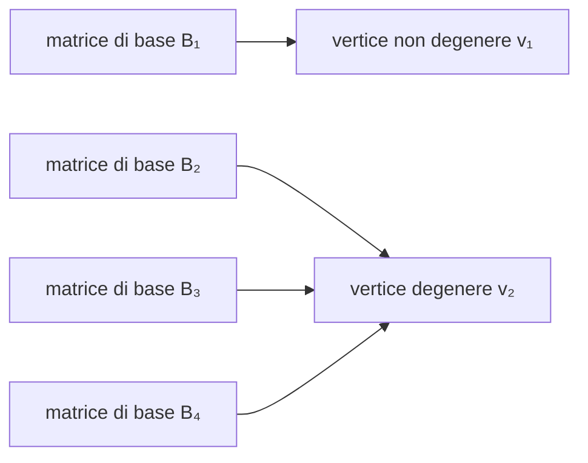

---

## corso: Ricerca Operativa lezione: 6 data: 2026-10-09 docente: Silvia Villa argomenti: [vertici in forma standard, matrice di base, matrice delle colonne fuori base, indici in base e fuori base, variabili in base e fuori base, forma canonica, soluzione di base, soluzione di base ammissibile, matrice di base ammissibile, equivalenza tra vertici e soluzioni di base ammissibili, soluzioni di base degeneri, numero massimo di vertici, variabili di slack] fonti: [trascrizione, appunti manuali, dispense] tags: [ricerca-operativa, lezione]
---
# Lezione 6 — Matrici di base e soluzioni di base ammissibili

> [!info] Fonti di questa nota Trascrizione della lezione del 09/10/2026 (un'unica parte), appunti manuali (scansione della lezione 6) e nota Obsidian _Simplesso_, che per questa lezione non aggiunge contenuti. Le dispense [@roma2023, §6.2] usano la stessa terminologia (matrice di base, matrice delle colonne fuori base, $I_B$, $I_N$, SBA); le note di Di Summa [@disumma2015, §2.3] presentano gli stessi risultati con una notazione insiemistica. Le parti prese solo da queste fonti, e i calcoli aggiunti per verifica, sono indicati esplicitamente.

La lezione completa il passaggio dalla geometria all'algebra. Si introducono le **matrici di base**, si riscrive il sistema $Ax = b$ separando le variabili **in base** da quelle **fuori base**, e si dimostra il risultato centrale di questa parte del corso: in forma standard i **vertici** coincidono con le **soluzioni di base ammissibili**. Da qui in poi trovare vertici significa trovare matrici di base ammissibili.

## Ripresa: vertici di un poliedro in forma standard

Per un poliedro in forma generale, $\bar x$ è un vertice se e solo se la matrice dei vincoli attivi ha rango $n$, cioè se tra i vincoli attivi ce ne sono almeno $n$ indipendenti. Nella [[Lezione 05 - Teorema fondamentale e forma standard|lezione 5]] si è passati alla forma standard

$$ P = {, x \in \mathbb{R}^n \mid Ax = b,\ x \ge 0 ,}, $$

in cui la matrice $A$ ha un significato diverso, e si è visto che **$\bar x \in P$ è un vertice se e solo se le colonne di $A$ relative alle componenti non nulle di $\bar x$ sono linearmente indipendenti**.

La docente ripercorre la dimostrazione "con più calma". Si riscrive $P$ in forma generale con la matrice $\begin{pmatrix} A \ -A \ I \end{pmatrix}$; sono attivi tutti i vincoli che vengono da $Ax = b$ e quelli di segno delle componenti nulle. Supponendo nulle le ultime $n - r$ componenti, sono attivi i vincoli $\bar x_{r+1} = 0, \dots, \bar x_n = 0$; le righe di $-A$ sono copie di quelle di $A$ e si possono dimenticare. Nella matrice che resta le ultime $n - r$ colonne contengono un'identità e sono già indipendenti, quindi il rango è $n$ se e solo se sono indipendenti le prime $r$ colonne di $A$: quelle relative alle componenti non nulle. La docente avverte che la volta precedente aveva sbagliato un indice scrivendo l'identità; la versione corretta della dimostrazione è nella nota della lezione 5. Il passaggio sul rango, dice, è un buon esercizio di algebra lineare.

## Esempi di verifica

Per verificare se un punto è un vertice ci sono due passi, e il primo non va dimenticato: controllare che il punto **stia in $P$**.

> [!example] Esempio 1 — un punto che non è un vertice $$ \begin{cases} 3x_1 - 2x_2 + x_3 + x_4 - x_5 + 4x_6 = 6 \ 2x_1 + 2x_3 - x_4 + 2x_5 + x_6 = 5 \ -x_1 + 4x_2 + 3x_3 + 2x_4 - x_5 + 3x_6 = 7 \ x \ge 0 \end{cases} \qquad \bar x = (2, 1, 1, 1, 0, 0)^T . $$ La docente ricorda che i vettori $x$ sono sempre vettori **colonna**, anche quando per comodità li scrive in riga.
> 
> _$\bar x \in P$?_ Sostituendo: $3 \cdot 2 - 2 \cdot 1 + 1 + 1 = 6$, $2 \cdot 2 + 2 \cdot 1 - 1 = 5$, $-2 + 4 + 3 + 2 = 7$, e tutte le componenti sono non negative. Il punto sta in $P$.
> 
> _È un vertice?_ Le componenti positive sono le prime quattro, quindi bisogna guardare le prime quattro colonne di $$ A = \begin{pmatrix} 3 & -2 & 1 & 1 & -1 & 4 \ 2 & 0 & 2 & -1 & 2 & 1 \ -1 & 4 & 3 & 2 & -1 & 3 \end{pmatrix}. $$ Non serve fare conti: sono **quattro vettori di $\mathbb{R}^3$**, che non possono essere indipendenti. $\bar x$ non è un vertice. In generale, se $A$ è $3 \times 6$, un punto con più di tre componenti non nulle non è mai un vertice.

> [!example] Esempio 2 — un vertice $$ \begin{cases} 2x_1 + x_2 - 2x_3 + 3x_4 = 3 \ x_1 + x_2 + 2x_3 + 2x_4 = 2 \ x \ge 0 \end{cases} \qquad A = \begin{pmatrix} 2 & 1 & -2 & 3 \ 1 & 1 & 2 & 2 \end{pmatrix}, \qquad \bar x = (1, 1, 0, 0) . $$ I punti di $P$ stanno in $\mathbb{R}^4$ e $A$ è $2 \times 4$: i vertici hanno al più due componenti non nulle. $\bar x$ sta in $P$ ($2 + 1 = 3$, $1 + 1 = 2$, $\bar x \ge 0$). Le colonne relative alle componenti positive sono le prime due, $(2, 1)^T$ e $(1, 1)^T$: non sono una multipla dell'altra, o, se si preferisce, $\det \begin{pmatrix} 2 & 1 \ 1 & 1 \end{pmatrix} = 2 - 1 = 1 \neq 0$. Sono indipendenti, quindi **$\bar x$ è un vertice**.

> [!warning] Sezione ricostruita — inizio Sullo stesso poliedro la docente ha proposto un altro punto, con **una sola** componente non nulla; uno studente ha risposto subito che è un vertice. I valori del punto non compaiono né nella trascrizione né negli appunti: l'esempio seguente li ricostruisce dai dati del poliedro.

> [!example] Esempio 3 — una sola componente non nulla Un punto con una sola componente non nulla $x_j = t > 0$ sta in $P$ solo se $t A_j = b$, cioè se $b$ è multiplo della colonna $A_j$; qui l'unica possibilità è la quarta colonna, che coincide con $b = (3, 2)^T$, e il punto è $(0, 0, 0, 1)$. La conclusione detta a lezione vale in generale: una colonna da sola è linearmente indipendente purché non sia nulla, quindi **se $A$ non ha colonne nulle, ogni punto di $P$ con una sola componente non nulla è un vertice**.

> [!warning] Sezione ricostruita — fine

## Matrici di base

Finora si è **verificato** se un punto dato è un vertice. Si vorrebbe invece un modo per **trovarli**.

Si parte da $P = {x \in \mathbb{R}^n \mid Ax = b,\ x \ge 0}$ con $A \in \mathbb{R}^{m \times n}$ e, come sempre, $\operatorname{rk}(A) = m$, quindi $m \le n$ (più incognite che equazioni). Questa volta conviene scrivere $A$ **per colonne**:

$$ A = \begin{pmatrix} a_1 & a_2 & \cdots & a_n \end{pmatrix}, \qquad a_j \in \mathbb{R}^m . $$

$\operatorname{rk}(A) = m$ significa che le $m$ righe sono indipendenti: non ci sono equazioni inutili. Poiché il rango per righe coincide con il rango per colonne, esistono anche **$m$ colonne linearmente indipendenti**. Non si sa quali (potrebbero essere la prima, la terza e la settima), quindi servono due indici: siano $a_{j_1}, a_{j_2}, \dots, a_{j_m}$. Messe una accanto all'altra formano una matrice

$$ B = \begin{pmatrix} a_{j_1} & a_{j_2} & \cdots & a_{j_m} \end{pmatrix} \in \mathbb{R}^{m \times m}, $$

quadrata, con colonne (e quindi righe) indipendenti: ha determinante non nullo.

> [!important] Definizione — matrice di base Una sottomatrice **quadrata** $m \times m$ di $A$, formata da colonne di $A$, con **determinante non nullo** (cioè non singolare) si dice **matrice di base** della matrice $A$.

Sono le matrici su cui si lavorerà: si vedrà che il metodo del simplesso non si muove tanto tra vertici quanto tra matrici di base.

Conviene ricordarsi anche delle colonne **non** selezionate, $a_{j_{m+1}}, \dots, a_{j_n}$, e dare un nome a tutto:

|oggetto|definizione|nome|
|---|---|---|
|$B = (a_{j_1}, \dots, a_{j_m})$|colonne scelte|matrice di base (colonne **in base**)|
|$N = (a_{j_{m+1}}, \dots, a_{j_n})$|colonne non scelte|matrice delle colonne **fuori base**|
|$I_B = { j_1, \dots, j_m }$|indici delle colonne di $B$|indici di base|
|$I_N = { j_{m+1}, \dots, j_n }$|indici delle colonne di $N$|indici fuori base|
|$x_B = (x_{j_1}, \dots, x_{j_m})$|componenti di $x$ con indice in $I_B$|variabili in base|
|$x_N = (x_{j_{m+1}}, \dots, x_{j_n})$|componenti di $x$ con indice in $I_N$|variabili fuori base|

Una volta fissata $B$, la matrice $N$ è obbligata: sono le colonne rimaste. Le definizioni coincidono con quelle delle dispense [@roma2023, Def. 6.2.4 e Definizioni 6.2.5].

> [!warning] Discrepanza tra fonti — nome di $N$ Negli appunti scansionati, accanto alla definizione generale, $N$ è chiamata "matrice della funzione fuori base"; nello stesso foglio, nell'esempio successivo, e nella trascrizione si parla correttamente di **matrice delle colonne fuori base**.

> [!example] Esempio — una matrice di base $$ \min\ -4x_1 - 2x_2 + x_3 - x_4 \qquad \text{s.t.} \qquad A = \begin{pmatrix} 1 & 1 & -1 & 1 \ 3 & 2 & 2 & 1 \end{pmatrix}, \quad b = \begin{pmatrix} 10 \ 20 \end{pmatrix}, \quad x \ge 0 . $$ Problema in forma standard, quattro variabili, due equazioni. Le due righe di $A$ sono indipendenti, quindi $\operatorname{rk}(A) = 2$ e si possono trovare due colonne indipendenti; le prime due lo sono, perché $\det \begin{pmatrix} 1 & 1 \ 3 & 2 \end{pmatrix} = -1 \neq 0$. Quindi $$ B = \begin{pmatrix} 1 & 1 \ 3 & 2 \end{pmatrix}, \quad I_B = {1, 2}, \quad x_B = \begin{pmatrix} x_1 \ x_2 \end{pmatrix}; \qquad N = \begin{pmatrix} -1 & 1 \ 2 & 1 \end{pmatrix}, \quad I_N = {3, 4}, \quad x_N = \begin{pmatrix} x_3 \ x_4 \end{pmatrix}. $$ "Non è un esempio molto furbo", serve solo a fissare le idee: $x_1, x_2$ sono le variabili in base, $x_3, x_4$ quelle fuori base.

> [!warning] Discrepanza tra fonti — il primo vincolo dell'esempio Negli appunti scansionati il primo vincolo è scritto $x_1 + 2x_2 - x_3 + x_4 = 10$, ma la matrice $A$ sullo stesso foglio (e la trascrizione) ha prima riga $(1, 1, -1, 1)$, e $B$ e $N$ sono costruite da quella. Si segue la matrice. Con questi dati la soluzione associata a $B$ (calcolo non svolto a lezione) è $x_B = B^{-1} b = (0, 10)$, cioè il punto $(0, 10, 0, 0)$: ammissibile, con una sola componente non nulla.

## Riscrivere $Ax = b$ con la base

Ecco perché la decomposizione è utile. Riordinando le colonne, $A$ si scrive a blocchi come $\begin{pmatrix} B & N \end{pmatrix}$, e il prodotto a blocchi funziona come il prodotto righe per colonne:

$$ \begin{aligned} Ax = b &\iff \begin{pmatrix} B & N \end{pmatrix} \begin{pmatrix} x_B \ x_N \end{pmatrix} = b \iff B x_B + N x_N = b \ &\iff B x_B = b - N x_N \iff x_B = B^{-1} b - B^{-1} N x_N . \end{aligned} $$

L'ultimo passaggio è un'equivalenza perché $B$ è una matrice di base, quindi **invertibile**: si moltiplicano entrambi i membri per $B^{-1}$.

Che cosa si è ottenuto? Per trovare una $x$ con $Ax = b$ bisognerebbe risolvere il sistema: si sa fare, ma passando da $2 \times 4$ a dimensioni più grandi diventa sempre più faticoso. Con la nuova scrittura il sistema è, di fatto, **già risolto**: le variabili in base sono scritte in funzione di quelle fuori base. Il sistema ha $n$ incognite e $m$ equazioni indipendenti, quindi ha $\infty^{,n-m}$ soluzioni, che dipendono da $n - m$ parametri liberi: sono proprio le componenti di $x_N$. Si sceglie un $x_N$ qualsiasi, si calcola $x_B$ con la formula, e si ha una soluzione del sistema. Per il momento si è parlato solo del sistema $Ax = b$; della condizione $x \ge 0$ non ci si è ancora preoccupati.

> [!example] Esempio — base con colonne in ordine sparso $$ \begin{cases} 2x_1 - 3x_2 + 4x_3 + 2x_4 + 5x_5 + x_6 = 7 \ x_1 + 2x_2 + x_3 + 4x_4 + 2x_5 + 2x_6 = 8 \ -x_1 + 4x_2 + 4x_3 + 3x_4 - x_5 + x_6 = 2 \ x \ge 0 \end{cases} \qquad x \in \mathbb{R}^6,\ A \in \mathbb{R}^{3 \times 6} . $$ Le matrici di base sono $3 \times 3$. Si prende $B$ formata dalla **sesta, prima e quarta** colonna, in quest'ordine: le colonne sono prese "nell'ordine sbagliato" apposta, perché nel metodo del simplesso capiterà che $B$ non abbia le colonne nell'ordine naturale. $$ B = \begin{pmatrix} 1 & 2 & 2 \ 2 & 1 & 4 \ 1 & -1 & 3 \end{pmatrix}, \qquad \det B = -3 \neq 0 , $$ quindi $B$ è una matrice di base (il determinante non è stato calcolato alla lavagna: "quello dovrete farlo voi"; il valore $-3$ è verificato). Allora $$ I_B = {6, 1, 4},\ \ x_B = \begin{pmatrix} x_6 \ x_1 \ x_4 \end{pmatrix}; \qquad I_N = {2, 3, 5},\ \ x_N = \begin{pmatrix} x_2 \ x_3 \ x_5 \end{pmatrix},\ \ N = \begin{pmatrix} -3 & 4 & 5 \ 2 & 1 & 2 \ 4 & 4 & -1 \end{pmatrix}, $$ e i punti che soddisfano le uguaglianze sono $$ \begin{pmatrix} x_6 \ x_1 \ x_4 \end{pmatrix} = B^{-1} \begin{pmatrix} 7 \ 8 \ 2 \end{pmatrix} - B^{-1} N \begin{pmatrix} x_2 \ x_3 \ x_5 \end{pmatrix}. $$ Fissate $x_2, x_3, x_5$ (le tre variabili libere, fuori base) sono determinate $x_6, x_1, x_4$ (quelle in base). L'esempio prosegue più avanti.

## Forma canonica e soluzioni di base ammissibili

Data una matrice di base $B$, anche la funzione obiettivo si spezza: siano $c_B$ il vettore delle componenti di $c$ con indici in $I_B$ e $c_N$ quello delle componenti con indici in $I_N$. Il problema si riscrive allora in modo equivalente come

$$ \begin{cases} \min\ c_B^T x_B + c_N^T x_N \ x_B = B^{-1} b - B^{-1} N x_N \ x_B \ge 0,\ x_N \ge 0 . \end{cases} $$

Questa scrittura si chiama **problema in forma canonica rispetto alla base $B$**. Non si è fatto nulla di nuovo, ma si può fare subito una prima considerazione. Fissato $x_N$ si trova $x_B$, e la coppia verifica le uguaglianze; non è detto però che verifichi le disuguaglianze $x_B \ge 0$. Si dà un nome a un caso speciale, particolarmente semplice: quello in cui $x_N = 0$. Allora l'equazione dà

$$ x_N = 0 \quad \Longrightarrow \quad x_B = B^{-1} b . $$

Il vettore $B^{-1} b$ può avere componenti negative. Se non le ha, si è trovato un punto di $P$.

> [!important] Definizione — soluzione di base ammissibile Sia $B$ una matrice di base di $A$. Il vettore $\bar x$ con $$ \bar x_B = B^{-1} b, \qquad \bar x_N = 0 $$ si dice **soluzione di base** associata a $B$. Se inoltre $$ B^{-1} b \ge 0 $$ (tutte le componenti), $\bar x$ si dice **soluzione di base ammissibile**, abbreviata **SBA** (in inglese _basic feasible solution_, BFS; la sigla inglese si trova anche nei libri in italiano), e $B$ si dice **matrice di base ammissibile**.

Quando $B^{-1} b$ ha qualche componente negativa, $\bar x$ si chiama ancora soluzione di base, ma non serve a niente e non si userà mai. La docente userà "SBA" con un po' di flessibilità, sia per il sottovettore $\bar x_B = B^{-1}b$ sia per l'intero vettore $\bar x$. Rispondendo a una domanda ha chiarito il senso della definizione: la scrittura $x_B = B^{-1}b - B^{-1}N x_N$ descrive **tutti** i punti che soddisfano le uguaglianze, e le SBA sono i punti particolari che corrispondono alla scelta $x_N = 0$; "ve lo svelo ormai", saranno i vertici.

> [!tip] Le inverse non si calcolano Gli esempi di questa lezione calcolano $B^{-1}$ esplicitamente solo per capire. La docente insiste: **nel metodo del simplesso non si invertono mai matrici**, perché è un metodo elegante che evita anche questo problema. Chi non sa calcolare le inverse non si deve preoccupare.

> [!example] Esempio — continuazione: la SBA associata a $B = (a_6, a_1, a_4)$ Calcolando l'inversa (verificata), $$ B^{-1} = -\frac13 \begin{pmatrix} 7 & -8 & 6 \ -2 & 1 & 0 \ -3 & 3 & -3 \end{pmatrix}, \qquad B^{-1} b = -\frac13 \begin{pmatrix} 7 & -8 & 6 \ -2 & 1 & 0 \ -3 & 3 & -3 \end{pmatrix} \begin{pmatrix} 7 \ 8 \ 2 \end{pmatrix} = \begin{pmatrix} 1 \ 2 \ 1 \end{pmatrix} \ge 0 . $$ $B$ è una matrice di base **ammissibile**. Attenzione all'ordine: $x_B = (x_6, x_1, x_4)$, quindi $x_6 = 1$, $x_1 = 2$, $x_4 = 1$, e le variabili fuori base sono nulle: $$ \bar x = (2, 0, 0, 1, 0, 1)^T . $$ _Controllo._ Prima equazione: $2 \cdot 2 + 2 \cdot 1 + 1 = 7$; seconda: $2 + 4 + 2 = 8$; terza: $-2 + 3 + 1 = 2$. $\bar x \in P$.
> 
> _È un vertice._ Le componenti non nulle di $\bar x$ sono la sesta, la prima e la quarta: corrispondono esattamente alle colonne di $B$, che sono indipendenti perché $B$ è una matrice di base. Per il teorema della lezione 5, $\bar x$ è un vertice.

> [!example] Svolgimento dell'esercizio lasciato — base non ammissibile La docente ha proposto di provare con le colonne prima, seconda e sesta, anticipando che si ottiene "una matrice di base, ma non ammissibile". Calcolo (non svolto a lezione): $$ B' = (a_1, a_2, a_6) = \begin{pmatrix} 2 & -3 & 1 \ 1 & 2 & 2 \ -1 & 4 & 1 \end{pmatrix}, \quad \det B' = 3 \neq 0, \quad B'^{-1} b = \begin{pmatrix} -\tfrac23 \ -1 \ \tfrac{16}{3} \end{pmatrix} \not\ge 0 . $$ $B'$ è una matrice di base, ma $x_1 = -\tfrac23$ e $x_2 = -1$ sono negativi: la soluzione di base $(-\tfrac23, -1, 0, 0, 0, \tfrac{16}{3})$ non sta in $P$.

## Vertici e soluzioni di base ammissibili

Quello che si è visto nell'esempio vale sempre.

> [!important] Teorema — vertici e SBA Sia $P = { x \in \mathbb{R}^n \mid Ax = b,\ x \ge 0 }$ con $A \in \mathbb{R}^{m \times n}$ e $\operatorname{rk}(A) = m$, e sia $\bar x \in P$. Allora $$ \bar x \text{ è un vertice di } P \iff \bar x \text{ è una soluzione di base ammissibile.} $$

_Dimostrazione._ Si usa il teorema della lezione 5 ("quello con la dimostrazione difficile").

**(SBA $\Rightarrow$ vertice).** Se $\bar x$ è una SBA, esiste una matrice di base $B$ con $\bar x_B = B^{-1} b \ge 0$ e $\bar x_N = 0$. Le componenti fuori base sono tutte nulle, quindi le componenti non nulle di $\bar x$ stanno tutte in $\bar x_B$. Non è detto che siano **tutte** quelle di $\bar x_B$: anche $\bar x_B$ potrebbe contenere degli zeri (nell'esempio precedente non succedeva). Certamente però le componenti non nulle corrispondono a colonne di $B$, magari a un sottoinsieme; le colonne di $B$ sono linearmente indipendenti, e un sottoinsieme di vettori indipendenti è indipendente. Per il teorema della lezione 5, $\bar x$ è un vertice.

**(vertice $\Rightarrow$ SBA).** Sia $\bar x$ un vertice e siano $\bar x_{j_1}, \dots, \bar x_{j_r}$ le sue componenti strettamente positive. Per il teorema della lezione 5 le colonne $a_{j_1}, \dots, a_{j_r}$ sono linearmente indipendenti, e $r \le m$, perché un vertice ha al più $m$ componenti non nulle. Si vorrebbe prendere queste colonne come matrice $B$, ma lo si può fare solo se $r = m$. Se $r < m$, si usa un fatto di algebra lineare: poiché $\operatorname{rk}(A) = m$, ogni insieme di colonne indipendenti si può **completare** a un insieme di $m$ colonne indipendenti. Si scelgono quindi altre $m - r$ colonne $a_{j_{r+1}}, \dots, a_{j_m}$ di $A$ in modo da avere $$ B = \begin{pmatrix} a_{j_1} & \cdots & a_{j_r} & a_{j_{r+1}} & \cdots & a_{j_m} \end{pmatrix}, $$ una matrice di base. Resta da vedere che $\bar x$ è proprio la SBA associata a $B$. Per costruzione tutte le componenti positive di $\bar x$ sono in base, quindi $\bar x_N = 0$. Poiché $\bar x \in P$, $$ b = A \bar x = B \bar x_B + N \bar x_N = B \bar x_B \quad \Longrightarrow \quad \bar x_B = B^{-1} b , $$ perché $B$ è invertibile. Infine $B^{-1} b = \bar x_B \ge 0$ non va verificato a parte: lo si sa già, perché $\bar x \in P$ ha tutte le componenti non negative. Quindi $\bar x$ è una SBA e $B$ è una matrice di base ammissibile. $\square$

"Questo è il grande salto": ci si può dimenticare della geometria, del poliedro e di qualunque disegno, perché i vertici **sono** le soluzioni di base ammissibili. Trovare vertici equivale a trovare matrici di base ammissibili, ed è l'unica cosa che bisogna saper fare. La docente sottolinea che è il punto fondamentale di tutta questa parte del corso.

> [!tip] Approfondimento — Basi come insiemi di indici #approfondimento Nelle note di Di Summa una **base** è un insieme $\mathcal B \subseteq {1, \dots, n}$ di $m$ indici tale che la sottomatrice $A_{\mathcal B}$ sia invertibile: è l'insieme $I_B$ della lezione, mentre la "matrice di base" è $A_{\mathcal B}$. In quel testo il percorso è leggermente diverso. Si dimostra prima che $\bar x$ è una soluzione di base se e solo se $A\bar x = b$ ed esiste una base $\mathcal B$ con $\bar x_j = 0$ per $j \notin \mathcal B$ [@disumma2015, Proposizione 2.3]; poi che, fissata una base, la soluzione di base relativa è unica, $\bar x_{\mathcal B} = A_{\mathcal B}^{-1} b$, $\bar x_N = 0$ [@disumma2015, Osservazione 2.5]. Le dispense enunciano il teorema di questa lezione come Teorema 6.2.2 [@roma2023].

## Una sottigliezza: le soluzioni di base degeneri

C'è una sola questione delicata, quella su cui la docente si era soffermata nella dimostrazione. Data una matrice di base ammissibile, il vertice è **univocamente** definito: $\bar x_B = B^{-1} b$, $\bar x_N = 0$, non c'è altra scelta. Il viceversa non vale: **dato un vertice, potrebbero esserci più matrici di base ammissibili associate allo stesso vertice**.

Il motivo sta nella dimostrazione. Se il vertice ha solo $r < m$ componenti non nulle, bisogna completare con $m - r$ colonne "un po' come vi pare", purché indipendenti dalle prime: con $m = 7$ e un vertice con 5 componenti non nulle, si scelgono altre due colonne, e questa libertà di scelta può produrre matrici diverse che danno lo stesso vertice. Se invece il vertice ha esattamente $m$ componenti non nulle non c'è scelta: la matrice di base è una sola.

> [!important] Definizione — soluzione di base degenere Una soluzione di base ammissibile si dice **degenere** se ha meno di $m$ componenti non nulle, cioè più di $n - m$ componenti nulle: "più zeri del dovuto". Solo i vertici degeneri possono corrispondere a più matrici di base ammissibili.

La docente avverte che è un'osservazione che "crea un sacco di problemi". La corrispondenza tra matrici di base ammissibili e vertici si può rappresentare così:

Ogni matrice di base ammissibile individua un solo vertice; un vertice non degenere ha una sola matrice di base, uno degenere può averne diverse. Un esempio esplicito, con un vertice che ha tre matrici di base, è nella [[Lezione 07 - Vertici degeneri e fase 2 del simplesso|lezione 7]].

## Quanti vertici ha un poliedro in forma standard

Anche se le matrici di base possono essere più dei vertici, la corrispondenza dà un limite superiore al numero dei vertici. Con una stima "molto rozza", che conta anche le matrici non ammissibili, i vertici sono al più quante le matrici di base, e queste sono al più quanti i sottoinsiemi di $m$ colonne distinte scelte tra $n$:

$$ #{\text{vertici}} ;\le; \binom{n}{m} = \frac{n!}{m!,(n-m)!} . $$

In particolare il numero di vertici è **finito**. Rispetto alla stima per la forma generale (lezione 4) i ruoli di $n$ e $m$ si sono scambiati:

|forma|descrizione|numero massimo di vertici|
|---|---|---|
|generale|$Ax \ge b$, $A \in \mathbb{R}^{m \times n}$|$\binom{m}{n}$: scelte di $n$ righe tra $m$|
|standard|$Ax = b$, $x \ge 0$, $A \in \mathbb{R}^{m \times n}$|$\binom{n}{m}$: scelte di $m$ colonne tra $n$|

## Esercizio: forma standard e una prima base

> [!example] Testo Scrivere in forma standard il problema $$ \begin{cases} \min\ -2x_1 + x_2 \ x_1 + x_2 \le 5 \ -x_1 + x_2 \le 0 \ 6x_1 + 2x_2 \le 21 \ x_1, x_2 \ge 0 \end{cases} $$ e trovare una soluzione di base ammissibile.

È un esercizio "rilassante" che serve a vedere come cambiano $m$ e $n$. Tutti i vincoli sono di "$\le$": per arrivare a $5$, a $0$ e a $21$ si aggiunge una slack per ciascuno.

$$ \begin{cases} \min\ -2x_1 + x_2 \ x_1 + x_2 + s_1 = 5 \ -x_1 + x_2 + s_2 = 0 \ 6x_1 + 2x_2 + s_3 = 21 \ x_1, x_2, s_1, s_2, s_3 \ge 0 \end{cases} \qquad A = \begin{pmatrix} 1 & 1 & 1 & 0 & 0 \ -1 & 1 & 0 & 1 & 0 \ 6 & 2 & 0 & 0 & 1 \end{pmatrix}, \quad b = \begin{pmatrix} 5 \ 0 \ 21 \end{pmatrix}. $$

Si è passati da $n = 2$ a $n = 5$, mentre $m$ è rimasto 3. Il rango di $A$ è al massimo 3, ed è 3: si vede subito perché le ultime tre colonne formano la **matrice identità**. È la situazione più felice di tutte, quella in cui si vorrebbe essere ogni volta che si inizia il metodo del simplesso: aggiungendo tre slack si è trovata "gratis" una matrice di base, $B = I$, con $x_B = (s_1, s_2, s_3)$. Ed è anche ammissibile, perché

$$ B^{-1} b = I, b = b = \begin{pmatrix} 5 \ 0 \ 21 \end{pmatrix} \ge 0 \quad \Longrightarrow \quad \bar x = (x_1, x_2, s_1, s_2, s_3) = (0, 0, 5, 0, 21) . $$

$B = I$ è una matrice di base ammissibile e $\bar x$ è una SBA, quindi un vertice. È **degenere**: ha solo due componenti non nulle invece di $m = 3$, "c'è uno zero dove non dovrebbe averlo, ma va bene". Conclusione della docente: **"variabili slack benvenute"**, purché $b$ sia non negativo. Se $b$ avesse una componente negativa, la base identità darebbe una soluzione di base non ammissibile. Il problema, che vive in $\mathbb{R}^2$, verrà ripreso nella lezione 7 confrontando le basi con i vertici del disegno.

## Riepilogo

- In forma standard, $\bar x \in P$ è un vertice $\iff$ le colonne di $A$ relative alle componenti non nulle sono indipendenti. Prima di tutto bisogna verificare $\bar x \in P$; un punto con più di $m$ componenti non nulle non è mai un vertice.
- Con $\operatorname{rk}(A) = m$ esistono $m$ colonne indipendenti. Una sottomatrice $m \times m$ non singolare di colonne di $A$ è una **matrice di base** $B$; le altre colonne formano $N$; $I_B$, $I_N$, $x_B$, $x_N$ sono indici e variabili in base e fuori base.
- $Ax = b \iff x_B = B^{-1} b - B^{-1} N x_N$: le $n - m$ variabili fuori base sono parametri liberi. Con la funzione obiettivo $c_B^T x_B + c_N^T x_N$ si ottiene la **forma canonica** rispetto a $B$.
- Con $x_N = 0$: $\bar x_B = B^{-1} b$. Se $B^{-1} b \ge 0$, $\bar x$ è una **soluzione di base ammissibile** (SBA, BFS) e $B$ è una **matrice di base ammissibile**. Nel simplesso le inverse non si calcolano.
- **Teorema**: $\bar x$ è un vertice $\iff$ è una SBA. Una base individua un solo vertice; un vertice può avere più basi solo se è **degenere** (meno di $m$ componenti non nulle).
- I vertici sono al più $\binom{n}{m}$. Le slack, con $b \ge 0$, danno subito la base ammissibile $B = I$.