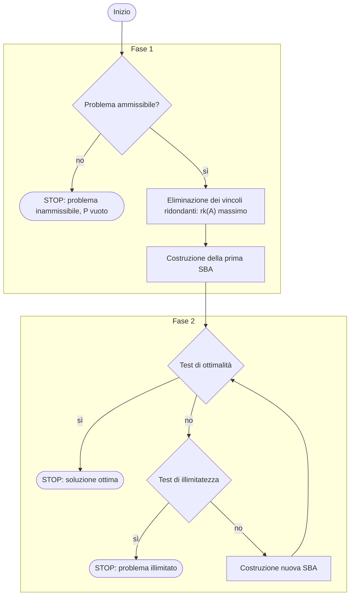

---

## corso: Ricerca Operativa lezione: 7 data: 2026-10-14 docente: Silvia Villa argomenti: [basi associate ai vertici, variabili di slack e vincoli attivi, vertici degeneri, ricerca esaustiva delle basi ammissibili, soluzioni di base degeneri, metodo del simplesso in due fasi, fase 1, fase 2, forma canonica rispetto a una base, costi ridotti, criterio di ottimalità] fonti: [trascrizione, appunti manuali, dispense] tags: [ricerca-operativa, lezione]

# Lezione 7 — Vertici degeneri e fase 2 del simplesso

> [!info] Fonti di questa nota Trascrizione della lezione (un'unica parte), appunti manuali (scansione della lezione 7, due pagine) e nota Obsidian _Simplesso_, che per questa lezione non aggiunge contenuti. Le dispense [@roma2023, §6.2–6.4.1] e le note di Di Summa [@disumma2015, §3.1] trattano gli stessi argomenti. Le parti prese solo da queste fonti, e i calcoli aggiunti per verifica, sono indicati esplicitamente.

> [!warning] Discrepanza tra fonti — data della lezione La trascrizione riporta come data di registrazione il **14/10/2026**, mentre il file degli appunti scansionati è datato **13/10/2026**. Nessuna delle due fonti contiene riferimenti interni che permettano di decidere (la lezione si chiude con "ci vediamo giovedì"). Nel front-matter si segue la trascrizione, più alta nella gerarchia delle fonti; nelle lezioni 5, 6 e 8 le due date coincidono.

La prima parte della lezione è un esercizio di "andata e ritorno" tra vertici e matrici di base: su un poliedro che si può disegnare si trovano le basi associate a ciascun vertice e si scopre geometricamente che cosa rende **degenere** un vertice; su un poliedro che non si può disegnare si trovano i vertici per ricerca esaustiva delle basi. La seconda parte presenta lo schema del **metodo del simplesso in due fasi** e, nella fase 2, il **criterio di ottimalità** basato sui **costi ridotti**.

## Esercizio: le basi associate ai vertici di un poliedro di $\mathbb{R}^2$

Si riprende l'esempio della fine della [[Lezione 06 - Matrici di base e soluzioni di base ammissibili|lezione 6]]:

$$ \begin{cases} \min\ -2x_1 + x_2 \ x_1 + x_2 \le 5 & (1) \ -x_1 + x_2 \le 0 & (2) \ 6x_1 + 2x_2 \le 21 & (3) \ x_1, x_2 \ge 0 . \end{cases} $$

La volta precedente la docente si era subito lanciata sulla forma standard; questa volta disegna prima la regione ammissibile, cosa possibile perché il problema vive in $\mathbb{R}^2$.

**Il disegno.** Si tracciano le tre rette con l'uguale.

- Vincolo (1): la retta $x_1 + x_2 = 5$ passa per $(5, 0)$ e $(0, 5)$. Il vettore dei coefficienti $(1, 1)$ punta verso il "$\ge$"; si vuole il "$\le$", quindi si sta dalla parte opposta, quella dell'origine (lo conferma il test con $(0,0)$: $0 \le 5$).
- Vincolo (2): la retta è la bisettrice $x_2 = x_1$, con vettore $(-1, 1)$; si sta sotto la bisettrice.
- Vincolo (3): $6x_1 + 2x_2 = 21$. Per $x_1 = 0$ si avrebbe $x_2 = \tfrac{21}{2}$, troppo in alto per il disegno; si usano $x_1 = 1$, che dà $x_2 = \tfrac{21}{2} - 3 = \tfrac{15}{2}$, e $x_2 = 0$, che dà $x_1 = \tfrac{21}{6} = \tfrac72$. Si sta dalla parte dell'origine.

Il poliedro è non vuoto e ha quattro vertici:

|vertice|coordinate $(x_1, x_2)$|rette su cui sta|
|---|---|---|
|$P_1$|$(0, 0)$|(2), $x_1 = 0$, $x_2 = 0$|
|$P_2$|$\left(\tfrac52, \tfrac52\right)$|(1) e (2)|
|$P_3$|$\left(\tfrac{11}{4}, \tfrac94\right)$|(1) e (3)|
|$P_4$|$\left(\tfrac72, 0\right)$|(3) e $x_2 = 0$|

> [!tip] Schema da disegnare Figura consigliata in Excalidraw: assi $x_1, x_2$ tra $0$ e $6$; la retta (1) per $(0,5)$ e $(5,0)$; la bisettrice (2); la retta (3) per $(1, \tfrac{15}{2})$ e $(\tfrac72, 0)$; il quadrilatero $P_1 P_2 P_3 P_4$ colorato, con i vettori $(1,1)$, $(-1,1)$, $(6,2)$ disegnati sulle rette. Accanto a ogni vertice si può annotare quali slack sono nulle: è la chiave dell'esercizio.

**Forma standard.** Come nella lezione 6, si aggiungono tre slack:

$$ \begin{cases} x_1 + x_2 + s_1 = 5 \ -x_1 + x_2 + s_2 = 0 \ 6x_1 + 2x_2 + s_3 = 21 \ x_1, x_2, s_1, s_2, s_3 \ge 0 \end{cases} \qquad A = \begin{pmatrix} 1 & 1 & 1 & 0 & 0 \ -1 & 1 & 0 & 1 & 0 \ 6 & 2 & 0 & 0 & 1 \end{pmatrix}, \quad b = \begin{pmatrix} 5 \ 0 \ 21 \end{pmatrix}, $$

con le colonne nell'ordine $(x_1, x_2, s_1, s_2, s_3)$. I punti del poliedro in forma standard hanno ora cinque coordinate.

**Il trucco: slack e vincoli attivi.** Ogni vertice è una SBA, quindi ha almeno una matrice di base ammissibile, e le colonne relative alle componenti strettamente positive devono stare in base. Come capire quali componenti sono positive? La slack $s_i$ misura "quanto manca" al vincolo $i$:

$$ s_i = 0 \iff \text{il punto sta sulla retta } i \ (\text{vincolo attivo}), \qquad s_i > 0 \iff \text{il punto non sta sulla retta } i . $$

### $P_3$

$P_3$ ha $x_1 > 0$ e $x_2 > 0$, quindi le prime due colonne di $A$ sono in base. $P_3$ sta sulle rette (1) e (3), quindi $s_1 = s_3 = 0$; non sta sulla retta (2), quindi $s_2 > 0$ e anche la colonna di $s_2$ è in base:

$$ B_3 = \begin{pmatrix} 1 & 1 & 0 \ -1 & 1 & 1 \ 6 & 2 & 0 \end{pmatrix}, \qquad x_B = (x_1, x_2, s_2) . $$

È l'**unica** matrice di base associata a $P_3$, perché $P_3$ ha esattamente tre componenti non nulle. Per verificarlo con i conti si usa la formula $x_B = B_3^{-1} b$:

$$ B_3^{-1} = \begin{pmatrix} -\tfrac12 & 0 & \tfrac14 \ \tfrac32 & 0 & -\tfrac14 \ -2 & 1 & \tfrac12 \end{pmatrix}, \qquad \begin{pmatrix} x_1 \ x_2 \ s_2 \end{pmatrix} = B_3^{-1} \begin{pmatrix} 5 \ 0 \ 21 \end{pmatrix} = \begin{pmatrix} -\tfrac52 + \tfrac{21}{4} \ \tfrac{15}{2} - \tfrac{21}{4} \ -10 + \tfrac{21}{2} \end{pmatrix} = \begin{pmatrix} \tfrac{11}{4} \ \tfrac94 \ \tfrac12 \end{pmatrix}. $$

Attenzione a usare il $b$ **della forma standard**, il vettore dei termini noti di $Ax = b$: a lezione la docente si è confusa proprio su questo punto. In forma standard $P_3 = \left(\tfrac{11}{4}, \tfrac94, 0, \tfrac12, 0\right)$.

_Controllo._ $\tfrac{11}{4} + \tfrac94 = 5$ e $6 \cdot \tfrac{11}{4} + 2 \cdot \tfrac94 = 21$: $P_3$ sta sulle rette (1) e (3), quindi $s_1 = s_3 = 0$. Invece $-\tfrac{11}{4} + \tfrac94 + \tfrac12 = 0$: $s_2 = \tfrac12$ dice di quanto $P_3$ "non soddisfa con l'uguale" il vincolo (2).

Uno studente ha chiesto perché si controlli $s_2$ se si sta cercando $P_3$. Risposta: $P_3$ sta sulle rette 1 e 3, quindi automaticamente $s_1 = s_3 = 0$; $s_2$ è strettamente positiva perché $P_3$ non sta sulla retta 2, e quindi la sua colonna deve stare in base.

### $P_2$

$P_2$ ha $x_1, x_2 > 0$; sta sulle rette (1) e (2), quindi $s_1 = s_2 = 0$; non sta sulla (3), quindi $s_3 > 0$. In base: $x_1, x_2, s_3$.

$$ B_2 = \begin{pmatrix} 1 & 1 & 0 \ -1 & 1 & 0 \ 6 & 2 & 1 \end{pmatrix}, \qquad B_2 \begin{pmatrix} x_1 \ x_2 \ s_3 \end{pmatrix} = \begin{pmatrix} 5 \ 0 \ 21 \end{pmatrix} \ \Longrightarrow\ \begin{pmatrix} x_1 \ x_2 \ s_3 \end{pmatrix} = \begin{pmatrix} \tfrac52 \ \tfrac52 \ 1 \end{pmatrix}. $$

> [!tip] Risolvere il sistema invece di invertire Se non si sa (o non si vuole) calcolare l'inversa di una matrice $3 \times 3$ ("come io ad esempio non ce la faccio mai", ammette la docente), si usa il fatto che $x_B = B^{-1} b$ equivale a $B x_B = b$: si risolve il sistema lineare, per esempio con l'eliminazione di Gauss. Sono comunque esercizi intermedi per capire: il metodo del simplesso non calcolerà mai inverse.

In forma standard $P_2 = \left(\tfrac52, \tfrac52, 0, 0, 1\right)$: $s_1$ e $s_2$ sono fuori base e infatti nulle, e $6 \cdot \tfrac52 + 2 \cdot \tfrac52 + 1 = 21$.

### $P_4$

$x_1 > 0$; $x_2 = 0$, quindi a priori $x_2$ non è strettamente positiva; $P_4$ non sta sulla retta (1), quindi $s_1 > 0$; non sta sulla retta (2), quindi $s_2 > 0$. Ci sono già tre variabili strettamente positive, il massimo possibile con tre vincoli: la base è $x_1, s_1, s_2$.

$$ B_4 = \begin{pmatrix} 1 & 1 & 0 \ -1 & 0 & 1 \ 6 & 0 & 0 \end{pmatrix}, \qquad \begin{pmatrix} x_1 \ s_1 \ s_2 \end{pmatrix} = B_4^{-1} \begin{pmatrix} 5 \ 0 \ 21 \end{pmatrix} = \begin{pmatrix} \tfrac72 \ \tfrac32 \ \tfrac72 \end{pmatrix}, \qquad P_4 = \left(\tfrac72, 0, \tfrac32, \tfrac72, 0\right). $$

Le coordinate di $P_4$ nel piano erano già note: $\left(\tfrac72, 0\right)$.

### $P_1$: un vertice degenere

$P_1$ è l'origine: $x_1 = x_2 = 0$. Sta sulla retta (2), quindi $s_2 = 0$; per fortuna $s_1 = 5 > 0$ e $s_3 = 21 > 0$. Le colonne di $s_1$ e $s_3$ devono stare in base, ma sono solo **due**: ne manca una. Si procede come nella dimostrazione del teorema vertici–SBA: si **completa a base** la coppia di colonne indipendenti aggiungendone una qualsiasi che mantenga l'indipendenza. Gli appunti riportano due scelte, entrambe matrici di base ammissibili:

$$ B_1 = (a_{s_1}, a_{s_3}, a_{x_1}) = \begin{pmatrix} 1 & 0 & 1 \ 0 & 0 & -1 \ 0 & 1 & 6 \end{pmatrix}, \qquad B_1' = (a_{s_1}, a_{s_3}, a_{s_2}) = \begin{pmatrix} 1 & 0 & 0 \ 0 & 0 & 1 \ 0 & 1 & 0 \end{pmatrix}. $$

Con entrambe si ottiene lo stesso punto: le variabili in base valgono $s_1 = 5$, $s_3 = 21$ e la terza vale $0$. Si ha **un unico vertice ma diverse matrici di base ammissibili**.

**Che cosa ha di diverso $P_1$, geometricamente?** Nel poliedro in forma generale un vertice di $\mathbb{R}^2$ è individuato da due rette indipendenti che si incrociano. $P_2$, $P_3$ e $P_4$ sono l'intersezione di **due** rette non parallele. $P_1$ è l'intersezione di **tre** rette: la retta (2) e i due assi. I vincoli attivi sono tre, ma ne basterebbero due per individuare $P_1$: ce n'è uno ridondante. Sono questi i vertici "che danno fastidio", i vertici **degeneri**: in forma standard hanno più zeri di quelli che dovrebbero avere, e lasciano la libertà di scegliere matrici di base ammissibili diverse.

> [!example] Verifica — tutte le basi del poliedro (calcolo non svolto a lezione) Con $n = 5$ e $m = 3$ le scelte di tre colonne sono $\binom{5}{3} = 10$, e in questo caso sono **tutte** matrici di base (determinante non nullo). La tabella riporta i valori $B^{-1} b$ delle variabili in base, nell'ordine indicato.
> 
> |variabili in base|$B^{-1} b$|ammissibile?|vertice|
> |---|---|---|---|
> |$x_1, x_2, s_1$|$\left(\tfrac{21}{8}, \tfrac{21}{8}, -\tfrac14\right)$|no|—|
> |$x_1, x_2, s_2$|$\left(\tfrac{11}{4}, \tfrac94, \tfrac12\right)$|sì|$P_3$|
> |$x_1, x_2, s_3$|$\left(\tfrac52, \tfrac52, 1\right)$|sì|$P_2$|
> |$x_1, s_1, s_2$|$\left(\tfrac72, \tfrac32, \tfrac72\right)$|sì|$P_4$|
> |$x_1, s_1, s_3$|$(0, 5, 21)$|sì|$P_1$|
> |$x_1, s_2, s_3$|$(5, 5, -9)$|no|—|
> |$x_2, s_1, s_2$|$\left(\tfrac{21}{2}, -\tfrac{11}{2}, -\tfrac{21}{2}\right)$|no|—|
> |$x_2, s_1, s_3$|$(0, 5, 21)$|sì|$P_1$|
> |$x_2, s_2, s_3$|$(5, -5, 11)$|no|—|
> |$s_1, s_2, s_3$|$(5, 0, 21)$|sì|$P_1$|
> 
> Le basi ammissibili sono sei per quattro vertici: $P_2$, $P_3$, $P_4$ (non degeneri) ne hanno una ciascuno, mentre il vertice degenere $P_1$ ne ha **tre**: oltre alle due degli appunti, anche quella con $x_2$ al posto di $x_1$. Le basi non ammissibili corrispondono a intersezioni di rette che cadono fuori dal poliedro: per esempio ${x_1, x_2, s_1}$ mette fuori base $s_2$ e $s_3$, cioè impone le rette (2) e (3); la loro intersezione $\left(\tfrac{21}{8}, \tfrac{21}{8}\right)$ viola il vincolo (1), e infatti $s_1 = -\tfrac14 < 0$.

> [!example] Svolgimento — risoluzione del problema (non svolta a lezione) La docente ha osservato che, avendo il disegno, il problema si può risolvere anche graficamente. Il poliedro è limitato, quindi per il teorema fondamentale il minimo esiste ed è su un vertice. Valutando $-2x_1 + x_2$: $$ P_1: 0, \qquad P_2: -5 + \tfrac52 = -\tfrac52, \qquad P_3: -\tfrac{11}{2} + \tfrac94 = -\tfrac{13}{4}, \qquad P_4: -7 . $$ La soluzione ottima è $P_4 = \left(\tfrac72, 0\right)$, con valore $-7$.

## Esercizio: tutti i vertici senza disegno

> [!example] Testo Trovare tutte le matrici di base ammissibili (e quindi i vertici) del poliedro in forma standard $$ \begin{cases} x_1 + 2x_2 - 2x_3 + \tfrac52 x_4 = 4 \ -x_1 + 4x_2 + 2x_3 + \tfrac12 x_4 = 2 \ x_1, x_2, x_3, x_4 \ge 0 \end{cases} \qquad A = \begin{pmatrix} 1 & 2 & -2 & \tfrac52 \ -1 & 4 & 2 & \tfrac12 \end{pmatrix}, \quad b = \begin{pmatrix} 4 \ 2 \end{pmatrix}. $$

> [!warning] Discrepanza tra fonti — il primo vincolo Negli appunti scansionati il primo vincolo è scritto $x_1 + x_2 - 2x_3 + \tfrac52 x_4 = 4$, mentre la matrice $A$ sullo stesso foglio e la trascrizione ("$x_1$ più $2x_2$ meno $2x_3$") hanno coefficiente $2$ per $x_2$. Si segue la matrice, con la quale sono svolti tutti i conti.

Qui la geometria non aiuta più: si fa una **ricerca esaustiva**, possibile perché le dimensioni sono piccole. Con $n = 4$ variabili e $m = 2$ equazioni, i vertici "buoni" hanno due componenti strettamente positive e le matrici di base sono tutte le sottomatrici $2 \times 2$ di $A$ invertibili. Le coppie di colonne sono $\binom42 = 6$: è il numero massimo di vertici, non è detto che siano tanti.

Si controlla prima quali sono matrici di base, poi quali sono ammissibili, risolvendo ogni volta il sistema $B x_B = b$. Per $B_1$, con le prime due colonne:

$$ \begin{cases} x_1 + 2x_2 = 4 \ -x_1 + 4x_2 = 2 \end{cases} $$

Sommando, $x_1$ se ne va e resta $6x_2 = 6$, cioè $x_2 = 1$; sostituendo, $x_1 = 4 - 2 = 2$. Entrambe positive: $B_1$ è ammissibile e la SBA è $(2, 1, 0, 0)$.

||colonne|$\det$|base?|$x_B = B^{-1} b$|ammissibile?|SBA (vertice)|
|---|---|---|---|---|---|---|
|$B_1$|$x_1, x_2$|$6$|sì|$(2, 1)$|sì|$(2, 1, 0, 0)$|
|$B_2$|$x_1, x_3$|$0$|**no**|—|—|—|
|$B_3$|$x_1, x_4$|$3$|sì|$(-1, 2)$|no|—|
|$B_4$|$x_2, x_3$|$12$|sì|$(1, -1)$|no|—|
|$B_5$|$x_2, x_4$|$-9$|sì|$\left(\tfrac13, \tfrac43\right)$|sì|$\left(0, \tfrac13, 0, \tfrac43\right)$|
|$B_6$|$x_3, x_4$|$-6$|sì|$\left(\tfrac12, 2\right)$|sì|$\left(0, 0, \tfrac12, 2\right)$|

$B_2$ non è una matrice di base perché le colonne $(1, -1)^T$ e $(-2, 2)^T$ sono proporzionali. Per $B_3$: dal sistema $x_1 + \tfrac52 x_4 = 4$, $-x_1 + \tfrac12 x_4 = 2$ si ottiene, sommando, $3x_4 = 6$, cioè $x_4 = 2$, e quindi $x_1 = 4 - 5 = -1 < 0$: non ammissibile (a lezione il conto è stato prima sbagliato e poi corretto ad alta voce). Per $B_4$: $2x_2 - 2x_3 = 4$, $4x_2 + 2x_3 = 2$ danno, sommando, $x_2 = 1$ e quindi $x_3 = -1$: non ammissibile.

> [!example] Svolgimento della parte lasciata per esercizio A lezione ci si è fermati dopo $B_4$ ("andate avanti per esercizio"). $B_5$: dal sistema $2x_2 + \tfrac52 x_4 = 4$, $4x_2 + \tfrac12 x_4 = 2$, ricavando $x_4 = 4 - 8x_2$ dalla seconda e sostituendo nella prima, $-18x_2 = -6$, quindi $x_2 = \tfrac13$ e $x_4 = \tfrac43$. $B_6$: dal sistema $-2x_3 + \tfrac52 x_4 = 4$, $2x_3 + \tfrac12 x_4 = 2$, sommando $3x_4 = 6$, quindi $x_4 = 2$ e $x_3 = \tfrac12$. Entrambe ammissibili. Il poliedro ha quindi **tre vertici**, tutti non degeneri (due componenti non nulle ciascuno): $(2, 1, 0, 0)$, $\left(0, \tfrac13, 0, \tfrac43\right)$, $\left(0, 0, \tfrac12, 2\right)$.

> [!example] Esercizio per casa — svolgimento _Testo (dagli appunti)._ Trovare le SBA di $$ x_1 + 2x_2 + x_3 - x_4 = 1, \qquad x_2 + x_3 = 1, \qquad x \ge 0 . $$ _Svolgimento (non svolto a lezione)._ $A = \begin{pmatrix} 1 & 2 & 1 & -1 \ 0 & 1 & 1 & 0 \end{pmatrix}$, $b = (1, 1)^T$; le coppie di colonne sono sei.
> 
> |colonne|$\det$|$x_B$|esito|
> |---|---|---|---|
> |$x_1, x_2$|$1$|$(-1, 1)$|non ammissibile|
> |$x_1, x_3$|$1$|$(0, 1)$|SBA $(0, 0, 1, 0)$|
> |$x_1, x_4$|$0$|—|non è una base|
> |$x_2, x_3$|$1$|$(0, 1)$|SBA $(0, 0, 1, 0)$|
> |$x_2, x_4$|$1$|$(1, 1)$|SBA $(0, 1, 0, 1)$|
> |$x_3, x_4$|$1$|$(1, 0)$|SBA $(0, 0, 1, 0)$|
> 
> I vertici sono due: $(0, 1, 0, 1)$, non degenere, e $(0, 0, 1, 0)$, **degenere**, con una sola componente non nulla e ben tre matrici di base ammissibili. È lo stesso sistema di vincoli dell'esempio di fase 2 alla fine di questa lezione.

## Soluzioni di base degeneri

Con questi esercizi si sa passare da una soluzione di base ammissibile a un vertice e viceversa. Il ritorno è più delicato: a ogni vertice possono corrispondere una o più soluzioni di base ammissibili, nel senso di più matrici di base. La docente riprende la definizione, che non ricordava di aver scritto esplicitamente la volta precedente.

> [!important] Definizione — SBA degenere Sia $P = { x \mid Ax = b,\ x \ge 0 }$ con $A \in \mathbb{R}^{m \times n}$ e $\operatorname{rk}(A) = m$. Una soluzione di base ammissibile si dice **degenere** se il numero delle sue componenti non nulle è **minore di $m$**; altrimenti si dice **non degenere**.

Se la SBA non è degenere, la corrispondenza "va davanti e dietro": al vertice corrisponde una sola matrice di base ammissibile, e la corrispondenza tra basi ammissibili e vertici non degeneri è biunivoca [@roma2023, Def. 6.2.16 e Teorema 6.2.4].

## Il metodo del simplesso in due fasi

Dopo tutto il lavoro su vertici, matrici e soluzioni di base, si può passare al metodo del simplesso. Ne esistono diverse varianti; quella del corso è la variante classica **in due fasi**. Il metodo risolve problemi in forma standard

$$ \min\ c^T x \quad \text{s.t.} \quad Ax = b,\ x \ge 0, \qquad A \in \mathbb{R}^{m \times n},\ b \in \mathbb{R}^m,\ c, x \in \mathbb{R}^n . $$

**Fase 1.** È una fase preliminare, che verifica due cose fondamentali: che il poliedro sia **non vuoto** e che il **rango di $A$ sia $m$**. Più che verificare il rango (cosa che si sa fare), lo sistema: elimina i vincoli ridondanti, cioè le righe dipendenti, fino ad avere una matrice di rango massimo. Inoltre costruisce la **prima SBA**: il simplesso si muove da una soluzione di base ammissibile all'altra, e per partire serve un primo vertice.

**Fase 2.** Risolve il problema: stabilisce se è illimitato e, se non lo è, trova una soluzione ottima. Si applica a poliedri non vuoti con $\operatorname{rk}(A) = m$, cioè a valle della fase 1. È esattamente la situazione in cui si è lavorato finora.

Lo schema dell'algoritmo, come disegnato alla lavagna:

All'ingresso della fase 2 si hanno quindi una matrice $A$ di rango $m$, un poliedro non vuoto e una prima SBA.

1. **Test di ottimalità**: la SBA corrente (all'inizio, la prima) è ottima? Se sì, si termina con una soluzione, "la situazione più bella del mondo".
2. **Test di illimitatezza**: se il test di ottimalità fallisce, ci si chiede se il problema è illimitato. Se sì, si termina: il problema non ha soluzione, perché si trovano punti del poliedro su cui la funzione obiettivo scende fino a $-\infty$.
3. **Costruzione di una nuova SBA**: altrimenti il vertice corrente non è ottimo e ci si sposta in un'altra soluzione di base ammissibile. È il passo più elaborato. Poi si torna al test di ottimalità.

Dalla fase 1 si esce una volta sola: terminata, si cicla dentro la fase 2 e non si torna più indietro. Si studierà **prima la fase 2**, perché per risolvere la fase 1 si userà proprio l'algoritmo della fase 2.

## Fase 2: la forma canonica rispetto alla base

Si assume $P \neq \varnothing$ e $\operatorname{rk}(A) = m$, e sia $B$ la matrice di base ammissibile trovata nella fase 1. Come nella lezione 6, il problema si riscrive spezzando variabili e colonne in base e fuori base:

$$ \begin{cases} \min\ c_B^T x_B + c_N^T x_N \ B x_B + N x_N = b \ x_B \ge 0,\ x_N \ge 0 \end{cases} \qquad \Longleftrightarrow \qquad \begin{cases} \min\ c_B^T x_B + c_N^T x_N \ x_B = B^{-1} b - B^{-1} N x_N \ x_B \ge 0,\ x_N \ge 0 . \end{cases} $$

Il passo successivo, che non era stato fatto la volta precedente, è esprimere **anche la funzione obiettivo** usando soltanto le variabili fuori base. Si sostituisce $x_B$:

$$ \begin{aligned} c^T x = c_B^T x_B + c_N^T x_N &= c_B^T \left( B^{-1} b - B^{-1} N x_N \right) + c_N^T x_N \ &= c_B^T B^{-1} b + \left( c_N^T - c_B^T B^{-1} N \right) x_N . \end{aligned} $$

> [!important] Definizione — forma canonica e costi ridotti Il problema scritto come $$ \begin{cases} \min\ c_B^T B^{-1} b + \left( c_N^T - c_B^T B^{-1} N \right) x_N \ x_B = B^{-1} b - B^{-1} N x_N \ x_B \ge 0,\ x_N \ge 0 \end{cases} $$ è il problema in **forma canonica rispetto alla base $B$**. Il vettore $$ \gamma^T = c_N^T - c_B^T B^{-1} N \in \mathbb{R}^{n-m} $$ si chiama **vettore dei costi ridotti** (in alcuni testi _coefficienti ridotti_). Ha una componente per ogni variabile fuori base.

È "il giro di boa": la funzione obiettivo è una **costante** più un termine che dipende **solo** dalle variabili fuori base.

**Il valore nella SBA corrente.** Sia $\bar x$ la SBA corrente, con $\bar x_B = B^{-1} b$ e $\bar x_N = 0$. Poiché le variabili fuori base sono nulle, il termine con $x_N$ sparisce e

$$ c^T \bar x = c_B^T \bar x_B = c_B^T B^{-1} b . $$

La costante della forma canonica è proprio il valore della funzione obiettivo nel vertice corrente.

## Il criterio di ottimalità

L'idea è stata spiegata prima a voce. Tutti i punti del poliedro si descrivono dando valori non negativi a $x_N$ e calcolando le $x_B$ corrispondenti, e la funzione obiettivo si scrive usando solo $x_N$. Se il coefficiente $\gamma$ è non negativo, comunque si scelgano le $x_N \ge 0$ si otterrà il valore corrente **più qualcosa di non negativo**: non c'è speranza di trovare un punto con valore più piccolo.

> [!important] Teorema — criterio di ottimalità Sia $B$ una matrice di base ammissibile e sia $\gamma \in \mathbb{R}^{n-m}$ il corrispondente vettore dei costi ridotti. Se $$ \gamma \ge 0 , $$ allora la SBA $\bar x$, con $\bar x_B = B^{-1} b$ e $\bar x_N = 0$, è una **soluzione ottima**.

_Dimostrazione._ Sia $x = (x_B, x_N) \in P$ un punto qualsiasi del poliedro. Allora

$$ c^T \bar x = c_B^T B^{-1} b ;\le; c_B^T B^{-1} b + \underbrace{\gamma^T}_{\ge 0} \underbrace{x_N}_{\ge 0} = c^T x , $$

perché il prodotto scalare di due vettori a componenti non negative è non negativo. Quindi $c^T \bar x \le c^T x$ per ogni $x \in P$. $\square$

Uno studente ha chiesto perché calcolare $\gamma$, visto che nella SBA $x_N = 0$ e il termine $\gamma^T x_N$ è nullo. È proprio questo il punto. Nella SBA il termine è nullo, ma un **altro** punto del poliedro non avrà $x_N = 0$: avrà delle $x_N \ge 0$ qualsiasi, e le corrispondenti $x_B$. La formula confronta il valore nella SBA con quello in un punto generico, e il segno di $\gamma$ dice se spostandosi si può guadagnare.

**Un criterio sufficiente, non necessario.** Se tutti i costi ridotti sono non negativi, la soluzione è ottima. Può però succedere che qualche costo ridotto sia negativo e la soluzione sia comunque ottima: questo caso non è coperto dal teorema. Il modo giusto di leggere il test quando fallisce è quindi: **"non sono in grado di stabilire se è ottima, vai avanti"**. Capiterà con le basi **degeneri**: si resta nello stesso vertice, e cambiando le variabili fuori base una volta si esce dal test con un no e la volta dopo con un sì. Il metodo del simplesso è comunque garantito terminare.

> [!tip] Approfondimento — Il criterio nei testi #approfondimento Le dispense enunciano il criterio come Teorema 6.4.1 e mostrano un esempio esplicito in cui fallisce su una soluzione ottima degenere [@roma2023, Esempi 6.4.2–6.4.3]: è lo stesso problema dell'esempio grande della [[Lezione 08 - Test di illimitatezza e cambio di base|lezione 8]]. Le note di Di Summa usano la **forma tableau**, in cui la funzione obiettivo è una variabile $z$ e il vincolo $z - \bar c_N^T x_N = \bar z$ si aggiunge al sistema [@disumma2015, §3.1]. Lì il problema è di **massimo**, quindi il criterio diventa $\bar c_N \le 0$ (Lemma 3.1): cambiando il segno della funzione obiettivo, i costi ridotti cambiano segno e le due versioni coincidono.

## Esempio: un passo della fase 2

> [!example] Testo $$ \begin{cases} \min\ 2x_1 + x_2 + x_3 - x_4 \ x_1 + 2x_2 + x_3 - x_4 = 1 \ x_2 + x_3 = 1 \ x_1, x_2, x_3, x_4 \ge 0 \end{cases} \qquad A = \begin{pmatrix} 1 & 2 & 1 & -1 \ 0 & 1 & 1 & 0 \end{pmatrix}, \quad b = \begin{pmatrix} 1 \ 1 \end{pmatrix}. $$

Qui si dovrebbe aver fatto la fase 1 e avere una base ammissibile; la docente la fornisce: $B = \begin{pmatrix} 1 & 1 \ 0 & 1 \end{pmatrix}$, formata dalla prima e dalla terza colonna. Ha determinante 1, quindi è invertibile; questo dice anche che $\operatorname{rk}(A) = 2 = m$, con $n = 4$.

**La SBA.** Le variabili in base sono $x_1, x_3$:

$$ \begin{pmatrix} 1 & 1 \ 0 & 1 \end{pmatrix} \begin{pmatrix} x_1 \ x_3 \end{pmatrix} = \begin{pmatrix} 1 \ 1 \end{pmatrix} \iff \begin{cases} x_1 + x_3 = 1 \ x_3 = 1 \end{cases} \iff x_3 = 1,\ x_1 = 0 . $$

Quindi $\bar x = (0, 0, 1, 0)$, con $\bar x_B = (0, 1)$, $\bar x_N = (0, 0)$, $I_B = {1, 3}$, $I_N = {2, 4}$. "È una bella base? Non ci piace": è **degenere**, perché $x_1$ è in base ma vale $0$.

**Forma canonica, a mano.** Invece di applicare le formule, con poche variabili conviene ricavare le variabili in base in funzione di quelle fuori base ($x_2$ e $x_4$). Dalla seconda equazione $x_3 = 1 - x_2$. Dalla prima

$$ x_1 = 1 - 2x_2 - x_3 + x_4 = 1 - 2x_2 - (1 - x_2) + x_4 = -x_2 + x_4 . $$

Quindi

$$ \begin{cases} x_1 = -x_2 + x_4 \ x_3 = 1 - x_2 \end{cases} \qquad\text{cioè}\qquad x_B = \begin{pmatrix} x_1 \ x_3 \end{pmatrix} = \underbrace{\begin{pmatrix} 0 \ 1 \end{pmatrix}}_{B^{-1} b} - \underbrace{\begin{pmatrix} 1 & -1 \ 1 & 0 \end{pmatrix}}_{B^{-1} N} \begin{pmatrix} x_2 \ x_4 \end{pmatrix}. $$

Si leggono "a posteriori", senza calcolare inverse, $B^{-1} b = (0, 1)^T$ e $B^{-1} N$.

> [!warning] Discrepanza tra fonti — il segno di $B^{-1} N$ Negli appunti scansionati si legge $B^{-1} N = \begin{pmatrix} -1 & 1 \ -1 & 0 \end{pmatrix}$, e a lezione la docente ha letto la matrice dai coefficienti di $x_2, x_4$ nelle espressioni di $x_1, x_3$. Quella matrice è la matrice dei **coefficienti** delle variabili fuori base, che per la formula $x_B = B^{-1} b - B^{-1} N x_N$ è $-B^{-1} N$. La matrice corretta è quindi $B^{-1} N = \begin{pmatrix} 1 & -1 \ 1 & 0 \end{pmatrix}$ (verificata calcolando $B^{-1} N$ con $B^{-1} = \begin{pmatrix} 1 & -1 \ 0 & 1 \end{pmatrix}$ e $N = \begin{pmatrix} 2 & -1 \ 1 & 0 \end{pmatrix}$). La docente chiarirà esplicitamente questa regola nella lezione 8: "$B^{-1}N$ sono i coefficienti delle variabili fuori base cambiati di segno". La differenza conta: con la matrice degli appunti la formula $\gamma^T = c_N^T - c_B^T B^{-1} N$ darebbe un vettore sbagliato, $(4, -3)$.

**La funzione obiettivo.** Si sostituiscono $x_1$ e $x_3$:

$$ \begin{aligned} c^T x = 2x_1 + x_2 + x_3 - x_4 &= 2(-x_2 + x_4) + x_2 + (1 - x_2) - x_4 \ &= 1 - 2x_2 + x_4 = 1 + \begin{pmatrix} -2 & 1 \end{pmatrix} \begin{pmatrix} x_2 \ x_4 \end{pmatrix}. \end{aligned} $$

Il termine costante è $c_B^T B^{-1} b = 1$ e il vettore dei costi ridotti è

$$ \gamma^T = (-2,\ 1) . $$

_Controllo con la formula._ $c_B = (2, 1)$, $c_N = (1, -1)$: $c_B^T B^{-1} N = (2 \cdot 1 + 1 \cdot 1,\ 2 \cdot (-1) + 1 \cdot 0) = (3, -2)$, e $\gamma^T = (1, -1) - (3, -2) = (-2, 1)$.

Il problema iniziale equivale a

$$ \begin{cases} \min\ 1 - 2x_2 + x_4 \ x_1 = -x_2 + x_4 \ x_3 = 1 - x_2 \ x_1, x_2, x_3, x_4 \ge 0 , \end{cases} $$

senza dimenticare le condizioni di positività, che sono fondamentali. Nel vertice corrente $(0, 0, 1, 0)$ la funzione vale $1$. I punti del poliedro sono tutti quelli che verificano queste uguaglianze con $x_2, x_4 \ge 0$ (e $x_1, x_3 \ge 0$). Che cosa si farebbe per diminuire la funzione obiettivo, sapendo che ora $x_2 = x_4 = 0$? Se si porta $x_2$ da $0$ a, per esempio, $0{,}2$, la funzione **diminuisce**, perché la prima componente del vettore dei costi ridotti è negativa. Con $\gamma_1 = -2 < 0$ il criterio di ottimalità non è soddisfatto: non si può affermare che la soluzione corrente sia ottima, e c'è speranza di diminuire la funzione obiettivo aumentando $x_2$. Se le due componenti fossero state entrambe positive, non ci sarebbe stata speranza. Come proseguire è l'argomento della lezione 8, dove l'esempio viene anche completato.

## Riepilogo

- Per trovare la base di un vertice di un poliedro con slack: le variabili strettamente positive sono in base; $s_i = 0$ se e solo se il vertice sta sulla retta $i$. Si calcola $x_B$ risolvendo $B x_B = b$ (Gauss), senza invertire.
- Un vertice in cui sono attivi più vincoli del necessario (in $\mathbb{R}^2$, tre rette per un punto) è **degenere**: in forma standard ha meno di $m$ componenti non nulle e più matrici di base ammissibili (nell'esempio, l'origine ne ha tre). Se la SBA non è degenere la corrispondenza base–vertice è biunivoca.
- Senza geometria i vertici si trovano per **ricerca esaustiva**: si provano tutte le $\binom{n}{m}$ scelte di colonne, si scartano quelle con determinante nullo e quelle con $B^{-1}b \not\ge 0$.
- Metodo del simplesso in **due fasi**. Fase 1: $P \neq \varnothing$?, eliminazione dei vincoli ridondanti, prima SBA. Fase 2: test di ottimalità, test di illimitatezza, nuova SBA, ripetere.
- Forma canonica rispetto a $B$: $\min\ c_B^T B^{-1} b + \gamma^T x_N$, con $x_B = B^{-1} b - B^{-1} N x_N$ e **costi ridotti** $\gamma^T = c_N^T - c_B^T B^{-1} N$. Il valore nella SBA è $c_B^T B^{-1} b$.
- **Criterio di ottimalità**: $\gamma \ge 0 \Rightarrow$ la SBA è ottima. È sufficiente ma non necessario (basi degeneri). Se $\gamma_h < 0$, aumentare la variabile fuori base $h$-esima può far diminuire la funzione obiettivo.
- $B^{-1} N$ è la matrice dei coefficienti delle variabili fuori base nelle espressioni delle variabili in base, **cambiata di segno**.