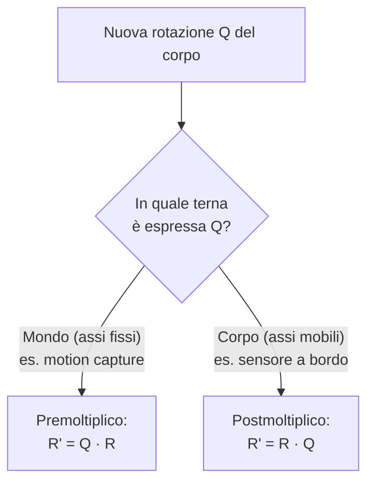

# Lezione 4 — Rotazioni nello spazio, SE(3) e angoli roll-pitch-yaw

## 1. Informazioni pratiche sul simulatore

### 1.1 Avvio bloccato su Windows

Su alcuni computer Windows lo script di avvio del simulatore viene bloccato da **SmartScreen**, la protezione di Windows che impedisce l'esecuzione di programmi non riconosciuti. Il docente lo aveva segnalato anche con un annuncio. Se succede, si può disattivare la relativa protezione basata sulla reputazione nelle impostazioni di sicurezza di Windows (nella sezione dedicata alla protezione delle app). Chi continua ad avere problemi può scrivere al docente.

### 1.2 Aggiornare il simulatore

Il simulatore viene **sviluppato man mano che il corso procede**: a ogni lezione possono comparire nuovi esercizi o correzioni. Prima di usarlo bisogna quindi scaricare la versione aggiornata.

- Chi ha scaricato il repository con `git clone` lo aggiorna con **`git pull`**. Se nel frattempo si sono modificati dei file (per esempio risolvendo un esercizio) e quegli stessi file sono cambiati anche online, Git segnala un **conflitto** da risolvere: si sceglie quale versione tenere. I file modificati solo in locale vengono lasciati come sono e tutto il resto viene aggiornato.
- Chi ha scaricato lo **ZIP** deve rifare tutto a mano: scaricare il nuovo archivio, estrarlo e, se serve, ricopiare gli esercizi già svolti. In questo modo si accumulano più copie del simulatore.

Il docente invita a imparare a usare Git, che è abbastanza semplice e molto comodo.

---

## 2. Ripasso dell'esercizio planare

Il docente ha mostrato la soluzione dell'esercizio sulle trasformazioni planari (`planar.py`) della [[Robotica MOD1 - Lezione 03|lezione 3]]. Gli ingressi della funzione sono la trasformazione dal robot al mondo e quella dal sensore al robot. Il nome *world from robot* va letto mentalmente come ${}^{w}_{b}T$: è la matrice che dalla terna del robot (spesso indicata con $b$, *base*) porta al mondo.

Le due trasformazioni si compongono con l'operatore `@`, che in NumPy è il prodotto matriciale. Ne risulta la trasformazione dal sensore al mondo. Poi:

- il punto osservato si porta in coordinate omogenee aggiungendo un $1$;
- la direzione osservata si porta in coordinate omogenee aggiungendo uno $0$;
- entrambi si moltiplicano per la trasformazione e si restituiscono al simulatore, scartando l'ultima componente.

Il simulatore confronta il risultato con quello atteso (*expected*), che deve coincidere con quello calcolato alla lavagna.

---

## 3. Terne di riferimento nello spazio

### 3.1 Definizione

La lezione estende allo spazio i concetti visti nel piano: in parte è un ripasso, in parte un'estensione. Una terna spaziale $\{a\}$ è definita da un'origine e da **tre** versori:

$$\{a\} = \big(O_a,\ {}^{a}\mathbf{i}_a,\ {}^{a}\mathbf{j}_a,\ {}^{a}\mathbf{k}_a\big).$$

Come nel piano, la notazione è ridondante: i versori di $\{a\}$ espressi in $\{a\}$ valgono banalmente $(1,0,0)^T$, $(0,1,0)^T$ e $(0,0,1)^T$. Serve però per uniformità, perché quando si esprimeranno gli assi di un'altra terna nella terna $\{a\}$ l'apice sarà indispensabile.

### 3.2 Prodotto vettoriale e terne destrorse

Nello spazio diventa utile il **prodotto vettoriale**. Dati due vettori $\mathbf a$ e $\mathbf b$, il prodotto $\mathbf a \times \mathbf b$ è un vettore con queste caratteristiche.

- **Direzione**: perpendicolare sia ad $\mathbf a$ sia a $\mathbf b$.
- **Modulo**: $\left\| \mathbf a \times \mathbf b \right\| = \|\mathbf a\|\,\|\mathbf b\|\sin\vartheta$, dove $\vartheta$ è l'angolo compreso tra i due vettori.
- **Verso**: dato dalla **regola della mano destra**. Se le dita della mano destra si chiudono andando da $\mathbf a$ verso $\mathbf b$, il pollice indica il verso di $\mathbf a \times \mathbf b$.

Il prodotto vettoriale descrive esattamente le terne usate nel corso. In una terna **destrorsa** il terzo asse è il prodotto vettoriale dei primi due:

$$\mathbf i \times \mathbf j = \mathbf k, \qquad \mathbf j \times \mathbf k = \mathbf i, \qquad \mathbf k \times \mathbf i = \mathbf j .$$

Fissati $x$ e $y$, l'asse $z$ è quindi determinato. Nel piano si era detto che $z$ «esce» dal piano: è proprio $\mathbf i \times \mathbf j$.

> [!tip] Excalidraw
> Nello spazio i disegni alla lavagna richiedono un po' di immaginazione. Uno schizzo di una terna destrorsa con la mano destra (pollice $x$, indice $y$, medio $z$) e di una seconda terna $\{b\}$ ruotata e traslata rispetto ad $\{a\}$, con un punto $P$, aiuta a visualizzare tutte le formule di questa lezione.

---

## 4. Matrici di rotazione nello spazio: il gruppo SO(3)

La matrice di rotazione che esprime l'orientamento di $\{b\}$ rispetto ad $\{a\}$ si costruisce come nel piano: le sue colonne sono **gli assi di $\{b\}$ espressi in $\{a\}$**.

$${}^{a}_{b}R = \begin{bmatrix} {}^{a}\mathbf i_b & {}^{a}\mathbf j_b & {}^{a}\mathbf k_b \end{bmatrix} \in \mathbb{R}^{3\times 3}, \qquad {}^{a}\mathbf v = {}^{a}_{b}R\;{}^{b}\mathbf v .$$

Il docente ha ricordato che questa lettura per colonne è utile soprattutto quando si scelgono rotazioni facili da intuire, come quelle di $90^\circ$. In generale, però, la definizione resta questa.

> [!important] Definizione di SO(3)
> $$SO(3) = \left\{ R \in \mathbb{R}^{3\times 3} \;:\; R^{T}R = I,\ \det(R) = +1 \right\}.$$

È la stessa definizione del caso piano, estesa a matrici $3\times 3$, e valgono le stesse proprietà.

- $R^TR = I$ significa che le colonne sono ortonormali e che l'inversa coincide con la trasposta. Ne segue che le rotazioni conservano lunghezze e angoli.
- $\det R = +1$ esclude le riflessioni. Una matrice ortogonale con determinante $-1$ ribalterebbe un asse e trasformerebbe una terna destrorsa in una **sinistrorsa**.

Il docente ha aperto una parentesi: non tutti i software usano terne destrorse. Alcuni programmi di grafica adottano terne sinistrorse, per ragioni storiche o di efficienza. Nel corso si usa sempre la convenzione destrorsa.

---

## 5. Rotazioni elementari

### 5.1 Costruzione per colonne

Nel piano c'è un solo grado di libertà rotazionale. Nello spazio ce ne sono tre, e qualunque rotazione si può ottenere componendo tre **rotazioni elementari**, cioè rotazioni attorno agli assi $x$, $y$, $z$. Per convenzione gli angoli di rotazione attorno a $x$, $y$ e $z$ si indicano rispettivamente con $\varphi$, $\theta$ e $\psi$.

Il **verso positivo** di una rotazione si stabilisce ancora con la regola della mano destra: con il pollice lungo l'asse di rotazione, le dita indicano il verso positivo. È il verso antiorario quando si guarda l'asse «dalla punta». Il docente ha fatto notare che, guardando lo stesso asse da dietro, la stessa rotazione appare oraria: bisogna fare attenzione da che parte si guarda il disegno.

**Rotazione attorno a $x$.** Il docente ha chiesto che cosa succede a una terna ruotata attorno al proprio asse $x$. L'asse $x$ resta fermo, quindi la prima colonna è $(1, 0, 0)^T$. Gli altri due assi ruotano nel piano $y$–$z$ esattamente come $x$ e $y$ ruotavano nel piano:

$$\mathbf i \to \begin{bmatrix} 1 \\ 0 \\ 0 \end{bmatrix}, \qquad \mathbf j \to \begin{bmatrix} 0 \\ \cos\varphi \\ \sin\varphi \end{bmatrix}, \qquad \mathbf k \to \begin{bmatrix} 0 \\ -\sin\varphi \\ \cos\varphi \end{bmatrix}.$$

Nel blocco in basso a destra ricompare la matrice di rotazione piana $R(\varphi)$.

**Rotazione attorno a $y$.** L'asse $y$ resta fermo e ruotano $z$ e $x$. Qui serve attenzione al segno. L'ordine ciclico degli assi è $x \to y \to z \to x$, quindi nel piano perpendicolare a $y$ il «primo» asse è $z$ e il «secondo» è $x$. Una rotazione positiva di $\theta$ porta $\mathbf k$ verso $\mathbf i$ e $\mathbf i$ verso $-\mathbf k$:

$$\mathbf i \to \begin{bmatrix} \cos\theta \\ 0 \\ -\sin\theta \end{bmatrix}, \qquad \mathbf j \to \begin{bmatrix} 0 \\ 1 \\ 0 \end{bmatrix}, \qquad \mathbf k \to \begin{bmatrix} \sin\theta \\ 0 \\ \cos\theta \end{bmatrix}.$$

Per questo in $R_y$ il seno con il segno meno sta in basso a sinistra, e non in alto a destra come nelle altre due.

**Rotazione attorno a $z$.** L'asse $z$ resta fermo e $x$, $y$ ruotano come nel piano.

> [!important] Rotazioni elementari
> $$R_x(\varphi) = \begin{bmatrix} 1 & 0 & 0 \\ 0 & \cos\varphi & -\sin\varphi \\ 0 & \sin\varphi & \cos\varphi \end{bmatrix}, \quad
> R_y(\theta) = \begin{bmatrix} \cos\theta & 0 & \sin\theta \\ 0 & 1 & 0 \\ -\sin\theta & 0 & \cos\theta \end{bmatrix}, \quad
> R_z(\psi) = \begin{bmatrix} \cos\psi & -\sin\psi & 0 \\ \sin\psi & \cos\psi & 0 \\ 0 & 0 & 1 \end{bmatrix}.$$
> In ciascuna, la riga e la colonna dell'asse di rotazione contengono un $1$ e degli zeri, e il resto è una rotazione piana.

> [!warning] Errore negli appunti manuali su $R_y$
> Negli appunti manuali $R_y(\theta)$ è scritta con uno $0$ nell'elemento in alto a destra. L'elemento corretto è $\sin\theta$. Con lo $0$ la matrice non sarebbe una rotazione: la terza colonna $(0,\ 0,\ \cos\theta)^T$ non avrebbe norma unitaria. La forma corretta è quella del riquadro, ricavata sopra per colonne.

### 5.2 Proprietà

Per tutte le rotazioni elementari valgono le proprietà già viste nel piano, conseguenza dell'appartenenza a SO(3):

$$R(0) = I, \qquad R(\alpha)^{-1} = R(-\alpha) = R(\alpha)^{T}.$$

La rotazione di angolo nullo è l'identità; ruotare di $\alpha$ e poi di $-\alpha$ attorno allo stesso asse riporta alla situazione iniziale.

---

## 6. Nello spazio le rotazioni non commutano

Nel piano le rotazioni commutano: c'è un solo grado di libertà, e fare prima una rotazione e poi l'altra o viceversa porta sempre allo stesso risultato. **Nello spazio non è così**: l'ordine delle rotazioni è importantissimo, e ha un significato fisico preciso, che si vedrà nella sezione 7.

> [!example] Esempio: due rotazioni di $90^\circ$ in ordine diverso
> Con $\varphi = \psi = \pi/2$:
> $$R_x\!\left(\tfrac{\pi}{2}\right) R_z\!\left(\tfrac{\pi}{2}\right) = \begin{bmatrix} 0 & -1 & 0 \\ 0 & 0 & -1 \\ 1 & 0 & 0 \end{bmatrix}, \qquad
> R_z\!\left(\tfrac{\pi}{2}\right) R_x\!\left(\tfrac{\pi}{2}\right) = \begin{bmatrix} 0 & 0 & 1 \\ 1 & 0 & 0 \\ 0 & 1 & 0 \end{bmatrix}.$$
> Le due matrici sono diverse. Si segua il versore $\mathbf i = (1,0,0)^T$, ricordando che le matrici agiscono da destra verso sinistra.
> - In $R_x R_z\,\mathbf i$ agisce prima $R_z$, che porta $\mathbf i$ in $\mathbf j$; poi $R_x$ porta $\mathbf j$ in $\mathbf k$. Risultato: $(0, 0, 1)^T$.
> - In $R_z R_x\,\mathbf i$ agisce prima $R_x$, che lascia $\mathbf i$ invariato (è il suo asse); poi $R_z$ lo porta in $\mathbf j$. Risultato: $(0, 1, 0)^T$.
>
> Lo si può verificare con un libro: ruotarlo di $90^\circ$ attorno a un asse verticale e poi a uno orizzontale non dà la stessa posizione finale dell'ordine inverso.

---

## 7. Rotazioni rispetto ad assi fissi e ad assi mobili

### 7.1 Il problema

Si immagini un corpo rigido, per esempio un robot, con la sua terna. Sia $\{b\}$ la terna del corpo **prima** di una rotazione e $\{b'\}$ la terna **dopo** la rotazione. Si consideri un vettore $\mathbf v$ **solidale al corpo**, cioè che ruota insieme a esso, e sia $\mathbf v'$ lo stesso vettore dopo la rotazione.

Valgono due relazioni.

- Prima della rotazione, come sempre: ${}^{w}\mathbf v = {}^{w}_{b}R\;{}^{b}\mathbf v$.
- Il vettore è solidale al corpo, quindi le sue componenti **nella terna del corpo** non cambiano: le componenti di $\mathbf v$ in $\{b\}$ coincidono con quelle di $\mathbf v'$ in $\{b'\}$, cioè ${}^{b}\mathbf v = {}^{b'}\mathbf v'$.

Una rotazione $Q$ che porta il corpo da $\{b\}$ a $\{b'\}$ può essere descritta in due modi diversi, a seconda della terna in cui è espressa. Il docente ha insistito che sono **casi diversi che capitano davvero** quando si lavora con un robot. Una rotazione del robot può essere nota **rispetto al mondo**, oppure **rispetto al robot stesso** com'era un istante prima.

### 7.2 Assi fissi: premoltiplicazione

Nel primo caso la rotazione avviene attorno agli **assi fissi**, cioè gli assi del mondo, che restano fermi mentre il corpo ruota. La rotazione è espressa nel mondo, e la si indica con ${}^{w}Q$. Agisce sul vettore espresso nel mondo:

$${}^{w}\mathbf v' = {}^{w}Q\;{}^{w}\mathbf v = {}^{w}Q\;{}^{w}_{b}R\;{}^{b}\mathbf v .$$

D'altra parte ${}^{w}\mathbf v' = {}^{w}_{b'}R\;{}^{b'}\mathbf v' = {}^{w}_{b'}R\;{}^{b}\mathbf v$, perché le componenti nel corpo non cambiano. Confrontando le due espressioni:

$${}^{w}_{b'}R = {}^{w}Q\;{}^{w}_{b}R .$$

La nuova rotazione si ottiene **premoltiplicando**, cioè moltiplicando a sinistra. Le matrici si leggono da destra verso sinistra: la rotazione aggiunta a sinistra agisce **dopo** che il corpo ha già assunto l'orientamento ${}^{w}_{b}R$.

### 7.3 Assi mobili: postmoltiplicazione

Nel secondo caso la rotazione avviene attorno agli **assi mobili**, cioè gli assi del corpo stesso, ed è espressa nella terna $\{b\}$: la si indica con ${}^{b}Q$. Agisce sulle componenti del vettore nel corpo, prima che queste vengano portate nel mondo:

$${}^{w}\mathbf v' = {}^{w}_{b}R\;\big({}^{b}Q\;{}^{b}\mathbf v\big).$$

Confrontando di nuovo con ${}^{w}\mathbf v' = {}^{w}_{b'}R\;{}^{b}\mathbf v$:

$${}^{w}_{b'}R = {}^{w}_{b}R\;{}^{b}Q .$$

Questa volta la nuova rotazione si ottiene **postmoltiplicando**, cioè moltiplicando a destra.

> [!important] Regola di composizione
> - Rotazione nota rispetto agli **assi fissi** (del mondo): **premoltiplicazione**, ${}^{w}_{b'}R = {}^{w}Q\;{}^{w}_{b}R$.
> - Rotazione nota rispetto agli **assi mobili** (del corpo): **postmoltiplicazione**, ${}^{w}_{b'}R = {}^{w}_{b}R\;{}^{b}Q$.



Non è una regola da applicare a memoria: bisogna capire da dove viene il dato. Il docente ha fatto due esempi.

- Se un **sensore montato sul corpo** misura una rotazione, quella rotazione è espressa nel riferimento del corpo, cioè rispetto ad assi mobili. Per sapere dove è finito il corpo si **postmoltiplica**.
- Se la rotazione viene da un **sistema di *motion capture***, che osserva il corpo dall'esterno e la fornisce nel riferimento del mondo, si **premoltiplica**.

Questa distinzione tornerà nella sezione 12, dove spiegherà perché due convenzioni diverse sugli angoli producono la stessa matrice.

> [!warning] Refuso negli appunti manuali e un passaggio ambiguo della trascrizione
> - Negli appunti manuali la formula per gli assi mobili è scritta come ${}^{w}_{b'}R = {}^{w}_{b}R\;{}^{w}_{b}Q$, e il passaggio precedente comincia con ${}^{w}R\,{}^{w}\mathbf v$. La rotazione aggiunta è espressa nel corpo, quindi la forma corretta è ${}^{w}_{b'}R = {}^{w}_{b}R\;{}^{b}Q$, con ${}^{w}\mathbf v' = {}^{w}_{b}R\,({}^{b}Q\,{}^{b}\mathbf v)$, come nella derivazione sopra.
> - Nella trascrizione un frammento sembra associare la moltiplicazione «a destra» agli assi fissi. Il frammento è poco intelligibile, mentre la derivazione alla lavagna (riportata anche negli appunti) è univoca: assi fissi → premoltiplicazione, assi mobili → postmoltiplicazione.

> [!example] Esempio: la stessa rotazione su assi fissi e su assi mobili
> Un robot ha orientamento ${}^{w}_{b}R = R_z(\pi/2)$: il suo asse $x_b$, la direzione di marcia, punta lungo $y_w$. Lo si ruota di $90^\circ$ attorno a un asse $x$.
> - **Attorno all'asse $x$ del mondo** (assi fissi): ${}^{w}_{b'}R = R_x(\tfrac{\pi}{2})\,R_z(\tfrac{\pi}{2})$. La prima colonna è $(0,0,1)^T$: la direzione di marcia ora punta verso l'alto. L'asse $x_w$ è laterale per il robot, quindi il robot ha «alzato il muso».
> - **Attorno al proprio asse $x$** (assi mobili): ${}^{w}_{b'}R = R_z(\tfrac{\pi}{2})\,R_x(\tfrac{\pi}{2})$. La prima colonna è $(0,1,0)^T$: la direzione di marcia non è cambiata. Il robot ha ruotato attorno al proprio asse longitudinale, come una barca che rolla.
>
> Le due matrici sono quelle dell'esempio della sezione 6: la non commutatività ha qui un significato fisico concreto.

---

## 8. Trasformazioni omogenee nello spazio: il gruppo SE(3)

Chiarita la parte rotazionale, le trasformazioni omogenee si estendono allo spazio senza sorprese: cambiano solo le dimensioni. La parte traslazionale resta identica, con una componente in più. La parte delicata dello spazio è quella rotazionale, appena discussa.

> [!important] Trasformazione omogenea nello spazio
> $${}^{a}_{b}T = \begin{bmatrix} {}^{a}_{b}R & {}^{a}O_b \\ \mathbf{0}_{1\times 3} & 1 \end{bmatrix} \in \mathbb{R}^{4\times 4}, \qquad {}^{a}\bar P = \begin{bmatrix} x_{P,a} \\ y_{P,a} \\ z_{P,a} \\ 1 \end{bmatrix}, \qquad {}^{a}\bar P = {}^{a}_{b}T\;{}^{b}\bar P .$$
> ${}^{a}_{b}R$ è una matrice di rotazione $3\times 3$ e ${}^{a}O_b$ è l'origine di $\{b\}$ espressa in $\{a\}$, un vettore $3\times 1$. Per i vettori la quarta componente vale $0$.

Queste matrici formano il **gruppo speciale euclideo** in dimensione 3:

$$SE(3) = \left\{ {}^{a}_{b}T = \begin{bmatrix} {}^{a}_{b}R & {}^{a}O_b \\ \mathbf{0}_{1\times 3} & 1 \end{bmatrix} \;:\; {}^{a}_{b}R \in SO(3),\ {}^{a}O_b \in \mathbb{R}^{3} \right\}.$$

**Gradi di libertà.** Nel piano una posa ha 3 gradi di libertà: $x$, $y$ e l'angolo $\psi$ attorno all'unico asse di rotazione, $z$. Nello spazio i gradi di libertà diventano **6**: tre di posizione ($x$, $y$, $z$) e tre di orientamento ($\varphi$, $\theta$, $\psi$). La matrice $4\times 4$ contiene però 16 numeri. L'ultima riga è fissa, e dei 9 elementi della rotazione solo 3 sono indipendenti, perché i vincoli di ortonormalità ne legano gli altri.

**Composizione e inversa** hanno esattamente la stessa forma vista nel piano; cambiano solo le dimensioni dei blocchi (rotazioni $3\times 3$, origini $3\times 1$):

$${}^{a}_{c}T = {}^{a}_{b}T\;{}^{b}_{c}T = \begin{bmatrix} {}^{a}_{b}R\;{}^{b}_{c}R & {}^{a}O_b + {}^{a}_{b}R\;{}^{b}O_c \\ \mathbf{0}_{1\times 3} & 1 \end{bmatrix}, \qquad
{}^{b}_{a}T = \big({}^{a}_{b}T\big)^{-1} = \begin{bmatrix} {}^{a}_{b}R^{T} & -\,{}^{a}_{b}R^{T}\;{}^{a}O_b \\ \mathbf{0}_{1\times 3} & 1 \end{bmatrix}.$$

> [!warning] Refusi negli appunti manuali sulla composizione
> Negli appunti la parte traslazionale della composizione è scritta ${}^{a}O_b + {}^{a}_{b}T\,{}^{b}O_c$, e l'ultima riga $\mathbf 0_{3\times 1}$. All'interno del blocco va la **matrice di rotazione** ${}^{a}_{b}R$ (una matrice $3\times 3$ che moltiplica un vettore $3\times 1$), non la trasformazione $4\times 4$. L'ultima riga è una riga di zeri, cioè $\mathbf 0_{1\times 3}$. La formula per l'inversa negli appunti è invece corretta.

---

## 9. Esempio: posa 3D di un sensore

### 9.1 I dati

L'esempio riprende quello planare della lezione 3, in versione tridimensionale.

- La base del robot è ruotata di $90^\circ$ attorno a $z$ rispetto al mondo e si trova nel punto $(1, 2, 0)$:
$${}^{w}_{b}R = R_z\!\left(\tfrac{\pi}{2}\right), \qquad {}^{w}O_b = \begin{bmatrix} 1 \\ 2 \\ 0 \end{bmatrix}.$$
- Il sensore è montato $20$ cm più avanti rispetto al centro del robot e $50$ cm più in alto. È ruotato di $90^\circ$ attorno al proprio asse $x$ rispetto alla base:
$${}^{b}_{s}R = R_x\!\left(\tfrac{\pi}{2}\right), \qquad {}^{b}O_s = \begin{bmatrix} 0{,}2 \\ 0 \\ 0{,}5 \end{bmatrix}.$$
- Il sensore osserva un punto a un metro lungo il proprio asse $y$:
$${}^{s}P = \begin{bmatrix} 0 \\ 1 \\ 0 \end{bmatrix}.$$

Come al solito l'asse $x$ del robot è nella direzione di marcia e gli altri assi seguono la regola della mano destra. La rotazione del sensore rispetto alla base riflette una situazione frequente. I sensori hanno spesso la propria terna stampata sull'involucro, e a seconda di come vengono montati la loro terna non coincide con quella del corpo. Bisogna sapere come è montato il sensore per scrivere la rotazione giusta.

> [!tip] Notazione per gli assi perpendicolari al foglio
> Per disegnare in due dimensioni un asse perpendicolare alla lavagna si usa una convenzione grafica. Si immagina l'asse come una freccia vista di punta o di coda.
> - Un **punto in un cerchio** ($\odot$) indica un asse che **esce** dal foglio, verso chi guarda: si vede la punta della freccia.
> - Una **croce in un cerchio** ($\otimes$) indica un asse che **entra** nel foglio: si vede la coda della freccia.

### 9.2 Le matrici, lette per colonne

Il docente ha raccomandato di allenare l'intuizione spaziale: invece di sviluppare ogni volta la formula con seni e coseni, si ragiona su dove vanno a finire gli assi.

**Dalla base al mondo.** Si ruota di $90^\circ$ attorno a $z$.

- Il nuovo asse $x$ coincide con il vecchio $y$: prima colonna $(0, 1, 0)^T$.
- Il nuovo asse $y$ coincide con il vecchio $-x$: seconda colonna $(-1, 0, 0)^T$.
- L'asse $z$, attorno a cui si ruota, non cambia: terza colonna $(0, 0, 1)^T$.

$${}^{w}_{b}T = \begin{bmatrix} 0 & -1 & 0 & 1 \\ 1 & 0 & 0 & 2 \\ 0 & 0 & 1 & 0 \\ 0 & 0 & 0 & 1 \end{bmatrix}.$$

**Dal sensore alla base.** Si ruota di $90^\circ$ attorno a $x$. Il ragionamento più facile parte dall'asse di rotazione.

- L'asse $x$ non cambia: prima colonna $(1, 0, 0)^T$.
- Il nuovo asse $y$ coincide con il vecchio $z$: seconda colonna $(0, 0, 1)^T$.
- Il nuovo asse $z$ coincide con il vecchio $-y$: terza colonna $(0, -1, 0)^T$.

$${}^{b}_{s}T = \begin{bmatrix} 1 & 0 & 0 & 0{,}2 \\ 0 & 0 & -1 & 0 \\ 0 & 1 & 0 & 0{,}5 \\ 0 & 0 & 0 & 1 \end{bmatrix}.$$

Il docente ha sottolineato perché nello spazio serve più attenzione. Nel piano una rotazione scambia solo destra e sinistra; nello spazio ci sono tre rotazioni possibili, ognuna delle quali cambia gli altri due assi, mentre solo l'asse di rotazione resta fermo.

### 9.3 Dal sensore al mondo

La trasformazione dal sensore al mondo è il prodotto delle due:

$${}^{w}_{s}T = {}^{w}_{b}T\;{}^{b}_{s}T = \begin{bmatrix} 0 & 0 & 1 & 1 \\ 1 & 0 & 0 & 2{,}2 \\ 0 & 1 & 0 & 0{,}5 \\ 0 & 0 & 0 & 1 \end{bmatrix}.$$

Si possono controllare i due blocchi separatamente.

- **Rotazione**: ${}^{w}_{s}R = R_z(\tfrac{\pi}{2})\,R_x(\tfrac{\pi}{2})$. È esattamente il caso degli assi mobili della sezione 7: prima si orienta come il robot, poi si ruota attorno al proprio asse $x$. Letta per colonne, dice che $x_s$ punta lungo $y_w$, $y_s$ lungo $z_w$ (verso l'alto) e $z_s$ lungo $x_w$.
- **Traslazione**: ${}^{w}O_b + {}^{w}_{b}R\,{}^{b}O_s = (1, 2, 0)^T + (0,\ 0{,}2,\ 0{,}5)^T = (1,\ 2{,}2,\ 0{,}5)^T$. I $20$ cm «in avanti» del robot diventano $20$ cm lungo $y_w$, perché il robot guarda lungo $y_w$; i $50$ cm verso l'alto restano lungo $z$.

Infine il punto:

$${}^{w}\bar P = {}^{w}_{s}T\;{}^{s}\bar P = \begin{bmatrix} 0 & 0 & 1 & 1 \\ 1 & 0 & 0 & 2{,}2 \\ 0 & 1 & 0 & 0{,}5 \\ 0 & 0 & 0 & 1 \end{bmatrix}\begin{bmatrix} 0 \\ 1 \\ 0 \\ 1 \end{bmatrix} = \begin{bmatrix} 1 \\ 2{,}2 \\ 1{,}5 \\ 1 \end{bmatrix}.$$

**Verifica intuitiva.** L'asse $y$ del sensore punta verso l'alto, quindi il punto, a un metro lungo $y_s$, sta un metro sopra il sensore. Il sensore è in $(1,\ 2{,}2,\ 0{,}5)$, quindi il punto è in $(1,\ 2{,}2,\ 1{,}5)$. Nel simulatore lo si vede bene: l'asse verde ($y$) del sensore punta verso l'alto e il punto si trova sopra di esso.

> [!tip] Excalidraw
> Questo esempio è difficile da seguire solo con le matrici. Uno schizzo in assonometria (mondo, robot in $(1,2,0)$ con $x_b$ lungo $y_w$, sensore più avanti e più in alto con la sua $y_s$ verso l'alto, punto un metro sopra il sensore) è il modo migliore per controllare il risultato.

---

## 10. Perché saper leggere le matrici: i manipolatori

Il docente ha insistito sull'immediatezza nel capire come è fatta una matrice di rotazione, perché servirà subito nello studio dei manipolatori. Il modello di un manipolatore si scrive di solito con il **braccio completamente disteso**. Lungo il braccio ci sono vari punti di riferimento: la terna della base, la terna 1, la terna 2, la terna 3 e così via.

La prima cosa da fare è collocare le terne e scrivere le matrici di rotazione tra una terna e la successiva. Nel caso disegnato alla lavagna è facile, perché le terne sono allineate, ma un braccio reale può avere giunti orientati in modi diversi. Chi ha capito come le rotazioni scambiano gli assi riesce a scrivere il modello da solo. Questo modello è la base della **cinematica diretta e inversa** dei manipolatori, analoga (ma molto più articolata) a quella vista per la base mobile: partendo dalla base, si vuole sapere dove si trova ciascuna terna, fino all'utensile.

---

## 11. Esercizio nel simulatore: trasformazioni spaziali

Nella versione aggiornata del simulatore c'è il modulo 2, con l'esercizio sulle trasformazioni spaziali (file `spatial.py`). La scena è quella dell'esempio della sezione 9: il robot ruotato di $90^\circ$ su $z$ e il sensore montato sopra di esso.

Nel simulatore gli assi sono disegnati in **rosso, verde e blu**. L'ordine non è casuale: i colori seguono la sigla **RGB** e corrispondono, nell'ordine, agli assi **$x$, $y$, $z$**. Guardando la scena dall'alto si vede che l'asse rosso del robot ($x_b$) punta lungo l'asse verde del mondo ($y_w$), come previsto da ${}^{w}_{b}R = R_z(\pi/2)$.

La funzione da completare riceve la trasformazione dalla base al mondo, quella dal sensore alla base e il punto nel sensore. Deve restituire il punto nel mondo, con lo stesso procedimento dell'esercizio planare. Il risultato atteso è $(1,\ 2{,}2,\ 1{,}5)$.

Un'implementazione scritta in modo indipendente dalla dimensione funziona sia nel piano sia nello spazio, perché le coordinate omogenee hanno sempre la stessa struttura.

```python
import numpy as np

def to_world(world_from_base, base_from_sensor, point_in_sensor):
    world_from_sensor = world_from_base @ base_from_sensor  # ʷₛT = ʷᵦT ᵇₛT
    point_h = np.append(point_in_sensor, 1.0)               # punto omogeneo
    return (world_from_sensor @ point_h)[:-1]               # scarta l'ultima componente

world_from_base = np.array([[0, -1, 0, 1],
                            [1,  0, 0, 2],
                            [0,  0, 1, 0],
                            [0,  0, 0, 1]], dtype=float)
base_from_sensor = np.array([[1, 0,  0, 0.2],
                             [0, 0, -1, 0.0],
                             [0, 1,  0, 0.5],
                             [0, 0,  0, 1.0]])

print(to_world(world_from_base, base_from_sensor, np.array([0.0, 1.0, 0.0])))
# [1.  2.2 1.5]
```

> [!warning] Nomi indicativi
> I nomi sono ricostruiti da quanto detto a lezione (*world from base*, *base from sensor*). La firma effettiva in `spatial.py` può essere diversa: fa fede il file del repository.

---

## 12. Rappresentare l'orientamento con tre angoli: roll, pitch, yaw

### 12.1 Perché non bastano le matrici

Le matrici omogenee sono il modo più sicuro di rappresentare le trasformazioni e, come si è visto, si compongono con semplici prodotti. Hanno però due limiti pratici.

- Usano molti numeri: una matrice $4\times 4$ ne contiene 16, per descrivere 6 gradi di libertà. Con un braccio a 7 gradi di libertà, come quello del laboratorio, e migliaia di operazioni, la mole di dati cresce rapidamente.
- **Non sono leggibili a colpo d'occhio.** Guardando una sequenza di numeri come $1, 0, 0, 0, 1, 0, \ldots$ non si capisce come è orientato il corpo. In un'interfaccia che mostra in tempo reale l'orientamento di un robot, una matrice di numeri che cambiano non dice nulla a chi la osserva.

Esistono quindi rappresentazioni alternative dell'orientamento. Una delle più usate, perché molto intuitiva, sono gli **angoli roll, pitch, yaw** (RPY), indicati con $\varphi$, $\theta$ e $\psi$. Usano solo **tre parametri** invece dei nove della matrice di rotazione e ciascuno ha un significato fisico chiaro. In cambio, come ha anticipato il docente, comportano alcune complicazioni.

Esistono anche altre rappresentazioni, come i **quaternioni**, che hanno vantaggi nella composizione delle rotazioni e soffrono meno di problemi numerici. Sono però più difficili da interpretare: dai loro valori numerici non si «vede» la rotazione. Il docente si concentrerà prima sul collegamento tra angoli RPY e matrici di rotazione.

Una motivazione pratica per conoscere gli angoli RPY è che molti sensori li forniscono direttamente. Un'unità inerziale con elaborazione a bordo fonde le misure di accelerometri e giroscopi (*sensor fusion*) e restituisce l'orientamento sotto forma di angoli. Più avanti nel corso si vedrà come un sensore usa il vettore della **gravità** $\mathbf g$ per capire se il corpo è inclinato: se si inclina il telefono, il vettore $\mathbf g$ misurato ruota rispetto al telefono. Poiché i dati arrivano in forme diverse, bisogna saper convertire da una rappresentazione all'altra.

### 12.2 La convenzione: estrinseca XYZ

La matrice di rotazione associata agli angoli RPY è la composizione di tre rotazioni elementari:

> [!important] Matrice di rotazione roll-pitch-yaw
> $$R(\varphi, \theta, \psi) = R_z(\psi)\;R_y(\theta)\;R_x(\varphi).$$

Perché in quest'ordine? Le rotazioni si leggono da destra verso sinistra. Scrivere $R_z R_y R_x$ significa ruotare **prima attorno a $x$, poi attorno a $y$, poi attorno a $z$**. Inoltre le rotazioni avvengono attorno agli **assi originali del mondo**, cioè ad assi fissi: per la regola della sezione 7 ogni nuova rotazione viene premoltiplicata.

Questa convenzione si chiama **estrinseca XYZ**.

- **XYZ** indica l'ordine degli assi attorno a cui si ruota.
- **Estrinseca** indica che gli assi sono quelli di un sistema esterno al corpo, per esempio il riferimento del mondo, che resta fermo durante le rotazioni.

### 12.3 La stessa rotazione in forma intrinseca

La stessa identica matrice si ottiene anche con rotazioni **intrinseche**, cioè attorno agli assi del corpo che si muovono con esso, **in ordine inverso**: prima attorno a $z$, poi attorno al nuovo $y$, poi attorno al nuovo $x$. È la convenzione **intrinseca ZYX**.

Lo si vede con la regola degli assi mobili. Si parte dall'identità (il corpo allineato al mondo) e a ogni passo si **postmoltiplica**:

$$I \;\xrightarrow{\ \text{rotazione su } z\ }\; R_z(\psi) \;\xrightarrow{\ \text{su } y \text{ mobile}\ }\; R_z(\psi)\,R_y(\theta) \;\xrightarrow{\ \text{su } x \text{ mobile}\ }\; R_z(\psi)\,R_y(\theta)\,R_x(\varphi).$$

Con gli assi fissi, invece, si parte da $R_x(\varphi)$ e si **premoltiplica** prima per $R_y(\theta)$ e poi per $R_z(\psi)$: il risultato è lo stesso prodotto. Applicare le rotazioni in ordine inverso sugli assi mobili equivale ad applicarle in ordine diretto sugli assi fissi.

> [!warning] Attenzione alla convenzione del software
> Il docente ha avvertito che molti programmi, come Unity e altri motori grafici, usano convenzioni diverse: ordini come XYX o ZYX, in forma estrinseca o intrinseca. Ci sono tutte le combinazioni immaginabili. Quando si lavora con angoli forniti da un programma o da un sensore, bisogna sempre verificare **quale convenzione** adotta: l'ordine degli assi e se le rotazioni sono estrinseche o intrinseche. Con la convenzione sbagliata si ottiene un orientamento diverso.

In letteratura, quando i tre assi della sequenza sono tutti diversi (come in XYZ), gli angoli si chiamano anche angoli di **Tait–Bryan**.

> [!tip] Approfondimento — Quante convenzioni esistono
> #approfondimento
> L'equivalenza vista sopra è un risultato generale. Tre rotazioni attorno ad assi fissi danno lo stesso orientamento finale delle stesse tre rotazioni eseguite in ordine inverso attorno agli assi del corpo. Per questo Craig chiama la stessa parametrizzazione sia «angoli fissi X–Y–Z» sia «angoli di Eulero Z–Y–X» [@craig2005].
> Quando invece il primo e l'ultimo asse coincidono si parla di angoli di Eulero propriamente detti, come la sequenza ZYZ [@siciliano2009].
> Il documento REP 103 di ROS osserva che esistono 24 convenzioni «valide» per gli angoli, e proprio per questo scoraggia l'uso degli angoli di Eulero generici. Raccomanda invece, nell'ordine, quaternioni, matrici di rotazione e angoli roll-pitch-yaw su assi fissi X, Y, Z [@rep103].
> Come esempio di convenzione diversa, la documentazione di Unity indica che il motore applica le rotazioni di Eulero in sequenza attorno a $z$, poi $x$, poi $y$, come rotazione estrinseca [@unityManual].

### 12.4 Significato fisico degli angoli

Si ricordi che l'asse $x$ è la direzione di avanzamento del robot.

- **Roll** ($\varphi$), in italiano **rollio**: rotazione attorno all'asse $x$, cioè attorno all'asse longitudinale. È il movimento di una barca che oscilla da un fianco all'altro.
- **Pitch** ($\theta$), in italiano **beccheggio**: rotazione attorno all'asse $y$. Indica in qualche modo un'elevazione: il «muso» del robot che si alza o si abbassa.
- **Yaw** ($\psi$), in italiano **imbardata**: rotazione attorno all'asse $z$, verticale. Indica la direzione verso cui il robot sta andando.

Lo yaw è spesso il più semplice da usare e da ottenere: basta, per esempio, una bussola, e per un robot che si muove sul piano è l'unico angolo che conta. Gli altri due angoli servono, combinati con lo yaw, a descrivere orientamenti generici nello spazio.

> [!tip] Excalidraw
> Un disegno di un veicolo (una barca o un drone) con i tre assi e le tre rotazioni (rollio attorno a $x$, beccheggio attorno a $y$, imbardata attorno a $z$) fissa il significato degli angoli meglio di qualunque descrizione a parole.

### 12.5 La matrice completa

Eseguendo i prodotti $R_z(\psi)\,R_y(\theta)\,R_x(\varphi)$ si ottiene la matrice esplicita. Per brevità si scrive $c_\varphi = \cos\varphi$, $s_\varphi = \sin\varphi$, e analogamente per gli altri angoli.

> [!important] Matrice RPY esplicita
> $$R(\varphi,\theta,\psi) = \begin{bmatrix}
> c_\psi c_\theta & c_\psi s_\theta s_\varphi - s_\psi c_\varphi & c_\psi s_\theta c_\varphi + s_\psi s_\varphi \\
> s_\psi c_\theta & s_\psi s_\theta s_\varphi + c_\psi c_\varphi & s_\psi s_\theta c_\varphi - c_\psi s_\varphi \\
> -s_\theta & c_\theta s_\varphi & c_\theta c_\varphi
> \end{bmatrix}.$$

La formula sembra complicata, ma è solo il prodotto delle tre matrici elementari. Conviene ricavarla almeno una volta in due passi.

1. Si calcola $R_y(\theta)\,R_x(\varphi)$:
$$R_y(\theta)\,R_x(\varphi) = \begin{bmatrix} c_\theta & s_\theta s_\varphi & s_\theta c_\varphi \\ 0 & c_\varphi & -s_\varphi \\ -s_\theta & c_\theta s_\varphi & c_\theta c_\varphi \end{bmatrix}.$$
2. Si premoltiplica per $R_z(\psi)$. La terza riga non cambia, perché $R_z$ lascia invariata la componente $z$. Le prime due righe si combinano come in una rotazione piana di angolo $\psi$: la nuova prima riga è $c_\psi\cdot(\text{riga 1}) - s_\psi\cdot(\text{riga 2})$ e la nuova seconda riga è $s_\psi\cdot(\text{riga 1}) + c_\psi\cdot(\text{riga 2})$. Si ottiene la matrice del riquadro.

Il motivo per scriverla esplicitamente, secondo il docente, è che a partire dai suoi elementi si possono **ricavare gli angoli**. Per esempio, l'elemento in basso a sinistra vale $-\sin\theta$. Si può così convertire una matrice di rotazione in angoli RPY e viceversa: è l'argomento che verrà ripreso.

> [!tip] Approfondimento — Dalla matrice agli angoli e il blocco cardanico
> #approfondimento
> Indicando con $r_{ij}$ l'elemento di riga $i$ e colonna $j$ della matrice, se $\theta \in (-\pi/2,\ \pi/2)$, cioè $\cos\theta > 0$, gli angoli si ricavano con la funzione $\operatorname{atan2}(y, x)$. È l'arcotangente a due argomenti, che usa i segni di entrambi per restituire l'angolo nel quadrante corretto [@siciliano2009]:
> $$\psi = \operatorname{atan2}(r_{21},\ r_{11}), \qquad \theta = \operatorname{atan2}\!\Big(-r_{31},\ \sqrt{r_{32}^{2} + r_{33}^{2}}\Big), \qquad \varphi = \operatorname{atan2}(r_{32},\ r_{33}).$$
> Per $\theta = \pm\pi/2$ si ha $\cos\theta = 0$ e gli elementi $r_{11}, r_{21}, r_{32}, r_{33}$ si annullano. La matrice dipende allora solo da una combinazione di $\psi$ e $\varphi$ (la differenza per $\theta = +\pi/2$, la somma per $\theta = -\pi/2$) e non è più possibile separarli. È una **singolarità** della rappresentazione, nota come *gimbal lock* (blocco cardanico): due assi di rotazione diventano paralleli e si perde un grado di libertà. Nei testi le lettere assegnate ai tre angoli possono essere diverse da quelle usate a lezione: conviene sempre verificare quale angolo corrisponde a quale asse.

### 12.6 Esercizio nel simulatore

Il simulatore contiene un esercizio dedicato agli angoli RPY (il nome esatto non è intelligibile nella trascrizione). Chiede di implementare la conversione da angoli a matrice di rotazione in due modi: prima con la formula esplicita, poi come prodotto delle tre rotazioni elementari. I due risultati devono coincidere, e il confronto è un ottimo controllo sulla correttezza di entrambi.

```python
import numpy as np

def rot_x(phi):
    c, s = np.cos(phi), np.sin(phi)
    return np.array([[1, 0, 0], [0, c, -s], [0, s, c]])

def rot_y(theta):
    c, s = np.cos(theta), np.sin(theta)
    return np.array([[c, 0, s], [0, 1, 0], [-s, 0, c]])

def rot_z(psi):
    c, s = np.cos(psi), np.sin(psi)
    return np.array([[c, -s, 0], [s, c, 0], [0, 0, 1]])

def rpy_composed(phi, theta, psi):
    # estrinseca XYZ = intrinseca ZYX
    return rot_z(psi) @ rot_y(theta) @ rot_x(phi)

def rpy_explicit(phi, theta, psi):
    cf, sf = np.cos(phi), np.sin(phi)
    ct, st = np.cos(theta), np.sin(theta)
    cp, sp = np.cos(psi), np.sin(psi)
    return np.array([
        [cp*ct, cp*st*sf - sp*cf, cp*st*cf + sp*sf],
        [sp*ct, sp*st*sf + cp*cf, sp*st*cf - cp*sf],
        [-st,   ct*sf,            ct*cf           ]])

def is_rotation(R):
    # appartenenza a SO(3): colonne ortonormali e determinante +1
    return np.allclose(R.T @ R, np.eye(3)) and np.isclose(np.linalg.det(R), 1.0)

R1 = rpy_composed(0.3, -0.5, 1.2)
R2 = rpy_explicit(0.3, -0.5, 1.2)
print(np.allclose(R1, R2), is_rotation(R1))   # True True
```

> [!warning] Nomi indicativi
> Anche qui i nomi delle funzioni sono indicativi: fa fede il file dell'esercizio nel repository.

---

## 13. Argomenti anticipati

Nelle prossime lezioni si riprenderanno:

- la conversione inversa, dalla matrice di rotazione agli angoli RPY;
- le altre rappresentazioni dell'orientamento, in particolare i quaternioni;
- l'uso della gravità per stimare l'inclinazione di un corpo con i sensori inerziali.
