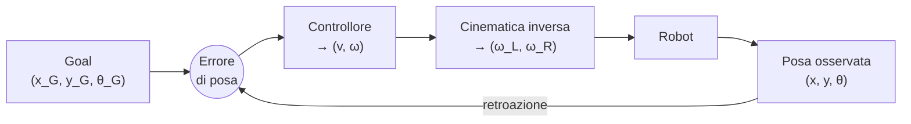
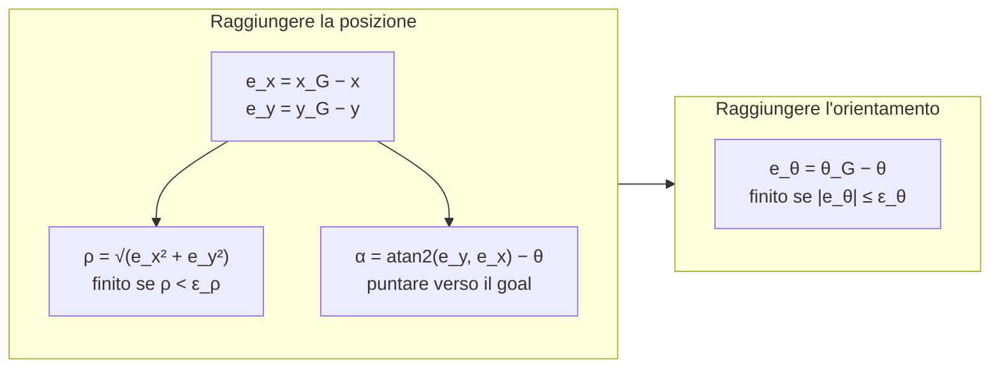

# Lezione 5 — Dagli angoli RPY al gimbal lock; cinematica e controllo della base differenziale

## 1. Riepilogo: angoli roll, pitch, yaw

La lezione riprende gli angoli **roll, pitch, yaw** (RPY) introdotti nella [[Robotica MOD1 - Lezione 04|lezione 4]]: rotazioni attorno agli assi $x$, $y$ e $z$, di angoli $\varphi$, $\theta$ e $\psi$. Il verso positivo è quello **antiorario** guardando l'asse dalla sua punta, per ciascuno dei tre assi.

La convenzione del corso resta la **estrinseca XYZ**: si ruota prima attorno a $x$, poi attorno a $y$, poi attorno a $z$, sempre sugli assi fissi del mondo. La matrice corrispondente è

$$R(\varphi,\theta,\psi) = R_z(\psi)\,R_y(\theta)\,R_x(\varphi) = \begin{bmatrix}
c_\psi c_\theta & c_\psi s_\theta s_\varphi - s_\psi c_\varphi & c_\psi s_\theta c_\varphi + s_\psi s_\varphi \\
s_\psi c_\theta & s_\psi s_\theta s_\varphi + c_\psi c_\varphi & s_\psi s_\theta c_\varphi - c_\psi s_\varphi \\
-s_\theta & c_\theta s_\varphi & c_\theta c_\varphi
\end{bmatrix},$$

dove $c_\varphi = \cos\varphi$, $s_\varphi = \sin\varphi$ e così via. Nel seguito $r_{ij}$ indica l'elemento di riga $i$ e colonna $j$.

Il docente ha ricordato che i nomi roll, pitch e yaw sono legati in origine al **corpo**. Lo yaw è la rotazione attorno all'asse verticale «sopra la testa» del corpo: se si sceglie una terna in cui la verticale è l'asse $y$ invece di $z$, lo yaw potrebbe essere la rotazione attorno a $y$. Altri programmi adottano convenzioni diverse; nel corso si usa sempre quella appena richiamata, e da qui in avanti il docente non la ripeterà: va interiorizzata.

---

## 2. Dalla matrice di rotazione agli angoli RPY

### 2.1 L'angolo di pitch

Data una matrice di rotazione $R$, ci si chiede come ricostruire gli angoli $\varphi$, $\theta$, $\psi$ che l'hanno generata. Si cercano nella matrice gli elementi più semplici.

L'elemento in basso a sinistra contiene il solo $\theta$:

$$r_{31} = -\sin\theta .$$

Gli altri due elementi della prima colonna contengono $\cos\theta$ moltiplicato per una funzione di $\psi$. Sommandone i quadrati, la dipendenza da $\psi$ scompare:

$$r_{11}^2 + r_{21}^2 = \cos^2\theta\,\big(\cos^2\psi + \sin^2\psi\big) = \cos^2\theta \qquad\Longrightarrow\qquad \cos\theta = \pm\sqrt{r_{11}^2 + r_{21}^2}.$$

> [!warning] Indici nella trascrizione
> Nella trascrizione si sente «$r_{11}^2 + r_{12}^2$». Gli elementi da usare sono quelli della **prima colonna**, $r_{11}$ e $r_{21}$, come il docente stesso dice indicando la matrice: sono gli unici che contengono $\cos\theta\cos\psi$ e $\cos\theta\sin\psi$.

### 2.2 Un'ambiguità: gli angoli RPY non sono unici

Qui compare un problema. Un quadrato ha due radici: sia il valore positivo sia quello negativo danno lo stesso quadrato. Ci sono quindi **due soluzioni** possibili per $\cos\theta$, e bisogna scegliere quale usare.

Questo fa capire un fatto importante: **la rappresentazione roll-pitch-yaw non è unica**. Terne di angoli diverse possono dare la stessa identica matrice di rotazione.

> [!example] Esempio: due terne di angoli, la stessa matrice
> Se $(\varphi, \theta, \psi)$ è una soluzione, lo è anche
> $$(\varphi', \theta', \psi') = (\varphi + \pi,\ \pi - \theta,\ \psi + \pi).$$
> Infatti $\sin\theta' = \sin\theta$, mentre $\cos\theta' = -\cos\theta$. Inoltre aggiungere $\pi$ a $\varphi$ e a $\psi$ cambia il segno dei loro seni e coseni. Nella prima colonna, per esempio, $r_{11}' = \cos\psi'\cos\theta' = (-\cos\psi)(-\cos\theta) = r_{11}$. Con un calcolo analogo si verifica che tutti e nove gli elementi coincidono: è la soluzione con $\cos\theta < 0$.
> Numericamente: $(0{,}3;\ -0{,}5;\ 1{,}2)$ e $(0{,}3 + \pi;\ \pi + 0{,}5;\ 1{,}2 + \pi)$ danno la stessa matrice.

Per ottenere un risultato univoco si fissa una convenzione: si sceglie il **ramo positivo** della radice. Equivale a limitare il pitch all'intervallo

$$\theta \in \left(-\tfrac{\pi}{2},\ \tfrac{\pi}{2}\right),$$

dove $\cos\theta > 0$. Con questa scelta

$$\theta = \operatorname{atan2}\!\Big(-r_{31},\ \sqrt{r_{11}^2 + r_{21}^2}\Big).$$

Il docente ha raccomandato di fare attenzione anche alla **continuità** dei valori ottenuti (lo si riprende nella sezione 4).

### 2.3 La funzione atan2

La funzione più familiare per ricavare un angolo è l'arcotangente: dati i due cateti $y$ e $x$ di un triangolo rettangolo, l'angolo è $\arctan(y/x)$. Ha però due difetti.

- È sensibile al caso $x = 0$, dove il rapporto non è definito: il grafico ha degli asintoti.
- Guardando solo il rapporto $y/x$ perde l'informazione sui segni: $(y, x)$ e $(-y, -x)$ danno lo stesso rapporto, quindi non si distingue tra due angoli che differiscono di $\pi$.

La funzione $\operatorname{atan2}(y, x)$ è un'arcotangente «a due argomenti» che gestisce questi casi. Riceve $y$ e $x$ separatamente, è definita anche per $x = 0$ e usa i segni di entrambi per restituire l'angolo nel **quadrante corretto**, in $(-\pi, \pi]$. È la funzione che si usa in tutti i calcoli di questo tipo; è disponibile in praticamente tutte le librerie matematiche (in Python, `math.atan2` e `numpy.arctan2`).

### 2.4 Gli angoli di roll e di yaw

Fissato $\theta$, si cercano gli elementi che contengono $\varphi$ e $\psi$ con un fattore in comune.

- Nell'ultima riga: $r_{32} = \cos\theta\sin\varphi$ e $r_{33} = \cos\theta\cos\varphi$.
- Nella prima colonna: $r_{21} = \cos\theta\sin\psi$ e $r_{11} = \cos\theta\cos\psi$.

L'arcotangente di un angolo si ottiene dal rapporto tra seno e coseno di quell'angolo. Qui seno e coseno sono moltiplicati per lo stesso fattore $\cos\theta$, che nel rapporto si semplifica. Poiché si è scelto $\cos\theta > 0$, il fattore non cambia nemmeno i segni dei due argomenti, e atan2 restituisce il quadrante giusto:

> [!important] Da matrice di rotazione ad angoli RPY (caso regolare)
> Con la convenzione $\theta \in (-\pi/2,\ \pi/2)$:
> $$\theta = \operatorname{atan2}\!\Big(-r_{31},\ \sqrt{r_{11}^2 + r_{21}^2}\Big), \qquad \varphi = \operatorname{atan2}(r_{32},\ r_{33}), \qquad \psi = \operatorname{atan2}(r_{21},\ r_{11}).$$

Ecco perché la scelta del ramo non è solo formale: se $\cos\theta$ fosse negativo, entrambi gli argomenti di atan2 cambierebbero segno e il risultato si sposterebbe di $\pi$. È proprio l'altra soluzione dell'esempio precedente.

> [!tip] Collegamento con la lezione 4
> Nell'approfondimento della lezione 4 il pitch era scritto come $\operatorname{atan2}\big(-r_{31},\ \sqrt{r_{32}^2 + r_{33}^2}\big)$. Le due forme sono equivalenti: anche $r_{32}^2 + r_{33}^2 = \cos^2\theta\,(\sin^2\varphi + \cos^2\varphi) = \cos^2\theta$.

---

## 3. Il caso singolare: il gimbal lock

### 3.1 Che cosa succede agli estremi dell'intervallo

L'intervallo $(-\pi/2,\ \pi/2)$ è aperto. Che cosa succede se il pitch vale **esattamente** $\pi/2$? Allora $\cos\theta = 0$ e $\sin\theta = 1$. Sostituendo nella matrice e usando le formule di sottrazione degli angoli si ottiene

$$R\!\left(\varphi, \tfrac{\pi}{2}, \psi\right) = \begin{bmatrix} 0 & \sin(\varphi - \psi) & \cos(\varphi - \psi) \\ 0 & \cos(\varphi - \psi) & -\sin(\varphi - \psi) \\ -1 & 0 & 0 \end{bmatrix}.$$

Tutti gli elementi dipendono **solo dalla differenza** $\varphi - \psi$. Una differenza di $1$ si può ottenere con $5 - 4$, ma anche con $3 - 2$ o con infinite altre coppie: dalla matrice non si possono più ricostruire separatamente gli angoli di partenza senza fare un'ipotesi.

Ne seguono due fatti.

- Matrici generate da angoli diversi coincidono. Per esempio
$$R\!\left(0,\ \tfrac{\pi}{2},\ 0\right) = R\!\left(\tfrac{\pi}{6},\ \tfrac{\pi}{2},\ \tfrac{\pi}{6}\right) = \begin{bmatrix} 0 & 0 & 1 \\ 0 & 1 & 0 \\ -1 & 0 & 0 \end{bmatrix}.$$
Sono due situazioni effettivamente diverse come terne di angoli, ma non si possono distinguere.
- Gli elementi $r_{11}$, $r_{21}$, $r_{32}$, $r_{33}$ valgono zero. Le formule del caso regolare chiederebbero quindi $\operatorname{atan2}(0, 0)$, che non ha significato.

Per $\theta = -\pi/2$ succede lo stesso, con la somma $\varphi + \psi$ al posto della differenza.

### 3.2 Il significato fisico

Il docente ha invitato a collegare sempre questi casi alla realtà. Il pitch è la rotazione attorno all'asse laterale del veicolo: è il «muso» che si alza o si abbassa. Un pitch di $\pm\pi/2$ significa che il veicolo è **verticale**.

- Per un **veicolo marino** è un caso rarissimo: significherebbe che sta affondando di prua o che è in verticale.
- Per un **robot aereo** non è così raro. In manovre particolarmente aggressive, per esempio una virata stretta per tornare indietro, il veicolo può passare per istanti in cui è verticale.

Sono **casi limite**, ma vanno saputi gestire: anche se di solito non si presentano, dipende dall'applicazione.

### 3.3 Singolarità e gimbal lock

Questi casi si chiamano **casi singolari**. In matematica una singolarità è una situazione in cui la soluzione è ambigua o non esiste. Questo caso specifico si chiama ***gimbal lock*** (blocco cardanico). Il *gimbal* è lo stesso sistema di sospensione cardanica usato, per esempio, negli stabilizzatori delle telecamere: in questa configurazione due assi di rotazione si allineano e non si distinguono più gli angoli.

La soluzione convenzionale è **fare una scelta**: visto che non si può sapere quale sia l'uno e quale l'altro, si fissa arbitrariamente uno dei due angoli, di solito $\varphi = 0$, e si ricava l'altro.

> [!warning] Sezione ricostruita — inizio (la formula dettata a lezione per $\psi$ non è intelligibile nella trascrizione)
> Con $\varphi = 0$ e $\theta = \pi/2$ la matrice diventa
> $$R\!\left(0, \tfrac{\pi}{2}, \psi\right) = \begin{bmatrix} 0 & -\sin\psi & \cos\psi \\ 0 & \cos\psi & \sin\psi \\ -1 & 0 & 0 \end{bmatrix},$$
> quindi
> $$\psi = \operatorname{atan2}(-r_{12},\ r_{22}).$$
> La stessa formula vale anche per $\theta = -\pi/2$: in quel caso $r_{12} = -\sin(\varphi + \psi)$ e $r_{22} = \cos(\varphi + \psi)$, e con $\varphi = 0$ si ottiene ancora $\psi$. Si può verificare che la terna $(0, \pm\pi/2, \psi)$ così ottenuta ridà esattamente la matrice di partenza.
>
> Sezione ricostruita — fine

Nel codice questo si traduce in un **ramo** (*branch*): se $|\theta|$ è (numericamente) uguale a $\pi/2$, si passa alla gestione del gimbal lock, si fissa $\varphi = 0$ e si calcola $\psi$; altrimenti si usano le formule del caso regolare.

```python
import numpy as np

def matrix_to_rpy(R, tol=1e-9):
    """Angoli RPY (convenzione estrinseca XYZ) da una matrice di rotazione 3x3."""
    cos_theta = np.hypot(R[0, 0], R[1, 0])          # ramo positivo: θ in (-π/2, π/2)
    theta = np.arctan2(-R[2, 0], cos_theta)
    if cos_theta > tol:                              # caso regolare
        phi = np.arctan2(R[2, 1], R[2, 2])
        psi = np.arctan2(R[1, 0], R[0, 0])
    else:                                            # gimbal lock: θ = ±π/2
        phi = 0.0                                    # scelta convenzionale
        psi = np.arctan2(-R[0, 1], R[1, 1])
    return phi, theta, psi
```

La funzione usa `np.hypot`, che calcola $\sqrt{a^2 + b^2}$. Nella sezione 6 è verificata insieme alla conversione inversa.

---

## 4. Conseguenze pratiche: quale rappresentazione usare

### 4.1 Lo stato interno e il logging

Dalle singolarità segue un consiglio generale: è **altamente sconsigliabile usare gli angoli RPY per rappresentare lo stato del sistema**. Visto che sono soggetti a singolarità, per lo stato interno è meglio usare altre variabili, per esempio direttamente la matrice di rotazione.

Il problema è lo spazio. Durante un esperimento si può tenere tranquillamente in memoria la matrice, con i suoi 9 numeri. Diverso è il caso del ***logging***, cioè della registrazione su file dell'andamento dell'esperimento, campione dopo campione, per poterlo analizzare in seguito. Lì conviene convertire lo stato in angoli RPY prima di salvarlo: si salvano 3 numeri invece di 9, riducendo di un fattore 3 l'occupazione di memoria. Gli angoli RPY sono quindi utili da conoscere, interpretare e convertire, a patto di sapere sempre in quale convenzione e in quale regione ci si trova.

### 4.2 La continuità degli angoli

Anche le conversioni vanno fatte con attenzione. Supponiamo che il corpo si trovi vicino a una configurazione singolare. Due istanti successivi, con orientamenti quasi uguali, potrebbero essere convertiti in terne di angoli molto diverse: un millisecondo dopo sembrerebbe che il corpo abbia fatto una rotazione istantanea, cosa fisicamente impossibile. In molti casi si sceglie allora la soluzione che **preserva la continuità** degli angoli rispetto al valore dell'istante precedente.

### 4.3 I quaternioni

Una rappresentazione dell'orientamento che risolve questo tipo di problema sono i **quaternioni**. Usano quattro numeri invece di tre, legati tra loro, e **non soffrono di gimbal lock**. Hanno molti vantaggi ma anche altri tipi di problematiche, e soprattutto sono molto poco intuitivi: dai quattro numeri non si «vede» la rotazione, perché sono una rappresentazione puramente matematica. In alcune applicazioni, come la robotica aerea, il gimbal lock è un problema concreto e i quaternioni sono la scelta abituale. Il corso non li approfondirà, perché non prevede esperimenti di robotica aerea.

> [!tip] Approfondimento — Il quaternione unitario
> #approfondimento
> Una rotazione di angolo $\vartheta$ attorno a un asse di versore $\mathbf r$ si rappresenta con il quaternione unitario $\mathcal Q = \{\eta, \boldsymbol\epsilon\}$, con parte scalare $\eta = \cos(\vartheta/2)$ e parte vettoriale $\boldsymbol\epsilon = \sin(\vartheta/2)\,\mathbf r$ [@siciliano2009]. I quattro numeri soddisfano il vincolo $\eta^2 + \|\boldsymbol\epsilon\|^2 = 1$, quindi i parametri indipendenti restano tre. Dalla definizione segue anche una piccola ridondanza: $\mathcal Q$ e $-\mathcal Q$ rappresentano la stessa rotazione, perché cambiare $\vartheta$ in $\vartheta + 2\pi$ cambia il segno di entrambe le parti.

---

## 5. Esempio: l'ordine delle rotazioni con angoli RPY

Per fissare le idee il docente ha proposto un esempio con

$$\varphi = \tfrac{\pi}{2}, \qquad \theta = 0, \qquad \psi = \tfrac{\pi}{2}.$$

Poiché $\theta = 0$, $R_y(0)$ è l'identità: se non c'è angolo, la matrice $3\times 3$ non cambia nulla. La matrice RPY si riduce a

$$R = R_z\!\left(\tfrac{\pi}{2}\right) R_x\!\left(\tfrac{\pi}{2}\right), \qquad R_z\!\left(\tfrac{\pi}{2}\right) = \begin{bmatrix} 0 & -1 & 0 \\ 1 & 0 & 0 \\ 0 & 0 & 1 \end{bmatrix}.$$

La matrice $R_z(\pi/2)$ si può scrivere ragionando per colonne come visto nelle lezioni precedenti: una rotazione di $\pi/2$ attorno a $z$ porta l'asse $x$ in $+y$, e così via. Il prodotto nell'ordine della convenzione (prima $x$, poi $z$, sugli assi fissi) è

$$R_z\!\left(\tfrac{\pi}{2}\right) R_x\!\left(\tfrac{\pi}{2}\right) = \begin{bmatrix} 0 & 0 & 1 \\ 1 & 0 & 0 \\ 0 & 1 & 0 \end{bmatrix},$$

mentre nell'ordine opposto

$$R_x\!\left(\tfrac{\pi}{2}\right) R_z\!\left(\tfrac{\pi}{2}\right) = \begin{bmatrix} 0 & -1 & 0 \\ 0 & 0 & -1 \\ 1 & 0 & 0 \end{bmatrix}.$$

Il risultato è nettamente diverso: anche con soli due angoli non nulli si vede subito che **nello spazio le rotazioni non commutano**.

> [!warning] Segni nella trascrizione
> Nella trascrizione la seconda matrice è dettata come $(0, 1, 0;\ 0, 0, 1;\ 1, 0, 0)$, senza segni meno. Il prodotto corretto contiene due elementi $-1$, come riportato sopra (la stessa matrice compare nella sezione 6 della lezione 4). La conclusione non cambia.

---

## 6. Esercizio nel simulatore: la matrice RPY

Il simulatore va aggiornato anche questa volta. Il docente, che prepara le lezioni settimana per settimana trattandosi di un corso nuovo, ricorda il consiglio di usare `git pull` invece di riscaricare tutto, facendo attenzione a conservare i propri esercizi.

Il file da completare è `exercises/lesson02/rpy.py`, nel task dedicato agli angoli RPY. Il simulatore fornisce gli angoli; bisogna calcolare la matrice di rotazione **in due modi**: con la formula esplicita e come prodotto di rotazioni elementari successive. Il simulatore mostra un segno di spunta se le due matrici coincidono e una croce se sono diverse.

**Python e C++.** Il docente ha osservato che Python spesso non è lo strumento finale: le implementazioni che richiedono prestazioni sono spesso scritte in C++. Per la **prototipazione** e per le parti senza requisiti stringenti di prestazioni, però, Python va benissimo, ed è utile esercitarsi con le sue librerie. Il materiale con i consigli sulle funzioni utili è su AulaWeb.

Due comodità di Python e NumPy mostrate a lezione rendono il codice molto sintetico.

- **Funzioni vettoriali.** `np.cos` accetta un intero vettore e restituisce i coseni di tutti gli elementi. Con l'**assegnazione multipla** (*unpacking*) i tre risultati finiscono in tre variabili in una sola riga: `cr, cp, cy = np.cos([roll, pitch, yaw])`. In C++ una scrittura così sintetica non sarebbe altrettanto immediata (si può ottenere con strumenti come le tuple).
- **Tipi dinamici.** In Python i tipi delle variabili non vanno dichiarati. In C++ invece bisogna dichiarare il tipo di ogni variabile, che in memoria ha una dimensione precisa. La libertà di Python rende la scrittura più facile e veloce, ma ha anche i suoi svantaggi, perché alcuni errori emergono solo durante l'esecuzione.

In NumPy una matrice $3\times 3$ è un array di tre righe, ciascuna un array di tre elementi. Il docente consiglia, per abitudine, di aprire e chiudere subito le parentesi e solo dopo riempirle, per non perdersi tra le parentesi annidate.

```python
import numpy as np

def rot_x(a):
    c, s = np.cos(a), np.sin(a)
    return np.array([[1, 0, 0], [0, c, -s], [0, s, c]])

def rot_y(a):
    c, s = np.cos(a), np.sin(a)
    return np.array([[c, 0, s], [0, 1, 0], [-s, 0, c]])

def rot_z(a):
    c, s = np.cos(a), np.sin(a)
    return np.array([[c, -s, 0], [s, c, 0], [0, 0, 1]])

def rpy_explicit(roll, pitch, yaw):
    cr, cp, cy = np.cos([roll, pitch, yaw])      # coseni in una sola riga
    sr, sp, sy = np.sin([roll, pitch, yaw])      # seni in una sola riga
    return np.array([
        [cy*cp, cy*sp*sr - sy*cr, cy*sp*cr + sy*sr],
        [sy*cp, sy*sp*sr + cy*cr, sy*sp*cr - cy*sr],
        [-sp,   cp*sr,            cp*cr           ],
    ])

def rpy_composed(roll, pitch, yaw):
    return rot_z(yaw) @ rot_y(pitch) @ rot_x(roll)   # estrinseca XYZ

R1 = rpy_explicit(np.pi/2, 0.0, np.pi/2)
R2 = rpy_composed(np.pi/2, 0.0, np.pi/2)
print(np.allclose(R1, R2))                           # True
print(np.round(R1).astype(int))                      # [[0 0 1] [1 0 0] [0 1 0]]

# Verifica della conversione inversa (sezioni 2-3), inclusi i casi singolari
for angles in [(0.3, -0.5, 1.2), (0.7, np.pi/2, 0.2), (0.7, -np.pi/2, 0.2)]:
    R = rpy_composed(*angles)
    print(np.allclose(R, rpy_composed(*matrix_to_rpy(R))))   # True
```

> [!warning] Nomi indicativi
> I nomi delle funzioni sono indicativi: fa fede il file `rpy.py` del repository. La funzione `matrix_to_rpy` usata nell'ultima parte è quella della sezione 3.

---

## 7. Cinematica della base a trazione differenziale

Nella seconda parte della lezione si torna al robot a trazione differenziale, già incontrato nella [[Robotica MOD1 - Lezione 01|lezione 1]]. Nelle formule che seguono:

- $r$ è il **raggio** delle ruote;
- $L$ è la **distanza tra le ruote** (l'interasse, indicato con $b$ nella lezione 1);
- $\omega_L$ e $\omega_R$ sono le **velocità angolari** delle ruote sinistra e destra;
- $v$ e $\omega$ sono la velocità lineare di avanzamento e la velocità angolare del robot.

Le velocità lineari delle ruote della lezione 1 sono quindi $v_L = r\,\omega_L$ e $v_R = r\,\omega_R$.

> [!warning] Sezione ricostruita — inizio (la registrazione presenta un vuoto: la cinematica diretta è stata presentata ma non è trascritta)
> La **cinematica diretta** risponde alla domanda: date le velocità delle ruote, come si muove il robot? Riprendendo le formule della lezione 1 con le velocità angolari delle ruote:
> $$v = \frac{r\,(\omega_R + \omega_L)}{2}, \qquad \omega = \frac{r\,(\omega_R - \omega_L)}{L}.$$
> La velocità di avanzamento è la media delle velocità lineari delle due ruote. La velocità angolare è proporzionale alla loro differenza, divisa per la distanza tra le ruote.
>
> Sezione ricostruita — fine

### 7.1 Cinematica diretta e inversa: a che cosa servono

Il docente ha distinto i due usi.

- La **cinematica diretta** è utile per capire **dove si è arrivati**: applicate certe velocità alle ruote, come si è mosso il robot.
- La **cinematica inversa** si usa soprattutto nei **contesti di controllo**: si vuole che il robot si muova con una certa velocità lineare $v$ e angolare $\omega$, e ci si chiede quali velocità dare alle ruote per ottenerle.

Risolvendo il sistema della cinematica diretta rispetto a $\omega_L$ e $\omega_R$:

> [!important] Cinematica inversa della base differenziale
> $$\omega_L = \frac{v - \dfrac{L\,\omega}{2}}{r}, \qquad \omega_R = \frac{v + \dfrac{L\,\omega}{2}}{r}.$$

Sono le formule che si useranno per imporre il moto al robot. Per andare da un punto a un altro, il robot deve ricevere una velocità angolare (per orientarsi) e una velocità lineare (per avanzare): si decidono $\omega$ e $v$, poi le due formule dicono quali velocità dare alle ruote.

> [!example] Esempio numerico
> Un robot ha ruote di raggio $r = 0{,}05\ \text{m}$ e interasse $L = 0{,}3\ \text{m}$. Si vuole $v = 0{,}2\ \text{m/s}$ e $\omega = 0{,}5\ \text{rad/s}$ (curva a sinistra). Il termine $L\omega/2$ vale $0{,}075\ \text{m/s}$:
> $$\omega_R = \frac{0{,}2 + 0{,}075}{0{,}05} = 5{,}5\ \text{rad/s}, \qquad \omega_L = \frac{0{,}2 - 0{,}075}{0{,}05} = 2{,}5\ \text{rad/s}.$$
> Verifica con la cinematica diretta: $v = 0{,}05\,(5{,}5 + 2{,}5)/2 = 0{,}2\ \text{m/s}$ e $\omega = 0{,}05\,(5{,}5 - 2{,}5)/0{,}3 = 0{,}5\ \text{rad/s}$.

### 7.2 Il modello dell'uniciclo

Resta da capire come variano nel tempo le coordinate del robot nel piano. Il robot si muove con velocità $v$ **solo lungo il proprio asse $x$**: nella terna del robot la velocità è $(v,\ 0)^T$. Per sapere come si sposta nel mondo, basta esprimere questa velocità nella terna del mondo con la matrice di rotazione dell'orientamento corrente $\theta$:

$$\begin{bmatrix} \dot x \\ \dot y \end{bmatrix} = \begin{bmatrix} \cos\theta & -\sin\theta \\ \sin\theta & \cos\theta \end{bmatrix}\begin{bmatrix} v \\ 0 \end{bmatrix} = \begin{bmatrix} v\cos\theta \\ v\sin\theta \end{bmatrix}.$$

La velocità angolare $\omega$, invece, è proprio la velocità di variazione dell'angolo: $\dot\theta = \omega$. Mettendo insieme le tre equazioni si ottiene il modello cinematico del robot, detto **modello dell'uniciclo** (già anticipato nell'approfondimento della lezione 1).

> [!important] Modello dell'uniciclo
> Con la configurazione $\mathbf q = (x,\ y,\ \theta)^T$ e l'ingresso di controllo $\mathbf u = (v,\ \omega)^T$:
> $$\dot{\mathbf q} = \begin{bmatrix} \dot x \\ \dot y \\ \dot\theta \end{bmatrix} = \begin{bmatrix} \cos\theta & 0 \\ \sin\theta & 0 \\ 0 & 1 \end{bmatrix}\begin{bmatrix} v \\ \omega \end{bmatrix} = G(\mathbf q)\,\mathbf u .$$

La matrice $G(\mathbf q)$ descrive **come la configurazione agisce sul movimento**: lo stesso comando produce spostamenti diversi a seconda di come è orientato il robot. Il vettore $\mathbf u$ è l'**ingresso di controllo**. A seconda di $v$ e $\omega$ applicati, le variabili di configurazione evolvono secondo questa legge.

> [!warning] Forma della matrice $G$ nella trascrizione
> Alla lavagna la matrice è dettata per righe come «$\cos\theta, \sin\theta, 0$ / $0, 0, 1$», cioè nella forma trasposta. Perché il prodotto $G(\mathbf q)\,\mathbf u$ abbia senso ($3$ equazioni, $2$ ingressi), $G$ deve essere $3\times 2$, con le colonne $(\cos\theta, \sin\theta, 0)^T$ e $(0, 0, 1)^T$, come nel riquadro.

---

## 8. Il controllo in retroazione verso un obiettivo

### 8.1 Regolazione con feedback

Con questi strumenti si può iniziare a progettare un **controllo** che porti il robot dove si vuole. Il compito è imporre al robot di assumere una certa configurazione: partire da una posa e arrivare a una posa obiettivo, il ***goal***. Lo si farà con un **controllo in regolazione**: un controllo che usa il **feedback**, cioè dove si è arrivati istante per istante, per aggiornare il comando.

Lo schema è il seguente. L'obiettivo, confrontato con la posa attuale, genera un **errore di posa**. Si parla di posa e non di posizione: la posizione comprende solo $(x, y)$, la posa anche l'orientamento $\theta$. L'errore genera delle **velocità desiderate** $(v, \omega)$, che diventano velocità delle ruote; applicate al robot, lo spostano e generano una nuova **posa osservata**.



Se ci si fermasse al percorso in avanti, senza l'anello di ritorno, il controllo sarebbe del tipo: «sono qui, il goal è là, avanzo a $1$ m/s per $3$ secondi, punto». Il problema è lo stesso visto nella lezione 1: se ci sono **disturbi**, oppure **errori nel controllo** (non si sta controllando davvero ciò che si pensava), e non si verifica dove si è arrivati, l'effetto del controllo va perso. Il docente ha usato l'esempio dell'auto: decidere i comandi una volta per tutte e poi lasciare che la macchina vada da sola, senza guardare la strada e il traffico. Un comando iniziale «che vada bene sempre» è un'ipotesi ideale che non è mai vera. Il pezzo da aggiungere è la **catena di retroazione**, in cui la posa osservata viene confrontata con l'obiettivo e genera un nuovo errore, a ogni passo di avanzamento del compito.

### 8.2 Il goal e gli errori di posizione

Il goal è una **posa** $(x_G,\ y_G,\ \theta_G)$: un punto da raggiungere e un orientamento da assumere una volta arrivati. Per semplicità di notazione, la posa attuale del robot si indica con $\mathbf q = (x,\ y,\ \theta)$.

Per raggiungere la **posizione** del goal si definiscono gli errori lungo i due assi e la distanza dal goal:

$$e_x = x_G - x, \qquad e_y = y_G - y, \qquad \rho = \sqrt{e_x^2 + e_y^2}.$$

Il goal si considera raggiunto, per quanto riguarda la posizione, quando

$$\rho < \varepsilon_\rho, \qquad \varepsilon_\rho > 0 .$$

Qui sta un punto importante: bisogna decidere una **tolleranza**, cioè quando si ritiene di essere arrivati. Non si arriva mai esattamente sul punto. Per esempio con $\varepsilon_\rho = 10^{-3}$ m si accetta di essere arrivati quando si è entro un millimetro dal goal. Il valore si può cambiare per vedere che cosa succede.

### 8.3 L'errore di direzione $\alpha$

Il robot può viaggiare **solo lungo il proprio asse $x$**: non basta dargli una velocità e lasciarlo andare, prima bisogna **orientarlo verso il goal**. Serve quindi un errore di orientamento, e il docente ha insistito su una distinzione importante.

> [!important] L'errore $\alpha$ non è $\theta_G - \theta$
> L'errore da azzerare per puntare verso il goal **non** è la differenza tra l'orientamento del robot e quello desiderato al goal. È l'angolo tra la direzione del robot e la **retta che congiunge il robot al goal**:
> $$\alpha = \operatorname{atan2}(e_y,\ e_x) - \theta .$$
> Il termine $\operatorname{atan2}(e_y, e_x)$ è l'angolo, rispetto all'asse $x$ del mondo, della congiungente robot–goal. Sottraendo l'orientamento attuale $\theta$ si ottiene quanto il robot deve ruotare per puntare verso il goal.

### 8.4 L'errore di orientamento finale

Raggiunta la posizione, resta da soddisfare l'**orientamento** attorno a $z$ richiesto dal goal. Si definisce l'errore

$$e_\theta = \theta_G - \theta ,$$

e l'orientamento si considera raggiunto quando

$$|e_\theta| \le \varepsilon_\theta, \qquad \varepsilon_\theta > 0 .$$

Gli angoli sono in **radianti**. Siccome viene più facile ragionare in gradi, si può fissare la tolleranza a un grado:

$$1^\circ = \frac{\pi}{180}\ \text{rad} \approx 0{,}0175\ \text{rad}.$$

Il docente ha commentato che forse un grado è una tolleranza troppo stretta; il valore alternativo citato subito dopo non è intelligibile nella trascrizione.



> [!tip] Excalidraw
> Uno schizzo con il robot in $(x, y)$ orientato di $\theta$, il goal in $(x_G, y_G)$ con il suo orientamento $\theta_G$, la congiungente di lunghezza $\rho$ e l'angolo $\alpha$ tra la direzione del robot e la congiungente aiuta a non confondere $\alpha$ con $e_\theta$.

### 8.5 Verso la legge di controllo

La lezione si chiude con un'anticipazione. Questi errori, moltiplicati per opportuni **guadagni**, daranno il controllo da applicare. Nell'esercizio del simulatore lo si userà per far muovere la base differenziale verso il goal. È l'argomento della [[Robotica MOD1 - Lezione 06|lezione 6]].
