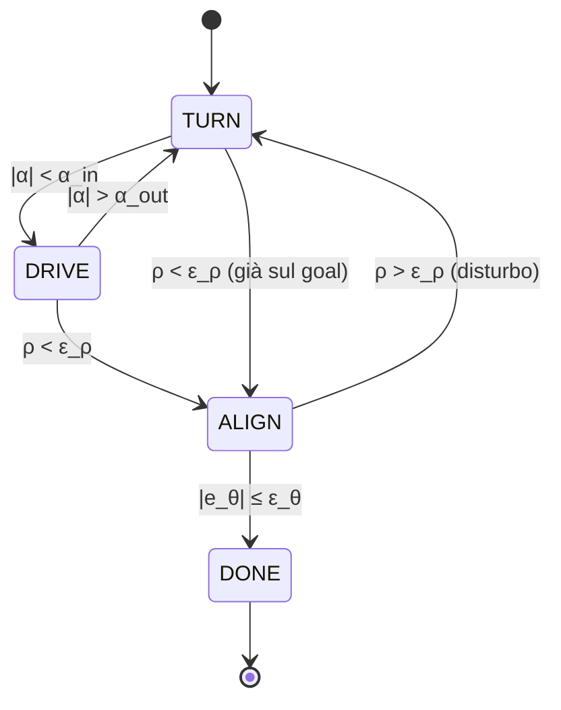

# Lezione 6 — Controllo proporzionale della base differenziale e macchina a stati

## 1. Riepilogo: gli errori rispetto al goal

La lezione riprende la fine della [[Robotica MOD1 - Lezione 05|lezione 5]]. Il robot a trazione differenziale si trova nella posa $(x, y, \theta)$ e deve raggiungere un **goal** $(x_G, y_G, \theta_G)$: arrivare nel punto e poi, eventualmente, girarsi nella direzione desiderata. Il robot si comanda con la coppia $(v, \omega)$: $v$ è la velocità di avanzamento lungo la direzione $\theta$, $\omega$ la velocità angolare.

Gli errori definiti nella lezione precedente sono:

| Errore | Definizione | Significato | Condizione di arrivo |
| --- | --- | --- | --- |
| $e_x$, $e_y$ | $x_G - x$, $\ y_G - y$ | Componenti della distanza dal goal | — |
| $\rho$ | $\sqrt{e_x^2 + e_y^2}$ | Distanza dal goal | $\rho < \varepsilon_\rho$ |
| $\alpha$ | $\operatorname{atan2}(e_y, e_x) - \theta$ | Angolo tra la direzione del robot e la congiungente con il goal | — |
| $e_\theta$ | $\theta_G - \theta$ | Errore di orientamento finale | $\lvert e_\theta \rvert \le \varepsilon_\theta$ |

Per $\rho$ la condizione non ha valore assoluto perché una distanza è sempre positiva. Per $e_\theta$ serve il valore assoluto, perché l'errore angolare può essere anche negativo: lo si esprime in un intervallo simmetrico rispetto allo zero, come si vede subito.

Il problema si affronta in due passi, come nel primo esercizio del simulatore: prima ci si preoccupa solo di **arrivare**, poi eventualmente di **orientarsi** nella direzione desiderata.

---

## 2. Normalizzazione degli angoli

### 2.1 Perché l'intervallo $(-\pi, \pi]$

Il docente ha chiarito una differenza importante tra gli errori angolari e la distanza. Un errore angolare si può esprimere in molti modi, e la scelta ha conseguenze concrete sul comportamento del robot.

Si supponga di misurare gli angoli da $0^\circ$ a $360^\circ$. Il robot è orientato a $0^\circ$ e un goal si trova nella direzione di $350^\circ$. Con questa convenzione l'errore varrebbe $350^\circ$, e il robot farebbe quasi un giro completo per allinearsi, quando basterebbe **ruotare di $10^\circ$ nel verso opposto**. Non ha senso.

È molto più conveniente esprimere gli errori in un intervallo **centrato sul robot**, da $-\pi$ a $\pi$. In questo modo l'errore di $350^\circ$ diventa un piccolo errore di $-10^\circ$, cioè $-\pi/18$, e il riferimento generato fa girare il robot dal lato giusto. Con un intervallo simmetrico rispetto allo zero il robot può girare sia a destra sia a sinistra, scegliendo sempre la rotazione più breve, invece di compensare inutilmente un errore di quasi $2\pi$.

Poiché gli errori, moltiplicati per un guadagno, **generano i comandi**, prima di usarli bisogna **normalizzarli** in questo intervallo.

### 2.2 La formula

Un modo per normalizzare un angolo qualsiasi $\alpha$ nell'intervallo $[-\pi, \pi)$ è:

1. sommare $\pi$;
2. applicare l'operazione **modulo** $2\pi$ (il resto della divisione per $2\pi$), che riporta il valore in $[0, 2\pi)$;
3. sottrarre di nuovo $\pi$.

> [!important] Normalizzazione di un angolo
> $$\operatorname{wrap}(\alpha) = \big((\alpha + \pi) \bmod 2\pi\big) - \pi \;\in\; [-\pi, \pi).$$

Funziona per qualunque valore, anche per angoli che hanno compiuto più giri o che sono negativi.

```python
import math

def wrap(angle):
    """Normalizza un angolo (in radianti) nell'intervallo [-π, π)."""
    return (angle + math.pi) % (2 * math.pi) - math.pi

print(math.degrees(wrap(math.radians(350))))    # ≈ -10
print(math.degrees(wrap(math.radians(-190))))   # ≈ 170
print(math.degrees(wrap(math.radians(725))))    # ≈ 5 (due giri in più)
```

> [!example] Esempio: perché va normalizzato anche $\alpha$
> $\operatorname{atan2}$ restituisce valori in $(-\pi, \pi]$ e anche $\theta$ sta in quell'intervallo. La loro differenza può quindi uscirne. Se la congiungente con il goal ha angolo $170^\circ$ e il robot è orientato a $-170^\circ$, la differenza è $340^\circ$. Normalizzata diventa $-20^\circ$: il robot deve ruotare di $20^\circ$ in senso orario, attraverso la direzione di $180^\circ$, non di $340^\circ$ in senso antiorario.

> [!tip] Approfondimento — L'operatore modulo in Python
> #approfondimento
> La formula funziona anche per angoli negativi perché in Python l'operatore `%` restituisce sempre un risultato con lo **stesso segno del secondo operando** (o zero) [@pythonReference]. Con divisore $2\pi$ il risultato è quindi in $[0, 2\pi)$. Non tutti i linguaggi si comportano così: in C e C++, per esempio, la funzione `fmod` dà un resto con il segno del dividendo. Portando la formula in quei linguaggi bisogna aggiungere una correzione per i valori negativi.

---

## 3. Il controllo proporzionale

### 3.1 Dagli errori ai comandi

Gli errori devono diventare **riferimenti** per il robot. Se c'è una distanza $\rho$ dal goal, si avanza con una velocità $v$ per avvicinarsi, e la si mantiene finché $\rho$ non si annulla. La scelta più semplice è una velocità **proporzionale** alla distanza dal goal: è un **controllo proporzionale**. Si prende l'errore, lo si moltiplica per un **guadagno** e si ottiene il riferimento.

> [!important] Leggi di controllo proporzionali
> $$v = k_\rho\,\rho, \qquad \omega = k_\alpha\,\alpha \qquad \text{(per raggiungere la posizione)},$$
> $$\omega = k_\theta\,e_\theta \qquad \text{(per l'orientamento finale)}.$$

- $v = k_\rho\,\rho$ fa avanzare il robot tanto più velocemente quanto più è lontano dal goal.
- $\omega = k_\alpha\,\alpha$ lo fa ruotare verso il goal. Senza questa rotazione, applicando solo la velocità $v$ si avanzerebbe nella direzione sbagliata, magari allontanandosi.
- $\omega = k_\theta\,e_\theta$ serve una volta arrivati, per allinearsi con l'orientamento del goal.

**Dimensioni dei guadagni.** Tutti questi guadagni si misurano in $\text{s}^{-1}$, perché i conti devono tornare anche dimensionalmente:

$$\underbrace{v}_{\text{m/s}} = \underbrace{k_\rho}_{\text{s}^{-1}}\,\underbrace{\rho}_{\text{m}}, \qquad \underbrace{\omega}_{\text{rad/s}} = \underbrace{k_\alpha}_{\text{s}^{-1}}\,\underbrace{\alpha}_{\text{rad}}.$$

Nello script dell'esercizio il valore predefinito è $k_\rho = 0{,}4\ \text{s}^{-1}$: con un errore di $1$ m si comanda $0{,}4$ m/s, cioè $40$ cm/s. Guadagni e tolleranze **dipendono dall'applicazione**.

- Se si vuole una precisione di un millimetro, si mette $\varepsilon_\rho = 10^{-3}$ m.
- Se si vuole arrivare più velocemente, motori permettendo, si aumenta il guadagno, per esempio a $1\ \text{s}^{-1}$.

Il valore predefinito della tolleranza $\varepsilon_\rho$ nello script non è intelligibile nella trascrizione.

### 3.2 Dai comandi cartesiani alle ruote

$v$ e $\omega$ sono comandi **cartesiani**, espressi nello spazio $x$–$y$. Il robot però agisce sulle ruote: i comandi vanno tradotti nelle velocità angolari delle ruote con la cinematica inversa vista nella lezione 5. Qui $r$ è il raggio delle ruote e $L$ la distanza tra le ruote:

$$\omega_L = \frac{v - \dfrac{L\,\omega}{2}}{r}, \qquad \omega_R = \frac{v + \dfrac{L\,\omega}{2}}{r}.$$

---

## 4. Primo esercizio: il goal di fronte al robot

### 4.1 La legge di controllo semplificata

Si procede un passo alla volta. Per ora si trascura l'orientamento e si suppone che il goal sia **esattamente di fronte** al robot, lungo la sua direzione di marcia. In questo caso non c'è errore di direzione ($\alpha = 0$), quindi non serve ruotare:

$$v = \begin{cases} k_\rho\,\rho & \text{se } \rho > \varepsilon_\rho \\ 0 & \text{se } \rho \le \varepsilon_\rho \end{cases}, \qquad \omega = 0 .$$

> [!example] Esempio: come decresce la distanza
> Con il goal di fronte, il robot avanza proprio verso il goal, quindi la distanza diminuisce esattamente della velocità di avanzamento: $\dot\rho = -v = -k_\rho\,\rho$. È un'equazione differenziale lineare del primo ordine, con soluzione
> $$\rho(t) = \rho_0\,e^{-k_\rho t}.$$
> La distanza decresce in modo **esponenziale**: il robot è veloce quando è lontano e rallenta avvicinandosi. In teoria non arriva mai esattamente a zero, ed è anche per questo che serve la tolleranza $\varepsilon_\rho$. Con $\rho_0 = 1$ m, $k_\rho = 0{,}4\ \text{s}^{-1}$ e $\varepsilon_\rho = 1$ cm, il tempo di arrivo è
> $$t = \frac{\ln(\rho_0/\varepsilon_\rho)}{k_\rho} = \frac{\ln 100}{0{,}4} \approx 11{,}5\ \text{s}.$$
> Raddoppiare la precisione richiesta allunga il tempo solo di $\ln 2 / k_\rho \approx 1{,}7$ s.
>
> ```chart
> type: line
> labels: [0, 1, 2, 3, 4, 5, 6, 7, 8, 9, 10]
> series:
>   - title: ρ(t) [m] con k_ρ = 0,4 1/s
>     data: [1, 0.670, 0.449, 0.301, 0.202, 0.135, 0.091, 0.061, 0.041, 0.027, 0.018]
>   - title: ρ(t) [m] con k_ρ = 1 1/s
>     data: [1, 0.368, 0.135, 0.050, 0.018, 0.007, 0.002, 0.001, 0, 0, 0]
> tension: 0.3
> width: 80%
> beginAtZero: true
> fill: false
> ```
>
> Asse orizzontale: tempo in secondi. Un guadagno più alto porta il robot al goal più in fretta, a parità di distanza iniziale, ma richiede velocità iniziali più elevate.

### 4.2 Il simulatore

Il simulatore aggiornato ha **segni di completamento** più evidenti per gli esercizi da svolgere. Per ogni esercizio c'è un **modello di riferimento**: premendo *Start* si vede che cosa deve succedere. Il robot raggiunge il goal, che diventa verde, e tutti i controlli risultano superati.

Al termine del movimento il simulatore mostra anche dei **grafici** di ciò che è successo:

- la traiettoria, che nell'esercizio va da $0$ a $1$;
- l'errore di posizione $\rho$;
- le velocità delle ruote, proporzionali all'errore, perché $v = k_\rho\,\rho$.

Non essendoci altri tipi di errore, gli altri grafici restano piatti.

Il file da completare è `proportional.py`, nella cartella degli esercizi della lezione 3. Il nome viene dal controllo proporzionale. Gli elementi principali sono i seguenti.

- In cima al file sono definiti il **goal**, il **guadagno** $k_\rho$ e la tolleranza di posizione $\varepsilon_\rho$.
- La funzione da completare restituisce i **comandi alle ruote** (*wheel command*), cioè $\omega_L$ e $\omega_R$.
- Dentro la funzione goal, guadagno, tolleranza e posa attuale si leggono attraverso `self`, la variabile che rappresenta l'oggetto stesso della classe. Le costanti definite in maiuscolo in cima al file si usano come attributi con un nome simile in minuscolo (`self.gain`, `self.goal`, …). La posa del robot è in `self.pose`.
- Per la distanza si può calcolare la radice della somma dei quadrati, oppure usare `math.hypot`, che fa la stessa cosa. Il README del repository riporta le equivalenze tra la notazione matematica e Python.
- Il goal contiene tre valori $(x, y, \theta)$, ma qui l'orientamento non serve. In Python si può **scartare** un valore assegnandolo al trattino basso: `gx, gy, _ = self.goal`.
- Va rimossa l'istruzione che solleva l'eccezione di «non implementato», sostituendola con il codice.

Il docente ha mostrato anche l'effetto di un errore: con un segno meno sbagliato nel calcolo dell'errore, la velocità $v$ risulta **negativa** per entrambe le ruote e il robot va all'indietro, allontanandosi dal goal. Ha poi ricordato che in `hypot` l'ordine degli argomenti è indifferente, mentre in `atan2` no.

Una possibile implementazione, con una piccola simulazione del modello dell'uniciclo che verifica l'andamento esponenziale dell'esempio precedente:

```python
import math

def wheel_command(pose, goal, gain=0.4, eps_position=0.01, r=0.05, L=0.3):
    x, y, _ = pose                      # θ non serve: il goal è di fronte
    gx, gy, _ = goal                    # "_" scarta l'orientamento del goal
    ex, ey = gx - x, gy - y
    rho = math.hypot(ex, ey)            # √(ex² + ey²)
    v = gain * rho if rho > eps_position else 0.0
    omega = 0.0                         # goal allineato: nessuna rotazione
    omega_l = (v - L * omega / 2) / r   # cinematica inversa
    omega_r = (v + L * omega / 2) / r
    return omega_l, omega_r

# Simulazione con il modello dell'uniciclo (passo di Eulero)
r, L, dt = 0.05, 0.3, 0.01
pose, goal = [0.0, 0.0, 0.0], (1.0, 0.0, 0.0)
for k in range(3000):
    if k % 500 == 0:                                   # ogni 5 s
        rho = goal[0] - pose[0]
        print(f"t = {k*dt:4.1f} s   rho = {rho:.3f} m   (atteso {math.exp(-0.4*k*dt):.3f} m)")
    wl, wr = wheel_command(pose, goal)
    v, w = r * (wr + wl) / 2, r * (wr - wl) / L       # cinematica diretta
    pose[0] += v * math.cos(pose[2]) * dt
    pose[1] += v * math.sin(pose[2]) * dt
    pose[2] += w * dt
    if wl == wr == 0.0:
        print(f"goal raggiunto a t = {k*dt:.2f} s, x = {pose[0]:.4f} m")
        break
# t =  0.0 s   rho = 1.000 m   (atteso 1.000 m)
# t =  5.0 s   rho = 0.135 m   (atteso 0.135 m)
# t = 10.0 s   rho = 0.018 m   (atteso 0.018 m)
# goal raggiunto a t = 11.49 s, x = 0.9900 m
```

> [!warning] Nomi e firma indicativi
> Nel simulatore la funzione è un metodo di una classe e legge goal, guadagno, tolleranza e posa da `self`. Qui, per poterla eseguire da sola, li riceve come argomenti. Raggio e interasse delle ruote sono valori di esempio. Fa fede il file `proportional.py` del repository.

### 4.3 Una semplificazione da rimuovere: la saturazione

Per ora si sta assumendo che le ruote possano raggiungere **qualsiasi velocità** venga comandata. Non è vero: il robot ha limiti fisici, e non si può mandare un motore a ottomila gradi al secondo. Interviene una **saturazione**, che va gestita: se una delle velocità diventa troppo grande, bisogna riscalare tutto il controllo entro il limite massimo del motore. Altrimenti i comandi non sono attuabili. Nel simulatore, per non complicare l'esercizio, la saturazione è gestita internamente. Il tema è ripreso nella sezione 8.

---

## 5. La scelta dei guadagni: la dinamica dell'errore

### 5.1 Perché analizzare l'errore

Finora i guadagni sono stati scelti «un po' come veniva». Perché il controllore funzioni davvero bisogna capire come scegliere questi valori. Ciò che si vuole è che **l'errore vada a zero**. Il problema è che non sempre accade: la velocità $v$ porta verso il goal solo se il robot è **orientato abbastanza bene** verso di esso, altrimenti lo porta da un'altra parte.

Per capirlo si studia la **dinamica dell'errore**, cioè come l'errore cambia nel tempo: la sua **derivata temporale**. Se un errore positivo deve diventare zero, la sua derivata deve essere negativa, cioè l'errore deve diminuire. Le grandezze da azzerare per raggiungere la posizione sono la distanza $\rho$ e l'orientamento rispetto al goal $\alpha$.

### 5.2 Le derivate degli errori

Il goal è fermo, quindi $\dot x_G = \dot y_G = 0$. Con il modello dell'uniciclo ($\dot x = v\cos\theta$, $\dot y = v\sin\theta$, $\dot\theta = \omega$):

$$\dot e_x = \dot x_G - \dot x = -v\cos\theta, \qquad \dot e_y = \dot y_G - \dot y = -v\sin\theta .$$

Il coseno compare in $x$ perché è il cateto adiacente all'angolo, il seno in $y$ perché è il cateto opposto.

A lezione sono state date le espressioni generali delle derivate di $\rho$ e $\alpha$ e i risultati finali. Il docente ha detto che fornirà degli appunti di approfondimento con i passaggi espliciti.

$$\dot\rho = \frac{e_x\,\dot e_x + e_y\,\dot e_y}{\rho}, \qquad \dot\alpha = \frac{e_x\,\dot e_y - e_y\,\dot e_x}{\rho^2} - \dot\theta .$$

> [!warning] Sezione ricostruita — inizio (passaggi intermedi non svolti a lezione)
> La prima formula è la derivata di $\rho = \sqrt{e_x^2 + e_y^2}$ con la regola della catena. La seconda viene dalla derivata di $\operatorname{atan2}(e_y, e_x)$, che vale $(e_x \dot e_y - e_y \dot e_x)/\rho^2$, meno la derivata di $\theta$.
> Per semplificare, si osserva che la congiungente con il goal forma con l'asse $x$ l'angolo $\theta + \alpha$, quindi
> $$e_x = \rho\cos(\theta + \alpha), \qquad e_y = \rho\sin(\theta + \alpha).$$
> Sostituendo $\dot e_x$ e $\dot e_y$:
> $$e_x\dot e_x + e_y\dot e_y = -v\rho\big[\cos(\theta+\alpha)\cos\theta + \sin(\theta+\alpha)\sin\theta\big] = -v\rho\cos\alpha,$$
> $$e_x\dot e_y - e_y\dot e_x = -v\rho\big[\cos(\theta+\alpha)\sin\theta - \sin(\theta+\alpha)\cos\theta\big] = v\rho\sin\alpha .$$
> Nelle parentesi si sono usate le formule di sottrazione: $\cos(a - b) = \cos a\cos b + \sin a\sin b$ e $\sin(b - a) = \sin b\cos a - \cos b\sin a$, con $a = \theta + \alpha$ e $b = \theta$.
>
> Sezione ricostruita — fine

> [!important] Dinamica degli errori di posizione
> $$\dot\rho = -v\cos\alpha, \qquad \dot\alpha = \frac{v}{\rho}\sin\alpha - \omega .$$

### 5.3 Perché bisogna prima orientarsi verso il goal

La prima equazione spiega perché è fondamentale **orientarsi prima verso il goal**. Si vuole $\dot\rho < 0$. Con $v > 0$ questo richiede

$$\cos\alpha > 0 \qquad\Longleftrightarrow\qquad |\alpha| < \frac{\pi}{2}.$$

Se $\cos\alpha$ fosse negativo, tutta la quantità $-v\cos\alpha$ diventerebbe positiva e la distanza aumenterebbe. Geometricamente: le direzioni nel **semipiano rivolto verso il goal** avvicinano il robot, anche quelle non perfettamente allineate (magari poco, ma lo avvicinano). Qualsiasi velocità nell'altro semipiano lo allontana.

Ne segue una conseguenza pratica: **ha senso applicare una velocità di avanzamento solo se $|\alpha| < \pi/2$**. Altrimenti ci si sta allontanando, e prima bisogna ruotare verso il goal.

### 5.4 La condizione sui guadagni $k_\alpha > k_\rho$

Si guardi ora come varia $\alpha$ applicando il controllo $v = k_\rho\,\rho$, $\omega = k_\alpha\,\alpha$. Sostituendo nella seconda equazione, $\rho$ si semplifica:

$$\dot\alpha = k_\rho\sin\alpha - k_\alpha\,\alpha .$$

I due termini hanno effetti **opposti**. Se per esempio $\alpha > 0$:

- il termine $k_\rho\sin\alpha$ è positivo e tende ad **aumentare** $\alpha$. Avanzando, la direzione del goal vista dal robot cambia, e l'avanzamento tende ad aumentare il disallineamento;
- il termine $-k_\alpha\,\alpha$ tende a **ridurlo**: è la rotazione comandata verso il goal.

Per capire quale dei due prevale si studia il comportamento quando il robot è **quasi allineato** con il goal, cioè per $\alpha$ piccolo. Per piccoli angoli $\sin\alpha \approx \alpha$, quindi

$$\dot\alpha \approx k_\rho\,\alpha - k_\alpha\,\alpha = -(k_\alpha - k_\rho)\,\alpha .$$

Perché $\alpha$ tenda a zero serve $\dot\alpha$ di segno opposto ad $\alpha$, cioè:

> [!important] Condizione sui guadagni
> $$k_\alpha > k_\rho .$$
> Il guadagno sull'angolo deve essere maggiore del guadagno sulla posizione.

Lo si capisce anche intuitivamente. Non ha senso partire «sparati» con una grande velocità $v$ se si è orientati male: anche avvicinandosi, si farebbe un giro lunghissimo per arrivare al goal. È più importante **allinearsi** verso il goal che avvicinarsi in fretta: prima ci si allinea, poi si avanza.

> [!tip] Approfondimento — La stessa legge nei testi di robotica mobile
> #approfondimento
> Le variabili $\rho$ e $\alpha$ e le equazioni $\dot\rho = -v\cos\alpha$ e $\dot\alpha = \frac{v}{\rho}\sin\alpha - \omega$ sono quelle del controllo cinematico di posizione per robot differenziali presentato da Siegwart, Nourbakhsh e Scaramuzza [@siegwart2011]. In quella formulazione la velocità angolare contiene anche un terzo termine, $\omega = k_\alpha\alpha + k_\beta\beta$, con $\beta = -\theta - \alpha$. Questo termine porta il robot all'orientamento finale **durante** l'avvicinamento, invece che in una fase separata. Linearizzando per piccoli errori, il sistema in anello chiuso è stabile se $k_\rho > 0$, $k_\beta < 0$ e $k_\alpha - k_\rho > 0$: compare la stessa condizione ricavata a lezione.

### 5.5 L'orientamento finale

Una volta vicini al goal resta l'errore di orientamento $e_\theta = \theta_G - \theta$. Qui l'analisi è più semplice. L'orientamento del goal non varia, quindi

$$\dot e_\theta = -\dot\theta = -\omega = -k_\theta\,e_\theta .$$

Basta $k_\theta > 0$ perché l'errore diminuisca: come per $\rho$ nel primo esercizio, $e_\theta$ decresce in modo esponenziale verso zero.

---

## 6. Le fasi del movimento e la macchina a stati

### 6.1 Non si può fare tutto insieme

Non si possono applicare tutte queste leggi contemporaneamente. Se il goal è dietro al robot e si applica subito la velocità, il robot parte nella direzione sbagliata. Bisogna stare attenti a **quando** si applica **che cosa**. La strategia più semplice, anche se ce ne sono molte altre, divide il movimento in fasi con nomi inglesi intuitivi.

1. **TURN**: il robot ruota sul posto finché non punta verso il goal.
2. **DRIVE**: il robot avanza verso il goal, continuando a correggere l'allineamento.
3. **ALIGN**: arrivato sul goal, il robot ruota fino all'orientamento desiderato.
4. **DONE**: il compito è concluso e il robot sta fermo.

| Fase | $v$ | $\omega$ |
| --- | --- | --- |
| TURN | $0$ | $k_\alpha\,\alpha$ |
| DRIVE | $k_\rho\,\rho$ | $k_\alpha\,\alpha$ |
| ALIGN | $0$ | $k_\theta\,e_\theta$ |
| DONE | $0$ | $0$ |

In ogni fase cambiano solo $v$ e $\omega$. La traduzione in velocità delle ruote $\omega_L$, $\omega_R$ è sempre la stessa funzione.

### 6.2 Isteresi

Quando si decide se passare da una fase all'altra, c'è un concetto importante: l'**isteresi**. Non si può usare una **soglia netta**, per esempio «se $|\alpha|$ è sotto la soglia faccio DRIVE, se è sopra faccio TURN». Quando il robot si trova esattamente vicino alla soglia, piccole incertezze, errori di misura e disturbi esterni lo farebbero passare continuamente da DRIVE a TURN e viceversa, in un'oscillazione senza fine.

La soglia non deve essere un singolo punto ma una **banda**. Si definiscono due angoli:

- $\alpha_{in}$, la soglia per **entrare** in DRIVE;
- $\alpha_{out}$, la soglia per **uscire** da DRIVE e tornare in TURN,

con

$$0 < \alpha_{in} < \alpha_{out} < \frac{\pi}{2}.$$

Si entra in DRIVE solo quando il robot è abbastanza allineato ($|\alpha| < \alpha_{in}$). Una volta in DRIVE non si torna subito in TURN appena si supera $\alpha_{in}$: si resta in DRIVE finché l'errore di allineamento non diventa troppo grande ($|\alpha| > \alpha_{out}$). Nel frattempo il controllo continua comunque a correggere l'allineamento. L'intervallo tra $\alpha_{in}$ e $\alpha_{out}$ è la **banda di isteresi**. Il limite superiore $\pi/2$ garantisce che in DRIVE valga sempre $\cos\alpha > 0$, cioè che l'avanzamento riduca davvero la distanza (sezione 5.3).

Il docente ha fatto un esempio quotidiano: il **termostato**. Se il riscaldamento è impostato a $20^\circ$C, non si accende a $19{,}9^\circ$ e si spegne a $20{,}1^\circ$: oscillerebbe continuamente. Si scalda fino a circa $22^\circ$, si spegne e si riaccende solo quando la temperatura è scesa a $20^\circ$. Tra $20$ e $22$ gradi resta nello stato in cui si trova. Allo stesso modo il frigorifero, per stare attorno ai $4^\circ$C, si attiva quando la temperatura sale oltre circa $4{,}5^\circ$ e si ferma quando scende sotto circa $3{,}5^\circ$. Questo vale per qualunque sistema di controllo, non solo per i robot: servono soglie diverse per entrare e per uscire da uno stato.

### 6.3 La macchina a stati

Le fasi e le condizioni di passaggio si organizzano in una **macchina a stati**, uno strumento fondamentale per qualsiasi sistema di controllo. Decide **quando fare che cosa** in base alle condizioni appena viste: $|\alpha| < \pi/2$, le soglie $\alpha_{in}$ e $\alpha_{out}$, la tolleranza $\varepsilon_\rho$ sulla distanza e $\varepsilon_\theta$ sull'orientamento.



- **Stato iniziale: TURN.** Qualunque sia la situazione di partenza, la prima cosa da fare è puntare verso il goal. Il robot non avanza ($v = 0$), ruota soltanto.
- **TURN → DRIVE** quando l'allineamento è abbastanza buono, $|\alpha| < \alpha_{in}$.
- **DRIVE → TURN** se per qualche motivo (un colpo di vento, una spinta) il disallineamento supera $\alpha_{out}$.
- **DRIVE → ALIGN** quando si è nell'intorno del goal, $\rho < \varepsilon_\rho$.
- **ALIGN → DONE** quando anche l'orientamento è raggiunto, $|e_\theta| \le \varepsilon_\theta$.

Le condizioni vanno verificate **a ogni ciclo di controllo**, e devono prevedere anche le situazioni particolari.

- Se il robot parte già vicino al goal, non ha senso fare TURN e DRIVE: si rischierebbe solo di aumentare l'errore e uscire dalla tolleranza. Se in TURN si ha già $\rho < \varepsilon_\rho$, si passa **direttamente ad ALIGN**.
- Se durante ALIGN qualcuno sposta il robot (un disturbo, un piano che si inclina, qualsiasi cosa) e $\rho$ torna sopra $\varepsilon_\rho$, bisogna tornare a raggiungere la posizione. La trascrizione non permette di capire con certezza lo stato di destinazione indicato a lezione. Qui si torna in TURN, che passa subito a DRIVE se il robot è già allineato.

Sono tre stati operativi più uno finale, DONE: una macchina a stati per il raggiungimento di un **singolo goal**.

### 6.4 Più waypoint

Il goal potrà non essere uno solo: si potrà avere una serie di punti di passaggio, i ***waypoint***, in vari punti della mappa. In quel caso, raggiunto un waypoint, non si va in DONE. Si incrementa l'**indice** del waypoint corrente in un vettore di waypoint e si ricalcolano tutti gli errori rispetto al successivo. Si va in DONE solo dopo l'ultimo. La modifica sarà vista nella prossima lezione.

Anche le scelte sulla macchina a stati influenzano la **fluidità** del movimento.

- Se l'orientamento è importante in ogni waypoint, il robot si ferma, si allinea, poi riparte: la traiettoria è spezzata.
- Se l'orientamento intermedio non è fondamentale, si può **saltare la fase ALIGN** nei waypoint intermedi e allinearsi solo alla fine. Il movimento risulta molto più fluido.

> [!tip] Excalidraw
> Due schizzi affiancati della stessa sequenza di waypoint aiutano a vedere l'effetto della scelta. Nel primo il robot si allinea in ogni waypoint, con soste e rotazioni sul posto; nel secondo si allinea solo nell'ultimo, con una traiettoria continua.

### 6.5 Un'implementazione completa

Il codice seguente mette insieme normalizzazione degli angoli, macchina a stati, leggi di controllo, cinematica inversa e saturazione (sezione 8). Lo verifica con una simulazione in cui il goal è dietro il robot, con un orientamento finale diverso da quello iniziale. I valori dei guadagni rispettano $k_\alpha > k_\rho$ e le soglie $0 < \alpha_{in} < \alpha_{out} < \pi/2$.

```python
import numpy as np

def wrap(a):
    """Normalizza un angolo in [-π, π)."""
    return (a + np.pi) % (2 * np.pi) - np.pi

P = dict(k_rho=0.4, k_alpha=1.5, k_theta=1.5,                    # guadagni [1/s], k_alpha > k_rho
         alpha_in=np.radians(10), alpha_out=np.radians(30),      # 0 < α_in < α_out < π/2
         eps_rho=0.01, eps_theta=np.radians(1),
         r=0.05, L=0.3, w_max=10.0)                              # raggio, interasse, limite ruote [rad/s]

def step_controller(phase, pose, goal, p=P):
    x, y, th = pose
    xg, yg, thg = goal
    ex, ey = xg - x, yg - y
    rho = np.hypot(ex, ey)
    alpha = wrap(np.arctan2(ey, ex) - th)
    e_th = wrap(thg - th)

    # 1) transizioni della macchina a stati (verificate a ogni ciclo)
    if phase in ("TURN", "DRIVE") and rho < p["eps_rho"]:
        phase = "ALIGN"
    elif phase == "TURN" and abs(alpha) < p["alpha_in"]:
        phase = "DRIVE"
    elif phase == "DRIVE" and abs(alpha) > p["alpha_out"]:
        phase = "TURN"
    elif phase == "ALIGN" and rho > p["eps_rho"]:
        phase = "TURN"
    elif phase == "ALIGN" and abs(e_th) <= p["eps_theta"]:
        phase = "DONE"

    # 2) comandi cartesiani (v, ω) della fase corrente
    if phase == "TURN":
        v, w = 0.0, p["k_alpha"] * alpha
    elif phase == "DRIVE":
        v, w = p["k_rho"] * rho, p["k_alpha"] * alpha
    elif phase == "ALIGN":
        v, w = 0.0, p["k_theta"] * e_th
    else:
        v, w = 0.0, 0.0

    # 3) cinematica inversa e saturazione uniforme
    wl = (v - p["L"] * w / 2) / p["r"]
    wr = (v + p["L"] * w / 2) / p["r"]
    beta = min(1.0, p["w_max"] / max(abs(wl), abs(wr), 1e-12))
    return phase, beta * wl, beta * wr

# Simulazione: goal dietro e a destra del robot, con orientamento finale π/2
pose, goal, phase, dt = np.array([0.0, 0.0, 0.0]), (-1.0, -1.5, np.pi / 2), "TURN", 0.01
history = [phase]
for k in range(10000):
    phase, wl, wr = step_controller(phase, pose, goal)
    if phase != history[-1]:
        history.append(phase)
    if phase == "DONE":
        break
    v, w = P["r"] * (wr + wl) / 2, P["r"] * (wr - wl) / P["L"]   # cinematica diretta
    pose += np.array([v * np.cos(pose[2]), v * np.sin(pose[2]), w]) * dt

print(" -> ".join(history))
print(f"t = {k*dt:.1f} s, posizione finale = {np.round(pose[:2], 3)}, θ = {np.degrees(wrap(pose[2])):.1f}°")
# TURN -> DRIVE -> ALIGN -> DONE
# t = 18.2 s, posizione finale = [-0.994 -1.492], θ = 91.0°
```

> [!warning] Codice indicativo
> Il codice serve a vedere il funzionamento d'insieme e a sperimentare con guadagni e soglie, come suggerito dal docente. Non è la soluzione del file `control.py` del simulatore, dove la struttura (classe, nomi, gestione della saturazione) è diversa. Raggio, interasse, limite delle ruote e soglie sono valori di esempio.

---

## 7. Il prossimo esercizio nel simulatore

Dopo `proportional.py` c'è il file `control.py`. Lì va implementata l'intera macchina a stati, perché il goal non è più allineato con il robot. In una fase successiva l'esercizio include due waypoint da raggiungere uno dopo l'altro, per vedere come sequenziarli. Il docente invita a sperimentare con i parametri, per esempio guadagni e tolleranze, per capire che cosa cambia.

Il percorso del corso con il simulatore prosegue così.

1. Muovere la base: prima in una sola direzione, poi nel piano.
2. Introdurre una serie di waypoint.
3. Aggiungere il braccio alla base.
4. Prendere un oggetto.

---

## 8. Saturazione dei comandi

### 8.1 Il problema

Finora si è trascurato che, scegliendo per esempio $k_\rho = 100\ \text{s}^{-1}$ con una distanza di un metro, si chiederebbe al robot di andare a $100$ m/s. È ovviamente impensabile. Dopo aver scelto i guadagni per ottenere un certo comportamento dinamico, bisogna tenere conto che i **motori hanno limiti fisici**. Serve quindi una **saturazione**, che va però fatta in modo **uniforme**, mantenendo le proporzioni tra i comandi. Se non è bilanciata, il robot segue direzioni diverse da quelle volute.

> [!example] Esempio: perché non basta tagliare il comando
> Sia $100$ la velocità massima delle ruote (in unità arbitrarie). Finché si comanda $50$ e $50$, tutto è nei limiti. Si supponga che il controllo chieda $\omega_L = 50$ e $\omega_R = 200$. Il **rapporto** tra le due velocità non è casuale: è frutto degli obiettivi di controllo e ha il significato di una **direzione**, cioè di una curvatura della traiettoria.
> - Se ci si limita a **tagliare** la ruota destra al massimo, si ottiene $50$ e $100$. Il rapporto passa da $1{:}4$ a $1{:}2$ e la curvatura cambia: il robot non va più dove il controllore voleva.
> - Bisogna invece **scalare uniformemente** entrambe le velocità. La destra va ridotta da $200$ a $100$, cioè moltiplicata per $0{,}5$, quindi anche la sinistra va moltiplicata per $0{,}5$: si ottiene $25$ e $100$, e il rapporto $1{:}4$ resta invariato.

### 8.2 Il coefficiente di scalatura

Dato un limite $\Omega_{max} > 0$ sulle velocità delle ruote, si calcola un coefficiente che riporta il comando nella zona ammissibile:

> [!important] Saturazione uniforme dei comandi alle ruote
> $$\beta = \min\left(1,\ \frac{\Omega_{max}}{\max\big(|\omega_L|,\ |\omega_R|\big)}\right), \qquad \omega_L^{applicata} = \beta\,\omega_L, \qquad \omega_R^{applicata} = \beta\,\omega_R .$$

Il coefficiente $\beta$ è compreso tra $0$ e $1$.

- Se entrambe le velocità sono sotto il limite, il rapporto $\Omega_{max}/\max(\cdot)$ è maggiore di $1$, quindi $\beta = 1$ e il comando resta com'è.
- Se una delle due supera il limite, per esempio vale $2\,\Omega_{max}$, si ha $\beta = \Omega_{max}/(2\,\Omega_{max}) = 0{,}5$ e tutti i comandi vengono dimezzati.

Il valore $\beta = 0$ non dovrebbe mai capitare: vorrebbe dire comandi infiniti, cioè comandi del tutto sbagliati.

> [!warning] Valore assoluto nel massimo
> Alla lavagna il massimo è scritto come $\max(\omega_L, \omega_R)$. Le velocità delle ruote possono però essere **negative**: in una rotazione sul posto, per esempio, valgono $-\omega$ e $+\omega$. Il confronto con il limite va fatto sui **valori assoluti**, come nel riquadro. Altrimenti una ruota che gira all'indietro troppo veloce non verrebbe saturata.

```python
def saturate(omega_l, omega_r, omega_max):
    beta = min(1.0, omega_max / max(abs(omega_l), abs(omega_r), 1e-12))
    return beta * omega_l, beta * omega_r

print(saturate(50, 200, 100))    # (25.0, 100.0): rapporto 1:4 conservato
print(saturate(50, 50, 100))     # (50.0, 50.0): nessuna modifica
print(saturate(-150, 150, 100))  # (-100.0, 100.0): rotazione sul posto
```

### 8.3 Lo stesso principio per i manipolatori

Il docente ha sottolineato che questo vale ancora di più per i **manipolatori**, che si vedranno più avanti. Nel robot differenziale i comandi sono $\omega_L$ e $\omega_R$; in un braccio sono i comandi ai giunti. Se uno dei comandi al braccio esce dai limiti e lo si taglia senza scalare gli altri, l'utensile va completamente da un'altra parte. Se si vuole mantenere l'organo terminale su una certa traiettoria, bisogna scalare **tutti** i comandi in modo uniforme, così da continuare ad andare nella direzione voluta. L'analogia è diretta: le ruote del robot corrispondono ai motori dei giunti del manipolatore.

Nel simulatore questa parte è per ora gestita dal programma stesso, ma va tenuta a mente per tutti i controlli futuri: senza saturazione si rischia, letteralmente, di **bruciare i motori** che si stanno controllando.
