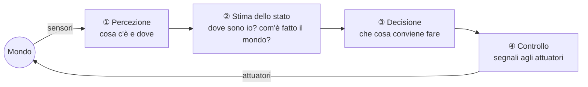
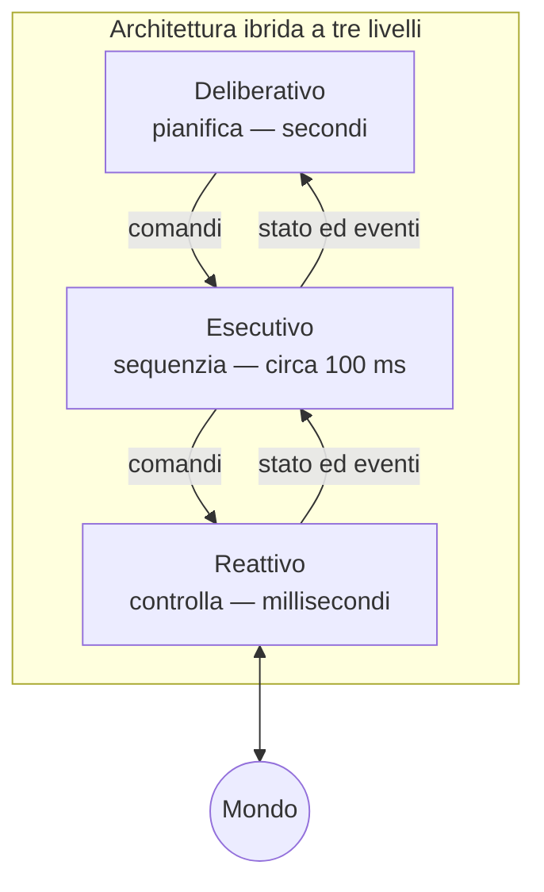

## 0. Organizzazione del corso

Il corso di Robotica 2 è composto da due moduli tenuti da due docenti con formazione diversa.

- Il **modulo 1** è tenuto dal prof. Francesco Wanderlingh, che ha una formazione di teoria dei controlli. Si occupa della realizzazione precisa del movimento e della stima dello stato.
- Il **modulo 2**, oggetto di queste note, è tenuto dal prof. Antonio Sgorbissa, che ha una formazione da ingegnere informatico. Tratta gli aspetti legati alla programmazione del comportamento autonomo: prendere decisioni senza che qualcuno le detti, ricostruire una mappa dell'ambiente, riconoscere oggetti.

Il docente avverte che all'inizio ci potrà essere qualche sovrapposizione fra i due moduli. In seguito i due percorsi si separeranno.

Dal punto di vista pratico:

- **AulaWeb.** È indispensabile iscriversi alla pagina "Robotica modulo 2", l'unica che il docente segue (conviene iscriversi anche al modulo 1). Lì si trovano le slide, gli avvisi su eventuali scambi di orario fra i moduli e il software del corso.
- **Esame.** Le modalità non erano ancora definite al momento della lezione. Il docente si è detto quasi certo di adottare una prova scritta per il proprio modulo.
- **Software del corso.** È un simulatore scritto in Python (versione consigliata 3.12, comunque non inferiore alla 3.10). Va scaricato, installato e provato.
- **Registrazione al server.** Il simulatore può collegarsi a un server, ma la registrazione con la propria matricola si fa **una sola volta e su un solo PC**. Per questo bisogna scegliere con cura la macchina. Il server raccoglie gli esercizi facoltativi svolti durante l'anno, che danno punti aggiuntivi. Il docente ha chiesto di **non svolgere ancora gli esercizi**: se si è collegati, un esercizio inviato non si può ripetere. L'uso del simulatore è descritto nella [[Lezione 03 - Simulatore, spazio delle configurazioni e A star|Lezione 3]].

---

# Parte I — Che cos'è un robot autonomo

## 1. La definizione di autonomia

> [!important] Robot autonomo Un robot è **autonomo** nella misura in cui decide da sé che cosa fare per raggiungere un obiettivo, in un mondo che non conosce del tutto in anticipo.

Nella definizione sono contenute tre condizioni distinte.

1. **Decide.** Non esegue una sequenza di azioni scritta da qualcun altro, ma sceglie le proprie azioni in base al proprio obiettivo.
2. **Non riceve indicazioni su come muoversi.** Nessuno gli fornisce una traiettoria del tipo "fai questo movimento": il _come_ muoversi lo calcola il robot.
3. **Non conosce tutto.** Non agisce in un ambiente preparato su misura per lui.

Il docente illustra la terza condizione con un esempio quotidiano. Chiunque sa che per scendere bisogna prendere le scale "più o meno da quella parte". Nessuno però sa in anticipo se la porta che incontrerà è aperta o chiusa: lo scopre arrivandoci, e se la trova chiusa cambia il piano invece di sbatterci contro. Un robot autonomo deve comportarsi allo stesso modo.

### Mondo noto e mondo ignoto

Si consideri un robot che deve andare dalla porta alla finestra di un'aula.

- **Mondo noto.** Il robot possiede una mappa precisa della posizione di tutti i banchi e può pianificare un percorso che li eviti.
- **Mondo ignoto.** Il robot non sa nulla dell'ambiente, ma dispone di sensori che gli permettono di accorgersi degli ostacoli e di evitarli.

I primi robotici, per semplificare il problema, hanno lavorato prevalentemente in mondi noti: la mappa veniva fornita. L'obiettivo di lungo periodo è sempre stato muoversi verso un'autonomia crescente, cioè verso mondi meno noti.

## 2. L'anello fondamentale: percezione, stima, decisione, controllo

Dal 1948 a oggi, ogni robot autonomo chiude lo stesso anello attraverso quattro competenze. Il **mondo** è la realtà oggettiva in cui il robot opera ("non facciamo discussioni filosofiche sul fatto che il mondo esista").



1. **Percezione.** Tramite i sensori si capisce _che cosa c'è e dove_: una sedia, una persona in un certo punto.
2. **Stima dello stato.** Comprende due domande diverse, che torneranno continuamente nel corso.
    - _Com'è fatto il mondo?_ Per esempio, dov'è la finestra rispetto a qui e quali ostacoli ci sono in mezzo. È il problema della **mappatura**.
    - _Dove sono io?_ È il problema della **localizzazione**, detta anche **autolocalizzazione** perché il robot localizza sé stesso. Per andare in un posto bisogna sapere dove ci si trova: per questo è difficile muoversi a occhi chiusi.
3. **Decisione.** Noti la propria posizione e l'obiettivo, si sceglie che cosa fare. Un esempio di piano: "cammina dritto per 4 passi, gira sul posto a sinistra di 90°, cammina per altri 4 passi, gira a destra di 90°, cammina dritto per 20 passi". Questo processo si chiama **pianificazione**, cioè produrre sequenze di azioni.
4. **Controllo.** Non basta sapere che si devono fare quattro passi: bisogna decidere quali segnali inviare agli **attuatori** perché i passi avvengano davvero. Gli attuatori sono il duale dei sensori: i sensori percepiscono qualcosa del mondo, gli attuatori agiscono su di esso comandando ruote, gambe, giunti. Nessuno di noi pensa consapevolmente all'impulso da dare ai muscoli della gamba, ma da qualche parte quella decisione viene presa. In un robot non è scontato, e qualcuno deve progettarla.

> [!tip] Una chiave di lettura diagnostica Le slide osservano che ciò che è cambiato nei decenni non è la struttura dell'anello. È cambiato _come_ si realizza ciascun blocco e _quanto in fretta_ si percorre l'anello. Quando un progetto robotico non funziona, quasi sempre il limite sta in uno solo dei quattro blocchi.

## 3. La scala dei livelli di autonomia

Per confrontare macchine diverse si usa una scala da L0 a L5. Non è un caso che L0 sia associato al passato e L5 al presente: la scala riflette anche lo sviluppo storico.

|Livello|Che cosa sa fare|Esempi|
|---|---|---|
|L0|Nulla: l'uomo chiude ogni anello|manipolatori teleoperati, anni '50|
|L1|Ripete una sequenza fissa, senza percepire|Unimate (1961)|
|L2|Reagisce a ciò che sente, senza rappresentare|tartarughe di Grey Walter (1948), Genghis (1989), Roomba (2002)|
|L3|Pianifica in un ambiente noto e mappato|Shakey (1969), robot di magazzino (2012)|
|L4|Costruisce la mappa, esplora, gestisce l'incertezza|MINERVA (1998), Stanley (2005), Spot (2020)|
|L5|Riceve l'obiettivo a parole e generalizza|modelli VLA (2023–2026), oggi solo in parte|

**L0 — teleoperazione.** È l'essere umano a chiudere l'anello: vede ciò che c'è da vedere, decide dove si trova e che cosa fare, e comanda il robot. Un manipolatore teleoperato non fa nulla in autonomia.

**L1 — sequenza fissa senza percezione.** Non c'è più un operatore, ma il robot ripete ciecamente una sequenza memorizzata. È il tipico robot industriale del passato, per esempio quello che verniciava le automobili. La sequenza è perfetta, ma si basa sul presupposto che l'auto sia al posto giusto. Se al posto dell'auto ci fosse una persona, il robot verniciarebbe la persona: non è in grado di percepire nulla.

**L2 — sistemi reattivi.** Il robot reagisce agli stimoli ma non costruisce alcuna rappresentazione interna del mondo. Il docente propone un esperimento mentale. Si cammina a occhi chiusi con una sola regola: "vado dritto; se sbatto contro qualcosa, mi sposto di un passo a destra e riprendo". In alcuni ambienti funziona, in altri no: si può restare incastrati a sbattere sempre contro lo stesso ostacolo. Una regola un po' più ricca, cioè spostarsi alternativamente una volta a destra e una volta a sinistra, produce uno zig-zag che in molti casi porta a destinazione. L'aspetto essenziale è che c'è una regola che tiene conto del mondo, ma **nessun tentativo di costruirne una mappa**. Il docente userà "mappa" e "rappresentazione" in modo quasi intercambiabile: mappa evoca una descrizione geometrica, rappresentazione è il termine più generale. Questa scelta ha permesso, a metà del secolo scorso, di costruire robot capaci di reagire in tempo reale con una potenza di calcolo irrisoria. Costruire una mappa richiede infatti di integrare in modo coerente i dati sensoriali, cosa allora impossibile.

**L3 — pianificazione in un mondo noto.** È l'approccio opposto. La mappa esiste e il robot pianifica su di essa. Il limite è che, se qualcosa nel mondo cambia (per esempio passa una persona che non è sulla mappa), il robot non ne tiene conto.

**L4 — esplorazione e incertezza.** Secondo il docente è stata "una vera e propria rivoluzione". I primi robot usati come guide nei musei costruivano da soli la mappa dell'ambiente e pianificavano su una mappa fatta da loro. Da qui nasce un enorme filone di ricerca chiamato **SLAM** (_Simultaneous Localization and Mapping_): costruire una mappa e allo stesso tempo localizzarsi su di essa. Questo filone ha finalmente prodotto risultati stabili.

**L5 — obiettivi in linguaggio naturale.** Il robot non è più programmato per un compito: riceve istruzioni a parole e ricava da solo anche l'aspetto di controllo, cioè come muovere le ruote per ottenere una certa velocità o come muovere il braccio per afferrare un oggetto. È il mondo dei modelli generativi: i _large language model_ (come GPT), i _visual language model_ che interagiscono con informazioni visive, e i **visual language action model** (VLA). Questi ultimi generano azioni con lo stesso principio con cui GPT genera testo. Il livello è ancora in costruzione.

> [!warning] Un equivoco ricorrente (dalle slide) Salire di livello non è sempre la scelta progettuale giusta. Gran parte dei successi industriali si ottiene **abbassando** il livello richiesto: si struttura l'ambiente, si restringe il dominio, si accetta un comportamento subottimale ma robusto. Il caso del Roomba (§4.9) e quello dei magazzini Kiva (§4.10) ne sono gli esempi più chiari.

---

# Parte II — Settant'anni di robotica autonoma, tappa per tappa

Le slide organizzano ogni tappa attorno a tre domande: quale problema era aperto, che cosa ha introdotto la tappa, che cosa è rimasto irrisolto. Il filo conduttore è una sola domanda: _che cosa impedisce al robot di decidere bene?_ Ogni epoca ha avuto un collo di bottiglia diverso, e ogni tappa fondamentale ne ha rimosso uno. Per la cronologia complessiva, organizzata su tre corsie (piattaforme, metodi, applicazioni), conviene consultare la **slide 5** del pacchetto _Robot autonomi_: una linea del tempo grafica difficile da rendere in testo.

## 4.1 Le origini reattive: le tartarughe di Grey Walter e i veicoli di Braitenberg

Si riteneva che un comportamento "intelligente" richiedesse un cervello complesso. Le **tartarughe** di W. Grey Walter (1948–49), Elmer ed Elsie, smentiscono l'idea. Con due sole valvole, equivalenti a due neuroni, cercano la luce, evitano gli ostacoli, fuggono la luce troppo intensa e rientrano alla "cuccia" di ricarica. Non hanno modello interno né mappa: l'anello va direttamente dal sensore all'attuatore. È la prima dimostrazione che **l'autonomia non richiede rappresentazione**. Il limite è che il comportamento è ricco ma privo di scopo: non si può assegnare loro un compito, né chiedere perché fanno ciò che fanno.

A lezione il docente ha approfondito lo stesso principio attraverso i **veicoli di Braitenberg**. Valentino Braitenberg non li ha costruiti: li ha teorizzati in un piccolo libro per mostrare che comportamenti che noi percepiamo come intelligenti si possono ottenere _senza un cervello_. Il veicolo discusso ha due ruote e due sensori di luce. Ciascun sensore comanda la velocità di una ruota: più luce percepisce, più velocemente fa girare la ruota a cui è collegato.

> [!example] Il veicolo che insegue la luce I collegamenti sono **incrociati**: il sensore sinistro comanda la ruota destra e il sensore destro comanda la ruota sinistra. Se una sorgente luminosa si trova a sinistra, il sensore sinistro riceve più luce, quindi la ruota destra gira più velocemente della sinistra. Il veicolo curva **verso sinistra**, cioè verso la luce. Chi lo osserva vede un robot che "cerca" la sorgente luminosa, come un gatto che insegue una macchia di luce in movimento. Eppure non c'è alcuna regola programmata da nessuna parte: il comportamento nasce soltanto da **come sono collegati i fili**, cioè da come è costruito il corpo.

Il principio che il docente vuole fissare è questo: comportamenti che un osservatore descriverebbe come intelligenti possono essere rapidissimi e non richiedere alcun calcolo, perché a bordo non c'è nemmeno un computer.

> [!tip] Approfondimento #approfondimento Il libro a cui il docente si riferisce è _Vehicles: Experiments in Synthetic Psychology_ di Valentino Braitenberg (MIT Press, 1984) [@braitenberg1984]. Descrive una serie di veicoli via via più complessi. Fra i primi, il veicolo con collegamenti eccitatori incrociati è quello che si dirige verso la sorgente, mentre con collegamenti diretti (sensore sinistro → ruota sinistra) il veicolo se ne allontana. Il libro è breve e si legge senza prerequisiti tecnici.

## 4.2 Unimate: precisione senza percezione (L1)

Negli stessi anni si sviluppa una strada opposta. L'industria aveva bisogno di ripetibilità e forza, non di adattamento. **Unimate** (1961) introduce la programmazione per punti memorizzati, con ripetibilità sotto il millimetro e funzionamento continuo. Entra in servizio alla General Motors per estrarre pezzi da una pressofusione e per trent'anni definisce che cosa il mercato intende per "robot". La foto mostrata a lezione, con il braccio che versa da bere in una tazza, può sembrare un comportamento intelligente. In realtà il movimento è descritto in ogni dettaglio: se la tazzina venisse spostata, il robot verserebbe comunque nello stesso punto. Percezione zero, autonomia zero: è **il mondo a dover essere reso perfetto**. Fin dagli albori esistono quindi due strade divergenti: una ricca di reattività ma senza scopo, l'altra precisa ma cieca.

## 4.3 Shakey e il paradigma Sense–Plan–Act (L3)

Il problema aperto era passare da "reagisci a ciò che senti" a "raggiungi un obiettivo che ti è stato assegnato". **Shakey** (SRI, 1966–1972) è il primo sistema a chiudere l'intero anello percezione–ragionamento–azione su un robot fisico. Il docente ne mostra la struttura meccanica: due ruote motrici, una **ruota folle** (_caster wheel_, una ruota passiva girevole come quelle dei carrelli del supermercato), un _bumper detector_ per rilevare gli urti, un telemetro e una telecamera.

Shakey rappresenta il mondo in forma **simbolica**, con predicati della logica del primo ordine. Per esempio, la rappresentazione può dire che c'è un blocco in una certa posizione e che tre caselle libere stanno di fronte a un altro blocco. Su questa rappresentazione pianifica una sequenza di azioni per raggiungere l'obiettivo. Con Shakey nascono strumenti usati ancora oggi:

- **A*** (1968), l'algoritmo per trovare soluzioni ottime di pianificazione su un grafo, studiato nella [[Lezione 03 - Simulatore, spazio delle configurazioni e A star|Lezione 3]];
- **STRIPS** (1971), un linguaggio pensato appositamente per descrivere problemi di pianificazione;
- l'architettura **Sense–Plan–Act** (talvolta Sense–Model–Plan–Act), che separa esplicitamente le fasi del robot: percepisce, costruisce un modello del mondo, pianifica, esegue.

Shakey ha anche una telecamera, ma nel 1969 percepire è così difficile che l'ambiente viene semplificato all'estremo. È un **mondo giocattolo** fatto di blocchi dai colori uniformi, con pareti di colori diversi. Il prezzo sono minuti o ore per compiti banali e un'ipotesi di fondo innaturale: il mondo deve restare fermo mentre il robot pensa.

## 4.4 Lo Stanford Cart: il collo di bottiglia è la percezione

Lo **Stanford Cart** (1979, Hans Moravec) realizza la prima navigazione autonoma guidata dalla visione in un ambiente non preparato. Procede a scatti: si ferma, acquisisce nove immagini (una sola telecamera fatta scorrere lateralmente), calcola la profondità per **stereoscopia** (da due o più viste dello stesso punto si ricava la sua distanza), avanza di circa un metro e ricomincia. Impiega circa **cinque ore** per attraversare una stanza ingombra di sedie, con errori frequenti.

Il docente usa questo esempio per definire il **tempo reale**. Non significa semplicemente "veloce": significa che i dati vengono acquisiti ed elaborati abbastanza in fretta da ottenere risultati _in tempo per essere usati_, cioè per rispondere in modo adeguato agli stimoli dell'ambiente. Lo Stanford Cart non è in tempo reale. La lezione che le slide traggono dai trent'anni successivi è che _il ragionamento funziona: il problema è la percezione_.

## 4.5 La reazione: campi di potenziale e subsumption

Di fronte alla constatazione che telecamere e stereoscopia non erano compatibili con un comportamento in tempo reale, attorno al 1986–1991 alcuni ricercatori riprendono l'idea reattiva delle origini e propongono un cambio di paradigma. Il docente ne cita due.

**Oussama Khatib e i campi di potenziale artificiale** (_Artificial Potential Fields_, APF, 1986). L'idea si ispira all'elettrostatica. Il robot è una carica, l'obiettivo è una carica di segno opposto che lo attrae, e gli ostacoli sono cariche dello stesso segno che lo respingono. Il robot si muove nella direzione della **somma vettoriale** di tutte le forze. Non serve costruire una mappa con le telecamere: basta un sensore che restituisca subito la **distanza dagli ostacoli**, perché la forza repulsiva cresce quanto più l'ostacolo è vicino. Il sensore ideale diventa quello a **ultrasuoni** (sonar). Se ne possono fare una decina di letture al secondo e ognuna dà, per tutte le direzioni attorno al robot, la distanza degli ostacoli. Dalle distanze si calcolano le forze repulsive e se ne fa la somma, un'operazione banale dal punto di vista computazionale. Resta però un'informazione indispensabile: la forza attrattiva va da _me_ all'obiettivo, quindi bisogna sapere dove si trova l'obiettivo **rispetto a sé**. È di nuovo il problema della localizzazione. Il docente dichiara di aver usato questo approccio "per anni e anni", e in parte di usarlo ancora. Il metodo sarà trattato in dettaglio nella [[Lezione 04 - Garanzie, RRT, algoritmi Bug e campi di potenziale|Lezione 4]].

**Rodney Brooks e l'architettura subsumption** (1986). Nel modello alla Shakey la catena è sequenziale: percezione → modello del mondo → pianificazione → esecuzione. Brooks propone invece molti **comportamenti** (_behaviour_) in parallelo, ciascuno dei quali prende i dati sensoriali e comanda direttamente gli attuatori. I comportamenti sono molto semplici:

- _vaga_: si muove per un secondo, si gira, si muove un altro secondo. Probabilmente non usa nemmeno i sensori ma comandi casuali;
- _evita ostacoli_: se vede un ostacolo entro una certa distanza, fa un passo laterale e continua.

Poiché i comportamenti agiscono in parallelo e possono dare comandi contrastanti, serve una logica che stabilisca chi prevale. Nella subsumption gli strati hanno una **gerarchia di precedenza**: alcuni comportamenti possono _sopprimere_ (_subsume_) quelli di altri strati.

> [!important] Pregi e limite del ramo reattivo Il sistema reattivo è velocissimo (reazioni nell'ordine dei millisecondi), non deve costruire un modello che richiederebbe tempo ed è ottimo per non sbattere contro i muri e muoversi rapidamente. Non riesce però a eseguire **piani complessi**. "Vai alla porta, aprila, esci, raggiungi le scale, scendile" non si ottiene componendo comportamenti semplici. Le slide aggiungono altri due limiti: i campi di potenziale **cadono nei minimi locali**, e un robot a subsumption non sa rispondere alla domanda "perché lo stai facendo?" né accettare un obiettivo che non sia stato cablato in uno strato.

## 4.6 La sintesi: architetture ibride

Da allora diventa consuetudine, ancora oggi praticamente universale, l'**architettura ibrida**. Il docente precisa il significato di "architettura": è il modo di organizzare la complessità di un robot, stabilendo quali blocchi gestiscono la parte sensoriale, quali il controllo dei motori e come comunicano. In un'architettura ibrida convivono:

- una parte **deliberativa**, che pianifica e decide per esempio dove andare;
- una parte **reattiva**, che gestisce il movimento e reagisce rapidamente all'ambiente.

Entrambe le capacità sono preziose, e l'unico modo di beneficiare di tutte e due è usarle insieme: "i robot che vedete in giro sono fatti così".



Le slide confrontano le tre organizzazioni.

- **Sense–Plan–Act** (1966–1985): un solo anello percorso per intero a ogni passo. Il mondo deve stare fermo mentre il robot pensa.
- **Subsumption** (1986–1995): nessun modello centrale, ogni strato collega da solo i sensori agli attuatori e gli strati alti sopprimono quelli bassi.
- **Architettura ibrida** (dal 1995, in uso oggi): ogni livello lavora alla propria scala di tempo. Si pianifica adagio e si reagisce in fretta, senza che l'uno blocchi l'altro.

La conclusione delle slide è che la scelta fra deliberativo e reattivo è mal posta: servono entrambi, a scale di tempo diverse. L'architettura a tre livelli è di fatto quella di quasi ogni robot mobile costruito da allora, compresi quelli odierni basati su modelli di fondazione.

> [!tip] Approfondimento #approfondimento L'articolo con cui Brooks presenta la subsumption è _A robust layered control system for a mobile robot_ (IEEE Journal of Robotics and Automation, 1986) [@brooks1986]. Quello con cui Khatib formula i campi di potenziale per manipolatori e robot mobili è _Real-Time Obstacle Avoidance for Manipulators and Mobile Robots_ (Int. Journal of Robotics Research, 1986) [@khatib1986]. Usciti lo stesso anno, sono due risposte diverse allo stesso problema di velocità di reazione.

## 4.7 Il ramo probabilistico: ammettere di non sapere

Parallelamente si sviluppa un'altra risposta. I sensori economici sono pessimi: il sonar vede attraverso coni larghi, viene riflesso in modo speculare dalle superfici lisce e "mente" spesso. Moravec ed Elfes (1985) propongono di discretizzare l'ambiente in una griglia, una sorta di matrice di pixel. A ogni cella si assegna la **probabilità di essere occupata** da un ostacolo: è la **griglia di occupazione** (_occupancy grid_).

> [!example] Come si legge una lettura di sonar Il docente propone di interpretare i valori di una griglia dopo una lettura del sonar. Per i dettagli grafici si veda la **slide 14** del pacchetto _Robot autonomi_.
> 
> - Le celle **fuori dal cono** del sensore o oltre l'eco valgono $0{,}5$: non sono state viste, quindi si è nella massima incertezza (come lanciare una moneta).
> - Le celle sull'**arco a distanza $z$**, dove si è generata l'eco, valgono circa $0{,}9$: lì c'è probabilmente un ostacolo.
> - Le celle **dentro il cono, prima dell'arco**, valgono circa $0{,}1$: se il segnale ha raggiunto l'ostacolo a distanza $z$, lo spazio davanti era per forza vuoto.

L'idea geniale secondo il docente è che, con una regola per aggiornare queste probabilità, le letture successive _rafforzano_ le zone dove un ostacolo c'è davvero. Le zone dove un ostacolo sembrava esserci ma non viene più rilevato vedono la loro probabilità scendere. La rappresentazione ammette la propria incertezza e la riduce con misure ripetute. Grazie a questo approccio e alla crescente capacità di calcolo, le mappe, escluse dal ramo reattivo, tornano al centro della scena. Rimane però un problema: **la griglia presuppone di sapere dove si trova il robot**. Proprio da qui nasce, a metà anni Novanta, il nome SLAM.

## 4.8 La svolta probabilistica: localizzazione Monte Carlo e SLAM

La svolta probabilistica (1995–2004) consiste in questo: invece di stimare lo stato, si stima una **distribuzione di probabilità sullo stato**. Secondo le slide è l'epoca in cui i robot cominciano davvero a funzionare.

Il primo passo riguarda la sola localizzazione con **mappa nota**: i bordi della stanza sono dati, e si vuole capire in modo probabilistico dove si trova il robot. Le soluzioni precedenti modificavano l'ambiente, per esempio applicando forme colorate (triangoli, cerchi) sui muri da riconoscere con la telecamera. Questo però è costoso e impossibile in un ambiente ignoto.

**Localizzazione Monte Carlo (MCL, 1999).** "Monte Carlo" indica sempre un algoritmo con una componente casuale. Il ragionamento del docente è il seguente.

1. Il robot parte da un punto noto e si muove. In teoria, sapendo come si è mosso, dovrebbe sapere con precisione dove si trova. In pratica il movimento è affetto da errori (lo si vedrà nella seconda parte della lezione e nella [[Lezione 02 - Cinematica inversa e odometria|Lezione 2]]), quindi la posizione diventa incerta.
2. La posizione dopo il movimento non si descrive più con una sola terna $(x, y, \theta)$, ma con un **insieme di particelle**, ciascuna delle quali è un'ipotesi di posa completa di orientamento. Le particelle realizzano una rappresentazione approssimata della distribuzione di probabilità: dove la probabilità è alta ci sono molte particelle, dove è bassa poche. Se il robot ha fatto un passo in avanti da qui, è possibile che si trovi un po' più in là o un po' di lato, ma la probabilità che sia vicino alla finestra è praticamente nulla. Lo strumento che fa questo si chiama **filtro a particelle** (_particle filter_).
3. Ogni volta che il robot osserva il mondo, per esempio vede un muro a un metro davanti a sé, confronta l'osservazione con ciò che _ciascuna particella si aspetterebbe di vedere_ sulla mappa. Le particelle compatibili con la misura vedono aumentare il proprio peso, quelle incompatibili lo vedono diminuire. Una particella orientata verso il muro a un metro di distanza è molto compatibile. Una particella in mezzo alla stanza e orientata in un'altra direzione non lo è.

Con il ripetersi di movimenti e osservazioni le particelle si addensano attorno alla posizione vera (si veda la **slide 16** del pacchetto _Robot autonomi_).

> [!important] Che cosa risolve MCL (dalle slide) Il filtro di Kalman permette di fondere stima della posa e osservazioni, ma richiede di conoscere la posa iniziale e non tollera ipotesi multiple. Un robot acceso in un punto qualsiasi, o sollevato e spostato da un visitatore, è perduto. MCL invece rappresenta la posa con campioni pesati che possono descrivere **qualunque distribuzione, anche con più massimi**: all'avvio le particelle sono sparse ovunque. MCL risolve così la **localizzazione globale** e il **problema del robot rapito**, è semplice da implementare ed è tuttora lo standard di fatto. I suoi limiti sono che richiede una mappa data e che il numero di campioni necessari cresce male con la dimensione dello stato.

**SLAM.** L'approccio ha avuto un successo tale da essere esteso alla stima simultanea della posizione _e della mappa_. Nei primi approcci di questo tipo, descritti dal docente, **ogni particella porta con sé una posizione e una mappa**. Due particelle diverse ipotizzano movimenti diversi e quindi costruiscono mappe diverse. Con le osservazioni successive si scartano le coppie (posa, mappa) poco compatibili e si conservano le più probabili. In ogni istante esistono quindi una posa più probabile e una mappa più probabile.

> [!tip] Approfondimento #approfondimento La localizzazione Monte Carlo è stata presentata da Dellaert, Fox, Burgard e Thrun all'ICRA 1999 [@dellaert1999]. Nella formulazione standard ogni ciclo ha tre fasi. Nella **predizione** ogni particella viene mossa secondo il modello di moto con l'aggiunta di rumore. Nella **correzione** il peso di ogni particella diventa proporzionale alla verosimiglianza della misura data quella posa. Nel **ricampionamento** si estrae un nuovo insieme di particelle con probabilità proporzionale ai pesi, così le ipotesi poco plausibili scompaiono e quelle plausibili si moltiplicano. La trattazione di riferimento di MCL, delle griglie di occupazione e dello SLAM probabilistico (compreso FastSLAM, in cui ogni particella porta una mappa) è _Probabilistic Robotics_ di Thrun, Burgard e Fox [@thrun2005].

## 4.9 Robot fra le persone, in casa e su altri pianeti

**RHINO e MINERVA (1997–1998).** Tutti i risultati precedenti erano stati ottenuti in corridoi vuoti. Le persone invece si muovono, bloccano i sensori, si mettono deliberatamente sulla strada del robot. Le guide museali RHINO (Deutsches Museum) e MINERVA (Smithsonian) integrano localizzazione probabilistica, mappe, pianificazione e interazione. Vengono valutate su una metrica onesta, le ore di servizio senza intervento umano: MINERVA percorre decine di chilometri in due settimane fra i visitatori. È il primo esempio credibile di livello L4 in un ambiente pubblico non modificato. Restano rudimentali l'interazione e la necessità di costruire la mappa in anticipo con grande cura.

**Roomba (2002): l'autonomia entra in casa abbassando l'asticella.** Nonostante i progressi nella costruzione di mappe, il primo prodotto di consumo di successo è un aspirapolvere che **non costruisce mappe e non si localizza**. Si muove a caso, sbatte, gira, segue i muri. Statisticamente, muovendosi a caso in uno spazio ristretto abbastanza a lungo, copre tutto il pavimento. È stato prodotto da iRobot, la stessa scuola di pensiero della robotica reattiva. Tecnicamente è molto meno avanzato di MINERVA, ma risolve il problema reale di milioni di persone, perché il compito tollera una soluzione stocastica: coprire una superficie, con tempo abbondante e nessun requisito di ottimalità. Le versioni successive, e i prodotti di altri produttori, costruiscono anche mappe, perché il costo di sensori e calcolo è sceso.

> [!important] Il caso di studio più istruttivo Il livello di autonomia giusto è **il minimo che risolve il problema**.

**Esplorazione planetaria (1994–2004).** Fra la Terra e Marte il ritardo di comunicazione è di minuti, quindi la teleoperazione in anello chiuso è fisicamente impossibile. Dante II scende nel cratere del Mount Spurr (1994), Sojourner si muove su Marte (1997), Spirit e Opportunity vi atterrano (2004). I rover ricevono obiettivi di alto livello e li realizzano con navigazione autonoma locale, valutando da soli la percorribilità del terreno da immagini stereo. L'autonomia resta deliberatamente conservativa: in caso di dubbio il rover si ferma e aspetta la Terra. Con un solo esemplare a centinaia di milioni di chilometri, la prudenza è la strategia corretta.

**Esplorazione a frontiera (1997).** Le slide segnalano anche il contributo di Yamauchi. Costruire una mappa resta un problema risolto solo a metà se qualcuno deve dire al robot dove andare. La **frontiera** è il confine fra lo spazio noto libero e lo spazio ignoto, e il robot sceglie quella più conveniente da raggiungere. L'esplorazione diventa un problema decisionale esplicito. Il simulatore del corso implementa proprio questo meccanismo ([[Lezione 03 - Simulatore, spazio delle configurazioni e A star|Lezione 3]]).

## 4.10 Uscire dal laboratorio: DARPA, LIDAR, ROS e magazzini

**DARPA Grand Challenge (2004–2007).** Nessuno sapeva se la guida autonoma su strada fosse a pochi anni o a pochi decenni di distanza. Nel 2004 nessun veicolo completa il percorso: il migliore si ferma dopo 12 dei 230 km. Diciannove mesi dopo cinque veicoli arrivano in fondo e **Stanley** vince in meno di sette ore. Si affermano come pratica standard la fusione LIDAR–visione–GPS e l'apprendimento automatico dentro la percezione. Il criterio di valutazione è pubblico e brutale: o arrivi, o no. Secondo le slide, il salto fra 2004 e 2005 mostra quanto una metrica pubblica acceleri un campo di ricerca. L'Urban Challenge (2007) si svolge però su una base chiusa, senza pedoni: la distanza dal traffico reale resterà enorme per un decennio. Oggi i veicoli autonomi esistono, ma operano ancora in aree circoscritte.

**Il LIDAR.** Il docente sottolinea l'importanza di questo sensore laser, che a un certo punto rivoluziona la robotica autonoma sostituendo gli ultrasuoni. Nelle prime versioni restituisce su un piano le distanze di tutti gli ostacoli, con una risoluzione molto superiore: per esempio 360 misure su 180°, cioè due per grado, contro le circa 10 misure su 360° di un anello di sonar. Ha però un difetto curioso: **non vede i vetri**, che gli ultrasuoni invece rilevano. Per questo, pur essendo il LIDAR diventato economico e onnipresente, alcuni continuano ad affiancargli i sonar. Il LIDAR ha problemi anche in situazioni molto rumorose.

**ROS (2010).** Il vero salto tecnologico di quegli anni, osserva il docente, non riguarda il robot ma il _sistema che lo controlla_. Fino ad allora ogni gruppo di ricerca scriveva i propri programmi da zero, con poche possibilità di riuso fra progetti. Nel 2010 Willow Garage rilascia **ROS** (_Robot Operating System_). Nonostante il nome non è un sistema operativo: gira su Linux ed è un _framework_. È un modello per costruire software robotico basato su **nodi**, cioè processi che svolgono compiti specifici, e sullo **scambio di messaggi** fra di essi. Le slide aggiungono l'albero delle trasformazioni fra sistemi di riferimento, gli strumenti di registrazione e l'ecosistema di pacchetti riusabili. ROS diventa uno standard di fatto: chi scrive un buon nodo di SLAM lo pubblica, altri lo usano e lo citano. I produttori forniscono robot già pronti per ROS.

Il docente esprime anche una riserva critica ("non sono un fan di ROS"). I mattoncini già pronti facilitano enormemente lo scambio e hanno accelerato la ricerca, ma spesso non si sa esattamente che cosa facciano: in teoria il codice è aperto, in pratica quasi nessuno lo legge, come accade con Linux. Le slide formulano la stessa riserva in termini ingegneristici: la componibilità nasconde il costo dell'integrazione, e un sistema che funziona in laboratorio è ancora lontanissimo da un prodotto affidabile. Sempre nel 2010 il Kinect rende la profondità densa un bene da poche decine di euro.

**Magazzini automatizzati (Kiva/Amazon, 2012).** Esistevano già da tempo gli **AGV** (_Automated Guided Vehicle_), che seguono bande colorate sul pavimento: non sono rotaie, ma comunque un percorso fisso. I robot di Kiva invece si infilano sotto gli scaffali, li sollevano e li portano agli operatori, coordinandosi in tempo reale a centinaia senza guide a terra. Per ragioni di sicurezza operano in aree interdette alle persone. Le slide ne fanno un esempio di scelta progettuale esemplare: **si modifica l'ambiente** (codici a terra, pavimento piano, zona interdetta) per ridurre drasticamente l'autonomia richiesta a ciascuna unità. Il compito difficile, cioè prelevare un singolo oggetto da uno scaffale, resta per anni all'uomo.

## 4.11 I droni

I quadricotteri non arrivano per una scoperta algoritmica, ma per una convergenza di componenti dell'elettronica di consumo: unità inerziali MEMS da pochi euro, batterie ai polimeri di litio, motori brushless e microcontrollori economici. Un quadricottero è intrinsecamente instabile e senza un controllo continuo ad alta frequenza cade. Per una robotica in cui riconoscere un ostacolo e non andarci a sbattere era ancora un problema serio, vedere macchine così piccole volare in formazione è stato, dice il docente, scioccante. Gli esperimenti spettacolari avvenivano però in stanze dotate di sistemi di **motion capture**: il drone non si localizzava, _gli veniva detto_ dove si trovava. All'aperto il GPS introduce altri problemi. Il messaggio è sempre lo stesso: **la localizzazione è il problema**. Le slide citano gli sviluppi successivi: l'odometria visivo-inerziale leggera (ORB-SLAM e simili, dal 2015), le consegne di sangue di Zipline in Ruanda (2016) e il primo volo autonomo su un altro pianeta (Ingenuity, aprile 2021).

## 4.12 La percezione smette di essere il collo di bottiglia

Dopo decenni in cui la visione era stata accantonata perché troppo onerosa, attorno al 2012 tornano di moda i sistemi neurali. AlexNet (2012) sposta la visione dalle caratteristiche progettate a mano a quelle apprese. **YOLO** (2015–16) riformula il rilevamento di oggetti come un'unica regressione sull'intera immagine. Restituisce decine di _bounding box_ al secondo, cioè rettangoli con un'etichetta del tipo "questa è una bicicletta", alla frequenza del controllo e su hardware installabile a bordo. Il docente lo paragona a ROS per l'effetto rivoluzionario: da quel momento tutti iniziano a dotare i robot di capacità di riconoscimento. I sistemi più avanzati fanno anche **segmentazione**, cioè decidono pixel per pixel quali appartengono a un oggetto.

Il limite è il **vocabolario chiuso**: il rilevatore riconosce solo le categorie su cui è stato addestrato, e per cercare qualcosa di nuovo bisogna riaddestrarlo. Il problema resterà aperto fino ai modelli visione–linguaggio. Da qui, osservano le slide, la mappa può contenere _categorie_ e non solo geometria: nasce lo **SLAM semantico**.

## 4.13 Locomozione appresa e simulatori

Il docente racconta lo stupore provocato dai video del quadrupede di Boston Dynamics che, spinto sul ghiaccio, recuperava l'equilibrio. Il laboratorio dispone di uno **Spot**, un robot da circa 80 000 euro: non è più vincolato a superfici piane e sale le scale in modo impeccabile. Le slide lo collocano fra i prodotti del 2020: è in vendita e viene usato per l'ispezione di impianti e cantieri. Per controllarlo via software si usa, ancora una volta, ROS. Il docente sottolinea che Spot "funziona come un elettrodomestico": esegue ciò che deve senza fallire, mentre in robotica è proverbiale l'_effetto demo_, per cui le cose funzionano in laboratorio ma non in modo ripetibile nel mondo reale.

Il punto concettuale riguarda il **controllo**. Sui quadrupedi e sugli umanoidi il modo di muovere le gambe non si ottiene più scrivendo esplicitamente le equazioni del modello, ma con l'**apprendimento per rinforzo** (_reinforcement learning_). Il robot prova, sbaglia, riceve un punteggio che misura quanto bene si è comportato e ripete finché impara. Poiché imparare a scendere le scale richiederebbe di far cadere il robot mille volte, la prima fase dell'addestramento avviene **in simulazione** e solo la fase finale sul robot reale. Da qui l'importanza crescente di **simulatori** fisicamente realistici, capaci di addestrare politiche che si trasferiscano bene al mondo vero. Le slide parlano di _divario fra simulazione e realtà_: la ricetta funziona dove la simulazione è fedele, molto meno per la manipolazione, dove contano contatto, deformabilità e attrito. Lo slogan è: "il controllo smette di essere progettato e diventa addestrato".

## 4.14 Modelli VLA e umanoidi

Con i modelli generativi nascono i **Vision-Language-Action model**. Anche il movimento di un manipolatore non deve più essere scritto con equazioni, ma viene _generato_ dal sistema di intelligenza artificiale. Il robot è stato addestrato ad afferrare molti oggetti. Gli si presenta un oggetto nuovo e, così come un modello linguistico produce un testo mai visto, lui produce traiettorie, velocità e forze adeguate. Le slide citano SayCan (2022), che combina ciò che è _sensato_ secondo un modello linguistico con ciò che è _possibile_ per il robot, e RT-2 (2023), che riaddestra un modello visione-linguaggio a produrre azioni come se fossero testo. Il risultato è che un robot può afferrare una banana mai vista nell'addestramento robotico, perché il concetto arriva dal web. È una ricerca ancora in pieno svolgimento. Il vincolo dominante oggi è che non esiste un "internet della manipolazione": i dati _incarnati_ (_embodied_) vanno raccolti fisicamente, robot per robot.

Il tema più caldo del momento sono gli **umanoidi** (Atlas di Boston Dynamics e numerosi modelli prodotti in Cina). Il docente ricorda di aver partecipato nel 1998 alla **RoboCup**, il campionato di calcio fra robot mobili su ruote. L'obiettivo dichiarato allora era avere, entro il 2050, una squadra di umanoidi capace di battere la nazionale campione del mondo. Allora gli sembrava impossibile; oggi, con umanoidi che corrono in gara, ritiene che potrebbe davvero succedere.

## 4.15 Robotica sociale

Chiude la rassegna una storia a parte: la **robotica sociale**, cioè robot non pensati per spostare pesi o ispezionare impianti ma per **stare con le persone e assisterle**. La foca robot **Paro** emette versi e reagisce al contatto. È molto usata con persone affette da demenza, su cui ha un effetto calmante, e in alcuni studi con bambini nello spettro autistico. **Pepper**, con cui il gruppo del docente fa molta ricerca, è usato per l'assistenza agli anziani. Due esemplari sono stati collocati all'Ospedale San Martino di Genova nelle stanze di pazienti anziani ricoverati, per prevenire il **delirium**. Il delirium è una condizione frequente in cui la persona, sradicata dal proprio ambiente e dalle proprie abitudini, perde la cognizione di dove si trova e può vedere cose che non ci sono. Il robot svolge attività di **riorientamento**. In questo ambito diventano centrali questioni diverse da quelle tecniche: etica, espressione delle emozioni, personalità del robot. Le slide aggiungono che il criterio di successo non è più il compito ma l'**effetto sulla persona**, e che l'effetto novità decade in poche settimane: ciò che resta deve essere utilità reale.

## 4.16 Sintesi: il collo di bottiglia, epoca per epoca

|Epoca|Che cosa limitava l'autonomia|Come è stato superato|
|---|---|---|
|1948–1965|Non esisteva il problema: o si reagiva, o si ripeteva|—|
|1966–1979|La percezione, troppo lenta e fragile per alimentare il piano|Non lo è stato: si è cambiato paradigma|
|1980–1994|La velocità di reazione e il costo del modello|Subsumption e architetture ibride|
|1995–2004|L'incertezza di sensori e movimento|Formulazione probabilistica: MCL, SLAM|
|2004–2012|La frammentazione del software e l'assenza di metriche|ROS, piattaforme condivise, sfide pubbliche|
|2012–2020|Il significato: geometria senza semantica|Apprendimento profondo, rilevamento in tempo reale|
|2020–2026|I dati _embodied_ e l'affidabilità "al quasi 100%"|Aperto|

La riga di ogni epoca spiega la tappa dell'epoca successiva. Le slide elencano come problemi aperti di oggi:

- i dati di manipolazione, che non si raccolgono dal web;
- il salto dal 95% al 99,99% di funzionamento senza errori, dove contano i casi rari;
- l'assenza di insiemi di prova condivisi;
- i limiti fisici di energia e attuazione;
- la responsabilità, perché quando una politica appresa sbaglia non c'è una riga di codice da correggere.

---

# Parte III — Il robot a guida differenziale

Il docente passa ora a qualcosa di più vicino all'implementazione. Il robot su ruote verrà usato come piattaforma per studiare le capacità che contano per l'autonomia: localizzazione, costruzione di mappe, pianificazione. Molti risultati si estendono ad altri tipi di robot, ma il corso non insisterà su questa generalizzazione.

## 5.1 Struttura meccanica: due ruote motrici e una ruota folle

Il veicolo a guida differenziale ha **due ruote motrici** indipendenti sullo stesso asse e una **ruota folle** (_caster_) che fa da appoggio. Due punti di contatto non bastano a sostenere un corpo su un piano, perché per due punti passano infiniti piani: servono almeno tre appoggi. Il Segway sta in piedi su due ruote solo grazie a un algoritmo di controllo attivo molto complesso: spento, cade.

La ruota folle **gira liberamente** e si orienta da sola nella direzione imposta dal moto delle due ruote motrici. Se il robot ruota su sé stesso, la ruota caster si dispone spontaneamente a 90°. Se invece la terza ruota fosse **sterzante attiva**, sarebbe compito del controllore portarla a 90°: tenendola dritta, il robot non potrebbe girare sul posto. Lo sterzo attivo deve sempre essere **coerente** con le velocità delle ruote motrici, ed è responsabilità del progettista garantirlo. Per ora il problema viene evitato considerando la terza ruota passiva. Il modello a ruota sterzante (_car-like_) è accennato nella [[Lezione 02 - Cinematica inversa e odometria|Lezione 2]].

## 5.2 Sistemi di riferimento e notazione

Si usano due sistemi di riferimento:

- il sistema **mondo** ${W}$, fisso, con assi $x_W, y_W$;
- il sistema **corpo** ${B}$ (_body_), solidale al robot. L'origine $P$ è posta **a metà dell'asse delle ruote motrici**, l'asse $x_B$ punta in avanti (direzione longitudinale) e l'asse $y_B$ verso sinistra (direzione laterale).

La scelta di $P$ al centro dell'assale non è obbligatoria, ma rende i calcoli semplici: altrove "verrebbero più difficili, e non vogliamo complicarci la vita".

|Simbolo|Significato|Unità|
|---|---|---|
|$x,\ y$|coordinate di $P$ nel sistema mondo|m|
|$\theta$|orientamento del robot: angolo fra $x_B$ e $x_W$|rad|
|$r_L,\ r_R$|raggi **efficaci** delle ruote sinistra e destra|m|
|$b$|distanza **efficace** fra le ruote (interasse trasversale)|m|
|$\varphi_L,\ \varphi_R$|angoli di rotazione delle ruote|rad|
|$\dot\varphi_L,\ \dot\varphi_R$|velocità angolari delle ruote|rad/s|
|$v$|velocità longitudinale (lungo $x_B$)|m/s|
|$\omega = \dot\theta$|velocità angolare del corpo|rad/s|
|$\Delta t$|periodo di campionamento|s|

I soli parametri geometrici del modello sono i due raggi efficaci e l'interasse efficace. Gli **ingressi** del modello sono le velocità angolari delle ruote. Si veda la figura della **slide 3** del pacchetto _Cinematica e odometria_. Convenzione sui segni: $\theta$ e $\omega$ sono **positivi in senso antiorario**, cioè ruotando verso sinistra.

## 5.3 Il raggio efficace: una prima sorgente di errore

> [!important] Raggio efficace Il raggio **efficace** di una ruota è quello che descrive davvero come una rotazione della ruota si trasforma in avanzamento sul terreno. Non coincide con il raggio nominale del manuale: una ruota può essere un po' sgonfia, il battistrada può essersi consumato, il carico può schiacciarla. La differenza può arrivare a mezzo centimetro.

Il docente lo usa per un esempio intuitivo. Per andare dritti si comanda la stessa velocità angolare alle due ruote. Ma la velocità con cui una ruota avanza sul terreno è $v_i = r_i,\dot\varphi_i$. Se la ruota destra ha raggio efficace minore, a parità di velocità angolare risulta $v_R < v_L$, e il robot **curva verso destra** invece di andare dritto. È un **errore sistematico**, e ha conseguenze doppie.

- **Sul moto.** Il robot non va dove dovrebbe andare.
- **Sulla stima della posizione.** L'algoritmo che ricostruisce il percorso ragionerà così: "ho fatto girare le ruote a questa velocità per questo tempo, quindi sono laggiù". In realtà il robot ha curvato e si trova altrove.

Per semplicità, nel seguito si porrà spesso $r_L = r_R = r$. Il concetto va però ricordato perché sta alla base dei problemi di localizzazione.

## 5.4 Posa, twist e modello di stato

Un corpo rigido nel piano ha **tre gradi di libertà**. La sua **posa** raccoglie posizione e orientamento:

$$ q = \begin{bmatrix} x & y & \theta \end{bmatrix}^\top . $$

Il docente precisa la terminologia: _posizione_ indica di solito la sola coppia $(x, y)$, mentre _posa_ include anche l'angolo.

La velocità del corpo si descrive con il **twist**, il vettore delle velocità espresso nel sistema corpo:

$$ {}^{B}\xi = \begin{bmatrix} v & 0 & \omega \end{bmatrix}^\top . $$

La componente lungo $y_B$ è nulla. Non è vero per ogni veicolo (un drone può traslare di lato), ma lo è per questo tipo di robot, come si vedrà in §5.5.

> [!tip] Richiamo: sistemi di riferimento e matrici di rotazione (dagli appunti manuali) Un sistema di riferimento ${a}$ è individuato da un'origine $O_a$ e dai versori ${}^a i_a,\ {}^a j_a$. Lo stesso punto fisico $P$ ha coordinate diverse in sistemi diversi: in generale ${}^wP \neq {}^bP \neq {}^sP$ (mondo, base, sensore). Un vettore espresso in ${b}$ si esprime in ${a}$ scrivendolo come combinazione dei versori di ${b}$ visti da ${a}$: $$ {}^a v = v_{x,b},{}^a i_b + v_{y,b},{}^a j_b = \underbrace{\begin{bmatrix} {}^a i_b & {}^a j_b \end{bmatrix}}_{{}^a_b R}\ \underbrace{\begin{bmatrix} v_{x,b} \ v_{y,b}\end{bmatrix}}_{{}^b v} = {}^a_b R\ {}^b v . $$ Nel piano, se ${b}$ è ruotato di $\theta$ rispetto ad ${a}$, $$ R(\theta) = \begin{bmatrix} \cos\theta & -\sin\theta \ \sin\theta & \cos\theta \end{bmatrix}, \qquad \det R = 1,\qquad R^{-1} = R^\top = R(-\theta). $$ Le matrici con $R^\top R = I$ e $\det R = 1$ formano il gruppo $SO(2)$, e vale $R(\alpha)R(\beta) = R(\alpha+\beta)$: comporre due rotazioni equivale a sommare gli angoli.

Per ottenere le velocità nel mondo basta ruotare la parte traslazionale del twist con $R(\theta)$. La componente angolare non cambia, perché nel piano la rotazione attorno all'asse verticale è la stessa in tutti i sistemi:

$$ \begin{bmatrix} \dot x \ \dot y \end{bmatrix} = R(\theta)\begin{bmatrix} v \ 0 \end{bmatrix} = \begin{bmatrix} v\cos\theta \ v\sin\theta \end{bmatrix}, \qquad \dot\theta = \omega . $$

Si ottiene così il **modello di stato** del robot differenziale, detto anche _modello uniciclo_:

$$ \boxed{\ \dot x = v\cos\theta, \qquad \dot y = v\sin\theta, \qquad \dot\theta = \omega\ } $$

In forma compatta, con l'ingresso $u = [v\ \ \omega]^\top$:

$$ \dot q = G(q),u, \qquad G(q) = \begin{bmatrix} \cos\theta & 0 \ \sin\theta & 0 \ 0 & 1 \end{bmatrix}. $$

$v$ e $\omega$ sono le **variabili di controllo**. Note la posa iniziale e l'andamento di $v$ e $\omega$ nel tempo, le equazioni danno le derivate dello stato, e integrandole si ricava la posa in ogni istante.

> [!important] Perché il modello non è banale da integrare La matrice $G$ dipende dallo stato $q$ tramite $\theta$, che compare dentro seno e coseno. Le derivate $\dot x$ e $\dot y$ dipendono quindi **in modo non lineare** da $\theta$, e $\theta$ a sua volta varia nel tempo con $\omega$. Integrare $\dot\theta = \omega$ è immediato. Integrare $\dot x$ e $\dot y$ no, perché il risultato dipende da come $\theta$ è variato durante l'intervallo. Questo è il nodo che la [[Lezione 02 - Cinematica inversa e odometria|Lezione 2]] scioglie con i metodi di integrazione odometrica.

Il docente aggiunge un'avvertenza che anticipa l'odometria. Nel mondo ideale le equazioni bastano. Ma se si comandano velocità uguali alle ruote pensando di ottenere $\omega = 0$, e i raggi efficaci sono diversi, il controllo effettivamente applicato non è quello voluto e il robot finisce altrove.

## 5.5 Il vincolo non olonomo

Una ruota ideale rotola senza strisciare lateralmente: la sua velocità nella direzione dell'asse di rotazione è nulla. Ne segue che il centro dell'assale **non può traslare di lato in un singolo istante**. Nella realtà ciò può accadere (spingendo lateralmente un veicolo leggero, oppure su un pavimento incerato), ma lo si considera un'eccezione.

**Derivazione.** La velocità laterale nel sistema corpo si ottiene esprimendo $(\dot x, \dot y)$ nel sistema corpo con $R(\theta)^\top$:

$$ \begin{bmatrix} v_{x_B} \ v_{y_B} \end{bmatrix} = R(\theta)^\top \begin{bmatrix} \dot x \ \dot y \end{bmatrix} = \begin{bmatrix} \dot x\cos\theta + \dot y\sin\theta \ -\dot x\sin\theta + \dot y\cos\theta \end{bmatrix}. $$

La lezione successiva ricava lo stesso risultato geometricamente: proiettando le componenti di velocità sugli assi, la componente lungo $y_B$ raccoglie $-\dot x\sin\theta$ e $\dot y\cos\theta$. Imponendo $v_{y_B} = 0$:

> [!important] Vincolo non olonomo della guida differenziale $$ -\dot x\sin\theta + \dot y\cos\theta = 0 $$ Il vincolo coinvolge le **velocità** e non si può integrare in un vincolo sulla sola configurazione. Per questo è detto **non olonomo**.

Il significato pratico è il seguente. Tutte le configurazioni $(x, y, \theta)$ sono raggiungibili, ma non tutte **istantaneamente**. È il problema del parcheggio: per spostarsi di lato bisogna fare manovra avanti e indietro. Due comandi istantanei ($v$ e $\omega$) governano tre coordinate di posa. La terza direzione, quella laterale, si costruisce nel tempo componendo traslazioni e rotazioni.

> [!example] Il vincolo a $\theta = 45^\circ$ Con $\theta = 45^\circ$ si ha $\sin\theta = \cos\theta = \tfrac{\sqrt2}{2}$, e il vincolo diventa $$ -\dot x,\frac{\sqrt2}{2} + \dot y,\frac{\sqrt2}{2} = 0 \quad\Longrightarrow\quad \dot x = \dot y . $$ Orientato a 45°, il robot può muoversi solo con velocità uguali lungo $x_W$ e $y_W$: lungo la propria direzione di marcia. Come osservano le slide, i due termini presi singolarmente possono essere diversi da zero. Nel mondo il robot avanza e si sposta lateralmente rispetto agli assi $x_W, y_W$: il vincolo annulla la loro **somma**, non ciascuno di essi.

> [!warning] Discrepanza fra fonti Una versione precedente di questi appunti intitolava l'esempio "implicazione pratica del vincolo **olonomo**". È un refuso: il vincolo della guida differenziale è **non olonomo**. Anche nella trascrizione il docente dice talvolta "olonomo" per lapsus. Le slide usano correttamente "non olonomo".

> [!tip] Approfondimento #approfondimento In forma matriciale il vincolo si scrive $A(q),\dot q = 0$ con $A(q) = [-\sin\theta\ \ \cos\theta\ \ 0]$. Un vincolo di questo tipo, lineare nelle velocità, è detto **pfaffiano**. È **olonomo** se esiste una funzione $h(q)$ tale che il vincolo equivalga a $h(q) = \text{cost}$, cioè se si può integrare in una restrizione sulle configurazioni raggiungibili. Altrimenti è **non olonomo**: riduce le direzioni di moto istantanee ma non lo spazio delle configurazioni raggiungibili. Per la guida differenziale tutte le pose restano raggiungibili, come affermato a lezione. La trattazione formale, con la condizione di integrabilità, si trova nei testi di robotica mobile come Siciliano et al., _Robotics: Modelling, Planning and Control_, cap. 11 [@siciliano2009].

## 5.6 Cinematica diretta

In robotica si chiama **cinematica** la relazione fra il moto dei **giunti** e il moto nello spazio cartesiano. Un giunto è il punto che collega due parti in moto relativo: in un braccio, ogni articolazione; in un veicolo su ruote, l'asse di ciascuna ruota.

- La **cinematica diretta** risponde alla domanda: date le velocità ai giunti (le ruote), come si muove il robot nello spazio cartesiano?
- La **cinematica inversa** risponde alla domanda opposta: dato il moto cartesiano desiderato, a che velocità devono girare le ruote? È trattata nella [[Lezione 02 - Cinematica inversa e odometria|Lezione 2]].

Per fortuna nel caso differenziale la relazione è semplice. Ogni ruota avanza al suolo con velocità

$$ v_L = r_L,\dot\varphi_L, \qquad v_R = r_R,\dot\varphi_R . $$

Il centro dell'assale avanza con la **media** delle due velocità, e la rotazione nasce dalla loro **differenza** divisa per l'interasse:

$$ \boxed{\ v = \frac{v_R + v_L}{2} = \frac{r_R\dot\varphi_R + r_L\dot\varphi_L}{2}, \qquad \omega = \frac{v_R - v_L}{b} = \frac{r_R\dot\varphi_R - r_L\dot\varphi_L}{b}\ } $$

In forma matriciale (slide 6):

$$ \begin{bmatrix} v \ \omega \end{bmatrix} = \begin{bmatrix} \dfrac{r_L}{2} & \dfrac{r_R}{2} \[2mm] -\dfrac{r_L}{b} & \dfrac{r_R}{b} \end{bmatrix} \begin{bmatrix} \dot\varphi_L \ \dot\varphi_R \end{bmatrix}. $$

**Lettura dei segni.** Se le due ruote hanno la stessa velocità, $v = \tfrac{2v_R}{2} = v_R$: il robot avanza alla velocità delle ruote. $\omega$ si scrive $v_R - v_L$ (e non il contrario) perché è positiva quando il robot gira a sinistra. Se gira solo la ruota destra ($v_L = 0$) il robot curva a sinistra e $\omega > 0$. Se gira solo la sinistra curva a destra e $\omega < 0$.

> [!tip] Perché $\omega = (v_R - v_L)/b$ Si osservi il moto nel sistema corpo. Le ruote stanno in $y_B = +b/2$ (sinistra) e $y_B = -b/2$ (destra). Per un corpo rigido che ruota con velocità angolare $\omega$, un punto a distanza $y$ lungo l'asse laterale ha velocità longitudinale $v - \omega y$. Quindi $v_L = v - \omega,b/2$ e $v_R = v + \omega,b/2$. Sommando si ottiene $v_R + v_L = 2v$, sottraendo $v_R - v_L = \omega b$. Queste due relazioni, lette al contrario, sono proprio la cinematica inversa della lezione successiva.

Poiché la relazione è un sistema lineare di due equazioni in due incognite, è intuitivo, conclude il docente, che si possa invertire: date $v$ e $\omega$ e noti raggi e interasse, si ricavano le velocità delle ruote.

```python
import numpy as np

def cinematica_diretta(phidot_L, phidot_R, r_L, r_R, b):
    """Dalle velocità angolari delle ruote [rad/s] a (v [m/s], omega [rad/s])."""
    v_L, v_R = r_L * phidot_L, r_R * phidot_R
    v = (v_R + v_L) / 2.0
    omega = (v_R - v_L) / b
    return v, omega

def derivata_stato(q, v, omega):
    """Modello uniciclo: q = (x, y, theta) -> q_dot."""
    x, y, theta = q
    return np.array([v * np.cos(theta), v * np.sin(theta), omega])
```

---

## Riepilogo della lezione

- Un robot è autonomo se **decide da sé** come raggiungere un obiettivo in un mondo **non del tutto noto**. Ogni robot autonomo chiude l'anello percezione → stima dello stato (mappatura e localizzazione) → decisione → controllo.
- La scala **L0–L5** classifica le macchine dalla teleoperazione agli obiettivi in linguaggio naturale. Il livello giusto è il minimo che risolve il problema.
- La storia procede per colli di bottiglia. Dalla percezione lenta (Shakey, Stanford Cart) si passa alla reazione (APF, subsumption) e da lì all'**architettura ibrida**. L'incertezza porta alla svolta probabilistica (griglie di occupazione, **MCL**, **SLAM**). Seguono il software condiviso (ROS), la percezione appresa (YOLO), il controllo appreso (RL in simulazione) e i modelli VLA.
- Il robot differenziale ha posa $q = [x\ y\ \theta]^\top$, twist ${}^B\xi = [v\ 0\ \omega]^\top$ e modello di stato $\dot q = G(q)u$, non lineare in $\theta$.
- Il **vincolo non olonomo** $-\dot x\sin\theta + \dot y\cos\theta = 0$ vieta la traslazione laterale istantanea, ma non rende irraggiungibile alcuna posa.
- **Cinematica diretta**: $v$ è la media e $\omega$ la differenza (divisa per $b$) delle velocità al suolo. I **raggi efficaci** diversi da quelli nominali sono una sorgente di errore sistematico.