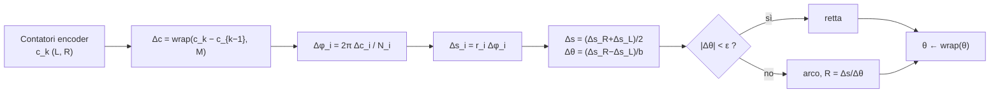

---

## corso: Robotica MOD2 lezione: 2 data: 2026-09-29 docente: Antonio Sgorbissa argomenti: [cinematica diretta, cinematica inversa, saturazione dei motori, centro istantaneo di curvatura, odometria, encoder, wrap-around, integrazione di Eulero, metodo del punto medio, integrazione esatta su arco, errori sistematici, errori non sistematici, UMBmark, modello car-like] fonti: [trascrizione L2, slide "Cinematica e odometria della guida differenziale", appunti manuali] tags: [robotica-mod2, lezione]
---
# Lezione 2 — Cinematica inversa e odometria della guida differenziale

La lezione completa il modello cinematico del robot differenziale e lo usa per affrontare il primo problema concreto di stima dello stato: ricostruire la posa del robot a partire dal moto delle ruote. Questo processo è l'**odometria**. Il docente insiste su un messaggio: l'odometria è indispensabile ma intrinsecamente destinata a sbagliare, e capire _come_ e _perché_ sbaglia è il punto di partenza di tutto ciò che seguirà in tema di localizzazione.

---

## 1. Riepilogo: notazione e cinematica diretta

Si riprendono gli elementi della [[Lezione 01 - Robot autonomi e cinematica differenziale|Lezione 1]]. Il docente osserva che i concetti valgono ben oltre i veicoli su ruote, e che nel modulo 1 il problema dei sistemi di riferimento è centrale anche per i manipolatori. In quel caso si descrive la posizione di ogni _link_ rispetto al precedente tramite relazioni fra sistemi di riferimento. Qui il caso è semplificato ma le idee sono le stesse.

Il robot ha due ruote motrici e una ruota folle passiva. Il sistema corpo ${B}$ ha origine $P$ al centro dell'assale, con $x_B$ in avanti. La posa è $q = [x\ y\ \theta]^\top$ (coordinate di $P$ e orientamento rispetto al mondo). Le ruote hanno raggi efficaci $r_L, r_R$ e interasse efficace $b$. Il modello di stato e la cinematica diretta sono:

$$ \dot x = v\cos\theta,\quad \dot y = v\sin\theta,\quad \dot\theta = \omega, \qquad v = \frac{v_R + v_L}{2},\quad \omega = \frac{v_R - v_L}{b},\quad v_i = r_i\dot\varphi_i . $$

Il docente ripete la derivazione del vincolo non olonomo per via geometrica, proiettando le componenti di velocità lungo $x_B$ e $y_B$ sull'asse $y_W$. Ricorda anche la forma compatta $\dot q = G(q)u$ con $G(q) = \begin{bmatrix}\cos\theta & 0\ \sin\theta & 0\ 0 & 1\end{bmatrix}$. Il docente sottolinea che con lo sterzo attivo il controllore dovrebbe garantirne la coerenza con le velocità delle ruote: per questo la ruota anteriore resta per ora passiva.

> [!important] Perché serve la stima della posa Rispetto a un manipolatore, il cui movimento è confinato ("il manipolatore non scappa"), un veicolo mobile su ruote, cingoli, zampe o in volo pone un problema cruciale: **avere una stima accurata della posizione**. Se si manda un robot alla macchinetta del caffè, il robot deve sapere dove si trova. Il primo strumento per saperlo è l'odometria.

## 2. Cinematica diretta: tre esercizi di intuizione

Il docente propone tre casi con $r_L = r_R = r$, senza fornire $r$ e $b$. L'obiettivo è capire che cosa si può dire _senza_ fare conti.

> [!example] Caso 1 — ruote in verso opposto $\dot\varphi_L = 2^\circ/\text{s}$, $\dot\varphi_R = -2^\circ/\text{s}$. Qualunque sia $r$, si ha $v = \tfrac{r(2 - 2)}{2} = 0$. Una ruota gira in avanti e l'altra all'indietro alla stessa velocità: il robot **ruota sul posto** (_pivot_ attorno a $P$). Per calcolare $\omega$ servirebbero $r$ e $b$.

> [!example] Caso 2 — ruote uguali $\dot\varphi_L = \dot\varphi_R = 2^\circ/\text{s}$. Per lo stesso motivo $\omega = 0$: il robot **va dritto**. Per calcolare $v$ serve $r$ ma non $b$, perché l'interasse conta solo nella rotazione.

> [!example] Caso 3 — una ruota ferma Se una sola ruota gira, il robot descrive una curva il cui centro è la **ruota ferma**: idealmente si muove su un cerchio di raggio $b/2$, misurato da $P$, attorno a quella ruota.

Le slide (§7.1) propongono anche un esempio numerico completo, utile come modello per gli esercizi.

> [!example] Esempio numerico di cinematica diretta (slide 14) Dati: $r_L = r_R = 0{,}05$ m, $b = 0{,}30$ m, $\dot\varphi_L = 4$ rad/s, $\dot\varphi_R = 8$ rad/s.
> 
> 1. Velocità al suolo: $v_L = 0{,}05\cdot 4 = 0{,}20$ m/s, $\quad v_R = 0{,}05\cdot 8 = 0{,}40$ m/s.
> 2. Somma e differenza: $v = \tfrac{0{,}40+0{,}20}{2} = 0{,}30$ m/s, $\quad \omega = \tfrac{0{,}40-0{,}20}{0{,}30} = 0{,}667$ rad/s.
> 3. Raggio della traiettoria (si veda §4): $R = v/\omega = 0{,}30/0{,}667 = 0{,}45$ m.

## 3. Cinematica inversa

Nel problema della generazione del movimento serve quasi sempre la direzione **inversa**. Un'altra parte del sistema, il pianificatore (lezioni 3 e 4), ha stabilito che il robot deve percorrere tratti rettilinei e archi, cioè mantenere certe $v$ e $\omega$ per certi intervalli di tempo. Bisogna allora decidere a che velocità far girare le ruote.

### 3.1 Derivazione

Basta risolvere il sistema lineare della cinematica diretta nelle incognite $\dot\varphi_L, \dot\varphi_R$:

$$ \begin{cases} r_R\dot\varphi_R + r_L\dot\varphi_L = 2v \ r_R\dot\varphi_R - r_L\dot\varphi_L = b,\omega \end{cases} \quad\Longrightarrow\quad \begin{aligned} r_R\dot\varphi_R &= v + \frac{b,\omega}{2}, \ r_L\dot\varphi_L &= v - \frac{b,\omega}{2}. \end{aligned} $$

Il primo passaggio somma e sottrae le due equazioni membro a membro. Il secondo divide per due.

> [!important] Cinematica inversa della guida differenziale $$ \dot\varphi_L = \frac{v - \dfrac{b,\omega}{2}}{r_L}, \qquad \dot\varphi_R = \frac{v + \dfrac{b,\omega}{2}}{r_R} . $$

Il segno è coerente con l'intuizione: per curvare a sinistra ($\omega > 0$) la ruota destra, esterna alla curva, deve girare più velocemente.

> [!warning] Discrepanza fra fonti — appunti manuali Negli appunti manuali della lezione la cinematica inversa è riportata come $\dot\phi_L = \frac{v - \frac{v\omega}{2}}{r_L}$ e $\dot\phi_R = \frac{v - \frac{v\omega}{2}}{r_R}$. Le formule contengono due errori: al numeratore compare $v\omega$ invece di $b,\omega$ (dimensionalmente scorretto, perché $v\omega$ non è una velocità), e la ruota destra ha il segno $-$ invece di $+$. Le formule corrette sono quelle delle slide, riportate sopra e ricavate al §3.1.

### 3.2 I limiti dei motori: scalare preserva la curvatura

$v$ e $\omega$ si possono scegliere liberamente, ma le ruote devono poi essere in grado di eseguirle. Ogni motore ha una velocità massima $\dot\varphi_{\max}$. Se la cinematica inversa produce una velocità di ruota che la supera, non bisogna limitarsi a "tagliare" quella ruota, perché si cambierebbe la traiettoria. Si procede invece così.

1. Si calcola il fattore $k = \dot\varphi_{\max} / |\dot\varphi_{\text{critica}}|$, dove $\dot\varphi_{\text{critica}}$ è la velocità di ruota che sfora il limite.
2. Si moltiplicano **entrambe** le velocità di ruota per $k$.

Il risultato è che il robot percorre **lo stesso cammino, più lentamente**. Il motivo è che scalando entrambe le ruote dello stesso fattore si scalano dello stesso fattore sia $v$ (proporzionale alla somma) sia $\omega$ (proporzionale alla differenza). Il loro rapporto, cioè il raggio di curvatura $R = v/\omega$ definito al §4, resta invariato:

$$ \frac{v'}{\omega'} = \frac{k,v}{k,\omega} = \frac{v}{\omega} = R . $$

Il docente fa l'esempio di una ruota che dovrebbe girare a 1 rad/s quando il massimo è 0,5 rad/s. Si dimezza quella ruota e si dimezza anche l'altra.

> [!example] Esempio numerico di cinematica inversa con saturazione (slide 15) Dati: $v = 0{,}40$ m/s, $\omega = 1$ rad/s, $b = 0{,}30$ m, $r_L = r_R = 0{,}05$ m, $\dot\varphi_{\max} = 9$ rad/s.
> 
> 1. Si inverte il modello: $\dot\varphi_L = \dfrac{0{,}40 - 0{,}15}{0{,}05} = 5$ rad/s, $\qquad \dot\varphi_R = \dfrac{0{,}40 + 0{,}15}{0{,}05} = 11$ rad/s.
> 2. La ruota destra sfora il limite ($11 > 9$): $k = 9/11 = 0{,}818$, quindi $\dot\varphi_L' = 4{,}09$ rad/s e $\dot\varphi_R' = 9$ rad/s.
> 3. La curvatura si conserva: $\omega'/v' = \omega/v \Rightarrow R' = R = 0{,}40$ m.

```python
def cinematica_inversa(v, omega, r_L, r_R, b, phidot_max):
    """Da (v, omega) desiderate alle velocità angolari delle ruote, con saturazione
    che preserva la curvatura."""
    phidot_L = (v - b * omega / 2.0) / r_L
    phidot_R = (v + b * omega / 2.0) / r_R
    picco = max(abs(phidot_L), abs(phidot_R))
    if picco > phidot_max:          # scala ENTRAMBE le ruote dello stesso fattore
        k = phidot_max / picco
        phidot_L, phidot_R = k * phidot_L, k * phidot_R
    return phidot_L, phidot_R
```

## 4. Centro istantaneo di curvatura e regimi di moto

Se $v$ e $\omega$ restano costanti, il robot si muove su una **circonferenza** di raggio $R$. Il centro di questa circonferenza è il **centro istantaneo di curvatura** (ICC, _Instantaneous Center of Curvature_). Se $v$ e $\omega$ cambiano, cambia anche la circonferenza: in ogni istante il robot sta ruotando attorno a un ICC.

**Perché $R = v/\omega$.** Il docente propone un argomento geometrico intuitivo. Quando il robot si sposta lungo un arco attorno all'ICC, l'angolo al centro spazzato dal raggio, $\Delta\theta$, è **uguale** alla rotazione subita dal sistema corpo rispetto al mondo. Se il robot parte "orizzontale" e dopo un quarto di giro attorno all'ICC è "verticale", ha spazzato 90° di arco ed è anche ruotato di 90° su sé stesso, e lo stesso vale per 45°. In un intervallo $\Delta t$ il robot percorre un arco $\Delta s = v,\Delta t$ e ruota di $\Delta\theta = \omega,\Delta t$. In una circonferenza arco = raggio × angolo, quindi:

$$ R = \frac{\Delta s}{\Delta\theta} = \frac{v,\Delta t}{\omega,\Delta t} = \frac{v}{\omega} = \frac{b}{2}\cdot\frac{v_R + v_L}{v_R - v_L}. $$

L'ultima uguaglianza si ottiene sostituendo la cinematica diretta.

> [!tip] La curvatura dipende solo dal rapporto delle velocità di ruota Dalla formula si vede che $R$, e quindi la posizione dell'ICC, dipende solo dal **rapporto** $v_R/v_L$ e non dai valori assoluti. È la stessa proprietà che rende corretta la saturazione proporzionale del §3.2. Il docente anticipa che la relazione $R = v/\omega$ servirà anche più avanti per altri scopi.

|Condizione|Moto|Osservazione|
|---|---|---|
|$v_R = v_L$|retta|$\omega = 0$, $R \to \infty$|
|$v_R > v_L$|arco a sinistra|$\omega > 0$|
|$v_R < v_L$|arco a destra|$\omega < 0$|
|$v_R = -v_L$|rotazione sul posto|$v = 0$, $R = 0$|
|$v_R = 0$ oppure $v_L = 0$|pivot su una ruota|ICC sulla ruota ferma, $\lvert R\rvert = b/2$|

Per la figura dell'ICC si veda la **slide 7** del pacchetto _Cinematica e odometria_.

---

## 5. Odometria: dagli encoder alla posa

### 5.1 L'idea

**Odometria** viene dal greco _hodós_ (cammino) e indica la misura del percorso fatto. L'idea è semplice. Si integrano nel tempo la velocità longitudinale e quella angolare, campionate con periodo $\Delta t$, per ricavare dove ci si trova. Se per esempio $\omega = 0$, dopo un intervallo $\Delta t$ il robot è avanzato di $v,\Delta t$ lungo la propria direzione.

"Bello, peccato che non funziona", commenta il docente. Il calcolo è esatto solo con una conoscenza **perfetta** delle velocità delle ruote, dei raggi e dell'interasse, e con ruote che non strisciano su un pavimento perfettamente piano. Basta una piccola differenza fra quanto si assume e la realtà perché la stima diverga sempre più col passare del tempo. Esistono metodi per ovviare al problema: negli ultimi trent'anni un intero filone della robotica si è occupato solo di questo. Prima però occorre capire bene come si calcola l'odometria.

### 5.2 Gli encoder

Il moto delle ruote si misura con un sensore chiamato **encoder** incrementale. In passato era spesso ottico: un disco con un motivo di fessure (una "dentellatura") interrompe o lascia passare un fascio di luce, e si contano le interruzioni. Le tecnologie oggi sono varie, ma il principio è lo stesso. L'encoder non misura una grandezza continua: **conta impulsi** proporzionali alla rotazione.

Siano $N_i$ gli impulsi per giro della ruota $i \in {L, R}$ e $\Delta c_i$ gli impulsi contati nell'ultimo intervallo. L'angolo ruotato e l'arco percorso al suolo sono:

$$ \Delta\varphi_i = \frac{2\pi,\Delta c_i}{N_i}, \qquad \Delta s_i = r_i,\Delta\varphi_i = \frac{2\pi r_i}{N_i},\Delta c_i . $$

Rispetto alla [[Lezione 01 - Robot autonomi e cinematica differenziale|Lezione 1]], si ragiona ora in termini di **spostamenti** in un passo di campionamento e non di velocità. L'avanzamento e la rotazione del corpo nell'intervallo si ottengono con le stesse formule di somma e differenza:

$$ \boxed{\ \Delta s = \frac{\Delta s_R + \Delta s_L}{2}, \qquad \Delta\theta = \frac{\Delta s_R - \Delta s_L}{b}\ } $$

> [!warning] Discrepanza fra fonti — trascrizione Nella trascrizione il docente, leggendo la slide, dice "delta teta sarà delta SR meno delta SL diviso 2". È un lapsus: la variazione di orientamento si divide per l'**interasse $b$**, come nella cinematica diretta ($\omega = (v_R - v_L)/b$) e come riportato nella slide 9. La divisione per 2 riguarda solo $\Delta s$.

**Risoluzione finita.** Poiché si contano impulsi interi, l'angolo minimo misurabile è $2\pi/N_i$, che si ottiene quando arriva un solo impulso. Una rotazione più piccola di una "tacca" non viene registrata, almeno non nel passo corrente. Questa risoluzione finita ha per forza un impatto negativo sull'odometria. Il docente osserva che in teoria se ne potrebbe tener conto, ma nella pratica viene quasi sempre ignorata.

> [!example] La risoluzione di un sistema reale (slide 21) Con $r = 0{,}05$ m, $N = 2048$ impulsi/giro e $b = 0{,}30$ m: $$ \Delta s\big|_{\Delta c=1} = \frac{2\pi\cdot 0{,}05}{2048} = 1{,}534\times10^{-4}\ \text{m} \approx 0{,}153\ \text{mm}, $$ $$ \Delta\theta\big|_{\Delta c=1} = \frac{1{,}534\times10^{-4}}{0{,}30} = 5{,}11\times10^{-4}\ \text{rad} \approx 0{,}029^\circ . $$ Il primo valore è l'avanzamento di una ruota per un solo conteggio. Il secondo è la rotazione del corpo quando una sola ruota registra un conteggio.

> [!tip] Scegliere il periodo di campionamento (slide 21) A bassa velocità, in un intervallo breve arrivano pochi conteggi, e la velocità stimata alterna zeri e picchi. Campioni rapidi seguono meglio le variazioni ma espongono la quantizzazione. Campioni lenti la levigano, ma l'ipotesi di velocità costante nel campione (§5.6) regge sempre meno.

### 5.3 Grandezze circolari: il wrap-around di conteggi e angoli

Il contatore dell'encoder è un registro di ampiezza finita. Con 16 bit conta da 0 a $M - 1$, con $M = 2^{16} = 65536$, e poi **riparte da zero**. Il numero di impulsi fra due letture si calcola come $\Delta c = c_k - c_{k-1}$. Ma se fra le due letture il contatore ha superato il massimo, il risultato è sbagliato.

> [!example] Il contatore passa da 65530 a 10 In realtà sono arrivati 16 impulsi (6 per arrivare a 65536 = 0, poi altri 10). La differenza ingenua vale $10 - 65530 = -65520$, un valore enorme e di segno sbagliato. La correzione riporta la differenza nell'intervallo centrato sullo zero $[-M/2,\ M/2)$: $$ \Delta c \leftarrow \Big(\big(\Delta c + \tfrac{M}{2}\big) \bmod M\Big) - \tfrac{M}{2}. $$ Numericamente: $$ \big((-65520 + 32768) \bmod 65536\big) - 32768 = (-32752 \bmod 65536) - 32768 = 32784 - 32768 = +16 . $$ Qui $\bmod$ è il resto con segno del divisore (sempre in $[0, M)$).

Esattamente la stessa operazione si applica all'**orientamento**, che è anch'esso una grandezza periodica, con periodo $2\pi$ al posto di $M$. Si vuole mantenere $\theta \in [-\pi, \pi)$:

$$ \theta \leftarrow \big((\theta + \pi) \bmod 2\pi\big) - \pi . $$

Il docente mostra il caso tipico. Sia $\theta_{k-1} = \pi$ e si ruoti ancora di un piccolo $\varepsilon$. Si ottiene $\pi + \varepsilon$, che va riportato a $-\pi + \varepsilon$: è lo stesso angolo fisico, rappresentato nell'intervallo canonico. La funzione che fa questo si chiama $\text{wrap}$.

> [!important] Quando riportare nell'intervallo (slide 10)
> 
> - **Conteggi**: si riporta la _differenza_ $\Delta c$, **prima** di convertirla in angolo.
> - **Orientamento del robot**: si riporta $\theta$ **dopo** l'aggiornamento $\theta_k + \Delta\theta$.
> - **Angolo della ruota** $\varphi_i$: **non va mai** riportato nell'intervallo, perché deve poter crescere senza limiti per contare i giri compiuti.
> 
> Il docente osserva che il wrap dei conteggi probabilmente non lo scriverete mai. A meno di costruire un robot da zero, firmware compreso, sarà inglobato in una funzione di libreria della piattaforma. Il wrap degli angoli invece lo dovrete fare praticamente ogni volta che maneggerete angoli.

```python
import math

def wrap(d, periodo):
    """Riporta d nell'intervallo [-periodo/2, periodo/2)."""
    h = periodo / 2.0
    return ((d + h) % periodo) - h

dc = wrap(10 - 65530, 65536)            # -> 16
theta = wrap(math.pi + 0.01, 2*math.pi) # -> -pi + 0.01
```

> [!tip] Attenzione al linguaggio La formula funziona perché in Python l'operatore `%` restituisce un risultato con il segno del **divisore**, quindi sempre in $[0, \text{periodo})$. In C e C++ invece `fmod` e `%` restituiscono un risultato con il segno del **dividendo**. Con un argomento negativo il risultato è negativo e la formula sbaglia. In quei linguaggi conviene usare `remainder(theta, 2*M_PI)`, che restituisce direttamente un valore in $[-\pi, \pi]$, oppure aggiungere il periodo quando il resto è negativo.

### 5.4 Primo metodo: Eulero esplicito

Noti $\Delta s$ e $\Delta\theta$ da un passo di campionamento, si aggiorna la posa. Il metodo più semplice discretizza il modello di stato assumendo che la **direzione resti quella iniziale** $\theta_k$ per tutto il passo. Il robot, a causa del vincolo non olonomo, si sposta solo lungo il proprio asse $x_B$: lo spostamento $\Delta s$ si proietta sugli assi del mondo con coseno e seno.

$$ \begin{aligned} x_{k+1} &= x_k + \Delta s\cos\theta_k \ y_{k+1} &= y_k + \Delta s\sin\theta_k \ \theta_{k+1} &= \text{wrap}(\theta_k + \Delta\theta) \end{aligned} $$

**Il limite.** Mentre si aggiorna $x$ e $y$ si assume $\theta_k$ fisso, ma anche $\theta$ sta cambiando: tanto è vero che lo si aggiorna. La formula è esatta solo se il robot si muove in linea retta. Se sta ruotando, $\theta_k$ non è l'orientamento corretto per tutto l'intervallo. Perché usare $\theta_k$ e non $\theta_{k+1}$, o un valore intermedio?

### 5.5 Secondo metodo: il punto medio

"Il meglio che posso fare senza sbattermi troppo", dice il docente, è usare il valore **medio** fra l'orientamento iniziale $\theta_k$ e quello finale $\theta_k + \Delta\theta$:

$$ \begin{aligned} x_{k+1} &= x_k + \Delta s\cos!\Big(\theta_k + \frac{\Delta\theta}{2}\Big) \ y_{k+1} &= y_k + \Delta s\sin!\Big(\theta_k + \frac{\Delta\theta}{2}\Big) \ \theta_{k+1} &= \text{wrap}(\theta_k + \Delta\theta) \end{aligned} $$

L'aggiornamento dell'angolo è identico. Cambia solo la direzione usata per proiettare $\Delta s$. Il metodo equivale a un **Runge–Kutta del secondo ordine** e costa quasi quanto Eulero.

> [!tip] Quanto conta la scelta del metodo Con un passo di integrazione piccolo l'angolo varia poco nell'intervallo, ed Eulero è un'approssimazione ragionevole. C'è anche un argomento pragmatico: l'odometria ha comunque problemi sui lunghi tratti per **altre** ragioni (raggi non perfettamente noti, ruote che si deformano o strisciano). Si può fare l'integrazione benissimo, ma l'errore arriverà comunque. La differenza fra i metodi diventa evidente solo con passi grandi. La **slide 11** mostra un passo con $\Delta\theta$ grande, partendo da $\theta = 0$. Eulero procede orizzontalmente e finisce lontano. Il punto medio va lungo la direzione intermedia e arriva molto più vicino all'arco vero. Entrambi divergono comunque dall'arco esatto.

> [!example] Esercizio svolto a lezione Dati: $x_k = y_k = 0$, $\theta_k = 30^\circ$, $\Delta s = 0{,}02$ m, $\Delta\theta = 2^\circ$.
> 
> **Eulero** ($\cos30^\circ = \tfrac{\sqrt3}{2} \approx 0{,}8660$, $\sin30^\circ = \tfrac12$): $$ x_{k+1} = 0{,}02\cdot0{,}8660 = 0{,}017321\ \text{m},\quad y_{k+1} = 0{,}02\cdot0{,}5 = 0{,}010000\ \text{m},\quad \theta_{k+1} = 32^\circ . $$ **Punto medio** (si usa $31^\circ$: $\cos31^\circ \approx 0{,}8572$, $\sin31^\circ \approx 0{,}5150$): $$ x_{k+1} = 0{,}017143\ \text{m},\quad y_{k+1} = 0{,}010301\ \text{m},\quad \theta_{k+1} = 32^\circ . $$ **Integrazione esatta su arco** (§5.6), con $\Delta\theta = 0{,}034907$ rad e $R = \Delta s/\Delta\theta = 0{,}57296$ m: $$ x_{k+1} = R(\sin32^\circ - \sin30^\circ) = 0{,}017142\ \text{m},\quad y_{k+1} = -R(\cos32^\circ - \cos30^\circ) = 0{,}010300\ \text{m}. $$
> 
> |Metodo|$x_{k+1}$ [mm]|$y_{k+1}$ [mm]|
> |---|---|---|
> |Eulero|17,321|10,000|
> |Punto medio|17,143|10,301|
> |Arco esatto|17,142|10,300|
> 
> Con un passo così piccolo il punto medio coincide con l'arco esatto entro un millesimo di millimetro. Eulero sbaglia di circa 0,3 mm in un solo passo. L'errore è piccolo, ma si accumula a ogni passo.
> 
> A lezione, durante il calcolo collettivo, il valore di $\cos 30^\circ$ è stato indicato per errore come $\tfrac12$. Il valore corretto è $\tfrac{\sqrt3}{2}$, mentre $\tfrac12$ è $\sin30^\circ$.

### 5.6 Terzo metodo: integrazione esatta su arco

C'è un modo "più astuto" di aggiornare la posa. Se nel passo di campionamento $v$ e $\omega$ sono **costanti**, il moto non è approssimato: è **esattamente** una retta (se $\omega = 0$) oppure un arco di circonferenza attorno a un ICC fisso. Si può allora usare la formula esatta del caso corrispondente.

Il docente avverte che anche questa è un'ipotesi. Nulla garantisce che fra due letture degli encoder il robot mantenga raggio costante attorno allo stesso ICC: potrebbe percorrere più archi diversi. È comunque un'approssimazione migliore delle precedenti, che assumevano sempre un moto rettilineo.

**Derivazione.** Durante il campione l'ICC resta fermo, e rispetto a esso la posa dipende solo dall'orientamento. Con la convenzione delle slide (ICC a sinistra del robot quando $\omega > 0$):

$$ x = x_{ICC} + R\sin\theta, \qquad y = y_{ICC} - R\cos\theta . $$

> [!tip] Perché seno per la $x$ e coseno per la $y$ A prima vista sorprende, ma l'angolo fra il raggio ICC–robot e l'asse $x$ è $90^\circ - \theta$, non $\theta$. Due verifiche aiutano.
> 
> - Con $\theta = 90^\circ$ (robot "verticale") si ha $\cos\theta = 0$, quindi $y = y_{ICC}$, e $\sin\theta = 1$, quindi $x = x_{ICC} + R$. Il robot sta alla stessa quota dell'ICC, a destra di esso.
> - Con $\theta = 0$ (robot "orizzontale") si ha $x = x_{ICC}$ e $y = y_{ICC} - R$. Il robot sta sotto l'ICC, che è alla sua sinistra.
> 
> Si veda la **slide 13**, con l'esempio $\theta_k = 45^\circ$, $\Delta\theta = 45^\circ$.

Si scrivono le due relazioni negli istanti $k$ e $k+1$ e si sottraggono. Il centro **si elide** e restano solo raggio e orientamenti:

$$ \begin{aligned} x_{k+1} - x_k &= R\big(\sin\theta_{k+1} - \sin\theta_k\big) \ y_{k+1} - y_k &= -R\big(\cos\theta_{k+1} - \cos\theta_k\big) \end{aligned} $$

con $\theta_{k+1} = \theta_k + \Delta\theta$. Esplicitando il nuovo stato in funzione del vecchio, che è la forma conveniente da implementare perché a sinistra stanno solo le quantità al passo $k+1$:

> [!important] Aggiornamento esatto della posa **Caso 1** — incremento angolare trascurabile, $|\Delta\theta| < \varepsilon$ (moto rettilineo): $$ x_{k+1} = x_k + \Delta s\cos\theta_k,\qquad y_{k+1} = y_k + \Delta s\sin\theta_k,\qquad \theta_{k+1} = \theta_k . $$ **Caso 2** — incremento angolare non trascurabile, $|\Delta\theta| \ge \varepsilon$ (moto su arco), con $R = \dfrac{\Delta s}{\Delta\theta} = \dfrac{v}{\omega}$: $$ \begin{aligned} \theta_{k+1} &= \theta_k + \Delta\theta \ x_{k+1} &= x_k + R\big[\sin(\theta_k + \Delta\theta) - \sin\theta_k\big] \ y_{k+1} &= y_k - R\big[\cos(\theta_k + \Delta\theta) - \cos\theta_k\big] \end{aligned} $$ Il centro istantaneo, se serve, vale $\text{ICC} = (x_k - R\sin\theta_k,\ y_k + R\cos\theta_k)$.

> [!warning] Il fastidio di avere due formule Il raggio "esplode" quando l'incremento angolare tende a zero: $R = \Delta s/\Delta\theta \to \infty$ per $\Delta\theta \to 0$. Il moto è quasi rettilineo e la circonferenza ha raggio enorme, quindi la seconda formula non è utilizzabile vicino allo zero. Serve una soglia $\varepsilon$, e la soglia è **arbitraria**.
> 
> - **Troppo bassa**: si continua a usare la formula dell'arco anche per circonferenze enormi, quasi rette, con valori numerici che esplodono e un pessimo condizionamento.
> - **Troppo alta**: si trattano come rette anche tratti che sono davvero archi, e si perde precisione.

> [!warning] Discrepanza fra fonti — il caso rettilineo Nella slide 12 il caso 1 pone $\theta_{k+1} = \theta_k$, cioè trascura del tutto il piccolo $\Delta\theta$. A lezione il docente dice invece che nel caso 1 "si applica Eulero (o il punto medio)", che aggiorna comunque $\theta_{k+1} = \text{wrap}(\theta_k + \Delta\theta)$. Le due versioni coincidono solo nel limite $\Delta\theta \to 0$.
> 
> Osservazione aggiuntiva, non detta a lezione: se a ogni passo si scartano rotazioni sotto soglia, in una curva molto ampia percorsa a passi piccoli l'orientamento stimato potrebbe non aggiornarsi mai. Per questo nelle implementazioni conviene sommare $\Delta\theta$ anche nel caso 1, come nel codice sotto.

> [!example] Aggiornamento su arco (slide 16) Dati: $x_k = 1{,}00$ m, $y_k = 2{,}00$ m, $\theta_k = 45^\circ$, $\Delta s = 0{,}40$ m, $\Delta\theta = 45^\circ = 0{,}785$ rad.
> 
> 1. Raggio: $R = 0{,}40/0{,}785 = 0{,}509$ m.
> 2. Si aggiorna **prima l'orientamento**, perché le altre due righe lo usano: $\theta_{k+1} = 90^\circ$.
> 3. $x_{k+1} = 1{,}00 + 0{,}509(\sin90^\circ - \sin45^\circ) = 1{,}00 + 0{,}509(1 - 0{,}707) = 1{,}149$ m.
> 4. $y_{k+1} = 2{,}00 - 0{,}509(\cos90^\circ - \cos45^\circ) = 2{,}00 - 0{,}509(0 - 0{,}707) = 2{,}360$ m.

### 5.7 L'intera catena in codice

La catena completa è: conteggi → differenza riportata nell'intervallo → angoli di ruota → archi al suolo → $\Delta s, \Delta\theta$ → aggiornamento della posa → wrap dell'orientamento.



```python
import math

def wrap(d, periodo):
    h = periodo / 2.0
    return ((d + h) % periodo) - h

class Odometria:
    def __init__(self, r_L, r_R, b, N_L, N_R, M=2**16, eps=1e-6):
        self.r_L, self.r_R, self.b = r_L, r_R, b
        self.N_L, self.N_R, self.M, self.eps = N_L, N_R, M, eps
        self.x = self.y = self.theta = 0.0
        self.c_prev = None

    def aggiorna(self, c_L, c_R):
        if self.c_prev is None:                    # prima lettura: solo inizializzazione
            self.c_prev = (c_L, c_R)
            return self.x, self.y, self.theta
        dc_L = wrap(c_L - self.c_prev[0], self.M)  # wrap PRIMA della conversione
        dc_R = wrap(c_R - self.c_prev[1], self.M)
        self.c_prev = (c_L, c_R)

        ds_L = 2 * math.pi * self.r_L * dc_L / self.N_L
        ds_R = 2 * math.pi * self.r_R * dc_R / self.N_R
        ds = (ds_R + ds_L) / 2.0
        dth = (ds_R - ds_L) / self.b

        if abs(dth) < self.eps:                    # caso 1: retta
            self.x += ds * math.cos(self.theta)
            self.y += ds * math.sin(self.theta)
        else:                                      # caso 2: arco esatto
            R = ds / dth
            th_new = self.theta + dth
            self.x += R * (math.sin(th_new) - math.sin(self.theta))
            self.y -= R * (math.cos(th_new) - math.cos(self.theta))
        self.theta = wrap(self.theta + dth, 2 * math.pi)  # wrap DOPO l'aggiornamento
        return self.x, self.y, self.theta
```

---

## 6. I limiti dell'odometria

### 6.1 Dead reckoning

> [!important] L'odometria non dimentica La nuova posa dipende dalla posa precedente e dagli incrementi misurati internamente. Una misura errata influenza **tutte** le pose successive, e nessun passo successivo la corregge da solo. L'odometria è sempre un'**inferenza basata su ipotesi**, chiamata in inglese _dead reckoning_: fra la stima e la posa vera ci sarà sempre uno scarto, destinato a crescere.

### 6.2 Tre livelli di odometria

Il docente distingue tre modalità, corrispondenti alla tabella della **slide 17**.

|Modalità|Dato integrato|Vantaggio|Limite|
|---|---|---|---|
|Open loop (anello aperto)|comandi di velocità|non richiede encoder|ignora urti e moto mancato|
|Feedback encoder|rotazioni misurate|osserva alberi e ruote|non osserva il contatto col suolo|
|Fusione sensoriale|encoder, inerziali, riferimenti assoluti|limita la deriva|richiede modelli e sincronizzazione|

- **Feedback encoder.** È quanto visto finora. Si basa su misure vere della rotazione delle ruote, che sono affidabili: difficilmente si perde una tacca. Ma non osserva il **contatto col suolo**. Si sa come girano le ruote, non che cosa succede davvero: le ruote possono strisciare o scivolare, si comprimono, e avendo una larghezza non nulla non si comportano come il modello ideale. Una ruota che slitta fa registrare all'encoder un moto senza avanzamento corrispondente. Un robot trascinato si muove senza che gli encoder lo descrivano correttamente.
- **Open loop.** È un livello inferiore. Si calcola lo spostamento dai **comandi** di velocità dati alle ruote, assumendo che vengano eseguiti, un'ipotesi forte. Ha il vantaggio di non richiedere encoder, almeno per la posizione. Il docente cita il caso dei **droni**, che non hanno ruote da misurare. Si potrebbe usare un **accelerometro** e integrare due volte (accelerazione → velocità → posizione), ma gli errori della prima integrazione si sommano nella seconda e il risultato degenera rapidamente. Per questo con i droni a volte si usa proprio l'approccio ad anello aperto: si integra la velocità comandata, "fidandosi perché non si può fare altro". Con i veicoli su ruote il minimo che si fa è il feedback encoder.
- **Fusione sensoriale.** È il terzo livello, che sarà trattato più avanti nel corso. Gli encoder da soli non bastano: dopo un po' il robot non sarà dove si pensa che sia. L'unica via d'uscita sono altri sensori, come le unità inerziali (accelerometri, giroscopi) e soprattutto i **riferimenti assoluti**. Un veicolo mobile oggi ha quasi sempre un **sensore laser**, che restituisce le distanze degli ostacoli, per esempio su 180° con due misure per grado. Con una mappa della stanza, la forma dei muri percepiti dice dove ci si trova.

### 6.3 Errori sistematici e non sistematici

Gli errori di odometria si dividono in due categorie con proprietà molto diverse. La **slide 18** ne mostra le firme.

> [!important] Due famiglie di errori **Sistematici.** Sono ripetibili e derivano da parametri e geometria: raggi disuguali o diversi dal valore assunto, interasse errato, disallineamenti delle ruote. Hanno un aspetto positivo: **si possono stimare e compensare**, entro certi limiti, con la **calibrazione**. Un interasse mal noto non si misura bene con il metro, ma si può stimare facendo muovere il robot e osservando l'effetto dell'errore sul suo moto. Poiché agiscono sempre nella stessa direzione, il loro effetto cresce in modo regolare con l'avanzamento, come un bias lineare.
> 
> **Non sistematici.** Dipendono dall'interazione con l'ambiente: slittamento, _scrub_ in curva, terreno irregolare, urti, gioco meccanico, quantizzazione. Non si eliminano con la calibrazione. Producono una dispersione casuale, simile a una passeggiata aleatoria. Si possono solo **contenere**.

La **firma** di ciascun errore, cioè come si manifesta nel moto, permette di diagnosticarlo (slide 19).

|Errore|Su una retta|In rotazione|Firma|
|---|---|---|---|
|$r_L, r_R$ entrambi errati|scala la distanza|scala l'angolo|fattore globale|
|$r_L \neq r_R$|curvatura spuria|diverso nei due versi|bias laterale|
|interasse sottostimato|quasi invariata|sovrastima la rotazione|sovrarotazione|
|interasse sovrastimato|quasi invariata|sottostima la rotazione|sottorotazione|
|slittamento|variabile|forte nei pivot|bassa ripetibilità|

L'interasse sottostimato sovrastima la rotazione per un motivo semplice: in $\Delta\theta = (\Delta s_R - \Delta s_L)/b$ un $b$ più piccolo del vero produce un $\Delta\theta$ più grande. Le slide raccomandano di non usare l'interasse per compensare uno slittamento non ripetibile: sono cause diverse con firme diverse.

### 6.4 Calibrazione: la prova UMBmark

Esiste da circa trent'anni un _benchmark_ pensato per stimare gli errori sistematici: la prova **UMBmark** di Borenstein e Feng. Si fa percorrere al robot, ripetutamente, un **quadrato** in senso orario e poi in senso antiorario. Il robot riceve i comandi "avanza per un lato, gira di 90°", ripetuti quattro volte, e secondo l'odometria è tornato al punto di partenza. Nella realtà si ritrova altrove, con un **errore di chiusura**. Confrontando le chiusure nei due versi si separano le due cause dominanti: **raggi efficaci disuguali** e **interasse errato**. L'asimmetria dei raggi incurva anche i tratti rettilinei, mentre l'errore di interasse emerge soprattutto nelle svolte a 90°. Si stimano i fattori correttivi, si applicano e si ripete, su più superfici e carichi, finché il quadrato diventa il migliore possibile. Si veda la figura della **slide 20**. La posa finale va misurata con uno strumento esterno.

Il docente non entra nelle formule. Vuole solo far sapere che questi metodi di calibrazione esistono e che hanno questo aspetto.

> [!example] L'autocalibrazione di Spot Il quadrupede Spot del laboratorio ha una procedura di autocalibrazione basata su una **scacchiera** (_checkerboard_) bianca e nera. Il robot si posiziona davanti alla scacchiera "come davanti a uno specchio" e si muove. Con le telecamere attorno al corpo osserva come varia la prospettiva della scacchiera e la confronta con come _dovrebbe_ variare secondo il proprio modello: se c'è un errore di calibrazione, i due andamenti non coincidono, e lo scarto serve a ricalibrare. Il docente racconta che il robot si era completamente scalibrato, "ovviamente", poco prima di un evento importante. Anche qui la calibrazione corregge gli errori **sistematici**. Per quelli non sistematici non c'è nulla da fare.

> [!tip] Approfondimento #approfondimento La prova è descritta in J. Borenstein e L. Feng, _Measurement and Correction of Systematic Odometry Errors in Mobile Robots_, IEEE Transactions on Robotics and Automation, vol. 12, n. 5, ottobre 1996 [@borenstein1996]. Gli autori individuano le due fonti dominanti di errore sistematico nei robot differenziali (diametri delle ruote disuguali e incertezza sull'interasse effettivo). Il metodo ricava due fattori correttivi dalle chiusure del quadrato percorso nei due versi. L'articolo osserva anche che, su superfici interne regolari, gli errori sistematici contribuiscono all'errore totale molto più di quelli non sistematici, e che crescono costantemente: per questo calibrarli conviene.

### 6.5 Buone pratiche di implementazione (slide 26)

Le slide propongono una sequenza consigliata.

1. Definire assi, segni e punto di riferimento della posa.
2. Acquisire conteggi e timestamp sincronizzati, scartando i campioni duplicati o fuori ordine.
3. Riportare la differenza dei conteggi nell'intervallo prima di convertirla.
4. Convertire con gli impulsi per giro e i raggi efficaci corretti, cioè misurati sotto carico e non nominali.
5. Integrare come retta o come arco a seconda dell'incremento angolare.
6. Riportare l'orientamento nell'intervallo solo dopo l'aggiornamento.
7. Pubblicare posa e twist con il proprio timestamp.
8. Validare con retta, pivot, cerchio e quadrati nei due versi.

Per la validazione la slide suggerisce alcuni test diagnostici.

|Test|Atteso|Che cosa controlla|
|---|---|---|
|stesse velocità|$\omega \approx 0$|segni e raggi|
|velocità opposte uguali|$v \approx 0$|interasse e pivot|
|una ruota ferma|ICC sulla ruota|convenzione L/R|
|avanti e ritorno|ritorno vicino al punto di partenza|gioco meccanico e scala|
|quadrati nei due versi|chiusure confrontabili|raggi e interasse|
|robot sollevato|encoder che contano senza moto|limite intrinseco dell'odometria|

Per esempio, una marcia avanti deve dare incrementi positivi su entrambi i lati.

---

## 7. Oltre il differenziale: ruota sterzante e modello car-like

> [!warning] Sezione basata sulle slide Il docente ha introdotto l'argomento solo a fine lezione, senza svilupparlo. All'inizio della [[Lezione 03 - Simulatore, spazio delle configurazioni e A star|Lezione 3]] ha dichiarato che lo riprenderà solo se resterà tempo. Il contenuto seguente è ricavato dalle slide 23–25 e va considerato di supporto finché non verrà trattato a lezione.

**Caster passivo e scrub.** Con la ruota folle, gli unici ingressi cinematici sono le due ruote motrici. Il caster però deve riallinearsi a ogni inversione di marcia e in ogni pivot. Finché non si è riallineato **striscia**, e la spinta che esercita non è modellata. Lo **scrub** è proprio lo strisciamento del battistrada quando una ruota è costretta a muoversi in una direzione diversa da quella in cui rotola. Consuma la gomma, dissipa energia e sposta il robot in un modo che gli encoder non vedono. Un cattivo montaggio può anche ridurre l'aderenza di una ruota motrice.

**Ruota sterzante comandata.** Una ruota anteriore con angolo di sterzo $\delta$ comandato non si adatta passivamente al moto, ma lo determina insieme alle ruote motrici. Introduce un nuovo vincolo di rotolamento e un modello cinematico diverso, il **modello a bicicletta equivalente**. Con $L$ il **passo** (distanza fra asse posteriore e ruota sterzante):

$$ \dot x = v\cos\theta,\qquad \dot y = v\sin\theta,\qquad \dot\theta = \frac{v}{L}\tan\delta, \qquad R = \frac{L}{\tan\delta}. $$

La geometria è nella **slide 24**: le perpendicolari alle due ruote si incontrano nell'ICC, unico per tutto il veicolo. Le conseguenze sono importanti.

- Se $v = 0$ allora $\omega = 0$: **non esiste la rotazione sul posto**, a differenza del differenziale, che può ruotare da fermo.
- Lo sterzo ha un limite meccanico $|\delta| \le \delta_{\max}$, che impone un **raggio minimo di curvatura** invalicabile: $R_{\min} = L/\tan\delta_{\max}$. È ciò che accade con l'automobile, che non può sterzare di 90° e girare su sé stessa.

**Compatibilità dei vincoli.** Se due ruote differenziali e una ruota sterzante comandata toccano il suolo senza slittare, devono tutte condividere lo stesso ICC. Comandarle in modo indipendente **sovravincola** il veicolo. La strategia coerente è scegliere la coppia $(v, \omega)$, ricavarne l'angolo di sterzo e assegnare alle ruote velocità compatibili con le loro distanze dall'ICC.

|Proprietà|Differenziale|Car-like|
|---|---|---|
|Ingressi|velocità delle due ruote|velocità e angolo di sterzo|
|Rotazione sul posto|sì|no|
|Raggio minimo|teoricamente zero|$R_{\min} = L/\tan\delta_{\max}$|
|Parametro angolare|interasse trasversale|passo e geometria di Ackermann|
|Errore critico|slittamento nei pivot|gioco o errore dello sterzo|
|Integrazione|modello uniciclo|$\omega = \frac{v}{L}\tan\delta$|

Questa differenza tornerà nella pianificazione ([[Lezione 04 - Garanzie, RRT, algoritmi Bug e campi di potenziale|Lezione 4]]). Un cammino con angoli retti può essere eseguito da un robot differenziale, che si ferma e ruota sul posto, ma non da un veicolo tipo automobile.

---

## Riepilogo della lezione

Le slide chiudono con sei idee da portare via.

- **Somma e differenza.** Avanzamento e rotazione del corpo nascono da due sole operazioni sugli archi percorsi dalle ruote: $\Delta s = (\Delta s_R + \Delta s_L)/2$ e $\Delta\theta = (\Delta s_R - \Delta s_L)/b$. La cinematica inversa le rovescia. In saturazione si scalano entrambe le ruote, così la curvatura resta invariata.
- **Due comandi, tre coordinate.** Il vincolo di rotolamento vieta lo scorrimento laterale: una posa si raggiunge nel tempo, componendo moto e rotazione.
- **L'odometria non dimentica.** È una stima a partire dalla posa precedente: ogni errore entra e ci resta.
- **Riconoscere il passo.** Integrare bene significa capire se il campione è una retta o un arco e usare la formula corrispondente (Eulero, punto medio, arco esatto con soglia $\varepsilon$), con wrap dei conteggi _prima_ e dell'angolo _dopo_.
- **Calibrare o contenere.** Gli errori sistematici si misurano e compensano (UMBmark). Quelli non sistematici si possono solo contenere.
- **Sapere quanto fidarsi.** Alla posa va sempre associata la sua incertezza, e prima o poi serve un riferimento esterno per fermarne la crescita (fusione sensoriale).

Cambiare corpo, per esempio con un caster o con una ruota sterzante, cambia il modello cinematico ma non il metodo: percepire, stimare, integrare, verificare.