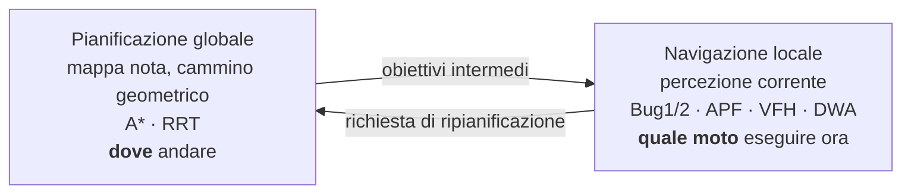
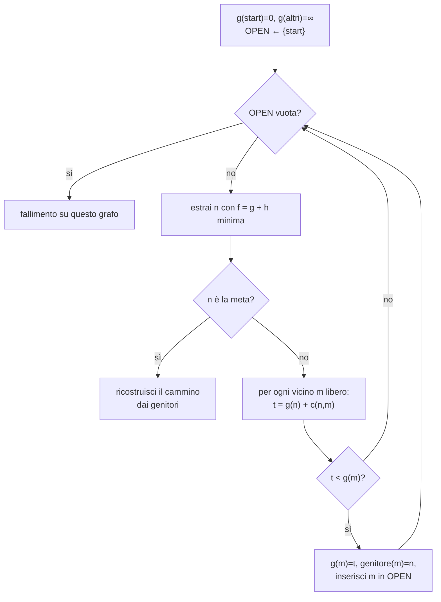

---

## corso: Robotica MOD2 lezione: 3 data: 2026-10-06 docente: Antonio Sgorbissa argomenti: [simulatore del corso, ground truth, errori di odometria, esplorazione a frontiera, pianificazione globale, navigazione locale, spazio delle configurazioni, somma di Minkowski, margine di sicurezza, discretizzazione a griglia, connettività 4 e 8, quadtree, A*, euristica] fonti: [trascrizione L3, slide "03 Pianificazione del moto in due dimensioni", simulatore del corso] tags: [robotica-mod2, lezione]
---
# Lezione 3 — Il simulatore, lo spazio delle configurazioni e l'algoritmo A*

La lezione ha due parti. Nella prima ora gli studenti installano e provano il **simulatore del corso**, che permette di vedere in azione la cinematica e l'odometria delle lezioni precedenti e anticipa gli argomenti successivi: mappe, pianificazione, esplorazione. Nella seconda ora si apre il capitolo della **pianificazione del moto in due dimensioni**: la distinzione fra pianificazione globale e navigazione locale, lo **spazio delle configurazioni**, la discretizzazione dello spazio a griglia e il primo algoritmo di pianificazione globale, **A***.

Il docente ha deciso di non approfondire il modello con sterzo attivo accennato a fine [[Lezione 02 - Cinematica inversa e odometria|Lezione 2]]. Lo riprenderà se resterà tempo.

---

# Parte I — Il simulatore del corso

## 1. Installazione, registrazione ed esercizi

Il simulatore, scaricabile da AulaWeb, si avvia dopo aver installato i _requirements_ Python. È pensato per Windows, Linux e macOS, ma il docente può testarlo solo su Windows e Linux, quindi su Mac potrebbero emergere problemi. Qualunque difetto va segnalato via email, con screenshot del messaggio di errore se il programma non parte: serve a rilasciare versioni corrette. Alcuni problemi osservati in aula:

- la connessione al server fallisce su **Eduroam**, probabilmente per le restrizioni della rete;
- su schermi a bassa risoluzione la finestra di avvio non mostra tutti i controlli, anche se premendo Invio si procede con le impostazioni predefinite;
- il programma si blocca se si modificano i sorgenti: c'è un controllo che lo impedisce.

> [!important] Regole su registrazione ed esercizi
> 
> - Si può lavorare **senza registrarsi** quante volte si vuole. Gli esercizi svolti offline vengono conservati localmente e trasmessi alla prima registrazione.
> - La registrazione con la propria matricola vale **una sola volta e su un solo PC**. Per cambiare macchina bisogna chiedere al docente di cancellare l'utente.
> - I punteggi degli esercizi arrivano sul server e serviranno ad **aggiustare in positivo** il voto finale (forse fino a circa 2 punti, da definire). Non svolgerli non penalizza.
> - Gli esercizi sono di difficoltà crescente: domande a scelta multipla, attività da eseguire nel simulatore seguite da un breve commento su ciò che si è osservato, completamento di frammenti di codice (per esempio la cinematica della guida differenziale). Per gli esercizi di codice si può **vedere la soluzione**, che però non si può copiare, e l'esercizio vale poi meno. I commenti arrivano al docente insieme alla matricola.

## 2. Che cosa si vede nel simulatore

All'avvio si sceglie il tipo di robot. Il **robot su ruote** è a guida differenziale. Il **quadrupede** è per ora "finto": è trattato esattamente come un robot su ruote, con due zampe per lato al posto delle ruote, e la sua cinematica si riduce alla velocità del lato destro e del lato sinistro. Si sceglie poi l'**edificio** da generare tramite un _seed_: lo stesso seed genera sempre lo stesso edificio casuale. Si possono regolare anche il numero di piani e la probabilità di ostacoli, porte bloccate, fughe di gas e altri pericoli.

Lo scenario è di **ricerca e soccorso** (_search and rescue_), un'applicazione della robotica autonoma più desiderata che realizzata. Dopo un terremoto o una fuga di gas, prima di mettere a rischio operatori umani, si manda un robot che costruisca autonomamente una mappa e raccolga informazioni. Le informazioni utili sono la planimetria, i percorsi accessibili, le zone con gas o temperatura elevata e le persone che hanno bisogno di aiuto. Nella simulazione, le aree **rosse** che si espandono rappresentano zone ad alta temperatura (incendi) e quelle **verdi** gas letali.

> [!important] Ground truth e stima La finestra principale ha due metà.
> 
> - A **sinistra** c'è il **ground truth**: il mondo come è davvero, cioè la verità rispetto a cui si confrontano tutti gli algoritmi di stima.
> - A **destra** c'è ciò che il robot **stima**: la mappa ricostruita e la posa che crede di avere.
> 
> All'inizio le due posizioni coincidono. A causa degli errori, dopo un po' non coincidono più. La distinzione fra ciò che è vero e ciò che il robot crede è fondamentale per tutto il corso. Si può attivare anche una vista 3D, molto pesante sui computer meno potenti, che non aggiunge nulla se non il piacere di vederla.

## 3. Muovere il robot

Lo stato del robot mostra il sistema di riferimento corpo, con $x_B$ lungo la direzione di marcia: il robot non può traslare di lato perché è non olonomo. Ci sono due modi per comandarlo.

- **Velocità delle ruote**: i tasti **V/B** aumentano o diminuiscono la velocità angolare della ruota sinistra, **N/M** quella della destra. Si possono anche impostare i valori a mano confermando con Invio. Con una sola ruota in moto il robot ruota attorno alla ruota ferma. Con velocità uguali avanza dritto. Con velocità diverse descrive archi.
- **Velocità lineare e angolare**: i tasti **W/S** (avanti/indietro) e **A/D** (rotazione) comandano direttamente $v$ e $\omega$. La corrispondenza con le velocità delle ruote è quella della cinematica inversa.

Il simulatore permette anche di anticipare la pianificazione autonoma:

- **cliccando su un punto** della mappa, il robot **pianifica** un percorso e lo esegue con l'algoritmo **A*** (§8);
- con il **doppio clic** parte l'**esplorazione automatica a frontiera**. Il robot calcola la _frontiera_ fra spazio noto e spazio ignoto, pianifica per raggiungerla e, una volta raggiunta, passa a un'altra, riducendo progressivamente lo spazio ignoto, anche su più piani.

La velocità di simulazione si può aumentare se il computer lo consente.

## 4. L'odometria sbaglia: due esperimenti

La mappa ricostruita a destra, con le impostazioni predefinite, è **irrealisticamente precisa**. Il robot presume di sapere esattamente dove si trova: con una posa sempre corretta, i muri visti da posizioni diverse si sovrappongono coerentemente. Nella realtà la mappa viene costruita usando una stima della posa, per esempio l'odometria, che ha errori.

Nel menu dello stato si sceglie la **sorgente di localizzazione** usata per costruire la mappa e per navigare. Le opzioni sono la posizione assoluta reale (realistica solo con un sistema esterno di telecamere, che non si può installare in un edificio crollato), l'**odometria**, oppure lo **SLAM**, che fonde l'odometria con la mappa che il robot sta costruendo.

> [!example] Esperimento 1 — errori non sistematici Il docente imposta l'odometria come sorgente di localizzazione e aumenta gli **errori percentuali** su $x$, $y$ e angolo, per esempio il 10%: a ogni spostamento la stima sbaglia di una frazione casuale. La mappa ricostruita diventa **storta** e, aumentando ancora gli errori, completamente sballata. L'orientamento stimato a destra non corrisponde più a quello reale a sinistra; a volte i due tornano simili per puro caso. Attivando la visualizzazione dell'odometria compare un'**ellisse di incertezza**: la stima che il robot fa della propria incertezza odometrica. Con grande probabilità la posizione reale cade al suo interno. Più il robot si muove, più l'ellisse cresce, perché gli errori si accumulano e non possono diminuire da soli. Questi errori sono **non sistematici**: casuali, un po' da una parte e un po' dall'altra, e quindi in parte si compensano.

> [!example] Esperimento 2 — un errore sistematico Il docente modifica il **raggio della ruota** che il robot _crede_ di avere, portandolo da 0,180 a 0,300 nelle unità del simulatore. Il raggio vero non cambia: cambia solo il parametro usato nelle formule dell'odometria. Poiché lo spostamento stimato di ogni ruota è $\Delta s_i = r_i\Delta\varphi_i$, il robot crede di aver percorso circa $0{,}300/0{,}180 \approx 1{,}67$ volte la distanza vera, quasi il doppio. La stima diverge subito e in modo **brutale**: il robot è "completamente perso". L'ellisse di incertezza non aiuta, perché modella solo gli errori casuali.

Il confronto dei due esperimenti illustra la classificazione della [[Lezione 02 - Cinematica inversa e odometria|Lezione 2]]. Un errore **sistematico** agisce sempre nella stessa direzione e ha un impatto enorme. Gli errori **casuali** si compensano almeno in parte.

> [!tip] Approfondimento #approfondimento L'ellisse di incertezza è la rappresentazione grafica della **covarianza** della stima di posizione, propagata passo dopo passo con un modello probabilistico del moto. Ogni passo aggiunge incertezza, e senza osservazioni esterne la covarianza non può che crescere. Il calcolo di questa propagazione per i modelli di moto odometrici, e il suo uso nei filtri di localizzazione, è trattato in Thrun, Burgard, Fox, _Probabilistic Robotics_, cap. 5 ("Robot Motion") [@thrun2005].

---

# Parte II — Pianificazione del moto in due dimensioni

## 5. Due problemi diversi: pianificazione globale e navigazione locale

Il problema di portare il robot da un punto a un altro si chiama spesso **navigazione** robotica. Nel piano si scompone in due sottoproblemi molto diversi, che vanno risolti **entrambi**.

**Pianificazione globale.** Si assume una **conoscenza globale** dell'ambiente: per esempio la mappa di un edificio noto. La conoscenza può però essere sbagliata. Possono esserci persone, i tavoli possono essere stati spostati, dopo un sisma può essere crollato tutto. La pianificazione globale _presume_ di avere questa conoscenza e la usa. Si può pianificare anche con una conoscenza globale **parziale**, come nel simulatore, dove il robot pianifica sulla mappa che sta costruendo, con poco spazio noto e molto ignoto. In quel caso bisogna saper **ripianificare** quando arrivano nuove informazioni. I metodi che si vedranno sono **A*** e **RRT**.

**Navigazione locale.** Il problema non è trovare un percorso verso l'obiettivo, ma muoversi **qui e ora** in base a ciò che i sensori vedono attorno al robot. Il docente fa l'esempio dell'uscita dall'edificio. Il piano globale dice: raggiungi la porta, attraversala, gira a destra, scendi le scale, attraversa le porte a vetri. Mentre si cammina, con un'odometria incerta, sono i sensori a dire dov'è la porta. Non è il piano globale a evitare di sbattere contro lo stipite, ma la navigazione locale, che decide istante per istante velocità e direzione. I metodi che si vedranno sono gli algoritmi **Bug1** e **Bug2**, i **campi di potenziale artificiale** (APF) e altri.



> [!important] Perché servono entrambi (slide 3) Un cammino geometrico privo di collisioni non soddisfa automaticamente i vincoli di sterzata, accelerazione e frenata del robot. Viceversa, un comando localmente sicuro non garantisce di raggiungere la destinazione. Un sistema di navigazione reale tiene quasi sempre entrambi i livelli. La distinzione che regge tutto il capitolo è che **decidere dove andare non è decidere quale moto eseguire adesso**.

## 6. Lo spazio delle configurazioni

### 6.1 Il problema: i robot non sono punti

Quasi tutti gli algoritmi di pianificazione trattano il robot come un **punto**. L'esempio più familiare, presente anche nei videogiochi, è la mappa discretizzata come una **griglia**: alcune celle sono libere, altre occupate da ostacoli, e pianificare significa scegliere la sequenza di celle che porta dalla partenza alla meta. Un robot reale però ha un ingombro. Per conciliare le due cose, prima ancora di pianificare, si trasforma il problema nello **spazio delle configurazioni** (_configuration space_, C-space). È uno spazio opportunamente costruito in cui il robot _può_ essere trattato come un punto, anche se non lo è.

### 6.2 Robot circolare: gonfiare gli ostacoli

Si assume che il robot sia un **disco** di raggio $r$, o che sia comunque contenuto in un disco. A $r$ si aggiunge un **margine** $\delta$, perché non si vuole un robot che si muova strisciando contro i muri. Per un robot come Pepper, un umanoide su base mobile, l'approssimazione col disco costa poco. Per un'automobile si può fare, ma si perde molta informazione: ci saranno posti dove il disco non passa e l'automobile sì.

Per un disco l'idea è **gonfiare gli ostacoli**. Intuitivamente si fa scorrere il disco lungo il bordo dell'ostacolo e si osserva la traiettoria del centro. La regione spazzata, insieme all'ostacolo, è il **C-ostacolo** $\mathcal{C}_{obs}$: la zona in cui il _centro_ del robot non può entrare, perché altrimenti il disco toccherebbe l'ostacolo. Fatto questo, si pianifica per il solo centro del disco come se fosse un punto. Se il punto non entra in $\mathcal{C}_{obs}$, il disco non urta l'ostacolo. Si veda la figura della **slide 4**: un ostacolo a L diventa un poligono con gli spigoli arrotondati di raggio $r + \delta$.

Formalmente l'operazione non si costruisce "facendo scorrere il disco", ma con la **somma di Minkowski**. Data la regione dell'ostacolo $\mathcal{O}$ e il disco chiuso di raggio $r + \delta$ centrato nell'origine,

$$ B_{r+\delta} = {, z \in \mathbb{R}^2 : |z| \le r + \delta ,}, $$

il C-ostacolo è

$$ \mathcal{C}_{obs} = \mathcal{O} \oplus B_{r+\delta}, \qquad \text{dove}\quad \mathcal{A} \oplus \mathcal{B} = {, a + b : a \in \mathcal{A},\ b \in \mathcal{B} ,}. $$

La somma di Minkowski somma, come vettori, **ogni punto del primo insieme con ogni punto del secondo**. In pratica si "appoggia" il disco su ogni punto dell'ostacolo e si tiene tutto ciò che copre. Lo spazio libero per il punto è il complemento, all'interno dello spazio di lavoro $\mathcal{W}$:

$$ p \in \mathcal{C}_{free} \iff p \in \mathcal{W}\ \text{ e }\ p \notin \mathcal{C}_{obs}. $$

### 6.3 Robot non circolare: le dimensioni diventano tre

Il gonfiaggio funziona perché il disco è **invariante per rotazione**: comunque sia orientato, occupa la stessa impronta. Un robot **rettangolare** no. Ruotandolo cambia l'ingombro, e quindi cambia la regione vietata al suo punto di riferimento. La configurazione diventa

$$ q = (x, y, \theta) \in \mathbb{R}^2 \times S^1, $$

e per ogni orientamento fissato il C-ostacolo è una **sezione** diversa:

$$ \mathcal{C}_{obs}(\theta) = \mathcal{O} \oplus \big(-\mathcal{A}(\theta)\big), $$

dove $\mathcal{A}(\theta)$ è l'impronta del robot orientato di $\theta$ rispetto al punto di riferimento, e il segno meno indica l'impronta riflessa rispetto all'origine. Per un disco $-\mathcal{A} = \mathcal{A}$, quindi il segno non conta.

> [!example] Il C-ostacolo di un robot rettangolare (slide 5) Per un robot di $1{,}5 \times 0{,}6$ m e un ostacolo rettangolare:
> 
> - a $\theta = 0^\circ$ il C-ostacolo è l'ostacolo allargato soprattutto in **larghezza**;
> - a $\theta = 90^\circ$ è allargato soprattutto in **altezza**;
> - a $\theta = 45^\circ$ diventa un **ottagono**.
> 
> Sovrapponendo tutte le sezioni al variare di $\theta$ si ottiene un **solido** nello spazio $(x, y, \theta)$, non un parallelepipedo, che cambia forma con $\theta$. Un cammino ammissibile è una curva dentro lo spazio libero di questo volume, non nel piano.

Una volta costruito lo spazio, il robot torna a essere un punto $(x, y, \theta)$, e si pianifica come questo punto si muove dalla partenza alla meta. Lo spazio può essere discretizzato in **voxel**, cubetti tridimensionali, oppure trattato con metodi che non discretizzano affatto, come i campi di potenziale. Il docente osserva che uno spazio a tre dimensioni "non è troppo".

Lo stesso approccio vale per robot a più gradi di libertà. Un **manipolatore a 6 giunti** rotazionali diventa un punto in uno spazio a 6 dimensioni, dove ogni punto rappresenta una configurazione di tutti i giunti. Trasformare gli ostacoli in C-ostacoli in sei dimensioni è complicatissimo, "ma c'è chi l'ha fatto".

> [!tip] Approfondimento #approfondimento L'idea di ridurre il problema a quello di un punto in uno spazio delle configurazioni, con ostacoli "espansi" tramite operazioni di tipo Minkowski, è formalizzata da T. Lozano-Pérez in _Spatial Planning: A Configuration Space Approach_, IEEE Transactions on Computers, 1983 [@lozanoperez1983]. Una trattazione moderna e completa dello spazio delle configurazioni, anche per manipolatori, si trova in S. M. LaValle, _Planning Algorithms_, Cambridge University Press, 2006, cap. 4 [@lavalle2006].

### 6.4 Il margine di sicurezza è una scelta, non una dimostrazione

Il margine $\delta$ tiene conto dell'errore di localizzazione, dell'incertezza della mappa e dell'errore con cui il robot insegue il percorso. Serve per sicurezza, ma **non dà garanzie formali** che il robot possa davvero eseguire il moto pianificato. Si gonfiano gli ostacoli quanto basta per avere, ragionevolmente, la garanzia che il disco passerà. Quando servono garanzie formali, quegli errori vanno modellati esplicitamente. Anche i bordi dello spazio di lavoro vanno trattati come ostacoli.

> [!example] Quanto deve essere largo un corridoio (slide 6) Siano $r = 0{,}25$ m e $\delta = 0{,}10$ m, quindi $r + \delta = 0{,}35$ m. Un corridoio viene "gonfiato" da entrambi i lati, perdendo $2(r+\delta) = 0{,}70$ m di larghezza utile. Perché il centro del robot possa passare, il corridoio reale deve essere **più largo di 0,70 m**. A 0,70 m esatti resterebbe una sola linea percorribile.
> 
> - Corridoio di **0,90 m**: varco residuo $0{,}90 - 0{,}70 = 0{,}20$ m. Il centro può passare.
> - Corridoio di **0,60 m**: varco residuo $\le 0$. Il gonfiaggio chiude il corridoio. Con un margine più piccolo di 0,10 m potrebbe riaprirsi: il margine è una scelta del progettista.

## 7. Discretizzare lo spazio: la griglia come grafo

### 7.1 Celle libere, celle piene e celle "a metà"

La soluzione più immediata è sovrapporre allo spazio una **griglia** di celle che possono essere piene o vuote: il robot passa nelle vuote e non nelle piene. Ma come si tratta una cella **mezza piena e mezza vuota**? Per sicurezza la si marca come **occupata**.

> [!example] La griglia può chiudere un varco che esiste (slide 6, terzo caso) Il corridoio di 0,90 m ha nello spazio delle configurazioni un varco di 0,20 m. Se si discretizza con celle di **0,50 m**, ogni cella lungo il corridoio contiene sia parte del varco sia parte del C-ostacolo, e viene marcata occupata. Il percorso, che nel continuo esiste, sulla griglia **sparisce** e il pianificatore non lo trova.

Avere un varco di una certa dimensione nel continuo non equivale quindi ad avere una soluzione sulla griglia. La discretizzazione toglie altro spazio, oltre a quello già tolto dal margine.

### 7.2 Connettività: quattro o otto vicini

La soluzione cercata sarà una **sequenza di celle**. Per definirla bisogna stabilire quando due celle sono **adiacenti**. Una griglia con una regola di adiacenza **definisce un grafo**: ogni cella libera è un vertice, e due vertici sono collegati da un arco se le celle sono adiacenti.

- **4-connessa** (_four-neighbour_): sono adiacenti le celle che hanno un **lato** in comune. Ogni movimento costa $\Delta$, il lato della cella. Il cammino può muoversi solo in orizzontale e verticale. Per raggiungere una cella in diagonale bisogna procedere "a scalini": avanzare fino all'allineamento e poi girare.
- **8-connessa**: ogni cella è adiacente alle **otto** che la circondano, diagonali comprese. I movimenti diagonali costano $\sqrt2,\Delta$, la distanza fra i centri.

Il cammino trovato sul grafo è una sequenza di passi discreti. Nulla vieta che poi la navigazione locale esegua un moto diverso, ma la rappresentazione impone comunque vincoli forti su dove si può passare.

> [!warning] Il taglio d'angolo Con la connettività a 8 due celle che si toccano solo per uno **spigolo** sono adiacenti sulla griglia. Ma se le altre due celle attorno allo spigolo sono occupate, nel piano il robot che si muove in diagonale dall'una all'altra attraverserebbe l'ostacolo. Le celle sono connesse nel grafo ma non nel mondo. Come osservano le slide, non basta che le due celle estreme siano libere: **deve esserlo anche il moto che le collega**. Questo "taglio d'angolo" va vietato esplicitamente. Si veda la **slide 10**.

Una mappa **probabilistica** di occupazione, come le griglie della [[Lezione 01 - Robot autonomi e cinematica differenziale|Lezione 1]], va prima **sogliata** per decidere quali celle sono libere. La soglia e il trattamento delle celle ignote sono decisioni di modello. Trattare l'ignoto come libero favorisce l'esplorazione, ma non offre le stesse garanzie di non collisione di una mappa nota.

### 7.3 Il prezzo della risoluzione

Il rimedio naturale ai problemi precedenti, suggerito da uno studente, è **aumentare la risoluzione**, cioè rimpicciolire le celle. Con celle di un centimetro le celle di confine sono ancora marcate piene, ma lo spazio vuoto contiene moltissime celle completamente libere, e i varchi riappaiono. Il prezzo è computazionale: dimezzando il lato della cella, su un'area fissa le celle diventano **quattro volte** tante. Il loro numero cresce col quadrato di $1/\Delta$ nel piano, e col cubo in tre dimensioni.

```chart
type: bar
labels: [1 m, 0.5 m, 0.25 m, 0.1 m, 0.05 m]
series:
  - title: Numero di celle per un'area di 10 m × 10 m
    data: [100, 400, 1600, 10000, 40000]
beginAtZero: true
width: 80%
```

Nonostante questo si fa. Il pianificatore del simulatore, quello che si attiva cliccando su un punto, usa proprio celle abbastanza piccole da evitare i problemi descritti. Il docente osserva che per la pianificazione nel piano, con la potenza di calcolo odierna, la risoluzione raramente è un problema critico.

**Risoluzione variabile: il quadtree.** Uno studente propone una soluzione ibrida: celle grandi dove non ci sono ostacoli e celle piccole vicino agli ostacoli. Si fa, e la struttura si chiama **quadtree**. Una cella grande viene divisa in quattro figlie solo se è "mista". Ciascuna figlia, se necessario, viene a sua volta divisa in quattro, e così via. La memorizzazione è un albero in cui ogni nodo ha quattro figli piene, vuote o ulteriormente suddivise. È particolarmente utile in 3D, dove l'equivalente si chiama _octree_. Il costo è una gestione più complessa: con celle di dimensioni diverse non è più ovvio quali siano adiacenti, mentre nella griglia uniforme basta scegliere 4 o 8 vicini.

---

## 8. L'algoritmo A*

### 8.1 Che cosa garantisce

A* calcola il **cammino a costo minimo** su un grafo in cui ogni arco ha un **costo noto**: nella pianificazione tipicamente la distanza euclidea fra i centri delle celle. Esistono altri algoritmi che trovano il cammino minimo, per esempio Dijkstra. Ma sotto opportune condizioni A* lo trova **esplorando il minor numero di nodi**: è il più efficiente possibile, in termini di passi e non di velocità di una certa implementazione. Il docente sottolinea che A* ha condizioni di applicabilità precise, e che nel caso della pianificazione nello spazio sono naturalmente soddisfatte.

### 8.2 Le tre quantità

Per ogni nodo $n$ l'algoritmo mantiene:

- $g(n)$: il **miglior costo noto** per arrivare dalla partenza a $n$. È "il migliore noto" perché durante la ricerca si possono scoprire cammini migliori;
- $h(n)$: una **stima** del costo residuo da $n$ alla meta, detta **euristica**. È una stima perché, se il costo vero fosse noto, il problema sarebbe già risolto;
- $f(n) = g(n) + h(n)$: la stima del costo totale di un cammino che passa per $n$.

> [!important] Funzione di valutazione e aggiornamento A* **espande sempre il nodo con $f$ minima**: $$ f(n) = g(n) + h(n). $$ Quando si espande $n$, per ogni vicino $m$ con costo d'arco $c(n, m)$ si calcola un costo tentativo $$ g_{\text{tent}}(m) = g(n) + c(n, m), $$ e lo si accetta **solo se migliora** il valore già noto, $g_{\text{tent}}(m) < g(m)$. In quel caso si aggiorna $g(m)$ e si registra $n$ come **genitore** di $m$. Questa operazione si chiama _rilassamento_. La catena dei genitori, ripercorsa a ritroso dalla meta, restituisce il cammino. Il $g$ di un nodo può solo diminuire.

> [!important] Euristica ammissibile Perché A* restituisca il cammino ottimo, l'euristica deve essere **ammissibile**: non deve mai **sopravvalutare** il vero costo residuo minimo $h^-(n)$: $$ 0 \le h(n) \le h^-(n). $$ Senza questa proprietà l'algoritmo non è applicabile con garanzia di ottimalità.

### 8.3 Un esempio passo per passo

Il docente svolge l'esempio delle **slide 12–14**, su un grafo generico di sei nodi. Il grafo è generico per ragioni di visualizzazione, ma una griglia con una regola di connettività è esattamente un grafo di questo tipo. Su una griglia 4-connessa gli archi costerebbero 1, sulle diagonali di una griglia 8-connessa $\sqrt2$.

|Arco|S–A|S–B|A–C|A–D|B–C|B–G|C–D|D–G|
|---|---|---|---|---|---|---|---|---|
|costo|2|3|4|7|2|12|2|3|

|Nodo|S|A|B|C|D|G|
|---|---|---|---|---|---|---|
|$h$|7|6|4|4|3|0|

L'euristica è ammissibile perché ogni $h$ non supera il costo vero minimo verso G. Per esempio $h(B) = 4$, mentre il costo reale da B è 7 (B→C→D→G). Il docente insiste su un punto: chi guarda il grafo vede tutto e può calcolare a occhio il cammino migliore, ma è proprio quello che l'algoritmo deve fare senza "vedere" il grafo.

> [!example] Le sei estrazioni dalla coda Si usano la coda **OPEN** (nodi scoperti, non ancora espansi) e l'insieme dei nodi **espansi** (CLOSED).
> 
> 1. **Estraggo S** ($f = 0 + 7 = 7$). Aggiorno i vicini: A con $g = 2$, $f = 2 + 6 = 8$; B con $g = 3$, $f = 3 + 4 = 7$. OPEN: B(7), A(8).
> 2. **Estraggo B** ($f = 7$). Aggiorno C con $g = 3 + 2 = 5$, $f = 9$, e G con $g = 3 + 12 = 15$, $f = 15$. OPEN: A(8), C(9), G(15). G è stato _scoperto_, ma l'algoritmo **non termina**: termina solo quando la meta viene _estratta_.
> 3. **Estraggo A** ($f = 8$). Aggiorno D con $g = 2 + 7 = 9$, $f = 12$. Per C il percorso via A darebbe $g = 2 + 4 = 6 > 5$, quindi C **non si aggiorna**. OPEN: C(9), D(12), G(15).
> 4. **Estraggo C** ($f = 9$). D migliora: $g = 5 + 2 = 7 < 9$, quindi $f = 10$ e il genitore di D diventa C. OPEN: D(10), G(15).
> 5. **Estraggo D** ($f = 10$). G migliora: $g = 7 + 3 = 10 < 15$, quindi $f = 10$. OPEN: G(10).
> 6. **Estraggo G**: è la meta, mi fermo.
> 
> **Cammino**: S → B → C → D → G, con costo $3 + 2 + 2 + 3 = 10$. Le alternative S→A→C→D→G (costo 11) e S→A→D→G (costo 12) sono state viste e scartate.

> [!tip] Che cosa insegna l'esempio (slide 14)
> 
> - **L'ordine segue $f$, non $g$.** Dopo S tocca a B ($f = 7$) e non ad A ($f = 8$), benché A sia più economico da raggiungere ($g = 2$ contro 3). A* segue la stima del totale, non il costo già speso.
> - **Rilassamento.** Al passo 4 il costo di D scende da 9 a 7 e il genitore cambia da A a C.
> - **Scoprire la meta non è risolverla.** G entra in coda al passo 2 con costo 15. Fermarsi allora avrebbe restituito un cammino da 15 invece che da 10.
> - **Un nodo estratto non cambia più.** Una volta espanso, il suo $g$ è definitivo, perché è il costo minimo per raggiungerlo. Con un'euristica _consistente_ (definita nella [[Lezione 04 - Garanzie, RRT, algoritmi Bug e campi di potenziale|Lezione 4]]) nessun nodo va riaperto. È questo a dare il vantaggio pratico su Dijkstra, che avrebbe espanso tutto il grafo.



### 8.4 Implementazione

L'implementazione standard usa una **coda di priorità** (un _heap_). Quando il $g$ di un nodo migliora, invece di aggiornare la sua voce nella coda se ne inserisce una nuova. Le voci **obsolete**, quelle con $f$ maggiore del valore attuale, vengono scartate quando vengono estratte.

```python
import heapq, math

def astar(start, goal, vicini, costo, h):
    """vicini(n) -> iterabile di nodi adiacenti liberi; costo(n, m) >= 0; h ammissibile."""
    g = {start: 0.0}
    genitore = {start: None}
    open_ = [(h(start), start)]
    while open_:
        f, n = heapq.heappop(open_)
        if f > g[n] + h(n):          # voce obsoleta: n è già stato migliorato
            continue
        if n == goal:                # ci si ferma all'ESTRAZIONE della meta
            cammino = []
            while n is not None:
                cammino.append(n)
                n = genitore[n]
            return cammino[::-1], g[goal]
        for m in vicini(n):
            t = g[n] + costo(n, m)
            if t < g.get(m, math.inf):   # rilassamento
                g[m], genitore[m] = t, n
                heapq.heappush(open_, (t + h(m), m))
    return None, math.inf            # nessun cammino su questo grafo
```

Applicata al grafo dell'esempio, questa funzione estrae i nodi nell'ordine S(7), B(7), A(8), C(9), D(10), G(10) e restituisce S→B→C→D→G con costo 10.

### 8.5 Da dove vengono le euristiche

A fine lezione il docente mostra che nella pianificazione su griglia è **facile** trovare euristiche ammissibili. Sia $n$ il nodo corrente e $p_g$ la meta, con $d_x = |x_n - x_g|$ e $d_y = |y_n - y_g|$ misurati in celle.

- **Griglia 4-connessa: distanza di Manhattan**, $h_4(n) = d_x + d_y$. Muovendosi solo in orizzontale e verticale, qualunque cammino deve fare almeno $d_x$ passi orizzontali e $d_y$ verticali, comunque siano ordinati. Gli ostacoli possono solo allungare il cammino. Con $d_x = 4$ e $d_y = 3$ il costo minimo è 7.
- **Griglia 8-connessa: distanza "ottile"**, $h_8(n) = \max(d_x, d_y) + (\sqrt2 - 1)\min(d_x, d_y)$. Si percorrono diagonali finché possibile, poi un tratto dritto. La derivazione è nella [[Lezione 04 - Garanzie, RRT, algoritmi Bug e campi di potenziale|Lezione 4]].
- **Distanza euclidea**, $h_E(n) = \sqrt{d_x^2 + d_y^2}$. Nessun cammino è più corto della linea retta, quindi è sempre ammissibile quando i costi sono distanze.

Con un'euristica ammissibile si hanno garanzie sul fatto che A* trovi il cammino minimo esplorando il minimo indispensabile. I valori $h$ dell'esempio del §8.3 potrebbero, per esempio, essere distanze euclidee dalla meta: lì sono scelti in modo arbitrario ma ammissibile.

> [!tip] Approfondimento #approfondimento A* è stato formulato da P. E. Hart, N. J. Nilsson e B. Raphael nel 1968 [@hart1968], all'SRI, nell'ambito del progetto **Shakey** visto nella [[Lezione 01 - Robot autonomi e cinematica differenziale|Lezione 1]]. Nell'articolo originale gli autori dimostrano che, con un'euristica che non sovrastima mai il costo residuo, l'algoritmo trova sempre un cammino ottimo. Dimostrano anche che, sotto un'ulteriore condizione di consistenza dell'euristica, nessun altro algoritmo che disponga della stessa informazione può espandere meno nodi.

---

## Riepilogo della lezione

- Il **simulatore** mostra a sinistra il _ground truth_ e a destra la stima del robot. Usando l'odometria come sorgente di localizzazione, gli errori casuali deformano la mappa e fanno crescere l'**ellisse di incertezza**, mentre un errore sistematico (raggio sbagliato) fa perdere il robot del tutto.
- La navigazione si divide in **pianificazione globale** (dove andare, su una mappa: A*, RRT) e **navigazione locale** (quale moto eseguire ora, dai sensori: Bug, APF, VFH, DWA). Servono entrambe.
- Lo **spazio delle configurazioni** riduce il robot a un punto. Per un disco si gonfiano gli ostacoli di $r + \delta$ con la **somma di Minkowski**. Per un robot non circolare lo spazio diventa $(x, y, \theta)$, per un manipolatore ha tante dimensioni quanti sono i giunti.
- Il **margine** $\delta$ è una scelta progettuale, non una garanzia. La **discretizzazione** toglie altro spazio: le celle miste si marcano occupate, i varchi stretti possono sparire, e con l'8-connessione il taglio d'angolo va vietato. Più risoluzione significa più celle (×4 dimezzando il lato). I **quadtree** adattano la risoluzione.
- **A*** espande il nodo con $f = g + h$ minima, aggiorna i vicini per rilassamento e si ferma all'**estrazione** della meta. Con un'euristica **ammissibile** ($h \le h^*$) il cammino è ottimo sul grafo. Manhattan, ottile ed euclidea sono euristiche ammissibili nei rispettivi vicinati.