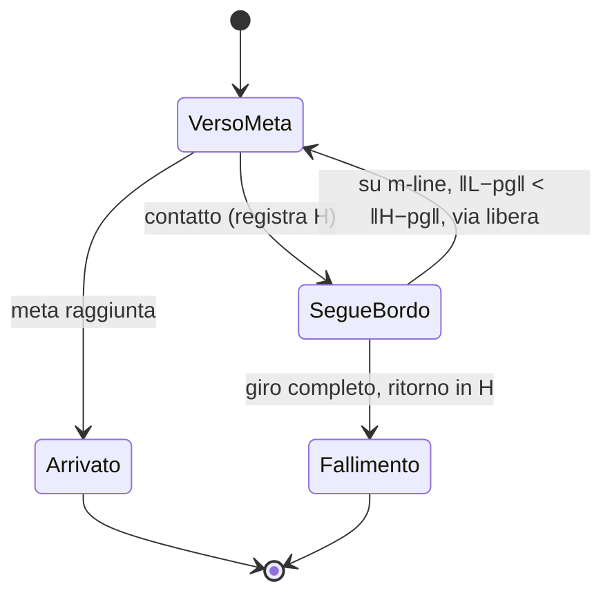
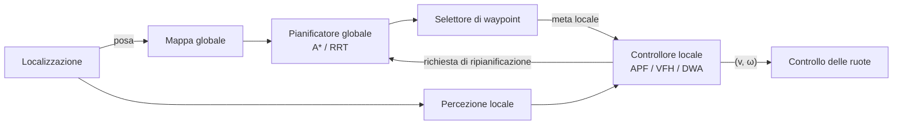

---

## corso: Robotica MOD2 lezione: 4 data: 2026-10-14 docente: Antonio Sgorbissa argomenti: [pianificazione globale, navigazione locale, cammino e traiettoria, completezza, ottimalità, euristiche ammissibili e consistenti, Dijkstra, RRT, regioni di Voronoi, RRT cinodinamico, Bug1, Bug2, campi di potenziale artificiale, minimi locali] fonti: [trascrizione L4, slide "03 Pianificazione del moto in due dimensioni"] tags: [robotica-mod2, lezione]
---
# Lezione 4 — Garanzie, euristiche, RRT, algoritmi Bug e campi di potenziale

La lezione completa la **pianificazione globale**. Formalizza che cosa si intende per cammino, che cosa promettono le garanzie degli algoritmi, approfondisce le euristiche di A* e introduce un secondo pianificatore basato sul campionamento casuale, **RRT**. Si passa poi alla **navigazione locale** con gli algoritmi **Bug1** e **Bug2** e con i **campi di potenziale artificiale**.

> [!important] Una premessa del docente sul livello di dettaglio Riguardando le slide, il docente sottolinea un messaggio. Lo scopo del corso è mostrare molti metodi diversi e, per ciascuno, l'**idea** che lo regge. Chi dovesse usarne uno davvero dovrebbe approfondirne l'implementazione e il comportamento nei casi particolari. La trattazione è volutamente ampia più che profonda. Ciò che conta per l'esame è capire _perché_ ogni metodo funziona, quando fallisce e che cosa promette.

---

## 1. Globale e locale: due rappresentazioni del problema

La distinzione introdotta nella [[Lezione 03 - Simulatore, spazio delle configurazioni e A star|Lezione 3]] viene ripresa e precisata.

- La **pianificazione globale** produce, dalla partenza alla meta, un piano: una sequenza di azioni o di punti. Lo fa però su una **rappresentazione semplificata** del mondo, come un grafo o una griglia. Un grafo dà una rappresentazione **topologica** dell'ambiente: dice che qui fuori c'è un incrocio e che si può andare a destra, a sinistra o dritto, non com'è fatto esattamente l'ambiente.
- Trovare un cammino sulla rappresentazione non dice ancora **come** il robot raggiungerà la meta di fronte a ostacoli imprevisti, né che il moto sia eseguibile. Un cammino su griglia può contenere **angoli retti**. Un robot differenziale li esegue fermandosi e ruotando sul posto, un veicolo tipo automobile no ([[Lezione 02 - Cinematica inversa e odometria|Lezione 2]], §7).

La pianificazione globale risolve dunque il problema nella sua rappresentazione e **delega** alla navigazione locale il compito di realizzarlo nel mondo reale: girare attorno agli ostacoli, produrre moti realistici.

## 2. Cammino e traiettoria

> [!important] Cammino e traiettoria
> 
> - Un **cammino** (_path_) è un insieme di punti dello spazio: dice _dove_ passare, non _come_ e _quando_.
> - Una **traiettoria** aggiunge una **legge oraria**: dice dove si trova il robot in ogni istante. Deve quindi rispettare un modello di moto.

Formalmente un cammino è una funzione continua

$$ \pi : [0, 1] \to \mathcal{C}_{free}, \qquad \pi(0) = p_s, \qquad \pi(1) = p_g , $$

che a ogni valore del parametro $s \in [0,1]$ associa una configurazione nello **spazio delle configurazioni libero**. Lo spazio libero è quello che tiene conto sia degli ostacoli sia dell'ingombro del robot, per esempio con gli ostacoli gonfiati della lezione 3. Il parametro $s$ non è il tempo: è solo un modo di percorrere il cammino da un estremo all'altro. La **lunghezza** del cammino è l'integrale della norma della sua derivata:

$$ L(\pi) = \int_0^1 \left| \frac{d\pi(s)}{ds} \right| ds . $$

Il docente presenta la definizione come puramente formale, ma utile per capire che cosa significhi "più corto". Le slide aggiungono che "più corto" ha senso solo dopo aver fissato rappresentazione, moti ammessi e costo. Un pianificatore può minimizzare la lunghezza, ma anche il tempo, l'energia, il rischio o una combinazione pesata.

Per un robot differenziale il vincolo non olonomo $-\dot x\sin\theta + \dot y\cos\theta = 0$ non è imposto da un pianificatore geometrico in $(x, y)$. Il robot può comunque seguire un cammino spezzato fermandosi e ruotando agli spigoli, se lo spazio e gli attuatori lo permettono.

## 3. Che cosa promette davvero una garanzia

Agli algoritmi di pianificazione non si chiede genericamente di "funzionare bene", ma di **garantire proprietà**. La tabella è quella della **slide 8**.

|Proprietà|Che cosa afferma|Che cosa **non** afferma|
|---|---|---|
|**Completo**|trova una soluzione se esiste, altrimenti termina dichiarando fallimento|che una singola esecuzione finita riesca|
|**Completo a risoluzione**|la stessa garanzia, ma alla discretizzazione scelta|che un passaggio più stretto della cella venga trovato|
|**Probabilisticamente completo**|la probabilità di trovare una soluzione tende a 1 al crescere del budget (tempo, iterazioni)|che un timeout finito dimostri che la meta è irraggiungibile|
|**Ottimo**|minimizza l'obiettivo dichiarato **sulla rappresentazione usata** (es. il grafo)|che il cammino sia ottimo nel piano continuo|
|**Asintoticamente ottimo**|si avvicina all'ottimo al crescere del calcolo|che dopo $N$ iterazioni il costo sia vicino all'ottimo|

Il docente ritiene essenziale capire tre di queste definizioni.

- **Completo.** Se una soluzione c'è la trova, e se non c'è lo dice. Non significa che ogni problema abbia soluzione.
- **Probabilisticamente completo.** È tipico degli algoritmi con una **componente casuale**. Non è garantito che trovino sempre una soluzione in tempo finito, ma aumentando il tempo a disposizione la probabilità di trovarla tende a 1.
- **Ottimo.** Minimizza una funzione di costo (lunghezza, consumo, tempo), ma **sulla rappresentazione usata**. Il cammino che A* trova ottimo sul grafo non è necessariamente ottimo quando il robot si muove davvero nel piano, perché il robot non si muove lungo il grafo.

> [!tip] Tre assi indipendenti Le slide sottolineano che queste proprietà sono **distinte** da altre due: evitare le collisioni ed eseguire un moto fisicamente possibile. Un algoritmo può essere completo e ottimo sul grafo e produrre comunque un cammino che il robot non sa eseguire.

---

# Parte I — Pianificazione globale

## 4. A* ripreso: scegliere bene l'euristica

### 4.1 Il ruolo dell'euristica

A* sceglie quale nodo esplorare minimizzando $f(n) = g(n) + h(n)$ ([[Lezione 03 - Simulatore, spazio delle configurazioni e A star|Lezione 3]], §8). Il docente invita a mettersi "nei panni dell'algoritmo": chi guarda il grafo lo vede tutto, ma l'algoritmo no. Partendo da S deve decidere se provare prima A o B, e lo decide in base a $f$, cioè al costo già speso più la stima di quello che resta. Il problema pratico è **trovare euristiche ammissibili**, che non sopravvalutino mai il costo residuo minimo:

$$ 0 \le h(n) \le h^*(n). $$

Le slide introducono anche una proprietà più forte.

> [!important] Ammissibile e consistente (slide 15)
> 
> - **Ammissibile**: $0 \le h(n) \le h^*(n)$. Garantisce l'ottimalità, ma può richiedere di **riaprire** nodi già espansi.
> - **Consistente** (o monotona): per ogni arco $(n, m)$ vale la disuguaglianza triangolare $$ h(n) \le c(n, m) + h(m), \qquad h(p_g) = 0 . $$ Nella versione standard su grafo evita del tutto le riaperture: una volta estratto un nodo, il suo $g$ è definitivo.
> 
> Ogni euristica consistente è anche ammissibile. Su un grafo finito con costi non negativi, A* restituisce un cammino di costo minimo quando la meta viene **rimossa** dalla coda, non quando viene generata per la prima volta. Un'euristica ammissibile ma non consistente resta compatibile con l'ottimalità, purché i nodi migliorati vengano riaperti. Il costo è $O\big((|V| + |E|)\log|V|\big)$ in tempo e $O(|V|)$ in memoria.

### 4.2 Euristiche per la griglia

Siano $d_x = |x_n - x_g|$ e $d_y = |y_n - y_g|$, in celle.

**Griglia 4-connessa: Manhattan.** Con soli movimenti orizzontali e verticali, per andare da $n$ alla meta serve **almeno** $d_x + d_y$: si può andare prima tutto a destra e poi su, oppure "a scaletta", ma mai in diagonale. Gli ostacoli possono solo allungare il cammino. Quindi

$$ h_4(n) = d_x + d_y $$

è ammissibile, ed è esattamente il costo vero in assenza di ostacoli.

**Griglia 8-connessa: distanza ottile.** Con le diagonali conviene muoversi in diagonale finché entrambe le distanze sono positive. Un passo diagonale costa $\sqrt2 \approx 1{,}41$ e accorcia **entrambe** le distanze, mentre un passo dritto costa 1 e ne accorcia una sola. Siano $M = \max(d_x, d_y)$ e $m = \min(d_x, d_y)$. Con $m$ passi diagonali si azzera la distanza più corta e si coprono anche $m$ unità di quella lunga. Restano $M - m$ passi dritti. Il costo minimo è quindi

$$ h_8 = \sqrt2,m + (M - m) = M + (\sqrt2 - 1),m . $$

> [!example] Le tre euristiche a confronto (slide 16–17) Con $d_x = 4$, $d_y = 3$:
> 
> - Manhattan: $h_4 = 4 + 3 = 7$;
> - ottile: $h_8 = 4 + (\sqrt2 - 1)\cdot 3 = 3\sqrt2 + 1 \approx 5{,}24$ (tre passi diagonali e uno dritto);
> - euclidea: $h_E = \sqrt{16 + 9} = 5$.
> 
> Su una griglia a 8 connessioni il costo minimo senza ostacoli è 5,24. Manhattan (7) lo **sopravvaluta** e **non è ammissibile** su quella griglia, pur essendo corretta a 4 connessioni. L'euristica va sempre abbinata al vicinato. L'euclidea è ammissibile per entrambi i vicinati, ma meno informativa.

```chart
type: bar
labels: [Manhattan h4, Ottile h8, Euclidea hE]
series:
  - title: Stima del costo da n alla meta (dx = 4, dy = 3)
    data: [7, 5.24, 5]
beginAtZero: true
width: 70%
```

**In generale: la distanza euclidea.** Se i costi sono **distanze nello spazio cartesiano**, la distanza euclidea fra nodo e meta è sempre ammissibile, perché nessun cammino è più corto della linea retta. A* nello spazio ha quindi "male che vada" sempre un'euristica a disposizione.

> [!warning] Se i costi non sono distanze Le slide avvertono: se ai costi si aggiungono penalità non negative, anche diverse da cella a cella, le distanze restano ammissibili. Se invece qualche arco può costare **meno** della sua lunghezza (per esempio quando il costo diventa un tempo di percorrenza), l'euristica va riscalata.

### 4.3 L'euristica nulla e il caso degli "zombie"

Il docente pone una domanda alla classe: esiste un'euristica che vada **sempre** bene, anche quando i costi degli archi non sono distanze? Per esempio quando il costo di un arco è il numero di _zombie_ che si incontrano percorrendolo e la distanza euclidea non c'entra nulla. L'unica ipotesi è che i costi non siano negativi, il che è ragionevole: un robot non "guadagna" a percorrere un arco.

La risposta è $h(n) = 0$ per ogni nodo. È sempre ammissibile: al limite si incontrano zero zombie, non meno uno. Ma è un'euristica **inutile**. Con $h \equiv 0$ si ha $f = g$, e A* sceglie i nodi solo in base alla distanza dalla partenza, senza alcuna spinta verso la meta. Può finire per esplorare l'intero grafo. In questo caso A* coincide con l'**algoritmo di Dijkstra**:

$$ h \equiv 0 \quad\Longrightarrow\quad \text{A* = Dijkstra}. $$

> [!important] Qualità dell'euristica Il cammino resta ottimo, ma si perde ciò che rende A* speciale: trovare il cammino minimo **esplorando il minimo indispensabile**. Tanto più l'euristica è **vicina al costo vero**, pur restando ammissibile, tanto più la ricerca è efficiente.

### 4.4 A* su una griglia con ostacoli

> [!example] A* al lavoro su una griglia 8-connessa (slide 18) Dati: $p_s = (0, 0)$, $p_g = (6, 4)$, celle di lato $\Delta = 1$ m, euristica ottile.
> 
> - Stima iniziale dalla partenza: $h_8(p_s) = 6 + (\sqrt2 - 1)\cdot 4 = 2 + 4\sqrt2 \approx 7{,}657$ m.
> - Dopo una mossa diagonale in $(1,1)$: $g = \sqrt2 \approx 1{,}414$ m e $f = \sqrt2 + [5 + 3(\sqrt2 - 1)] \approx 7{,}657$ m. **$f$ non cambia**, perché la mossa punta dritta alla meta.
> 
> Nella figura della **slide 18**, molte celle hanno lo stesso $f = 7{,}66$. Sono quelle lungo cui un cammino libero potrebbe realizzare esattamente la stima ottimistica dell'euristica: diagonali più un tratto dritto, come se non ci fossero ostacoli. Dove un ostacolo costringe a deviare, $f$ cresce: lungo il cammino restituito passa da 7,66 a 8,83, perché servono più passi del previsto. Con un'euristica consistente $f$ non decresce mai lungo un cammino. Molte celle lontane non vengono mai toccate, perché l'euristica guida l'espansione verso la meta.

### 4.5 Ottimo sul grafo, non nel piano

> [!warning] Il punto da non confondere (slide 19) L'ottimalità di A* vale **sul grafo scelto**: vicinato, costi e risoluzione fanno parte del problema. Il cammino "a gradini" è ottimo fra i moti rappresentati, non fra tutti i moti del piano. Lo si può **lisciare** (_smoothing_) sostituendo tratti a gradini con segmenti diretti, ma ogni segmento sostituito va **ricontrollato per collisione** e, se il robot ha vincoli di curvatura, anche contro questi. Un cammino privo di collisioni sul grafo **non è ancora una traiettoria eseguibile**: per questo esistono i metodi locali, che lavorano su comandi e non su geometria.

## 5. RRT: campionare invece di discretizzare

### 5.1 L'idea

Esistono altri approcci alla pianificazione globale. Il docente ne presenta uno "talmente interessante che è uno dei più usati attualmente", basato su un principio completamente diverso e che **non richiede una griglia**: **RRT** (_Rapidly-exploring Random Tree_, albero casuale a esplorazione rapida).

A* è completo e trova in modo deterministico un cammino dalla partenza alla meta, ma su una griglia. Trasformare quel cammino in un moto reale può essere molto faticoso, per esempio per un veicolo tipo automobile. RRT ha invece una forte **componente casuale**. Costruisce un **albero** radicato nella partenza e lo fa crescere **campionando** punti casuali dello spazio delle configurazioni continuo.

1. Si estrae un punto **casuale** $p_{rand}$, per esempio con probabilità uniforme nello spazio.
2. Si cerca il **vertice dell'albero più vicino** a $p_{rand}$. All'inizio c'è solo la partenza, quindi il primo campione si collega necessariamente a essa.
3. Si cerca di estendere l'albero da quel vertice verso il campione.
4. L'estensione si accetta solo se il nuovo punto non cade su un ostacolo **e** il segmento che lo collega all'albero **non attraversa** alcun ostacolo.

Prima o poi un vertice finisce abbastanza vicino alla meta, entro un raggio prefissato. Se il collegamento finale è libero, si è trovato un cammino, che si estrae risalendo i genitori fino alla radice.

### 5.2 Il passo di estensione

Il docente precisa che non si collega il campione direttamente all'albero: si fa un **passo di lunghezza al più $\eta$** dal vertice più vicino verso il campione. A ogni iterazione:

$$ p_{near} = \arg\min_{p \in V} | p - p_{rand} | , $$

dove $V$ è l'insieme dei vertici dell'albero. Poi, posto $d = | p_{rand} - p_{near} |$,

$$ p_{new} = p_{near} + \min!\left(1,\ \frac{\eta}{d}\right)(p_{rand} - p_{near}) . $$

> [!important] Perché il passo non supera mai $\eta$ Il vettore $p_{rand} - p_{near}$ fissa la **direzione**, e il fattore $\min(1, \eta/d)$ decide solo la **lunghezza**: $$ | p_{new} - p_{near} | = \min!\left(1, \frac{\eta}{d}\right) d = \min(d,\ \eta). $$
> 
> - Se $d > \eta$ il fattore vale $\eta/d < 1$. Si percorre solo la frazione $\eta/d$ del segmento, quindi il passo è lungo esattamente $\eta$. $p_{new}$ cade sul cerchio di raggio $\eta$ attorno a $p_{near}$, nella direzione del campione, che resta fuori portata.
> - Se $d \le \eta$ il fattore vale 1. Si arriva direttamente al campione: $p_{new} = p_{rand}$.
> 
> Si veda la figura della **slide 22**.

> [!example] Un'estensione numerica (slide 24) Dati: $p_{near} = (1, 1)$, $p_{rand} = (4, 5)$, $\eta = 0{,}5$ m. Allora $p_{rand} - p_{near} = (3, 4)$ e $d = |(3,4)| = 5$ m. Poiché $d > \eta$: $$ p_{new} = (1, 1) + \frac{0{,}5}{5}(3, 4) = (1{,}3;\ 1{,}4). $$ Il nuovo punto dista esattamente 0,5 m dal genitore. Se il **segmento** fra $(1,1)$ e $(1{,}3; 1{,}4)$ attraversa un ostacolo gonfiato, l'estensione viene respinta anche se il punto finale è libero.

> [!warning] Verificare il segmento, non solo l'estremo Un estremo libero non implica un segmento libero. La verifica di collisione riguarda l'intera estensione. Per ostacoli poligonali esistono test esatti di intersezione. I controlli per campionamento lungo il segmento devono usare una risoluzione giustificata o limiti conservativi. $\eta$ governa quanto avanza un'estensione, non l'accuratezza del controllo di collisione.

```python
import math, random

def rrt(p_s, p_g, eta, collisione_segmento, campiona, raggio_meta, max_iter=5000, p_bias=0.05):
    """collisione_segmento(a, b) -> True se il segmento a-b interseca un ostacolo (gonfiato).
    campiona() -> punto casuale nello spazio libero o nel workspace."""
    vertici, genitore = [p_s], {p_s: None}
    for _ in range(max_iter):
        p_rand = p_g if random.random() < p_bias else campiona()      # piccolo bias verso la meta
        p_near = min(vertici, key=lambda p: math.dist(p, p_rand))     # vicino più prossimo (O(N))
        d = math.dist(p_near, p_rand)
        if d == 0:
            continue
        k = min(1.0, eta / d)
        p_new = (p_near[0] + k * (p_rand[0] - p_near[0]),
                 p_near[1] + k * (p_rand[1] - p_near[1]))
        if collisione_segmento(p_near, p_new):                        # estensione respinta
            continue
        vertici.append(p_new); genitore[p_new] = p_near
        if math.dist(p_new, p_g) <= raggio_meta and not collisione_segmento(p_new, p_g):
            genitore[p_g] = p_new
            cammino, n = [], p_g
            while n is not None:
                cammino.append(n); n = genitore[n]
            return cammino[::-1]
    return None   # "nessuna soluzione nel budget", NON "nessuna soluzione"
```

> [!warning] Un fallimento non è conclusivo "Nessuna soluzione nel budget" non significa "nessuna soluzione": un timeout finito non dimostra che la meta sia irraggiungibile. Al contrario, l'esito negativo di A* è conclusivo, almeno sul grafo scelto.

### 5.3 Perché il campionamento uniforme esplora: le regioni di Voronoi

L'albero non cresce in direzione della meta: è un **campionatore dello spazio**. Uno studente chiede se l'albero possa allontanarsi dalla meta. Il docente risponde di sì: in un dato momento può arrivare un campione dalla parte opposta e l'albero crescerà da quella parte. Perché allora l'albero finisce per esplorare tutto lo spazio, compresa la zona della meta?

La risposta passa per le **regioni di Voronoi**. Dato l'insieme dei vertici, la regione di Voronoi di un vertice è l'insieme dei punti del piano **più vicini a quel vertice che a qualunque altro**. I confini fra regioni sono luoghi di punti equidistanti fra due vertici, e l'insieme delle regioni forma la _tassellazione di Voronoi_.

> [!important] Il meccanismo di esplorazione (slide 23) Un campione uniforme cade in una regione con probabilità proporzionale alla sua area, e viene collegato al vertice proprietario di quella regione. I vertici con regione **più grande** vengono quindi scelti **più spesso**. I vertici affacciati sullo **spazio inesplorato** hanno regioni enormi, perché non hanno vicini da quella parte, e attraggono più crescita. Le zone già esplorate, piene di vertici, hanno regioni piccole. Nessuno dice all'albero quale direzione sia promettente: la spinta verso l'ignoto è **un effetto della geometria**.

**Bias verso la meta.** Il campionamento non deve essere per forza uniforme. Si può introdurre un **bias**: con probabilità $p_b$ il campione coincide con la meta. Un bias piccolo e non nullo accelera la convergenza. Il docente però mostra il rischio dell'eccesso: se la meta avesse probabilità 1 e tutto il resto 0, l'albero crescerebbe sempre lungo la retta partenza–meta, e se lì c'è un ostacolo continuerebbe a generare estensioni respinte senza mai aggirarlo. È la componente **casuale** a permettere di girare attorno agli ostacoli. Il bias va calibrato per mescolare campioni verso la meta e campioni casuali.

### 5.4 Un esempio e che cosa ci insegna

> [!example] RRT su un ambiente con tre ostacoli (slide 25–26) La corsa mostrata nelle slide procede così.
> 
> - Iterazione 1: prima estensione, il segmento è libero e il vertice entra nell'albero.
> - Iterazione 2: un campione preso sulla meta (bias). L'estensione va in quella direzione ed è libera.
> - Iterazione 3: il segmento attraversa un ostacolo e l'estensione viene scartata.
> - Iterazione 4: un'estensione in una direzione "sbagliata", accettata comunque.
> - Iterazione 92: l'albero conta 31 vertici e si è diramato in tutto lo spazio.
> - Iterazione 158: un vertice è abbastanza vicino alla meta (raggio 1,2) e la vede. Il cammino è trovato.
> 
> Su 158 iterazioni, **89 sono state respinte** (il 56%). Il cammino ha 16 segmenti per una lunghezza di 15,4.

> [!warning] Discrepanza nelle slide Lo stesso esempio riporta il numero di vertici al momento della connessione come **69** nella slide 25 (e così lo cita il docente a lezione) e **71** nella slide 26. Le estensioni accettate sono $158 - 89 = 69$. Per l'esame conta l'ordine di grandezza e il significato del dato, non il numero esatto.

> [!tip] Che cosa insegna l'esempio
> 
> - **Più di metà del lavoro è scartato.** In ambienti stretti il costo è dominato dal controllo di collisione, non dalla ricerca del vicino.
> - **L'albero riempie lo spazio, non lo cerca.** Cresce dove le regioni di Voronoi sono grandi, anche nelle zone inutili.
> - **Il cammino è spezzato e non minimo.** Ha 16 segmenti per una distanza che ne richiederebbe una manciata. RRT non ottimizza nulla. Un passo $\eta$ più piccolo riduce le deviazioni, ma richiede più iterazioni: "la coperta, se la tiri da una parte, lascia i piedi al freddo". Per accorciare il cammino servono una lisciatura, con nuovo controllo di collisione, oppure RRT*.
> - **Un'altra corsa dà un altro albero.** Cambiando il seme casuale cambiano albero, cammino e numero di iterazioni. Con lo stesso seme si ottiene lo stesso risultato, ma è una proprietà dei generatori pseudo-casuali dei computer, non del mondo. Confrontare due implementazioni richiede semi fissati e più ripetizioni.

### 5.5 Garanzie, pregi e limiti

> [!important] Completezza probabilistica Sotto ipotesi standard (copertura adeguata del campionamento, controllo di collisione corretto, esistenza di un cammino con margine positivo) l'RRT geometrico è **probabilisticamente completo**: $$ \Pr\big(\text{soluzione trovata entro } N \text{ iterazioni}\big) \longrightarrow 1 \qquad \text{per } N \to \infty . $$ **Non è ottimo**: restituisce un cammino qualsiasi.

**Limiti.**

- **Nessuna ottimalità.** Esiste una variante, **RRT***, che converge all'ottimo in senso probabilistico. Non è stata vista a lezione, e le slide avvertono che è un algoritmo concettualmente diverso, non una variante di dettaglio.
- **I passaggi stretti sono improbabili.** Per la stessa ragione per cui l'albero esplora volentieri le regioni ampie, una gola sottile viene campionata di rado: il robot ci passerebbe, ma è improbabile che un campione ci cada. RRT può quindi avere difficoltà in ambienti con corridoi stretti.
- **Il costo sta nella ricerca del vicino.** Vicino più prossimo e controllo di collisione dominano il tempo. Con una scansione lineare, $N$ iterazioni costano $O(N^2)$ confronti.

**Pregi.** Il docente ne sottolinea due, che spiegano il grande successo dell'algoritmo.

1. **Rapidità, soprattutto in spazi a molte dimensioni.** A* richiede una discretizzazione abbastanza fine da far passare tutti i varchi, quindi moltissimi nodi. RRT di solito impiega meno. Il vantaggio diventa enorme quando lo spazio ha molte dimensioni. Lo spazio delle configurazioni di un robot rettangolare che può ruotare è già $(x, y, \theta)$, con ostacoli di forma diversa per ogni $\theta$. Quello di un manipolatore a 6 giunti ha sei dimensioni. Una griglia con $n$ celle per lato in $d$ dimensioni ha $n^d$ celle e diventa ingestibile. RRT invece **non enumera lo spazio**, e la sua memoria cresce solo con le iterazioni: si lancia un punto, lo si collega, se ne lancia un altro.
2. **Vincoli cinematici e dinamici già in pianificazione.** Già nella versione originale gli autori proponevano di collegare il nuovo nodo all'albero **con un moto eseguibile dal robot**, invece che con un segmento. Per un'automobile con raggio di curvatura minimo, i nodi si uniscono con **archi** di curvatura ammissibile. Più in generale si applica al modello del robot un comando ammissibile (per esempio $(v, \omega)$ costanti per un breve intervallo) e se ne integra il moto. Il cammino finale non solo raggiunge la meta, ma è già **eseguibile**: niente angoli retti, ogni tratto è raggiungibile dal precedente rispettando velocità, accelerazioni e curvatura. È il cosiddetto **RRT cinodinamico**. Le garanzie di completezza richiedono allora ipotesi aggiuntive sul sistema.

Il simulatore del corso offre entrambi i pianificatori globali. Con A* si vedono i nodi espansi come cellette, con RRT si vede crescere l'albero.

| |Griglia con A*|RRT geometrico|
|---|---|---|
|Rappresentazione|celle: lo spazio libero è enumerato|vertici e archi: lo spazio è campionato|
|Memoria|cresce con l'area e con $1/\Delta^2$|cresce con il numero di iterazioni|
|Garanzia|cammino di costo minimo sul grafo|completezza probabilistica, nessuna ottimalità|
|Esito negativo|conclusivo sul grafo scelto|inconcludente: il budget può essere insufficiente|
|Punto debole tipico|risoluzione: i varchi stretti spariscono|campionamento: i varchi stretti sono improbabili|
|Estensione naturale|costi variabili, D* per ripianificare|RRT* per l'ottimalità, alberi cinodinamici per i vincoli|

> [!tip] Approfondimento #approfondimento RRT è stato introdotto da S. M. LaValle nel rapporto tecnico _Rapidly-Exploring Random Trees: A New Tool for Path Planning_ (Iowa State University, 1998) [@lavalle1998]. La formulazione originale copre già i sistemi con vincoli differenziali, cioè la versione cinodinamica citata a lezione. La variante **RRT***, che ricollega i nuovi nodi in modo da ridurre il costo e converge all'ottimo, è stata proposta da S. Karaman ed E. Frazzoli in _Sampling-based algorithms for optimal motion planning_ (International Journal of Robotics Research, 2011) [@karaman2011]. Gli stessi autori dimostrano che l'RRT di base converge, con probabilità uno, a un cammino **non** ottimo.

---

# Parte II — Navigazione locale

## 6. Il paradigma opposto

La pianificazione globale presuppone una **conoscenza globale** del problema. Se si può campionare un punto e chiedersi se cade su un ostacolo, è perché si possiede una mappa. La **navigazione locale** parte invece dal presupposto opposto: non c'è conoscenza **se non quella ricavata localmente** dai sensori, vicino al robot. Quale paradigma sia giusto ha una risposta facile da immaginare: servono **entrambi**. Si può calcolare un percorso globale, ma nulla garantisce che lungo il cammino non comparirà uno scatolone o una persona, e allora serve un metodo locale.

> [!tip] Percezione locale non significa assenza di memoria Le slide precisano che un metodo locale usa ripetutamente i dati sensoriali vicini per decidere come muoversi. La destinazione può essere nota anche quando la mappa degli ostacoli non lo è. E "locale" non significa "senza memoria": Bug1 e Bug2 **memorizzano** punti di contatto e intersezioni proprio per non ripetere decisioni già rivelatesi inutili.

## 7. Gli algoritmi Bug

### 7.1 Ipotesi e grandezze

Gli algoritmi **Bug** ("insetto") si chiamano così perché il loro autore, Vladimir Lumelsky, che si occupava di ragionamento geometrico, li immaginava abbastanza semplici da poter essere eseguiti da una specie di agente-insetto. Sono "talmente famosi che non si possono non citare, anche se non li usa quasi nessuno".

Sulla carta hanno caratteristiche notevoli. Pur avendo **solo informazione locale**, trovano un cammino verso la meta con **garanzia**: sono algoritmi **completi**, e operano direttamente **nello spazio**, senza griglia. Il problema è che si fondano su un **mondo idealizzato**, che rende molto difficile implementarli su un robot reale.

> [!important] Il robot idealizzato dei Bug
> 
> - È un **punto materiale** in un ambiente **planare statico**.
> - **Conosce la propria posizione e quella della meta**, o almeno la posizione relativa della meta. Qualunque algoritmo deve sapere dove si trova la meta rispetto a sé per dirigersi verso di essa.
> - **Rileva il contatto** con un ostacolo.
> - **Sa seguire un bordo** in modo affidabile.
> - I bordi sono regolari e finiti, senza incontri patologici ripetuti all'infinito.

Il docente commenta alcune ipotesi.

- **Ambiente statico.** È un'ipotesi meno critica di quanto sembri. Se gli ostacoli si muovono ma prima o poi si fermano, l'algoritmo funziona. Fallisce se un altro agente continua a mettersi davanti: io giro a destra, lui si sposta a destra, e così all'infinito.
- **Seguire il bordo.** È l'ipotesi più forte. Un sensore di tatto che segua il profilo va bene con muri lisci e tutti della stessa altezza, già molto meno con un tavolo. Si può usare un sensore di prossimità: in passato gli **ultrasuoni**, oggi il **LIDAR** (_laser range finder_), con misure su 180° e magari due per grado. Ma così ci si allontana dal mondo ideale: a una certa distanza si rischia di perdere un'apertura nel bordo.

Le quantità in gioco sono poche. La prima è la **distanza dalla meta**:

$$ d(p) = | p - p_g | . $$

Le altre sono due tipi di punti notevoli. Gli $H_i$ (_hit point_) sono i punti in cui il robot, muovendosi nello spazio libero verso la meta, **incontra** l'$i$-esimo ostacolo. Gli $L_i$ (_leave point_) sono i punti in cui il robot, che sta seguendo un ostacolo, lo **lascia** per dirigersi di nuovo verso la meta. I comportamenti sono soltanto due: **andare verso la meta** e **seguire un bordo**. Bug1 e Bug2 differiscono **unicamente per come scelgono $L_i$**.

### 7.2 Bug1: esplora tutto il bordo, poi decide

1. Il robot si muove verso la meta.
2. Quando incontra un ostacolo in $H_i$, lo memorizza e **percorre il bordo per un giro completo**, registrando il punto **a distanza minima dalla meta**: $$ L_i \in \arg\min_{p \in \partial\mathcal{O}_i} | p - p_g | , $$ dove $\partial\mathcal{O}_i$ è il bordo dell'ostacolo.
3. Completato il giro, cioè tornato in $H_i$, **torna** lungo il bordo fino a $L_i$, scegliendo il verso più corto se ha memorizzato le lunghezze d'arco. Poi riprende il moto verso la meta.
4. Se da $L_i$ non c'è un distacco possibile verso la meta, dichiara **fallimento**: la meta è irraggiungibile.

```pseudo
vai verso la meta
se la meta è raggiunta: termina con successo
al contatto con un ostacolo:
    registra H e inizializza il miglior punto
    percorri il bordo per un giro completo
    registra il punto L più vicino alla meta
    torna a L lungo l'arco più corto
    se nessun distacco valido verso la meta: dichiara fallimento
    altrimenti riprendi il moto verso la meta
```

> [!example] Bug1 su un rettangolo (slide 31–32) Dati: $p_s = (0,0)$, $p_g = (6,0)$, ostacolo $[2,4]\times[-1,1]$, quindi perimetro 8 m. Il punto di contatto è $H = (2,0)$ con $d(H) = 4$ m. Il punto del bordo più vicino alla meta è $L = (4,0)$ con $d(L) = 2$ m. Da $H$ a $L$ l'arco più corto misura 4 m in entrambi i versi. $$ L_{Bug1} = \underbrace{2}_{\text{avvicinamento}} + \underbrace{8}_{\text{giro completo}} + \underbrace{4}_{\text{ritorno a } L} + \underbrace{2}_{\text{tratto finale}} = 16\ \text{m}. $$

**Perché fare tutto il giro?** Guardando la figura viene voglia di dire "vai verso la meta, non vedi che non c'è niente in mezzo?". Ma è la rappresentazione grafica a far vedere tutto il mondo. Il robot non ha questa visione: oltre l'ostacolo potrebbe esserci un altro ostacolo che rende impossibile raggiungere la meta da quel lato. Il giro completo è ciò che **garantisce** la completezza. Distaccarsi al primo punto più vicino incontrato sarebbe un altro algoritmo.

Bug1 ha bisogno di pochissima informazione: la **direzione** della meta e la **distanza** dalla meta, e nient'altro. Non è nemmeno indispensabile misurare la distanza in metri. Se la meta fosse una grossa palla rossa visibile, si potrebbe usarne la grandezza apparente nell'immagine come indicatore di vicinanza.

> [!warning] Il prezzo dell'informazione completa Bug1 scambia efficienza con esplorazione sistematica. Può risolvere casi in cui il moto avido verso la meta fallirebbe, ma può percorrere due volte gran parte del bordo. La completezza ideale non implica cammini brevi, arrivo rapido o robustezza agli ostacoli in movimento.

### 7.3 Bug2: una retta fissa fra partenza e meta

Nello stesso articolo Lumelsky propone un secondo algoritmo, più "furbetto", che sembra fatto apposta per essere implementato. Bug2 usa, oltre alla distanza, una retta fissa fra partenza e meta, la **m-line**. Viene fissata all'inizio e non viene mai ridefinita:

$$ p(\lambda) = p_s + \lambda,(p_g - p_s), \qquad \lambda \in [0, 1]. $$

Serve quindi un'informazione in più rispetto a Bug1. Il robot deve conoscere la retta in forma esplicita e saper riconoscere **quando la sta incrociando**. Questo richiede una localizzazione più accurata della semplice stima della direzione della meta.

1. Il robot si muove **lungo la m-line** verso la meta. Se non incontra ostacoli, arriva ed è finito.
2. Al primo contatto registra $H_i$ e **segue il bordo**. Il verso di inseguimento, destra o sinistra, è fissato a priori.
3. Lascia il bordo nel primo punto $L_i$ in cui **ritrova la m-line** e vale $$ L_i \in \text{m-line}, \qquad | L_i - p_g | < | H_i - p_g | , $$ cioè quando è **più vicino alla meta** di quanto lo fosse nel punto di contatto, e la prosecuzione lungo la m-line è localmente libera.
4. Se il giro completo del bordo lo riporta in $H_i$ senza trovare un punto valido, dichiara **fallimento**.



> [!example] Bug2 sullo stesso rettangolo (slide 33) Il robot avanza 2 m lungo la m-line fino a $H = (2,0)$. Segue il bordo per 4 m (sale di 1, avanza di 2, scende di 1) e ritrova la m-line in $L = (4,0)$, più vicino alla meta di $H$. Riprende la m-line per 2 m. $$ L_{Bug2} = 2 + 4 + 2 = 8\ \text{m}, $$ contro i 16 m di Bug1, **in questo esempio**.

**Perché serve la condizione di distanza.** Se Bug2 lasciasse il bordo a ogni incrocio con la m-line, la regola sarebbe banale. La condizione $|L_i - p_g| < |H_i - p_g|$ diventa decisiva con ostacoli complicati. Il docente lo mostra con un ostacolo "a pettine" (**slide 35**).

> [!example] Due esempi sullo stesso pettine (slide 35) **Partenza fuori dal pettine.** A ogni rientranza Bug2 incontra un nuovo dente, lo scavalca e si stacca appena ritrova la m-line più vicino alla meta: tre incontri e sei incroci. Per un Bug2 che gira a sinistra, un ostacolo fatto così non è diverso da tre ostacoli separati, perché il robot non si accorge mai che i denti sono collegati. Ogni distacco è corretto, ma il percorso si allunga. Un Bug2 che girasse dall'altro lato avrebbe forse avuto un solo contatto e un cammino più breve, ma il verso si fissa a priori e non si può sapere in anticipo quale convenga.
> 
> **Partenza dentro la prima rientranza.** Il primo contatto $H$ è sul dente di destra. Seguendo il bordo il robot esce all'indietro e ritrova la m-line **due volte**, ma sempre **più lontano** dalla meta di $H$. Sono candidati _leave_ che non soddisfano la condizione, quindi il robot non si stacca e continua. Deve aggirare tutto l'ostacolo, finché trova un incrocio con la m-line più vicino alla meta, e solo lì lascia il bordo.
> 
> Si può provare con tutti gli esempi che si vogliono: con questa regola Bug2 trova sempre la soluzione, se esiste. È **completo**.

> [!important] La distinzione chiave fra Bug1 e Bug2 Bug1 sceglie il punto di bordo a distanza minima **dopo aver ispezionato tutto il bordo**. Bug2 sceglie il **primo incrocio ammissibile** con una retta fissa. Entrambi usano memoria e condizioni di progresso, e nessuno dei due equivale a "girarsi" dall'ostacolo più vicino. Bug2 è più corto in molti esempi, ma non sempre: un bordo complicato può incrociare la m-line molte volte. **Nessuno dei due risolve un problema di cammino minimo**: garantiscono di arrivare, non di arrivare presto.

### 7.4 Perché nella pratica quasi nessuno li usa

Bug2 sembra la soluzione a tutto: è completo, lavora nello spazio senza griglia e trova un cammino verso la meta senza bisogno di pianificazione globale. Implementarlo però "fa diventare matti".

Per riconoscere la m-line si usa la **distanza punto–retta**. Per la retta in forma implicita $ax + by + c = 0$ vale

$$ d_{line} = \frac{|a x + b y + c|}{\sqrt{a^2 + b^2}} . $$

In funzione di partenza e meta, la stessa distanza per la posizione corrente $p = (x, y)$ diventa (slide 34):

$$ d_{line}(p) = \frac{\big| (x_g - x_s)(y - y_s) - (y_g - y_s)(x - x_s) \big|}{| p_g - p_s |} . $$

La distanza vale zero quando il robot è sulla retta. Ma con un robot reale **non sarà mai esattamente zero**: servono **soglie** di tolleranza, e le soglie cambiano l'algoritmo.

$$ d_{line}(p) < \varepsilon_{line}, \qquad d(L_i) < d(H_i) - \varepsilon_d . $$

- Con errori di localizzazione il robot può attraversare la retta, riattraversarla, oscillare. Bisogna evitare le oscillazioni.
- Un ostacolo "sensoriale" puntiforme, cioè un falso positivo, può generare una coppia $H$/$L$ spuria. Per questo si chiede un **margine di progresso** positivo $\varepsilon_d$ e non la semplice disuguaglianza.
- Rilevamento dell'incrocio, margine di distacco e riconoscimento del ritorno in $H$ vanno progettati **insieme**.

Il risultato è un gran groviglio, e le implementazioni reali riuscite sono pochissime. Sensori imprecisi, deriva della localizzazione, spazio di arresto non nullo e inseguimento del bordo imperfetto fanno sì che la dimostrazione ideale **non sopravviva automaticamente** alle modifiche necessarie. Restano però importanti per un concetto: come si può affrontare il problema di evitare ostacoli nel mondo reale con sensori a raggio limitato, al limite nullo come nel caso del tatto, e conservare una garanzia.

> [!tip] Approfondimento #approfondimento Gli algoritmi sono stati pubblicati da V. J. Lumelsky e A. A. Stepanov in _Path-Planning Strategies for a Point Mobile Automaton Moving Amidst Unknown Obstacles of Arbitrary Shape_ (Algorithmica, 2, 1987, pp. 403–430) [@lumelsky1987]. L'articolo mostra che l'informazione del "sensore tattile" basta a raggiungere la meta o a concludere in tempo finito che è irraggiungibile, e fornisce limiti sulla lunghezza del cammino in funzione dei **perimetri** $p_i$ degli ostacoli incontrati. Nella forma riportata dai testi, con $D$ la distanza in linea retta fra partenza e meta, Bug1 percorre al più $D + 1{,}5\sum_i p_i$. Bug2 percorre al più $D + \tfrac12\sum_i n_i,p_i$, dove $n_i$ è il numero di intersezioni della m-line con l'ostacolo $i$, il che spiega perché il "pettine" penalizza Bug2. Una presentazione didattica completa, con le dimostrazioni, si trova in Choset et al., _Principles of Robot Motion_, cap. 2 [@choset2005]. Le strategie e le loro ipotesi sono discusse anche in LaValle (2006), sez. 12.3.3 [@lavalle2006].

## 8. I campi di potenziale artificiale

### 8.1 L'idea

Fra gli algoritmi locali, molto più usati dei Bug pur con numerosi problemi, ci sono i **campi di potenziale artificiale** (APF, _Artificial Potential Fields_). Hanno avuto un successo tale che "quasi qualunque ricercatore o studente ne ha implementato una versione nella sua vita", con moltissime sfumature. L'idea è già stata introdotta nella [[Lezione 01 - Robot autonomi e cinematica differenziale|Lezione 1]]: il robot è una particella carica, la meta ha carica opposta e la **attrae**, gli ostacoli hanno la stessa carica del robot e lo **respingono**. Si definisce un **potenziale** scalare su tutto lo spazio, e la forza è il suo **gradiente cambiato di segno**. Il robot "scende" lungo il potenziale verso la meta: la navigazione diventa una **discesa del gradiente**.

$$ U = U_{att} + \sum_i U_{rep,i}, \qquad F = -\nabla U = F_{att} + \sum_i F_{rep,i}. $$

Il potenziale è **artificiale**: unità di misura e guadagni dipendono dal controllore scelto e non rappresentano un'energia fisica. La formulazione robotica classica è di Khatib (1986). Il campo risultante è l'unico oggetto che il controllore vede (si veda la **slide 36**).

> [!important] Perché funziona così bene nei casi semplici: la robustezza A differenza dei Bug, basati sul concetto di contatto, gli APF si basano sulla **somma di molte forze**. Nell'implementazione tipica ogni sensore a ultrasuoni, o ogni singola misura del laser, che percepisce un ostacolo a una certa distanza genera una propria forza repulsiva. Ci sono quindi tante forze quante letture. Se un sensore restituisce un valore sbagliato, conta poco: la sua forza è un po' più forte o più debole del dovuto, e le altre la compensano. Il robot si sposta un po' e le letture successive saranno diverse, ma le forze in gioco più o meno le stesse. Per evitare ostacoli, anche in mezzo a una folla, il metodo funziona "in maniera meravigliosa".

### 8.2 Il potenziale attrattivo

$$ U_{att}(p) = \tfrac12,k_a,| p - p_g |^2 , $$

$$ F_{att}(p) = -\nabla U_{att} = -k_a(p - p_g) = k_a,(p_g - p) . $$

La forza punta dalla posizione corrente verso la meta, lungo la congiungente, con una costante moltiplicativa $k_a$.

> [!warning] Una caratteristica forse indesiderata Nella forma quadratica la forza attrattiva **cresce con la distanza** dalla meta. Se la si traducesse direttamente in velocità, il robot partirebbe velocissimo da lontano e rallenterebbe avvicinandosi. In pratica si può usarne solo la **direzione**, oppure adottare altre forme del potenziale.

> [!tip] Approfondimento #approfondimento Una soluzione comune in letteratura è un potenziale attrattivo **misto**. È quadratico entro una distanza $d^*$ dalla meta, così la forza si annulla dolcemente all'arrivo, e **conico** oltre, cioè lineare nella distanza, così la forza ha modulo costante quando si è lontani. Le due parti si raccordano con continuità del gradiente. Si veda Choset et al., _Principles of Robot Motion_, cap. 4 [@choset2005].

### 8.3 Il potenziale repulsivo

Una carica elettrica eserciterebbe una forza via via più debole ma mai nulla. I sensori reali hanno invece una **portata limitata**: non ha senso parlare della forza di un ostacolo che non si riesce nemmeno a vedere. Si introduce allora un **raggio di influenza** $\rho_0$. Sia $\rho_i(p) > 0$ la distanza di $p$ dall'ostacolo $i$, nella mappa gonfiata:

$$ U_{rep,i}(p) = \begin{cases} \dfrac12,k_r\left(\dfrac{1}{\rho_i(p)} - \dfrac{1}{\rho_0}\right)^2, & 0 < \rho_i(p) < \rho_0,\[3mm] 0, & \rho_i(p) \ge \rho_0 . \end{cases} $$

Il potenziale è nullo fuori dalla regione di influenza. Vale zero anche sul suo bordo ($\rho_i = \rho_0$), perché i due termini si annullano. **Tende a infinito** avvicinandosi all'ostacolo ($\rho_i \to 0$). Derivando con la regola della catena:

$$ \begin{aligned} F_{rep,i}(p) = -\nabla U_{rep,i} &= -k_r\left(\frac{1}{\rho_i} - \frac{1}{\rho_0}\right)\cdot\left(-\frac{1}{\rho_i^2}\right)\nabla\rho_i(p) \ &= k_r\left(\frac{1}{\rho_i} - \frac{1}{\rho_0}\right)\frac{1}{\rho_i^2},\nabla\rho_i(p) . \end{aligned} $$

Vicino a un ostacolo la forza repulsiva cresce senza limite: non c'è attrazione verso la meta né altra forza che tenga, e il robot non può andare contro l'ostacolo, a meno di errori di moto.

> [!important] Il significato di $\nabla\rho_i$ e il segno che conta (slide 37) $\nabla\rho_i$ è il **versore che punta lontano dall'ostacolo**, lungo la direzione in cui la distanza cresce più rapidamente. Il modo di calcolare $\rho_i$ dipende dall'implementazione.
> 
> - Nella formulazione originale si calcola il **punto dell'ostacolo più vicino** al robot. L'intero ostacolo produce una sola distanza, e $\nabla\rho_i$ è la congiungente da quel punto al robot.
> - Chi implementa con sensori considera spesso **ogni misura come un pezzo di ostacolo distinto**. Con cinque sonar si hanno $\rho_1, \dots, \rho_5$, con un laser $\rho_1, \dots, \rho_{360}$, e $\nabla\rho_i$ è semplicemente la direzione della misura $i$, rovesciata.
> 
> Usare un vettore che punta **verso** l'ostacolo rovescerebbe l'effetto voluto. Nei punti con più punti di bordo equidistanti la distanza non ha un gradiente unico, e l'implementazione deve scegliere una direzione coerente. Il raggio $\rho_0$ esiste perché, senza di esso, ogni ostacolo perturberebbe il campo ovunque e il comportamento diventerebbe imprevedibile anche in zone sgombre. Il prezzo è una discontinuità della derivata sul bordo della regione.

Uno studente chiede che cosa succeda se la meta è dentro la "zona repulsiva". Nella formulazione ideale la repulsione è ovunque, sempre più debole con la distanza. Nella pratica esiste una regione entro cui gli ostacoli sono sentiti. La forza totale è comunque una **somma** di attrazione e repulsioni, quindi in generale dà una direzione. Lo studente però intuisce un problema reale: ci possono essere punti in cui le forze **si annullano** (§8.5). Le slide citano tra i modi di fallire proprio il caso della **meta vicina a un ostacolo**, dove la repulsione può superare l'attrazione proprio là dove il robot dovrebbe fermarsi.

### 8.4 Dal campo al moto

Data la forza, bisogna decidere come trasformarla in movimento, e i modi sono molti. Il più semplice è fare, a ogni ciclo di controllo, un passo lungo la forza:

$$ F(p) = F_{att}(p) + \sum_i F_{rep,i}(p), \qquad p_{k+1} = p_k + \Delta t,F(p_k) . $$

Idealmente è così. In realtà ci si ritrova con i vincoli cinematici e dinamici della [[Lezione 02 - Cinematica inversa e odometria|Lezione 2]], perché il robot non può fare qualunque spostamento.

A ogni ciclo:

1. si misurano le distanze $\rho_i$ dagli ostacoli entro $\rho_0$;
2. si calcola $F(p_k)$ sommando i contributi;
3. se $p_k$ è abbastanza vicino alla meta, ci si ferma;
4. se $|F| \approx 0$ lontano dalla meta il robot è **bloccato** e serve una strategia di recupero, perché la direzione non è definita;
5. si esegue il passo, limitandone la lunghezza a un massimo $s_{max}$.

```python
import numpy as np

def passo_apf(p, p_g, letture, k_a, k_r, rho0, dt, s_max, tol_meta=0.05, tol_forza=1e-3):
    """letture: lista di (rho_i, u_i) con u_i versore che punta LONTANO dall'ostacolo i."""
    if np.linalg.norm(p_g - p) < tol_meta:
        return p, "arrivato"
    F = k_a * (p_g - p)                                     # attrazione
    for rho, u in letture:
        if 0 < rho < rho0:                                  # solo entro il raggio di influenza
            F += k_r * (1/rho - 1/rho0) / rho**2 * u        # repulsione
    if np.linalg.norm(F) < tol_forza:
        return p, "bloccato"                                # minimo locale o sella: serve recupero
    passo = dt * F
    if np.linalg.norm(passo) > s_max:                       # limita la lunghezza del passo
        passo *= s_max / np.linalg.norm(passo)
    return p + passo, "in moto"
```

> [!warning] Il passo discreto può "saltare" un ostacolo (slide 38) Più i passi sono piccoli, più fedelmente si segue il campo. Un passo grande può portare il robot **dentro** un ostacolo anche se il potenziale continuo lo respingerebbe. $\Delta t$ e $s_{max}$ vanno scelti rispetto alla distanza dagli ostacoli. Si veda il confronto nella **slide 38**.

### 8.5 Il tallone d'Achille: dove la forza si annulla

È molto facile, talmente facile da capitare spesso, trovare punti in cui la forza totale **si annulla** lontano dalla meta. Lì il robot non sa più dove andare.

> [!example] Punto di sella e minimo locale (slide 39) **Dietro un ostacolo: punto di sella.** Il robot è perfettamente allineato con il centro di un ostacolo, e la meta è dall'altra parte. L'attrazione punta verso la meta, la repulsione esattamente in verso opposto. A un certo punto le due si annullano, o la forza diventa così piccola che il robot oscilla senza uscirne. Basta però partire un po' spostati perché la repulsione abbia una componente laterale, e il robot **aggira** l'ostacolo. È un **punto di sella**: sulla retta verso la meta le forze si annullano, ma di lato il potenziale cala, e una piccola perturbazione basta a ripartire.
> 
> **Nella concavità: minimo locale.** Il robot è dentro un ostacolo a forma di U, con la meta dall'altra parte del fondo. La meta lo spinge contro il fondo, il fondo lo respinge, le pareti laterali lo centrano. Il potenziale cresce **in ogni direzione**: spostandosi un po' a destra o a sinistra si trovano altre forze repulsive e la stessa attrazione, e il robot non ne uscirà mai. È un vero **minimo locale**.

Le slide aggiungono altri due modi di fallire. Nei **passaggi stretti** le repulsioni delle due pareti si contendono il robot e lo fanno oscillare, tanto più con rumore e passo discreto. Con la **meta vicina a un ostacolo**, la repulsione può impedire di raggiungerla.

**Rimedi.**

- **Componente casuale.** Molti ricercatori aggiungono alla somma un **piccolo vettore random**. Di solito è trascurabile rispetto alle altre forze, ma quando queste si annullano sbilancia il robot e lo fa ripartire. Risolve i **punti di sella**, ma **non** il minimo locale nella concavità.
- **Forze tangenziali.** È "la tentazione che verrebbe se steste facendo una tesi". Gli ostacoli generano anche una forza **tangenziale**, che segue le linee di livello del potenziale e fa girare il robot **attorno** all'ostacolo. Quando arriva dall'altra parte, attrazione, repulsione e componente tangenziale vanno nella stessa direzione e lo aiutano a staccarsi. Funziona, ma emergono altre situazioni ingannevoli. Una possibilità è combinare le forze tangenziali con un principio alla **Bug2** per gestire casi più complessi, come ostacoli concavi che si intersecano.
- **Pianificatore globale.** Il rimedio adottato ormai da tutti: nessuno usa gli APF da soli, ma insieme a un pianificatore globale che fornisce **mete intermedie** lungo il cammino e aiuta a uscire dai minimi. Oppure si passa all'inseguimento del bordo quando il progresso si ferma. Il mondo richiede di integrare soluzioni diverse.

> [!tip] Approfondimento #approfondimento Le limitazioni intrinseche dei campi di potenziale sono state analizzate sistematicamente da Y. Koren e J. Borenstein in _Potential Field Methods and Their Inherent Limitations for Mobile Robot Navigation_ (IEEE ICRA, 1991) [@koren1991]. Gli autori elencano quattro problemi: le trappole dovute ai minimi locali; l'impossibilità di passare fra ostacoli ravvicinati, anche quando il varco esiste; le oscillazioni in presenza di ostacoli; le oscillazioni nei passaggi stretti. Proprio da quest'analisi nasce il loro metodo alternativo, il **Vector Field Histogram** (§9.1), che non somma le forze ma conserva l'informazione direzione per direzione [@borenstein1991].

---

# Parte III — Contenuti delle slide non ancora trattati a lezione

> [!warning] Sezione basata solo sulle slide La lezione si è chiusa con i campi di potenziale. Il pacchetto _Pianificazione del moto in due dimensioni_ contiene anche altri due metodi locali (**VFH** e **DWA**) e una parte conclusiva sull'integrazione dei due livelli. Il docente ha annunciato che la prossima lezione si terrà in laboratorio. Il contenuto seguente riassume le slide 40–51 e verrà integrato o corretto se il docente lo tratterà.

## 9.1 Vector Field Histogram (VFH)

VFH (Borenstein e Koren, 1991) non trasforma gli ostacoli in una forza da sommare: conserva l'informazione **direzione per direzione**. Si costruisce in tre passi.

1. **Finestra attiva.** Si considerano solo le celle di una griglia di occupazione vicine al robot.
2. **Ogni cella vota.** Una cella occupata aggiunge peso alla propria direzione rispetto al robot, tanto più quanto è certa e vicina.
3. **Settori.** I voti si raccolgono in settori angolari, per esempio di 10°, e si lisciano fra settori vicini.

Il risultato è un **istogramma polare**, che dice per ogni direzione quanto è ingombra. I settori consecutivi sotto una soglia formano una **valle**, cioè un ventaglio di direzioni libere. Si sceglie la valle più vicina alla direzione della meta. Se è stretta se ne segue il centro, se è larga si punta verso la meta restando lontani dai bordi. Una valle però non garantisce che il robot passi: servono ostacoli gonfiati o un margine angolare, e la velocità va ridotta quando l'ingombro cresce. Si vedano le **slide 40–41**.

Nella scena della **slide 42**, con un varco percorribile fra due colonne e la meta oltre, APF fallisce. Le repulsioni delle due colonne si compensano lateralmente e insieme spingono indietro, trattenendo il robot davanti al varco. VFH invece vede una valle proprio nel varco e la imbocca. Resta però un metodo locale: una valle può portare in un vicolo cieco.

## 9.2 Dynamic Window Approach (DWA)

APF e VFH indicano una **direzione**. DWA (Fox, Burgard e Thrun, 1997) sceglie direttamente la coppia $(v, \omega)$ da mandare ai motori, fra quelle che il robot può davvero raggiungere. I candidati nello spazio delle velocità passano tre filtri.

1. **Limiti del robot**: velocità massime lineare e angolare.
2. **Finestra dinamica**: con accelerazioni limitate, nel prossimo ciclo la velocità può cambiare solo di poco attorno a quella attuale.
3. **Frenata**: si scartano le velocità con cui il robot non riuscirebbe a fermarsi prima di un ostacolo.

A ogni ciclo:

1. **simula**: per ogni candidato si prevede il moto per un breve orizzonte. A velocità costanti il robot percorre un **arco di cerchio** (una retta se $\omega = 0$), esattamente come nell'odometria della [[Lezione 02 - Cinematica inversa e odometria|Lezione 2]];
2. **filtra** gli archi da cui non ci si ferma prima di urtare;
3. **valuta** i rimanenti, premiando l'allineamento con la meta, la distanza dagli ostacoli e la velocità;
4. **esegue** il comando migliore per un solo ciclo, poi rimisura e ricomincia.

La sicurezza è un **filtro**, non una voce del punteggio: un buon allineamento con la meta non compensa mai una collisione. Il costo è $O(N_v N_\omega N_t)$ per il costo di una verifica di collisione sull'impronta, con $N_v$ e $N_\omega$ i campioni di velocità e $N_t$ i passi dell'orizzonte. Si vedano le **slide 43–44**.

| |APF|VFH|DWA|
|---|---|---|---|
|Produce|una forza (somma di attrazione e repulsioni)|una direzione, scelta vedendo tutte quelle libere|il comando $(v, \omega)$, compatibile con accelerazioni e frenata|
|Ignora|la dinamica: la direzione può cambiare di colpo|in parte la dinamica: la velocità si decide a parte|ciò che sta oltre un orizzonte breve|
|Si blocca|in minimi locali, oscilla nei passaggi stretti|in vicoli ciechi; soglie da tarare|in una concavità senza un piano globale|

## 9.3 Mettere insieme i due livelli

Un sistema di navigazione reale ha due livelli (**slide 47**). La **mappa globale** alimenta il **pianificatore globale** (A* o RRT). Un **selettore di waypoint** sceglie una **meta locale** lungo il percorso. Il **controllore locale** (APF, VFH o DWA), alimentato dalla percezione locale, produce $(v, \omega)$ per il **controllo delle ruote**. La **localizzazione** fornisce la posa a tutti.



> [!important] La composizione non eredita le garanzie Mettere in sequenza due algoritmi **non** produce garanzie: contano la scelta della meta locale, la commutazione, la ripianificazione e le regole di sicurezza. Nessuna combinazione acquista una garanzia di completezza solo perché due algoritmi sono messi in sequenza.

**Misura di progresso.** Per decidere quando il livello locale è bloccato e serve ripianificare si può usare

$$ P = s_{rem}(t - T_p) - s_{rem}(t) . $$

Qui $s_{rem}(t)$ è la lunghezza del percorso globale che resta da fare, misurata dal punto del percorso più vicino al robot fino alla meta, e $T_p$ è una finestra di osservazione di qualche secondo. $P$ misura di quanto si è accorciato il percorso residuo negli ultimi $T_p$ secondi.

- $P \approx v,T_p$: il robot avanza lungo il percorso a velocità $v$.
- $P \approx 0$: il robot è fermo o oscilla sul posto.
- $P < 0$: il robot si sta allontanando dalla meta lungo il percorso.

Sotto una soglia $P_{min}$ scatta il recupero. Non è una prova di fallimento: una deviazione necessaria può far crescere il residuo per un po'.

> [!example] Un robot in un magazzino (slide 48) A* trova una rotta a basso costo attorno agli scaffali noti, e il percorso indica quale corsia e quale lato dell'ostacolo portano a destinazione. DWA insegue mete successive lungo la rotta. Quando una scatola viene lasciata in corsia, la percezione locale la aggiunge al modello di collisione e DWA le gira attorno se c'è spazio. Se la corsia è **bloccata**, il livello locale non può inventare una corsia alternativa: deve chiedere al pianificatore globale di ripianificare, ed è qui che la misura di progresso serve davvero. In alternativa APF può usare una meta intermedia della rotta come bersaglio attrattivo, riducendo il rischio che l'attrazione punti dentro uno scaffale, e VFH può scegliere una direzione libera verso quella stessa meta.

## 9.4 I metodi a confronto

|Metodo|Informazione e uscita|Garanzia sotto ipotesi|Limite principale|
|---|---|---|---|
|A* su griglia|grafo noto; cammino discreto|cammino di costo minimo sul grafo|risoluzione e discretizzazione del moto|
|RRT geometrico|modello di collisione; albero continuo|completezza probabilistica|nessuna ottimalità; fallimento inconcludente|
|Bug1|contatto e posizione; decisioni di navigazione|completezza ideale|il giro completo del bordo è lungo|
|Bug2|contatto e posizione; decisioni di navigazione|completezza ideale|incroci ripetuti della m-line|
|APF|meta e distanze vicine; vettore o comando|nessuna garanzia di arrivo|equilibri diversi dalla meta, oscillazione|
|VFH|evidenza di occupazione locale; direzione e velocità|nessuna garanzia di completezza|vicoli ciechi, sensibilità alla soglia|
|DWA|ostacoli locali, limiti di moto; comando di velocità|arrestabilità condizionata|orizzonte breve, dipendenza dal modello|

> [!tip] Che cosa registrare per capire che cosa succede (slide 50) In laboratorio conviene registrare elementi diversi per ciascun metodo.
> 
> - **A***: regole sui vicini, politica sulle diagonali, voci obsolete in coda, condizione di arresto.
> - **RRT**: semi casuali fissati nei confronti, estensioni respinte.
> - **Bug**: transizioni di stato, punti $H$ e $L$, giri completati.
> - **APF**: i singoli termini di forza, per diagnosticare le cancellazioni.
> - **VFH**: l'istogramma e la valle selezionata.
> - **DWA**: i candidati respinti, distinguendo fra raggiungibilità, collisione e distanza di arresto.
> 
> Prima di tutto vanno dichiarate le convenzioni: sistemi di riferimento, angoli, unità, e se il margine si misura dal centro del robot, dalla sua impronta o da un bordo già gonfiato. Gonfiare due volte per errore chiude passaggi validi. Infine va tenuto separato il **tasso di collisione** dal **tasso di arrivo**: un robot che si ferma per sempre in sicurezza evita le collisioni ma non ha risolto il problema di navigazione.

---

## Riepilogo della lezione

- **Due decisioni diverse.** Dove andare (globale) e quale moto eseguire adesso (locale) sono problemi distinti, e nessuno dei due risolve l'altro.
- **Cammino ≠ traiettoria.** Il cammino $\pi:[0,1]\to\mathcal{C}_{free}$ dice dove passare, la traiettoria anche quando, e deve rispettare il modello di moto.
- **Le garanzie hanno un dominio.** Ottimo sul grafo, completo a risoluzione, completo in probabilità: ogni promessa vale entro le proprie ipotesi.
- **A*.** L'euristica deve essere ammissibile per il vicinato usato (Manhattan a 4, ottile a 8, euclidea per entrambi). Una euristica consistente evita le riaperture. Con $h \equiv 0$ si ottiene Dijkstra: corretto ma inefficiente.
- **RRT** campiona invece di discretizzare: passo limitato da $\eta$, verifica dell'intero segmento, esplorazione guidata dalle **regioni di Voronoi**, bias moderato verso la meta. È probabilisticamente completo, non ottimo, rapido in spazi a molte dimensioni, e nella versione cinodinamica tiene conto dei vincoli del robot.
- **La memoria compra garanzie.** Bug1 (giro completo, punto più vicino) e Bug2 (m-line più condizione di distanza) sono completi in un mondo ideale ma difficili da implementare.
- **Discesa non è arrivo.** Gli APF sono robusti al rumore ma cadono in punti di sella e minimi locali. Si rimedia con perturbazioni casuali, forze tangenziali e soprattutto mete intermedie fornite da un pianificatore globale.