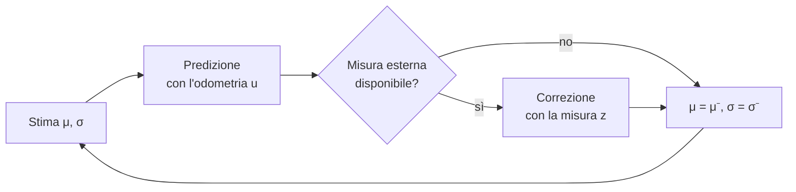

# Lezione 6 — Localizzazione: odometria, riferimenti esterni e filtro di Kalman

Con questa lezione si apre un nuovo pacchetto di slide, *Localizzazione, SLAM ed esplorazione*. Il filo conduttore è dichiarato nella copertina: integrare il proprio moto non basta, bisogna **agganciarsi al mondo**; e quando la mappa non c'è, bisogna costruirla mentre ci si muove. La lezione copre la prima delle tre parti, la **localizzazione**. Si parte dai limiti dell'odometria, si passa ai riferimenti esterni (beacon, landmark, marker) e si arriva al **filtro di Kalman**, che fonde le due fonti in modo ottimo. SLAM ed esplorazione saranno trattati nelle lezioni successive.

> [!warning] Numerazione e inizio della registrazione
> - Il file della trascrizione è intitolato "Lezione 6", mentre l'intestazione generata dalla trascrizione automatica riporta "Lezione 5" (data 28 ottobre 2026). Queste note seguono la numerazione dei file. Fra la [[Lezione 04 - Garanzie, RRT, algoritmi Bug e campi di potenziale|Lezione 4]] (14 ottobre) e questa lezione non è stato fornito materiale per una "Lezione 5".
> - La registrazione parte a metà di una frase introduttiva sul nuovo capitolo ("…che ha occupato tantissimi ricercatori in robotica negli ultimi anni: solo adesso lo si considera un problema praticamente risolto"). Dal seguito non risultano nozioni tecniche date per scontate: la trattazione della localizzazione riparte da zero. Non è quindi necessaria alcuna ricostruzione.

> [!important] Il livello di dettaglio richiesto
> Il docente avverte che le slide contengono alcune formule "per completezza", ma che il suo obiettivo è dare un'**idea intuitiva** di ciascun metodo. Approfondire la matematica di ogni argomento richiederebbe molto tempo, e non tutti hanno ancora seguito i corsi necessari (per esempio Controlli automatici). Per lo studio conta soprattutto capire *che cosa* fa ogni metodo, *perché* funziona e *quando* fallisce. Le formule servono a fissare le idee.

---

## 1. Tre problemi e un'ipotesi di lavoro

I tre argomenti del capitolo sono:

1. la **localizzazione**: capire dove si trova il robot;
2. lo **SLAM** (*Simultaneous Localization And Mapping*): costruire una mappa tenendo conto del fatto che la propria posizione è incerta;
3. l'**esplorazione autonoma**: decidere dove andare quando la mappa è ancora incompleta.

L'ipotesi di lavoro resta quella delle lezioni precedenti. Il robot si muove **nel piano** ed è a guida differenziale: la velocità lineare $v$ e quella angolare $\omega$ si ottengono impostando le velocità delle due ruote ([[Lezione 02 - Cinematica inversa e odometria|Lezione 2]]). Una terza ruota lo tiene in piedi. Può essere passiva, come quella di un carrello del supermercato, oppure attiva e sterzante, purché sterzi in modo coerente con il raggio di curvatura. Da qui in avanti, osserva il docente, i dettagli delle ruote si possono dimenticare: si assume semplicemente di poter controllare $v$ e $\omega$.

## 2. Il problema della localizzazione

**Localizzarsi** significa stimare la **posa** del robot, cioè $x$, $y$ e l'orientamento $\theta$, rispetto a un sistema di riferimento fisso, per esempio quello della mappa. Il docente ricorda la distinzione terminologica: spesso "posizione" indica la sola coppia $(x, y)$, mentre con l'angolo si parla di posa.

Perché serve? Perché per raggiungere un obiettivo bisogna sapere dove ci si trova rispetto a esso. Anche in un salone vuoto, senza ostacoli, se la meta è $x = 10$ m, $y = 5$ m, $\theta = 0$, il robot non "vede" le coordinate nello spazio: l'unico modo di arrivarci è conoscere la propria posa. Ogni decisione di navigazione, dal pianificatore globale al controllore locale, parte da questa stima.

### 2.1 Localizzazione relativa

> [!important] Localizzazione relativa
> Il robot **integra il proprio moto** a partire da una posa iniziale nota. È "relativa" proprio perché è riferita a quella posa iniziale. Si basa su encoder delle ruote (odometria), giroscopi e accelerometri.
> Pregi: è sempre disponibile, frequente e regolare. Difetto: l'errore **si accumula senza limite**.

L'**odometria** (la misura del percorso, [[Lezione 02 - Cinematica inversa e odometria|Lezione 2]]) è l'esempio tipico: si contano i giri delle ruote, li si trasforma in spostamenti lineari e si integra. In alternativa si possono usare un **giroscopio**, che misura la velocità angolare, e un **accelerometro**, che misura le accelerazioni.

L'accelerometro però pone un problema serio. Per ottenere uno spostamento bisogna integrare l'accelerazione **due volte**: l'accelerazione integrata dà una velocità non esatta, e integrando di nuovo si ottiene una posizione che "non c'entra più niente con quella vera". Il docente lo illustra con un robot fermo.

> [!example] Il robot fermo
> - Con gli **encoder** il robot fermo legge zero: le ruote non girano, quindi non c'è errore. Il robot si accorge di stare fermo.
> - Con l'**accelerometro** dovrebbe leggere zero, ma un piccolo errore produce un'accelerazione leggermente positiva. Integrandola si ottiene una velocità che cresce sempre, e integrando ancora uno spostamento che cresce sempre. Il robot non riesce nemmeno a capire di essere fermo.
>
> Per questo, nei veicoli su ruote, l'odometria basata su encoder è la base della localizzazione relativa.

Gli encoder sono inoltre "praticamente gratis": ci sono già, perché servono a controllare la velocità di ciascuna ruota.

> [!tip] Sensori propriocettivi ed esterocettivi
> Il docente introduce il termine **propriocettivo**: un sensore propriocettivo misura una variabile *interna* del robot, come la posizione angolare delle ruote misurata dagli encoder. Il robot se li porta sempre dietro, quindi sono sempre disponibili. Il termine complementare, comune nei testi, è **esterocettivo**: un sensore che misura qualcosa dell'ambiente, come una telecamera, un sonar o un LIDAR.

### 2.2 Localizzazione assoluta

> [!important] Localizzazione assoluta
> Il robot misura la propria posa rispetto a **riferimenti esterni di posizione nota**: beacon, landmark, marker.
> Pregi: l'errore è **limitato** e non dipende dalla storia dei movimenti. Difetti: le misure sono **intermittenti**, rumorose, a volte ambigue, e l'ambiente va spesso attrezzato.

Un esempio banale: si attaccano al muro degli adesivi con una palla rossa, facili da riconoscere, magari ciascuno con un numero. Quando il robot ne vede uno sa di trovarsi nelle sue vicinanze, e si può anche calcolare la posizione con precisione. Ma i riferimenti artificiali vanno **installati**, e così si "rovina l'ambiente". In molti casi non è possibile: nessuno avrà attaccato degli adesivi, prima del sisma, in una casa distrutta da un terremoto.

Perché allora non usare sempre la localizzazione assoluta? Perché l'odometria è gratis e sempre disponibile, mentre la localizzazione assoluta richiede qualcosa di esterno. Ciascuna delle due ha pregi e difetti. **L'idea vincente sarà metterle insieme**: la localizzazione relativa fornisce una stima continua il cui errore cresce, e quella assoluta, quando possibile, cioè quando si vede un riferimento, lo riduce.

### 2.3 Perché l'odometria da sola non basta

La **slide 4** mostra i due tipi di errore della [[Lezione 02 - Cinematica inversa e odometria|Lezione 2]] in azione.

- **Errore sistematico.** Il robot percorre un rettangolo di $6 \times 3$ m con ruote che differiscono di circa lo 0,5%. Dopo un giro la stima odometrica non si chiude sul punto di partenza. Le cause sono ruote di diametro diverso, interasse incerto e risoluzione degli encoder. Sono costanti per un dato robot: si possono misurare e calibrare (Borenstein e Feng, 1996).
- **Errore casuale.** Si simulano 400 corse dritte con solo rumore casuale e si osserva dove l'odometria crede che sia finito il robot. Le cause sono slittamenti, pavimento irregolare, urti e contatto non puntiforme della ruota. Cambiano da una corsa all'altra e non si calibrano.

Il docente commenta la seconda figura. La **nuvola** di punti si ottiene ripetendo molte volte lo stesso esperimento, ed è quindi una rappresentazione della **distribuzione di probabilità** dell'errore: dove i punti sono più radi è meno probabile finire. Il massimo della probabilità resta sulla retta. Ma la nuvola **cresce con la distanza e si curva**, perché basta un piccolo errore d'angolo, "conosco l'angolo ma lo conosco male", perché più ci si allontana più l'errore laterale diventa ampio.

> [!important] Da errore d'angolo a errore laterale
> Ogni passo somma il proprio errore e nulla lo riporta indietro. Un errore d'angolo $e_\theta$, dopo un tratto $d$, diventa un errore laterale
> $$ e_{lat} \approx d\cdot e_\theta \qquad (e_\theta \text{ in radianti}). $$
> Un solo grado ($e_\theta = \pi/180 \approx 0{,}01745$ rad), dopo $d = 10$ m, sposta il robot di $10 \cdot 0{,}01745 \approx 0{,}17$ m, cioè circa **17 cm**.

---

## 3. Riferimenti esterni: AGV, beacon e landmark

### 3.1 La soluzione industriale: modificare l'ambiente

I primi veicoli autonomi industriali, gli **AGV** (*Automated Guided Vehicle*, già incontrati nella [[Lezione 01 - Robot autonomi e cinematica differenziale|Lezione 1]]), sfruttano una particolarità dell'ambiente industriale. Modificare le mura di un ospedale o di un palazzo storico perché ci si muova un robot non è sempre possibile, ma in una fabbrica sì. La soluzione più semplice è una **banda magnetica** (o visiva) a terra con un sensore che la segue. Funziona se i percorsi sono sempre gli stessi, ma non è un robot autonomo nel senso del corso. Il passo successivo è usare **beacon** e **landmark**.

### 3.2 Beacon e landmark

> [!important] Beacon e landmark
> - Un **beacon** è un dispositivo installato appositamente e, di solito, **attivo**: fa qualcosa, per esempio emette o risponde a un segnale (radio, UWB, ultrasuoni, infrarosso). Il robot ne misura la distanza, per esempio dal tempo di volo, oppure la direzione. È affidabile, ma l'ambiente va attrezzato.
> - Un **landmark** è un elemento **riconoscibile** dell'ambiente, ed è sempre **passivo**: il compito di riconoscerlo spetta ai sensori del robot, tipicamente una telecamera. Può essere
>   - **artificiale**: un adesivo, un catarifrangente, un marker stampato;
>   - **naturale**: porte, colonne, gli spigoli dove due muri si incontrano.
>
> In entrambi i casi la **posizione nel mondo deve essere nota**: o li si è installati, o la si è misurata.

Riconoscere gli spigoli dei muri richiede un sistema di visione abbastanza potente e affidabile, ma si intuisce che si possa fare: cambia l'ombra, e a occhio gli spigoli li riconosciamo tutti. Il robot misura l'**angolo** sotto cui vede ciascuno spigolo rispetto alla propria direzione principale, e questi angoli possono essere usati per capire dove si trova.

> [!example] I beacon della tesi del docente
> Quando il docente iniziò la tesi, il suo laboratorio usava un robot mobile con un tubo verticale. In cima c'era un laser puntato verso l'alto e uno **specchietto rotante** che faceva girare il raggio tutto attorno. Nell'edificio erano installati dei beacon che, colpiti dal raggio, **rispondevano**. Un encoder sulla torretta rotante diceva com'era orientato il laser nell'istante della risposta. Il tempo impiegato dalla luce è trascurabile, quindi il robot conosceva esattamente l'**angolo** sotto cui vedeva quel beacon.
>
> Pregi: misura affidabile, se il sistema è costruito bene (i beacon devono essere all'altezza giusta), e visione a **360°**. Una telecamera ha invece un campo visivo limitato, a meno che non sia omnidirezionale. Difetto: installare i beacon ha un costo. I landmark naturali o gli adesivi costano meno, ma il riconoscimento è più difficile.

Il docente sottolinea che beacon e landmark non sono categorie chiuse. Sono classi di soluzioni di progetto, e chiunque potrebbe inventare un nuovo tipo di landmark o di beacon che sfrutti una proprietà diversa e funzioni meglio di quelli esistenti.

### 3.3 Distanze o angoli

Dai riferimenti si può misurare la **distanza** oppure la **direzione** (**slide 5**). Le due misure portano a due tecniche: la **trilaterazione** e la **triangolazione**.

## 4. Trilaterazione: dalle distanze ai cerchi

Come si misura la distanza da un riferimento?

- Da un landmark visivo di dimensione nota, per esempio una palla, si sfrutta la relazione fra distanza e dimensione apparente nell'immagine: le cose più lontane appaiono più piccole.
- Da beacon radio si può stimare la distanza dalla **potenza del segnale** ricevuto. Ci sono lavori di ricerca che usano come beacon gli access point Wi-Fi.
- Da beacon attivi si misura spesso il **tempo di volo** del segnale.

Ogni misura è affetta da errori, ma "qualunque cosa facciamo è affetta da errori": tutto dipende dalla precisione con cui serve conoscere la posizione.

Il principio è geometrico. Si conosce la posizione $(x_i, y_i)$ del beacon $B_i$ e se ne misura la distanza $r_i$. Allora il robot si trova, a meno dell'errore, su un **cerchio** di raggio $r_i$ centrato su $B_i$:

$$
(x - x_i)^2 + (y - y_i)^2 = r_i^2 .
$$

Con due beacon i cerchi si intersecano, in generale, in **due punti**. Con il terzo si individua un solo punto: se tutto fosse perfetto i tre cerchi passerebbero per lo stesso punto, nella realtà si intersecano in punti vicini (**slide 5**, a sinistra).

> [!tip] Come si risolve in pratica (integrazione)
> Le tre equazioni dei cerchi sono quadratiche, ma sottraendone una dalle altre i termini $x^2$ e $y^2$ si cancellano e restano equazioni **lineari**. Per esempio, sottraendo la prima dalla seconda:
> $$ -2(x_2 - x_1)\,x - 2(y_2 - y_1)\,y = r_2^2 - r_1^2 - (x_2^2 + y_2^2) + (x_1^2 + y_1^2). $$
> Con più di tre beacon il sistema lineare è sovradeterminato e si risolve ai minimi quadrati, così le misure rumorose si compensano.

> [!example] Trilaterazione con tre beacon (esempio costruito per queste note)
> Beacon in $B_1 = (0, 0)$, $B_2 = (4, 0)$, $B_3 = (0, 3)$. Il robot misura $r_1 = \sqrt2$, $r_2 = \sqrt{10}$, $r_3 = \sqrt5$ m.
> 1. Seconda meno prima: $(x-4)^2 + y^2 - x^2 - y^2 = 10 - 2 \Rightarrow -8x + 16 = 8 \Rightarrow x = 1$.
> 2. Terza meno prima: $x^2 + (y-3)^2 - x^2 - y^2 = 5 - 2 \Rightarrow -6y + 9 = 3 \Rightarrow y = 1$.
>
> Il robot è in $(1, 1)$. Verifica: $1^2 + 1^2 = 2 = r_1^2$.

La trilaterazione restituisce solo la **posizione** $(x, y)$. Per l'orientamento serve almeno una misura di direzione, come nel caso della triangolazione.

## 5. Triangolazione: dagli angoli ai cerchi

La **triangolazione** è forse la tecnica più nota. Il robot misura le **direzioni** $\varphi_1, \varphi_2, \varphi_3$ sotto cui vede i tre beacon, **rispetto al proprio asse**, cioè alla propria orientazione (con un sensore rotante o una telecamera). Gli angoli $\varphi_i$ però non servono direttamente: dipendono dall'orientamento del robot, che è incognito. Servono le loro **differenze**:

$$
\alpha_{12} = \varphi_2 - \varphi_1, \qquad \alpha_{23} = \varphi_3 - \varphi_2 .
$$

Se il robot ruota su sé stesso, tutti i $\varphi_i$ cambiano della stessa quantità, mentre le differenze no: $\alpha_{ij}$ **non dipende dall'orientamento** del robot.

**Perché le differenze individuano la posizione.** Interviene un risultato di geometria elementare, il **teorema dell'angolo alla circonferenza**: tutti i punti di un arco di circonferenza vedono una stessa corda sotto lo stesso angolo. Quindi l'insieme dei punti da cui il segmento $B_1B_2$ si vede sotto l'angolo $\alpha_{12}$ è un **arco di cerchio passante per $B_1$ e $B_2$**, e il robot sta su quell'arco. La coppia $B_2B_3$ con l'angolo $\alpha_{23}$ individua un secondo cerchio. I due cerchi si incontrano in $B_2$ e in un secondo punto, che è la **posizione** $(x, y)$ del robot (**slide 6**).

> [!tip] Il raggio del cerchio (integrazione)
> Dal teorema dei seni, una corda di lunghezza $c$ vista sotto l'angolo $\alpha$ da un punto della circonferenza appartiene a un cerchio di raggio
> $$ R = \frac{c}{2\sin\alpha}. $$
> Per $B_1B_2$ la corda è $c = \|B_2 - B_1\|$. Il centro sta sull'asse del segmento, dalla parte indicata dal segno di $\alpha$.

**L'orientamento, nota la posizione.** Basta un beacon qualsiasi. La direzione assoluta del beacon $B_1$ vista dal robot è $\operatorname{atan2}(y_{B_1} - y,\ x_{B_1} - x)$. Il robot la misura come $\varphi_1$ rispetto al proprio asse, quindi la differenza è l'orientamento:

$$
\theta = \operatorname{atan2}(y_{B_1} - y,\ x_{B_1} - x) - \varphi_1 .
$$

> [!warning] Configurazione degenere (dalle slide)
> Se il robot sta sul cerchio che passa per tutti e tre i beacon, i due cerchi **coincidono** e la posizione è indeterminata. Vicino a quel cerchio l'errore esplode. Conviene che i beacon **circondino** l'area di lavoro (Cohen e Koss, 1992; Pierlot e Van Droogenbroeck, 2014).

### 5.1 Perché gli angoli sono più robusti delle distanze

Con i landmark artificiali, osserva il docente, la stima della distanza dalla dimensione apparente può essere molto sbagliata anche in casi semplici. Se qualcuno, appoggiandosi, copre un pezzo del landmark, il sistema ne vede meno e lo crede più lontano. Lo stesso può fare un riflesso. Lo stesso disturbo ha invece un effetto molto minore sull'**angolo**: coprendo un pezzo del landmark il suo centro si sposta di poco, per esempio di un centimetro, e la direzione cambia pochissimo. Nel modello ideale della telecamera lo spostamento dell'oggetto rispetto al centro dell'immagine è legato direttamente all'angolo e non dipende dalla distanza. Per questo la **triangolazione è molto più usata** della trilaterazione.

### 5.2 Il problema nascosto: l'associazione dei dati

Il docente pone una domanda alla classe: anche con un algoritmo di visione perfetto, che riconosce ogni spigolo senza errori, resta un grosso problema. Quale? La risposta sta nell'assunto su cui si basano sia la triangolazione sia la trilaterazione. Per tracciare il cerchio che passa per $B_1$ e $B_2$ bisogna sapere **dove** sono $B_1$ e $B_2$ nel mondo, quindi bisogna saper dire che il landmark visto in una certa direzione **è proprio $B_1$** e non un altro.

> [!important] Associazione dei dati
> Tutti questi metodi presuppongono di saper **identificare in modo univoco** ciascun riferimento. Prima della localizzazione c'è sempre una fase di **associazione**: capire "chi è chi", cioè a quale elemento della mappa corrisponde ciò che si sta osservando. Anche quando non viene detto esplicitamente, il problema c'è. Un'associazione sbagliata è un'ulteriore fonte di errore.

Con gli spigoli il problema è serio, perché tutti gli spigoli si somigliano. Anche con palle colorate attaccate al muro serve un modo per distinguerle, per esempio un numero sopra. Un rimedio è usare l'odometria come guida: se il robot sa di trovarsi *più o meno* in un certo punto e vede uno spigolo in una direzione dove la mappa ne prevede uno solo, l'associazione è plausibile. È proprio qui che i **beacon attivi** hanno un grande vantaggio. Quando il laser rotante colpisce un beacon, questo può rispondere "sono il beacon numero 1", e così si risolve in modo univoco, senza complicare troppo la tecnologia, il problema dell'associazione.

### 5.3 Correzioni saltuarie

Il limite principale di triangolazione e trilaterazione è che richiedono di vedere **tre riferimenti nello stesso istante**. Questo significa installarne moltissimi. Per questo i sistemi di questo tipo realizzano di solito una correzione **assoluta e saltuaria**, non continua. Il robot arriva in un'area attrezzata, vede i beacon (magari ruotando su sé stesso), si localizza con errore piccolo, poi procede con la sola odometria sapendo che l'errore cresce in un certo modo. Raggiunta un'altra area attrezzata, si rilocalizza.

## 6. Marker fiduciali: la posa da un solo riferimento

Per poter usare **un solo** landmark sono stati inventati meccanismi diversi. Il più popolare è il **marker ArUco** (**slide 7**). È un quadrato con bordo nero e una griglia di celle bianche e nere, una sorta di QR code semplificato, perché deve contenere poca informazione. Il lato è noto e la posa di ogni marker nella mappa è registrata.

> [!important] Perché i marker funzionano bene
> - **Identificativo.** Le celle codificano un numero: il marker dice da sé quale marker è, e il problema dell'associazione è risolto.
> - **Robustezza.** Un pattern con una struttura precisa è difficilmente confuso con altro: gli algoritmi di visione, anche quelli buoni, sbagliano in certe condizioni, ma se il sistema verifica che il marker contenga davvero un codice valido, i falsi positivi diventano rari.
> - **Meglio non vedere che vedere male.** Se il marker è parzialmente coperto il sistema non lo riconosce affatto, invece di usarlo male. Quando lo vede per intero, i quattro angoli sono localizzati con grande precisione.
> - **Ne basta uno.** Il principio non è più trilaterazione o triangolazione, ma la **prospettiva inversa**.

L'aspetto pratico non va sottovalutato. Registrare con precisione la posa di ogni marker è faticoso: in un ospedale, fissato un sistema di riferimento in un angolo, non è banale ottenere le coordinate di ogni punto delle corsie, e senza una pianta dell'edificio è ancora più complesso. Per questo i marker si collocano in **punti strategici**: vicino a una porta, per imboccarla bene; vicino all'ascensore; a tratti lungo un corridoio, per correggere l'errore. Nel frattempo il robot si muove con l'odometria. È un'illustrazione perfetta del rapporto fra localizzazione relativa, buona sul breve termine e sempre disponibile, e localizzazione assoluta, usata a tratti.

### 6.1 La prospettiva inversa

L'intuizione è questa. A seconda della posizione e dell'orientamento della telecamera rispetto al marker, il quadrato appare **deformato** in modo diverso. Visto frontalmente appare come un quadrato, con i lati paralleli a due a due, e la sua dimensione apparente indica la distanza. Visto da sinistra, il lato sinistro appare più alto e quello destro più piccolo e lontano, e viceversa da destra. Da queste deformazioni si ricava la posa della telecamera rispetto al marker.

Nel caso generale, come per un drone, la posa relativa ha **6 incognite**: 3 rotazioni e 3 traslazioni. Per un robot nel piano con telecamera fissa ne bastano 3, cioè $x$, $y$ e un angolo.

Il modello della telecamera è quello della **proiezione prospettica** (**slide 8–9**). Per ogni angolo $i$ del marker:

$$
\lambda_i\,\tilde c_i = A\,(R\,a_i + t),
$$

dove

- $a_i = (\pm s/2,\ \pm s/2,\ 0)$ è la posizione dell'angolo nel riferimento del marker, con $s$ il lato: è **nota**;
- $A = \begin{bmatrix} f & 0 & u_0 \\ 0 & f & v_0 \\ 0 & 0 & 1 \end{bmatrix}$ contiene i **parametri interni** della telecamera, cioè la focale $f$ in pixel e il centro dell'immagine $(u_0, v_0)$. È **nota** da una calibrazione fatta una volta;
- $\tilde c_i = (c_{i,x},\ c_{i,y},\ 1)$ è la posizione in pixel dell'angolo, in **coordinate omogenee** (con un 1 in fondo): è **misurata** nell'immagine;
- $R$, $t$ sono la rotazione e la traslazione dal marker alla telecamera: sono le **incognite**;
- $\lambda_i$ è la **profondità** dell'angolo, anch'essa ignota, perché una telecamera misura direzioni e non distanze.

La relazione elementare dietro la formula è quella dei **triangoli simili** (slide 8, a sinistra): un punto ad altezza $Y_i$ sopra l'asse ottico e a profondità $\lambda_i$ si proietta sul piano immagine, a distanza focale $f$, all'altezza

$$
c_{i,y} = f\,\frac{Y_i}{\lambda_i}.
$$

Scrivendo per esteso $(X_i, Y_i, Z_i) = R\,a_i + t$ (la terza colonna di $R$ non compare, perché il marker è piatto e $a_{i,z} = 0$), le tre righe dell'equazione diventano

$$
\lambda_i c_{i,x} = f X_i + u_0 Z_i, \qquad \lambda_i c_{i,y} = f Y_i + v_0 Z_i, \qquad \lambda_i = Z_i .
$$

La terza riga non contiene misure e dice solo che $\lambda_i$ è la profondità $Z_i$. Sostituendola e dividendo:

$$
c_{i,x} = f\,\frac{r_{11}a_x + r_{12}a_y + t_x}{r_{31}a_x + r_{32}a_y + t_z} + u_0, \qquad
c_{i,y} = f\,\frac{r_{21}a_x + r_{22}a_y + t_y}{r_{31}a_x + r_{32}a_y + t_z} + v_0 .
$$

> [!important] Il conto delle equazioni
> Ogni angolo dà **2 equazioni** (una per coordinata in pixel). Quattro angoli danno **8 equazioni** per **6 incognite** (3 angoli di $R$ e 3 componenti di $t$). Le equazioni non sono lineari e si risolvono con un algoritmo **PnP** (*Perspective-n-Point*). Trovati $R$ e $t$, si ricava anche $\lambda_i$. Composta con la posa nota del marker nella mappa, la posa della telecamera dà la posa del robot.

Il docente non entra nei dettagli: il punto è capire che c'è una relazione geometrica molto semplice per ciascun punto, e che le equazioni risultanti si riescono a risolvere.

> [!example] Una domanda dalla classe: e se il marker è posizionato male?
> Uno studente chiede quanto pesi un errore di posizionamento del marker, per esempio di un centimetro. Il docente risponde che, supponendo perfetto tutto il resto, l'errore si **riproduce tale e quale** sulla posizione del robot: un marker spostato di 1 cm a destra produce una stima del robot spostata di 1 cm. Resta poi l'errore di stima della distanza, ridotto però dalla precisione con cui il pattern permette di trovare gli angoli.

> [!tip] Traslazione e rotazione del marker (integrazione)
> La risposta del docente riguarda un errore di **traslazione** del marker. Un errore sulla sua **orientazione** registrata si comporta diversamente: come l'errore d'angolo dell'odometria (§2.3), produce un errore di posizione proporzionale alla distanza dal marker, circa $d\cdot e_\theta$. Per questo conviene registrare con particolare cura l'orientamento dei marker che saranno osservati da lontano.

> [!tip] Approfondimento #approfondimento
> Il sistema ArUco è descritto da Garrido-Jurado, Muñoz-Salinas, Madrid-Cuevas e Marín-Jiménez in *Automatic Generation and Detection of Highly Reliable Fiducial Markers under Occlusion* (Pattern Recognition, 2014) [@garridojurado2014]. Il dizionario di codici è generato in modo da massimizzare la distanza fra i marker, così da ridurre gli scambi di identità. L'idea è analoga agli AprilTag di E. Olson (ICRA 2011) [@olson2011]. Un algoritmo PnP molto usato, con costo lineare nel numero di punti, è EPnP di Lepetit, Moreno-Noguer e Fua (International Journal of Computer Vision, 2009) [@lepetit2009]. Entrambi i marker e EPnP sono disponibili nella libreria OpenCV.

## 7. Due fonti complementari

Il docente chiarisce che oggi quasi nessuno, probabilmente neanche in ambito industriale, usa lo schema "mi localizzo, mi sposto con l'odometria, mi rilocalizzo". Tutti i sistemi si basano su un'**integrazione stretta e continua** fra odometria e localizzazione assoluta. Il confronto della **slide 10** spiega perché le due fonti si completano.

| | Odometria | Beacon, landmark, marker |
| - | --------- | ------------------------ |
| **Frequenza** | a ogni ciclo di controllo, decine o centinaia di volte al secondo | solo quando un riferimento è visibile o un segnale arriva |
| **Breve termine** | molto precisa da un passo al successivo | rumorosa, a salti |
| **Lungo termine** | deriva senza limite | errore limitato, nessuna deriva |
| **Disponibilità** | sempre: i sensori sono propriocettivi | dipende dalla posizione; può sbagliare l'associazione |

Il punto meno intuitivo è il breve termine. Misurando lo stesso beacon in letture successive, perfino stando fermi, si ottengono angoli leggermente diversi: $\alpha$, poi $\alpha + \varepsilon$, poi $\alpha - \varepsilon$. La posizione stimata salta attorno a un valore medio. L'odometria, se il robot è fermo, se ne accorge. Sul breve termine l'odometria è quindi migliore. Sul lungo termine invece l'errore della misura esterna dipende solo dall'errore della misura stessa e non cresce col tempo: è un grande vantaggio.

> [!important] L'idea del filtro
> Usare l'odometria per **predire** dove si trova il robot a ogni ciclo, accettando che l'incertezza cresca. Ogni volta che arriva una misura esterna, **correggere** la stima pesando le due fonti secondo quanto ciascuna è affidabile. Il filtro di Kalman fa esattamente questo, con un peso **calcolato** e non scelto a mano.

---

## 8. Il filtro di Kalman in una dimensione

### 8.1 Stimare la posizione e la sua incertezza

Il filtro di Kalman non stima solo la posizione, ma anche la sua **incertezza**: "mi trovo qui, ma con quale errore penso di trovarmi qui?". Il docente insiste sul termine: non si **misura** la posizione, la si **stima**.

L'incertezza è rappresentata con una **gaussiana**. Il picco corrisponde alla posizione più probabile (la media $\mu$). L'altezza della curva in ogni punto dà la probabilità di trovarsi lì, che va a zero allontanandosi dalla stima. La larghezza è data dalla deviazione standard $\sigma$. "Se penso di essere al centro del corridoio, è improbabile che sia in Piazza De Ferrari: la probabilità c'è, ma è minuscola."

Il filtro alterna due fasi:

- la **predizione**, a ogni ciclo in cui è disponibile l'odometria;
- la **correzione**, solo quando arriva una misura esterna.

Non è detto che a ogni predizione segua una correzione: si possono avere molte predizioni consecutive, se per un po' non si osserva nulla. L'esempio delle slide considera una predizione seguita da una correzione.



Il modello è unidimensionale: un robot che si muove lungo un corridoio. Si può pensare a un robot differenziale che avanza dritto con le due ruote alla stessa velocità, oppure a un carrello su un binario. Orientamento e coordinata $y$ vengono trascurati.

### 8.2 Predizione

All'inizio il robot è a $\mu = 2$ m con $\sigma = 0{,}15$ m. Avanza di $u = 1{,}5$ m, ma l'avanzamento, cioè il controllo, è a sua volta incerto, con $\sigma_u = 0{,}3$ m.

> [!important] Predizione
> $$ \mu^- = \mu + u, \qquad (\sigma^-)^2 = \sigma^2 + \sigma_u^2 . $$
> L'apice "$-$" indica la stima **prima della correzione**, cioè frutto della sola predizione.

La media si sposta della quantità comandata, che è comunque la più probabile. Le **varianze si sommano**: all'incertezza che si aveva si aggiunge quella del nuovo movimento, e la gaussiana si **allarga**. Muoversi rende sempre più incerti. Il docente fa notare che, se non ci fosse errore sul movimento, la curva si sposterebbe tale e quale. All'inizio $\sigma$ rifletterebbe solo l'imprecisione con cui il robot è stato collocato nel punto di partenza, e il robot penserebbe per sempre di avere quell'errore. Se la curva si allarga è proprio perché l'odometria non dà la misura esatta.

Numericamente: $\mu^- = 3{,}5$ m e $\sigma^- = \sqrt{0{,}15^2 + 0{,}3^2} = \sqrt{0{,}1125} \approx 0{,}34$ m.

### 8.3 Correzione

A questo punto arriva una misura esterna della posizione lungo il corridoio. Il docente immagina, per esempio, una telecamera rivolta verso l'alto che conta i riquadri del soffitto. La misura dice $z = 3{,}9$ m. Perché non 3,5? Perché c'è un possibile errore sulla posizione predetta, ma anche un errore sulla misura, con deviazione standard $\sigma_z = 0{,}25$ m.

> [!important] Guadagno di Kalman e correzione
> $$ K = \frac{(\sigma^-)^2}{(\sigma^-)^2 + \sigma_z^2}, \qquad \mu = \mu^- + K\,(z - \mu^-), \qquad \sigma^2 = (1 - K)\,(\sigma^-)^2 . $$
> $K \in [0, 1]$ è il **guadagno di Kalman**: dice quanto pesa la differenza fra la misura e la predizione, $z - \mu^-$.

I casi limite rendono chiaro il significato di $K$.

- Se $K = 0$, allora $\mu = \mu^-$: il filtro si fida completamente della **predizione**. Succede quando l'errore di misura è molto grande ($\sigma_z \to \infty$) o, ancora di più, quando la predizione è molto precisa.
- Se $K = 1$, allora $\mu = z$: il filtro si fida completamente della **misura**. Succede quando la misura è quasi perfetta ($\sigma_z \to 0$).

Il sistema calcola $K$ **automaticamente** a partire dalle incertezze stimate delle due fonti. Nell'esempio:

$$
K = \frac{0{,}1125}{0{,}1125 + 0{,}0625} = \frac{0{,}1125}{0{,}175} \approx 0{,}64,
\qquad \mu = 3{,}5 + 0{,}64\cdot 0{,}4 \approx 3{,}76 \text{ m},
\qquad \sigma = \sqrt{0{,}36 \cdot 0{,}1125} \approx 0{,}20 \text{ m}.
$$

La nuova stima sta fra predizione e misura, più vicina alla misura perché questa era più precisa ($0{,}25 < 0{,}34$). La deviazione standard finale, 0,20 m, è **più piccola sia di $\sigma^-$ sia di $\sigma_z$**: la correzione riduce sempre la varianza.

```chart
type: line
labels: [1.0, 1.1, 1.2, 1.3, 1.4, 1.5, 1.6, 1.7, 1.8, 1.9, 2.0, 2.1, 2.2, 2.3, 2.4, 2.5, 2.6, 2.7, 2.8, 2.9, 3.0, 3.1, 3.2, 3.3, 3.4, 3.5, 3.6, 3.7, 3.8, 3.9, 4.0, 4.1, 4.2, 4.3, 4.4, 4.5, 4.6, 4.7, 4.8, 4.9, 5.0]
series:
  - title: Prima (μ = 2, σ = 0,15)
    data: [0, 0, 0, 0, 0.001, 0.01, 0.076, 0.36, 1.093, 2.13, 2.66, 2.13, 1.093, 0.36, 0.076, 0.01, 0.001, 0, 0, 0, 0, 0, 0, 0, 0, 0, 0, 0, 0, 0, 0, 0, 0, 0, 0, 0, 0, 0, 0, 0, 0]
  - title: Predizione (μ⁻ = 3,5, σ⁻ = 0,34)
    data: [0, 0, 0, 0, 0, 0, 0, 0, 0, 0, 0, 0, 0.001, 0.002, 0.005, 0.014, 0.032, 0.069, 0.135, 0.24, 0.392, 0.584, 0.797, 0.996, 1.138, 1.189, 1.138, 0.996, 0.797, 0.584, 0.392, 0.24, 0.135, 0.069, 0.032, 0.014, 0.005, 0.002, 0.001, 0, 0]
  - title: Misura (z = 3,9, σz = 0,25)
    data: [0, 0, 0, 0, 0, 0, 0, 0, 0, 0, 0, 0, 0, 0, 0, 0, 0, 0, 0, 0.001, 0.002, 0.01, 0.032, 0.09, 0.216, 0.444, 0.777, 1.159, 1.473, 1.596, 1.473, 1.159, 0.777, 0.444, 0.216, 0.09, 0.032, 0.01, 0.002, 0.001, 0]
  - title: Stima corretta (μ = 3,76, σ = 0,20)
    data: [0, 0, 0, 0, 0, 0, 0, 0, 0, 0, 0, 0, 0, 0, 0, 0, 0, 0, 0, 0, 0.002, 0.009, 0.042, 0.148, 0.407, 0.874, 1.464, 1.911, 1.945, 1.544, 0.955, 0.461, 0.173, 0.051, 0.012, 0.002, 0, 0, 0, 0, 0]
tension: 0.3
beginAtZero: true
width: 90%
```

> [!tip] Perché la varianza finale è più piccola di entrambe (integrazione)
> Sostituendo $K$ nella formula della varianza:
> $$ \sigma^2 = \Big(1 - \tfrac{(\sigma^-)^2}{(\sigma^-)^2 + \sigma_z^2}\Big)(\sigma^-)^2 = \frac{(\sigma^-)^2\,\sigma_z^2}{(\sigma^-)^2 + \sigma_z^2} \quad\Longleftrightarrow\quad \frac{1}{\sigma^2} = \frac{1}{(\sigma^-)^2} + \frac{1}{\sigma_z^2}. $$
> Gli inversi delle varianze, detti *precisioni*, si **sommano**: unire due informazioni indipendenti produce sempre una stima più precisa di ciascuna. Con i numeri dell'esempio: $1/0{,}1125 + 1/0{,}0625 = 8{,}89 + 16 = 24{,}89$, quindi $\sigma = 1/\sqrt{24{,}89} \approx 0{,}20$ m. Allo stesso modo la media corretta è la media delle due stime pesata con le precisioni.

### 8.4 Perché il filtro è "ottimo"

Il filtro di Kalman fa questa fusione **in modo ottimo**. In condizioni ideali (modelli lineari, rumori gaussiani) nessuno sa stimare meglio la posizione e la sua incertezza, né farlo con un numero minore di misure. Questo non significa che l'incertezza sia zero. La dimostrazione esiste e si vede nei corsi di stima; il docente non la affronta. Due aspetti meritano di essere sottolineati.

1. La misura esterna può essere **saltuaria**, e soprattutto **non servono tre misure** come nella triangolazione o nella trilaterazione. Anche **un solo spigolo** visto sotto un certo angolo fornisce un po' di informazione: se l'odometria dice al robot di essere orientato in un modo e lo spigolo appare in una direzione incompatibile, quella singola misura basta a fare una piccola correzione. Ogni misura, presa singolarmente, migliora un po' la stima e la sua incertezza.
2. Il filtro fornisce anche una **stima dell'errore**: il robot è "consapevole di quanto sta sbagliando". Se deve usare la propria posizione per afferrare la maniglia del frigorifero, può decidere di aspettare qualche altra misura che riduca l'incertezza.

```python
def kalman_1d(mu, var, u, var_u, z=None, var_z=None):
    """Un ciclo del filtro di Kalman in una dimensione."""
    mu_m, var_m = mu + u, var + var_u          # predizione
    if z is None:                              # nessuna misura: solo predizione
        return mu_m, var_m
    K = var_m / (var_m + var_z)                # guadagno
    return mu_m + K * (z - mu_m), (1 - K) * var_m   # correzione

print(kalman_1d(2.0, 0.15**2, 1.5, 0.3**2, z=3.9, var_z=0.25**2))
# -> (3.757..., 0.0402...)  cioè μ ≈ 3,76 m, σ ≈ 0,20 m
```

> [!example] Una domanda dalla classe: questi modelli si implementano a mano?
> Uno studente chiede se modelli di questo tipo si trovino già implementati in librerie. Il docente risponde in due tempi.
> - Il filtro di Kalman in sé è "di una semplicità estrema" da implementare, una volta studiato bene: lui stesso lo ha implementato più volte.
> - Altri metodi, come quelli di SLAM che si vedranno, sono molto complessi. Negli ultimi anni c'è stato un forte movimento verso la **condivisione di librerie**. Nel laboratorio del docente nessuno studente che debba fare SLAM rifà la mappa da zero, a meno di fare ricerca proprio sul mapping: prende un modulo esistente. Conviene però capirne i principi.
>
> Lo strumento di riferimento è **ROS 2**, che sbaglieremmo a chiamare sistema operativo: è una sorta di *middleware* sopra il sistema operativo che gestisce tutte le attività robotiche ([[Lezione 01 - Robot autonomi e cinematica differenziale|Lezione 1]]). È così diffuso che alcuni robot vengono prodotti *ROS compliant*, perché altrimenti i ricercatori non li comprerebbero. Al suo interno si trovano moduli per SLAM, filtri di Kalman e quasi tutto ciò che si vede nel corso. La competenza che il corso fornisce serve, oltre che a capire, a **sapere quale modulo scegliere**.

---

## 9. Il filtro di Kalman esteso (EKF)

### 9.1 Dallo scalare al vettore

Nella realtà non si stima un solo numero ma almeno la posa $\mu = (x, y, \theta)$. In altri casi lo stato può includere altro, per esempio l'assetto di un robot quadrupede. L'incertezza diventa una **gaussiana multidimensionale**, descritta da una **matrice di covarianza** $P$ di dimensione $3 \times 3$ (Leonard e Durrant-Whyte, 1991).

Il docente ne dà un'immagine intuitiva limitandosi a $x$ e $y$. L'incertezza è una "campana" nel piano. Non è detto che sia simmetrica: può essere più larga in una direzione che in un'altra, e orientata in modo qualsiasi. La matrice $2\times2$ di covarianza descrive proprio quanto è ampia la campana e come è orientata. Spesso la si rappresenta con un'**ellisse** che racchiude la maggior parte della probabilità, come quella vista nel simulatore ([[Lezione 03 - Simulatore, spazio delle configurazioni e A star|Lezione 3]]).

> [!tip] Che cosa contiene $P$
> Sulla diagonale di $P$ stanno le varianze $\sigma_x^2$, $\sigma_y^2$, $\sigma_\theta^2$. Fuori diagonale stanno le **covarianze**, che dicono quanto gli errori sono legati fra loro: per esempio, se a un errore positivo su $\theta$ tende a corrispondere un errore positivo su $y$, la covarianza $\sigma_{y\theta}$ è positiva e l'ellisse risulta inclinata.

### 9.2 Il modello di moto non è lineare

Il comando $u = (d, \Delta\theta)$ è lo spostamento misurato dagli encoder: $d$ in avanti (cioè $v$ per un certo tempo) e $\Delta\theta$ di rotazione (cioè $\omega$ per un certo tempo). Il modello di moto è quello dell'odometria con il metodo di Eulero ([[Lezione 02 - Cinematica inversa e odometria|Lezione 2]], §5.4):

$$
f(\mu, u) = \begin{bmatrix} x + d\cos\theta \\ y + d\sin\theta \\ \theta + \Delta\theta \end{bmatrix}.
$$

Il filtro di Kalman di base nasce sotto l'ipotesi di un sistema **lineare**, cioè scrivibile come

$$
\mu^- = F\,\mu + G\,u
$$

con matrici $F$ e $G$ costanti. Nel caso unidimensionale era proprio così ($F = 1$, $G = 1$). Qui non è possibile: $\theta$ compare dentro seno e coseno, e quei termini non si possono scrivere come prodotto di una matrice costante per lo stato. Solo l'ultima riga, $\theta + \Delta\theta$, sarebbe lineare. Per questo si usa il **filtro di Kalman esteso** (EKF, *Extended Kalman Filter*), che richiede una **linearizzazione**.

### 9.3 La linearizzazione

La posa vera non è esattamente $\mu$, ma $\mu + \delta$, dove $\delta = (\delta_x, \delta_y, \delta_\theta)$ è il piccolo errore della stima, che non conosciamo. $P$ è proprio la covarianza di $\delta$. Se $\delta$ è piccolo, $f$ si può approssimare con la sua tangente:

$$
f(\mu + \delta, u) \approx f(\mu, u) + F\,\delta,
$$

dove $F$ è la matrice $3 \times 3$ delle derivate di $f$ rispetto a $x$, $y$ e $\theta$ (lo **jacobiano**). Dopo il passo, l'errore diventa circa $F\delta$.

> [!tip] Lo jacobiano del modello di moto (calcolo non svolto a lezione)
> Derivando ciascuna componente di $f$ rispetto a $x$, $y$, $\theta$:
> $$ F = \frac{\partial f}{\partial \mu} = \begin{bmatrix} 1 & 0 & -d\sin\theta \\ 0 & 1 & d\cos\theta \\ 0 & 0 & 1 \end{bmatrix}. $$
> La terza colonna è quella interessante: un errore d'angolo $\delta_\theta$ produce un errore di posizione $(-d\sin\theta,\ d\cos\theta)\,\delta_\theta$, cioè **perpendicolare** alla direzione di marcia e proporzionale a $d$. È la versione matriciale della regola $e_{lat} \approx d\cdot e_\theta$ del §2.3.

### 9.4 La predizione

> [!important] Predizione dell'EKF
> $$ \mu^- = f(\mu, u), \qquad P^- = F\,P\,F^\top + Q . $$

- La **media** si sposta con il modello **vero** $f$, non con la sua approssimazione.
- La **covarianza** evolve per due motivi. Se l'errore $\delta$ ha covarianza $P$, l'errore $F\delta$ ha covarianza $F P F^\top$: questo termine è l'analogo di $\sigma^2$ nel caso scalare. $Q$ aggiunge il rumore dell'odometria, cioè gli errori su $d$ e $\Delta\theta$: è l'analogo di $\sigma_u^2$.

Il docente insiste sul primo termine, che è il concetto da capire anche senza la matematica. Anche se il movimento non introducesse **nessun nuovo errore**, la matrice di incertezza cambierebbe solo perché il robot si è mosso **senza sapere esattamente dove fosse**. Se il robot pensa di essere in un punto con un certo errore e avanza di un metro, finirà un metro più avanti. Ma se in realtà era un po' spostato e orientato diversamente, dopo un metro sarà altrove. L'errore d'angolo iniziale, in particolare, si trasforma in un errore laterale sempre più grande. La **slide 12** lo mostra: 1500 pose estratte dalla stima iniziale, con 20° di incertezza d'angolo, spostate di 2,5 m. Con il modello vero $f$ la nuvola si **incurva** a forma di arco. L'ellisse ottenuta con $F$ ne è l'approssimazione lineare.

> [!example] Un passo di predizione (esempio costruito per queste note)
> Il robot è in $\mu = (0, 0, 0)$ con $P = \operatorname{diag}(0{,}01^2,\ 0{,}01^2,\ \sigma_\theta^2)$, dove $\sigma_\theta = 5^\circ = 0{,}0873$ rad. Avanza di $d = 1$ m senza ruotare, e per isolare l'effetto si pone $Q = 0$.
> Con $\theta = 0$ lo jacobiano è $F = \begin{bmatrix}1 & 0 & 0\\ 0 & 1 & 1\\ 0 & 0 & 1\end{bmatrix}$, e il prodotto $F P F^\top$ dà
> $$ P^- = \begin{bmatrix} 0{,}0001 & 0 & 0 \\ 0 & 0{,}0001 + 0{,}0076 & 0{,}0076 \\ 0 & 0{,}0076 & 0{,}0076 \end{bmatrix}. $$
> L'incertezza lungo $x$, cioè nella direzione di marcia, non cambia. Quella lungo $y$ passa da 1 cm a $\sqrt{0{,}0077} \approx 8{,}8$ cm. Compare inoltre una covarianza fra $y$ e $\theta$: se il robot è ruotato verso sinistra, è anche spostato verso sinistra. L'ellisse si allunga lateralmente e si inclina, senza che il movimento abbia aggiunto alcun errore.

### 9.5 Il modello di misura e l'innovazione

Nel caso unidimensionale la misura era direttamente confrontabile con lo stato: si stimava la posizione lungo il corridoio e si misurava proprio quella. In generale non è così. Se si osserva l'**angolo** sotto cui si vede uno spigolo, non ha senso sottrarre uno scalare (un angolo) dal vettore $(x, y, \theta)$. Serve il **modello di misura** $h$.

> [!important] Modello di misura
> Data una posa, $h$ dice **quale misura il sensore dovrebbe fornire** se il robot fosse davvero in quella posa. Per un beacon $B$ di posizione nota $(x_B, y_B)$, misurato in distanza e direzione:
> $$ h(\mu) = \begin{bmatrix} \sqrt{(x_B - x)^2 + (y_B - y)^2} \\ \operatorname{atan2}(y_B - y,\ x_B - x) - \theta \end{bmatrix}. $$

Il ragionamento del filtro è questo. Il robot ha calcolato $\mu^-$ con la predizione, ma la stima può essere sbagliata. Osserva un beacon e misura un certo angolo. Calcola **con quale angolo dovrebbe vederlo se fosse davvero in $\mu^-$**: è la misura attesa $h(\mu^-)$. La differenza fra la misura reale e quella attesa si chiama **innovazione**:

$$
\nu = z - h(\mu^-).
$$

Nell'esempio del docente il sensore misura $-60^\circ$, mentre dalla posa predetta ci si aspetterebbe $-59^\circ$. Quella discrepanza di un grado, moltiplicata per il guadagno di Kalman, serve a correggere la stima. Se non ci fosse differenza, il robot sarebbe davvero nel posto giusto.

> [!warning] Le innovazioni angolari vanno riportate nell'intervallo (integrazione)
> La componente angolare dell'innovazione è una differenza fra angoli: va sempre riportata in $(-\pi, \pi]$ con la funzione $\text{wrap}$ della [[Lezione 02 - Cinematica inversa e odometria|Lezione 2]]. Se la misura vale $179^\circ$ e quella attesa $-179^\circ$, la differenza ingenua è $358^\circ$, mentre l'errore vero è $-2^\circ$. Senza wrap il filtro applicherebbe una correzione enorme e sbagliata.

### 9.6 La correzione

Si linearizza anche $h$ con lo stesso trucco. Se la posa vera è $\mu^- + \delta$, il sensore misurerebbe circa

$$
h(\mu^- + \delta) \approx h(\mu^-) + H\,\delta,
$$

con $H$ la matrice $2\times3$ delle derivate di $h$ rispetto a $x$, $y$ e $\theta$. $H$ traduce un errore di posa in un errore di misura. Il guadagno $K$ fa il percorso inverso: dall'innovazione alla correzione della posa.

> [!important] Correzione dell'EKF
> $$ K = P^- H^\top \big(H P^- H^\top + \Sigma_z\big)^{-1}, \qquad \mu = \mu^- + K\,\big(z - h(\mu^-)\big), \qquad P = (I - K H)\,P^- . $$
> $\Sigma_z$ è la covarianza del rumore del sensore, analoga a $\sigma_z^2$; $I$ è la matrice identità.

Le formule sembrano complesse, ma coinvolgono solo matrici al posto di scalari. Il confronto con il caso unidimensionale lo rende evidente:

| | Una dimensione | EKF |
| - | -------------- | --- |
| Predizione media | $\mu^- = \mu + u$ | $\mu^- = f(\mu, u)$ |
| Predizione incertezza | $(\sigma^-)^2 = \sigma^2 + \sigma_u^2$ | $P^- = F P F^\top + Q$ |
| Guadagno | $K = \dfrac{(\sigma^-)^2}{(\sigma^-)^2 + \sigma_z^2}$ | $K = P^- H^\top (H P^- H^\top + \Sigma_z)^{-1}$ |
| Innovazione | $z - \mu^-$ | $z - h(\mu^-)$ |
| Correzione | $\mu = \mu^- + K(z - \mu^-)$ | $\mu = \mu^- + K\,(z - h(\mu^-))$ |
| Incertezza finale | $\sigma^2 = (1-K)(\sigma^-)^2$ | $P = (I - KH)P^-$ |

Come nel caso scalare, un rumore di misura grande ($\Sigma_z$ grande, che compare invertito) fa tendere il guadagno a zero, mentre un rumore piccolo lo fa crescere.

> [!tip] Lo jacobiano del modello di misura (calcolo non svolto a lezione)
> Posti $\Delta x = x_B - x$, $\Delta y = y_B - y$, $q = \Delta x^2 + \Delta y^2$ e $r = \sqrt q$:
> $$ H = \frac{\partial h}{\partial \mu} = \begin{bmatrix} -\dfrac{\Delta x}{r} & -\dfrac{\Delta y}{r} & 0 \\[3mm] \dfrac{\Delta y}{q} & -\dfrac{\Delta x}{q} & -1 \end{bmatrix}. $$
> La prima riga dice che la distanza non dipende dall'orientamento. La seconda dice che la direzione misurata cambia di $-1$ per ogni unità di rotazione del robot, ed è proprio per questo che anche una sola misura di direzione corregge $\theta$.

```python
import numpy as np

def wrap(a):
    return (a + np.pi) % (2 * np.pi) - np.pi

def ekf_predizione(mu, P, d, dth, Q):
    x, y, th = mu
    mu_m = np.array([x + d*np.cos(th), y + d*np.sin(th), wrap(th + dth)])
    F = np.array([[1, 0, -d*np.sin(th)],
                  [0, 1,  d*np.cos(th)],
                  [0, 0,  1]])
    return mu_m, F @ P @ F.T + Q

def ekf_correzione(mu_m, P_m, z, beacon, Sz):
    x, y, th = mu_m
    dx, dy = beacon[0] - x, beacon[1] - y
    q = dx*dx + dy*dy; r = np.sqrt(q)
    h = np.array([r, wrap(np.arctan2(dy, dx) - th)])        # misura attesa
    H = np.array([[-dx/r, -dy/r,  0],
                  [ dy/q, -dx/q, -1]])
    nu = z - h; nu[1] = wrap(nu[1])                          # innovazione
    K = P_m @ H.T @ np.linalg.inv(H @ P_m @ H.T + Sz)        # guadagno
    mu = mu_m + K @ nu; mu[2] = wrap(mu[2])
    return mu, (np.eye(3) - K @ H) @ P_m
```

> [!tip] Approfondimento #approfondimento
> Il filtro è stato introdotto da R. E. Kalman in *A New Approach to Linear Filtering and Prediction Problems* (Journal of Basic Engineering, 1960) [@kalman1960]. La sua applicazione alla localizzazione di un robot mobile tramite riferimenti geometrici è il tema di J. J. Leonard e H. F. Durrant-Whyte, *Mobile Robot Localization by Tracking Geometric Beacons* (IEEE Transactions on Robotics and Automation, 1991) [@leonard1991], citato dalle slide. Una trattazione completa dell'EKF per la localizzazione, con i modelli di moto e di misura per robot differenziali, si trova in Thrun, Burgard e Fox, *Probabilistic Robotics*, cap. 3 e 7 [@thrun2005].

## 10. Il filtro in azione

La **slide 14** mostra una simulazione. Quattro beacon con portata di 3 m rispondono ogni 2 s, e l'odometria ha un rumore del 5% e una piccola deriva d'angolo. Il robot percorre un'ellisse.

- **Solo odometria**: dopo 90 s, circa 27 m e poco più di un giro, la stima dista 3,2 m dal robot vero e continua ad allontanarsi.
- **Con il filtro**: bastano 43 misure di beacon in 90 s, e alla fine l'errore è di circa 11 cm.

Il docente descrive il comportamento. Il robot si muove lungo la traiettoria stimata e l'incertezza cresce. Poi vede un beacon e "tac", corregge. Si muove ancora un po', vede un altro beacon, corregge. L'effetto è un andamento **a scala**: ogni correzione sposta la stima di un po'. **Nessuna singola misura** riporta il robot nella posizione vera: tutte tendono a riavvicinarlo a una posizione più plausibile.

Il grafico a destra non mostra la matrice $P$, ma un numero ricavato da essa, $\sqrt{\sigma_x^2 + \sigma_y^2}$, con $\sigma_x^2$ e $\sigma_y^2$ i primi due elementi della diagonale: è la deviazione standard della posizione. Anche questo ha un andamento a dente di sega. Cresce fra due misure, quando il robot non vede nulla, e crolla quando un beacon risponde.

## 11. Che cosa il tracking non risolve

> [!warning] Sezione basata sulle slide
> La lezione si chiude con la simulazione della slide 14. La slide 15 non è stata commentata esplicitamente. Il primo punto riprende però il tema dell'associazione dei dati discusso a lezione (§5.2).

- **Quale riferimento ho visto?** Attribuire una misura al beacon sbagliato sposta la stima *con decisione* nella direzione sbagliata. Il filtro infatti si fida della misura in proporzione al guadagno, non alla correttezza dell'associazione. Si scartano allora le misure con innovazione troppo grande rispetto all'incertezza attesa, cioè rispetto a $H P^- H^\top + \Sigma_z$. La **slide 15** mostra il caso di un robot che vede una porta in un corridoio con due porte identiche.
- **Linearizzazione.** $F$ e $H$ valgono solo per $\delta$ piccolo. Con incertezze d'angolo grandi la nuvola vera si curva, come nella slide 12, e l'ellisse non la descrive più.
- **Serve una posa iniziale.** Il filtro *segue* una stima che parte già vicina al vero. Se il robot non sa dove si trova, la risposta corretta è "qui oppure là": due ipotesi, che una sola gaussiana non può rappresentare.
- **Localizzazione globale.** Per partire da zero si usano i **filtri a particelle**: migliaia di ipotesi di posa pesate con le misure e ricampionate. È la **localizzazione Monte Carlo** (Dellaert et al., 1999; Thrun, Burgard e Fox, 2005), introdotta nella [[Lezione 01 - Robot autonomi e cinematica differenziale|Lezione 1]] (§4.8).

---

## Riepilogo della lezione

- **Relativa e assoluta.** La localizzazione relativa (encoder, giroscopi, accelerometri) è sempre disponibile e precisa sul breve termine, ma l'errore cresce senza limite: un grado d'errore dopo 10 m vale circa 17 cm. Quella assoluta (beacon, landmark, marker) ha errore limitato, ma è intermittente, rumorosa e richiede di sapere *quale* riferimento si sta vedendo.
- **Beacon e landmark.** I beacon sono installati e attivi; i landmark sono passivi, naturali o artificiali. La **trilaterazione** usa le distanze (cerchi attorno ai beacon), la **triangolazione** le differenze di direzione (teorema dell'angolo alla circonferenza). Entrambe richiedono tre riferimenti visti insieme e una corretta **associazione dei dati**. Gli angoli sono più robusti delle distanze.
- **Marker ArUco.** Un solo marker basta: l'identificativo risolve l'associazione e la **prospettiva inversa** (8 equazioni, 6 incognite, algoritmo PnP) dà la posa della telecamera.
- **Filtro di Kalman.** La predizione con l'odometria sposta la stima e somma le varianze. La correzione con una misura esterna usa il guadagno $K$, calcolato dalle due incertezze, e riduce sempre la varianza. Il filtro è ottimo in condizioni ideali, accetta misure saltuarie e singole, e stima anche il proprio errore.
- **EKF.** Il modello di moto è non lineare per via di $\cos\theta$ e $\sin\theta$: si linearizza con lo jacobiano $F$ e si ottiene $P^- = FPF^\top + Q$. La correzione confronta la misura reale con quella attesa $h(\mu^-)$: la differenza è l'**innovazione**. Il risultato è l'andamento a scala dell'errore.
- **Limiti.** Il tracking richiede una posa iniziale, soffre le associazioni sbagliate e le linearizzazioni con grandi incertezze. Per la localizzazione globale serve il filtro a particelle.
