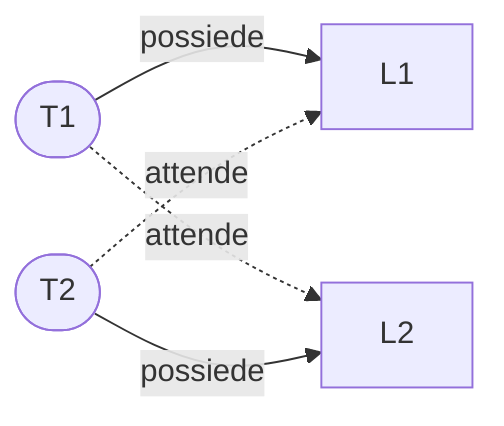
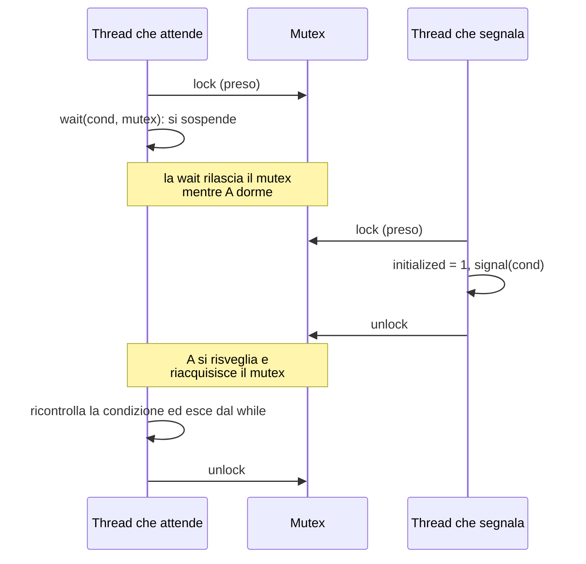

# Lezione 10 — API dei thread, mutex e variabili condizionate

La lezione è divisa in due parti. Nella prima il professore presenta le tre funzionalità di base della libreria dei thread POSIX: la **creazione** di un thread e l'**attesa della sua terminazione**, i **mutex** per proteggere le sezioni critiche, e le **variabili condizionate** per mettere un thread in attesa di un evento. Nella seconda parte gli studenti svolgono in aula tre esercizi di programmazione che ripercorrono passo per passo queste tre funzionalità.

## Ripasso: che cos'è un thread

Il professore ricorda brevemente il concetto introdotto nella [[Lezione 09 - Swapping, politiche di sostituzione e introduzione ai thread#Dai processi ai thread|lezione precedente]]. Un processo può trovarsi in diversi stati, ha un program counter che dice in che punto dell'esecuzione si trova e viene schedulato in modo concorrente con gli altri processi: uno solo è in esecuzione, gli altri sono pronti o bloccati. Un processo con queste caratteristiche può però avere **più thread di esecuzione**. *Thread* si può tradurre con "trama", nel senso della trama di un tessuto: significa che diversi pezzi di codice, dentro lo stesso programma, vengono eseguiti in modo **concorrente**, cioè competono per avere il processore.

Tutto quello che si è detto per i processi vale quindi per i thread all'interno di un processo:

- ogni thread ha il proprio **program counter**, perché bisogna ricordare dove si trova ciascuno;
- i thread sono schedulati tra loro, per esempio in round robin, un po' di tempo per ciascuno;
- il **codice** è uno solo: è un unico programma in cui si dice esplicitamente "fai partire questo thread, fai partire quest'altro", e ogni thread esegue la propria parte;
- anche lo **heap** è uno solo. Il professore lo definisce "fantastico": un'area di memoria allocata da un thread può essere letta da un altro, cosa che con i processi non ha senso, perché ogni processo ha uno spazio di indirizzamento separato e gli stessi indirizzi hanno significati diversi.

Ciò che i thread non condividono sono i **registri** (program counter compreso) e lo **stack**. Lo stack contiene le variabili locali e i parametri passati alle funzioni, e ciò che fa un thread è diverso da ciò che fa un altro: per questo gli stack sono separati. La condivisione della memoria, però, crea problemi, ed è proprio di questi che si occupa la lezione.

## Creare un thread

Per creare un thread si usa la funzione `pthread_create`:

```c
#include <pthread.h>

int pthread_create(pthread_t *thread,
                   const pthread_attr_t *attr,
                   void *(*start_routine)(void *),
                   void *arg);
```

I parametri sono quattro.

1. `thread` è un puntatore a una variabile di tipo `pthread_t`, in cui viene scritto l'**identificatore** del thread creato. Serve per forza: bisogna poter distinguere un thread dall'altro.
2. `attr` contiene **attributi** aggiuntivi. Nel corso lo si ignora e si passa `NULL`, ma il professore precisa che gli attributi sono molto interessanti: per esempio si può indicare la **priorità** di un thread, così che se due thread sono pronti venga schedulato quello con priorità più alta. Le slide citano anche la dimensione dello stack.
3. `start_routine` è la **funzione** associata al thread, quella che ne contiene il codice.
4. `arg` è l'**unico argomento** che si può passare a quella funzione.

### La firma della funzione del thread

La funzione passata a `pthread_create` può avere un nome qualsiasi (il professore propone, per sottolinearlo, un nome di fantasia), ma la sua **struttura non può cambiare**: deve restituire un puntatore a `void` e ricevere un solo parametro, anch'esso di tipo `void *`.

```c
void *mythread(void *arg);
```

Un puntatore non è altro che un **indirizzo di memoria**. Un puntatore a `void` è un indirizzo "senza tipo": non interessa a priori che cosa ci sia a quell'indirizzo, lo si interpreterà poi come si vuole. È questo che rende generica l'interfaccia: con un `void *` si può passare qualunque tipo di argomento, e restituire qualunque tipo di risultato.

Le slide mostrano per contrasto come sarebbe la dichiarazione se la funzione richiedesse un tipo specifico, per esempio un intero come argomento (`void *(*start_routine)(int)`) oppure un intero come valore di ritorno (`int (*start_routine)(void *)`). Non è il caso standard: la libreria usa `void *` in entrambe le posizioni proprio per non vincolare il programmatore.

### Un primo esempio

```c
#include <stdio.h>
#include <pthread.h>

typedef struct __myarg_t {
    int a;
    int b;
} myarg_t;

void *mythread(void *arg) {
    myarg_t *m = (myarg_t *) arg;   // cast dell'argomento al tipo reale
    printf("%d %d\n", m->a, m->b);
    return NULL;
}

int main(int argc, char *argv[]) {
    pthread_t p;
    int rc;
    myarg_t args;
    args.a = 10;
    args.b = 20;
    rc = pthread_create(&p, NULL, mythread, &args);
    // ...
}
```

`myarg_t` è semplicemente uno `struct` con due interi. Nella funzione del thread l'argomento arriva come `void *`, e la prima istruzione ne fa un **cast** a `myarg_t *`: con i puntatori lo si può sempre fare, perché in fondo sono tutti indirizzi, e il cast dice soltanto come interpretare il contenuto di quell'indirizzo. Poi il thread stampa i due campi; quello che fa, in questo esempio, interessa poco.

Il `main` dichiara le variabili che gli servono, imposta i campi di `args` e chiama `pthread_create`, con `NULL` come secondo parametro e il nome della funzione caratteristica come terzo. Da quel momento esiste un nuovo thread che esegue `mythread`.

> [!example] Domanda in aula: quanti thread ci sono?
> Dopo la chiamata a `pthread_create`, quanti thread ci sono? Qualcuno risponde "tre", come nell'esempio della lezione precedente, in cui le chiamate a `pthread_create` erano due. Qui la chiamata è una sola, quindi i thread sono **due**: il thread principale, che esegue il `main`, e quello appena creato.

## Attendere un thread e ottenere il valore di ritorno

Per attendere che un thread termini si usa `pthread_join`:

```c
int pthread_join(pthread_t thread, void **value_ptr);
```

Il primo parametro è l'identificatore del thread da aspettare. Il secondo serve a ricevere il **valore di ritorno** del thread: quando ha terminato il suo codice, il thread può restituire un valore (con `return` dalla sua funzione, oppure chiamando `pthread_exit`), e il thread che fa la `join` lo intercetta.

```c
#include <stdio.h>
#include <pthread.h>
#include <assert.h>
#include <stdlib.h>

typedef struct __myarg_t { int a; int b; } myarg_t;
typedef struct __myret_t { int x; int y; } myret_t;

void *mythread(void *arg) {
    myarg_t *m = (myarg_t *) arg;
    printf("%d %d\n", m->a, m->b);
    myret_t *r = malloc(sizeof(myret_t));   // risultato allocato nello heap
    r->x = 1;
    r->y = 2;
    return (void *) r;
}

int main(int argc, char *argv[]) {
    int rc;
    pthread_t p;
    myret_t *m;

    myarg_t args;
    args.a = 10;
    args.b = 20;
    pthread_create(&p, NULL, mythread, &args);
    pthread_join(p, (void **) &m);   // il main attende qui la fine del thread
    printf("returned %d %d\n", m->x, m->y);
    return 0;
}
```

Compilato ed eseguito, il programma stampa prima `10 20` (dal thread) e poi `returned 1 2` (dal `main`).

### Perché `&p` in un caso e `p` nell'altro

Chi non ricorda bene il C potrebbe chiedersi perché in `pthread_create` si scrive `&p` e in `pthread_join` soltanto `p`. Nella creazione la variabile `p` deve essere **riempita** dentro la funzione: le si passa il suo indirizzo, cioè la si passa **per riferimento**, e al ritorno `p` contiene l'identificatore del thread. Nella `join`, invece, `p` non deve essere modificata: basta il suo valore.

Per il valore di ritorno vale lo stesso ragionamento, con un livello in più. La variabile `m` del `main` è già un puntatore a `myret_t`. Alla `join` si passa però `&m`, l'**indirizzo del puntatore**, cioè un puntatore a puntatore (`void **`): la `join` scrive in `m` il puntatore restituito dal thread, cioè proprio `r`. Dopo la `join`, `m` punta all'area di memoria che il thread ha allocato e riempito.

### Perché il risultato va allocato nello heap

Il professore suggerisce di ricordare questa costruzione una volta per tutte, ma la logica è evidente. La funzione del thread è una funzione come le altre. Se `r` fosse una **variabile locale** (non un puntatore a memoria allocata), all'uscita dalla funzione non esisterebbe più. Invece si dichiara un puntatore `r`, si alloca un'area di memoria con `malloc`, e quest'area sta nello **heap**: non scompare all'uscita dalla funzione, a meno che non la si liberi esplicitamente. All'uscita scompare la variabile locale `r`, ma l'area che contiene i valori resta, e il `main` ne riceve l'indirizzo attraverso la `join`.

Le slide mostrano esplicitamente l'errore da evitare:

```c
void *mythread(void *arg) {
    myarg_t *m = (myarg_t *) arg;
    printf("%d %d\n", m->a, m->b);
    myret_t r;              // ALLOCATA SULLO STACK: SBAGLIATO!
    r.x = 1;
    r.y = 2;
    return (void *) &r;
}
```

Qui `r` sta sullo stack del thread e viene deallocata automaticamente al ritorno: il `main` riceverebbe l'indirizzo di una zona di memoria non più valida.

### La join come primitiva di sincronizzazione

Dopo la `pthread_create` i thread sono due, e non si sa come verranno eseguiti: il sistema operativo applica la sua politica generale (un po' di tempo per uno), ma chi parte per primo e chi finisce per primo non è noto. L'unica cosa certa è quella imposta esplicitamente: il `main` **resterà bloccato sulla `join`** finché l'altro thread non avrà terminato. Quello che succede in mezzo non si sa; dopo la `join`, il `main` riprende.

> [!important] La join come sincronizzazione
> `pthread_join` è considerata la **prima primitiva di sincronizzazione**: è l'unico modo, finora, per imporre un vincolo sull'ordine di esecuzione dei thread. Il professore chiede di ricordarlo: non si ha alcuna certezza su come verranno eseguiti i thread; sono soltanto le **primitive esplicite di sincronizzazione** a dare il controllo.

In questo caso la primitiva permette anche di ottenere il risultato del thread. Se il thread, invece di stampare due numeri, elaborasse delle immagini, la `join` sarebbe il modo per raccoglierne il risultato.

## Race condition e sezione critica

Il secondo meccanismo di sincronizzazione sono i **mutex**. Prima di vedere come si usano, il professore ricapitola il problema che risolvono, con una piccola simulazione in aula.

### Un incremento non è un'operazione sola

Si supponga che più thread incrementino una variabile condivisa:

```c
static volatile int counter = 0;

void *mythread(void *arg) {
    printf("%s: begin\n", (char *) arg);
    int i;
    for (i = 0; i < 1e7; i++) {
        counter = counter + 1;
    }
    printf("%s: done\n", (char *) arg);
    return NULL;
}
```

A prima vista non dovrebbe succedere nulla di strano: l'incremento è un'istruzione sola. Il problema è che, tradotta in codice macchina, **non è un'operazione sola**: bisogna prendere la variabile dalla memoria, portarla in un registro, aumentarla di 1 e riscrivere il registro in memoria.

Il professore assegna il ruolo di un thread a due studenti. La variabile vale 50. Il primo "thread" prende la variabile dalla memoria, la porta nel suo registro e la incrementa: nel registro c'è 51. A quel punto avviene un **context switch**, il suo quanto di tempo è finito. Tocca al secondo "thread", che legge la variabile dalla memoria: vale ancora 50, perché il primo non l'ha riscritta. Il secondo la incrementa e scrive 51 in memoria. Poi torna il primo, che ha già letto e incrementato la variabile, e scrive in memoria il valore che ha nel registro: di nuovo 51. Ognuno dei due l'ha aumentata di 1, quindi il risultato dovrebbe essere 52, e invece è 51.

La slide mostra la stessa sequenza in assembly x86, con il valore del program counter, del registro `%eax` e della variabile in memoria dopo ogni istruzione:

| SO | Thread 1 | Thread 2 | PC | `%eax` | counter |
| -- | -------- | -------- | -- | ------ | ------- |
| | *prima della sezione critica* | | 100 | 0 | 50 |
| | `mov 0x8049a1c, %eax` | | 105 | 50 | 50 |
| | `add $0x1, %eax` | | 108 | 51 | 50 |
| interrupt: salva T1, ripristina T2 | | | 100 | 0 | 50 |
| | | `mov 0x8049a1c, %eax` | 105 | 50 | 50 |
| | | `add $0x1, %eax` | 108 | 51 | 50 |
| | | `mov %eax, 0x8049a1c` | 113 | 51 | 51 |
| interrupt: salva T2, ripristina T1 | | | 108 | 51 | 51 |
| | `mov %eax, 0x8049a1c` | | 113 | 51 | 51 |

Ogni thread ha il proprio `%eax`, perché al context switch i registri vengono salvati e ripristinati: quando T1 riprende, ritrova nel suo `%eax` il valore 51 calcolato prima dell'interruzione.

> [!important] Race condition e sezione critica
> - Si ha una **race condition** (condizione di corsa) quando il risultato di un'esecuzione dipende dall'ordine, casuale, in cui i thread vengono eseguiti: in un'esecuzione il problema può verificarsi, in un'altra no.
> - Una **sezione critica** è un pezzo di codice che accede a una variabile condivisa e che non deve essere eseguito contemporaneamente da più di un thread.
>
> Per evitare le race condition serve che la sezione critica sia **atomica**, cioè indivisibile: è la **mutua esclusione**.

> [!tip] Approfondimento — Il programma delle slide, eseguito davvero
> #approfondimento
> Il programma della slide, con due thread che incrementano ciascuno `counter` dieci milioni di volte, è stato compilato con `gcc -pthread` ed eseguito cinque volte di seguito su una macchina con due CPU. Il valore finale atteso è 20 000 000; i valori ottenuti sono stati 13 055 693, 10 688 820, 10 448 564, 11 563 292 e 12 930 125, diversi a ogni esecuzione. OSTEP riporta lo stesso fenomeno: il programma è **indeterminato**, perché il suo risultato cambia da un'esecuzione all'altra [@arpacidusseau2023ostep, cap. 26].

Il professore osserva che la variabile da proteggere, in un caso come questo, è presumibilmente una **variabile globale**, dichiarata in cima al programma e accessibile a tutti i thread. Una variabile locale, dichiarata dentro la funzione, esiste solo dentro quella funzione (e sta sullo stack del thread): non potrebbe esserci alcun problema, e non avrebbe senso proteggerla.

## I mutex

> [!important] Mutex
> Un **mutex** (*mutual exclusion*, mutua esclusione) è un lock che protegge una sezione critica. Un thread che chiama `pthread_mutex_lock` su un mutex libero lo acquisisce e prosegue; un thread che lo chiama su un mutex già preso **resta bloccato** finché il possessore non lo rilascia con `pthread_mutex_unlock`.

```c
pthread_mutex_t lock;            // tipo fornito dalla libreria dei thread

pthread_mutex_lock(&lock);
x = x + 1;                       // o qualunque sia la sezione critica
pthread_mutex_unlock(&lock);
```

Il mutex si passa **per riferimento**. Il manuale lo richiede, ma il motivo è abbastanza ovvio: chiamando la funzione qualcosa cambia nello stato del lock, e da quel momento nessun altro può prenderlo.

Il professore distingue il mutex da un semaforo generico, che si vedrà più avanti. Un semaforo "standard" viene inizializzato a un valore, per esempio 10, e questo significa che fino a 10 thread possono prenderlo contemporaneamente. Un mutex è come un semaforo inizializzato a 1, cioè un **semaforo binario**: un solo thread può prenderlo, e nessun altro può prenderlo finché il primo non lo rilascia. Il confronto preciso tra mutex e semafori è nella [[Lezione 12 - Variabili condizionate, strutture dati concorrenti e semafori|Lezione 12]].

Il mutex quindi impedisce il disastro visto sopra: protegge la sezione critica e la rende atomica. È la seconda primitiva di sincronizzazione. Di nuovo, che cosa facciano i thread non si sa; si sa però con certezza che **nessun altro thread può prendere il lock** se qualcuno l'ha preso e non l'ha ancora rilasciato.

### Inizializzare un mutex

Un mutex deve essere **inizializzato** prima dell'uso. Ci sono due modi.

```c
// Modo statico: al momento della dichiarazione
pthread_mutex_t lock = PTHREAD_MUTEX_INITIALIZER;

// Modo dinamico: a tempo di esecuzione
int rc = pthread_mutex_init(&lock, NULL);
assert(rc == 0);   // controllare sempre che abbia avuto successo
```

Il modo statico è il più semplice. Quello dinamico offre qualche possibilità in più (il secondo argomento sono gli attributi), che al momento non interessano.

Le slide raccomandano di **controllare i codici di errore** di `lock` e `unlock`. Per non appesantire il codice si può usare un *wrapper*, una funzione che avvolge quella di libreria e termina il programma se qualcosa va storto:

```c
// Da usare solo se terminare il programma in caso di errore è accettabile
void Pthread_mutex_lock(pthread_mutex_t *mutex) {
    int rc = pthread_mutex_lock(mutex);
    assert(rc == 0);
}
```

È la ragione per cui negli esempi delle slide le funzioni compaiono a volte con l'iniziale maiuscola.

### Trylock e timedlock

Quasi tutte queste funzioni, oltre al funzionamento di base, offrono una serie di varianti. Non interessano tutte, ma è importante sapere che chi scrive una libreria cerca di prevedere che cosa possa essere utile.

- **Trylock**: se il mutex è libero lo prende, esattamente come la `lock` normale. Se invece è occupato, **non resta bloccata**: ritorna subito con un codice d'errore. Il thread, che non è entrato nella sezione critica, può fare dell'altro. Serve a non bloccare mai il thread.
- **Timedlock**: il thread prova a prendere il mutex per un certo tempo; se allo scadere del *timeout* il mutex è ancora occupato, ritorna comunque, con un codice d'errore.

```c
int pthread_mutex_trylock(pthread_mutex_t *mutex);
int pthread_mutex_timedlock(pthread_mutex_t *mutex,
                            const struct timespec *abs_timeout);
```

> [!warning] Precisazione sul nome
> Nelle slide la seconda funzione è scritta `pthread_mutex_timelock`. Il nome corretto nello standard POSIX è `pthread_mutex_timedlock`. Lo standard precisa che il tempo limite è **assoluto**: l'attesa termina quando passa l'istante indicato, e in quel caso la funzione restituisce l'errore `ETIMEDOUT` [@posixpthreadmutextimedlock]. La `trylock`, se il mutex è già preso, ritorna immediatamente con l'errore `EBUSY` [@posixpthreadmutextrylock].

Queste varianti nascono da due esigenze. Da un lato offrono possibilità interessanti: se non si può entrare subito nella sezione critica, magari si preferisce fare dell'altro piuttosto che restare bloccati. Dall'altro aiutano a gestire un problema enorme della sincronizzazione.

### Il deadlock

Il professore chiede se qualcuno conosce la cosa "tremenda" che può succedere usando i semafori. È il **deadlock**, o **stallo**.

Per descriverlo si chiamano i lock L1, L2, e così via, e si indicano con **P** l'operazione che prende un lock e con **V** quella che lo rilascia: è un modo standard di chiamarle. Si considerino due thread con questo codice:

```pseudo
// Thread T1                 // Thread T2
...                          ...
P(L1)                        P(L2)
...                          ...
P(L2)                        P(L1)
...                          ...
V(L2)                        V(L1)
...                          ...
V(L1)                        V(L2)
```

In T1 i lock sono **annidati**: si prende L1, poi L2, si rilascia L2, poi L1, uno dentro l'altro. Succede più spesso di quanto si immagini. Quando si scrive un programma si usano funzioni di libreria di cui non si guarda il codice interno: può darsi che una funzione di libreria prenda al suo interno un mutex, e che all'esterno, per le proprie esigenze, se ne usi un altro. T2 prende gli stessi due lock, ma **in ordine diverso**.

Ecco che cosa può succedere. T1 è in esecuzione e prende L1, che è libero. Prima che prenda L2 avviene un context switch: lo scheduler, giustamente, fa eseguire anche T2. Non è strano: non si ha il controllo su quando succede, ma può succedere. T2 prende L2, che è libero, e prova a prendere L1: è già preso da T1, quindi T2 si blocca. Riprende T1, che prova a prendere L2: è già preso da T2. Ognuno dei due aspetta un lock che possiede l'altro, e nessuno dei due potrà mai rilasciare il proprio.



> [!important] Deadlock
> Si ha un **deadlock** (stallo) quando un insieme di thread è bloccato per sempre, perché ciascuno attende una risorsa posseduta da un altro thread dell'insieme. Nell'esempio l'attesa è circolare: T1 attende L2, posseduto da T2, che attende L1, posseduto da T1.

Si potrebbe obiettare che basta fare attenzione a come si prendono i lock. È vero se il programma è scritto interamente da sé; usando librerie altrui diventa più difficile accorgersene, perché i lock possono essere nascosti in codice più interno. Si capisce allora il senso di `trylock` e `timedlock`: se si usasse sempre una `timedlock` potrebbe andare male, nel senso che il lock non viene preso, ma almeno non si resta in stallo per sempre. Dopo il timeout il thread riprende con un codice d'errore, può fare dell'altro e riprovare più avanti. Il deadlock sarà trattato in modo sistematico più avanti nel corso.

> [!tip] Approfondimento — Da dove vengono P e V
> #approfondimento
> A lezione il professore dice di non ricordare che cosa significhino le lettere P e V. La notazione risale a **Dijkstra**, a cui si deve il concetto di semaforo. OSTEP riferisce due spiegazioni dell'origine, entrambe da parole olandesi: secondo una, P viene da *passering* (passaggio) e V da *vrijgave* (rilascio); Dijkstra stesso, in seguito, le fece derivare da *prolaag* (una parola composta da lui, per "prova a diminuire") e *verhoog* ("aumenta") [@arpacidusseau2023ostep, cap. 31].

## Le variabili condizionate

L'ultima funzionalità sono le **variabili condizionate** (*condition variables*). Qualcuno potrebbe pensarle simili a un semaforo, perché anche loro bloccano un thread; ma il blocco **non è simmetrico**.

> [!important] Variabile condizionata
> Una **variabile condizionata** permette a un thread di **bloccarsi in attesa**, senza consumare CPU, finché un altro thread non gli segnala che può continuare. Le due operazioni sono **wait** e **signal**:
> - il thread che chiama `pthread_cond_wait` viene **sospeso** in attesa del segnale;
> - il thread che chiama `pthread_cond_signal` **non viene sospeso**: fa i fatti suoi e, quando si verifica la condizione attesa, lancia il segnale che libera l'altro.

```c
int pthread_cond_wait(pthread_cond_t *cond, pthread_mutex_t *mutex);
int pthread_cond_signal(pthread_cond_t *cond);
```

Servono quindi a mettere un thread in attesa di una condizione. Anche le variabili condizionate devono essere inizializzate, in modo simile ai mutex. Le slide mostrano l'uso tipico.

```c
// Thread che attende
pthread_mutex_t lock = PTHREAD_MUTEX_INITIALIZER;
pthread_cond_t  init = PTHREAD_COND_INITIALIZER;

pthread_mutex_lock(&lock);
while (initialized == 0)
    pthread_cond_wait(&init, &lock);
pthread_mutex_unlock(&lock);
```

```c
// Thread che segnala
pthread_mutex_lock(&lock);
initialized = 1;
pthread_cond_signal(&init);
pthread_mutex_unlock(&lock);
```

Il professore chiede inizialmente di ignorare il ciclo `while` e la variabile `initialized`, per concentrarsi sulle due chiamate e sul mutex che le circonda.

### Perché serve un mutex

Sia la `wait` sia la `signal` sono protette da un mutex: prima della `wait` bisogna prendere il mutex e rilasciarlo dopo, e lo stesso per la `signal`. Il motivo è semplice: le strutture dati che il sistema usa per ricordare chi attende quale condizione sono **variabili condivise**. Qualcuno segnala una condizione, qualcun altro si accorge che è stata segnalata: è chiaro che sotto c'è una struttura condivisa, e va protetta. Altrimenti potrebbe succedere che, mentre il primo thread sta aggiornando queste strutture per mettersi a dormire, avvenga un context switch e l'altro lanci il segnale: il sistema si troverebbe in uno stato incoerente, con il primo thread che non ha ancora finito di addormentarsi e il segnale che è già arrivato.

### Perché la wait riceve il mutex

Questo però crea un problema. Il thread che attende prende il mutex e chiama la `wait`: si blocca. Lo scheduler dà il processore all'altro thread, quello che deve risvegliarlo. Ma come fa il secondo thread a entrare nella sezione protetta e a chiamare la `signal`, se il mutex è stato preso dal primo, che ora sta dormendo? Non potrebbe.

Per questo il **secondo parametro della `wait` è proprio il mutex**. Il thread che si sospende prende il mutex, chiama la `wait` e le passa il mutex. Il sistema mette il thread a dormire e poi, quando sta dormendo in modo sicuro, **rilascia il mutex** (lo fa la libreria, e non si vuole nemmeno vedere come). A quel punto il secondo thread può prendere il mutex, chiamare la `signal` e rilasciarlo. Quando lo rilascia, il mutex viene **restituito**, già preso, al thread che aveva chiamato la `wait`, che può proseguire, rilasciare il mutex e terminare.



> [!tip] Approfondimento — Che cosa dice lo standard
> #approfondimento
> Lo standard POSIX conferma questo comportamento: `pthread_cond_wait` **rilascia atomicamente** il mutex e blocca il thread chiamante sulla variabile condizionata; al risveglio, il thread **riacquisisce sempre** il mutex prima che la funzione ritorni [@posixpthreadcondwait].

### Perché serve la variabile `initialized`

Resta da spiegare la variabile `initialized` e il ciclo `while`. I motivi sono diversi.

Il primo, il più banale: i thread sono eseguiti senza che se ne abbia il controllo. Che cosa succede se il thread che fa la `signal` esegue **prima** di quello che fa la `wait`? La `signal` viene lanciata quando nessuno è ancora in attesa, e **va perduta**: un segnale che nessuno aspetta non viene conservato. Il professore lo paragona a entrare in un'aula vuota, urlare "fate gli esercizi per lunedì" e poi pretendere che qualcuno se ne ricordi. Il secondo thread, quando si mette a dormire, aspetterà per sempre un segnale che è già passato. Con la variabile invece il problema non si pone: il thread che segnala ha messo `initialized` a 1, quindi quando arriva quello che dovrebbe attendere il ciclo `while (initialized == 0)` non viene mai eseguito, e il thread prosegue diritto.

Il secondo motivo, che il professore confessa di trovare sempre un po' misterioso ma che verifica e riferisce ogni anno: a quanto pare possono arrivare dei **segnali spuri**. Per qualche motivo interno, il thread che ha fatto la `wait` può essere risvegliato anche se non c'è stata una `signal` corrispondente; forse è un meccanismo di garanzia contro eventuali errori di funzionamento. Grazie al ciclo, un thread risvegliato da un segnale spurio ricontrolla la variabile, trova che `initialized` non è a 1, e si rimette a dormire.

> [!important] Uso corretto delle variabili condizionate
> La pratica corretta prevede sempre tre elementi insieme: un **mutex** attorno alla `wait` e alla `signal`, una **variabile di stato** che il thread che segnala imposta prima della `signal`, e un ciclo **`while`** (non un `if`) che ricontrolla la variabile attorno alla `wait`. Così si prevengono errori dovuti a sincronizzazioni iniziali sfortunate e a risvegli non dovuti.

> [!tip] Approfondimento — I risvegli spuri nello standard
> #approfondimento
> Il fenomeno che il professore trova misterioso è previsto esplicitamente dallo standard POSIX: "possono verificarsi risvegli spuri" dalle funzioni `pthread_cond_wait` e `pthread_cond_timedwait`. Per questo lo standard raccomanda di racchiudere l'attesa nell'equivalente di un ciclo `while` che ricontrolla il predicato [@posixpthreadcondwait]. OSTEP osserva che in alcune librerie, per dettagli di implementazione, una sola `signal` può risvegliare due thread [@arpacidusseau2023ostep, cap. 30].

### Perché non basta un ciclo di attesa

Si potrebbe pensare di fare a meno delle variabili condizionate:

```c
// Thread che attende
while (initialized == 0)
    ;   // spin: non fa nulla

// Thread che segnala
initialized = 1;
```

Il punto e virgola dopo il `while` significa "nessuna istruzione": il thread resta a ciclare sulla variabile. Funziona? Il professore chiede alla classe di rispondere senza guardare la slide ("non pensate all'elefante"), e la risposta arriva: in questo caso il thread **non è bloccato**, continua a usare la CPU. È come chi sta per uscire di casa e torna in continuazione a controllare di aver chiuso il gas: cicla all'infinito sfruttando la CPU per niente.

Il senso di tutto il meccanismo è **non consumare risorse**. Un thread che attende una variabile condizionata è nello stato **bloccato**: ricordando lo schema degli stati (in esecuzione, pronto, bloccato), un thread bloccato non consuma CPU. La soluzione con il ciclo funziona, ma è uno spreco. Le slide aggiungono che è anche **soggetta a errori**.

> [!warning] Il ciclo di attesa può anche non funzionare
> L'esempio `main-signal.c` del pacchetto di esercizi allegato (vedi [[#Esercizi del pacchetto threads-api|più sotto]]) implementa proprio questa attesa con una variabile `int done` non dichiarata `volatile`. Compilato senza ottimizzazioni funziona; compilato con `gcc -O2` è stato verificato che il programma **resta bloccato per sempre**: il compilatore, che non sa che un altro thread può modificare `done`, è libero di leggerla una volta sola e di trasformare il ciclo in un ciclo infinito. Le slide, nell'esempio di attesa attiva della [[Lezione 11 - Implementazione dei lock e variabili condizionate|lezione successiva]], dichiarano infatti la variabile `volatile`.

## Esercitazione in aula

Nella seconda parte della lezione gli studenti hanno svolto tre esercizi sul proprio computer, con Linux, una macchina virtuale Linux o il sottosistema Linux di Windows (WSL), come già fatto per i processi nella [[Lezione 06 - Base and bound, Memory API ed esercitazione Linux#Esercitazione su Linux|Lezione 6]].

### Il materiale e il metodo

Il materiale si scarica da AulaWeb: un archivio chiamato `thread.zip` o `thread.tgz`, con lo stesso contenuto (il secondo è compresso con `tar`, il metodo tipico di Unix). Va copiato nella propria cartella e scompattato. Contiene tre esercizi, che ripercorrono le tre funzionalità della lezione:

1. il primo crea un thread, ne attende la terminazione con la `join` e ne prende il valore di ritorno;
2. il secondo usa un **mutex**;
3. il terzo usa le **variabili condizionate**.

Per ogni esercizio c'è un file **start** e uno con la **soluzione**, con i commenti sia in italiano sia in inglese. Nello start, al posto del codice mancante, ci sono dei commenti (per esempio "inserisci qui la funzione che crea il thread"): al loro posto va scritto il codice corrispondente, che si trova nella soluzione.

Il professore suggerisce fortemente questo metodo: aprire **fianco a fianco** lo start, a sinistra, e la soluzione, a destra; leggere il commento nello start, cercare nella soluzione il pezzo di codice corrispondente (per esempio la `pthread_create`) e copiarlo. Copiare va benissimo: l'obiettivo è che, copiando, si faccia lo sforzo di capire quale pezzo serve per fare che cosa. Compilare direttamente la soluzione non è la stessa cosa: va compilato il proprio file start, verificando che non ci siano errori.

Serve un editor di testo. Il professore usa **gedit**, ma va bene qualunque editor. Su una distribuzione Ubuntu, se gedit manca, lo si installa con:

```bash
sudo apt-get install gedit
```

`sudo` significa eseguire il comando come **super user**: l'utente acquisisce temporaneamente i privilegi di amministratore. La password richiesta è quella con cui si accede al proprio account, perché l'utente è già un potenziale super user e con `sudo` lo diventa.

### Compilare un programma con i thread

```bash
gcc nomefile.c -o nomeoutput -pthread
# oppure, a seconda della versione:
gcc nomefile.c -o nomeoutput -lpthread
./nomeoutput
```

L'opzione `-o` indica il nome dell'eseguibile. Il professore, per pigrizia dichiarata, usa `g++`, il compilatore C++: se per caso nel codice è scappata un po' di sintassi C++, `g++` la accetta comunque. Ma il codice è C, e con `gcc` va benissimo.

Dato che si usano i thread, bisogna includere la **libreria dei thread**, e il modo varia a seconda delle versioni: si aggiunge `-pthread` oppure `-lpthread` (in alcune versioni non serve nemmeno la `l`). Senza questa opzione il programma **compila ma non fa il linking**. Il professore ricorda come funziona un compilatore: prima trasforma i sorgenti in **file oggetto** (`.o`), poi fa il **linking** di tutti gli oggetti per creare l'eseguibile, e nel linking aggiunge anche le **librerie** usate. Senza la libreria dei thread, il linker segnala che non trova alcuni **simboli**, cioè il codice corrispondente alle funzioni di libreria.

> [!tip] Approfondimento — `-pthread` e `-lpthread`
> #approfondimento
> Le slide del corso raccomandano `-pthread` [@arpacidusseau2023ostep, cap. 27]. Le pagine di manuale di Linux indicano la libreria come `libpthread`, da collegare con `-lpthread` [@linuxman3semwait]. La differenza è che `-lpthread` aggiunge soltanto la libreria in fase di linking, mentre `-pthread` è un'opzione del compilatore: secondo il manuale di GCC definisce anche le macro aggiuntive richieste dalla libreria dei thread, e va usata in modo coerente sia in compilazione sia nel linking [@gccpthread]. Dalla versione 2.34 della libreria C di GNU (glibc, 2021), inoltre, tutte le funzioni di `libpthread` sono state integrate nella libreria C stessa, e le note di rilascio precisano che le nuove applicazioni non hanno più bisogno di `-lpthread` [@glibc234]: è per questo che su sistemi recenti il programma si collega anche senza nessuna delle due opzioni, come accennato dal professore.

### Provare a togliere il mutex

Per chi ha finito il secondo esercizio, il professore propone, "se siete malvagi", di **commentare** le chiamate al mutex e vedere che cosa succede: a un certo punto l'incremento delle variabili va storto. Nel codice, ricorda, ha probabilmente introdotto apposta un **ritardo** nella sezione critica. Il motivo è che l'incoerenza si verifica solo se un thread interrompe l'altro proprio a metà della sezione critica, e la probabilità che succeda è bassa; allungando il tempo trascorso dentro la sezione critica la si fa diventare alta.

## Esercizi del pacchetto threads-api

> [!warning] Materiale allegato diverso da quello usato in aula
> L'archivio `threads-api` allegato al materiale della lezione non è quello usato in aula (che, dalla registrazione, si chiama `thread.zip` e contiene file *start* e soluzioni). È il compito a casa del capitolo 27 del libro di testo, con le istruzioni tradotte in italiano nel file `istruzioni.txt`. Le risposte che seguono non sono state discusse a lezione: sono state ricavate compilando i programmi con il `Makefile` del pacchetto ed eseguendoli con **helgrind** (Valgrind 3.22). Nelle istruzioni manca la domanda 3 e la 4 compare due volte; qui le domande sono numerate come nel file.

Il pacchetto si usa con uno strumento reale per trovare problemi nei programmi multithread, **helgrind**, che fa parte della suite di strumenti di debugging Valgrind. Si compila tutto con `make` e si esegue un programma sotto helgrind con:

```bash
valgrind --tool=helgrind ./main-race
```

> [!tip] Approfondimento — Che cosa rileva helgrind
> #approfondimento
> Secondo il suo manuale, helgrind rileva tre classi di errori: gli **usi scorretti** dell'API dei thread POSIX, i **potenziali deadlock** dovuti a problemi nell'ordine di acquisizione dei lock e le **data race**, cioè accessi alla memoria senza un lock o una sincronizzazione adeguata. Per i deadlock costruisce un **grafo orientato** dell'ordine in cui i lock sono stati acquisiti in passato e, a ogni nuova acquisizione, controlla se si è formato un ciclo: un ciclo indica un deadlock **potenziale** tra i lock coinvolti [@valgrindhelgrind].

### Domande 1 e 2: una data race

```c
int balance = 0;

void* worker(void* arg) {
    balance++; // accesso non protetto
    return NULL;
}

int main(int argc, char *argv[]) {
    pthread_t p;
    Pthread_create(&p, NULL, worker, NULL);
    balance++; // accesso non protetto
    Pthread_join(p, NULL);
    return 0;
}
```

La race è quella vista a lezione: il thread principale e il thread `worker` incrementano entrambi `balance` senza protezione. Helgrind segnala **due errori** ("Possible data race"), uno per la lettura e uno per la scrittura di 4 byte, nel `main` alla riga 15, in conflitto con la scrittura fatta dal `worker` alla riga 8. Indica quindi le righe giuste. Fornisce anche altre informazioni: quale thread è stato creato e dove (alla riga 14 del `main`), e quali lock erano posseduti durante gli accessi (nessuno).

Rimuovendo una delle due righe incriminate, la race scompare e helgrind non segnala errori. Aggiungendo un mutex attorno a **uno solo** dei due incrementi, helgrind segnala ancora la race: proteggere un solo accesso non serve, perché l'altro può comunque avvenire in contemporanea. Con il mutex attorno a **entrambi** gli incrementi gli errori scompaiono.

### Domande 4 e 5: deadlock e falsi positivi

```c
void* worker(void* arg) {
    if ((long long) arg == 0) {
        Pthread_mutex_lock(&m1);
        Pthread_mutex_lock(&m2);
    } else {
        Pthread_mutex_lock(&m2);
        Pthread_mutex_lock(&m1);
    }
    Pthread_mutex_unlock(&m1);
    Pthread_mutex_unlock(&m2);
    return NULL;
}
```

È esattamente il deadlock della lezione: un thread prende `m1` e poi `m2`, l'altro prende `m2` e poi `m1`. Se il primo viene interrotto tra le due acquisizioni, i due thread restano bloccati per sempre. Helgrind segnala una violazione dell'ordine dei lock ("lock order violated"): mostra l'ordine osservato come scorretto e le righe in cui ciascun lock è stato acquisito per la prima volta.

In `main-deadlock-global.c` ogni thread, prima di prendere `m1` e `m2`, prende un terzo lock globale `g`, che rilascia per ultimo. Così i due thread non possono mai trovarsi contemporaneamente nella zona in cui si prendono `m1` e `m2`, e il deadlock **non può verificarsi**. Eppure helgrind segnala lo **stesso errore**: vede che `m1` e `m2` sono stati presi in ordini diversi, e non tiene conto del fatto che il lock `g` rende impossibile l'intreccio pericoloso. Strumenti come helgrind sono utili, ma possono dare **falsi positivi**: i loro avvisi vanno interpretati, non accettati ciecamente.

### Domande 6 e 7: l'attesa attiva

`main-signal.c` usa una variabile `done` per segnalare che il thread figlio ha finito: il padre cicla con `while (done == 0);`. Il codice è inefficiente per il motivo visto a lezione: il padre consuma CPU per tutto il tempo in cui il figlio lavora, e se il figlio impiega molto tempo lo spreco è grande. Helgrind segnala inoltre una **data race** su `done`, letta dal `main` alla riga 16 e scritta dal figlio alla riga 9 senza alcuna sincronizzazione. Il codice quindi non è corretto, anche se compilato senza ottimizzazioni sembra funzionare; come già detto, con `-O2` il programma si blocca.

### Domande 8 e 9: la versione con variabile condizionata

`main-signal-cv.c` incapsula il meccanismo in una piccola struttura `synchronizer_t`, con un mutex, una variabile condizionata e il flag `done`:

```c
void signal_done(synchronizer_t *s) {
    Pthread_mutex_lock(&s->lock);
    s->done = 1;
    Pthread_cond_signal(&s->cond);
    Pthread_mutex_unlock(&s->lock);
}

void signal_wait(synchronizer_t *s) {
    Pthread_mutex_lock(&s->lock);
    while (s->done == 0)
        Pthread_cond_wait(&s->cond, &s->lock);
    Pthread_mutex_unlock(&s->lock);
}
```

È lo schema corretto della lezione, e la versione è preferibile **sia per la correttezza sia per le prestazioni**: il padre dorme invece di consumare CPU, l'accesso a `done` è protetto dal mutex, e il ciclo `while` gestisce sia il caso in cui il figlio segnali prima che il padre si metta in attesa, sia gli eventuali risvegli spuri. Helgrind non segnala alcun errore.

> [!tip] Schema consigliato
> In questo punto sarebbe utile uno schema disegnato a mano (per esempio con Excalidraw) che metta a confronto le tre primitive viste nella lezione. Per ciascuna andrebbero disegnati due thread come linee verticali del tempo: per la `join`, il `main` che si blocca fino alla fine del figlio; per il mutex, due thread che si contendono una sezione critica rappresentata come un rettangolo in cui può stare uno solo; per la variabile condizionata, un thread che si addormenta sulla `wait` e una freccia di `signal` dall'altro thread che lo risveglia, con il mutex rilasciato durante il sonno.

## Indicazioni pratiche

- Alcuni studenti hanno segnalato problemi con il sistema per la consegna degli esercizi. Il professore, rientrato da un convegno, li sistema dopo la lezione e concede **un giorno in più** a chi non è riuscito a consegnare. In generale, problemi di questo tipo non saranno mai un ostacolo: il software è in sperimentazione quest'anno.
- Per problemi con gli esercizi conviene andare a trovare il professore dopo la lezione, oppure nel suo ufficio al **secondo piano**, così da guardare insieme sul server che cosa succede.
- Pochi studenti sono arrivati all'esercizio sulle variabili condizionate. In aula non si tornerà su questi esercizi, ma il professore consiglia di riprenderli **entro dicembre**, perché sono la base della programmazione avanzata.
- Dalla lezione successiva si riprende la **sincronizzazione** (semafori e problemi correlati) in modo più narrativo, con proiettore e lavagna.
