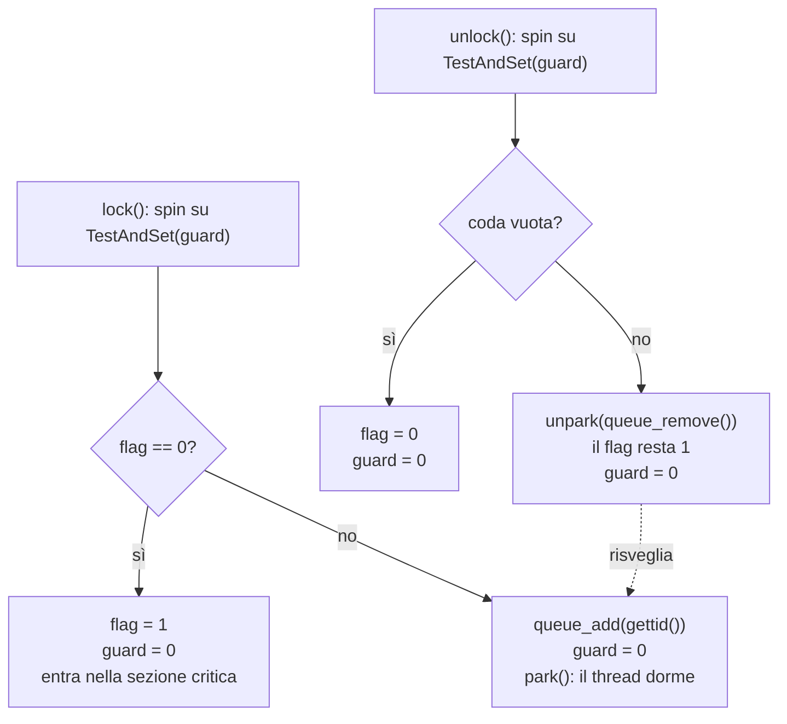

# Lezione 11 — Implementazione dei lock e variabili condizionate

Dopo aver visto nella [[Lezione 10 - API dei thread, mutex e variabili condizionate|lezione precedente]] come si **usano** i mutex e le variabili condizionate, il professore mostra come i lock sono **costruiti**. Il punto centrale è che un lock efficace non si può realizzare con il solo software: servono **istruzioni hardware atomiche**, come il *test-and-set*, e per non sprecare CPU serve anche il supporto del sistema operativo, che permette di mettere a dormire i thread in attesa. Il professore avverte che alcuni concetti sono fondamentali e li sottolineerà; altri sono più accessori, ma mostrano come certe cose sono fatte e quali problemi sollevano. Riflettendo bene su questi dettagli si capiscono anche gli errori che si rischia di fare programmando. Nella seconda parte si torna alle variabili condizionate e si introduce il problema del **produttore-consumatore**.

## Ripasso: dove siamo

Il professore riepiloga il percorso del corso. Si è parlato di **virtualizzazione della CPU**, cioè di come dare l'impressione che ci siano più CPU dove ce n'è una sola, grazie a un appropriato algoritmo di scheduling. Poi di **virtualizzazione della memoria**: pur essendo la memoria limitata, ogni processo ha l'impressione di avere a disposizione l'intero spazio di indirizzamento. Ora si è passati alla **concorrenza**, cioè a come far interagire correttamente più task tra loro.

Invece di continuare a parlare di processi, che sono un modo per raggruppare risorse (il processo mette insieme la memoria e il resto), si è passati ai **thread**. Il thread è l'elemento base della schedulazione, ed è quindi il thread che ha il problema di comunicare correttamente con gli altri thread. Nella lezione precedente si sono viste le primitive dello standard **POSIX**, lo standard dei sistemi basati su Unix, per creare un thread, per attenderne la terminazione (che è una primitiva di sincronizzazione), i mutex per impedire l'accesso contemporaneo a un'area di memoria condivisa e le variabili condizionate.

## Il lock

Oggi si parla, in senso più generico, di **lock**. Un lock è quello che finora si è chiamato semaforo o mutex; *lock* è il termine più astratto, che non si riferisce né all'uno né all'altro. È il concetto di bloccare l'accesso di un task finché un altro task non gli dice che può andare avanti.

> [!important] Lock
> Un **lock** garantisce che una sezione critica venga eseguita **come se fosse un'unica istruzione atomica**, cioè indivisibile.

L'istruzione `balance = balance + 1` è una sola istruzione in C, ma corrisponde a più istruzioni in linguaggio macchina e non è indivisibile; si è visto che senza protezione possono succedere disastri. Il modo tipico per impedirlo è proteggerla con un lock:

```c
lock_t mutex;          // un lock globale chiamato 'mutex'
...
lock(&mutex);
balance = balance + 1;
unlock(&mutex);
```

Qui `lock` e `unlock` non sono i nomi veri di una funzione: è pseudocodice astratto. Se un thread è dentro la sezione critica e un altro thread va in esecuzione e prova a chiamare la `lock`, il secondo resta bloccato finché il primo non chiama la `unlock`.

### Lo stato del lock

Ogni lock è associato a una variabile di qualche tipo. È intuitivo: da qualche parte ci deve essere una variabile che ricorda lo stato del lock. Gli stati sono due:

- **disponibile** (*available*, *unlocked*, *free*): nessun thread possiede il lock;
- **acquisito** (*acquired*, *locked*, *held*): un thread possiede il lock e presumibilmente si trova nella sezione critica.

Quando un thread chiama la `lock`, prova a prendere il lock. Se nessun altro thread lo possiede, lo prende ed entra nella sezione critica: si dice che quel thread è il **proprietario** (*owner*) del lock. Gli altri thread non possono entrare nella sezione critica finché il primo tiene il lock. Nella libreria pthread le funzioni sono `pthread_mutex_lock` e `pthread_mutex_unlock`.

### Proteggere solo quello che serve

Ci si potrebbe togliere il pensiero una volta per tutte: se una grossa porzione di codice sembra critica, si mette una `lock` all'inizio e una `unlock` alla fine. Non è una bella idea: più codice c'è tra `lock` e `unlock`, più a lungo si tengono bloccati altri thread che nel frattempo potrebbero lavorare. La buona pratica è proteggere **solo i punti critici**, e non tutto "per non saper né leggere né scrivere".

> [!important] Approccio a grana fine
> Usare lock diversi per proteggere variabili o strutture diverse, invece di un unico lock per tutto, aumenta la concorrenza tra i thread. Si parla di approccio **a grana fine** (*fine-grained*).

Con una sola variabile non fa differenza. Ma con due variabili si può mettere un lock attorno all'una e un altro attorno all'altra, e se le operazioni sono molte può avere senso spezzarle in modo da proteggere solo ciò che interessa.

## Costruire un lock

Dal punto di vista di chi progetta un sistema operativo (il professore precisa che parla a nome di chi li ha progettati davvero) non basta fare dei lock: bisogna farli **efficienti** e con alcune proprietà. Soprattutto, si scopre che l'unico modo per costruire un lock è usare **istruzioni hardware apposite**. Se si prova a scrivere un lock con del codice normale, ci si accorge che quel codice stesso avrebbe bisogno di un lock per non creare incoerenze.

### I criteri di valutazione

> [!important] Criteri per valutare un lock
> - **Mutua esclusione**: il lock deve fare ciò che deve, cioè impedire per nessun motivo al mondo che più thread entrino nella stessa sezione critica.
> - **Equità** (*fairness*): ogni thread che aspetta il lock deve avere più o meno la possibilità di prenderlo quando si libera. Altrimenti si ha **starvation** (inedia): alcuni thread aspettano per sempre mentre gli altri continuano a passarsi il lock.
> - **Prestazioni**: il costo aggiuntivo in tempo dovuto all'uso del lock. Alcune soluzioni funzionano ma hanno prestazioni pessime.

## Primo tentativo: disabilitare gli interrupt

Da dove nasce l'incoerenza? Dalla possibilità che più thread accedano alla stessa area di memoria nel mezzo di operazioni che dovrebbero essere indivisibili. E questa possibilità nasce dallo **scheduling**: se ogni task venisse eseguito dall'inizio alla fine, il problema non esisterebbe.

In un sistema basato sul **time sharing** (condivisione del tempo) l'algoritmo tipico è il round robin o una sua variante: un task va in esecuzione per un quanto di tempo, poi l'algoritmo di scheduling decide che tocca a un altro, e così via. Chi esegue l'algoritmo di scheduling? L'**interrupt del timer**.

> [!important] Interrupt
> Un **interrupt** è un segnale lanciato al verificarsi di un evento. Le porte di ingresso del calcolatore (USB e le altre) sono collegate a un segnale di interrupt, in origine proprio un filo fisico che arriva a un **interrupt controller**. Quando ci sono dati in ingresso, il segnale viene attivato, e a esso è agganciato un pezzo di software, l'**interrupt handler** (gestore dell'interrupt), che preleva i dati dalla porta e li mette da qualche parte. L'obiettivo è che i dati vengano presi rapidamente non appena arrivano. Tra i vari interrupt c'è quello del **timer** interno, che tipicamente avvia l'algoritmo di scheduling.

Il meccanismo è quello già visto nella [[Lezione 02 - Process API e Limited Direct Execution#Il protocollo LDE con timer interrupt|Lezione 2]]. La soluzione più semplice che viene in mente, e che è stata davvero usata, è **disabilitare gli interrupt**:

```c
void lock() {
    DisableInterrupts();
}

void unlock() {
    EnableInterrupts();
}
```

Se gli interrupt sono disabilitati durante la sezione critica, nessun altro task può essere mandato in esecuzione al posto di quello corrente: la zona tra `lock` e `unlock` **non ammette preemption**, cioè non ammette che un task prenda il processore al posto di un altro. È una delle prime soluzioni, inventata per i sistemi a singolo processore.

L'approccio però non è robusto.

- Si basa su una **fiducia enorme nei programmatori**, che il professore definisce, scherzando, "tutti mezzi criminali". Un programma potrebbe mettere una `lock` all'inizio e una `unlock` alla fine di un'esecuzione di tre ore, e usare il processore da solo per tutto il tempo. Anche senza malizia, un programmatore poco attento può creare sezioni critiche enormi. In ogni caso si interferisce con il meccanismo di scheduling, e questo non è accettabile.
- **Non funziona su più processori**: disabilitare gli interrupt agisce solo sulla CPU corrente, mentre i thread sulle altre CPU continuano a eseguire, e l'incoerenza resta possibile.
- Le slide aggiungono che sulle CPU moderne il codice che maschera e smaschera gli interrupt viene eseguito lentamente.

Serve qualcosa di più raffinato.

## Secondo tentativo: un flag

Si potrebbe pensare che basti una variabile:

```c
typedef struct __lock_t { int flag; } lock_t;

void init(lock_t *mutex) {
    // 0 -> lock disponibile, 1 -> lock preso
    mutex->flag = 0;
}

void lock(lock_t *mutex) {
    while (mutex->flag == 1)   // TEST del flag
        ;                      // spin-wait (non fa nulla)
    mutex->flag = 1;           // ora lo SET!
}

void unlock(lock_t *mutex) {
    mutex->flag = 0;
}
```

Il `flag` è proprio la variabile che descrive lo stato del mutex: 0 se è libero, 1 se è preso. All'inizializzazione lo si mette a 0, libero; inizializzarlo come preso non avrebbe molto senso, perché vorrebbe dire che qualcuno deve fare una `unlock` come prima operazione. La `lock` cicla finché il flag vale 1, senza fare nulla (il punto e virgola dopo il `while` significa nessuna istruzione), e poi lo mette a 1. La `unlock` lo rimette a 0.

Il primo thread trova il flag a 0, esce dal ciclo, lo mette a 1 ed entra nella sezione critica. Arriva il secondo thread: il flag è a 1, quindi resta lì.

### Un'attesa rumorosa

Il professore pone una domanda solo apparentemente scherzosa: se l'istruzione `while (mutex->flag == 1);` dovesse avere un suono, sarebbe un silenzio o un rumore continuo? Qualcuno risponde che è un rumore: il thread **continua a lavorare**. Sembra fermo, e sarebbe bello che lo fosse, ma per tutto il suo quanto di tempo non fa nulla se non verificare continuamente se il lock è libero: occupa il processore senza essere sospeso.

> [!important] Spin-waiting
> Si parla di **spin-waiting** (attesa attiva) quando un thread attende un evento controllando ripetutamente una condizione, invece di essere sospeso. Il thread consuma CPU senza fare lavoro utile.

### Il problema vero: nessuna mutua esclusione

Lo spin-waiting è un problema di prestazioni. Ma c'è un problema più grave, e il professore chiede di pensarci seriamente, perché errori del genere si rischiano anche programmando. Il test (`while (mutex->flag == 1)`) e l'impostazione (`mutex->flag = 1`) sono **due operazioni separate**: non si sa come diventino linguaggio macchina, ma anche se fossero un'istruzione ciascuna resterebbero due cose distinte.

| Thread 1 | Thread 2 |
| -------- | -------- |
| chiama `lock()` | |
| `while (flag == 1);` → il flag è 0, esce dal ciclo | |
| *interrupt: passa al Thread 2* | |
| | chiama `lock()` |
| | `while (flag == 1);` → il flag è ancora 0 |
| | `flag = 1;` ed entra nella sezione critica |
| | *interrupt: passa al Thread 1* |
| `flag = 1;` (anche lui!) ed entra nella sezione critica | |

Il primo thread ha verificato che il flag è a 0 e sta per metterlo a 1; ma prima che ci riesca avviene un context switch. Può succedere: le condizioni rare sono proprio quelle che creano i disastri, e che siano improbabili non conta. Il secondo thread trova il flag a 0, lo mette a 1 e prosegue. Quando torna il primo thread, il controllo l'ha già fatto e non deve rifarlo: mette anch'esso il flag a 1 e prosegue. **Tutti e due sono dentro la sezione critica.**

Aggiungere un altro lock per proteggere il test e l'impostazione sposta soltanto il problema. Esistono in realtà algoritmi software, molto complessi, che risolvono il problema senza la soluzione che si vedrà ora; ma la strada maestra è inventarsi qualcosa che **non sia a sua volta divisibile in più pezzi**: un'operazione atomica, che per sua natura non possa essere interrotta dallo scheduling.

> [!tip] Approfondimento — Le soluzioni solo software
> #approfondimento
> Gli algoritmi a cui allude il professore sono quelli di **Dekker** e di **Peterson**, che realizzano la mutua esclusione usando soltanto letture e scritture in memoria e risalgono a prima che l'hardware offrisse istruzioni dedicate. OSTEP osserva che oggi sono poco utili: sulle architetture moderne non funzionano, a causa dei **modelli di consistenza della memoria rilassati** [@arpacidusseau2023ostep, cap. 28].

## Il test-and-set

La soluzione è un'**istruzione hardware**. Concettualmente è equivalente a un'istruzione come la `mov`, che sposta un dato dalla memoria a un registro. Le slide la descrivono come se fosse codice C, ma **non è codice C**: se lo fosse, il problema esisterebbe di nuovo. Quel codice va interpretato come la spiegazione di ciò che fa un'istruzione del processore, implementata in hardware in modo **atomico**.

```c
int TestAndSet(int *ptr, int new) {
    int old = *ptr;   // legge il vecchio valore puntato da ptr
    *ptr = new;       // scrive 'new' in *ptr
    return old;       // restituisce il vecchio valore
}
```

> [!important] Test-and-set
> L'istruzione **test-and-set** (detta anche *atomic exchange*) legge il valore all'indirizzo `ptr`, ci scrive il nuovo valore `new` e restituisce il valore **vecchio**, il tutto in modo atomico, come un blocco non interrompibile. Il nome descrive le due parti: restituisce il vecchio valore, che si può **testare**, e contemporaneamente **imposta** il nuovo.

Il primo parametro è un puntatore perché il valore viene modificato e la modifica deve essere visibile all'esterno, dove la funzione viene chiamata; il secondo è un valore normale. Diverse architetture fisiche offrono istruzioni diverse con lo stesso scopo: il test-and-set è la prima e la più comune, se ne vedranno altre, ma non tutte, perché ciò che interessa è il concetto.

### Uno spin lock con il test-and-set

```c
typedef struct __lock_t {
    int flag;
} lock_t;

void init(lock_t *lock) {
    // 0: lock disponibile, 1: lock preso
    lock->flag = 0;
}

void lock(lock_t *lock) {
    while (TestAndSet(&lock->flag, 1) == 1)
        ;   // spin-wait
}

void unlock(lock_t *lock) {
    lock->flag = 0;
}
```

Ci vuole un attimo per entrare nella logica. Il `flag` descrive lo stato del mutex, inizializzato a 0. La `lock` chiama `TestAndSet(&lock->flag, 1)`:

- se il flag era **0**, il test-and-set restituisce il vecchio valore, 0, e contemporaneamente lo mette a 1. Il ciclo termina e il thread prosegue: ha preso il lock, e il flag è rimasto aggiornato a 1;
- se il flag era già **1**, il test-and-set restituisce 1 e lo imposta comunque a 1. Il professore nota che sembra una cosa inutile (riscrivere 1 dove c'è già 1), ma l'istruzione la fa comunque, ogni volta. Il ciclo continua: spin-wait.

Poiché lettura e scrittura avvengono in un unico passo indivisibile, è impossibile che due thread leggano entrambi 0. La `unlock` non ha bisogno di verifiche: mette semplicemente il flag a 0, e un'assegnazione singola di questo tipo è di per sé atomica.

> [!tip] Approfondimento — Il test-and-set su x86
> #approfondimento
> Il test-and-set ha nomi diversi su architetture diverse. Secondo OSTEP, su x86 corrisponde alla versione con prefisso `lock` dell'istruzione di scambio atomico `xchg` [@arpacidusseau2023ostep, cap. 28].

### Serve uno scheduler preemptive

Una cosa può sembrare ovvia, ma vale la pena dirla: su un singolo processore, perché questo lock funzioni, lo scheduler deve essere **preemptive**, cioè deve poter togliere il processore a un thread. Quello che prima sembrava il problema, qui è la soluzione: deve poter succedere che un altro task prenda il controllo, altrimenti il thread che fa spin non lascerà mai la CPU a quello che deve rilasciare il lock.

Non è così scontato, perché il round robin non è l'unico algoritmo possibile. Lo stesso Linux permette di usare lo **scheduling in tempo reale**, che assegna priorità fisse ai thread. Se il thread che fa spin è quello a priorità più alta, e trova il lock preso, continua a ciclare: nessuno lo interromperà mai, quindi nessuno rilascerà mai il lock. Lo spin-waiting non è quindi soltanto inefficiente: con uno scheduler a priorità può essere addirittura problematico. Servirebbe un meccanismo che non tenga il thread attivo a non fare niente, ma che gli faccia dire esplicitamente "lascio il processore, lo prenda qualcun altro".

> [!tip] Approfondimento — L'inversione di priorità
> #approfondimento
> OSTEP chiama questo fenomeno **inversione di priorità** (*priority inversion*): un thread ad alta priorità resta bloccato dietro un thread a bassa priorità che possiede il lock. Il libro ricorda che il problema si è presentato davvero, "sulla Terra e su Marte", e descrive come rimedio la **priority inheritance** (ereditarietà della priorità): il thread ad alta priorità in attesa alza temporaneamente la priorità del thread che possiede il lock, così che questo possa eseguire e rilasciarlo [@arpacidusseau2023ostep, cap. 28].

### Valutare lo spin lock

| Criterio | Esito |
| -------- | ----- |
| Correttezza | **Sì**: un solo thread alla volta può entrare nella sezione critica. |
| Equità | **No**: non c'è alcuna garanzia. Se cento thread stanno provando a prendere il lock e qualcuno lo libera, entra quello che in quel momento sta eseguendo: è casuale, e nulla assicura che prima o poi tutti ci riescano. Un thread potrebbe fare spin per sempre. |
| Prestazioni | Su una sola CPU il costo può essere molto pesante: i thread in attesa sprecano interi quanti di tempo. Se il numero di thread è circa pari al numero di CPU, gli spin lock funzionano ragionevolmente bene. |

## Il compare-and-swap

Un'altra istruzione, allo stesso livello del test-and-set, è il **compare-and-swap**. Va citata perché, oltre a un piccolo beneficio immediato, può essere usata per molte altre cose, non solo per i lock. Anche questa non è una funzione C, ma uno pseudocodice che descrive un'istruzione hardware.

```c
int CompareAndSwap(int *ptr, int expected, int new) {
    int actual = *ptr;
    if (actual == expected)
        *ptr = new;
    return actual;
}
```

> [!important] Compare-and-swap
> L'istruzione **compare-and-swap** confronta il valore all'indirizzo `ptr` con il valore atteso `expected`; **solo se sono uguali** scrive in `*ptr` il nuovo valore `new`. In ogni caso restituisce il valore effettivo che c'era in memoria. Il tutto è atomico.

Lo spin lock diventa:

```c
void lock(lock_t *lock) {
    while (CompareAndSwap(&lock->flag, 0, 1) == 1)
        ;   // spin
}
```

Se il flag è 0, nessuno ha preso il lock: `actual` vale 0, è uguale al valore atteso, il flag viene messo a 1 e viene restituito 0, quindi il thread non fa spin e prosegue. Esattamente come con il test-and-set. Se il flag è 1, viene restituito 1 e lo spin continua, ma **senza scrivere** nella variabile, perché `actual` è diverso da `expected`.

Le slide elencano due vantaggi:

1. **non scrive sempre il flag**. La copia in memoria è più onerosa di un semplice confronto, e il compare-and-swap la fa solo quando serve. È un piccolo vantaggio;
2. può essere usato per la **concorrenza senza lock** (*lock-free*). È il vantaggio più interessante, ma verrà visto in seguito.

Il professore insiste su un punto che, nonostante lo ripeta, l'anno scorso agli esami non veniva colto: il vantaggio di queste istruzioni è che sono **implementate in hardware e atomiche**. Non vanno immaginate come funzioni scritte in C o in un linguaggio ad alto livello, ma come un blocco monolitico, un'istruzione che fa tutto da sé. È la grande proprietà che il test-and-set e il compare-and-swap hanno in comune.

## Fetch-and-add e ticket lock

Le slide presentano altre varianti che il professore salta (sono riassunte più avanti); si sofferma invece sul **fetch-and-add**, perché permette di vedere un concetto interessante. Le persone hanno idee diverse, provano soluzioni diverse con vantaggi diversi, e non serve conoscerle tutte; questa però serve.

```c
int FetchAndAdd(int *ptr) {
    int old = *ptr;
    *ptr = old + 1;
    return old;
}
```

> [!important] Fetch-and-add
> L'istruzione **fetch-and-add** incrementa atomicamente di 1 il valore all'indirizzo `ptr` e restituisce il valore **precedente**.

Con questa istruzione si possono costruire algoritmi che tengono conto della **fairness**. L'idea è che non sia più casuale chi riceverà il lock, ma che i thread si mettano in coda, come a uno sportello con i biglietti numerati. Il professore lo collega, scherzando, alle code di giorni che si fanno alle fiere del fumetto per un autografo.

```c
typedef struct __lock_t {
    int ticket;
    int turn;
} lock_t;

void lock_init(lock_t *lock) {
    lock->ticket = 0;
    lock->turn = 0;
}

void lock(lock_t *lock) {
    int myturn = FetchAndAdd(&lock->ticket);
    while (lock->turn != myturn)
        ;   // spin
}

void unlock(lock_t *lock) {
    FetchAndAdd(&lock->turn);
}
```

> [!important] Ticket lock
> Nel **ticket lock** ogni thread che vuole il lock prende atomicamente un **biglietto** (`ticket`), che viene incrementato per il successivo. Il lock è del thread il cui biglietto coincide con il **turno** corrente (`turn`). La `unlock` incrementa il turno, passando il lock al biglietto successivo.

All'inizio `ticket` e `turn` valgono 0. Il primo thread chiama la `FetchAndAdd`: riceve 0 come proprio turno, e `ticket` diventa 1. Il turno corrente è 0, uguale al suo, quindi prosegue. Si immagini invece di essere andati avanti per un po': `ticket` vale 200 e `turn` vale 20. Un nuovo thread riceve 200 come proprio turno (e `ticket` passa a 201, per il prossimo); finché il turno non arriva a 200, il thread fa spin. Ogni `unlock` incrementa il turno: dopo abbastanza rilasci il turno diventa 200 e il thread entra.

Questa soluzione non è solo corretta, ma garantisce anche l'**equità**: chi è stato il primo a chiedere il lock sarà il primo a usarlo, chi è stato il quinto sarà il quinto, e così via. Non è più puramente casuale. Il problema grosso resta lo **spin-wait**.

> [!tip] Approfondimento — L'origine del ticket lock
> #approfondimento
> OSTEP attribuisce questa versione del ticket lock a **Mellor-Crummey e Scott** [@arpacidusseau2023ostep, cap. 28].

## Evitare lo spinning

Lo spin-wait è altamente inefficiente: un thread che si trova a fare spin spreca il suo **intero quanto di tempo** senza fare altro che controllare un valore. Più thread aspettano, peggio è. Le slide lo dicono chiaramente: per evitarlo serve anche il **supporto del sistema operativo**.

### Prima idea: cedere la CPU

La prima soluzione è un'istruzione esplicita per rilasciare il processore: **yield**. È una chiamata tipica con cui un thread dice "adesso non voglio più eseguire" e rinuncia spontaneamente al resto del suo quanto. Il sistema operativo lo sposta dallo stato *in esecuzione* allo stato *pronto*.

```c
void init() {
    flag = 0;
}

void lock() {
    while (TestAndSet(&flag, 1) == 1)
        yield();   // cede la CPU
}

void unlock() {
    flag = 0;
}
```

Funziona un po' meglio di prima, ma non è una grande soluzione. Con il test-and-set i problemi di fairness restano (per avere l'equità bisognerebbe usare il fetch-and-add). Soprattutto, se i thread in attesa sono tanti, uno viene mandato in esecuzione e dice "non lo voglio", ne viene schedulato un altro che dice lo stesso, e così via: i **context switch continuano a esserci**, e il loro costo può essere considerevole. Il thread non viene messo a dormire: semplicemente rinuncia al suo quanto, e il processore gli verrà riproposto ancora e ancora.

### Seconda idea: mettere i thread a dormire su una coda

La soluzione efficiente, ed è così che vengono fatti in realtà i semafori, è **mettere in attesa** il thread, su una **coda**. Un thread che deve aspettare non rinuncia al processore per poi vederselo riproporre: viene proprio messo a dormire e passa allo stato **bloccato**, come ci si aspettava fin dallo schema degli stati dei processi. La coda, inoltre, introduce un ordine, e quindi l'equità.

Il sistema operativo offre due chiamate, che le slide chiamano `park` e `unpark`. Il nome rende bene l'idea: si "parcheggia" il thread, cioè lo si mette a dormire, oppure se ne risveglia uno in particolare.

| Chiamata | Effetto |
| -------- | ------- |
| `park()` | mette a dormire il thread chiamante |
| `unpark(threadID)` | risveglia il thread indicato da `threadID` |

C'è poi una **coda** che tiene traccia dei thread in attesa di prendere il lock.

```c
typedef struct __lock_t { int flag; int guard; queue_t *q; } lock_t;

void lock_init(lock_t *m) {
    m->flag = 0;
    m->guard = 0;
    queue_init(m->q);
}

void lock(lock_t *m) {
    while (TestAndSet(&m->guard, 1) == 1)
        ;   // acquisisce la guardia con uno spin
    if (m->flag == 0) {
        m->flag = 1;          // il lock è acquisito
        m->guard = 0;
    } else {
        queue_add(m->q, gettid());
        m->guard = 0;
        park();
    }
}

void unlock(lock_t *m) {
    while (TestAndSet(&m->guard, 1) == 1)
        ;   // acquisisce la guardia con uno spin
    if (queue_empty(m->q))
        m->flag = 0;          // nessuno vuole il lock: lo rilascia
    else
        unpark(queue_remove(m->q));   // lo tiene per il prossimo thread!
    m->guard = 0;
}
```

La struttura contiene tre elementi. Il **flag** dice se il lock è preso o no. La **coda** contiene i thread in attesa. La **guardia** (*guard*) serve solo a garantire che le operazioni sul flag e sulla coda siano a loro volta atomiche.

**La `lock`.** Prima si prende la guardia con un test-and-set: se la guardia era 0, il thread la mette a 1 e prosegue, mentre tutti gli altri che chiamano la `lock` o la `unlock` nel frattempo restano bloccati sul test-and-set, perché trovano la guardia a 1. Il codice fino al punto in cui la guardia torna a 0 è quindi protetto. Poi:

- se il flag è 0 (lock libero), lo si mette a 1 (lock preso) e si rimette la guardia a 0;
- se il flag è 1 (lock già preso), si aggiunge l'identificatore del thread alla coda, si rimette la guardia a 0, così che altri possano operare, e si chiama `park`, che mette il thread a dormire.

**La `unlock`.** Anche lei comincia prendendo la guardia, con lo stesso scopo di proteggere poche righe di codice. Poi:

- se la coda è vuota, nessuno aspetta il lock: si mette il flag a 0, lock libero;
- se la coda non è vuota, **non si tocca il flag**. Non avrebbe senso metterlo a 0 per poi rimetterlo a 1, visto che c'è una coda: si fa semplicemente `unpark` del primo thread in coda, che viene risvegliato. Il lock passa direttamente dal thread che lo rilascia a quello risvegliato, che al ritorno da `park` si trova già proprietario del lock.

### C'è ancora uno spin, ma diverso

Si potrebbe osservare, con voce "odiosa" dice il professore, che c'è ancora uno spin lock: il test-and-set sulla guardia. È vero. Ma questa volta lo spin **non dipende da dove il programmatore ha messo la `lock` e la `unlock`**: prima, chi avesse protetto un'enorme sezione di codice avrebbe costretto gli altri a fare spin per tutto quel tempo. Qui lo spin protegge solo le poche righe che manipolano il flag e la coda, prese e liberate dentro la `lock` e la `unlock` in un tempo breve e prevedibile. Chiunque debba aspettare, aspetterà per pochissimo.

Questa soluzione rispetta quindi sia la **fairness**, grazie alla coda, sia l'**efficienza**, perché i thread in attesa non fanno spin ma dormono.



### La corsa tra risveglio e attesa

Il professore precisa che questa parte non va saputa in dettaglio, ma è interessante vedere come i problemi si annidino nei dettagli: chi lavora con la concorrenza deve essere pronto a pensare a tutto.

Nella `lock`, la `park` viene **dopo** aver rimesso la guardia a 0. Non potrebbe essere altrimenti: se il thread chiamasse `park` prima, si addormenterebbe tenendo la guardia, e nessuno potrebbe più entrare né nella `lock` né nella `unlock`, che iniziano entrambe con lo stesso test-and-set sulla guardia.

Ma che cosa succede se avviene un context switch proprio **tra** l'azzeramento della guardia e la chiamata a `park`? Può partire il thread che possiede il lock: la guardia è a 0, quindi entra nella `unlock`, trova il primo thread in coda e lo risveglia con `unpark`. Ma quel thread **non dorme ancora**: la `unpark` non ha nessuno da svegliare. Poi il primo thread riprende e chiama `park`: si addormenta, e potenzialmente dorme **per sempre**, perché il risveglio è già passato. Il codice non lo impedisce.

> [!important] Wakeup/waiting race
> Si chiama **corsa tra risveglio e attesa** (*wakeup/waiting race*) la situazione in cui un thread viene "risvegliato" prima di essersi effettivamente addormentato, e poi si addormenta senza che nessuno lo risvegli più.

Il sistema operativo **Solaris**, una versione di Unix, ha risolto il problema con una terza chiamata, `setpark`. Non mette il thread a dormire: gli permette di indicare "sto per mettermi a dormire", e viene chiamata **prima** di rimettere la guardia a 0.

```c
queue_add(m->q, gettid());
setpark();     // nuovo codice
m->guard = 0;
park();
```

Se, dopo la `setpark` e prima della `park`, un altro thread chiama `unpark`, il sistema se ne ricorda, e la `park` successiva **ritorna immediatamente** invece di mettere il thread a dormire per sempre. Al di là della soluzione specifica, al professore piace questo esempio perché mostra che tutto sembra funzionare, e poi arriva la piega: in quel punto preciso qualcuno si può infilare, e bisogna trovare una soluzione.

## I lock a due fasi

Un'ultima osservazione. Il meccanismo della coda è ottimo se l'attesa è lunga. Se un task deve aspettare **poco**, invece, lo spin lock è migliore: permette di reagire più rapidamente, senza gestire una coda né mettere e togliere thread dalla coda. Il professore lo cita solo come esempio di come non ci si accontenti mai e si aggiunga complessità; ciò che conta sono il test-and-set, la fairness e quanto visto finora.

> [!important] Two-phase lock
> Un **lock a due fasi** (*two-phase lock*) parte dall'idea che lo spin non sia una cattiva idea se il lock sta per essere rilasciato.
> - **Prima fase**: il thread fa spin per un po', sperando di prendere il lock.
> - **Seconda fase**: se nella prima fase non ci è riuscito, viene messo a dormire su una coda, e verrà risvegliato solo quando il lock si libera.
>
> È un compromesso: si reagisce rapidamente se il lock si libera presto, e si dorme se l'attesa va per le lunghe.

> [!tip] Approfondimento — Un'idea vecchia di sessant'anni
> #approfondimento
> Secondo OSTEP l'approccio a due fasi è in uso da decenni: risale almeno ai **Dahm lock** dei primi anni Sessanta. Il lock basato su futex di Linux, descritto più sotto, è un esempio moderno di lock a due fasi, con una prima fase molto breve [@arpacidusseau2023ostep, cap. 28].

## Contenuti delle slide non trattati a lezione

> [!warning] Sezione basata sulle slide
> Il professore ha esplicitamente saltato alcune slide del capitolo sui lock ("altre versioni che schippiamo"). Sono riassunte qui per completezza, seguendo le slide e il libro di testo [@arpacidusseau2023ostep, cap. 28].

### Il compare-and-swap su x86

Le slide mostrano una versione del compare-and-swap richiamabile da C sull'architettura x86, scritta con l'assembly in linea di GCC:

```c
char CompareAndSwap(int *ptr, int old, int new) {
    unsigned char ret;

    // Nota: sete imposta un byte, non una parola
    __asm__ __volatile__ (
        " lock\n"
        " cmpxchgl %2,%1\n"
        " sete %0\n"
        : "=q" (ret), "=m" (*ptr)
        : "r" (new), "m" (*ptr), "a" (old)
        : "memory");
    return ret;
}
```

L'istruzione che fa il lavoro è `cmpxchgl` (*compare and exchange*), resa atomica dal prefisso `lock`. Il valore atteso viene passato nel registro `%eax` (il vincolo `"a" (old)`); `cmpxchgl` lo confronta con `*ptr` e, se sono uguali, scrive in `*ptr` il valore `new`. L'istruzione `sete` mette poi in `ret` un byte che vale 1 se il confronto è riuscito. Si noti che questa versione restituisce un esito (successo o fallimento) e non il valore precedente come lo pseudocodice visto prima.

### Load-linked e store-conditional

Alcune architetture offrono una **coppia** di istruzioni che collaborano.

```c
int LoadLinked(int *ptr) {
    return *ptr;
}

int StoreConditional(int *ptr, int value) {
    if (nessuno ha aggiornato *ptr dopo la LoadLinked a questo indirizzo) {
        *ptr = value;
        return 1;   // successo!
    } else {
        return 0;   // aggiornamento fallito
    }
}
```

La **load-linked** legge un valore dalla memoria, come una normale lettura. La **store-conditional** riesce **solo se nessun'altra scrittura** è avvenuta a quell'indirizzo dopo la load-linked: in caso di successo aggiorna il valore e restituisce 1, altrimenti non lo aggiorna e restituisce 0. Il lock diventa:

```c
void lock(lock_t *lock) {
    while (1) {
        while (LoadLinked(&lock->flag) == 1)
            ;   // spin finché non è zero
        if (StoreConditional(&lock->flag, 1) == 1)
            return;   // impostarlo a 1 è riuscito: fatto
        // altrimenti si ricomincia da capo
    }
}

void unlock(lock_t *lock) {
    lock->flag = 0;
}
```

Il thread attende che il flag sia 0 e poi prova a metterlo a 1 con la store-conditional. Se due thread vedono entrambi il flag a 0 e provano entrambi la store-conditional, solo uno ci riesce, perché la scrittura del primo fa fallire quella del secondo, che ricomincia da capo. Le slide riportano anche una forma più concisa:

```c
void lock(lock_t *lock) {
    while (LoadLinked(&lock->flag) || !StoreConditional(&lock->flag, 1))
        ;   // spin
}
```

Come il compare-and-swap, anche questa coppia si presta alla concorrenza senza lock. OSTEP usa come esempio principale l'architettura MIPS e precisa che Alpha, PowerPC e ARM offrono istruzioni simili [@arpacidusseau2023ostep, cap. 28].

### I futex di Linux

Linux offre un meccanismo simile a `park` e `unpark` di Solaris, i **futex** (*fast user-space mutex*).

| Chiamata | Effetto |
| -------- | ------- |
| `futex_wait(address, expected)` | mette a dormire il thread chiamante, ma se il valore all'indirizzo `address` è diverso da `expected` ritorna subito |
| `futex_wake(address)` | risveglia uno dei thread in attesa sulla coda associata a quell'indirizzo |

Le slide mostrano un frammento del lock della libreria dei thread di Linux (`lowlevellock.h` nella libreria NPTL). Un solo intero codifica tutto lo stato: il **bit più alto** (il bit 31) dice se il lock è preso, gli altri bit contano i **thread in attesa**.

```c
void mutex_lock(int *mutex) {
    int v;
    /* Il bit 31 era a zero: abbiamo il mutex (percorso veloce) */
    if (atomic_bit_test_set(mutex, 31) == 0)
        return;
    atomic_increment(mutex);
    while (1) {
        if (atomic_bit_test_set(mutex, 31) == 0) {
            atomic_decrement(mutex);
            return;
        }
        /* Ora bisogna aspettare. Prima ci si assicura che il valore
           osservato sia davvero negativo (cioè che il lock sia preso). */
        v = *mutex;
        if (v >= 0)
            continue;
        futex_wait(mutex, v);
    }
}

void mutex_unlock(int *mutex) {
    /* Sommare 0x80000000 al contatore dà 0 se e solo se
       non ci sono altri thread interessati */
    if (atomic_add_zero(mutex, 0x80000000))
        return;
    /* Ci sono altri thread in attesa: se ne risveglia uno */
    futex_wake(mutex);
}
```

Nella `mutex_lock`, il caso comune (lock libero) si risolve con un solo test-and-set sul bit 31: è il *fast path*. Altrimenti il thread si conta tra quelli in attesa e cicla: riprova a prendere il lock e, se non ci riesce, legge il valore. Poiché il bit 31 è il bit del segno, un valore negativo significa che il lock è preso: in quel caso il thread si addormenta con `futex_wait`, passando il valore appena letto, così che, se nel frattempo il lock è cambiato, la `futex_wait` ritorni subito invece di farlo dormire inutilmente. È la stessa idea della `setpark`. Nella `mutex_unlock`, sommare `0x80000000` azzera il bit 31; il risultato è 0 solo se non c'erano thread in attesa, e in quel caso non serve svegliare nessuno.

> [!tip] Approfondimento — Il futex nel manuale di Linux
> #approfondimento
> La pagina di manuale della chiamata di sistema `futex(2)` la descrive come un metodo per attendere finché una certa condizione non diventa vera. Nel caso **non conteso**, un thread accede allo stato del lock con semplici istruzioni atomiche, senza entrare nel kernel; un programma usa la chiamata di sistema `futex()` solo quando è probabile che debba bloccarsi, e il kernel blocca il thread solo se la parola di memoria del futex ha ancora il valore fornito dal chiamante [@linuxman2futex]. È ciò che rende il meccanismo veloce: nella maggior parte dei casi il lock si prende e si rilascia interamente in spazio utente.

> [!tip] Schema consigliato
> In questo punto sarebbe utile uno schema disegnato a mano (per esempio con Excalidraw) che riassuma l'evoluzione dei lock vista nella lezione, come una scala in cui ogni gradino risolve un problema del precedente: disabilitazione degli interrupt (non funziona su più CPU), flag (nessuna mutua esclusione), test-and-set (spin, nessuna equità), ticket lock con fetch-and-add (equo, ma spin), yield (meno spin, ma molti context switch), coda con park e unpark (equo ed efficiente, con la corsa risolta da setpark), lock a due fasi.

## Le variabili condizionate

Per le variabili condizionate il professore non mostra l'implementazione a basso livello. Ricorda però che la variabile condizionata è **sempre protetta da un lock**: al suo interno ci sono strutture condivise importanti, e il meccanismo che le protegge è proprio quello appena visto. Ciò che interessa è come le variabili condizionate vanno **usate correttamente**, e come si possono usare per costruire **schemi di sincronizzazione** tra thread (*pattern*). Il più noto è il **produttore-consumatore**.

### Un genitore che aspetta il figlio

Ci sono molti casi in cui un thread vuole verificare che una condizione sia vera prima di continuare. Il primo modo per far aspettare un thread a un altro è la **join**: il thread principale fa quello che deve, poi si ferma sulla `join` e non va avanti finché non succede qualcosa. Nel caso della `join`, quel qualcosa è molto specifico: il thread figlio ha finito di eseguire.

```c
void *child(void *arg) {
    printf("child\n");
    // XXX come segnalare che abbiamo finito?
    return NULL;
}

int main(int argc, char *argv[]) {
    printf("parent: begin\n");
    pthread_t c;
    Pthread_create(&c, NULL, child, NULL);   // crea il figlio
    // XXX come aspettare il figlio?
    printf("parent: end\n");
    return 0;
}
```

Si vorrebbe vedere `parent: begin`, poi `child`, poi `parent: end`. Ma senza alcuna certezza sull'ordine di esecuzione si potrebbe benissimo ottenere `parent: begin`, `parent: end`, `child`: nulla dice che la stampa finale del padre avvenga dopo quella del figlio. Bisogna inserire un meccanismo.

La prima idea è un'attesa attiva su una variabile:

```c
volatile int done = 0;

void *child(void *arg) {
    printf("child\n");
    done = 1;
    return NULL;
}

int main(int argc, char *argv[]) {
    printf("parent: begin\n");
    pthread_t c;
    Pthread_create(&c, NULL, child, NULL);   // crea il figlio
    while (done == 0)
        ;   // spin
    printf("parent: end\n");
    return 0;
}
```

Si può fare, e funziona, ma il problema è lo stesso visto finora: è fortemente inefficiente, perché il genitore spreca tempo di CPU solo per controllare la variabile. Si potrebbe usare la `pthread_join`, che ha esattamente questo scopo, oppure le variabili condizionate.

### Attendere e segnalare una condizione

> [!important] Wait e signal su una condizione
> - **Attendere su una condizione** significa che i thread si mettono su una **coda esplicita** di attesa, finché un certo stato dell'esecuzione non è quello desiderato.
> - **Segnalare la condizione** significa che un altro thread, quando cambia quello stato, risveglia **uno** dei thread in attesa e gli permette di continuare.

Quale thread venga risvegliato è **ignoto** e fuori dal controllo del programmatore: se più thread hanno chiamato la `wait` sulla stessa condizione e un altro manda una `signal`, il sistema ne sceglie uno secondo regole sue. Non a caso, osserva il professore, ma con regole che non si conoscono.

Il professore chiede come si potrebbe fare per avere il controllo su quale thread prosegue. La soluzione offerta dal sistema è una funzione **broadcast**, che invece di risvegliarne uno li **risveglia tutti**: ognuno poi verifica delle condizioni aggiuntive per capire se tocca a lui o a un altro. Ci si arriverà nella [[Lezione 12 - Variabili condizionate, strutture dati concorrenti e semafori#Le covering conditions|lezione successiva]].

Le operazioni sono le due già viste: `pthread_cond_wait(c, m)`, che ha come primo parametro la condizione (la coda su cui si aspetta) e come secondo un mutex; e `pthread_cond_signal(c)`, che segnala che la condizione si è verificata. La variabile condizionata va inizializzata correttamente. La `wait` rilascia il mutex e mette a dormire il chiamante; quando il thread si risveglia, deve riacquisire il mutex.

### La join costruita con una variabile condizionata

```c
int done = 0;
pthread_mutex_t m = PTHREAD_MUTEX_INITIALIZER;
pthread_cond_t c = PTHREAD_COND_INITIALIZER;

void thr_exit() {
    Pthread_mutex_lock(&m);
    done = 1;
    Pthread_cond_signal(&c);
    Pthread_mutex_unlock(&m);
}

void *child(void *arg) {
    printf("child\n");
    thr_exit();
    return NULL;
}

void thr_join() {
    Pthread_mutex_lock(&m);
    while (done == 0)
        Pthread_cond_wait(&c, &m);
    Pthread_mutex_unlock(&m);
}

int main(int argc, char *argv[]) {
    printf("parent: begin\n");
    pthread_t p;
    Pthread_create(&p, NULL, child, NULL);
    thr_join();
    printf("parent: end\n");
    return 0;
}
```

`thr_join` e `thr_exit` si chiamano così perché non sono la `join` e la `pthread_exit` della libreria: sono reimplementate in questo programma con le variabili condizionate.

Il **genitore** crea il figlio e continua a eseguire; poi chiama `thr_join` per aspettare che il figlio finisca. Prende il lock, controlla se il figlio ha finito e, se no, si mette a dormire chiamando la `wait`; alla fine rilascia il lock. Il **figlio** stampa il suo messaggio e chiama `thr_exit` per svegliare il genitore: prende il lock, imposta la variabile di stato `done`, segnala la condizione e rilascia il lock.

Il mutex attorno alla `wait` e alla `signal` c'è perché al loro interno ci sono strutture da proteggere. Il mutex è passato alla `wait` perché, se così non fosse, si avrebbe uno stallo: il genitore prende il mutex e si addormenta; esegue il figlio, che prova a prendere il mutex, ma è già preso dal padre. Invece la `wait` rilascia in modo sicuro il mutex dopo aver sospeso il thread; il figlio può entrare, mandare la `signal` e rilasciare il mutex, che viene ridato al genitore, il quale può uscire.

### L'importanza della variabile `done`

Resta da spiegare `done`, che in realtà è fondamentale: è talmente importante che una buona prassi di programmazione la richiede **sempre**.

Il primo motivo è di pura sicurezza: a quanto pare lo standard POSIX non garantisce che non ci siano **segnalazioni spurie**, non dovute. Se il genitore, mentre dorme, riceve una `signal` che non viene dal figlio, controlla `done`, vede che non è stata messa a 1 (lo fa solo il figlio) e si rimette in attesa.

Il secondo motivo è molto più concreto. Si tolgano `done` e il ciclo:

```c
void thr_exit() {
    Pthread_mutex_lock(&m);
    Pthread_cond_signal(&c);
    Pthread_mutex_unlock(&m);
}

void thr_join() {
    Pthread_mutex_lock(&m);
    Pthread_cond_wait(&c, &m);
    Pthread_mutex_unlock(&m);
}
```

Finora si è assunto che esegua per primo il padre. Ma che cosa succede se, appena creato, esegue per primo il figlio? Il figlio prende il mutex, manda la `signal` ed esce; poi tocca al padre, che prende il mutex e si mette in attesa. In attesa di che cosa? Il figlio la `signal` l'ha già mandata, e nessun thread lo risveglierà mai. Con `done`, invece, il padre trova la variabile già a 1 e non si mette proprio ad aspettare.

### Perché serve anche il mutex

Anche togliendo i mutex il meccanismo diventa pericolosissimo, tanto più in presenza della variabile aggiuntiva:

```c
void thr_exit() {
    done = 1;
    Pthread_cond_signal(&c);
}

void thr_join() {
    if (done == 0)
        Pthread_cond_wait(&c);
}
```

Il genitore chiama la `thr_join`, controlla `done`, vede che è 0 e sta per andare a dormire. Ma prima che ci riesca viene interrotto dal figlio, che mette `done` a 1 e manda la `signal`: nessuno sta aspettando, quindi nessuno viene svegliato. Quando il genitore riprende, si addormenta per sempre. È una corsa sottile.

> [!important] Le due regole delle variabili condizionate
> Servono **entrambi** i meccanismi: una **variabile di stato** controllata in un ciclo, e il **mutex** attorno al controllo, alla `wait` e alla `signal`. Così deve essere usata una condizione.

> [!tip] Approfondimento — Tenere il lock mentre si segnala
> #approfondimento
> OSTEP formula le stesse indicazioni come consigli pratici. Il primo è **tenere sempre il lock mentre si segnala**: non è strettamente necessario in tutti i casi, ma è la scelta più semplice e sicura. Il secondo è **usare `while` e non `if`** per le condizioni: un ciclo `while` è sempre corretto, mentre un `if` potrebbe esserlo o no, a seconda della semantica della segnalazione [@arpacidusseau2023ostep, cap. 30]. Il secondo consiglio diventerà cruciale nella [[Lezione 12 - Variabili condizionate, strutture dati concorrenti e semafori|lezione successiva]].

## Il problema del produttore-consumatore

Dati questi principi generali di buon uso, si passa a uno schema classico di programmazione.

> [!important] Produttore-consumatore
> Nel problema del **produttore-consumatore** (o del *bounded buffer*, buffer limitato) ci sono uno o più thread **produttori**, che generano dati e li mettono in un **buffer**, e uno o più thread **consumatori**, che prendono i dati dal buffer e li usano. Il buffer è un'area di memoria con spazio per un certo numero di dati dello stesso tipo: uno nel caso limite, ma presumibilmente di più, spesso organizzato come **buffer circolare** con $N$ posizioni.

Il professore lo paragona al nastro di un sushi bar: qualcuno mette i piatti sul nastro, e qualcun altro li prende. Lo schema è usatissimo. Un **server web**, tipicamente, deve accettare più richieste contemporaneamente: un thread produttore riceve le richieste e le mette in un buffer, e diversi thread consumatori prendono ciascuno una richiesta dal buffer e la gestiscono.

Le slide citano anche un esempio familiare a chi usa la shell. Nel comando `grep foo file.txt | wc -l` il processo `grep` è il produttore e il processo `wc` è il consumatore; tra i due c'è un **bounded buffer** nel kernel. Il buffer è una risorsa condivisa, quindi l'accesso deve essere sincronizzato.

### Put e get

Si parte da un buffer che contiene **un solo dato**, con due funzioni scritte apposta (non sono chiamate di sistema):

```c
int buffer;
int count = 0;   // inizialmente vuoto

void put(int value) {
    assert(count == 0);
    count = 1;
    buffer = value;
}

int get() {
    assert(count == 1);
    count = 0;
    return buffer;
}
```

`buffer` contiene il valore e `count` dice quanti valori ci sono nel buffer: qui 0 (vuoto) o 1 (pieno). Si vuole che si possano mettere dati nel buffer solo quando `count` è 0, cioè quando è vuoto, e prenderli solo quando `count` è 1, cioè quando è pieno. La `assert` è una funzione del C che verifica se la condizione è vera; se non lo è, stampa un messaggio di errore e termina il programma. Qui serve solo come verifica.

### Un primo tentativo che non funziona

```c
void *producer(void *arg) {
    int i;
    int loops = (int) arg;
    for (i = 0; i < loops; i++) {
        put(i);
    }
}

void *consumer(void *arg) {
    int i;
    while (1) {
        int tmp = get();
        printf("%d\n", tmp);
    }
}
```

Le due funzioni sono quelle che si passerebbero a `pthread_create`. Il produttore riceve come argomento il numero di cicli da eseguire e a ogni ciclo mette nel buffer il valore di `i` (0, 1, 2, …). Il consumatore è un ciclo infinito: non sa quanti dati metterà il produttore, e a ogni giro prende qualcosa dal buffer.

È chiaro che non va bene: nessuno dei due controlla se il buffer è pieno o vuoto. Il consumatore prende, prende, prende, anche quando `count` è già 0, e la `assert` segnala l'errore. Il produttore la prima volta trova il buffer vuoto e scrive, ma poi non potrebbe più scrivere; il consumatore la prima volta legge, ma poi non dovrebbe più leggere. Ci sono race condition, e la `assert` produce errori. Serve un meccanismo di sincronizzazione, e tipicamente lo si realizza con le variabili condizionate.

### Una variabile condizionata e un `if`

```c
cond_t cond;
mutex_t mutex;

void *producer(void *arg) {
    int i;
    for (i = 0; i < loops; i++) {
        Pthread_mutex_lock(&mutex);            // p1
        if (count == 1)                        // p2
            Pthread_cond_wait(&cond, &mutex);  // p3
        put(i);                                // p4
        Pthread_cond_signal(&cond);            // p5
        Pthread_mutex_unlock(&mutex);          // p6
    }
}

void *consumer(void *arg) {
    int i;
    for (i = 0; i < loops; i++) {
        Pthread_mutex_lock(&mutex);            // c1
        if (count == 0)                        // c2
            Pthread_cond_wait(&cond, &mutex);  // c3
        int tmp = get();                       // c4
        Pthread_cond_signal(&cond);            // c5
        Pthread_mutex_unlock(&mutex);          // c6
        printf("%d\n", tmp);
    }
}
```

Il mutex protegge tutta l'area: gli estremi sono la `lock` e la `unlock`. Il **produttore**, se `count` è 1 (buffer pieno), si mette in attesa sulla condizione; poi riempie il buffer e manda una `signal`, rivolta al consumatore che potrebbe essere in attesa. Il **consumatore** fa lo stesso dal suo lato: se `count` è 0 (buffer vuoto) si mette in attesa sulla condizione, che segnalerà il produttore quando il buffer sarà pieno; poi legge il dato e anche lui manda una `signal` all'altro, per dire che il buffer è di nuovo libero. Nella slide il consumatore ha un numero finito di cicli invece del ciclo infinito di prima, ma è la stessa cosa.

Ognuno attende sulla condizione e ognuno la segnala all'altro: è come se si passassero la palla. Questo meccanismo semplice funziona ed è sensato, ma **solo con un produttore e un consumatore**. Le etichette p1–p6 e c1–c6 serviranno nella [[Lezione 12 - Variabili condizionate, strutture dati concorrenti e semafori#Che cosa va storto con più consumatori|lezione successiva]] per mostrare i disastri che succedono quando i thread sono di più.

## Indicazioni pratiche

- Il professore ritiene che i problemi con gli esercizi segnalati nella lezione precedente siano risolti.
- Agli esami dell'anno scorso spesso non si coglieva il punto fondamentale sul test-and-set e sul compare-and-swap: sono **istruzioni hardware atomiche**, non funzioni scritte in C.
