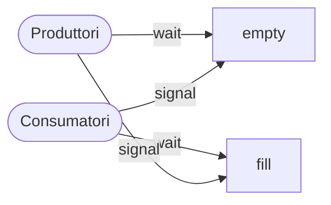

# Lezione 12 — Variabili condizionate, strutture dati concorrenti e semafori

La lezione si apre riprendendo il problema del **produttore-consumatore** lasciato in sospeso nella [[Lezione 11 - Implementazione dei lock e variabili condizionate#Il problema del produttore-consumatore|lezione precedente]]: la soluzione vista funziona con un produttore e un consumatore, ma con più thread succedono dei disastri, che portano a due regole fondamentali sull'uso delle variabili condizionate. Si passa poi alle **strutture dati concorrenti**, con l'esempio di un contatore che deve essere aggiornato da molti thread su molte CPU senza perdere il vantaggio del parallelismo. Infine si introducono i **semafori**, uno strumento più generale con cui si possono realizzare sia i mutex sia le variabili condizionate.

## Ripasso: mutex e variabili condizionate

Il problema della concorrenza è che più thread devono sincronizzarsi tra loro, per esempio per non entrare contemporaneamente nella stessa sezione critica. Per questo si usano i **mutex**: se due thread devono agire sulla stessa variabile, il mutex permette che solo uno dei due entri nella sezione critica. *Mutex* sta per *mutual exclusion*: è un lock, un semaforo di mutua esclusione.

Le **variabili condizionate** hanno uno scopo diverso: permettono di far aspettare un thread indefinitamente finché un altro thread non lo sblocca con una `signal`. Le due primitive sono la `wait`, che aspetta, e la `signal`, che risveglia.

Insieme alla variabile condizionata si usa sempre una **variabile di stato** aggiuntiva, controllata in un ciclo `while`. Nell'esempio della `join` emulata con una variabile condizionata, il thread principale crea il figlio e si mette in attesa; il figlio, quando ha terminato, chiama `thr_exit`, che manda la `signal` e sblocca il padre. Sembrerebbero bastare queste due funzioni, ma c'è anche la variabile `done` (il nome è arbitrario), che serve a due cose. Se arriva un segnale spurio, il padre si sveglia, vede che `done` non è stata messa a 1 da nessuno e torna a dormire. E soprattutto: non si sa se esegua prima il figlio o il padre. Se il figlio esegue per primo e manda subito la `signal`, il padre che poi va a dormire aspetterebbe per sempre, perché il segnale è già stato perso. Con `done`, il figlio la mette a 1 prima di segnalare, e il padre, quando esegue, la trova a 1 e non si mette proprio ad aspettare.

## Il produttore-consumatore con più thread

Il produttore-consumatore è uno schema di programmazione molto importante, perché molti sistemi multithread sono fatti così. Un thread produce uno o più dati e li mette in un **buffer**, un'area di memoria atta a contenerli: un solo dato, oppure una sequenza. Un altro thread li legge. L'accesso va protetto, ma va anche **sincronizzato**: altrimenti il consumatore potrebbe leggere sempre lo stesso dato, mentre si vuole che venga risvegliato solo quando c'è un dato nuovo.

L'esempio è un **server web**. Un thread attende le richieste di connessione dei client e, quando ne riceve una, la mette nel buffer; un altro thread la prende e la gestisce. Il produttore è uno solo, ma i consumatori sono tipicamente **molti**: con dieci richieste da dieci client, la prima la prende un primo thread consumatore, la seconda un secondo, e così via. È quindi interessante, e realistico, il caso con più consumatori.

### Il buffer da un solo dato

Si riparte dal buffer con spazio per **un solo dato**: finché nessuno lo prende, non si può scriverne un altro, altrimenti si cancella il precedente.

```c
int buffer;
int count = 0;   // inizialmente vuoto

void put(int value) {
    assert(count == 0);
    count = 1;
    buffer = value;
}

int get() {
    assert(count == 1);
    count = 0;
    return buffer;
}
```

La `put` verifica con la `assert` che `count` sia 0, cioè che il buffer sia vuoto; altrimenti stampa un errore e probabilmente il programma termina. Se c'è già qualcosa non si può sovrascriverlo, o lo si perde. Poi imposta `count` a 1 e mette il valore nel buffer. La `get` verifica che il buffer sia pieno, perché altrimenti restituirebbe spazzatura, mette `count` a 0 e restituisce il valore.

Il primo tentativo, senza sincronizzazione, non funziona:

```c
void *producer(void *arg) {
    int i;
    int loops = (int) arg;
    for (i = 0; i < loops; i++) {
        put(i);
    }
}

void *consumer(void *arg) {
    int i;
    while (1) {
        int tmp = get();
        printf("%d\n", tmp);
    }
}
```

Le due funzioni hanno proprio la forma delle funzioni da thread: restituiscono un `void *` e prendono un solo argomento di tipo `void *`, come richiede `pthread_create`. Il produttore fa un certo numero di cicli e a ogni ciclo chiama `put(i)`; il consumatore fa cicli infiniti, leggendo con `get`. Non c'è alcuna garanzia che facciano un'esecuzione a testa: anzi, quando parte il produttore, probabilmente scriverà il primo dato e poi toccherà ancora a lui, perché il suo quanto di tempo non è finito. La seconda volta trova `count` a 1, la `assert` fallisce: disastro.

### Una variabile condizionata e un `if`

La soluzione usa le variabili condizionate. Le etichette a destra (p1–p6, c1–c6) servono per fare riferimento alle singole righe: conviene ricordare che **p3 e c3 sono le `wait`** e **p5 e c5 sono le `signal`**.

```c
cond_t cond;
mutex_t mutex;

void *producer(void *arg) {
    int i;
    for (i = 0; i < loops; i++) {
        Pthread_mutex_lock(&mutex);            // p1
        if (count == 1)                        // p2
            Pthread_cond_wait(&cond, &mutex);  // p3
        put(i);                                // p4
        Pthread_cond_signal(&cond);            // p5
        Pthread_mutex_unlock(&mutex);          // p6
    }
}

void *consumer(void *arg) {
    int i;
    for (i = 0; i < loops; i++) {
        Pthread_mutex_lock(&mutex);            // c1
        if (count == 0)                        // c2
            Pthread_cond_wait(&cond, &mutex);  // c3
        int tmp = get();                       // c4
        Pthread_cond_signal(&cond);            // c5
        Pthread_mutex_unlock(&mutex);          // c6
        printf("%d\n", tmp);
    }
}
```

Il mutex sopra e sotto è sempre necessario, per proteggere la variabile condizionata stessa; anzi, il mutex preso va passato alla `wait`, che lo libererà quando il thread starà dormendo. Il produttore: se il buffer è già pieno (`count == 1`) attende; quando può, scrive e fa una `signal`. Il consumatore, con lo stesso principio: se non c'è niente da prendere (`count == 0`) attende; quando può, prende il dato e fa una `signal`. C'è **una sola variabile condizionata**, `cond`, su cui aspettano sia il produttore sia il consumatore, e su cui entrambi segnalano: si risvegliano a vicenda, e non può più succedere quanto visto prima, perché si risvegliano solo quando `count` ha il valore giusto.

Questo funziona, ma **solo con un produttore e un consumatore**.

### Che cosa va storto con più consumatori

Si considerino due consumatori, $T_{c1}$ e $T_{c2}$, e un produttore, $T_p$. Il professore sottolinea un punto molto importante: la sequenza che segue **non è detto che succeda**, ma **può succedere**, perché gli unici vincoli sulla sincronizzazione dei thread sono quelli messi esplicitamente. È una race condition: si può verificare oppure no, e se si verifica sono problemi.

| $T_{c1}$ | Stato | $T_{c2}$ | Stato | $T_p$ | Stato | count | Commento |
| -------- | ----- | -------- | ----- | ----- | ----- | ----- | -------- |
| c1 | Running | | Ready | | Ready | 0 | |
| c2 | Running | | Ready | | Ready | 0 | |
| c3 | Sleep | | Ready | | Ready | 0 | Niente da prendere |
| | Sleep | | Ready | p1 | Running | 0 | |
| | Sleep | | Ready | p2 | Running | 0 | |
| | Sleep | | Ready | p4 | Running | 1 | Buffer ora pieno |
| | Ready | | Ready | p5 | Running | 1 | $T_{c1}$ risvegliato |
| | Ready | | Ready | p6 | Running | 1 | |
| | Ready | | Ready | p1 | Running | 1 | |
| | Ready | | Ready | p2 | Running | 1 | |
| | Ready | | Ready | p3 | Sleep | 1 | Buffer pieno: dorme |
| | Ready | c1 | Running | | Sleep | 1 | $T_{c2}$ si infila… |
| | Ready | c2 | Running | | Sleep | 1 | |
| | Ready | c4 | Running | | Sleep | 0 | …e prende il dato |
| | Ready | c5 | Running | | Ready | 0 | $T_p$ risvegliato |
| | Ready | c6 | Running | | Ready | 0 | |
| c4 | Running | | Ready | | Ready | 0 | Il dato manca! |

Parte il consumatore $T_{c1}$: nulla lo impedisce. Esegue c1, c2 e c3: non c'è ancora niente, `count` è 0, e va a dormire. Potrebbero partire $T_{c2}$ o $T_p$; qui parte il produttore. Esegue p1 e p2, **non** p3 (la `wait` si fa solo se il buffer è pieno, e nessuno ha ancora scritto), poi p4, che scrive, e p5, la `signal` con cui dice "ho scritto, potete svegliarvi".

Chi riceve la `signal`? Non si sa: l'unica cosa certa è che viene risvegliato uno dei thread che hanno fatto la `wait`. Qui c'è un solo thread in attesa, $T_{c1}$, perché $T_{c2}$ non ha nemmeno mai eseguito. Quindi $T_{c1}$ viene svegliato.

> [!important] Risvegliato non significa in esecuzione
> Un thread risvegliato da una `signal` passa dallo stato bloccato allo stato **pronto**: **può** eseguire, ma non va subito in esecuzione. Il thread che ha mandato la `signal` continua a eseguire fino alla fine del suo quanto di tempo.

$T_p$ quindi continua: fa p6, torna all'inizio del ciclo, fa p1 e p2 e questa volta si mette a dormire (p3), perché `count` vale 1: c'è ancora un valore che nessuno ha preso, e il produttore non può scriverne un altro.

Chi parte adesso? Verrebbe da dire $T_{c1}$, ed è possibile; ma può partire anche $T_{c2}$, che è pronto, e anzi, in base a una logica di scheduling, visto che $T_{c1}$ ha già eseguito, verrebbe da pensare che tocchi a $T_{c2}$. Parte $T_{c2}$: c1, c2; non deve dormire, perché `count` è 1, quindi non fa c3; fa c4 (prende il dato), c5 (risveglia il produttore) e c6. Finalmente riprende $T_{c1}$, che era fermo alla `wait` e prosegue da lì, con c4: prova a prendere il dato, ma **il dato non c'è più**, gliel'ha preso $T_{c2}$.

### La semantica Mesa

Questo comportamento ha un nome.

> [!important] Semantica Mesa
> Secondo la **semantica Mesa** di `wait` e `signal`, quando un thread risvegliato va finalmente in esecuzione **non c'è alcuna garanzia** che lo stato del sistema sia ancora quello che c'era al momento della `signal`. Quasi tutti i sistemi funzionano così. Il nome deriva da **Mesa**, un linguaggio di programmazione storico sviluppato allo Xerox PARC.

La semantica è il significato: come la parola "sedia" è associata a qualcosa nel mondo reale su cui sedersi, così la semantica di `wait` e `signal` è il comportamento che ci si deve aspettare dai thread. Nel caso visto, quando il produttore ha mandato la `signal` `count` valeva 1, proprio perché aveva riempito il buffer; ma quando $T_{c1}$ va in esecuzione non è più vero, perché qualcun altro ha preso il dato.

L'alternativa sarebbe che un thread risvegliato eseguisse **subito**, ignorando il quanto di tempo di chi lo ha risvegliato. In quel caso si avrebbe una garanzia diversa, ma non è così che funzionano i sistemi.

> [!tip] Approfondimento — Semantica Hoare
> #approfondimento
> Le slide chiamano l'alternativa **semantica Hoare**, da C. A. R. Hoare (1974): garantisce che il thread risvegliato esegua immediatamente. OSTEP osserva che è più difficile da realizzare, ed è per questo che praticamente tutti i sistemi adottano la semantica Mesa. Il nome di quest'ultima viene dal lavoro di Lampson e Redell sul linguaggio Mesa, il primo a realizzare le variabili condizionate in questo modo [@arpacidusseau2023ostep, cap. 30].

### Il `while` al posto dell'`if`

Il problema nasce dal fatto che il controllo è un **`if`**: una volta superata la `wait`, il thread non torna a controllare `count`, anche se nel frattempo è cambiato. L'idea è allora che il thread, quando esce dalla `wait`, **ricontrolli** la condizione, e se è cambiata torni a dormire. Basta un `while` al posto dell'`if`:

```c
void *producer(void *arg) {
    int i;
    for (i = 0; i < loops; i++) {
        Pthread_mutex_lock(&mutex);            // p1
        while (count == 1)                     // p2
            Pthread_cond_wait(&cond, &mutex);  // p3
        put(i);                                // p4
        Pthread_cond_signal(&cond);            // p5
        Pthread_mutex_unlock(&mutex);          // p6
    }
}

void *consumer(void *arg) {
    int i;
    for (i = 0; i < loops; i++) {
        Pthread_mutex_lock(&mutex);            // c1
        while (count == 0)                     // c2
            Pthread_cond_wait(&cond, &mutex);  // c3
        int tmp = get();                       // c4
        Pthread_cond_signal(&cond);            // c5
        Pthread_mutex_unlock(&mutex);          // c6
        printf("%d\n", tmp);
    }
}
```

Nel caso di prima, $T_{c1}$, dopo la `wait`, rifà la verifica: si accorge che `count` è tornato a 0, perché l'altro thread si è preso il dato, e torna in attesa.

> [!important] Usare sempre `while`
> Una regola semplice da ricordare con le variabili condizionate è **usare sempre un ciclo `while`** attorno alla `wait`, mai un `if`.

### Anche con il `while` qualcosa non va

Sembra una buona soluzione, ma anche questa non funziona. Al professore interessa, al di là della soluzione, far vedere che la concorrenza è davvero un problema: non tutto ciò che sembra scontato lo è.

| $T_{c1}$ | Stato | $T_{c2}$ | Stato | $T_p$ | Stato | count | Commento |
| -------- | ----- | -------- | ----- | ----- | ----- | ----- | -------- |
| c1 | Running | | Ready | | Ready | 0 | |
| c2 | Running | | Ready | | Ready | 0 | |
| c3 | Sleep | | Ready | | Ready | 0 | Niente da prendere |
| | Sleep | c1 | Running | | Ready | 0 | |
| | Sleep | c2 | Running | | Ready | 0 | |
| | Sleep | c3 | Sleep | | Ready | 0 | Niente da prendere |
| | Sleep | | Sleep | p1 | Running | 0 | |
| | Sleep | | Sleep | p2 | Running | 0 | |
| | Sleep | | Sleep | p4 | Running | 1 | Buffer ora pieno |
| | Ready | | Sleep | p5 | Running | 1 | $T_{c1}$ risvegliato |
| | Ready | | Sleep | p6 | Running | 1 | |
| | Ready | | Sleep | p1 | Running | 1 | |
| | Ready | | Sleep | p2 | Running | 1 | |
| | Ready | | Sleep | p3 | Sleep | 1 | Deve dormire (pieno) |
| c2 | Running | | Sleep | | Sleep | 1 | Ricontrolla la condizione |
| c4 | Running | | Sleep | | Sleep | 0 | $T_{c1}$ prende il dato |
| c5 | Running | | Ready | | Sleep | 0 | Ops! Risveglia $T_{c2}$ |
| c6 | Running | | Ready | | Sleep | 0 | |
| c1 | Running | | Ready | | Sleep | 0 | |
| c2 | Running | | Ready | | Sleep | 0 | |
| c3 | Sleep | | Ready | | Sleep | 0 | Niente da prendere |
| | Sleep | c2 | Running | | Sleep | 0 | |
| | Sleep | c3 | Sleep | | Sleep | 0 | Tutti addormentati… |

Questa volta partono per primi i due consumatori: $T_{c1}$ e poi $T_{c2}$ fanno c1, c2, c3 e si addormentano, perché non c'è nessun dato. Ce ne sono due in attesa sulla stessa condizione. Arriva $T_p$: p1, p2, non fa p3 perché nessuno ha scritto prima di lui, poi p4 (scrive) e p5, la `signal`. Si immagini che svegli $T_{c1}$: è possibile. Poi p6, torna all'inizio, p1, p2, p3: il buffer è pieno e il produttore dorme.

Ora può eseguire $T_{c1}$, l'unico risvegliato. Ricontrolla la condizione (c2): il dato c'è, `count` vale 1, quindi non fa c3, prende il dato (c4) e fa c5. La c5 è la `signal` con cui il consumatore dice ai produttori "potete scriverne un altro". **Ma attenzione**: la variabile condizionata è **una sola**, e sia il produttore sia i consumatori aspettano e segnalano su quella. Niente impedisce che, invece del produttore, venga risvegliato **l'altro consumatore**, $T_{c2}$. Succede proprio questo.

$T_{c1}$ continua, perché il suo quanto non è finito: c6, poi c1, c2, c3. Il dato l'ha già preso, non ce ne sono più, e si mette in attesa. L'unico che può eseguire è $T_{c2}$, quello risvegliato per errore: fa c2 e c3, anche lui non trova dati e si rimette in attesa. **Sono tutti bloccati** sulla stessa variabile condizionata, e nessuno li risveglierà.

> [!important] Chi deve risvegliare chi
> Un consumatore non deve risvegliare altri consumatori, ma solo i produttori, e viceversa.

### Due variabili condizionate

La soluzione è abbastanza semplice: servono **due variabili condizionate diverse**, qui chiamate `empty` e `fill`.

```c
cond_t empty, fill;
mutex_t mutex;

void *producer(void *arg) {
    int i;
    for (i = 0; i < loops; i++) {
        Pthread_mutex_lock(&mutex);
        while (count == 1)
            Pthread_cond_wait(&empty, &mutex);
        put(i);
        Pthread_cond_signal(&fill);
        Pthread_mutex_unlock(&mutex);
    }
}

void *consumer(void *arg) {
    int i;
    for (i = 0; i < loops; i++) {
        Pthread_mutex_lock(&mutex);
        while (count == 0)
            Pthread_cond_wait(&fill, &mutex);
        int tmp = get();
        Pthread_cond_signal(&empty);
        Pthread_mutex_unlock(&mutex);
        printf("%d\n", tmp);
    }
}
```

I **produttori** aspettano su `empty`, cioè che il buffer sia vuoto, e segnalano `fill`. I **consumatori** aspettano su `fill`, cioè che il buffer sia pieno, e segnalano `empty`, quando l'hanno svuotato. Così non può più succedere che un consumatore risvegli un altro consumatore: un consumatore può risvegliare solo un produttore, e un produttore solo un consumatore.



### La soluzione finale: un buffer con più posizioni

Tutto ciò si estende a un buffer che non contiene un solo dato, il che è molto più ragionevole: si ottiene più concorrenza e più efficienza, perché produzione e consumo possono procedere senza alternarsi a ogni dato e i context switch diminuiscono.

```c
int buffer[MAX];
int fill = 0;
int use = 0;
int count = 0;

void put(int value) {
    buffer[fill] = value;
    fill = (fill + 1) % MAX;
    count++;
}

int get() {
    int tmp = buffer[use];
    use = (use + 1) % MAX;
    count--;
    return tmp;
}
```

Il buffer ha `MAX` posizioni ed è **circolare**. Ogni volta che si scrive, l'indice `fill` avanza di 1 e si calcola il resto della divisione per `MAX`, per farlo tornare a 0. Con `MAX = 5`, `fill` vale 0, 1, 2, 3, 4, poi $5 \bmod 5 = 0$, e di nuovo 0, 1, 2, 3, 4. In generale:

$$
\texttt{fill}_{\text{nuovo}} = (\texttt{fill} + 1) \bmod \texttt{MAX}
$$

`fill` tiene quindi conto della posizione in cui si sta per scrivere. `use` è un indice diverso, che dice qual è il **prossimo dato da leggere**: con un solo produttore che scrive in 0, 1, 2, 3, il consumatore non legge l'ultimo dato scritto, ma parte da `use = 0`, poi 1, e così via. `count`, infine, dice **quanti dati ci sono** nel buffer: aumenta a ogni `put` e diminuisce a ogni `get`. Serve per sapere quando segnalare al produttore che può scrivere, cioè quando c'è spazio libero, e al consumatore che può leggere, cioè quando ci sono nuovi dati.

```c
cond_t empty, fill;
mutex_t mutex;

void *producer(void *arg) {
    int i;
    for (i = 0; i < loops; i++) {
        Pthread_mutex_lock(&mutex);            // p1
        while (count == MAX)                   // p2
            Pthread_cond_wait(&empty, &mutex); // p3
        put(i);                                // p4
        Pthread_cond_signal(&fill);            // p5
        Pthread_mutex_unlock(&mutex);          // p6
    }
}

void *consumer(void *arg) {
    int i;
    for (i = 0; i < loops; i++) {
        Pthread_mutex_lock(&mutex);            // c1
        while (count == 0)                     // c2
            Pthread_cond_wait(&fill, &mutex);  // c3
        int tmp = get();                       // c4
        Pthread_cond_signal(&empty);           // c5
        Pthread_mutex_unlock(&mutex);          // c6
        printf("%d\n", tmp);
    }
}
```

È come prima. L'unica differenza è che il produttore va a dormire non quando `count` è 1, ma quando il buffer ha raggiunto il **massimo riempimento**, `count == MAX`: solo allora non può scrivere più niente. Il consumatore si blocca quando non c'è più niente da leggere, cioè quando `count`, che magari era cresciuto e poi è sceso, torna a 0. La condizione del consumatore è la stessa di prima, anche se il significato di `count` è un po' diverso.

### Che cosa insegna il produttore-consumatore

Il professore sottolinea che non si è visto un nuovo strumento: le variabili condizionate erano già note. Si è visto che **usarle bene richiede una grande cura**: programmare in modo corretto non è scontato come sembra, e i disastri sono sempre in agguato. Esistono però alcuni **pattern** di programmazione consolidati, come questo, per cui un programmatore semplicemente impara "si fa così". Quando dovrà affrontare problemi nuovi, saprà di dover ragionare sui pattern che conosce e cercare di applicarli il più possibile.

## Le covering conditions

L'ultima cosa sulle variabili condizionate riguarda la domanda: quale thread deve essere risvegliato? Si direbbe uno qualunque. A volte è vero, a volte no.

Si immagini di gestire una memoria, con 0 byte liberi.

- Il thread $T_a$ chiama `allocate(100)`, per allocare 100 byte. Non c'è memoria libera: che cosa ci si aspetta che succeda? Che aspetti, usando una variabile condizionata, che qualcuno liberi della memoria.
- Il thread $T_b$ chiama `allocate(10)`, e anche lui si mette in attesa sulla condizione.
- Il thread $T_c$ libera 50 byte.

Chi va risvegliato? Il professore chiede alla classe, e la risposta è $T_b$: risvegliare $T_a$ sarebbe una crudeltà, perché gli si direbbe "ce ne sono solo 50". Ma la `signal` risveglia un thread a caso tra quelli in attesa.

```c
// quanti byte dello heap sono liberi?
int bytesLeft = MAX_HEAP_SIZE;

// servono anche un lock e una condizione
cond_t c;
mutex_t m;

void *
allocate(int size) {
    Pthread_mutex_lock(&m);
    while (bytesLeft < size)
        Pthread_cond_wait(&c, &m);
    void *ptr = ...;               // prende la memoria dallo heap
    bytesLeft -= size;
    Pthread_mutex_unlock(&m);
    return ptr;
}

void free(void *ptr, int size) {
    Pthread_mutex_lock(&m);
    bytesLeft += size;
    Pthread_cond_signal(&c);       // chi segnalare??
    Pthread_mutex_unlock(&m);
}
```

La `allocate`, se i byte liberi sono meno di quelli richiesti, si mette in attesa sulla condizione; la `free` restituisce i byte e manda una `signal`. Questo è il problema, non la soluzione: la `signal` potrebbe risvegliare $T_a$, che ricontrolla, vede che 50 byte non gli bastano e torna a dormire, mentre $T_b$, che potrebbe proseguire, resta addormentato.

> [!important] Broadcast e covering condition
> La funzione `pthread_cond_broadcast` risveglia **tutti** i thread in attesa su una variabile condizionata. Ognuno, una volta sveglio, ricontrolla se ci sono le condizioni per proseguire; chi non le trova torna a dormire. Una condizione usata in questo modo, che "copre" tutti i casi in cui un thread potrebbe dover essere svegliato, si chiama **covering condition**.

La soluzione è quindi sostituire la `signal` della `free` con una `broadcast`. Qui va considerato anche il fatto che più di un thread potrebbe riuscire ad allocare memoria, mentre un altro no, e la cosa è ancora più complessa. Il punto importante è che esistono le due possibilità: risvegliarne **uno** senza sapere quale, oppure risvegliarli **tutti** e lasciare che ognuno verifichi le proprie condizioni. Le slide ricordano il costo: si rischia di svegliare troppi thread, che si sveglieranno, ricontrolleranno e torneranno a dormire.

> [!tip] Approfondimento — L'origine del termine
> #approfondimento
> Secondo le slide e OSTEP la soluzione con il broadcast è stata suggerita da **Lampson e Redell**, gli stessi del lavoro su Mesa, che hanno coniato il termine *covering condition*. OSTEP avverte che il broadcast può avere un impatto negativo sulle prestazioni, perché sveglia inutilmente molti thread che non dovrebbero (ancora) essere svegli [@arpacidusseau2023ostep, cap. 30].

## Strutture dati concorrenti

Prima di passare ai semafori, il professore affronta un tema che non richiede nuovi pezzi di codice C, ma è interessante. Le primitive di mutua esclusione sono fondamentali: dove una porzione di codice è critica non possono mancare, perché senza succede un disastro. Ci sono però situazioni in cui questi meccanismi procurano un danno tale che bisogna pensare a qualche altra soluzione.

> [!important] Struttura dati thread safe
> Aggiungere dei lock a una struttura dati la rende **thread safe**, cioè utilizzabile correttamente da più thread. **Come** i lock vengono aggiunti determina sia la correttezza sia le **prestazioni** della struttura.

### Molti thread su molte CPU

La situazione critica è quella con molti thread su **diverse CPU**. Se tanti thread sono sulla stessa CPU e si bloccano a vicenda, non si perde niente: o esegue uno o esegue l'altro, e se un thread è bloccato ce ne sarà un altro che riceve il processore. Ma con più thread su più CPU le cose cambiano. Si immagini il caso limite: quattro thread su quattro CPU, ognuno dei quali occupa la propria CPU al 100%, eseguendo tutti allegramente. Se devono sincronizzarsi con un meccanismo di mutua esclusione, questo non succede più: a un certo punto un thread deve aspettare, e se era l'unico su quella CPU, sulla CPU non succede nulla (magari qualche compito di servizio, ma non il programma). Il parallelismo per cui si hanno più CPU viene vanificato dai meccanismi di sincronizzazione.

### Il contatore concorrente

L'esempio è un **contatore** da incrementare.

```c
typedef struct __counter_t {
    int value;
} counter_t;

void init(counter_t *c) {
    c->value = 0;
}

void increment(counter_t *c) {
    c->value++;
}

void decrement(counter_t *c) {
    c->value--;
}

int get(counter_t *c) {
    return c->value;
}
```

Si crea un tipo apposito, uno `struct` con un unico campo intero `value`, il valore del contatore. `init` lo inizializza, `increment` lo incrementa, `decrement` lo decrementa e `get` ne restituisce il valore. Va bene se un solo thread chiama queste funzioni; con più thread, si sa già che non va.

La versione che permette a più thread di usare lo stesso contatore aggiunge un lock, preso e rilasciato in ogni funzione che manipola la struttura:

```c
typedef struct __counter_t {
    int value;
    pthread_mutex_t lock;
} counter_t;

void init(counter_t *c) {
    c->value = 0;
    Pthread_mutex_init(&c->lock, NULL);
}

void increment(counter_t *c) {
    Pthread_mutex_lock(&c->lock);
    c->value++;
    Pthread_mutex_unlock(&c->lock);
}

void decrement(counter_t *c) {
    Pthread_mutex_lock(&c->lock);
    c->value--;
    Pthread_mutex_unlock(&c->lock);
}

int get(counter_t *c) {
    Pthread_mutex_lock(&c->lock);
    int rc = c->value;
    Pthread_mutex_unlock(&c->lock);
    return rc;
}
```

> [!warning] Dettagli delle slide
> Nella slide il campo è dichiarato di tipo `pthread_lock_t`, che non esiste nella libreria: il tipo corretto è `pthread_mutex_t`, come in questa nota. Il professore fa inoltre notare che le funzioni con la **P maiuscola** (`Pthread_mutex_lock` e simili) non sono le funzioni della libreria, che hanno tutte la `p` minuscola, ma i **wrapper** usati nel libro consigliato su AulaWeb (e nelle dispense tratte da esso), che chiamano la funzione vera e ne controllano l'esito: non vanno confusi.

Con il lock le operazioni di incremento, decremento e lettura diventano atomiche, e il contatore funziona con più thread. Ma funzionare non vuol dire avere buone prestazioni.

### Il costo della sincronizzazione

Il grafico delle slide mostra un esperimento su un iMac con quattro CPU Intel i5 a 2,7 GHz: ogni thread, su una CPU diversa, incrementa il contatore condiviso **un milione di volte**, e si misura il tempo totale con 1, 2, 3 e 4 thread. Ogni thread, per ogni incremento, prende il mutex, incrementa e lo rilascia.

In teoria i thread lavorano in parallelo: che un solo thread incrementi un milione di volte, o che ciascuno di quattro thread lo faccia, il tempo dovrebbe essere lo stesso.

> [!important] Perfect scaling
> Si ha **scalabilità perfetta** (*perfect scaling*) quando, pur facendo più lavoro, lo si fa in parallelo, e quindi il tempo per completare il compito **non aumenta**.

Invece, con il contatore sincronizzato, il tempo **cresce** con il numero di thread: da quasi zero con un solo thread, arriva nell'ordine di diversi secondi. Il tempo speso per la sincronizzazione è così significativo da annullare il vantaggio delle quattro CPU. Le slide lo dicono in una riga: il contatore sincronizzato **scala male**.

### Lo sloppy counter

Nello stesso grafico c'è una seconda serie, quella di un contatore diverso: con questo, il tempo resta irrisorio con un thread e resta irrisorio con due, tre, quattro thread. È quello che si vorrebbe. Il professore chiede alla classe come potrebbe essere fatto, ricordando che si chiama *sloppy counter* (contatore approssimativo, "un po' raffazzonato"). Il problema è che tutti aumentano un unico contatore condiviso, e tutti perdono tempo ad aspettare che gli altri escano dalla sezione critica.

> [!important] Sloppy counter
> Uno **sloppy counter** rappresenta un unico contatore logico con:
> - un **contatore locale** per ogni CPU, protetto da un proprio lock;
> - un **contatore globale**, protetto da un lock globale.
>
> Con quattro CPU ci sono quindi cinque contatori (quattro locali e uno globale) e cinque mutex. Un thread incrementa **solo il contatore locale** della propria CPU; quando il contatore locale raggiunge una **soglia** $S$, il suo valore viene trasferito nel contatore globale (prendendo il lock globale) e il contatore locale viene azzerato.

Il contatore globale è quello che interessa davvero: alla fine dell'esperimento, con quattro thread, dovrà valere quattro milioni. I thread su CPU diverse aggiornano contatori locali diversi, **senza contesa**, e per questo gli aggiornamenti scalano. Il lock locale serve solo se sulla stessa CPU ci sono più thread (nell'esempio, con un thread per CPU, potrebbe non servire nemmeno); il lock globale verrà certamente conteso, ma solo con una frequenza molto bassa, quando bisogna trasferire un valore.

Non è la stessa cosa di avere un contatore preciso. Se la soglia fosse 1, a ogni incremento il valore verrebbe trasferito nel contatore globale: sarebbe precisissimo, ma non si guadagnerebbe niente. Con una soglia alta, per esempio 1024 come nell'esperimento, si guadagna molto, perché quasi tutti gli aggiornamenti non richiedono di aspettare nulla; ma la differenza tra il contatore globale e il valore vero può arrivare fino a 1024 per ogni CPU. È un errore temporaneo, perché prima o poi il valore giusto viene raggiunto, ma in ogni istante il contatore globale non è preciso.

> [!important] Sloppiness
> La soglia $S$ si chiama **sloppiness** (letteralmente "trascuratezza"); la lettera viene da questa parola e non da "soglia", che in inglese è *threshold*.
> - Con $S$ **piccola** il contatore si comporta come quello non scalabile: preciso ma lento.
> - Con $S$ **grande** il contatore è più scalabile, ma il valore globale può essere più lontano dal conteggio reale.

### Una traccia dello sloppy counter

Le slide mostrano una traccia con soglia $S = 5$ e un thread su ciascuna di quattro CPU. Ogni riga è un istante in cui almeno un contatore locale viene incrementato: gli incrementi avvengono in parallelo, e ciò che succede a ciascuno dipende da lui.

| Tempo | $L_1$ | $L_2$ | $L_3$ | $L_4$ | $G$ |
| ----- | ----- | ----- | ----- | ----- | --- |
| 0 | 0 | 0 | 0 | 0 | 0 |
| 1 | 0 | 0 | 1 | 1 | 0 |
| 2 | 1 | 0 | 2 | 1 | 0 |
| 3 | 2 | 0 | 3 | 1 | 0 |
| 4 | 3 | 0 | 3 | 2 | 0 |
| 5 | 4 | 1 | 3 | 3 | 0 |
| 6 | 5 → 0 | 1 | 3 | 4 | 5 (da $L_1$) |
| 7 | 0 | 2 | 4 | 5 → 0 | 10 (da $L_4$) |

All'istante 6, $L_1$ passa da 4 a 5, raggiunge la soglia, viene azzerato e il contatore globale diventa 5. C'è chiaramente un errore: se si guardasse il valore vero del contatore, cioè quello che si avrebbe se tutti incrementassero un unico contatore, all'istante 6 sarebbe $5 + 1 + 3 + 4 = 13$, ma il contatore globale registra 5. Il grafico confronta il valore globale con il conteggio reale (somma di globale e locali), ricavato dalla tabella.

```chart
type: line
labels: [t0, t1, t2, t3, t4, t5, t6, t7]
series:
  - title: Contatore globale G
    data: [0, 0, 0, 0, 0, 0, 5, 10]
  - title: Conteggio reale (G + L1 + L2 + L3 + L4)
    data: [0, 2, 4, 6, 8, 11, 13, 16]
tension: 0
width: 80%
labelColors: false
fill: false
beginAtZero: true
```

Un secondo grafico delle slide mostra, sempre con quattro thread che incrementano un milione di volte ciascuno, il tempo impiegato al variare di $S$: con $S$ bassa le prestazioni sono pessime, ma il conteggio globale è sempre piuttosto accurato; con $S$ alta (fino a 1024) le prestazioni sono eccellenti, ma il conteggio globale è in ritardo.

### L'implementazione

Il professore non entra nei dettagli del codice, ma fa notare com'è diventata la struttura del contatore:

```c
typedef struct __counter_t {
    int global;                      // contatore globale
    pthread_mutex_t glock;           // lock globale
    int local[NUMCPUS];              // contatori locali (uno per CPU)
    pthread_mutex_t llock[NUMCPUS];  // ...e i loro lock
    int threshold;                   // frequenza di aggiornamento
} counter_t;

// init: registra la soglia, inizializza i lock e i valori
//       di tutti i contatori locali e di quello globale
void init(counter_t *c, int threshold) {
    c->threshold = threshold;

    c->global = 0;
    pthread_mutex_init(&c->glock, NULL);

    int i;
    for (i = 0; i < NUMCPUS; i++) {
        c->local[i] = 0;
        pthread_mutex_init(&c->llock[i], NULL);
    }
}

// update: di solito prende solo il lock locale e aggiorna il valore locale;
//         quando il contatore locale ha raggiunto la soglia, prende il lock
//         globale e vi trasferisce il valore locale
void update(counter_t *c, int threadID, int amt) {
    pthread_mutex_lock(&c->llock[threadID]);
    c->local[threadID] += amt;                  // assume amt > 0
    if (c->local[threadID] >= c->threshold) {   // trasferisce al globale
        pthread_mutex_lock(&c->glock);
        c->global += c->local[threadID];
        pthread_mutex_unlock(&c->glock);
        c->local[threadID] = 0;
    }
    pthread_mutex_unlock(&c->llock[threadID]);
}

// get: restituisce solo il valore globale (che può non essere esatto)
int get(counter_t *c) {
    pthread_mutex_lock(&c->glock);
    int val = c->global;
    pthread_mutex_unlock(&c->glock);
    return val;   // solo approssimato!
}
```

Ci sono il contatore globale `global` con il suo mutex `glock`, un array di contatori locali, uno per CPU, e un array di mutex locali della stessa dimensione, più la soglia. Quando un thread aggiorna il contatore, prende il mutex del contatore locale corrispondente (lo rilascia alla fine), aumenta il contatore locale di una quantità `amt` qualunque, non necessariamente 1; se il contatore locale ha raggiunto la soglia, prende anche il mutex globale, incrementa il contatore globale, rilascia il mutex globale e azzera il contatore locale. Nel codice delle slide l'indice del contatore locale è chiamato `threadID`, perché nell'esempio c'è un thread per CPU.

> [!tip] Approfondimento — Contatori approssimati e Linux
> #approfondimento
> OSTEP collega il problema dei contatori scalabili a uno studio di **Boyd-Wickizer e altri** (2010), secondo cui alcuni carichi di lavoro eseguiti su Linux soffrono di seri problemi di scalabilità sulle macchine multicore; lo stesso lavoro descrive un contatore approssimato di questo tipo [@arpacidusseau2023ostep, cap. 29].

Le slide sulle **liste concorrenti** vengono rimandate alla [[Lezione 13 - Semafori, problemi classici, liste e code concorrenti#Liste concorrenti|lezione successiva]].

## I semafori

Dopo mutex, variabili condizionate, problemi e pattern interessanti, si passa al concetto più generale di **semaforo**, che non è più vincolato a essere binario. Il professore lo dice subito, per evitare fraintendimenti: con questa struttura si può fare **sia** ciò che si è visto con i mutex, **sia** ciò che si è visto con le variabili condizionate.

Perché allora esistono anche le altre? Perché così funzionano le cose create dall'uomo. Qualcuno ha creato i semafori per un certo sistema; qualcun altro, quando ha introdotto i thread, ha inventato mutex e variabili condizionate. Non c'è stato un grande architetto che ha deciso "questo sì, questo no": le cose sono nate così e coesistono, come succede in tanti campi della programmazione. Magari un giorno qualcuno dirà che le variabili condizionate sono deprecate e si useranno solo i semafori; per ora non è così.

### Definizione

> [!important] Semaforo
> Un **semaforo** è un oggetto con un **valore intero**, che può essere inizializzato e manipolato con due funzioni, `sem_wait` e `sem_post`.

```c
#include <semaphore.h>

sem_t s;
sem_init(&s, 0, 1);   // inizializza s al valore 1
```

`sem_init` inizializza il semaforo al valore indicato dal terzo argomento, qui 1. Il **secondo argomento**, 0, indica che il semaforo è condiviso tra i thread **dello stesso processo**. Inizializzando il semaforo a 1 si è creato di fatto un semaforo binario, ma non è più un vincolo: con i mutex il valore era 1 e basta, qui si decide come inizializzarlo.

Il comportamento delle due funzioni è semplice ma preciso, e va compreso nel modo corretto.

```pseudo
int sem_wait(sem_t *s) {
    decrementa di uno il valore del semaforo s
    attendi se il valore del semaforo s è negativo
}

int sem_post(sem_t *s) {
    incrementa di uno il valore del semaforo s
    se ci sono uno o più thread in attesa, svegliane uno
}
```

> [!important] sem_wait e sem_post
> - **`sem_wait`** decrementa **sempre** di 1 il valore del semaforo: se è 0 diventa −1, se è −1 diventa −2. Poi, se il valore è **negativo**, blocca il thread chiamante. Se il valore era 1 o più al momento della chiamata, ritorna subito.
> - **`sem_post`** incrementa di 1 il valore del semaforo e, se c'è un thread in attesa, ne risveglia uno.
>
> Quando è negativo, il **valore assoluto** del semaforo è uguale al **numero di thread in attesa**.

Con il semaforo inizializzato a 1, il primo thread che chiama `sem_wait` lo decrementa a 0 e non si blocca, perché 0 va bene. Se un altro chiama `sem_wait`, il semaforo va a −1 e il thread viene sospeso. Il successivo trova −1, decrementa a −2 e viene sospeso: −2 vuol dire due thread sospesi.

### Nessun proprietario

> [!important] Semafori e mutex
> Una differenza fondamentale, che rende i semafori più generali, è che un semaforo **non ha un proprietario**. Un mutex sì: chi chiama la `lock` deve essere anche chi chiama la `unlock`, sempre nello stesso thread. Con un semaforo le due operazioni sono **indipendenti**: un thread può chiamare `sem_post` senza aver mai chiamato `sem_wait`.

È proprio questo che permette di costruire con i semafori l'equivalente delle variabili condizionate. Si inizializzi il semaforo a 0: il primo thread che chiama `sem_wait` lo porta a −1 e si sospende; un **altro** thread, che non ha fatto alcuna `wait`, può chiamare `sem_post` e svegliarlo. È come con le variabili condizionate, dove chi fa la `signal` non deve aver aspettato.

> [!tip] Approfondimento — Sbloccare un mutex altrui
> #approfondimento
> Lo standard POSIX precisa che cosa succede se un thread prova a sbloccare un mutex che non ha bloccato: per i mutex di tipo *error-checking* la funzione restituisce un errore (`EPERM`); per i mutex di tipo predefinito o *normal* il comportamento è **indefinito** [@posixpthreadmutextrylock]. Con un semaforo, invece, una `sem_post` da parte di un thread qualsiasi è un uso del tutto normale.

> [!tip] Approfondimento — Il valore negativo e l'implementazione di Linux
> #approfondimento
> La definizione delle slide, in cui il valore negativo conta i thread in attesa, è quella originale di Dijkstra. La pagina di manuale di `sem_wait` su Linux descrive invece un comportamento in cui il valore **non scende mai sotto zero**: se il valore è maggiore di zero il decremento avviene e la funzione ritorna subito; se è zero, la chiamata si blocca finché il decremento non diventa possibile [@linuxman3semwait]. Per chi usa il semaforo il risultato è lo stesso; cambia solo il modo di rappresentare lo stato. Le slide stesse lo ricordano a proposito della realizzazione dei semafori, vista nella [[Lezione 13 - Semafori, problemi classici, liste e code concorrenti#Come si implementa un semaforo|lezione successiva]].

### Il semaforo binario come lock

Per usare il semaforo come un mutex basta questo:

```c
sem_t m;
sem_init(&m, 0, X);   // inizializza il semaforo a X: quanto deve valere X?

sem_wait(&m);
// sezione critica
sem_post(&m);
```

Il valore iniziale `X` deve essere **1**. Lo si usa per proteggere la sezione critica esattamente come si faceva con `pthread_mutex_lock` e `pthread_mutex_unlock`: il primo che entra porta il semaforo a 0 e prosegue; se un altro prova a entrare, il semaforo va a −1 e quello resta bloccato.

Con un solo thread la traccia è banale: il valore passa da 1 a 0 alla `sem_wait`, che ritorna subito; dopo la sezione critica la `sem_post` lo riporta a 1. Più interessante è la traccia con **due thread**:

| Valore | Thread 0 | Stato | Thread 1 | Stato |
| ------ | -------- | ----- | -------- | ----- |
| 1 | | Running | | Ready |
| 1 | chiama `sem_wait()` | Running | | Ready |
| 0 | `sem_wait()` ritorna | Running | | Ready |
| 0 | (inizio sezione critica) | Running | | Ready |
| 0 | interrupt; passa a T1 | Ready | | Running |
| 0 | | Ready | chiama `sem_wait()` | Running |
| −1 | | Ready | decrementa il semaforo | Running |
| −1 | | Ready | (sem < 0) → dorme | Sleeping |
| −1 | | Running | passa a T0 | Sleeping |
| −1 | (fine sezione critica) | Running | | Sleeping |
| −1 | chiama `sem_post()` | Running | | Sleeping |
| 0 | incrementa il semaforo | Running | | Sleeping |
| 0 | risveglia T1 | Running | | Ready |
| 0 | `sem_post()` ritorna | Running | | Ready |
| 0 | interrupt; passa a T1 | Ready | | Running |
| 0 | | Ready | `sem_wait()` ritorna | Running |
| 0 | | Ready | (sezione critica) | Running |
| 0 | | Ready | chiama `sem_post()` | Running |
| 1 | | Ready | `sem_post()` ritorna | Running |

Non si sa chi parte per primo; qui parte il thread 0. Il valore iniziale è 1; T0 chiama `sem_wait`, il valore diventa 0 e la `sem_wait` ritorna subito, nessuno viene bloccato. T0 è nella sezione critica quando arriva l'interrupt: il suo quanto è finito e c'è un context switch verso T1. T1 chiama `sem_wait`, il semaforo diventa −1, e poiché è negativo T1 non ritorna: viene messo a dormire. Lo stato di T1 diventa immediatamente bloccato, senza nemmeno finire il quanto (è il motivo per cui esiste lo stato di attesa), e si torna a T0. T0 finisce la sezione critica e chiama `sem_post`: il semaforo torna a 0 e T1 viene risvegliato. Ma risvegliato non vuol dire in esecuzione: T1 eseguirà quando sarà terminato il quanto di T0. Quando arriva il suo turno, T1, che era rimasto dentro la `sem_wait`, ne esce, esegue la sezione critica e chiama `sem_post`: il valore torna a 1. Il valore finale è uguale a quello iniziale, il che fa pensare che tutto sia andato correttamente.

### Il semaforo come variabile condizionata

Il semaforo può essere usato anche come una variabile condizionata, proprio perché non ha un proprietario: chiunque può chiamare `wait` e `post`, purché possa accedere alla struttura semaforo, e nel caso dei thread questo è sempre vero. Si riprende l'esempio ormai visto in diversi modi (con la `join`, con la variabile condizionata): il genitore crea un figlio con `pthread_create` e si mette in attesa che termini; il figlio fa quello che deve, termina e risveglia il genitore.

```c
sem_t s;

void *
child(void *arg) {
    printf("child\n");
    sem_post(&s);   // segnala qui: il figlio ha finito
    return NULL;
}

int
main(int argc, char *argv[]) {
    sem_init(&s, 0, X);   // quanto deve valere X?
    printf("parent: begin\n");
    pthread_t c;
    pthread_create(&c, NULL, child, NULL);
    sem_wait(&s);         // attende qui il figlio
    printf("parent: end\n");
    return 0;
}
```

Come va inizializzato il semaforo? Non come prima. Nella sezione critica si voleva che il primo `sem_wait` entrasse subito; qui si vuole che il genitore, alla prima `sem_wait`, **si blocchi**. Basta inizializzare il semaforo a **0**: la prima `sem_wait` lo porta a −1 e il genitore dorme. Il figlio, già creato, fa le sue operazioni e chiama `sem_post`: il semaforo torna a 0 e il genitore, l'unico in attesa, viene risvegliato e può finire.

Le slide mostrano i due casi possibili. Nel **primo**, il genitore chiama `sem_wait` prima che il figlio abbia chiamato `sem_post`:

| Valore | Genitore | Stato | Figlio | Stato |
| ------ | -------- | ----- | ------ | ----- |
| 0 | crea il figlio | Running | (il figlio esiste ed è eseguibile) | Ready |
| 0 | chiama `sem_wait()` | Running | | Ready |
| −1 | decrementa il semaforo | Running | | Ready |
| −1 | (sem < 0) → dorme | Sleeping | | Ready |
| −1 | passa al figlio | Sleeping | il figlio esegue | Running |
| −1 | | Sleeping | chiama `sem_post()` | Running |
| 0 | | Sleeping | incrementa il semaforo | Running |
| 0 | | Ready | risveglia il genitore | Running |
| 0 | | Ready | `sem_post()` ritorna | Running |
| 0 | | Ready | interrupt; passa al genitore | Ready |
| 0 | `sem_wait()` ritorna | Running | | Ready |

Nel **secondo**, il figlio esegue fino in fondo prima che il genitore chiami `sem_wait`:

| Valore | Genitore | Stato | Figlio | Stato |
| ------ | -------- | ----- | ------ | ----- |
| 0 | crea il figlio | Running | (il figlio esiste ed è eseguibile) | Ready |
| 0 | interrupt; passa al figlio | Ready | il figlio esegue | Running |
| 0 | | Ready | chiama `sem_post()` | Running |
| 1 | | Ready | incrementa il semaforo | Running |
| 1 | | Ready | risveglia (nessuno) | Running |
| 1 | | Ready | `sem_post()` ritorna | Running |
| 1 | il genitore esegue | Running | interrupt; passa al genitore | Ready |
| 1 | chiama `sem_wait()` | Running | | Ready |
| 0 | decrementa il semaforo | Running | | Ready |
| 0 | (sem ≥ 0) → resta sveglio | Running | | Ready |
| 0 | `sem_wait()` ritorna | Running | | Ready |

Il secondo caso mostra un vantaggio rispetto alla variabile condizionata usata da sola: il semaforo **ricorda** la `sem_post`. Il figlio la fa quando nessuno è in attesa, il valore sale a 1, e quando il genitore chiama `sem_wait` lo trova a 1, lo decrementa e non si blocca. Il segnale non va perso, senza bisogno di una variabile di stato aggiuntiva come `done`. Con la stessa struttura, il semaforo, si sono realizzati sia la sezione critica sia la variabile condizionata.

## Il produttore-consumatore con i semafori

Si può rifare il produttore-consumatore con i semafori? Certo; lo si era fatto con variabili condizionate e mutex, ma con i semafori si possono fare entrambe le cose.

```c
int buffer[MAX];
int fill = 0;
int use = 0;

void put(int value) {
    buffer[fill] = value;      // riga f1
    fill = (fill + 1) % MAX;   // riga f2
}

int get() {
    int tmp = buffer[use];     // riga g1
    use = (use + 1) % MAX;     // riga g2
    return tmp;
}
```

`put` e `get` sono quelle di prima, con il buffer circolare di `MAX` posizioni. Non c'è `count`: serviva per l'attesa con la variabile condizionata, qui non serve.

### Primo tentativo: i semafori full e empty

Il concetto è lo stesso della soluzione con le variabili condizionate. Nell'ultimo tentativo, quello funzionante, per evitare che tutti finissero a dormire servivano **due** variabili condizionate, una per sospendere il produttore quando il buffer è pieno e una per sospendere il consumatore quando è vuoto. Qui vale lo stesso: con un solo semaforo ci si ritroverebbe nello stesso disastro. Il professore lo indica come un punto concettuale importante.

```c
sem_t empty;
sem_t full;

void *producer(void *arg) {
    int i;
    for (i = 0; i < loops; i++) {
        sem_wait(&empty);   // riga P1
        put(i);             // riga P2
        sem_post(&full);    // riga P3
    }
}

void *consumer(void *arg) {
    int i, tmp = 0;
    while (tmp != -1) {
        sem_wait(&full);    // riga C1
        tmp = get();        // riga C2
        sem_post(&empty);   // riga C3
        printf("%d\n", tmp);
    }
}

int main(int argc, char *argv[]) {
    // ...
    sem_init(&empty, 0, MAX);   // all'inizio ci sono MAX posizioni vuote...
    sem_init(&full, 0, 0);      // ...e 0 piene
    // ...
}
```

Il produttore fa `sem_wait` su `empty` e, quando ha scritto, `sem_post` su `full`. Il consumatore fa il contrario: `sem_wait` su `full`, e dopo aver letto `sem_post` su `empty`. Il ciclo del consumatore va avanti finché qualcuno non mette `tmp` a −1.

Il punto interessante è l'inizializzazione. `empty` vale `MAX`: il produttore può chiamare `sem_wait(&empty)` `MAX` volte prima di bloccarsi. Con `MAX = 3`, `empty` passa a 2, poi a 1, poi a 0, e alla quarta volta il produttore si blocca: ci sono tre posizioni nel buffer, e dopo averle riempite qualcuno deve svuotarlo, altrimenti si perderebbero dei dati. `full` invece vale 0: all'inizio non c'è niente, e ogni scrittura lo incrementa. Il consumatore, se `full` è 0, si blocca; se il produttore ha scritto tre volte, il consumatore può eseguire tre volte prima di bloccarsi. Man mano che consuma, decrementa `full` e incrementa `empty`.

> [!important] Il semaforo come contatore di risorse
> Nei semafori `empty` e `full` si mette ciò che prima faceva "a mano" il contatore `count`: `empty` conta le posizioni libere, `full` quelle occupate. Inizializzare un semaforo a $N$ significa disporre di $N$ risorse, che possono essere prese $N$ volte prima che qualcuno si blocchi.

### Che cosa manca: la mutua esclusione

Va bene? No: il meccanismo per svegliare e addormentare funziona, ma **non si sta proteggendo la sezione critica**. Usando il semaforo come variabile condizionata, si è dimenticato di usarlo anche come mutex. Con `MAX` maggiore di 1 e più produttori, due produttori possono chiamare la `put` in modo infelice: il primo esegue `buffer[fill] = value` (riga f1) e, prima che possa incrementare `fill`, c'è un context switch perché il suo quanto è finito; il secondo produttore esegue anch'esso `buffer[fill] = value` e **sovrascrive la stessa casella** del buffer. Riempire la posizione e incrementare l'indice è una sezione critica: queste due operazioni, almeno, devono essere atomiche.

### Aggiungere un mutex

Come proteggere la sezione critica? Con un **terzo semaforo**, chiamato `mutex` perché lo si vuole usare proprio come un mutex, e quindi inizializzato a 1. Lo si mette attorno a tutto il corpo del ciclo, sia nel produttore sia nel consumatore:

```c
sem_t empty;
sem_t full;
sem_t mutex;

void *producer(void *arg) {
    int i;
    for (i = 0; i < loops; i++) {
        sem_wait(&mutex);   // riga p0 (NUOVA)
        sem_wait(&empty);   // riga p1
        put(i);             // riga p2
        sem_post(&full);    // riga p3
        sem_post(&mutex);   // riga p4 (NUOVA)
    }
}

void *consumer(void *arg) {
    int i;
    for (i = 0; i < loops; i++) {
        sem_wait(&mutex);   // riga c0 (NUOVA)
        sem_wait(&full);    // riga c1
        int tmp = get();    // riga c2
        sem_post(&empty);   // riga c3
        sem_post(&mutex);   // riga c4 (NUOVA)
        printf("%d\n", tmp);
    }
}
```

Il professore chiede se è corretto, facendo notare che se lo si chiede è facile sospettare che la risposta sia no. Per mancanza di tempo lascia la domanda in sospeso per la lezione successiva: la risposta è nella [[Lezione 13 - Semafori, problemi classici, liste e code concorrenti#Il mutex nel posto sbagliato|Lezione 13]].

> [!tip] Schema consigliato
> In questo punto sarebbe utile uno schema disegnato a mano (per esempio con Excalidraw) del buffer circolare con `MAX = 5`: un anello di cinque caselle, l'indice `fill` del produttore e l'indice `use` del consumatore come due frecce che ruotano nello stesso verso, e accanto i valori dei semafori `empty` e `full` (che sommati danno sempre `MAX`) in tre istanti: buffer vuoto, buffer parzialmente pieno, buffer pieno.

## Indicazioni pratiche

- Su AulaWeb sono stati pubblicati **nuovi esercizi**, con scadenza la settimana successiva. Come al solito, eventuali problemi o errori del programma vanno segnalati al professore.
