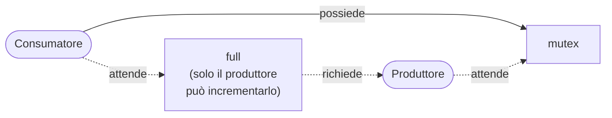
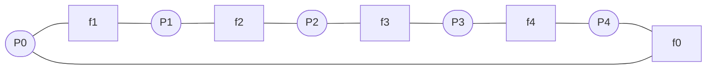
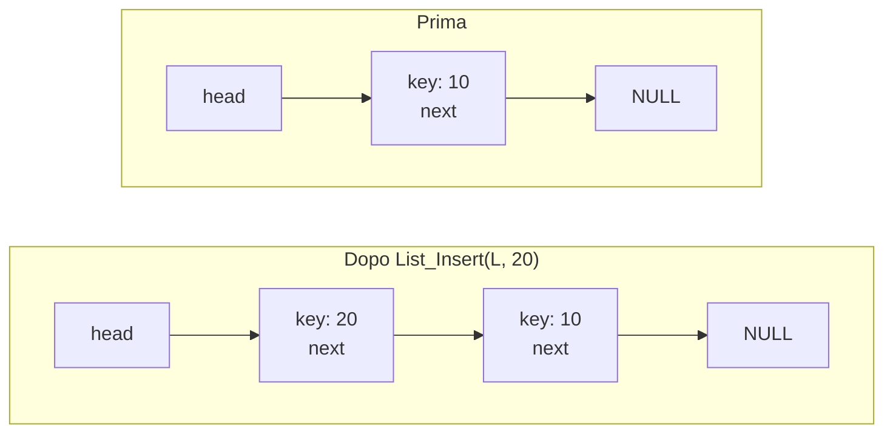
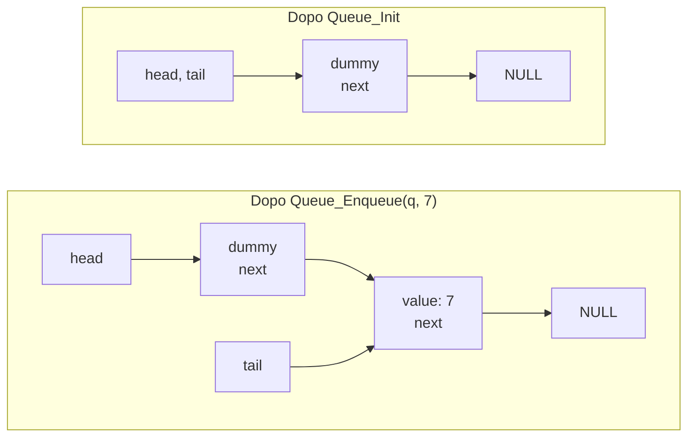

# Lezione 13 — Semafori, problemi classici, liste e code concorrenti

La lezione chiude il discorso sui **semafori** risolvendo la domanda lasciata aperta nella [[Lezione 12 - Variabili condizionate, strutture dati concorrenti e semafori#Aggiungere un mutex|lezione precedente]]: dove va messo il mutex nel produttore-consumatore. Poi presenta due problemi classici della concorrenza, i **reader-writer lock** e il **problema dei filosofi a cena**, che non introducono strumenti nuovi ma sono schemi di ragionamento da riconoscere e adattare. L'ultima parte torna alle strutture dati concorrenti, con le **liste** e le **code**: dove mettere i lock perché siano corretti, poco soggetti a errori e il più possibile concorrenti.

## Ripasso: variabili condizionate e semafori

Con una variabile condizionata, un thread si blocca chiamando la `wait` e un altro lo risveglia chiamando la `signal`; ma la relazione non è simmetrica: soltanto uno dei due si blocca, l'altro su quella variabile manda soltanto il segnale. Il **semaforo** in senso stretto, invece, può essere usato sia per realizzare un mutex sia per realizzare una condizione. Come si è detto, il sistema dei thread non è stato progettato da una mente superiore che ha deciso le sorti dell'universo: si è sviluppato per vie diverse, sistemi diversi hanno proposto soluzioni diverse, e ora convivono. I semafori hanno però il pregio di permettere l'una e l'altra cosa.

Il problema rimasto aperto è il produttore-consumatore con un buffer di `MAX` posizioni. Gli indici `fill` e `use` indicano rispettivamente la prossima posizione da riempire, per chi scrive, e la prossima da leggere, per chi legge. La `put` scrive il valore in `buffer[fill]` e incrementa `fill` in modo circolare: aumenta di 1 e calcola il resto della divisione per `MAX`, quindi `fill` vale 0, 1, 2, …, `MAX − 1` e poi torna a 0. La `get` legge l'elemento di indice `use` e incrementa `use` nello stesso modo. Sono funzioni accessorie: lì dentro non ci sono semafori.

Con le variabili condizionate era costato un po' di fatica capire che servono **due** variabili diverse, una per segnalare quando il buffer è pieno e una per quando è vuoto. Con i semafori si fa in modo simile, con due semafori, `empty` e `full`. `empty` è inizializzato a `MAX`, perché all'inizio le posizioni libere sono proprio `MAX`: ogni volta che se ne riempie una si chiama il semaforo e lo si decrementa di 1, finché arriva a 0 e nessuno può più scrivere. `full` parte da 0 e aumenta a ogni riempimento.

Il **produttore** chiama prima `sem_wait(&empty)`. Ricordando la semantica del semaforo, `sem_wait` decrementa di 1 il valore e, se il risultato è negativo, sospende il chiamante: all'inizio `empty` vale `MAX`, diventa `MAX − 1`, non è negativo, e il produttore prosegue, mette un dato nel buffer e chiama `sem_post(&full)`, che incrementa `full`. Se il produttore venisse chiamato `MAX` volte senza che nessuno consumi niente, alla fine `empty` varrebbe 0 e `full` varrebbe `MAX`. Il **consumatore** fa l'opposto: `sem_wait(&full)` (se `full` è 0 non può prendere niente, e funziona solo se `full` è maggiore di 0, qualunque sia il valore), poi prende il valore e chiama `sem_post(&empty)`, aumentando il semaforo che conta le posizioni vuote.

Ma serve anche la **mutua esclusione**: i semafori `empty` e `full` servono solo a segnalare quando il buffer è pieno e quando è vuoto, cioè sono usati come variabili condizionate. Nulla garantisce che quello che avviene dentro la `put` e la `get` sia atomico: un thread scrive `buffer[fill] = value`, non ha ancora spostato l'indice, avviene una preemption, e un altro thread riscrive nella stessa posizione. Ci vuole un meccanismo che renda atomica questa sezione.

## Il mutex nel posto sbagliato

La soluzione più immediata è aggiungere un terzo semaforo, chiamato `mutex`, e metterlo attorno a tutto il corpo del ciclo, sia nel produttore sia nel consumatore. Si sta facendo tutto con i semafori.

```c
void *producer(void *arg) {
    int i;
    for (i = 0; i < loops; i++) {
        sem_wait(&mutex);   // riga p0 (NUOVA)
        sem_wait(&empty);   // riga p1
        put(i);             // riga p2
        sem_post(&full);    // riga p3
        sem_post(&mutex);   // riga p4 (NUOVA)
    }
}

void *consumer(void *arg) {
    int i;
    for (i = 0; i < loops; i++) {
        sem_wait(&mutex);   // riga c0 (NUOVA)
        sem_wait(&full);    // riga c1
        int tmp = get();    // riga c2
        sem_post(&empty);   // riga c3
        sem_post(&mutex);   // riga c4 (NUOVA)
        printf("%d\n", tmp);
    }
}
```

Prima domanda: a quanto si inizializza `mutex`? Dall'aula arriva la risposta giusta, **1**: un semaforo di mutua esclusione si inizializza sempre a 1, così che il primo possa fare `wait` e nessun altro possa farla finché qualcuno non fa `post`.

Il professore precisa una sottigliezza: per quanto simile, il semaforo usato così non è identico a un mutex vero. Il comportamento è semplicemente quello descritto: chi fa `wait` decrementa e, se il valore è negativo, si blocca. Ma se per assurdo qualcuno facesse trenta `post` subito, poi si potrebbero fare trenta `wait` senza bloccarsi: con un semaforo nulla lo impedisce, mentre il mutex classico serve solo alla mutua esclusione. In questo caso, comunque, il funzionamento è corretto.

Il disastro viene da un'altra parte. Si immagini un produttore e un consumatore, e che parta per primo il **consumatore**.

1. Il consumatore prende il semaforo `mutex` (riga c0): è il primo, lo trova a 1, entra.
2. Chiama `sem_wait(&full)` (riga c1). Ma `full` è inizializzato a 0: lo decrementa a −1 e si **ferma**. Nessuno ha ancora scritto niente, quindi non può leggere.
3. Il consumatore è bloccato su `full`, **ma possiede ancora il mutex**.
4. Il produttore chiama `sem_wait(&mutex)` (riga p0): il mutex è già preso, quindi si blocca anche lui.

Il produttore non potrà mai prendere il mutex, quindi nessuno farà mai `sem_post(&full)`, e il consumatore resterà bloccato per sempre. È un **deadlock** classico: ciascuno attende qualcosa che può dargli solo l'altro.



### La soluzione corretta

```c
void *producer(void *arg) {
    int i;
    for (i = 0; i < loops; i++) {
        sem_wait(&empty);   // riga p1
        sem_wait(&mutex);   // riga p1.5 (MUTEX SPOSTATO QUI...)
        put(i);             // riga p2
        sem_post(&mutex);   // riga p2.5 (...E QUI)
        sem_post(&full);    // riga p3
    }
}

void *consumer(void *arg) {
    int i;
    for (i = 0; i < loops; i++) {
        sem_wait(&full);    // riga c1
        sem_wait(&mutex);   // riga c1.5 (MUTEX SPOSTATO QUI...)
        int tmp = get();    // riga c2
        sem_post(&mutex);   // riga c2.5 (...E QUI)
        sem_post(&empty);   // riga c3
        printf("%d\n", tmp);
    }
}

int main(int argc, char *argv[]) {
    // ...
    sem_init(&empty, 0, MAX);   // all'inizio ci sono MAX posizioni vuote...
    sem_init(&full, 0, 0);      // ...e 0 piene
    sem_init(&mutex, 0, 1);     // mutex = 1 perché è un lock
    // ...
}
```

Il mutex va messo **all'interno**, attorno alla sola `put` e alla sola `get`. Perché così funziona? Perché quando il produttore entra nel mutex ha **già verificato** di poter produrre, con la `sem_wait(&empty)` che precede; e quando il consumatore entra nel mutex ha già verificato di poter consumare. Nessuno dei due si può bloccare tenendo il mutex.

> [!important] La sezione critica deve essere la più interna possibile
> Un thread non deve mai bloccarsi in attesa di una condizione mentre possiede un lock di cui ha bisogno il thread che deve soddisfare quella condizione. Nel produttore-consumatore, il mutex va preso **dopo** l'attesa sul semaforo di condizione e rilasciato **prima** della segnalazione.

Tipicamente chi programma questo schema lo sa: il mutex deve stare all'interno. Ma il professore insiste sul fatto che, quando ci si trova a usare questi strumenti, raramente capita una situazione identica a quella studiata. L'unico modo è **ragionare su che cosa può succedere**.

## I reader-writer lock

Il problema visto genera una serie di altri problemi, ciascuno con una sua soluzione tipica. Uno dei più comuni nasce dall'osservazione che la protezione vista finora non è sempre necessaria in tutta la sua forza.

Si immaginino uno **scrittore** (*writer*; scrittore e produttore sono la stessa cosa) e molti **lettori** (*reader*). In certi casi va protetto l'accesso congiunto tra scrittori e lettori. Ma se i lettori **leggono soltanto** un dato, senza modificare nulla (non come nel buffer, dove leggendo si fa avanzare un indice), allora più lettori possono leggere contemporaneamente: non cambiano niente. La competizione non c'è tra i lettori, ma solo tra lettori e scrittori.

Le slide immaginano una **lista** su cui si fanno due operazioni:

- l'**inserimento** (*insert*) modifica lo stato della lista: per questa operazione ha senso una sezione critica tradizionale;
- la **ricerca** (*lookup*) legge soltanto la struttura dati, scorrendo tutta la lista. Finché si garantisce che nessun inserimento sia in corso, si possono lasciare procedere molte ricerche in parallelo.

Nel buffer circolare, dove i lettori fanno avanzare un indice, anche tra lettori ci sarebbe un problema, perché ognuno deve leggere il dato giusto e non lo stesso degli altri. Qui invece ogni lettore si legge tutta la lista.

> [!important] Reader-writer lock
> Un **reader-writer lock** permette a **un solo scrittore** di prendere il lock. Una volta che un lettore ha preso il lock in lettura, anche **altri lettori** possono prenderlo ed entrare, senza alcun problema di concorrenza tra loro. Lo scrittore deve aspettare che **tutti i lettori** abbiano finito.

L'esempio del professore viene dalla robotica, che conosce bene. È molto comune che un thread di **localizzazione** calcoli la posizione del robot, e che questa posizione serva a tanti altri thread: a quello che aggiorna la mappa, a quello che calcola il piano ottimo per raggiungere l'obiettivo. C'è uno scrittore che aggiorna la posizione e molti lettori. Si possono immaginare molte altre applicazioni in cui un dato aggiornato da qualcuno serve a molti.

### L'implementazione

Anche questo è un **pattern** di programmazione: non si introducono strutture nuove, si mostra un modo di programmare da riconoscere e riapplicare in casi simili.

```c
typedef struct _rwlock_t {
    sem_t lock;       // semaforo binario (lock di base)
    sem_t writelock;  // permette UNO scrittore o MOLTI lettori
    int readers;      // numero di lettori nella sezione critica
} rwlock_t;

void rwlock_init(rwlock_t *rw) {
    rw->readers = 0;
    sem_init(&rw->lock, 0, 1);
    sem_init(&rw->writelock, 0, 1);
}

void rwlock_acquire_readlock(rwlock_t *rw) {
    sem_wait(&rw->lock);
    rw->readers++;
    if (rw->readers == 1)
        sem_wait(&rw->writelock);   // il primo lettore acquisisce writelock
    sem_post(&rw->lock);
}

void rwlock_release_readlock(rwlock_t *rw) {
    sem_wait(&rw->lock);
    rw->readers--;
    if (rw->readers == 0)
        sem_post(&rw->writelock);   // l'ultimo lettore rilascia writelock
    sem_post(&rw->lock);
}

void rwlock_acquire_writelock(rwlock_t *rw) {
    sem_wait(&rw->writelock);
}

void rwlock_release_writelock(rwlock_t *rw) {
    sem_post(&rw->writelock);
}
```

La nuova struttura `rwlock_t` contiene:

- `lock`, un semaforo binario (inizializzato a 1, segno che lo si vuole usare come un semplice mutex) che protegge tutte le operazioni sulle strutture condivise;
- `writelock`, anch'esso inizializzato a 1, che permette l'accesso a **uno** scrittore oppure a **molti** lettori;
- `readers`, il numero di lettori entrati finora, inizializzato a 0. Serve a sapere quando sono usciti tutti, per poter liberare il lock.

Le funzioni per prendere e rilasciare il lock sono diverse per lettori e scrittori, perché il comportamento è diverso: `rwlock_acquire_readlock` e `rwlock_release_readlock` per i lettori, `rwlock_acquire_writelock` e `rwlock_release_writelock` per gli scrittori.

**Acquisizione in lettura.** Il lettore prende il semaforo di mutua esclusione `lock`, che rilascerà solo alla fine: deve agire su strutture condivise e deve farlo in modo atomico. Poi incrementa il numero di lettori. Se è il **primo** lettore (`readers == 1`), tenta anche di prendere `writelock`, quello conteso tra lettori e scrittori: il primo lettore deve trovarlo libero per entrare. Ma se arrivano altri lettori, anche ottocentomila, semplicemente incrementano `readers` ed entrano.

**Rilascio in lettura.** È simmetrico: il lettore prende `lock` all'inizio e lo molla alla fine, per lo stesso motivo; decrementa `readers` e, se è l'**ultimo** lettore (`readers == 0`), rilascia `writelock` con una `sem_post`.

Il professore lo paragona a una festa: il primo lettore entra perché conosce il padrone di casa, e poi fa entrare tutti i suoi amici di nascosto. Aggiunge, scherzando, che funzioni davvero dipende dal numero di invitati: se la festa è per due persone, ottanta amici in più si notano; se è una festa di incoronazione con novemila invitati, no.

**Lo scrittore**, invece, fa semplicemente `sem_wait` su `writelock` quando vuole entrare e `sem_post` quando vuole uscire. Se dei lettori sono dentro, il primo di loro possiede `writelock`, e lo scrittore resta bloccato finché l'ultimo lettore non lo rilascia.

> [!important] Pattern da riconoscere
> Il professore ci tiene a chiarire un concetto: non si stanno introducendo nuovi strumenti. Come in un corso di base di informatica si studiano alcuni algoritmi fondamentali, per esempio di ricerca, perché sono la base di molte altre cose, così nella concorrenza ci sono alcuni **pattern** più comuni di altri, come questo e il produttore-consumatore. È importante conoscerli bene per poterli applicare a situazioni anche diverse.

### Il problema dell'equità

Si può osservare che il reader-writer lock ha un problema di **fairness**: una volta entrato il primo lettore, gli altri lettori possono continuare a entrare, e gli scrittori potrebbero non entrare mai. È una **starvation** degli scrittori. La si può risolvere, per esempio, introducendo una coda FIFO delle richieste di prendere il semaforo, in modo che prima o poi arrivi comunque il turno dello scrittore; ma questo complica il tutto. Una soluzione come questa è interessante, ma ha anche delle controindicazioni.

> [!tip] Approfondimento — Più concorrenza non vuol dire più velocità
> #approfondimento
> Le slide pongono la domanda di come impedire ad altri lettori di entrare una volta che uno scrittore è in attesa. OSTEP aggiunge un'osservazione pratica: i reader-writer lock spesso aggiungono un costo, perché il meccanismo è più complesso, e non sempre finiscono per migliorare le prestazioni rispetto a primitive di lock semplici e veloci [@arpacidusseau2023ostep, cap. 31].

## Il problema dei filosofi a cena

L'ultimo problema è molto noto: il **problema dei filosofi a cena** (*dining philosophers*). Perché filosofi? Il professore suppone che sia perché si assume che siano razionalissimi, che facciano il meglio che si possa fare: si dimostra così che anche una situazione semplice può creare grossi problemi, e si mostra come risolverli.

> [!important] Il problema dei filosofi a cena
> Cinque filosofi siedono attorno a un tavolo. Tra ogni coppia di filosofi c'è **una sola forchetta**: cinque in tutto. Ogni filosofo alterna momenti in cui **pensa**, e non ha bisogno di forchette, a momenti in cui **mangia**, e per mangiare ha bisogno di **due forchette**: quella alla sua sinistra e quella alla sua destra. I filosofi competono per le forchette.
>
> La sfida è trovare una soluzione in cui non ci sia **deadlock**, nessun filosofo **muoia di fame** (non ci sia starvation) e la **concorrenza** sia alta, cioè molti filosofi possano mangiare contemporaneamente.

Il professore si chiede che cosa si mangi con due forchette (nessuno in aula conosce un piatto del genere). Il motivo per cui non sono una forchetta e un coltello è che tutti gli oggetti tra un filosofo e l'altro devono essere uguali: con forchetta e coltello, uno si troverebbe il coltello a destra e la forchetta a sinistra, il vicino il contrario. I filosofi sono anche un po' individualisti: se uno ha preso una forchetta, prova a prendere l'altra, e non la molla finché non ha mangiato.

La metafora rappresenta una situazione di programmazione reale: un thread deve prendere un semaforo e poi un altro, nel proprio codice, e altri thread hanno lo stesso problema con semafori in parte condivisi.



### Il ciclo di ogni filosofo

```c
while (1) {
    think();
    getforks();
    eat();
    putforks();
}

// funzioni di supporto
int left(int p)  { return p; }
int right(int p) { return (p + 1) % 5; }
```

Ogni filosofo **pensa** (si sa che i filosofi vivono la loro vita così), poi **prende le forchette**, **mangia** e le **rimette giù**. Prendere le forchette non è un'operazione atomica, altrimenti sarebbe tutto semplice: significa prendere la forchetta sinistra e poi quella destra. I filosofi sono numerati da 0 a 4; il filosofo $p$ ha alla sua sinistra la forchetta $p$ e alla sua destra la forchetta $(p+1) \bmod 5$. Per il filosofo 3, per esempio, la forchetta sinistra è la 3 e quella destra è la $(3+1) \bmod 5 = 4$; per il filosofo 4, la destra è la $(4+1) \bmod 5 = 0$.

Dato che ogni forchetta è una risorsa condivisa, la si modella con un **semaforo**: un array di cinque semafori `sem_t forks[5]`, uno per forchetta, ciascuno inizializzato a 1. Prendere una forchetta significa prendere un semaforo, che non si molla finché non si è preso anche l'altro, si è fatto ciò che si doveva e allora si mollano entrambi.

```c
void getforks() {
    sem_wait(forks[left(p)]);
    sem_wait(forks[right(p)]);
}

void putforks() {
    sem_post(forks[left(p)]);
    sem_post(forks[right(p)]);
}
```

### Il deadlock

Questa soluzione genera, con grandissima probabilità, un **deadlock**, ed è abbastanza intuitivo perché. I thread sono indipendenti e si supponga che pensino tutti per lo stesso tempo (se pensassero per tempi diversi il problema non ci sarebbe). A mezzogiorno esatto a tutti viene fame: ognuno prende la forchetta alla propria sinistra e la tiene in mano; quando prova a prendere quella alla propria destra, la trova già presa dal vicino. Sono tutti bloccati, ciascuno con una forchetta in mano e in attesa dell'altra, per sempre.

Non si ha controllo sul tempo in cui pensano. È evidente che, se fosse diverso per tutti, il deadlock non si verificherebbe, ma non lo si può garantire. Anzi, è ragionevole che il tempo sia uguale: se i thread eseguono lo stesso codice, probabilmente partono tutti insieme, eseguono un po' di codice e arrivano più o meno allo stesso punto in cui devono prendere il semaforo. E non basta evitarlo nella maggior parte dei casi: se si sta controllando una centrale nucleare, un deadlock ogni mille esecuzioni non è accettabile. Va evitato sempre.

### Come evitarlo

Il professore chiede alla classe come si potrebbe evitare. Uno studente propone di introdurre un **ritardo**, come fanno certi sistemi per gestire la contesa su un bus di comunicazione. Il professore obietta che non si sa quanto dura il codice: si introduce un ritardo, ma magari la durata del codice precedente era diversa, e per colpa del ritardo i filosofi finiscono per arrivare tutti insieme. Si potrebbe certamente avere un meccanismo che **riconosce il deadlock** e, se lo riconosce, fa mollare la forchetta: è una cosa che si fa, come si vedrà nella lezione successiva. Se non si riesce a evitare il deadlock, si può almeno saperlo riconoscere, per esempio uscendo con un errore dopo un certo tempo di attesa su un lock. Ma qui non serve.

La soluzione è semplicissima: basta che **almeno uno** dei filosofi, uno qualunque, prenda le forchette **in ordine diverso**.

```c
void getforks() {
    if (p == 4) {
        sem_wait(forks[right(p)]);
        sem_wait(forks[left(p)]);
    } else {
        sem_wait(forks[left(p)]);
        sem_wait(forks[right(p)]);
    }
}
```

Il filosofo 4 prende prima la forchetta di destra, la $f_0$, e poi quella di sinistra, la $f_4$. Perché funziona? Si guardi il primo passo, in cui tutti provano a prendere la prima forchetta: P3 prende $f_3$ come prima, P2 prende $f_2$, P1 prende $f_1$, P0 prova a prendere $f_0$ come prima, ma anche P4 prova a prendere $f_0$, invece di $f_4$. Chi ci riesce per primo non si sa, ma le ipotesi sono solo due.

- **Vince P4**: P0 resta in attesa di $f_0$. P4 e P3 contenderanno $f_4$. Chiunque dei due vinca, avrà in mano **entrambe** le forchette: se è P3 (che ha già $f_3$), finirà di mangiare e rilascerà $f_3$ e $f_4$, che potranno essere prese da altri, che finiranno a loro volta, e così via; se è P4 (che ha già $f_0$), mangia e rilascia.
- **Vince P0**: P4 resta sospeso in attesa di $f_0$, ma allora P3 può prendere con certezza $f_4$, che nessuno contende. P3 finisce, rilascia $f_3$ e $f_4$, P2 può prendere $f_3$, finisce, e così via.

Il problema era proprio la **ciclicità** con cui i filosofi prendevano le forchette: basta **spezzare la catena** in un punto qualunque, cambiando l'ordine per un solo filosofo, e il problema scompare del tutto. Non esiste più una situazione in cui ogni filosofo ha preso una forchetta e aspetta l'altra: il ciclo di attesa è rotto.

> [!important] Rompere l'attesa circolare
> Un deadlock tra thread che prendono più lock richiede un **ciclo** di attese: ciascuno tiene un lock e aspetta quello tenuto dal successivo. Imporre che almeno un thread acquisisca i lock in un ordine diverso, o più in generale che tutti li acquisiscano in un **ordine globale** coerente, impedisce che il ciclo si chiuda.

Il problema dei filosofi è un problema **paradigmatico** della concorrenza: viene risolto in modo esemplare, e poi lo si deve adattare a casi diversi.

> [!tip] Approfondimento — Le origini del problema
> #approfondimento
> Secondo OSTEP il problema dei filosofi a cena è dovuto a **Dijkstra**, a cui si deve anche la soluzione in cui un filosofo prende le forchette in ordine diverso; le funzioni di supporto `left` e `right` delle slide seguono invece le soluzioni di **Downey**, autore di un libro dedicato ai problemi di sincronizzazione con i semafori [@arpacidusseau2023ostep, cap. 31]. Il manuale di helgrind usa proprio i filosofi come esempio di potenziale deadlock rilevato dall'analisi dell'ordine dei lock: il ciclo nel grafo delle acquisizioni corrisponde alla situazione in cui tutti e cinque potrebbero prendere contemporaneamente la forchetta di sinistra [@valgrindhelgrind].

> [!tip] Schema consigliato
> In questo punto sarebbe utile uno schema disegnato a mano (per esempio con Excalidraw) con il tavolo dei filosofi in due versioni affiancate. Nella prima, ogni filosofo tiene la forchetta di sinistra e una freccia tratteggiata indica la forchetta di destra che attende: le cinque frecce formano un cerchio chiuso. Nella seconda, P4 punta per primo a $f_0$, e il cerchio si interrompe tra P4 e P3, con P3 che riesce a prendere entrambe le forchette.

## Liste concorrenti

Dopo il buffer circolare e il problema prototipale dei filosofi ("prototipale" significa che lo si ritrova poi in altri casi), il professore descrive come gestire la concorrenza su una struttura dati non ancora vista da questo punto di vista: una **lista**, e poi una **coda**. Liste e code sono già note da altri corsi; qui interessa che cosa succede se più thread vogliono aggiornare una lista, scrivere dati in una coda o scorrerla alla ricerca di qualcosa.

### La struttura

```c
// struttura di base di un nodo
typedef struct __node_t {
    int key;
    struct __node_t *next;
} node_t;

// struttura di base di una lista (una per lista)
typedef struct __list_t {
    node_t *head;
    pthread_mutex_t lock;
} list_t;

void List_Init(list_t *L) {
    L->head = NULL;
    pthread_mutex_init(&L->lock, NULL);
}
```

La lista si basa su due strutture.

- Il **nodo** (`node_t`) è il singolo elemento: contiene un valore, qui un intero `key` (potrebbe essere un dato molto complesso, ma è irrilevante), e un puntatore `next` al nodo successivo.
- La **lista** (`list_t`) rappresenta l'intera sequenza di nodi: contiene la testa `head`, che punta al primo nodo, e un **mutex** per proteggere l'accesso alla lista. Se più thread agiscono in modo concorrente, possono esserci problemi quando qualcuno aggiunge o toglie un nodo mentre un altro fa lo stesso, o mentre un altro la sta scorrendo.

Il lock potrebbe essere realizzato anche con un semaforo binario, ma qui è un mutex, e va bene lo stesso. All'inizializzazione non c'è nessun nodo: la testa punta a `NULL` e si inizializza l'unico lock. Il lock va preso e rilasciato quando si inserisce un nuovo elemento o si cerca un elemento scorrendo la lista; ma, come dicono le slide, **il punto in cui lo si prende e lo si rilascia conta**, perché può produrre errori.

### L'inserimento, prima versione

```c
int List_Insert(list_t *L, int key) {
    pthread_mutex_lock(&L->lock);
    node_t *new = malloc(sizeof(node_t));
    if (new == NULL) {
        perror("malloc");
        pthread_mutex_unlock(&L->lock);
        return -1;   // fallimento
    }
    new->key = key;
    new->next = L->head;
    L->head = new;
    pthread_mutex_unlock(&L->lock);
    return 0;        // successo
}
```

Il lock viene preso all'inizio e mollato alla fine. Si crea un nuovo nodo con una `malloc` della dimensione opportuna. La `malloc` potrebbe fallire, se non c'è più memoria disponibile nello heap: in quel caso restituisce un fallimento, e bisogna **liberare il mutex** prima di restituire −1. Altrimenti sarebbe tremendo: si prende il mutex, si fallisce, fine, e il mutex resta preso per sempre.

Se tutto va bene, si imposta la chiave del nuovo nodo e si fa puntare il suo `next` alla vecchia testa; poi la testa diventa il nuovo nodo. La lista, cioè, **aggiunge gli elementi in testa**: si crea il nodo, ci si mette il valore, si dice che il nodo successivo è la vecchia testa e si sposta la testa sul nuovo nodo.



Le operazioni che toccano `new->next` e `L->head` vanno protette, perché manipolano la lista. Questa soluzione funziona, ma è davvero necessario proteggere tutto? Proteggere il più possibile vuol dire potenzialmente bloccare gli altri thread per più tempo.

### La ricerca, prima versione

```c
int List_Lookup(list_t *L, int key) {
    pthread_mutex_lock(&L->lock);
    node_t *curr = L->head;
    while (curr) {
        if (curr->key == key) {
            pthread_mutex_unlock(&L->lock);
            return 0;   // successo
        }
        curr = curr->next;
    }
    pthread_mutex_unlock(&L->lock);
    return -1;          // fallimento
}
```

La funzione verifica soltanto se la chiave `key` è nella lista: restituisce 0 se la trova e −1 se no (non restituisce il nodo). Si prende il lock, si fa puntare `curr` alla testa e, finché `curr` non è `NULL` (`while (curr)` significa finché ha un valore diverso da zero), se la chiave del nodo corrente è quella cercata si rilascia il mutex e si restituisce 0; altrimenti si passa al nodo successivo con `curr = curr->next`. L'ultimo nodo punta a `NULL`: se si arriva in fondo senza trovare niente, si rilascia il mutex e si restituisce −1. Anche qui si sta proteggendo molto, tanto più che scorrere la lista può essere un'operazione molto onerosa, se la lista è lunga.

### Che cosa non va

Questo modo di fare funziona, ma è un cattivo modo, e ci sono linee guida che dicono di fare diversamente, per due motivi.

1. Si prende un mutex all'inizio e ci si deve ricordare di rilasciarlo in **ogni** percorso d'uscita, compresa la condizione d'errore. Lo si fa, certo; ma è noto che questo pattern **produce errori**: spesso ci si dimentica di rilasciare tutto quello che va rilasciato quando si verifica un errore, soprattutto se le strutture da liberare sono tante. Non vuol dire che si sbagli necessariamente, ma è un modo di programmare **prono agli errori**.
2. Non si protegge davvero solo ciò che interessa. Perché mai proteggere la **creazione del nuovo nodo**? Il nodo appena creato è un nodo a sé, non c'entra ancora niente con la lista. Il punto critico è solo quello in cui lo si **aggancia**.

### La versione riscritta

```c
void List_Insert(list_t *L, int key) {
    // la sincronizzazione non serve
    node_t *new = malloc(sizeof(node_t));
    if (new == NULL) {
        perror("malloc");
        return;
    }
    new->key = key;

    // si protegge solo la sezione critica
    pthread_mutex_lock(&L->lock);
    new->next = L->head;
    L->head = new;
    pthread_mutex_unlock(&L->lock);
}
```

Si crea il nuovo nodo; se la creazione fallisce si ritorna, e non c'è altro da fare, perché non si è preso nessun mutex: è semplicemente un'allocazione andata male. Anche impostare la chiave non è critico. Si potrebbe proteggerla lo stesso, se `key` è un intero; ma se scrivere la chiave significasse riempire strutture dati molto complesse, perché proteggere una cosa che non è a rischio? Si protegge solo il piccolo pezzo a rischio di conflitto: l'aggancio del nodo alla testa. Se centomila thread stessero creando e riempiendo nodi contemporaneamente, nessun problema; servono ordine e protezione solo quando li si aggancia.

```c
int List_Lookup(list_t *L, int key) {
    int rv = -1;
    pthread_mutex_lock(&L->lock);
    node_t *curr = L->head;
    while (curr) {
        if (curr->key == key) {
            rv = 0;
            break;
        }
        curr = curr->next;
    }
    pthread_mutex_unlock(&L->lock);
    return rv;   // ora sia il successo sia il fallimento
}
```

Nella ricerca la sottigliezza è meno visibile. Il lock resta all'inizio e alla fine: c'è poco da fare, se si scorre la lista bisogna proteggere le strutture che si scorrono, e nessuno può scrivere mentre la si scorre. Ma dentro il ciclo, invece del `return` che obbligava a rilasciare il mutex, c'è un **`break`**, che fa uscire dal ciclo `while`. Una variabile accessoria, `rv`, inizializzata a −1 (fallimento, chiave non trovata), viene messa a 0 se la chiave si trova. Poi, sia in caso di successo sia di fallimento, si rilascia il mutex **una sola volta** e si fa **un solo** `return`. Questo modo di programmare riduce la possibilità di errori.

> [!tip] Approfondimento — Attenzione ai cambi di flusso
> #approfondimento
> OSTEP formula questi due consigli come regole generali. Il primo è fare **attenzione all'acquisizione e al rilascio dei lock attorno ai cambi del flusso di controllo**, come i ritorni anticipati in caso di errore, perché sono una fonte nota di bug. Il secondo riguarda il metodo: costruendo una struttura dati concorrente conviene partire dall'approccio più semplice, **un unico grande lock**, e raffinarlo solo se le prestazioni lo richiedono; il libro cita a questo proposito la frase di Knuth secondo cui "l'ottimizzazione prematura è la radice di tutti i mali" [@arpacidusseau2023ostep, cap. 29].

### Un lock per ogni nodo

Resta però il fatto che si protegge la scansione di **tutta** la lista, indipendentemente dal punto in cui si agisce, il nodo 17 o l'ultimo. Non sarebbe bello avere un lock **per ogni nodo**?

> [!important] Hand-over-hand locking
> Nel **hand-over-hand locking** (detto anche *lock coupling*) ogni nodo della lista ha il proprio lock. Scorrendo la lista, si prende prima il lock del **nodo successivo** e poi si rilascia quello del **nodo corrente**; si agisce sul nodo successivo, si prende il lock di quello dopo, si rilascia quello appena usato, e così via.

Il professore lo descrive solo a parole. Questo aumenta molto la concorrenza: molti thread possono scorrere la lista contemporaneamente, uno all'inizio, uno a metà, uno alla fine, senza bloccarsi tutti solo perché qualcuno sta guardando un nodo. Però **prendere un lock è un'operazione onerosa** in quanto tale: prendere e lasciare un lock per ogni nodo finisce per aumentare il tempo totale invece di diminuirlo. In pratica non è una bella idea. Le slide suggeriscono che potrebbe valere la pena studiare soluzioni ibride, in cui si prende un nuovo lock ogni tanti nodi.

## Code concorrenti

Una soluzione ibrida, con cui si chiude la lezione, è la **coda concorrente**. La coda è diversa dalla lista: nella lista si aggiungeva sempre in testa, mentre nella coda si **aggiunge in fondo** e si **toglie dalla testa**. Che problema c'è se si legge in testa e contemporaneamente si scrive in coda? Testa e coda non sono la stessa cosa: perché bloccare chiunque voglia aggiungere in coda solo perché qualcuno vuole leggere in testa?

> [!important] Coda di Michael e Scott
> La coda concorrente di **Michael e Scott** usa **due lock**: uno per la **testa** (*head*) e uno per la **coda** (*tail*). Lo scopo è permettere che l'inserimento in coda (*enqueue*) e la rimozione dalla testa (*dequeue*) avvengano in modo **concorrente**, in sicurezza. Per separare le operazioni sulla testa e sulla coda si aggiunge un **nodo fittizio** (*dummy node*), allocato nell'inizializzazione, che non contiene dati utili.

### La struttura e l'inizializzazione

```c
typedef struct __node_t {
    int value;
    struct __node_t *next;
} node_t;

typedef struct __queue_t {
    node_t *head;
    node_t *tail;
    pthread_mutex_t headLock;
    pthread_mutex_t tailLock;
} queue_t;

void Queue_Init(queue_t *q) {
    node_t *tmp = malloc(sizeof(node_t));
    tmp->next = NULL;
    q->head = q->tail = tmp;
    pthread_mutex_init(&q->headLock, NULL);
    pthread_mutex_init(&q->tailLock, NULL);
}
```

Il nodo è uguale a quello della lista, con la sola differenza che il campo si chiama `value` invece di `key`. La coda ha un puntatore alla testa, uno alla coda, un mutex per la testa e uno per la coda. L'inizializzazione crea il **nodo fittizio** con una `malloc`, ne fa puntare il `next` a `NULL` e fa puntare **sia la testa sia la coda** a questo nodo; infine inizializza i due lock. Dopo l'inizializzazione la coda contiene un solo nodo, che non serve a niente: anche se un giorno conterrà un valore, quel valore viene ignorato.

### L'inserimento in coda

```c
void Queue_Enqueue(queue_t *q, int value) {
    node_t *tmp = malloc(sizeof(node_t));
    assert(tmp != NULL);

    tmp->value = value;
    tmp->next = NULL;

    pthread_mutex_lock(&q->tailLock);
    q->tail->next = tmp;
    q->tail = tmp;
    pthread_mutex_unlock(&q->tailLock);
}
```

Si crea il nuovo nodo `tmp`, che conterrà il valore; si verifica che l'allocazione sia riuscita, si imposta il valore e si mette `next` a `NULL`, perché il nodo andrà in fondo. Fin qui nessun lock: come nella lista riscritta, la preparazione del nodo non è critica. Poi si prende il **lock della coda** e si fanno due operazioni: il `next` del nodo che era in fondo (all'inizio il nodo fittizio) viene fatto puntare al nuovo nodo, e il puntatore `tail` viene spostato sul nuovo nodo. Le uniche cose manipolate sotto lock sono il `next` dell'ultimo nodo e `tail`.



### La rimozione dalla testa

```c
int Queue_Dequeue(queue_t *q, int *value) {
    pthread_mutex_lock(&q->headLock);
    node_t *tmp = q->head;
    node_t *newHead = tmp->next;
    if (newHead == NULL) {
        pthread_mutex_unlock(&q->headLock);
        return -1;   // la coda era vuota
    }
    *value = newHead->value;
    q->head = newHead;
    pthread_mutex_unlock(&q->headLock);
    free(tmp);
    return 0;
}
```

Si prende il **lock della testa**. `tmp` punta alla testa, cioè al nodo fittizio; `newHead` è il nodo successivo, il primo nodo "buono", quello con un valore dentro. Se `newHead` è `NULL`, la coda è vuota: si rilascia il mutex e si restituisce −1 (il professore osserva che, come visto per la lista, anche questo ritorno anticipato si potrebbe scrivere meglio, con un unico punto d'uscita). Altrimenti si legge il valore di `newHead` e si sposta la testa su `newHead`, poi si rilascia il mutex e si libera il vecchio nodo fittizio.

Il risultato è interessante: il nodo appena letto **diventa il nuovo nodo fittizio**. Il vecchio nodo fittizio scompare, e la testa, che prima puntava a lui, ora punta al nodo appena letto. Dopo un inserimento e una rimozione, testa e coda puntano allo stesso nodo, con `next` a `NULL`: è esattamente la situazione iniziale. Si è aggiunto un nodo, se ne è tolto uno, e ci si ritrova al punto di partenza; l'unica differenza è che il nodo fittizio non è più lo stesso.

### Perché enqueue e dequeue possono procedere insieme

Il motivo per cui il professore mostra questo esempio è che nella `Queue_Dequeue` l'unico elemento della coda che viene **modificato** è `head` (`newHead` è una variabile locale, che prima non esisteva). Nella `Queue_Enqueue` vengono modificati solo il `next` dell'ultimo nodo e `tail`. Le due operazioni modificano **strutture diverse**, e possono quindi essere protette da lock diversi.

Non si possono fare due `enqueue` contemporaneamente, perché entrambe agirebbero su `next` e `tail`, e quell'aggiornamento deve essere atomico: per questo c'è il lock della coda. Non si possono fare due `dequeue` contemporaneamente, perché entrambe agirebbero su `head`: per questo c'è il lock della testa. Ma si può fare un'`enqueue` **contemporaneamente** a una `dequeue`. È un esempio di come, in modo accorto, si possa aumentare la concorrenza.

> [!warning] Precisazione: il caso della coda vuota
> A lezione si dice che enqueue e dequeue "toccano cose completamente diverse". È vero per ciò che **modificano**, ma c'è un caso in cui toccano lo stesso campo: quando la coda contiene solo il nodo fittizio, la `dequeue` **legge** `head->next`, mentre l'`enqueue` **scrive** lo stesso campo (`tail->next`, perché testa e coda puntano allo stesso nodo). Le slide lo segnalano: può capitare che la `dequeue` trovi `newHead == NULL` e che subito dopo l'`enqueue` aggiunga un nodo, che quindi non viene considerato. Il risultato resta coerente: la `dequeue` vede la coda come era un istante prima, cioè vuota, e il nuovo nodo verrà preso dalla `dequeue` successiva. Il nodo fittizio serve proprio a fare in modo che, anche in questo caso, nessuna delle due operazioni debba modificare i puntatori gestiti dall'altra.

> [!tip] Approfondimento — Riferimento originale
> #approfondimento
> OSTEP attribuisce la coda a due lock a **Michael e Scott** e indica come riferimento un articolo del 1998 sul *Journal of Parallel and Distributed Computing* [@arpacidusseau2023ostep, cap. 29].

## Contenuti delle slide non trattati a lezione

> [!warning] Sezione basata sulle slide
> Le slide che seguono, l'hash table concorrente nel capitolo 29 e l'implementazione dei semafori nel capitolo 31, non sono state spiegate a lezione. Sono riportate per completezza, seguendo le slide e il libro di testo.

### L'hash table concorrente

Una semplice **hash table** concorrente si costruisce a partire dalle liste concorrenti. La tabella non cambia mai dimensione e ha un certo numero di **bucket**, ognuno dei quali è una lista concorrente con il **proprio lock**.

```c
#define BUCKETS (101)

typedef struct __hash_t {
    list_t lists[BUCKETS];
} hash_t;

void Hash_Init(hash_t *H) {
    int i;
    for (i = 0; i < BUCKETS; i++) {
        List_Init(&H->lists[i]);
    }
}

int Hash_Insert(hash_t *H, int key) {
    int bucket = key % BUCKETS;
    return List_Insert(&H->lists[bucket], key);
}

int Hash_Lookup(hash_t *H, int key) {
    int bucket = key % BUCKETS;
    return List_Lookup(&H->lists[bucket], key);
}
```

Una chiave finisce nel bucket `key % BUCKETS`, e l'inserimento e la ricerca si delegano alla lista di quel bucket. Poiché c'è un lock per bucket invece di un lock per l'intera struttura, thread che lavorano su bucket diversi non si ostacolano. `Hash_Insert` restituisce il valore di `List_Insert`, quindi presuppone la prima versione dell'inserimento, quella che restituisce un intero, e non la versione riscritta, che è `void`.

Le slide riportano un esperimento sullo stesso iMac a quattro CPU, con un numero di aggiornamenti concorrenti per ciascuno dei quattro thread che va da 10 000 a 50 000: la semplice hash table concorrente **scala in modo eccellente**. OSTEP aggiunge il confronto: la lista concorrente con un unico lock, invece, non scala [@arpacidusseau2023ostep, cap. 29].

### Come si implementa un semaforo

Le slide mostrano come costruire un semaforo con un lock e una variabile condizionata. Il libro lo chiama **Zemaphore**, per distinguerlo dai semafori veri.

```c
typedef struct __Zem_t {
    int value;
    pthread_cond_t cond;
    pthread_mutex_t lock;
} Zem_t;

// solo un thread può chiamarla
void Zem_init(Zem_t *s, int value) {
    s->value = value;
    Cond_init(&s->cond);
    Mutex_init(&s->lock);
}

void Zem_wait(Zem_t *s) {
    Mutex_lock(&s->lock);
    while (s->value <= 0)
        Cond_wait(&s->cond, &s->lock);
    s->value--;
    Mutex_unlock(&s->lock);
}

void Zem_post(Zem_t *s) {
    Mutex_lock(&s->lock);
    s->value++;
    Cond_signal(&s->cond);
    Mutex_unlock(&s->lock);
}
```

La struttura contiene il valore del semaforo, una variabile condizionata e un lock. La `Zem_wait` prende il lock e, finché il valore non è positivo, attende sulla condizione, con il ciclo `while` raccomandato per le variabili condizionate; poi decrementa il valore e rilascia il lock. La `Zem_post` prende il lock, incrementa il valore, segnala la condizione per svegliare un eventuale thread in attesa e rilascia il lock.

C'è una differenza rispetto alla definizione vista nella [[Lezione 12 - Variabili condizionate, strutture dati concorrenti e semafori#Definizione|lezione precedente]]: lo Zemaphore **non mantiene l'invariante** per cui, quando è negativo, il valore del semaforo è uguale al numero di thread in attesa. Il suo valore **non scende mai sotto zero**: il decremento avviene solo dopo l'attesa. Le slide osservano che questo comportamento è più facile da implementare e corrisponde all'attuale implementazione di Linux.

> [!tip] Approfondimento — Semafori da variabili condizionate e viceversa
> #approfondimento
> Lo Zemaphore mostra che un semaforo si costruisce facilmente con un lock e una variabile condizionata. OSTEP avverte che il percorso inverso, costruire variabili condizionate a partire dai semafori, è molto più insidioso di quanto sembri: il libro riferisce che persino programmatori esperti, provando a farlo su Windows, hanno prodotto implementazioni piene di errori [@arpacidusseau2023ostep, cap. 31].

## Indicazioni pratiche

- Nella **lezione successiva** si vedrà come riconoscere e risolvere i **deadlock** in generale, al di là del problema dei filosofi (slide del capitolo 32).
- Con i nuovi esercizi su AulaWeb non sembrano esserci problemi: il sistema, dice il professore, sta raggiungendo una configurazione stabile. Eventuali problemi, o la necessità di cancellare un account, vanno segnalati.
