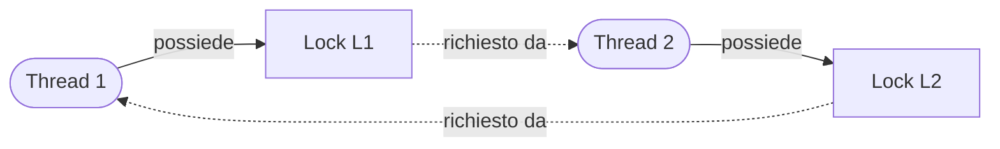
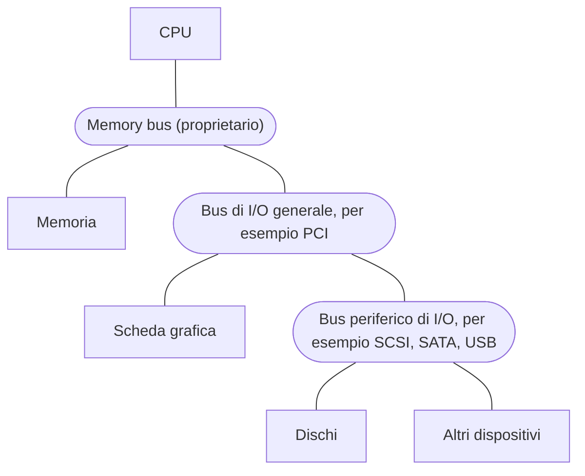
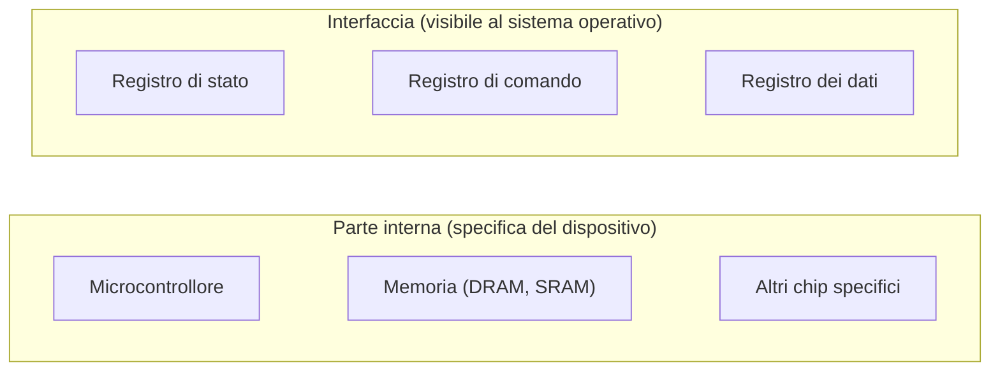
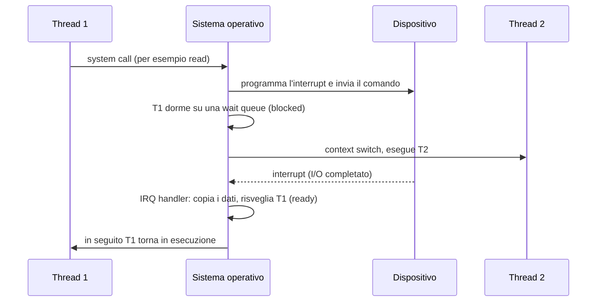
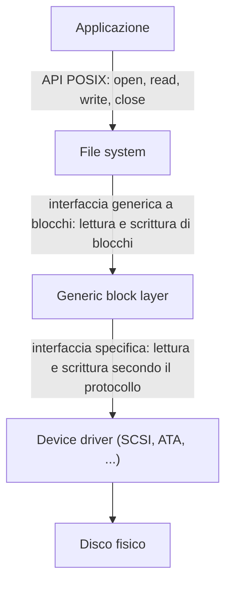
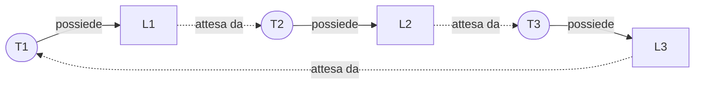

# Lezione 14 — Problemi comuni di concorrenza, deadlock e dispositivi di input/output

La lezione è divisa in due parti nettamente separate da una pausa. La **prima parte** chiude il capitolo sulla concorrenza: dopo aver visto mutex, variabili condizionate e semafori, il professore mostra quali errori si commettono davvero nei programmi concorrenti, partendo da uno studio su applicazioni open source molto note, e poi affronta in modo sistematico il **deadlock**: quando si può verificare, quali sono le quattro condizioni necessarie e come si può impedire che ciascuna di esse sia soddisfatta. È la trattazione generale annunciata alla fine della [[Lezione 13 - Semafori, problemi classici, liste e code concorrenti|lezione precedente]], dopo il caso particolare dei filosofi a cena. La **seconda parte** apre il terzo grande tema del corso, la **persistenza**: per arrivare ai dischi e ai file system si comincia dai **dispositivi di input/output** in generale, cioè da come sono collegati al calcolatore, da come il sistema operativo comunica con loro (polling, interrupt, DMA, istruzioni dedicate o memory-mapped I/O) e da come l'astrazione a livelli permette di trattare in modo uniforme dispositivi molto diversi. La lezione si ferma all'inizio dell'esempio del driver di un disco IDE; il codice del driver non è stato spiegato ed è riportato nella sezione finale basata sulle slide, insieme alle ultime slide sul deadlock (evitarlo con lo scheduling, rilevarlo e recuperare), anch'esse non trattate.

## Parte I — Problemi comuni di concorrenza

### Uno studio sui bug reali

Il professore introduce l'argomento con un'osservazione: tutto quello che si è visto finora sulla sincronizzazione dei thread (mutex, variabili condizionate, semafori) sembra lineare quando lo si studia su esempi piccoli, ma programmatori esperti, che lavorano a software usato da milioni di persone, sbagliano spesso proprio sugli aspetti più semplici. Lo mostra uno studio, non recentissimo, condotto su quattro grandi applicazioni open source, di cui era quindi possibile leggere i sorgenti per capire dove fosse il problema: il database **MySQL**, il server web **Apache**, il browser **Mozilla** e la suite per ufficio **OpenOffice**.

| Applicazione | Che cosa fa | Bug non deadlock | Bug deadlock |
| ------------ | ----------- | ---------------: | -----------: |
| MySQL | Server di database | 14 | 9 |
| Apache | Server web | 13 | 4 |
| Mozilla | Browser web | 41 | 16 |
| OpenOffice | Suite per ufficio | 6 | 2 |
| **Totale** | | **74** | **31** |

```chart
type: bar
labels: [MySQL, Apache, Mozilla, OpenOffice]
series:
  - title: Bug non deadlock
    data: [14, 13, 41, 6]
  - title: Bug deadlock
    data: [9, 4, 16, 2]
width: 80%
labelColors: false
beginAtZero: true
```

Il grafico riporta i valori della tabella delle slide. I totali sono stati ricontrollati: $14+13+41+6 = 74$ e $9+4+16+2 = 31$, quindi i bug di tipo deadlock sono circa il 30% del totale ($31/105 \approx 0{,}295$).

La cosa interessante, sottolinea il professore, è che **la maggior parte dei bug non riguarda il deadlock**: sono errori dovuti a un cattivo uso, o semplicemente al mancato uso, della mutua esclusione e delle variabili condizionate. Una fetta comunque consistente riguarda invece il deadlock, su cui la lezione si sofferma di più perché è il problema più interessante da analizzare.

> [!tip] Approfondimento — Lo studio sui bug di concorrenza
> #approfondimento
> La tabella delle slide viene da uno studio di Shan Lu, Soyeon Park, Eunsoo Seo e Yuanyuan Zhou, presentato alla conferenza ASPLOS nel 2008, che ha esaminato 105 bug di concorrenza reali tratti dai sistemi di segnalazione dei quattro progetti [@lu2008learning]. Lo studio è all'origine della classificazione dei bug non deadlock in violazioni dell'atomicità e violazioni dell'ordine usata nelle slide; OSTEP lo riprende proprio come base del capitolo sui problemi comuni di concorrenza [@arpacidusseau2023ostep, cap. 32].

### I bug che non sono deadlock

Gli errori non deadlock sono la maggioranza e si dividono in due grandi famiglie.

1. **Violazione dell'atomicità** (*atomicity violation*): il programmatore pensa che una sequenza di operazioni avvenga in modo atomico, ma non è così, e avrebbe dovuto renderla atomica lui, con un mutex o con un semaforo.
2. **Violazione dell'ordine** (*order violation*): il programmatore presuppone che un'operazione avvenga sempre prima di un'altra, ma niente nel codice impone quest'ordine.

In entrambi i casi gli strumenti per evitare il problema esistono e sono quelli già studiati; il punto è che non vengono usati, o vengono usati male, anche nei sistemi commerciali.

#### Violazione dell'atomicità

> [!important] Violazione dell'atomicità
> Si ha una **violazione dell'atomicità** quando una sequenza di accessi alla memoria che dovrebbe essere eseguita come un tutto unico (*serializzabile*, cioè equivalente a un'esecuzione senza interruzioni) può invece essere interrotta da un altro thread che accede agli stessi dati.

L'esempio, trovato in MySQL, è riportato a titolo puramente didattico (il professore si augura che nel frattempo sia stato corretto). Due thread accedono al campo `proc_info` della struttura `thd`.

```c
Thread1::
if (thd->proc_info) {
    ...
    fputs(thd->proc_info, ...);
    ...
}

Thread2::
thd->proc_info = NULL;
```

Il primo thread controlla che il puntatore non sia nullo e, se non lo è, lo usa, passandolo a `fputs`; il secondo lo mette a `NULL`. Il problema è evidente, e ormai lo si è visto in molte forme: il primo thread esegue il controllo, trova che il puntatore non è nullo ed entra nel blocco; se a quel punto subisce una preemption prima di aver chiamato `fputs`, il secondo thread può mettere il puntatore a `NULL`. Quando il primo thread riprende, chiama `fputs` con un puntatore che non punta più da nessuna parte, e il programma va in errore. Il controllo e l'uso dovevano essere un'unica operazione indivisibile, ma il codice non lo garantisce.

La soluzione è quella nota: basta mettere un **mutex** attorno agli accessi alla variabile condivisa, "sopra e sotto", come dice il professore, in **entrambi** i thread.

```c
pthread_mutex_t lock = PTHREAD_MUTEX_INITIALIZER;

Thread1::
pthread_mutex_lock(&lock);
if (thd->proc_info) {
    ...
    fputs(thd->proc_info, ...);
    ...
}
pthread_mutex_unlock(&lock);

Thread2::
pthread_mutex_lock(&lock);
thd->proc_info = NULL;
pthread_mutex_unlock(&lock);
```

Ora il controllo e l'uso del puntatore sono atomici rispetto all'assegnamento del secondo thread: se il primo thread è dentro la sezione critica, il secondo resta bloccato sulla `pthread_mutex_lock` finché il primo non ha finito. Lo stesso risultato si otterrebbe con un semaforo inizializzato a 1, usato come semaforo binario: il primo thread che lo prende lo porta a 0 e l'altro deve attendere (si veda il [[Lezione 12 - Variabili condizionate, strutture dati concorrenti e semafori#Il semaforo binario come lock|semaforo binario come lock]]).

#### Violazione dell'ordine

> [!important] Violazione dell'ordine
> Si ha una **violazione dell'ordine** quando l'ordine desiderato tra due accessi alla memoria si inverte: un'operazione A dovrebbe sempre essere eseguita prima di un'operazione B, ma durante l'esecuzione quest'ordine non viene imposto.

Il secondo esempio, che il professore trova molto più bello perché l'errore non si vede a prima vista, viene dal codice di Mozilla.

```c
Thread1::
void init() {
    mThread = PR_CreateThread(mMain, ...);
}

Thread2::
void mMain(...) {
    mState = mThread->State;
}
```

Il primo thread, a un certo punto, crea un nuovo thread. La funzione `PR_CreateThread` è l'equivalente, nella libreria di Mozilla, della `pthread_create`: riceve la funzione che il nuovo thread deve eseguire, `mMain` (ogni thread, come si è visto nella [[Lezione 10 - API dei thread, mutex e variabili condizionate#Creare un thread|Lezione 10]], ha bisogno di una funzione da eseguire), e restituisce un puntatore `mThread` alla struttura che descrive il thread creato. La funzione `mMain`, cioè il codice del nuovo thread, legge il campo `State` di quella struttura attraverso `mThread` e lo copia nella variabile `mState`.

Leggendo il codice così come è scritto, si immagina che le cose vadano in quest'ordine: si chiama la funzione di creazione, si manda in esecuzione `mMain`, si ottiene il valore di ritorno `mThread`, e l'operazione è finita. Se si potesse garantire che tutto questo avviene senza che nulla succeda nel frattempo, quando `mMain` parte il puntatore `mThread` esisterebbe già. Ma chi lo garantisce? Niente impedisce che, durante la chiamata di creazione, il nuovo thread venga mandato in esecuzione **prima** che la funzione abbia restituito il suo valore e che questo sia stato assegnato a `mThread`. In quel caso `mMain` accede a `mThread->State` quando `mThread` non ha ancora un valore definito (probabilmente è ancora `NULL`), e il programma va in errore. Il codice del secondo thread presuppone un ordine che il programma non impone.

La soluzione è imporre l'ordine con una **variabile condizionata**.

```c
pthread_mutex_t mtLock = PTHREAD_MUTEX_INITIALIZER;
pthread_cond_t  mtCond = PTHREAD_COND_INITIALIZER;
int mtInit = 0;

Thread 1::
void init() {
    ...
    mThread = PR_CreateThread(mMain, ...);

    // segnala che il thread è stato creato
    pthread_mutex_lock(&mtLock);
    mtInit = 1;
    pthread_cond_signal(&mtCond);
    pthread_mutex_unlock(&mtLock);
    ...
}

Thread2::
void mMain(...) {
    ...
    // attende che il thread sia stato inizializzato
    pthread_mutex_lock(&mtLock);
    while (mtInit == 0)
        pthread_cond_wait(&mtCond, &mtLock);
    pthread_mutex_unlock(&mtLock);

    mState = mThread->State;
    ...
}
```

Il primo thread, dopo aver creato l'altro **e dopo che la funzione di creazione ha restituito `mThread`**, mette a 1 la variabile di stato `mtInit` e chiama la `pthread_cond_signal` sulla variabile condizionata `mtCond`. Il secondo thread, prima di accedere a `mThread->State`, si mette in attesa su `mtCond` finché `mtInit` vale 0. Se anche il secondo thread partisse subito, prima che la funzione di creazione abbia restituito il valore, si metterebbe in attesa sulla variabile condizionata, e il segnale corrispondente arriverebbe solo quando la creazione è terminata e `mThread` ha un valore. Se invece il secondo thread arriva tardi, quando il primo ha già messo `mtInit` a 1, il ciclo `while` non attende affatto e il thread prosegue.

Il professore invita a non soffermarsi sul lock attorno alla variabile condizionata: c'è sempre, ogni volta che c'è una variabile condizionata, e la parte che conta davvero è la coppia `signal`/`wait`. A lezione non ha commentato la variabile `mtInit`, che però è indispensabile per la ragione vista nella [[Lezione 10 - API dei thread, mutex e variabili condizionate#Le variabili condizionate|Lezione 10]]: senza una variabile di stato, se la `signal` avvenisse prima della `wait` il segnale andrebbe perso e il secondo thread resterebbe bloccato per sempre. Il ciclo `while`, invece di un `if`, è quello raccomandato dalla semantica Mesa.

> [!warning] Precisazione — Mutex, non semaforo
> A lezione il lock attorno alla variabile condizionata viene chiamato "semaforo". Nel codice delle slide è un **mutex** (`pthread_mutex_t mtLock`): la `pthread_cond_wait` richiede come secondo argomento un mutex, che rilascia durante l'attesa e riacquisisce al risveglio. Allo stesso modo la funzione di creazione nel codice di Mozilla è `PR_CreateThread`, non la `pthread_create` nominata a lezione, anche se il ruolo è lo stesso.

> [!example] Verifica della soluzione
> Il codice della soluzione è stato provato in una versione completa in C, in cui la funzione di creazione è sostituita da `pthread_create` e la struttura `mThread` è assegnata solo dopo il ritorno della creazione. Compilato con `gcc -Wall -O2 -pthread`, il programma stampa sempre `mState = 42`, il valore scritto nella struttura dal primo thread, perché il secondo thread non legge `mThread` prima che `mtInit` sia stato messo a 1.

Riassumendo, i due problemi visti sono stati incontrati più volte nel corso: la **violazione dell'atomicità** si risolve con un mutex (o un semaforo binario), la **violazione dell'ordine** con una variabile condizionata (o un semaforo usato come condizione). Sono cose difficili, conclude il professore, al punto che errori di questo tipo si trovano anche in software commerciale molto noto.

### Il deadlock

Il **deadlock** (*stallo*) è già comparso due volte: in forma generale, quando si sono introdotti i mutex ([[Lezione 10 - API dei thread, mutex e variabili condizionate#Il deadlock|Lezione 10]]), e nel caso dei [[Lezione 13 - Semafori, problemi classici, liste e code concorrenti#Il problema dei filosofi a cena|filosofi a cena]], che vogliono prendere le forchette per mangiare. In generale lo si può rappresentare così.

```c
// Thread 1:          // Thread 2:
lock(L1);             lock(L2);
lock(L2);             lock(L1);
```

Ci sono due thread e due lock. Qui "lock" è un termine generico, che indica un mutex o un semaforo: si usa per astrarsi dall'implementazione specifica, e indica semplicemente un lucchetto che, se un thread è entrato, impedisce all'altro di entrare. Il thread 1 prende prima `L1` e poi `L2`; il thread 2 prende prima `L2` e poi `L1`.

Il deadlock **non si verifica necessariamente**: dipende da come i thread si alternano. Ma **può** verificarsi, e il punto è proprio questo: se una cosa può succedere, su tante esecuzioni prima o poi succederà. Si supponga che il thread 1 prenda `L1` e che, prima che riesca a prendere `L2`, lo scheduler faccia eseguire il thread 2, che prende `L2` e poi prova a prendere `L1`. Il thread 1 ha in mano `L1` e vuole `L2`, ma `L2` è in mano al thread 2, che vuole `L1`. Nessuno dei due può proseguire, né rilasciare il lock che possiede: è lo stallo.



Il diagramma, che riproduce quello delle slide, mostra la caratteristica fondamentale della situazione: un **ciclo**. Il thread 1 possiede `L1`, richiesto dal thread 2, che possiede `L2`, richiesto dal thread 1.

> [!important] Il ciclo è necessario
> Perché ci sia un deadlock è **sempre necessaria la presenza di un ciclo** di attese: ciascun thread possiede una risorsa ed è in attesa di una risorsa posseduta dal thread successivo del ciclo. Non è l'unica condizione necessaria, ma non si può immaginare un deadlock senza una struttura di questo tipo. Per questo la ricerca di cicli diventa uno dei modi per verificare se un deadlock si può verificare o si è verificato.

> [!example] Il deadlock in pratica
> Il codice dei due thread è stato eseguito in un programma in cui ciascun thread ripete un milione di volte la propria coppia di acquisizioni (thread 1: `L1` poi `L2`; thread 2: `L2` poi `L1`). In cinque esecuzioni su cinque il programma si è bloccato e non è mai terminato: è stato interrotto dopo 3 secondi. Lo strumento helgrind di Valgrind, eseguito su una versione in cui ciascun thread fa una sola iterazione (che di norma termina), segnala comunque il problema con il messaggio `lock order "… before …" violated`: helgrind non aspetta che il deadlock avvenga, ma riconosce che i due lock sono stati acquisiti in ordini opposti, cioè che nel grafo delle acquisizioni c'è un ciclo [@valgrindhelgrind].

### Perché i deadlock si verificano

Ci si potrebbe chiedere se i deadlock nascano solo dalla distrazione dei programmatori. Non è così: le slide indicano due ragioni strutturali.

La prima è che nei programmi di grandi dimensioni si creano **dipendenze complesse tra i componenti**. La seconda, che il professore considera la peggiore, è l'**incapsulamento** e la **modularità** del software. Uno dei principi base della programmazione, e forse proprio la base della programmazione a oggetti, è la modularità: si definisce una classe, la si collauda, la si usa e la useranno altri in futuro; quella classe verrà usata in un'altra classe, a sua volta usata da altre, e così via. Non si ricostruisce tutto da capo ogni volta, si incorpora un pezzo già fatto in un altro software. Ma questo significa usare componenti senza sapere esattamente che cosa contengono: quando si chiama una funzione non se ne legge il codice, al più se ne legge il manuale. La modularità, osservano le slide, non si accorda bene con l'uso dei lock, che sono un dettaglio interno dell'implementazione ma hanno effetti su chi la usa.

L'esempio, che il professore definisce molto bello, è il metodo `addAll` della classe `Vector` di Java.

```text
Vector v1, v2;
v1.addAll(v2);
```

Per eseguire l'operazione in modo sicuro rispetto ai thread, evitando che qualcun altro modifichi i vettori mentre li si sta usando, il metodo deve acquisire i lock di **entrambi** i vettori: quello del vettore su cui opera (`v1`) e quello del vettore passato come parametro (`v2`). Ogni oggetto `Vector` ha un lock associato, e il metodo li prende in un certo ordine, che dal punto di vista di chi lo chiama è arbitrario: prima `v1`, poi `v2`. Se un altro thread, in modo del tutto ingenuo e inconsapevole, chiama quasi nello stesso momento `v2.addAll(v1)`, prende gli stessi due lock nell'ordine opposto, prima `v2` e poi `v1`. È esattamente la situazione dei due thread vista sopra, e quindi un deadlock possibile. Bisogna essere sfortunati, certo; ma se due thread combinano vettori in continuazione, prima o poi succede. E succede proprio per colpa della modularità: chi usa `addAll` ne legge il manuale, vede che cosa fa e la usa, senza sapere che al suo interno vengono presi dei lock in un ordine che, combinato con le chiamate di un altro thread, può creare un ciclo.

> [!warning] Precisazione — Che cosa fa `addAll`
> A lezione il professore dice di non ricordare se `addAll` "sommi" i due vettori restituendo un risultato o modifichi uno dei due. Secondo la documentazione ufficiale di Java, il metodo **aggiunge in coda** al vettore su cui è chiamato (`v1`) tutti gli elementi della collezione passata come parametro (`v2`), nell'ordine in cui li restituisce l'iteratore della collezione; `v1` viene quindi modificato, `v2` no [@javadocvector]. Per il ragionamento sul deadlock non cambia nulla: conta solo che servano i lock di entrambi.

### Le quattro condizioni per il deadlock

In modo più generale, ci si chiede quali siano le condizioni perché un deadlock si possa verificare. Il problema è stato studiato e la risposta è che devono essere vere **tutte e quattro** le condizioni seguenti.

| Condizione | Descrizione |
| ---------- | ----------- |
| **Mutua esclusione** (*mutual exclusion*) | I thread rivendicano il controllo esclusivo delle risorse di cui hanno bisogno. |
| **Possesso e attesa** (*hold-and-wait*) | I thread trattengono le risorse che hanno già ottenuto mentre attendono di acquisirne altre. |
| **Assenza di preemption** (*no preemption*) | Le risorse non possono essere tolte con la forza ai thread che le possiedono. |
| **Attesa circolare** (*circular wait*) | Esiste una catena circolare di thread in cui ciascun thread possiede una o più risorse richieste dal thread successivo della catena. |

> [!important] Condizioni necessarie per il deadlock
> Un deadlock può verificarsi solo se valgono **contemporaneamente** mutua esclusione, hold-and-wait, assenza di preemption e attesa circolare. Se **anche una sola** di queste condizioni non è soddisfatta, il deadlock **non può** verificarsi.

Il fatto che le condizioni debbano valere tutte insieme è una buona notizia, osserva il professore: basta farne cadere una per essere sicuri che il deadlock non ci sia. Un programmatore che vuole garantire l'assenza di deadlock deve fare in modo che almeno una delle quattro sia violata.

Vale la pena di commentarle una per una.

- **Mutua esclusione.** Ci deve essere un meccanismo di mutua esclusione, come un mutex o un semaforo: se non c'è, non ci può essere deadlock. Sembra un'osservazione banale, visto che se ne sta parlando proprio perché i meccanismi di mutua esclusione ci sono; ma si vedrà che in certi casi si possono fare le stesse cose senza usarli. Senza mutex né semafori possono verificarsi altri problemi, ma non il deadlock.
- **Hold-and-wait.** Il deadlock si verifica perché un thread ha preso un lock e poi ne vuole prendere un altro. Se potesse rilasciare il primo, la situazione sarebbe diversa; invece ogni thread "arraffa" e, mentre tiene ciò che ha preso, prova a prendere dell'altro: trattiene e aspetta.
- **Assenza di preemption.** Non è possibile togliere a un thread una risorsa che ha già preso: il thread 1 che ha preso `L1` non lo molla per nessun motivo. Se ci fosse un modo per dirgli di mollarlo, le cose cambierebbero. Il termine *preemption* è usato qui in senso più generale rispetto allo scheduling, dove significa togliere il processore a un thread per darlo a un altro: qui significa togliere a un thread una risorsa qualsiasi per darla a un altro.
- **Attesa circolare.** È il ciclo visto sopra: deve esistere una catena circolare di thread in cui ciascuno possiede risorse richieste dal successivo. Se la catena non c'è, di nuovo, non ci può essere deadlock.

> [!tip] Approfondimento — Le condizioni di Coffman
> #approfondimento
> Le quattro condizioni sono note come **condizioni di Coffman**, dal primo autore dell'articolo *System Deadlocks* di E. G. Coffman, M. J. Elphick e A. Shoshani, pubblicato su *ACM Computing Surveys* nel 1971, che le enunciò insieme alle strategie di prevenzione, di rilevamento e di avoidance [@coffman1971deadlocks]. OSTEP le presenta nella stessa forma e con lo stesso ordine delle slide [@arpacidusseau2023ostep, cap. 32].

### Prevenire il deadlock

Avendo consapevolezza delle quattro condizioni, si possono progettare meccanismi che ne violino almeno una. Le tecniche che agiscono in questo modo si chiamano di **prevenzione** (*prevention*). Il professore insiste su un punto: ogni tecnica agisce **separatamente**, su una sola condizione. Non vanno combinate: basta che una delle quattro condizioni non sia vera.

#### L'attesa circolare: un ordinamento dei lock

Per l'attesa circolare è stato proposto di fissare un **ordinamento totale** sull'acquisizione dei lock. Si immagini di numerare i lock e di garantire che `L1` venga sempre preso prima di `L2`, `L1` prima di `L5`, `L7` sempre prima di `L12`, e così via. Se **tutti** i thread, quando devono prendere più lock, li prendono sempre secondo quest'ordine, non si può formare una catena circolare: può esistere un thread che ha preso `L1` e vuole `L2`, ma non può esistere un thread che ha preso `L2` e vuole `L1`, perché in tal caso avrebbe dovuto prendere `L1` per primo. Nell'esempio con due soli lock, basta acquisire sempre `L1` prima di `L2`.

È la stessa idea usata per i [[Lezione 13 - Semafori, problemi classici, liste e code concorrenti#Come evitarlo|filosofi a cena]], dove bastava che un filosofo prendesse le forchette in ordine diverso dagli altri per spezzare il ciclo: in quel caso l'ordine globale è "prima la forchetta di indice minore", che per il filosofo 4 significa prendere prima la forchetta 0.

> [!important] Prevenzione dell'attesa circolare
> Se tutti i thread acquisiscono i lock rispettando un **ordine totale** prefissato (o almeno un ordine parziale coerente sui lock che possono essere presi insieme), l'attesa circolare non può verificarsi e quindi non può verificarsi il deadlock.

Questa tecnica pone però vincoli molto forti alla programmazione, e può non funzionare sempre. Richiede una progettazione accurata di una strategia globale di locking e, soprattutto, richiede di conoscere **a priori tutti i lock** del sistema. Nel software fortemente modulare non si sa che cosa succede dentro le funzioni che si chiamano, né se rispettano lo stesso ordinamento. Se però lo si riesce a fare, funziona sicuramente: nel codice scritto da sé, che non chiama librerie complesse con altri mutex al loro interno, è la soluzione che dà la garanzia di non avere problemi.

#### L'hold-and-wait: prendere tutti i lock insieme

Per l'hold-and-wait la proposta, anche questa con controindicazioni, è che un thread che deve prendere più lock li prenda **tutti insieme, atomicamente**. Non deve essere possibile averne preso uno e poi volerne prendere un altro: o li si prende tutti subito, o non se ne prende nessuno.

L'esempio delle slide, puramente illustrativo, usa un lock aggiuntivo chiamato `prevention`.

```c
lock(prevention);
lock(L1);
lock(L2);
...
unlock(prevention);
```

Prima di prendere `L1` e `L2`, il thread prende `prevention`. Fintanto che lo possiede, nessun altro thread che segue lo stesso protocollo può acquisire lock: l'acquisizione di `L1` e `L2` diventa come un'unica operazione indivisibile, e non può avvenire un cambio di thread "inopportuno" a metà dell'acquisizione. Di conseguenza l'ordine in cui i lock vengono presi lì dentro diventa irrilevante: non serve più prenderli sempre nello stesso ordine. Un thread non può trovarsi con `L1` in mano mentre un altro sta prendendo `L2`, perché la fase di acquisizione è protetta da `prevention`, e quindi il deadlock non può esserci.

> [!warning] Precisazione — Quanto dura il lock `prevention`
> A lezione il professore descrive il lock `prevention` come un "lockone" tenuto per tutto il lavoro: i thread lo prendono, fanno ciò che devono e poi lo rilasciano. Nel codice delle slide, e in OSTEP, `prevention` serve invece solo a rendere atomica la **fase di acquisizione**: viene rilasciato appena dopo aver preso tutti i lock necessari (al posto dei puntini c'è eventualmente l'acquisizione di altri lock, non il lavoro vero e proprio), mentre `L1` e `L2` restano presi fino alla fine della sezione critica. Perché funzioni, inoltre, **ogni** thread che acquisisce quei lock deve passare per `prevention` [@arpacidusseau2023ostep, cap. 32]. Una versione in cui due thread prendono `L1` e `L2` in ordine opposto, ma sempre dentro `lock(prevention)`/`unlock(prevention)`, è stata eseguita due milioni di volte complessivamente senza mai bloccarsi; senza `prevention` lo stesso programma si blocca, come nell'esperimento precedente.

Anche questa soluzione ha due problemi. Il primo è lo stesso dell'ordinamento: bisogna sapere, quando si chiama una funzione, esattamente quali lock dovranno essere presi, e prenderli in anticipo; ma con la funzione dei vettori, per esempio, magari non si sa nemmeno che al suo interno vengono presi dei lock. Il secondo è che **diminuisce la concorrenza**. Prendere tutti i lock insieme significa prenderli presto, anche quando non sarebbero ancora necessari: il lock `L1` magari lo si deve prendere all'inizio perché lo impone la logica del programma, ma `L7` servirebbe solo molto più avanti, per una piccola istruzione; con questa tecnica lo si deve prendere subito, e la sezione critica diventa la più larga possibile. Mentre si tiene quel lock, altri thread potrebbero fare cose utili e non possono. Funziona, si previene il deadlock, ma si riduce la concorrenza. Quasi tutto, commenta il professore, funziona così: si migliora da una parte e si generano problemi dall'altra.

#### L'assenza di preemption: la trylock

La terza condizione è molto interessante, dice il professore: chi ha detto che un lock, una volta preso, non possa essere abbandonato? Finora non lo si è previsto, ma lo si può prevedere, e infatti le implementazioni dei lock, come quella dei thread POSIX, offrono spesso una versione della funzione di lock chiamata **trylock**, già incontrata nella [[Lezione 10 - API dei thread, mutex e variabili condizionate#Trylock e timedlock|Lezione 10]]. Se il lock è libero, la trylock lo prende; se non lo è, **non resta bloccata** e ritorna con un codice d'errore.

Con la trylock si può costruire un protocollo di acquisizione di più lock **senza deadlock** e **indipendente dall'ordine**.

```c
top:
    lock(L1);
    if (tryLock(L2) == -1) {
        unlock(L1);
        goto top;
    }
```

Qui non ci si preoccupa né dell'ordinamento né di prendere i lock tutti insieme: si agisce solo sulla terza condizione. Il thread prende il primo lock normalmente; se non ci riesce resta in attesa, e questo non è un problema, perché non possiede ancora nulla. Il problema nasce quando ha preso il primo e vuole anche il secondo: allora il secondo non lo prende con `lock`, ma con `tryLock`. Se è libero, il thread lo prende, ha entrambi i lock e prosegue: niente deadlock. Altrimenti la `tryLock` restituisce un errore e il thread **rilascia anche il primo** lock, per poi riprovare dall'inizio. È una forma di preemption volontaria: il thread rinuncia da sé alla risorsa che possiede, invece di trattenerla mentre aspetta. Non si forma mai una situazione in cui un thread tiene un lock e resta bloccato in attesa di un altro.

> [!warning] Precisazione — Il valore di ritorno della trylock
> Nelle slide `tryLock` è una funzione generica che restituisce −1 se il lock è occupato. La funzione reale della libreria dei thread POSIX, `pthread_mutex_trylock`, restituisce invece **0** se ha preso il mutex e il codice d'errore **`EBUSY`** se il mutex è già occupato, non −1 [@posixpthreadmutextrylock]. Su Linux è stato verificato che una seconda `pthread_mutex_trylock` sullo stesso mutex restituisce 16, cioè `EBUSY` ("Device or resource busy"). Nel codice reale il controllo va quindi scritto `if (pthread_mutex_trylock(&L2) != 0)`.

Sorge però un dubbio: questo protocollo risolve davvero il problema? Si immaginino due thread che lo eseguono e che, per creare la famosa catena circolare, prendono i lock in ordine opposto: uno prende `L1` e fa la trylock su `L2`, l'altro prende `L2` e fa la trylock su `L1`. Può succedere che entrambi prendano il proprio primo lock, falliscano la trylock sul secondo, rilascino il primo, lo riprendano, falliscano di nuovo la trylock, lo rilascino, e così via, potenzialmente per moltissimo tempo.

> [!important] Livelock
> Si ha un **livelock** quando due o più thread continuano a eseguire la stessa sequenza di codice, ripetendola all'infinito, senza che nessuno faccia progressi. A differenza del deadlock i thread non sono fermi, "sono vivi", ma sono comunque bloccati nel senso che il lavoro non va avanti.

Il livelock è un problema reale. Per risolverlo, come aveva proposto anche uno studente in un'altra occasione, si può aggiungere un **ritardo casuale** prima di riprovare: se tutti riprovano subito, rischiano di ritrovarsi sempre sincronizzati e di fallire di nuovo; con un ritardo casuale tra un tentativo e l'altro aumenta la probabilità che i thread si desincronizzino e che uno dei due riesca finalmente a prendere tutti i lock.

> [!example] Trylock con ritardo casuale
> Il protocollo è stato provato in C con due thread che prendono `L1` e `L2` in ordine opposto, duecentomila volte ciascuno, usando `pthread_mutex_trylock` sul secondo lock e, in caso di fallimento, rilasciando il primo e attendendo un tempo casuale tra 0 e 9 microsecondi. Il programma termina sempre, in pochi centesimi di secondo; in un'esecuzione i tentativi falliti sono stati 138 per il primo thread e 173 per il secondo. I valori cambiano da un'esecuzione all'altra.

Le slide ricordano anche due difficoltà pratiche di questo approccio, che a lezione non sono state discusse: se tra l'acquisizione del primo lock e la trylock il thread ha acquisito altre risorse (per esempio ha allocato memoria), al momento di tornare a `top` deve rilasciare anche quelle; e la tecnica non realizza una vera preemption, in cui sia il sistema a togliere una risorsa a un thread, ma solo una rinuncia volontaria del thread stesso [@arpacidusseau2023ostep, cap. 32].

#### La mutua esclusione: strutture dati senza lock

L'ultima condizione è la mutua esclusione, e sembra strano poterla eliminare: tutto il discorso nasce proprio dall'aver introdotto meccanismi di mutua esclusione. Ma è interessante ricordare come sono costruiti i lock e i semafori. Ed è, avverte il professore, una **domanda d'esame**: un semaforo non potrebbe esistere senza un'**istruzione hardware dedicata**, atomica, come il **test-and-set** o il **compare-and-swap** (ne esistono altre, citate nella [[Lezione 11 - Implementazione dei lock e variabili condizionate#Il compare-and-swap|Lezione 11]]). Il codice con cui le si descrive non è codice vero: è lì solo per spiegare che cosa fa l'istruzione. L'istruzione è implementata in hardware ed è atomica come un'istruzione `mov` che sposta un dato dalla memoria: non può esserci una preemption a metà, perché è una sola istruzione.

L'idea è allora usare direttamente queste istruzioni per costruire strutture dati che **non richiedono lock espliciti**. Le slide presentano il compare-and-swap in una forma leggermente diversa da quella vista nella Lezione 11.

```c
int CompareAndSwap(int *address, int expected, int new) {
    if (*address == expected) {
        *address = new;
        return 1;   // successo
    }
    return 0;       // fallimento
}
```

L'istruzione ha tre parametri: `address`, un puntatore, `expected`, il valore atteso, e `new`, il nuovo valore. Controlla se il contenuto dell'indirizzo `address` è uguale a `expected`; se lo è, scrive `new` all'indirizzo `address` e restituisce 1, altrimenti non scrive nulla e restituisce 0. Nell'implementazione dei lock il primo caso corrispondeva a "lock preso" e il secondo a "lock occupato". Ancora una volta, il professore chiede di immaginare tutto questo come un unico blocco indivisibile, non come un pezzetto di codice C.

> [!warning] Precisazione — Due versioni del compare-and-swap
> Nella [[Lezione 11 - Implementazione dei lock e variabili condizionate#Il compare-and-swap|Lezione 11]] il compare-and-swap restituiva il **valore effettivo** trovato in memoria; qui restituisce **1 o 0** a seconda che lo scambio sia avvenuto. Il professore lo fa notare esplicitamente: il significato è lo stesso e le due versioni si possono usare nello stesso modo, cambiando solo il test sul valore di ritorno. Ritiene più vicina al comportamento reale quella di questa lezione. Entrambe le forme esistono nei compilatori: GCC, per esempio, offre `__sync_val_compare_and_swap` (restituisce il valore precedente) e `__sync_bool_compare_and_swap` (restituisce vero se lo scambio è avvenuto), che sono stati usati per le prove di questa nota.

##### L'incremento atomico

Il primo esempio è l'**incremento di un contatore**. Incrementare un contatore non è di per sé un'operazione atomica: come si è visto nella [[Lezione 10 - API dei thread, mutex e variabili condizionate#Un incremento non è un'operazione sola|Lezione 10]], richiede più istruzioni in linguaggio macchina e può essere interrotto a metà, con risultati sbagliati. Per questo lo si protegge normalmente con un mutex. Ma lo si può fare anche senza mutex, usando direttamente il compare-and-swap.

```c
void AtomicIncrement(int *value, int amount) {
    int old;
    do {
        old = *value;
    } while (CompareAndSwap(value, old, old + amount) == 0);
}
```

La funzione riceve il contatore per riferimento, `value`, in modo da modificarlo, e la quantità di cui incrementarlo, `amount`. Nel ciclo legge il valore corrente del contatore in `old` e poi chiama `CompareAndSwap(value, old, old + amount)`. Per semplicità, come fa il professore, si può parlare di "value" intendendo il valore puntato da `value`.

Si segua la logica. Se tra la lettura `old = *value` e il compare-and-swap non succede nulla, il compare-and-swap trova che il valore del contatore è ancora uguale a `old`, lo sostituisce con `old + amount` e restituisce 1: il contatore è stato incrementato e il ciclo termina.

Ma tra la lettura e il compare-and-swap **può** avvenire una preemption, perché nessun lock lo impedisce: l'unica cosa atomica è il compare-and-swap. In quel punto un altro thread potrebbe modificare il contatore, che è condiviso. In questo caso, quando il compare-and-swap viene eseguito, trova che il valore del contatore non è più uguale a `old`: non scrive nulla e restituisce 0. Il ciclo continua, si rilegge il valore aggiornato in `old` e si riprova. Il compare-and-swap, invece, non può essere interrotto, perché è una sola istruzione. Quindi non ci si trova mai in una situazione incoerente: o il contatore è stato incrementato a partire dal valore giusto, oppure non è stato toccato e si ritenta. Se il tentativo fallisce, è perché qualcun altro ha modificato il contatore nel frattempo.

> [!important] Incremento senza lock
> Con il compare-and-swap il contatore viene incrementato in modo corretto **senza acquisire alcun lock**: la lettura del valore può essere interrotta, ma l'aggiornamento avviene solo se nel frattempo nessuno ha modificato il contatore; altrimenti si ripete il tentativo. Non essendoci lock, **non può esserci deadlock**.

Uno studente chiede come mai la funzione diventi atomica. Il professore precisa: il compare-and-swap è atomico per sua natura, non lo diventa; è un'istruzione scritta nell'hardware, e un'interruzione può avvenire solo tra un'istruzione e l'altra. Ciò che diventa atomico, nel senso che non produce mai risultati incoerenti, è l'**incremento del contatore** nel suo complesso, grazie al ciclo che ritenta finché il compare-and-swap non ha successo.

##### L'inserimento in una lista

La stessa idea si può applicare a una struttura più complessa: l'inserimento in testa a una **lista**, che nella [[Lezione 13 - Semafori, problemi classici, liste e code concorrenti#Liste concorrenti|lezione precedente]] aveva richiesto un certo sforzo con i lock. La versione senza alcuna protezione è questa.

```c
void insert(int value) {
    node_t *n = malloc(sizeof(node_t));
    assert(n != NULL);
    n->value = value;
    n->next = head;
    head = n;
}
```

Si crea il nodo con `malloc`, gli si assegna un valore (altrimenti la lista non conterrebbe alcuna informazione), lo si collega davanti alla testa attuale (`n->next = head`) e infine si sposta la testa sul nuovo nodo (`head = n`). Se più thread chiamano la funzione "nello stesso momento", il codice ha una race condition: due thread possono leggere la stessa `head`, collegare entrambi il proprio nodo davanti a quella testa, e l'ultimo che scrive `head` cancella l'inserimento dell'altro.

La soluzione standard, vista finora, protegge con un lock la parte critica.

```c
void insert(int value) {
    node_t *n = malloc(sizeof(node_t));
    assert(n != NULL);
    n->value = value;
    lock(listlock);     // inizio della sezione critica
    n->next = head;
    head = n;
    unlock(listlock);   // fine della sezione critica
}
```

Funziona; ma se questa lista viene usata chissà dove, magari da codice che tiene già un altro lock, si può ricadere nel deadlock. Ci si chiede allora se si possa togliere del tutto il lock, e la risposta è sì, con il compare-and-swap.

```c
void insert(int value) {
    node_t *n = malloc(sizeof(node_t));
    assert(n != NULL);
    n->value = value;
    do {
        n->next = head;
    } while (CompareAndSwap(&head, n->next, n) == 0);
}
```

L'assegnamento `n->next = head` non è ancora un'operazione critica: il nodo `n` esiste solo nel thread che lo ha creato, è una variabile locale, e nessun altro thread può accedervi. Il punto critico è lo spostamento della testa, ed è proprio quello che viene fatto con il compare-and-swap: se `head` è ancora uguale a `n->next`, cioè se nessuno ha cambiato la testa da quando la si è letta, allora `head` diventa `n`. È esattamente ciò che si vuole. Altrimenti significa che un altro thread ha inserito un nodo nel frattempo: il compare-and-swap non modifica nulla, restituisce 0, e il ciclo ricollega `n` alla nuova testa e ritenta.

> [!example] Verifica dell'incremento e dell'inserimento senza lock
> I due esempi sono stati compilati con `gcc -Wall -O2 -pthread`, usando `__sync_bool_compare_and_swap` di GCC per realizzare il `CompareAndSwap` delle slide. Quattro thread incrementano ciascuno un milione di volte il contatore con `AtomicIncrement` e inseriscono ciascuno centomila nodi con la `insert` senza lock. Alla fine il contatore vale 4 000 000 e la lista contiene 400 000 nodi, esattamente i valori attesi: nessun incremento e nessun inserimento è andato perso.

Il professore conclude che non tutto si può fare in questo modo, ma ciò che si riesce a fare così elimina la mutua esclusione, che è una delle possibili cause del deadlock: se non ci sono lock, non c'è deadlock. È una possibilità che esiste proprio perché l'hardware offre istruzioni atomiche come il compare-and-swap o il test-and-set.

> [!warning] Precisazione — Wait-free o lock-free
> Le slide chiamano queste strutture *wait-free* (senza attesa) e aggiungono che il livelock resta possibile. In senso stretto, secondo la definizione di Herlihy, un algoritmo è **wait-free** se **ogni** thread completa la propria operazione in un numero finito di passi, qualunque cosa facciano gli altri; è invece **lock-free** (o *non bloccante*) se è garantito che **almeno un** thread faccia progressi [@herlihy1991waitfree]. Gli esempi con il ciclo di compare-and-swap sono lock-free ma non wait-free: un singolo thread sfortunato può, in teoria, fallire il compare-and-swap indefinitamente, ma ogni fallimento significa che un altro thread ha appena completato con successo il proprio aggiornamento, quindi il sistema nel suo insieme avanza sempre. Il rischio per il singolo thread è la starvation più che un livelock vero e proprio.

> [!tip] Approfondimento — Lock-free e wait-free
> #approfondimento
> La teoria delle strutture dati senza lock si deve in gran parte a Maurice Herlihy, che nel 1991 ha formalizzato la nozione di implementazione wait-free e ha mostrato che istruzioni diverse hanno un potere diverso: letture e scritture atomiche, o istruzioni come il test-and-set, non bastano a costruire una versione wait-free di qualsiasi struttura dati concorrente, mentre il compare-and-swap è un'istruzione **universale**, con cui ciò è possibile in linea di principio [@herlihy1991waitfree]. È una delle ragioni per cui le architetture moderne offrono il compare-and-swap, o istruzioni equivalenti come la coppia load-linked/store-conditional vista nella Lezione 11.

### Un cenno ai sistemi in tempo reale

Il professore apre una parentesi, che non è nelle slide, sui **sistemi in tempo reale**. Un **RTOS** (*Real-Time Operating System*, sistema operativo in tempo reale) è un sistema operativo particolare il cui scopo è garantire non solo l'esecuzione dei thread, ma anche il rispetto dei loro **vincoli temporali**. Un vincolo temporale significa, per esempio, questo: un pezzo di codice acquisisce i dati da un sensore, come una telecamera, e li elabora per controllare un robot che si muove a 4 metri al secondo e deve trovare gli ostacoli. Non conta solo che l'elaborazione sia corretta: conta anche la **frequenza** con cui si riesce ad acquisire ed elaborare una nuova immagine. Chi corre vedendo un'immagine ogni 3 secondi va sicuramente a sbattere. Un sistema in tempo reale deve garantire, poniamo, l'elaborazione di 25 immagini al secondo, qualunque cosa accada.

In un sistema che fa del tempo il suo elemento fondamentale, che non deve avere ritardi e in cui tutto deve essere prevedibile, evitare il deadlock diventa ancora più importante. Esistono perciò sistemi operativi con **semafori particolari**, congegnati appositamente per evitare a priori i deadlock senza ricorrere a nessuna delle tecniche viste. Il professore li cita solo per dire che esistono: il corso tratta mutex e semafori standard.

> [!tip] Approfondimento — Il protocollo del priority ceiling
> #approfondimento
> Un esempio noto di semafori di questo tipo è il **protocollo del priority ceiling** (*soffitto di priorità*), proposto da Lui Sha, Ragunathan Rajkumar e John Lehoczky nel 1990. A ogni semaforo si associa un "soffitto", pari alla priorità del thread più prioritario che potrà mai usarlo, e un thread può entrare in una sezione critica solo se la sua priorità supera i soffitti di tutti i semafori in quel momento presi da altri thread. Gli autori dimostrano che il protocollo **impedisce il deadlock** e limita l'attesa di un thread ad alta priorità alla durata di al più una sezione critica di un thread meno prioritario [@sha1990priority]. In sostanza è una forma di ordinamento imposta dal sistema invece che dal programmatore.

### Quadro riassuntivo

| Condizione da violare | Tecnica | Costo o limite |
| --------------------- | ------- | -------------- |
| Attesa circolare | Ordine totale (o parziale) sull'acquisizione dei lock | Serve conoscere tutti i lock e progettare una strategia globale; difficile con codice modulare |
| Hold-and-wait | Acquisire tutti i lock insieme, con un lock `prevention` | Serve sapere in anticipo quali lock servono; riduce la concorrenza |
| Assenza di preemption | `trylock` e rilascio dei lock già presi | Possibile livelock (si attenua con un ritardo casuale); bisogna rilasciare anche le altre risorse |
| Mutua esclusione | Strutture senza lock con il compare-and-swap | Applicabile solo a operazioni semplici; un thread può dover ritentare a lungo |

Ricapitolando: se il problema è l'assenza di preemption, la si introduce con la trylock; se il problema è che i thread trattengono e aspettano, li si costringe a prendere tutto insieme; se il problema è l'attesa circolare, la si toglie con un ordinamento fissato; se il problema è la mutua esclusione, la si evita, dove possibile, con le istruzioni atomiche. Basta toglierne una per essere salvi.

## Parte II — I dispositivi di input/output

### Dalla concorrenza alla persistenza

Dopo la virtualizzazione (della CPU e della memoria) e la concorrenza, il corso arriva al terzo grande tema annunciato fin dalla [[Lezione 01 - Introduzione ai SO e processi#Persistenza|Lezione 1]]: la **persistenza** dell'informazione, cioè il modo in cui il sistema operativo memorizza i dati in modo che sopravvivano allo spegnimento della macchina, li conserva, li legge e li scrive in modo efficiente. Si arriverà ai dischi e ai file system; ma il disco è solo uno dei tanti **dispositivi di input/output** (I/O), e conviene partire da come i dispositivi in generale vengono integrati nel sistema.

L'I/O è fondamentale: senza di esso il calcolatore non potrebbe interagire con altre componenti, con il mondo reale, con i sensori. Chi progetta un sistema operativo si pone alcune domande, che le slide riassumono così:

1. come si integra l'I/O nel sistema così come lo si è visto finora?
2. quali sono i meccanismi generali?
3. come li si rende efficienti?

Per esempio: per controllare un dispositivo, che accenda una luce o stampi un foglio, bisogna inventare un meccanismo del tutto nuovo, o si possono sfruttare in parte meccanismi esistenti? Che differenza c'è tra scrivere nella memoria e scrivere in un dispositivo? Dopotutto anche un dispositivo avrà bisogno di una memoria: per mandare una pagina a una stampante la si descriverà in qualche modo, come si descrive il contenuto della memoria, perché concettualmente è la stessa cosa. Ci si chiede se esista un unico meccanismo generale, valido per tutti i dispositivi, da specializzare poi caso per caso, e come renderlo efficiente.

### L'architettura: i bus

La comunicazione con i dispositivi avviene tipicamente attraverso dei **bus**, canali di comunicazione su cui viaggiano i dati tra la CPU, la RAM e i dispositivi. In un calcolatore ce ne sono diversi; il professore precisa di non essere un esperto di architettura dei calcolatori e rimanda al corso dedicato per i dettagli. La figura delle slide mostra una **architettura prototipale**, cioè uno schema di principio.



C'è sicuramente un **bus della memoria** (*memory bus*), dedicato e spesso proprietario, che collega la CPU alla memoria centrale. È dedicato perché tra CPU e memoria le interazioni sono molto più frequenti e devono essere molto più rapide. Poi ci sono diversi **bus di I/O**, non necessariamente uno solo, di tipo diverso, con prestazioni diverse per scopi diversi: un **bus di I/O generale** come il PCI, a cui si collegano per esempio le schede grafiche e altri dispositivi ad alte prestazioni, e uno o più **bus periferici** come SCSI, SATA o USB, a cui si agganciano tipicamente i dischi e gli altri dispositivi di memorizzazione. Al corso interessa soprattutto quest'ultimo. Come spiega OSTEP, la gerarchia ha una ragione fisica ed economica: un bus più veloce deve essere più corto e costa di più, quindi i componenti che richiedono prestazioni elevate stanno vicino alla CPU e quelli più lenti più lontano.

### Porte, interfacce e controller

Il **bus di I/O** è il percorso dei dati che collega la CPU a un dispositivo. Per collegarlo fisicamente al dispositivo servono tre componenti hardware, ciascuna delle quali risolve un problema diverso.

1. Le **porte di I/O** (*I/O ports*): registri, cioè locazioni di memoria a indirizzi ben precisi, in cui si scrive o da cui si legge per comunicare con il dispositivo. È un nome da ricordare. Come la CPU ha i suoi registri (il program counter, lo stack pointer), ogni dispositivo ha le sue porte, dove il sistema operativo scrive o legge per parlare con lui.
2. Le **interfacce**: la connessione elettrica e di segnalazione che converte i segnali del bus nel formato richiesto dal dispositivo.
3. Il **device controller** (*controllore del dispositivo*): il componente hardware che controlla fisicamente il funzionamento del dispositivo e gestisce le operazioni di basso livello. È molto diverso da dispositivo a dispositivo: se è un disco tradizionale dovrà anche far girare il disco e spostare la testina; se è un dispositivo USB non c'è niente da far girare.

Le porte rappresentano il concetto universale di come si comunica con un dispositivo; il controller è un concetto generale, ma la sua realizzazione è specifica di ogni dispositivo; le interfacce stanno in mezzo. Al sistema operativo interessano soprattutto le **porte**, perché sono ciò che gli permette di interagire con il dispositivo.

### Il dispositivo canonico

Un altro modo di vedere le stesse cose è il **dispositivo canonico**: "canonico" vuol dire prototipo, modello ideale; i dispositivi reali saranno un po' diversi, e più avanti se ne vedrà un esempio.



Il dispositivo canonico ha due componenti importanti. La prima è l'**interfaccia hardware**, che permette al software di sistema di controllarne il funzionamento; la seconda è la **parte interna** (*internals*), specifica dell'implementazione: un microcontrollore, cioè una piccola CPU, della memoria e altri circuiti dedicati. Questa seconda parte la costruisce, si spera bene, il produttore del dispositivo, e non riguarda il sistema operativo. Si dirà qualcosa sul funzionamento interno dei dischi, perché ha conseguenze interessanti, ma per il resto al corso interessa poco.

L'interfaccia è composta da tre registri, che corrispondono a ciò che serve sapere di un dispositivo e a ciò che serve dirgli.

> [!important] I registri del dispositivo canonico
> - Il **registro di stato** (*status register*) dice qual è lo stato corrente del dispositivo: se è occupato, se è pronto a ricevere altri dati, se è in una condizione di errore (una stampante che segnala la mancanza della carta lo farà scrivendo un codice in un registro che si può leggere).
> - Il **registro di comando** (*command register*) dice al dispositivo di svolgere un certo compito: salvare dati sul disco, stampare un foglio, leggere dati da una chiavetta USB.
> - Il **registro dei dati** (*data register*) serve a passare dati al dispositivo, in uscita, o a prenderli dal dispositivo, in ingresso.
>
> Leggendo e scrivendo questi tre registri, il sistema operativo può controllare il comportamento del dispositivo.

L'interesse di questo modello è che permette, se si è furbi, di **trattare tutti i dispositivi in modo simile**. Se è vero che tutti i dispositivi, più o meno, hanno bisogno di queste cose, il sistema operativo può avere una parte comune in cui dispositivi molto diversi usano le stesse funzionalità per comunicare. È ciò che un progettista di sistemi operativi desidera, perché deve spendere meno tempo a scrivere codice ad hoc.

### Il protocollo canonico e il polling

Una tipica interazione tra il sistema operativo e il dispositivo canonico potrebbe essere questa. In realtà, avverte il professore, non è quasi mai davvero così, e si vedrà perché, ma concettualmente lo è.

```pseudo
while (STATUS == BUSY)
    ;   // attende che il dispositivo non sia occupato
scrivi i dati nel registro dei dati
scrivi il comando nel registro di comando
    (questo avvia il dispositivo ed esegue il comando)
while (STATUS == BUSY)
    ;   // attende che il dispositivo abbia finito la richiesta
```

Il protocollo ha quattro passi.

1. Finché il registro di stato dice che il dispositivo è occupato (*busy*), sta facendo qualcos'altro e non gli si possono dare comandi: si resta in attesa.
2. Quando il dispositivo è libero, si scrivono i dati nel registro dei dati. Va fatto **prima** del comando: se si mandasse prima il comando, il dispositivo lo eseguirebbe su dati privi di senso.
3. Si scrive il comando nel registro di comando, e questo avvia il dispositivo.
4. Si attende di nuovo che il dispositivo non sia più occupato, perché ci si aspetta che alla fine succeda qualcosa: per esempio che siano arrivati i dati richiesti a una chiavetta USB.

Già il primo ciclo sa di spreco di tempo. Se questo è codice del sistema operativo, significa che un thread ha fatto una chiamata di sistema e che è sempre quel thread a eseguire e a usare la CPU, controllando ossessivamente il registro: "è occupato, è occupato, è occupato…". Questo modo di interagire si chiama **polling**: interrogare ripetutamente il dispositivo per vedere se ha finito.

> [!important] Polling
> Con il **polling** il sistema operativo attende che il dispositivo sia pronto **leggendo ripetutamente il registro di stato**. L'aspetto positivo è che è **semplice** e funziona. L'aspetto negativo è che **spreca tempo di CPU** solo per attendere il dispositivo: passare a un altro processo pronto permetterebbe di usare meglio la CPU.

La figura delle slide rappresenta l'occupazione della CPU e del disco nel tempo con un solo processo, il task 1; ogni casella è un'unità di tempo, "1" indica che la risorsa è usata dal task 1 e "p" che la CPU è impegnata nel polling.

> [!example] Occupazione della CPU con il polling
>
> | Tempo | 1 | 2 | 3 | 4 | 5 | 6 | 7 | 8 | 9 | 10 | 11 | 12 | 13 | 14 | 15 |
> | ----- | - | - | - | - | - | - | - | - | - | -- | -- | -- | -- | -- | -- |
> | CPU | 1 | 1 | 1 | 1 | 1 | p | p | p | p | p | 1 | 1 | 1 | 1 | 1 |
> | Disco | | | | | | 1 | 1 | 1 | 1 | 1 | | | | | |
>
> Dal tempo 6 al tempo 10 il disco lavora per il task 1, e la CPU, pur non facendo nulla di utile, è occupata dal task 1 che controlla lo stato del disco. Su 15 unità di tempo, 5 di CPU sono sprecate (un terzo). Nel frattempo il disco è occupato dal task 1 e nessun altro potrebbe usarlo; quando il polling finisce il disco si libera, ma la CPU torna a essere usata ancora dal task 1.

### Gli interrupt

L'alternativa classica al polling è usare gli **interrupt**. Il concetto si incontra anche nel corso di architettura dei calcolatori, che spiega come l'hardware lo rende possibile; qui interessa come lo usa il sistema operativo.

> [!important] I/O con interrupt
> Con gli interrupt il sistema operativo, dopo aver inviato la richiesta di I/O, **mette a dormire il processo** che l'ha fatta ed esegue un **context switch** verso un altro processo. Quando il dispositivo ha finito, solleva un **interrupt** (*interruzione*), che fa eseguire un gestore del sistema operativo; questo **risveglia il processo** in attesa dell'I/O. Il vantaggio è che la CPU e il disco sono usati entrambi in modo appropriato, perché le attese dell'uno si sovrappongono al lavoro dell'altra.

Il professore descrive la sequenza in dettaglio. Il thread 1 esegue il proprio codice; a un certo punto deve leggere dal disco e fa una chiamata di sistema, per esempio una `read`, perché di solito non si accede ai dispositivi dal codice utente. Dentro la chiamata di sistema il sistema operativo invia la richiesta al dispositivo, avendo **prima programmato l'interrupt** (lo deve fare lui: per esempio abilitando gli interrupt nel registro di controllo del dispositivo), e poi mette il thread esplicitamente a dormire, con una funzione di tipo `sleep` (il nome esatto non importa). Nel kernel Linux, per esempio, su cui il professore ha lavorato scrivendo driver, si va a dormire su una **wait queue**: una coda in cui i thread si autosospendono in attesa di qualcosa. A quel punto il thread non usa più la CPU: ricordando gli [[Lezione 01 - Introduzione ai SO e processi#Gli stati di un processo|stati di un processo]], passa da *running* a *blocked*, e un altro thread, il 2, può andare in esecuzione.

L'**interrupt**, tipicamente, è un segnale elettrico associato al dispositivo fisico: un dispositivo collegato via USB, per esempio, ha un piedino (*pin*) collegato fisicamente a una linea di interrupt, e quando ci sono dati arriva un segnale su quel piedino. All'interrupt è associato un **gestore**, l'*IRQ handler* (*interrupt request handler*): un pezzo di codice del sistema operativo, codice normale, non qualcosa di misterioso. Non appartiene a un thread: è come un allarme collegato a quell'interrupt fisico, eseguito dal sistema operativo nel momento in cui arriva il segnale. Fa varie cose (per esempio copia i dati appena arrivati), e tra queste **risveglia** il thread in attesa, che può tornare in esecuzione. Invece di dire "attendo finché il dispositivo è occupato", si dice "dormo sulla wait queue; quando il dispositivo non sarà più occupato, l'interrupt mi risveglierà".



> [!example] Occupazione della CPU con gli interrupt
>
> | Tempo | 1 | 2 | 3 | 4 | 5 | 6 | 7 | 8 | 9 | 10 | 11 | 12 | 13 | 14 | 15 |
> | ----- | - | - | - | - | - | - | - | - | - | -- | -- | -- | -- | -- | -- |
> | CPU | 1 | 1 | 1 | 1 | 1 | 2 | 2 | 2 | 2 | 2 | 1 | 1 | 1 | 1 | 1 |
> | Disco | | | | | | 1 | 1 | 1 | 1 | 1 | | | | | |
>
> Mentre il disco lavora per il task 1, la CPU esegue il task 2. Rispetto al polling le 5 unità di CPU che prima andavano sprecate sono usate da un processo che ha lavoro da fare: CPU e disco lavorano in parallelo.

### Polling o interrupt?

Il meccanismo basato sugli interrupt è più furbo: se le attese sono lunghe conviene, perché la CPU non viene sprecata nel polling e qualcun altro la può usare. Però, avverte il professore, **non è sempre la soluzione migliore**: tutto dipende da quanto si deve aspettare. Per passare da un task a un altro serve un [[Lezione 01 - Introduzione ai SO e processi#Il costo del context switch|context switch]]: si salvano i registri del task uscente, si caricano quelli del task entrante, e quando arriva l'interrupt si fa l'operazione inversa. Tutto questo richiede tempo. Se l'attesa (le caselle "p" della figura) fosse molto breve, paragonabile al tempo di un context switch, non è affatto detto che convenga fare due context switch invece di "buttare via" pochi microsecondi in attesa attiva.

> [!important] Quando usare il polling e quando gli interrupt
> Se il dispositivo è **veloce**, e l'attesa è breve, è meglio il **polling**: gli interrupt rallenterebbero il sistema per il costo dei context switch. Se il dispositivo è **lento**, e l'attesa è lunga, sono meglio gli **interrupt**, perché la CPU può essere usata da altri processi.

Il polling, dunque, che a prima vista sembra solo una cattiva idea, viene usato davvero: quando l'attesa è breve può addirittura essere la scelta più conveniente. La maggior parte dei sistemi usa gli interrupt, ma non sempre.

> [!tip] Approfondimento — Soluzioni ibride
> #approfondimento
> OSTEP osserva che, quando la velocità del dispositivo non è nota o varia, si usa spesso un approccio **ibrido in due fasi**: si fa polling per un breve intervallo e, se il dispositivo non ha ancora finito, si passa agli interrupt. È la stessa idea dei lock a due fasi visti nella Lezione 11 (prima uno spin breve, poi il thread viene messo a dormire). Il libro ricorda anche un altro rischio degli interrupt: una scheda di rete che riceve un flusso enorme di pacchetti può generare tanti interrupt da far passare al sistema operativo tutto il tempo a gestirli, senza mai eseguire i processi utente (una forma di *livelock*); in questi casi conviene passare temporaneamente al polling, oppure **raggruppare** più interrupt in uno solo (*interrupt coalescing*), al prezzo di una latenza un po' maggiore [@arpacidusseau2023ostep, cap. 36].

### Il costo della copia e il DMA

Il polling non è l'unico punto in cui si spreca tempo. C'è un'altra fonte di spreco: la **copia dei dati** tra la memoria e il dispositivo. Il dispositivo ha i suoi registri di stato, di comando e dei dati. Quanti sono i dati? Dipende: per certi dispositivi basta un dato solo (il professore scherza su un dispositivo che "fa esplodere la centrale nucleare" con un singolo comando), ma per un dispositivo di memorizzazione i dati da copiare dalla memoria al dispositivo possono essere moltissimi, e copiarli richiede tempo di CPU. Questo tipo di trasferimento, in cui è la CPU a spostare ogni parola, si chiama **I/O programmato** (*programmed I/O*, PIO).

> [!example] Occupazione della CPU con la copia dei dati
>
> | Tempo | 1 | 2 | 3 | 4 | 5 | 6 | 7 | 8 | 9 | 10 | 11 | 12 | 13 | 14 | 15 |
> | ----- | - | - | - | - | - | - | - | - | - | -- | -- | -- | -- | -- | -- |
> | CPU | 1 | 1 | 1 | 1 | C | C | C | 2 | 2 | 2 | 2 | 2 | 1 | 1 | 1 |
> | Disco | | | | | | | | 1 | 1 | 1 | 1 | 1 | | | |
>
> "C" indica che la CPU sta copiando i dati dalla memoria al dispositivo per conto del task 1. Anche usando gli interrupt, la CPU spende 3 unità di tempo solo per la copia: è "sovraccarica" (*over-burdened*) di un lavoro che non richiede alcuna elaborazione.

La soluzione, che probabilmente si è già incontrata nel corso di architettura dei calcolatori, è il **DMA**.

> [!important] DMA (Direct Memory Access)
> Il **DMA** (*accesso diretto alla memoria*) è un componente hardware che esegue il trasferimento dei dati tra la memoria e il dispositivo **al posto della CPU** e in parallelo a essa. La CPU si limita ad avviare il trasferimento, comunicando al DMA **dove si trovano i dati in memoria**, **quanti dati copiare** e a quale dispositivo inviarli; il DMA esegue la copia in modo asincrono e, quando ha finito, **solleva un interrupt**, dopo il quale l'operazione di I/O sul disco può cominciare.

> [!example] Occupazione della CPU con il DMA
>
> | Tempo | 1 | 2 | 3 | 4 | 5 | 6 | 7 | 8 | 9 | 10 | 11 | 12 | 13 | 14 | 15 |
> | ----- | - | - | - | - | - | - | - | - | - | -- | -- | -- | -- | -- | -- |
> | CPU | 1 | 1 | 1 | 1 | 2 | 2 | 2 | 2 | 2 | 2 | 2 | 2 | 1 | 1 | 1 |
> | DMA | | | | | C | C | C | | | | | | | | |
> | Disco | | | | | | | | 1 | 1 | 1 | 1 | 1 | | | |
>
> Nel momento in cui il task 1 avvia il trasferimento, la CPU diventa libera per il task 2 per tutte le 8 unità di tempo della copia e dell'operazione sul disco. Il task 1 dovrà attendere che i dati siano copiati e scritti, ma intanto la CPU, risorsa preziosa, resta disponibile per altri.

Questi sono, conclude il professore, i meccanismi fondamentali con cui dispositivo e sistema operativo interagiscono: scrittura e lettura dei registri, interrupt, DMA. La cosa bella è che i registri, pur diversi da dispositivo a dispositivo, seguono un concetto comune (stato, comando, dati), e anche il meccanismo con cui un thread va a dormire e viene risvegliato da un interrupt è comune: questo permette di gestire in modo simile, dal punto di vista del sistema operativo, cose molto diverse.

### Come il sistema operativo comunica con il dispositivo

Resta da capire come, concretamente, il sistema operativo legge e scrive i registri del dispositivo. I registri sono locazioni di memoria con un indirizzo, e ci sono due modi fondamentali per raggiungerli; in certi casi si possono usare entrambi.

**1. Istruzioni di I/O dedicate** (*I/O instructions*). Per certi dispositivi i registri hanno indirizzi speciali, che non c'entrano nulla con gli indirizzi della memoria visti parlando dello [[Lezione 05 - MLFQ, scheduling multiprocessore e spazio di indirizzamento#Lo spazio di indirizzamento|spazio di indirizzamento]]. Là si era detto che ogni processo ha l'illusione di avere tutto lo spazio di indirizzamento per sé, grazie alla memoria virtuale e poi alla paginazione, e che con indirizzi a 32 bit gli indirizzi possibili sono $2^{32}$. I registri dei dispositivi, in questa prima soluzione, vivono in uno **spazio di indirizzamento separato**, con indirizzi dedicati, e si accedono con **istruzioni dedicate**. Sull'architettura x86 sono le istruzioni `in` e `out`, molto note, che chiunque vada a guardare un pezzo di codice di un driver ritrova: leggono o scrivono byte negli indirizzi speciali riservati all'I/O. Come precisa OSTEP, queste istruzioni sono **privilegiate**: può eseguirle solo il sistema operativo, in kernel mode [@arpacidusseau2023ostep, cap. 36].

**2. I/O mappato in memoria** (*memory-mapped I/O*). La seconda soluzione, per certi versi più affascinante, consiste nel **mappare i registri del dispositivo nello spazio degli indirizzi della memoria**: una parte degli indirizzi non corrisponde a celle della RAM ma ai registri dei dispositivi. L'interesse sta nel fatto che non servono istruzioni speciali: scrivere in quei registri è esattamente come scrivere in memoria, e si usano le normali istruzioni di **load** (per leggere) e **store** (per scrivere). L'hardware si occupa di instradare l'accesso al dispositivo invece che alla memoria centrale.

> [!important] Istruzioni di I/O e memory-mapped I/O
> - Con le **istruzioni di I/O** i registri del dispositivo stanno in uno spazio di indirizzi dedicato all'I/O e si accedono con istruzioni apposite e privilegiate (`in` e `out` su x86).
> - Con il **memory-mapped I/O** i registri del dispositivo sono resi disponibili come se fossero locazioni di memoria, e il sistema operativo li legge e li scrive con le normali istruzioni di `load` e `store`.

Nel seguito del corso le due modalità non verranno trattate in modo diverso, ma è utile sapere che esistono entrambe: quando si incontrano `in` e `out` in un driver, si sa che si tratta della prima; quando si vedono normali accessi in memoria a indirizzi particolari, si tratta della seconda. Le slide non indicano un vincitore: entrambe sono in uso.

> [!warning] Precisazione — In quale memoria sono mappati i registri
> A lezione il memory-mapped I/O è descritto come la mappatura dei registri del dispositivo "nella memoria del processo". Più precisamente, i registri sono mappati nello **spazio degli indirizzi fisici** della macchina, accanto alla RAM; è il sistema operativo (il driver, in kernel mode) a mapparli nel proprio spazio di indirizzi virtuale per accedervi. Di norma i processi utente non vi accedono direttamente, perché farlo aggirerebbe la protezione garantita dal sistema operativo; i dispositivi restano accessibili ai programmi solo attraverso le chiamate di sistema.

### L'astrazione a livelli e lo stack del file system

Anche sapendo che le interfacce dei dispositivi si somigliano, resta un problema: il disco di un produttore e quello di un altro non sono necessariamente uguali, perché nessuno obbliga i produttori a costruirli allo stesso modo al loro interno. La somiglianza data dai tre registri di stato, comando e dati **non basta**. Dal punto di vista del sistema operativo, e dell'utente, si vuole ragionare in termini di **file system**, il sistema di gestione dei file: si vuole che il gestore dei file del proprio computer (in Windows l'Esplora risorse) presenti file e cartelle, senza che si sappia nemmeno quale disco si sta usando, indipendentemente dal fatto che l'hardware sia stato prodotto da A o da B. Le slide formulano la domanda così: come si costruisce un file system che funzioni sopra dischi SCSI, dischi IDE, chiavette USB e così via?

La soluzione è il principio dei **livelli di astrazione**: l'**astrazione** incapsula tutti i dettagli specifici dell'interazione con il dispositivo, e ogni livello offre un servizio al livello superiore usando quello inferiore. Il professore lo mostra con l'esempio dei dischi, che lo rende particolarmente bene; ma lo stesso schema si applicava, per esempio, alle stampanti collegate alla vecchia porta parallela.



Lo stack si legge dal particolare al generale, cioè dal basso verso l'alto.

- In basso c'è il **device driver** (*driver del dispositivo*): il pezzo di sistema operativo che sa gestire uno specifico dispositivo fisico. Sa che quel dispositivo ha proprio quei registri e che i comandi scritti nei registri hanno proprio quel significato. È ciò che si installa quando si compra un dispositivo nuovo e il sistema chiede di "installare i driver": oggi succede quasi automaticamente, un tempo lo si faceva a mano, e in parte capita ancora.
- Sopra c'è il **generic block layer** (*livello generico dei blocchi*), che ragiona in termini di **blocchi**. Un blocco è un insieme di dati che, per i dispositivi di memorizzazione come i dischi, è un'entità unica: si leggono e si scrivono blocchi, non singoli byte. Questo livello sa gestire i blocchi e sa come interagire con il driver sottostante.
- Sopra ancora c'è il **file system**. Un utente non ragiona in termini di blocchi: nessuno sa di quanti blocchi è fatto il documento appena scritto. Il file system presenta il mondo come diviso in **file e cartelle**, e sa come leggere e scrivere i blocchi che corrispondono ai file e alle cartelle.
- In cima c'è l'**applicazione**, che ragiona per file e cartelle ma ha bisogno di chiamate di sistema per manipolarli: le API (*Application Programming Interface*) POSIX `open`, `read`, `write`, `close`, che dicono come aprire un file o una cartella (che è un tipo particolare di file), come chiuderli, come leggerli e come scriverli.

Il confine tra modalità utente e modalità kernel passa tra l'applicazione e il file system: tutto ciò che sta sotto le chiamate di sistema è codice del sistema operativo. L'idea è che i livelli più alti siano **comuni e indipendenti** da quelli più bassi: il file system emette richieste di lettura e scrittura di blocchi al generic block layer senza sapere quale tipo di disco sta usando, e solo il driver conosce i dettagli del dispositivo.

> [!warning] Precisazione — Chi conosce i comandi del dispositivo
> A lezione, ripercorrendo lo stack dall'alto, il professore attribuisce al generic block layer la conoscenza di "quali comandi deve mandare a quello specifico dispositivo fisico". Secondo lo schema delle slide, il generic block layer è invece **indipendente dal dispositivo**: inoltra le richieste di blocchi al driver attraverso un'interfaccia specifica del protocollo, ed è il **device driver** a conoscere i comandi e i registri del dispositivo, come il professore stesso spiega poco prima.

### Un vero driver: il disco IDE

Per vedere che cosa c'è davvero sotto, le slide presentano un esempio reale: il driver di un disco **IDE**, un'interfaccia vecchia. Il professore non crede che se ne trovino più (oggi i dischi sono SATA), ma anni fa, quando si comprava un disco, l'IDE era diffusissimo. L'esempio serve anche a mostrare che questo disco funziona sia con il **memory-mapped I/O** sia con le **istruzioni `in` e `out`**: il sistema operativo può interagire con il dispositivo usando le istruzioni dedicate, oppure mappare i registri nella propria memoria e usare le normali istruzioni di accesso alla memoria.

La cosa interessante è che il disco IDE **non ha i tre registri** del dispositivo canonico, anche se, come si vedrà, corrispondono più o meno a quelli. Ha quattro tipi di registri: di **controllo**, del **blocco comandi** (*command block*), di **stato** e di **errore**; questi ultimi due fanno parte dei registri del blocco comandi. Il dispositivo canonico, con stato, comando e dati, era un esempio "ideale".

| Indirizzo | Registro |
| --------- | -------- |
| `0x3F6` | Registro di controllo |
| `0x1F0` | Porta dei dati |
| `0x1F1` | Errore |
| `0x1F2` | Numero di settori (*sector count*) |
| `0x1F3` | LBA, byte basso |
| `0x1F4` | LBA, byte intermedio |
| `0x1F5` | LBA, byte alto |
| `0x1F6` | `1B1D` + 4 bit più alti dell'LBA (B = modalità LBA, D = disco) |
| `0x1F7` | Comando (in scrittura) / stato (in lettura) |

Questi sono indirizzi dello spazio di I/O dedicato, quello delle istruzioni `in` e `out`. Il **registro di controllo** all'indirizzo `0x3F6` permette, per esempio, di **abilitare gli interrupt**: si dice al disco di abilitare l'interrupt, poi gli si fanno fare delle cose, e l'interrupt verrà sollevato quando servirà. Il bit R serve per il reset del disco, e il bit E, se vale 0, abilita gli interrupt. I **registri del blocco comandi** contengono moltissime cose: il comando da inviare (leggi, scrivi); il numero di settori da trasferire e l'indirizzo del blocco da leggere o scrivere, espresso come **LBA** (*Logical Block Address*, indirizzo logico del blocco) e distribuito su più registri da un byte; la porta dei dati. Una curiosità: lo **stesso indirizzo** `0x1F7` contiene il comando quando lo si scrive e lo stato quando lo si legge. Tipicamente si legge prima lo stato e, quando il disco è pronto, si scrive il comando nello stesso indirizzo. C'è poi un indirizzo per l'errore: se il disco è in una situazione di errore, lo si ritrova lì. Non è identico all'esempio canonico, ma gli assomiglia molto.

> [!warning] Precisazione — La lunghezza degli indirizzi di I/O
> A lezione il professore dice che questi indirizzi "sono molto più lunghi" di quelli della memoria e, nella stessa frase, che appartengono a uno "spazio di indirizzamento minore". Vale la seconda affermazione: come precisano le slide, lo spazio delle porte di I/O su x86 è di **16 bit**, cioè quattro cifre esadecimali (`0x3F6` è lo stesso indirizzo di `0x03F6`), quindi gli indirizzi sono **più corti** di quelli della memoria, che sono a 32 o 64 bit. Lo spazio di I/O contiene $2^{16} = 65\,536$ indirizzi.

> [!warning] Errore nella slide
> La slide 18 scrive il valore del registro di controllo come `0x80 (0000 1RE0)`. Il valore esadecimale non corrisponde allo schema dei bit: `0x80` è `1000 0000`, mentre lo schema `0000 1RE0` corrisponde a `0x08` con R ed E a zero. In OSTEP il valore è infatti `0x08` [@arpacidusseau2023ostep, cap. 36]. Nel codice del driver (vedi la sezione finale) il registro viene scritto con il valore 0, cioè con E = 0: interrupt abilitati.

A questo punto il professore si ferma: per vedere il codice del driver è troppo tardi, e preferisce riprenderlo un'altra volta. Le slide sul codice, insieme a quelle sui bit del registro di stato e del registro di errore, sono riportate nella sezione seguente.

## Contenuti delle slide non trattati a lezione

> [!warning] Sezione basata sulle slide
> Le slide 22–25 del capitolo 32 (evitare il deadlock con lo scheduling, rilevamento e recupero) e le slide 16 e 19–24 del capitolo 36 (limiti dell'astrazione, bit dei registri e codice del driver IDE) non sono state spiegate a lezione: la prima parte si è chiusa con le strutture senza lock, la seconda si è interrotta prima del codice, che il professore ha detto di voler riprendere. Nelle registrazioni delle lezioni successive disponibili (15, 16 e 17) il driver IDE non viene ripreso. Il testo che segue si basa sulle slide e sul libro di riferimento [@arpacidusseau2023ostep, capp. 32 e 36] e non riporta commenti del professore.

### Evitare il deadlock con lo scheduling

Invece di prevenire il deadlock violando una delle quattro condizioni, in certi scenari è preferibile **evitarlo** (*deadlock avoidance*). Per farlo serve una **conoscenza globale**: quali lock i vari thread potrebbero prendere durante la loro esecuzione. Con questa informazione lo scheduler può eseguire i thread in modo da garantire che nessun deadlock possa verificarsi.

> [!example] Primo esempio: due processori e quattro thread
> I thread hanno queste esigenze di lock:
>
> | | T1 | T2 | T3 | T4 |
> | -- | -- | -- | -- | -- |
> | L1 | sì | sì | no | no |
> | L2 | sì | sì | sì | no |
>
> Un deadlock richiede due thread che prendano **entrambi** i lock: solo T1 e T2 lo fanno. Uno scheduler intelligente può quindi calcolare che, **finché T1 e T2 non vengono eseguiti contemporaneamente**, nessun deadlock potrà mai verificarsi. T3, che prende solo L2, può sovrapporsi a T1 o a T2: al più dovrà attendere che L2 si liberi, senza ciclo. Una pianificazione possibile è: CPU 1 esegue T3 e poi T4; CPU 2 esegue T1 e poi T2.

> [!example] Secondo esempio: più contesa
> Ora anche T3 ha bisogno di entrambi i lock:
>
> | | T1 | T2 | T3 | T4 |
> | -- | -- | -- | -- | -- |
> | L1 | sì | sì | sì | no |
> | L2 | sì | sì | sì | no |
>
> T1, T2 e T3 non devono mai essere eseguiti contemporaneamente. Una pianificazione che garantisce l'assenza di deadlock è: CPU 1 esegue T4; CPU 2 esegue T1, poi T2, poi T3. Il prezzo è che il **tempo totale** per completare i job si allunga considerevolmente: i tre thread vengono di fatto serializzati, anche se ci sono due processori.

L'avoidance tramite scheduling è quindi poco diffusa: richiede di conoscere in anticipo tutti i lock che i thread useranno, e limita la concorrenza. OSTEP cita come esempio più noto di questo approccio l'**algoritmo del banchiere** di Dijkstra, e osserva che queste tecniche si usano in ambienti molto controllati, per esempio sistemi embedded in cui l'insieme dei task e dei lock è noto a priori [@arpacidusseau2023ostep, cap. 32].

### Rilevare e recuperare

L'ultima strategia generale è **permettere** che un deadlock avvenga di tanto in tanto e, quando lo si rileva, intervenire (*detect and recover*). Se i deadlock sono rari, una soluzione così semplice è spesso la più pragmatica: se un sistema operativo si blocca, lo si riavvia. Molti sistemi di gestione di database usano tecniche di **rilevamento e recupero**: un **rilevatore di deadlock** viene eseguito periodicamente, costruisce un **grafo delle risorse** (chi possiede che cosa e chi attende che cosa) e lo controlla alla ricerca di **cicli**, proprio la struttura che, come si è visto, è necessaria per il deadlock. Se trova un ciclo, il sistema deve essere riavviato, o almeno deve annullare (abortire) una delle operazioni coinvolte per spezzarlo.



Il grafo rappresenta un deadlock a tre thread: T1 attende L3, posseduto da T3, che attende L2, posseduto da T2, che attende L1, posseduto da T1. Il rilevatore, trovando il ciclo T1 → L1 → T2 → L2 → T3 → L3 → T1, sa che quei tre thread non potranno mai proseguire da soli.

### I limiti dell'astrazione

L'astrazione a livelli ha anche un prezzo. Se un dispositivo ha molte **capacità speciali**, queste restano inutilizzate dall'interfaccia generica, che espone solo ciò che tutti i dispositivi hanno in comune. Inoltre, osservano le slide, **oltre il 70% del codice di un sistema operativo** (in Linux) si trova nei **device driver**: servono driver per qualsiasi dispositivo si possa collegare al sistema, anche se ognuno usa solo pochi dei dispositivi supportati. I driver sono scritti spesso da sviluppatori meno esperti del nucleo del kernel, e sono la causa principale dei crash del kernel e la fonte della maggior parte dei bug.

> [!tip] Approfondimento — I driver come fonte di errori
> #approfondimento
> Il dato sui driver viene da uno studio empirico sugli errori dei sistemi operativi di Andy Chou, Junfeng Yang, Benjamin Chelf, Seth Hallem e Dawson Engler, presentato al simposio SOSP nel 2001, che ha analizzato con strumenti automatici il codice di molte versioni di Linux e di OpenBSD: lo studio trova che i driver costituiscono la maggior parte del codice del kernel e hanno una frequenza di errori da tre a sette volte superiore a quella del resto del kernel [@chou2001empirical; @arpacidusseau2023ostep, cap. 36].

### I registri di stato e di errore del disco IDE

Il **registro di stato** (`0x1F7`, in lettura) contiene otto bit di significato fisso.

| Bit | 7 | 6 | 5 | 4 | 3 | 2 | 1 | 0 |
| --- | - | - | - | - | - | - | - | - |
| Nome | BUSY | READY | FAULT | SEEK | DRQ | CORR | IDDEX | ERROR |

I più importanti per il driver sono BUSY (il disco è occupato), READY (il disco è pronto), DRQ (*Data ReQuest*, il disco è pronto a ricevere o fornire dati) ed ERROR (c'è un errore). Quando il bit ERROR vale 1, si legge il **registro di errore** (`0x1F1`) per i dettagli.

| Bit | 7 | 6 | 5 | 4 | 3 | 2 | 1 | 0 |
| --- | - | - | - | - | - | - | - | - |
| Nome | BBK | UNC | MC | IDNF | MCR | ABRT | T0NF | AMNF |

I significati sono: BBK, blocco danneggiato (*Bad Block*); UNC, errore non correggibile sui dati (*Uncorrectable data error*); MC, supporto cambiato (*Media Changed*); IDNF, marcatore di identificazione non trovato (*ID mark Not Found*); MCR, richiesta di cambio del supporto (*Media Change Requested*); ABRT, comando annullato (*Command aborted*); T0NF, traccia 0 non trovata (*Track 0 Not Found*); AMNF, marcatore di indirizzo non trovato (*Address Mark Not Found*).

### Il protocollo del driver IDE

L'interazione con il disco segue un protocollo in sei passi, che riprende quello del dispositivo canonico.

1. **Attendere che il disco sia pronto.** Si legge il registro di stato (`0x1F7`) finché il disco non è NOT BUSY e READY.
2. **Scrivere i parametri nei registri di comando.** Si scrivono il numero di settori, l'indirizzo logico (LBA) dei settori da accedere e il numero del disco (master = `0x00` o slave = `0x10`, perché l'IDE permette solo due dischi) nei registri da `0x1F2` a `0x1F6`.
3. **Avviare l'I/O.** Si scrive il comando di lettura o di scrittura nel registro di comando (`0x1F7`).
4. **Trasferire i dati** (per le scritture). Si attende che lo stato sia READY e DRQ e si scrivono i dati nella porta dei dati.
5. **Gestire gli interrupt.** Nel caso più semplice si gestisce un interrupt per ogni settore trasferito; approcci più complessi permettono di raggruppare i trasferimenti e di ricevere un solo interrupt finale quando tutto è completato.
6. **Gestire gli errori.** Dopo ogni operazione si legge il registro di stato; se il bit ERROR è attivo, si legge il registro di errore per i dettagli.

### Il codice del driver IDE di xv6

Le slide riportano, in forma semplificata, il driver IDE del sistema operativo didattico **xv6** [@xv6public], con quattro funzioni. Il codice delle slide contiene alcuni errori di sintassi e di logica (vedi l'avviso più sotto); qui è riportato nella forma corretta, fedele al codice di xv6 come è presentato in OSTEP, con i commenti in italiano.

```c
static int ide_wait_ready() {
    int r;
    while (((r = inb(0x1f7)) & IDE_BSY) || !(r & IDE_DRDY))
        ;   // cicla finché il disco è occupato o non è pronto
    return r;
}
```

`ide_wait_ready` realizza il passo 1 con un **polling** sul registro di stato: `inb` è l'istruzione `in` che legge un byte dalla porta `0x1F7`. Si cicla finché il bit BUSY è attivo o il bit READY non lo è.

```c
static void ide_start_request(struct buf *b) {
    ide_wait_ready();
    outb(0x3f6, 0);                        // abilita gli interrupt (E = 0)
    outb(0x1f2, 1);                        // quanti settori?
    outb(0x1f3, b->sector & 0xff);         // qui va l'LBA...
    outb(0x1f4, (b->sector >> 8) & 0xff);  // ...e qui...
    outb(0x1f5, (b->sector >> 16) & 0xff); // ...e qui!
    outb(0x1f6, 0xe0 | ((b->dev & 1) << 4) | ((b->sector >> 24) & 0x0f));
    if (b->flags & B_DIRTY) {
        outb(0x1f7, IDE_CMD_WRITE);        // è una SCRITTURA
        outsl(0x1f0, b->data, 512/4);      // trasferisce anche i dati
    } else {
        outb(0x1f7, IDE_CMD_READ);         // è una LETTURA (nessun dato da inviare)
    }
}
```

`ide_start_request` invia una richiesta al disco (passi 2–4). Dopo aver atteso che il disco sia pronto, abilita gli interrupt scrivendo 0 nel registro di controllo, scrive il numero di settori (uno solo) e scompone il numero del settore in byte: i bit 0–7 in `0x1F3`, i bit 8–15 in `0x1F4`, i bit 16–23 in `0x1F5`. Nel registro `0x1F6` il valore `0xe0` (`1110 0000`) imposta i bit fissi e il bit B della modalità LBA; il bit 4 seleziona il disco (master o slave, dal bit meno significativo di `b->dev`) e i 4 bit bassi contengono i bit 24–27 dell'indirizzo. Infine, se il buffer è "sporco" (`B_DIRTY`, cioè contiene dati da scrivere), si invia il comando di scrittura e si trasferiscono i 512 byte del settore con `outsl`, che scrive 128 parole da 4 byte; altrimenti si invia il comando di lettura, e i dati arriveranno più tardi.

```c
void ide_rw(struct buf *b) {
    acquire(&ide_lock);
    struct buf **pp;
    for (pp = &ide_queue; *pp; pp = &(*pp)->qnext)
        ;                                   // scorre la coda
    *pp = b;                                // aggiunge la richiesta in fondo
    if (ide_queue == b)                     // se la coda era vuota
        ide_start_request(b);               // invia la richiesta al disco
    while ((b->flags & (B_VALID | B_DIRTY)) != B_VALID)
        sleep(b, &ide_lock);                // attende il completamento
    release(&ide_lock);
}
```

`ide_rw` è la funzione chiamata dai livelli superiori per leggere o scrivere un blocco. Prende il lock `ide_lock`, che protegge la coda delle richieste (le richieste possono arrivare da più processi contemporaneamente: è il problema di concorrenza della prima parte); aggiunge la richiesta in fondo alla coda `ide_queue`; se la coda era vuota la invia subito al disco, altrimenti verrà inviata quando le precedenti saranno completate. Poi il processo **si mette a dormire** con `sleep` finché la richiesta non è completata (il buffer è valido e non più sporco): è il meccanismo basato sugli interrupt descritto a lezione. Come la `pthread_cond_wait`, la `sleep` di xv6 riceve il lock e lo rilascia durante l'attesa.

```c
void ide_intr() {
    struct buf *b;
    acquire(&ide_lock);
    b = ide_queue;                                  // la richiesta appena servita
    if (!(b->flags & B_DIRTY) && ide_wait_ready() >= 0)
        insl(0x1f0, b->data, 512/4);               // se è una LETTURA: prende i dati
    b->flags |= B_VALID;
    b->flags &= ~B_DIRTY;
    wakeup(b);                                      // risveglia il processo in attesa
    if ((ide_queue = b->qnext) != 0)                // avvia la richiesta successiva
        ide_start_request(ide_queue);               // (se esiste)
    release(&ide_lock);
}
```

`ide_intr` è il **gestore dell'interrupt** (l'IRQ handler di cui ha parlato il professore), eseguito quando il disco ha completato la richiesta. Se era una lettura, legge i 512 byte dalla porta dei dati con `insl`; segna il buffer come valido e non più sporco; **risveglia** il processo che dormiva su quel buffer con `wakeup`; infine toglie la richiesta dalla coda e, se ce n'è un'altra, la avvia. Si vedono così all'opera tutti i meccanismi della lezione: registri del dispositivo, istruzioni `in` e `out`, polling breve per lo stato, attesa con `sleep` e risveglio da interrupt, lock per proteggere la coda condivisa.

> [!warning] Errore nella slide
> Il codice delle slide 21–24 contiene alcuni errori, corretti nella versione riportata sopra:
> - in `ide_wait_ready` la variabile `r` è dichiarata dentro l'espressione del `while` (`while (((int r = inb(0x1f7)) & ...`), che in C non è ammesso; va dichiarata prima;
> - in `ide_intr` il puntatore `b` è usato senza essere stato inizializzato: va prima assegnato alla richiesta in testa alla coda (`b = ide_queue`);
> - in `ide_intr` la funzione `ide_wait_ready` è chiamata con un argomento (`ide_wait_ready(1)`), mentre è definita senza parametri; nel codice reale di xv6 la funzione corrispondente, `idewait(int checkerr)`, riceve un flag che chiede di controllare anche i bit di errore;
> - il simbolo `˜` (tilde tipografica) in `b->flags &= ˜B_DIRTY` va letto come l'operatore C `~` (negazione bit a bit);
> - il commento `// generate interrupt` sulla scrittura nel registro di controllo è impreciso: scrivere 0 **abilita** gli interrupt del disco (bit E = 0), non ne genera uno.
>
> Il codice non è stato compilato, perché dipende dall'ambiente di xv6 (`inb`, `outb`, `struct buf`, `sleep`, `wakeup`); le correzioni seguono il codice di xv6 [@xv6public] e la versione del libro [@arpacidusseau2023ostep, cap. 36].

## Indicazioni pratiche

- Per la **lezione di mercoledì** (la lezione successiva) il professore chiede di **portare il PC**: si faranno esercizi pratici sui file system. Ha detto che avrebbe provato a ricordarsi di scriverlo anche sulla pagina web del corso, chiedendo agli studenti di ricordarselo comunque.
- È una **domanda d'esame**: perché un semaforo (o un lock) non potrebbe esistere senza un'istruzione hardware atomica come il test-and-set o il compare-and-swap, e perché queste istruzioni vanno pensate come un'operazione indivisibile e non come il codice C con cui vengono descritte.
- Il professore ha lasciato in sospeso il **codice del driver IDE**, che intendeva rivedere in una lezione successiva; finché non viene ripreso, il riferimento è la sezione basata sulle slide di questa nota.
