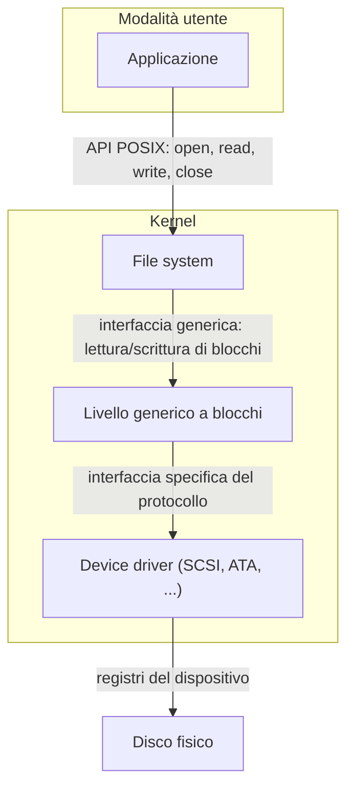
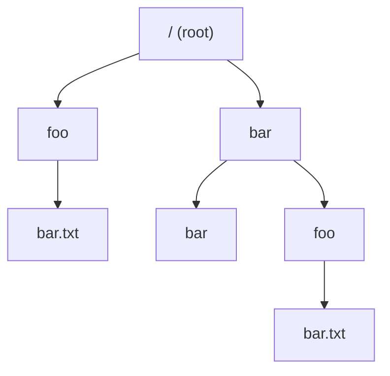
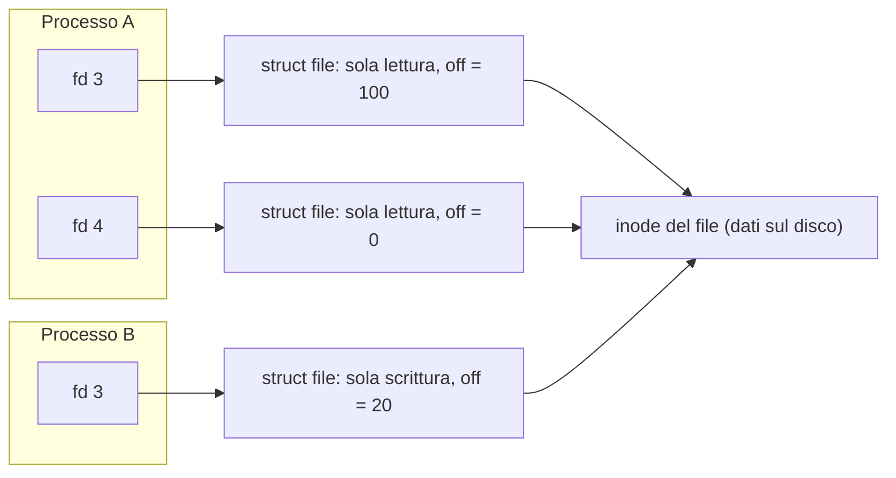

# Lezione 15 — File e directory, chiamate di sistema sui file ed esercitazione

La lezione apre il terzo grande tema del corso, la **persistenza**, cioè la memorizzazione dei dati su supporti che li conservano anche a computer spento. Il professore riprende brevemente il discorso sui dispositivi di input/output avviato nella lezione precedente (registri, spazi di indirizzamento dei dispositivi, livelli di astrazione), poi salta in avanti rispetto all'ordine "naturale" degli argomenti: prima di parlare degli hard disk presenta l'organizzazione in **file e directory** e le chiamate di sistema di base per lavorare sui file (`open`, `read`, `write`, `close`, `lseek`), perché la seconda metà della lezione è un'**esercitazione pratica** proprio su queste chiamate. Durante l'esercitazione spiega anche i **permessi dei file** (il misterioso `0644` passato alla `open`) e chiude con un'osservazione sull'interfaccia uniforme che Unix offre ai dispositivi "a caratteri".

Dal capitolo 39 sono state spiegate le slide 1–12; la tabella della slide 13 sull'offset non è stata commentata in aula ma illustra esattamente quanto detto a voce, ed è integrata nella sezione sull'offset. Le slide successive (tabelle dei file aperte condivise, `fsync`, `rename`, `stat`, directory, link) sono riprese e completate nella lezione successiva, quindi non compaiono qui come "slide non trattate". I file degli esercizi (*Esercizi con i file*, su AulaWeb) **non sono tra i materiali ricevuti**: la parte sull'esercitazione si basa su ciò che il professore descrive e commenta in aula, e il codice della soluzione del primo esercizio è ricostruito da quella descrizione (lo si dichiara nel punto in cui compare).

## Ripasso: i dispositivi di input/output

Dopo la virtualizzazione (della CPU e della memoria) e la concorrenza, il corso arriva alla persistenza, già presentata a grandi linee nella [[Lezione 01 - Introduzione ai SO e processi#Persistenza|Lezione 1]]. Per parlarne si è partiti, nella lezione precedente, da come il sistema operativo gestisce in generale i **dispositivi di input/output** (*I/O devices*): l'hard disk è uno di questi, ma non l'unico.

Dal punto di vista fisico i dispositivi sono collegati a un **bus**, un canale di comunicazione condiviso su cui viaggiano i dati. Dal punto di vista logico interessa di più la loro **interfaccia**: nel modello "canonico" delle slide un dispositivo espone tre **registri**, cioè piccole locazioni di memoria interne al dispositivo:

- il registro di **stato** (*status*), che dice in che condizione si trova il dispositivo (per esempio occupato o pronto);
- il registro dei **comandi** (*command*), in cui si scrive l'operazione da eseguire;
- il registro dei **dati** (*data*), attraverso cui passano i dati verso il dispositivo o dal dispositivo.

Il protocollo di base è quindi: leggo lo stato finché il dispositivo è pronto a ricevere comandi, metto i dati nel registro opportuno, scrivo il comando.

Come ogni locazione di memoria, anche questi registri hanno un **indirizzo**, e ci sono due possibilità. Gli indirizzi possono stare in uno **spazio di indirizzamento separato**, dedicato all'I/O e accessibile con istruzioni apposite (sugli x86 `in` e `out`). Il professore usa un'immagine genovese: in città il "12 rosso" (numerazione delle attività commerciali) e il "12" (numerazione degli edifici residenziali) sono indirizzi diversi che non si mescolano, pur avendo lo stesso numero. Oppure i registri possono essere **mappati nello spazio di indirizzamento principale** (*memory-mapped I/O*): una parte degli indirizzi è riservata ai registri dei dispositivi, e scrivere in un registro diventa esattamente come scrivere in un'area di memoria, con le stesse istruzioni di `load` e `store`.

Il fatto che molti dispositivi abbiano registri simili non basta però a renderli intercambiabili: dischi di produttori diversi non sono obbligati a comportarsi allo stesso modo. Il sistema operativo li gestisce perciò attraverso **diversi livelli di astrazione**, in cui ogni livello usa i servizi di quello sottostante e offre un servizio più generale a quello superiore. Per i dischi i livelli sono tre:

1. il **device driver** (*driver di dispositivo*), il pezzo di sistema operativo che conosce i registri e i comandi di quel dispositivo specifico e lo controlla fisicamente; cambia a seconda del tipo di disco;
2. il **livello generico a blocchi** (*generic block layer*): i dischi si leggono e si scrivono a **blocchi**, cioè unità di dimensione prefissata, non byte per byte; questo livello sa leggere e scrivere blocchi e usa il driver sottostante per farlo;
3. il **file system**, ciò che vedono le applicazioni: ragiona in termini di file e cartelle e usa il livello a blocchi.

Il professore paragona la catena alla filastrocca della *Fiera dell'Est* (il bastone che picchia il cane che morse il gatto che si mangiò il topo): ogni livello agisce su quello immediatamente sotto. Lo schema è quello della slide 15 del capitolo 36, *The File System Stack*.



## La persistenza e il suo problema

A che cosa serve un hard disk, o un'unità a stato solido (*SSD*, *solid-state drive*)? A **mantenere i dati in modo persistente e intatto anche se manca la corrente**. Il professore insiste che non è affatto ovvio. Che cosa succede se si stacca la spina mentre il disco sta scrivendo un blocco, o mentre si sta scrivendo un file composto da molti blocchi? Il file è stato scritto tutto? Se sì lo si tiene; se no, che cosa se ne fa, lo si cancella? Il sistema operativo dovrà avere meccanismi per prendere queste decisioni, e se ne parlerà più avanti.

Per rendere la gestione persistente dei dati **virtuale e uniforme**, indipendente dal supporto fisico sottostante, il sistema operativo offre due astrazioni: il **file** e la **directory** (cartella). Anche qui, in un certo senso, si sta virtualizzando: qualunque sia il dispositivo reale, l'utente e i programmi vedono sempre la stessa rappresentazione.

## File e directory

### Il file e l'inode

> [!important] File
> Un **file** è un **array lineare di byte**, cioè una sequenza di byte. Ogni file ha due nomi: un nome di alto livello, leggibile dall'utente (per esempio `pippo.doc`), e un **nome di basso livello**, un numero chiamato **numero di inode** (*inode number*), che l'utente di solito non conosce e non usa. Il sistema operativo tiene traccia dei file attraverso l'inode, non attraverso il nome.

Il termine *inode* (da *index node*) indica la struttura con cui il file system descrive un file; il suo numero lo identifica in modo univoco all'interno del file system. Il file system ha la responsabilità di memorizzare i dati dei file in modo persistente sul disco. Il fatto che il nome "vero" del file sia un numero, e non la stringa che digitiamo, avrà conseguenze importanti quando si parlerà di directory e di link.

### La directory

> [!important] Directory
> Anche la **directory** (cartella) è come un file: ha un nome leggibile e un nome di basso livello, il suo numero di inode. Il suo contenuto, però, è una lista di **coppie (nome leggibile, numero di inode)**. Ogni voce della lista si riferisce a un file oppure a un'altra directory.

Per esempio, una directory può contenere la voce `("foo", "10")`: significa che al suo interno c'è un file che l'utente chiama `foo` e il cui nome di basso livello è l'inode 10. Dei due elementi della coppia l'utente vede sempre il nome e quasi mai l'inode, ma è l'inode quello che il sistema usa davvero per fare riferimento al file. Si può immaginare una directory come una lista di inode, ciascuno dei quali è un file oppure un'altra directory.

### L'albero delle directory

Poiché una directory può contenere altre directory, l'insieme di file e cartelle forma un **albero**, la **gerarchia delle directory** (*directory tree*). Il professore fa notare una differenza con Windows. In Windows ci sono più radici, una per unità: `C:\`, `D:\` e così via, a seconda del disco. In un sistema Unix la radice dell'albero è **una sola**, sempre, ed è indicata con una barra `/`: si chiama **root directory**. Per pura curiosità, *root* è anche il nome del **superutente**, l'utente che nel sistema può fare tutto.

Un file si identifica con il suo **percorso assoluto** (*absolute pathname*): si parte dalla radice e si elencano le directory attraversate, separate da `/`, fino al nome del file. Nell'esempio della slide 5 l'albero è il seguente.



I file validi sono `/foo/bar.txt` e `/bar/foo/bar.txt`; le directory sono `/`, `/foo`, `/bar`, `/bar/bar` e `/bar/foo`. Lo si capisce anche dall'estensione: solo i due `bar.txt` sono file normali, gli altri nodi sono cartelle. Si noti che due file possono avere lo stesso nome (`bar.txt`) purché si trovino in directory diverse: il percorso completo è diverso, e anche l'inode.

## Le chiamate di sistema per i file

Il file system è gestito dal sistema operativo, che deve consentire l'accesso ai dati solo in **modo protetto**: un programma non deve poter fare qualunque cosa sul disco. Per questo l'accesso passa dalle **chiamate di sistema**, il meccanismo visto nella [[Lezione 02 - Process API e Limited Direct Execution#Le system call|Lezione 2]].

Il professore osserva che chi ha già programmato con i file probabilmente non ha mai usato direttamente queste chiamate. In C e in C++ ci sono funzioni di libreria (`printf`, `fprintf`, `fgets`, gli stream del C++) che permettono di scrivere o leggere **con una certa formattazione**: si può dire, per esempio, "stanno per arrivare tre interi", e verranno scritti come tre interi. Quelle che si vedono ora sono invece le chiamate di sistema di base, le più generali possibili: ragionano in termini di **sequenze di byte** e non si interessano della formattazione. Qualunque sia l'interpretazione di quei byte, vengono scritti o letti come byte. Le funzioni di libreria, a loro volta, sono costruite sopra queste chiamate.

### Aprire e creare un file con open

La prima chiamata è la **`open`**, che apre un file: da quel momento lo si può usare. L'esempio della slide 6 crea un file:

```c
int fd = open("foo", O_CREAT | O_WRONLY | O_TRUNC);
```

Il primo parametro è il **nome del file** nel file system (qui `foo`, cioè il file con quel nome nella directory corrente; in generale si può passare un percorso). Il secondo è un insieme di **flag** messe in OR. Quando c'è una barra verticale `|` tra delle costanti, vuol dire che sono flag: ognuna corrisponde a uno o più bit, che il programmatore non vede, e l'OR bit a bit (*bitwise OR*) li combina in un unico intero. Nell'esempio:

- `O_CREAT`: crea il file se non esiste;
- `O_WRONLY`: apre il file in **sola scrittura**. Attenzione al significato: non è il file a non poter essere letto, è questa particolare apertura del file che non permette di leggerlo;
- `O_TRUNC`: se il file esisteva già, lo **tronca** a lunghezza zero, cioè ne cancella il contenuto e riparte da zero.

Altre flag comuni sono `O_RDONLY` (sola lettura) e `O_RDWR` (lettura e scrittura). Se l'apertura non riesce (il file non esiste e non si è chiesto di crearlo, mancano i permessi, il percorso è sbagliato…) la `open` restituisce **−1**: è buona norma controllarlo sempre, come si vedrà nell'esercizio.

> [!warning] Errore nella slide — il terzo parametro di `open`
> Nella slide 6 la `open` con `O_CREAT` ha solo due parametri. Quando si usa `O_CREAT` serve anche un **terzo parametro**, il *mode*, cioè i permessi con cui il file viene creato (per esempio `0644`, vedi [[#I permessi dei file|più avanti]]). Il manuale è esplicito: se il terzo argomento non viene passato, come permessi del file viene usato un valore arbitrario preso dallo stack [@linuxman2open]. Il codice dell'esercitazione, infatti, lo passa sempre. La forma corretta dell'esempio è `open("foo", O_CREAT | O_WRONLY | O_TRUNC, 0644)`.

### Il descrittore di file

La `open` restituisce un intero molto importante, il **descrittore di file** (*file descriptor*, abbreviato `fd`), che si usa da lì in poi per tutte le operazioni su quel file.

> [!important] Descrittore di file
> Il **descrittore di file** è un intero che identifica, all'interno di un processo, **un'istanza di apertura** di un file. Non identifica il file in sé: lo stesso processo può aprire lo stesso file più volte e ottiene ogni volta un descrittore diverso, attraverso cui può operare in modo indipendente. È una "maniglia" con cui si agisce sul file aperto. I descrittori sono **propri di ogni processo**: i numeri assegnati in un processo non hanno nulla a che vedere con quelli di un altro.

Il fatto che il descrittore identifichi un'apertura, e non il file, ha senso: un processo può aprire lo stesso file una volta in sola lettura e una volta in sola scrittura, oppure leggerlo da due punti diversi. Come ogni processo ha il proprio spazio di indirizzamento, così ha la propria sequenza di descrittori: il primo file aperto riceve un certo numero, il successivo il numero dopo e così via, e in un altro processo la sequenza riparte dall'inizio.

Nei sistemi Unix questo si realizza con una semplice struttura dentro la struttura del processo, il PCB visto nella [[Lezione 01 - Introduzione ai SO e processi#Process list e PCB|Lezione 1]]: un array di puntatori ai file aperti, indicizzato proprio dal descrittore. La slide 7 lo mostra con la `struct proc` di xv6:

```c
struct proc {
    ...
    struct file *ofile[NOFILE]; // file aperti dal processo
    ...
};
```

Il descrittore è quindi semplicemente un indice in questo array; `NOFILE` è il numero massimo di file che un processo può tenere aperti contemporaneamente.

#### Perché il primo descrittore è 3

Il professore pone una domanda all'aula. Ci si aspetterebbe che il primo file aperto da un processo riceva il descrittore 0 (o 1, se si conta da 1); invece riceve **3**. Perché? Dall'aula arriva la risposta giusta: i descrittori 0, 1 e 2 sono già occupati dai tre flussi standard, aperti automaticamente alla creazione del processo, come si era visto parlando di [[Lezione 02 - Process API e Limited Direct Execution#Redirezione dell'input e dell'output|redirezione]].

| Descrittore | Flusso | Uso |
| ----------- | ------ | --- |
| 0 | standard input | ciò che si legge, normalmente dalla tastiera |
| 1 | standard output | ciò che si scrive, normalmente sullo schermo |
| 2 | standard error | i messaggi di errore |

Leggere da tastiera e scrivere su schermo, in fondo, significa leggere e scrivere sequenze di byte: è naturale che il meccanismo sia lo stesso dei file. E poiché sono descrittori come gli altri, si possono anche **chiudere**. Se si chiude lo standard output e subito dopo si apre un file, il sistema assegna al file il primo descrittore libero, che è proprio l'1: da quel momento tutto ciò che il programma "stampa a schermo" finisce nel file, senza cambiare nient'altro nel codice. È il principio del terzo esercizio dell'esercitazione.

> [!example] Esperimento — chiudere lo standard output
> Il programma seguente chiude il descrittore 1, apre un file e poi usa una normale `printf`.
>
> ```c
> #include <stdio.h>
> #include <fcntl.h>
> #include <unistd.h>
>
> int main(void) {
>     close(STDOUT_FILENO);                 /* libera il descrittore 1 */
>     int fd = open("uscita.txt", O_CREAT | O_WRONLY | O_TRUNC, 0644);
>     printf("Questa riga finisce nel file (fd = %d)\n", fd);
>     return 0;
> }
> ```
>
> Compilato con `gcc -Wall` ed eseguito, non stampa nulla sullo schermo; il file `uscita.txt` contiene:
>
> ```text
> Questa riga finisce nel file (fd = 1)
> ```
>
> La `open` ha restituito 1, il primo descrittore libero, e la `printf` (che scrive sempre sul descrittore 1) ha scritto nel file.

> [!tip] Approfondimento — Il descrittore più basso e `dup2`
> #approfondimento
> Il comportamento sfruttato nell'esperimento è garantito dal manuale: il descrittore restituito da una `open` riuscita è sempre **il descrittore con il numero più basso non ancora aperto** nel processo [@linuxman2open]. Per redirigere un flusso in modo esplicito, senza contare su quale descrittore sia libero, esiste la chiamata `dup2(oldfd, newfd)`, che fa lo stesso lavoro di `dup` ma, invece di usare il descrittore libero più basso, usa il numero indicato in `newfd` [@linuxman2dup]. È lo strumento che usano le shell per realizzare `>` e `<`.

### Vedere le chiamate di sistema con strace

La slide 8 mostra un esempio in shell:

```bash
prompt> echo hello > foo
prompt> cat foo
hello
```

`echo` è un comando Linux che riproduce sullo standard output la stringa ricevuta (qui `hello`). Il segno `>` è la **redirezione dello standard output** della shell: invece di chiudere a mano lo standard output dentro il programma, come nell'esperimento sopra, lo fa la shell, e il risultato di `echo` va nel file `foo` invece che sullo schermo. `cat` è un altro comando che mostra sullo schermo il contenuto di un file: `cat foo` mostra appunto `hello`.

Per vedere che cosa fa `cat` dal punto di vista del sistema operativo si usa **`strace`**, un comando che esegue un programma e mostra la traccia di tutte le chiamate di sistema che esso effettua. Attenzione: quello che segue non è codice C, è l'**output** di `strace`. L'estratto della slide 9 è:

```text
prompt> strace cat foo
...
open("foo", O_RDONLY|O_LARGEFILE)         = 3
read(3, "hello\n", 4096)                  = 6
write(1, "hello\n", 6)                    = 6   // descrittore 1: standard output
hello
read(3, "", 4096)                         = 0   // 0: non ci sono più byte nel file
close(3)                                  = 0
...
```

La lettura riga per riga conferma esattamente ciò che ci si aspetta:

1. `cat` apre `foo` in sola lettura; la `open` restituisce **3**, il primo descrittore libero, perché 0, 1 e 2 sono occupati;
2. legge dal descrittore 3 chiedendo **fino a 4096 byte**: la `read` richiede di specificare quanti byte si vogliono leggere al massimo, e `cat` ne chiede molti di più di quanti ce ne siano. Il file contiene solo `hello\n`, cioè **6 byte**, e la `read` restituisce 6, il numero di byte effettivamente letti;
3. scrive quei 6 byte sul descrittore **1**, lo standard output, con la `write`, il simmetrico della `read`; per questo `hello` compare sullo schermo;
4. prova a leggere ancora: la `read` restituisce **0**, che significa che il file è finito;
5. chiude il descrittore 3 con la `close`.

> [!warning] Precisazione — che cos'è `\n`
> A lezione il carattere `\n` viene descritto come "il carattere di fine stringa". In realtà `\n` è il carattere di **a capo** (*newline*), che `echo` aggiunge dopo la stringa. I 6 byte del file sono `h`, `e`, `l`, `l`, `o` e l'a capo; il terminatore di stringa del C (`\0`, il byte zero) **non** viene scritto nel file. Il conto di 6 byte resta quindi corretto, ma per un motivo diverso.

> [!tip] Approfondimento — Che cosa mostra `strace` su un sistema recente
> #approfondimento
> `strace` esegue il comando indicato fino alla sua terminazione e ne registra le chiamate di sistema [@linuxman1strace]. Ripetendo l'esperimento delle slide su un Linux attuale (verificato eseguendo `strace cat foo`), la traccia ha la stessa struttura ma due differenze di dettaglio: al posto di `open` compare `openat(AT_FDCWD, "foo", O_RDONLY) = 3`, una variante di `open` che interpreta il percorso relativo alla directory corrente (`AT_FDCWD`), e `cat` chiede blocchi di 131072 byte invece di 4096. Prima delle righe sul file, inoltre, compaiono molte altre chiamate (per esempio le `open` e le `read` delle librerie condivise caricate all'avvio del programma), che le slide omettono con i puntini.

### Scrivere con write e leggere con read

Nella traccia di `strace` si è visto all'opera l'unica chiamata già spiegata, la `open`; restano la `write`, la `read` e la `close`. Le slide 9 e 10 le presentano così:

```c
int bwritten = write(fd, buffer, strlen(buffer));
int bread    = read(fd, buffer, sizeof(buffer));
close(fd);
```

La **`write`** ha tre parametri.

1. Il **descrittore** su cui scrivere: si possono avere più file aperti e bisogna dire in quale scrivere.
2. Il **buffer**, cioè un puntatore a un'area di memoria che contiene i dati da scrivere. Questo significa che prima bisogna aver dichiarato un puntatore (per esempio `char *buffer`), averlo **allocato**, perché il puntatore da solo non basta (con `malloc`, quindi nello heap, oppure dichiarando un array), e averlo riempito con i dati.
3. **Quanti byte** scrivere. Nell'esempio non è un numero scritto a mano (si potrebbe: se si sa che sono 18 si scrive 18), ma `strlen(buffer)`, la lunghezza della stringa contenuta nel buffer: si sta dicendo di scrivere tutto il contenuto del buffer.

La `write` restituisce il **numero di byte effettivamente scritti**, che può essere minore di quello richiesto, oppure −1 in caso di errore.

La **`read`** è il simmetrico: il descrittore da cui leggere, il puntatore a un'area di memoria **già allocata** in cui mettere i dati letti (il suo contenuto iniziale non interessa, interessa ciò che ci sarà dopo la lettura) e il numero **massimo** di byte da leggere. Non è detto che nel file ci siano tanti byte quanti se ne chiedono: se se ne chiedono 100 e ne restano solo 10, la `read` ne legge 10, li mette nel buffer e restituisce 10. Restituisce **0** quando si è alla fine del file, −1 in caso di errore. Le due chiamate hanno dunque la stessa struttura e significato simmetrico.

Infine la **`close(fd)`** chiude il descrittore: il file non serve più e il descrittore torna libero. Bisogna sempre ricordarsi di chiudere i file; il professore lo paragona a chiudere il gas, e l'aula aggiunge le portiere della macchina e le relazioni tossiche.

> [!warning] Errore nella slide — i parametri di `open` e della `read`
> Due imprecisioni nelle slide 9 e 10. Nella slide 9 la firma è scritta `open(file descriptor, flags)`: il primo parametro della `open` non è un descrittore (è proprio la `open` a restituirlo), ma il **nome del file**; la firma corretta è `open(pathname, flags)` oppure `open(pathname, flags, mode)`. Nella slide 10 la `read` è scritta `read(fd, buffer, strlen(buffer))`: per la lettura `strlen` non ha senso, perché misura la stringa già presente nel buffer (che prima della lettura può contenere qualunque cosa). Il terzo parametro deve essere la **capacità** del buffer, per esempio `sizeof(buffer)` se è un array; nella nota si usa questa forma.

> [!warning] Precisazione — chiedere di scrivere più byte di quelli presenti nel buffer
> A lezione si fa l'esempio di una `write` a cui si chiede di scrivere 30 byte quando nel buffer "ce ne sono solo 15", dicendo che ne scriverà 15. Non è così: la `write` non sa quanto è grande il buffer né dove finiscono i dati "utili", e tenterà di scrivere 30 byte a partire da quell'indirizzo, leggendo memoria oltre la fine dei dati (comportamento indefinito, che può anche far terminare il programma). Il numero di byte richiesto è responsabilità di chi chiama. Il valore di ritorno può effettivamente essere minore del richiesto, ma per motivi legati al dispositivo o al sistema: per esempio spazio insufficiente sul supporto fisico, il superamento del limite `RLIMIT_FSIZE` sulla dimensione dei file, o un segnale che interrompe la chiamata dopo una scrittura parziale [@linuxman2write]. Per la `read`, invece, l'esempio del professore è corretto: chiedere più byte di quelli rimasti nel file è normale, e la chiamata restituisce quanti ne ha letti davvero.

### L'offset corrente

> [!important] Offset corrente
> Ogni file aperto ha un **offset corrente** (*current offset*): la posizione all'interno del file da cui partirà la prossima lettura o scrittura. L'offset è associato al **descrittore**, cioè all'istanza di apertura, e **non** al file fisico. L'offset si aggiorna in due modi:
> - **implicitamente**: una `read` o una `write` di $N$ byte aggiunge $N$ all'offset;
> - **esplicitamente**, con la chiamata `lseek`.

Il professore lo spiega con la lettura, più facile da visualizzare. Lo stesso file può essere aperto in lettura da due processi diversi, o anche due volte dallo stesso processo, e i due lettori possono trovarsi in punti diversi: come due persone che leggono lo stesso libro, una più veloce che è già a una certa pagina e una più lenta che è più indietro. In un certo istante un descrittore può essere al byte 20 e l'altro al byte 15: non c'è nulla di strano, perché ogni descrittore mantiene il proprio stato separatamente.

Nel caso normale la lettura è **sequenziale**: se il file contiene 100 byte e si chiama ripetutamente `read` di 10 byte, la prima legge i primi 10 e sposta l'offset a 10, la seconda legge i secondi 10, poi i terzi, e così via, senza che il programma debba fare nulla. La slide 13 mostra due tracce; i valori sono stati ricalcolati eseguendo un piccolo programma su un file di 300 byte.

> [!example] Come si muove l'offset (slide 13)
> Un solo descrittore che legge un file di 300 byte, 100 byte alla volta:
>
> | Chiamata | Valore restituito | Offset corrente |
> | -------- | ----------------- | --------------- |
> | `fd = open("file", O_RDONLY);` | 3 | 0 |
> | `read(fd, buffer, 100);` | 100 | 100 |
> | `read(fd, buffer, 100);` | 100 | 200 |
> | `read(fd, buffer, 100);` | 100 | 300 |
> | `read(fd, buffer, 100);` | 0 | 300 |
> | `close(fd);` | 0 | – |
>
> La quarta `read` restituisce 0: l'offset è già alla fine del file e non c'è più nulla da leggere.
>
> Due descrittori sullo stesso file, aperti dallo stesso processo:
>
> | Chiamata | Valore restituito | Offset di `fd1` | Offset di `fd2` |
> | -------- | ----------------- | --------------- | --------------- |
> | `fd1 = open("file", O_RDONLY);` | 3 | 0 | – |
> | `fd2 = open("file", O_RDONLY);` | 4 | 0 | 0 |
> | `read(fd1, buffer1, 100);` | 100 | 100 | 0 |
> | `read(fd2, buffer2, 100);` | 100 | 100 | 100 |
> | `close(fd1);` | 0 | – | 100 |
> | `close(fd2);` | 0 | – | – |
>
> La seconda `open` restituisce 4, perché il 3 è già occupato. La lettura da `fd1` sposta solo il suo offset: `fd2` riparte da 0 e legge gli stessi primi 100 byte. Nelle slide le due colonne si chiamano `OFT[10]` e `OFT[11]`: sono le voci 10 e 11 della tabella dei file aperti del sistema, di cui si parlerà nella lezione successiva.

### La struttura struct file

Dove si trova l'offset? Nella struttura che il sistema crea **ogni volta che un file viene aperto**. La slide 11 ne mostra una versione semplificata, che non è quella reale del kernel Linux ma rende l'idea; il professore precisa che non va imparata a memoria.

```c
struct file {
    int ref;           // quanti riferimenti puntano a questa struttura
    char readable;     // l'apertura consente la lettura?
    char writable;     // l'apertura consente la scrittura?
    struct inode *ip;  // il file vero e proprio, tramite il suo inode
    uint off;          // l'offset corrente
};
```

Un processo che ha aperto il file in sola lettura avrà `readable` vero e `writable` falso; un altro che l'ha aperto in sola scrittura avrà il contrario. Ogni apertura produce una struttura diversa, con il proprio offset. Tutte però devono fare riferimento allo **stesso file fisico** sul disco, quello che contiene davvero i dati, e lo fanno attraverso l'**inode**, il numero che identifica in modo univoco ogni file e ogni cartella. Il campo `ref` conta quanti riferimenti puntano a quella struttura; serve nei casi in cui una stessa voce è condivisa, che saranno visti nella lezione successiva.



Il diagramma riassume i tre livelli: il **descrittore** è un indice nell'array `ofile` del processo, punta a una **`struct file`** (un'istanza di apertura, con modalità e offset), che a sua volta punta all'**inode** del file. Lo stesso numero di descrittore (3) in due processi diversi indica aperture del tutto diverse.

### Spostare l'offset con lseek

Il secondo modo per cambiare l'offset è esplicito, con la chiamata di sistema **`lseek`** (slide 12), che permette di spostarsi in una certa posizione del file: per esempio "voglio leggere a partire dal trentesimo byte, quello che c'è prima non mi interessa".

```c
off_t lseek(int fildes, off_t offset, int whence);
```

- `fildes` è il **descrittore** del file su cui spostarsi;
- `offset` è **dove** spostare l'offset; per sceglierlo bisogna sapere come è strutturato il contenuto del file, altrimenti è impossibile sapere dove andare;
- `whence` dice **come** interpretare `offset`.

I valori di `whence`, come riportati dal manuale, sono tre [@linuxman2lseek]:

| `whence` | Nuovo offset |
| -------- | ------------ |
| `SEEK_SET` | `offset` byte dall'inizio del file (posizione assoluta) |
| `SEEK_CUR` | la posizione corrente più `offset` byte (spostamento relativo) |
| `SEEK_END` | la dimensione del file più `offset` byte |

La `lseek` restituisce il nuovo offset, misurato dall'inizio del file. Il professore spiega perché serve la forma relativa: a volte si sa di voler andare alla posizione 112 e si usa la posizione assoluta; ma se il file contiene una sequenza di **record** tutti uguali, di dimensione fissa, per andare al record successivo basta sommare la dimensione di un record alla posizione corrente, e per saltarne uno la si somma due volte. Va notato che la `lseek` **non** compie alcuna operazione sul disco: modifica soltanto il campo `off` della `struct file`, che sarà usato dalla prossima `read` o `write`.

> [!example] `lseek` su un file di 300 byte
> Con lo stesso file di 300 byte dell'esempio precedente (valori verificati eseguendo il programma):
>
> | Chiamata | Valore restituito (nuovo offset) |
> | -------- | -------------------------------- |
> | `lseek(fd, 30, SEEK_SET)` | 30 |
> | `lseek(fd, 50, SEEK_CUR)` | 80 |
> | `lseek(fd, -10, SEEK_END)` | 290 |
>
> Una `read(fd, buf, 100)` eseguita subito dopo l'ultima chiamata leggerebbe solo gli ultimi 10 byte.
>
> Un trucco frequente: `lseek(fd, 0, SEEK_CUR)` non sposta nulla e restituisce l'offset corrente. È così che sono stati ottenuti i valori delle tabelle precedenti.

> [!tip] Approfondimento — Spostarsi oltre la fine del file
> #approfondimento
> La `lseek` permette di portare l'offset **oltre la fine** del file, e questo non cambia la dimensione del file. Se poi si scrive in quella posizione, lo spazio intermedio diventa un **buco** (*hole*): le letture di quella zona restituiscono byte nulli finché qualcuno non ci scrive dati [@linuxman2lseek]. È il meccanismo dei cosiddetti file sparsi, che occupano sul disco meno spazio della loro dimensione apparente.

## I permessi dei file

Durante l'esercitazione uno studente chiede che cosa significhi il `0644` passato come terzo parametro alla `open`. Il professore coglie l'occasione per spiegare i permessi, già incontrati nella [[Lezione 06 - Base and bound, Memory API ed esercitazione Linux#I permessi dei file|Lezione 6]] con `ls -l`; li si ritroverà anche nelle slide successive.

Ogni file ha permessi di **lettura** (`r`, *read*), **scrittura** (`w`, *write*) ed **esecuzione** (`x`, *execute*) per tre categorie di utenti: il **proprietario** del file (*owner*), il **gruppo** del proprietario (*group*) e **tutti gli altri** (*others*). Con `ls -l` nella propria cartella si vede la lista dei file con il proprietario (probabilmente sé stessi, oppure `root` se è un file di sistema) e il gruppo.

Il numero passato alla `open` è scritto in **ottale** (base 8, ed è per questo che inizia con lo 0). Ogni cifra ottale corrisponde esattamente a **3 bit**, e ogni bit è un permesso:

> [!important] Permessi in notazione ottale
> Ogni cifra ottale descrive i permessi di **una categoria di utenti**; i suoi tre bit sono, da sinistra, lettura (valore 4), scrittura (valore 2) ed esecuzione (valore 1).
>
> | Cifra | Bit `rwx` | Permessi |
> | ----- | --------- | -------- |
> | 7 | `111` | `rwx` lettura, scrittura, esecuzione |
> | 6 | `110` | `rw-` lettura e scrittura |
> | 5 | `101` | `r-x` lettura ed esecuzione |
> | 4 | `100` | `r--` solo lettura |
> | 0 | `000` | `---` nessun permesso |
>
> Le cifre si leggono nell'ordine **proprietario, gruppo, altri**. Così `0644` significa `rw-r--r--`: il proprietario può leggere e scrivere, il gruppo e tutti gli altri possono solo leggere.

> [!warning] Precisazione — come si legge `644`
> A lezione la spiegazione è partita in modo confuso: prima si dice che il 6 si riferisce ai permessi di lettura, il primo 4 a quelli di scrittura e il secondo 4 a quelli di esecuzione, poi che i tre bit di una cifra riguardano proprietario, gruppo e altri. È il contrario. Le **tre cifre** corrispondono alle tre **categorie di utenti** (proprietario, gruppo, altri), e i **tre bit di ciascuna cifra** corrispondono ai tre **permessi** (`r`, `w`, `x`). Quindi 6 = `110` dà al proprietario lettura e scrittura (non esecuzione), e 4 = `100` dà al gruppo e agli altri la sola lettura; nessuno può eseguire il file. La lettura corretta coincide con quella del manuale di GNU Coreutils sulla struttura dei bit dei permessi [@gnucoreutilsmode].

Nel codice dell'esercitazione l'importante, osserva il professore, sono i permessi del **proprietario**, che devono comprendere lettura e scrittura: il programma scrive il file e poi lo vuole rileggere. Gli altri due 4 interessano poco. Il valore massimo è `777`, tutti i permessi a tutti, che spesso non ha neanche molto senso: un file di testo può essere letto e scritto, ma "eseguirlo" è assurdo, come eseguire un foglio del Blocco note. Gli eseguibili prodotti dal compilatore, invece, hanno sicuramente la `x`, e se non ce l'hanno bisogna aggiungerla. Per le cartelle il significato di `x` è diverso, come già precisato nella [[Lezione 06 - Base and bound, Memory API ed esercitazione Linux#I permessi dei file|Lezione 6]]: a lezione si ripete che "eseguire" una cartella vuol dire poterne elencare il contenuto con `ls`, ma elencare è il permesso `r`, mentre `x` permette di **attraversarla** e accedere ai file che contiene.

> [!tip] Approfondimento — Il `mode` della `open` e la `umask`
> #approfondimento
> I permessi passati alla `open` non sono necessariamente quelli che il file avrà davvero. Il manuale specifica che il file viene creato con permessi `(mode & ~umask)`, dove la **umask** è una maschera del processo che toglie alcuni permessi [@linuxman2open]. Il valore predefinito tipico è `022`, cioè toglie la scrittura al gruppo e agli altri: per esempio con `mode` uguale a `0666` il file ottiene `0644`, cioè `rw-r--r--` [@linuxman2umask]. Nell'esercitazione, chiedendo `0644` con la umask `022`, i permessi restano `0644` (verificato con `ls -l` sul file creato).

### Cambiare i permessi con chmod e sudo

Per cambiare i permessi di un file esistente c'è il comando **`chmod`** (*change mode*), che accetta la stessa notazione ottale:

```bash
chmod 660 nome_file
```

Dopo questo comando proprietario e gruppo possono leggere e scrivere il file, gli altri non possono fare niente, e nessuno lo può eseguire. Naturalmente non tutti possono cambiare i permessi di qualunque file: sarebbe troppo facile se `root` avesse reso un file non scrivibile e chiunque potesse renderlo scrivibile. Questi comandi possono essere eseguiti solo dal **proprietario** del file, oppure da `root`.

> [!warning] Precisazione — chi può usare `chmod`
> A lezione si dice anche che i permessi si possono cambiare sui file su cui si ha il permesso di scrittura. Il criterio è un altro: conta essere il **proprietario** del file (o il superutente), non avere il permesso `w`. È stato verificato con due utenti diversi: il proprietario di un file a sola lettura (`444`) riesce a cambiarne i permessi, mentre un altro utente non ci riesce su un file scrivibile da tutti (`666`), e riceve "Operation not permitted".

Sul proprio computer, però, si è l'autorità massima. Il comando **`sudo`** esegue il comando che lo segue con i privilegi del superutente (*superuser do*, "fai da superutente"; non c'entra niente con il sudare, scherza il professore):

```bash
sudo chmod 660 nome_file
```

Normalmente un utente qualunque non potrebbe farlo, ma l'utente creato all'installazione del sistema può agire da superutente. `sudo` chiede la password: in questo modo le operazioni pericolose si fanno solo **con consapevolezza**. Si può anche cancellare tutto, ma bisogna farlo con `sudo` e confermare di volerlo davvero.

> [!warning] Precisazione — come si diventa root
> A lezione si cita la forma `sudo root` per "diventare root". Non è un comando valido (`sudo` cercherebbe di eseguire un programma chiamato `root`). Per aprire una shell da superutente si usano di solito `sudo -i` oppure `sudo su`; per un singolo comando basta premettere `sudo`, come nell'esempio sopra.

## Esercitazione: esercizi con i file

La seconda metà della lezione è dedicata agli esercizi. Il professore ricorda che, come sempre, non si tratta di una prova: si sta imparando facendo. Il materiale è nella sezione *Persistenza* di AulaWeb, con il nome *Esercizi con i file*, in due formati equivalenti, `.zip` e `.tgz` (il secondo perché nei sistemi Unix è il formato di archivio più comune). Gli esercizi vanno svolti su una macchina Linux, ma basta anche il sottosistema Linux di Windows.

### Preparare l'ambiente

I passi suggeriti sono gli stessi delle esercitazioni precedenti.

```bash
unzip nome_archivio.zip          # oppure: tar xzf nome_archivio.tgz
gedit nome_file.c                # o qualunque editor di testo
g++ nome_file.c -o nome_eseguibile
./nome_eseguibile
```

Si scarica l'archivio, si apre un terminale nella cartella giusta (per esempio con il tasto destro e "Apri nel terminale"), si scompatta (anche dall'interfaccia grafica va bene), si guardano i file con un editor (il professore usa `gedit`; un tempo usava `vi`) e si compila. Il professore suggerisce `g++` "per sicurezza", nel caso sfugga qualche costrutto del C++: non servono i thread, quindi non serve `-pthread`. Il sorgente non può essere eseguito direttamente: va **prima compilato** per produrre l'eseguibile, perché il processore non capisce il C. È diverso da Python, linguaggio interpretato (che in realtà traduce il codice al volo, in una macchina virtuale).

Gli esercizi sono tre, ciascuno con un file di partenza (*start*) e uno con la soluzione. Il consiglio è tenerli aperti entrambi: leggere che cosa chiede lo *start*, pensarci un attimo e poi guardare la soluzione e ricopiarla. Ci si pone la domanda e si vede la risposta, e questo, secondo il professore, è imparare. Il suggerimento più importante è di **non trasformarli in una sfida di programmazione**: non è un corso di programmazione, si sta imparando a usare le chiamate di sistema, e per questo si possono consultare il manuale o gli esempi proposti e seguire quella strada.

1. **Esercizio 1**: apertura di un file in scrittura, scrittura, e poi lettura.
2. **Esercizio 2**: uso della `lseek`.
3. **Esercizio 3**: chiude lo standard input e lo standard output e poi legge e scrive su file usando le funzioni che normalmente si usano per lo schermo e la tastiera, come la `printf`: avendo chiuso lo standard output, la `printf` scrive nel file. È il "giochino" dei descrittori visto [[#Perché il primo descrittore è 3|sopra]].

Il professore consiglia l'ordine 1, 3, 2, perché il terzo gli sembra il più curioso, e di finire a casa quello che non si riesce a fare in aula. Spiega anche che nella pagina c'erano file più vecchi, nascosti agli studenti, con solo i primi due esercizi: il terzo è stato aggiunto il giorno stesso.

> [!warning] Precisazione — file `.c` compilati con `g++`
> I file degli esercizi hanno estensione `.c` ma vengono compilati con `g++`, cioè come C++. Per il codice di questi esercizi non fa differenza (la ricostruzione qui sotto è stata compilata sia con `gcc -Wall -Wextra` sia con `g++ -Wall` senza avvisi), ma in generale C e C++ sono linguaggi diversi e alcuni programmi C validi non compilano come C++.

### La soluzione del primo esercizio

Per chi era in difficoltà il professore commenta la soluzione del primo esercizio. Il programma dichiara un descrittore e un array di 256 caratteri. L'array è dichiarato con dimensione fissa, quindi non finisce nello heap (è una variabile locale, sullo stack), ma è comunque un'area di memoria a cui si può passare un puntatore. Poi:

1. con `printf` chiede all'utente di inserire una frase, e con una funzione di lettura dallo standard input la mette nel buffer; sono funzioni di libreria che lavorano sullo standard output e sullo standard input e servono solo a dialogare con l'utente;
2. apre il file **in scrittura** con `open`, flag di creazione, sola scrittura e troncamento, e permessi `0644`;
3. se il descrittore è −1 l'apertura non è riuscita: si gestisce l'errore (non sempre lo si fa, ma è corretto farlo);
4. scrive con `write` tutto il contenuto del buffer; il nome dell'array senza parentesi quadre è l'indirizzo del suo primo elemento, come un puntatore `char *`;
5. chiude il file;
6. lo **riapre in sola lettura**. Lo si fa apposta in due fasi separate: si sarebbe potuto aprirlo in lettura e scrittura, tornare all'inizio e leggere, ma si preferisce chiuderlo e riaprirlo. Anche qui si controlla che il descrittore non sia −1;
7. legge il file **un byte alla volta**, per mostrare che si può fare: la `read` riceve l'**indirizzo** di una variabile `char ch` (il secondo parametro è sempre l'indirizzo di un'area di memoria, e una variabile `char` è un'area di un byte), e il ciclo continua finché la `read` restituisce 1, cioè finché trova un nuovo byte; ogni byte viene stampato sullo schermo con `putchar`;
8. chiude il file.

> [!warning] Codice ricostruito dalla descrizione
> Il file della soluzione non è tra i materiali ricevuti. Il codice seguente è stato scritto seguendo passo per passo la descrizione fatta in aula (la funzione di lettura dell'input, che nella trascrizione è incomprensibile, è stata resa con `fgets`; il nome del file è inventato). Può differire nei dettagli dal file di AulaWeb, che resta il riferimento. È stato compilato con `gcc -Wall -Wextra` e con `g++ -Wall` ed eseguito.

```c
#include <stdio.h>
#include <stdlib.h>
#include <string.h>
#include <fcntl.h>
#include <unistd.h>

int main(void) {
    int fd;
    char buffer[256];

    printf("Inserisci una frase: ");
    if (fgets(buffer, sizeof(buffer), stdin) == NULL) {
        fprintf(stderr, "Nessun input\n");
        return 1;
    }

    /* Prima fase: apertura in scrittura e scrittura */
    fd = open("foo.txt", O_CREAT | O_WRONLY | O_TRUNC, 0644);
    if (fd == -1) {
        perror("open in scrittura");
        return 1;
    }
    ssize_t scritti = write(fd, buffer, strlen(buffer));
    if (scritti == -1) {
        perror("write");
        close(fd);
        return 1;
    }
    close(fd);

    /* Seconda fase: riapertura in lettura e lettura un byte alla volta */
    fd = open("foo.txt", O_RDONLY);
    if (fd == -1) {
        perror("open in lettura");
        return 1;
    }
    char ch;
    while (read(fd, &ch, 1) == 1)
        putchar(ch);
    close(fd);
    return 0;
}
```

Le librerie incluse sono quelle che servono alle chiamate di sistema: `fcntl.h` per la `open` e le sue flag, `unistd.h` per `read`, `write` e `close`. `perror` stampa sullo standard error un messaggio che spiega l'ultimo errore. Il tipo `ssize_t` è un intero con segno, perché la `write` può restituire −1.

```text
$ ./es1
Inserisci una frase: ciao a tutti
ciao a tutti
$ ls -l foo.txt
-rw-r--r-- 1 utente utente 13 nov 21 14:33 foo.txt
```

Il file contiene 13 byte: i 12 caratteri di "ciao a tutti" più l'a capo letto da `fgets`. I permessi `rw-r--r--` sono proprio `0644`.

## I dispositivi a caratteri e l'interfaccia uniforme

Verso la fine dell'esercitazione il professore interrompe il lavoro per un'osservazione che considera importante. Una delle ambizioni di un sistema operativo è offrire un'**interfaccia il più possibile simile** per dispositivi diversi: vicino all'hardware ciascuno è costruito a modo suo, ma sarebbe bellissimo che il sistema potesse gestirli tutti nello stesso modo.

I sistemi Unix ci sono riusciti, almeno per una parte dei dispositivi, in modo che il professore definisce meraviglioso. Molti dispositivi si possono interpretare come un **flusso di caratteri** in lettura o in scrittura: la tastiera produce un flusso di caratteri; il mouse, in fondo, produce un flusso di spostamenti; la porta della stampante riceve un flusso di byte. Tutti questi sono classificati come **dispositivi a caratteri** (*character devices*, dispositivi di tipo *char*): con loro si interagisce leggendo o scrivendo sequenze di byte. E con quali chiamate di sistema? Proprio **`open`, `read`, `write`, `close`**, le stesse appena viste per i file. Si usano identiche per leggere e scrivere da una porta seriale, da una porta parallela e da altri dispositivi.

I dispositivi sono cambiati molto negli anni e oggi molti non rientrano in questa categoria, ma all'inizio erano quasi tutti di questo tipo: leggere da un file o leggere dal mouse era esattamente la stessa cosa. È per questo che le chiamate di sistema viste oggi sono interessanti: non sono solo il modo di leggere e scrivere file, sono un **meccanismo fondamentale per leggere e scrivere da un dispositivo di input/output**, con Unix come esempio. I dispositivi si vedono, infatti, come file speciali nella directory `/dev`: con `ls -l` il primo carattere della riga è `c` per i dispositivi a caratteri e `b` per quelli **a blocchi** (come i dischi, che si leggono a blocchi, come detto nel ripasso). Su un Linux di prova, per esempio, `/dev/null` e `/dev/tty` risultano dispositivi `c` e `/dev/loop0` un dispositivo `b`.

## Una domanda dall'aula: sistemi operativi per desktop e per server

Durante l'esercitazione uno studente chiede quale sia la differenza tra le versioni "normali" e "server" di un sistema operativo (per esempio Windows e Windows Server, o le distribuzioni Linux per server), visto che un computer personale dovrebbe servire un solo utente alla volta. Il professore risponde che, secondo lui, i **meccanismi di base** visti nel corso (gestione della memoria virtuale, paginazione, scheduling) non cambiano. Anche l'idea dell'utente unico non regge: su un Linux standard si possono far collegare molti altri computer e lavorarci contemporaneamente, ed è una cosa che si fa abitualmente. Le differenze stanno piuttosto nella **configurazione**, nei **servizi installati** e negli **obiettivi d'uso**: un sistema per server ha spesso un'interfaccia testuale invece che grafica, si gestisce da remoto (per esempio via SSH), offre servizi come web server, database e file server invece di browser e applicazioni multimediali, e include strumenti e driver aggiuntivi, per esempio per gestire dischi multipli ridondanti o un gruppo di continuità (UPS) che permette di sopravvivere a un calo temporaneo di corrente. Il kernel si può configurare in modo diverso, per esempio dando meno peso alla latenza di risposta, e le macchine server sono di solito più potenti, con molti più core; ma nulla impedisce di installare una versione server su un PC poco potente. In sintesi, per il professore, la differenza non è sostanziale.

## Indicazioni pratiche

- Per questa lezione andava portato il **PC**: il professore l'aveva detto a voce nella lezione precedente ma non l'aveva scritto su AulaWeb, e si scusa; chi non l'aveva ha lavorato con un compagno.
- Gli esercizi sono nella sezione **Persistenza** di AulaWeb, *Esercizi con i file*, in formato `.zip` o `.tgz` (identici). Sono tre; l'ordine consigliato è 1, 3, 2, e quelli non finiti vanno completati a casa. Per compilare: `g++ nome.c -o nome_eseguibile`.
- Il consiglio del professore: non perdere tempo a "programmare", ma usare il manuale e gli esempi per imparare **come si usano le chiamate di sistema**.
- Nella **lezione successiva** si riprendono i meccanismi del file system: un riepilogo delle chiamate viste e le slide rimanenti del capitolo 39. Ci potrà essere un'altra esercitazione, ma molto più avanti, quando si parlerà di rete.
