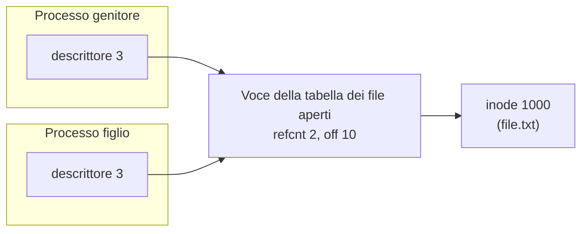
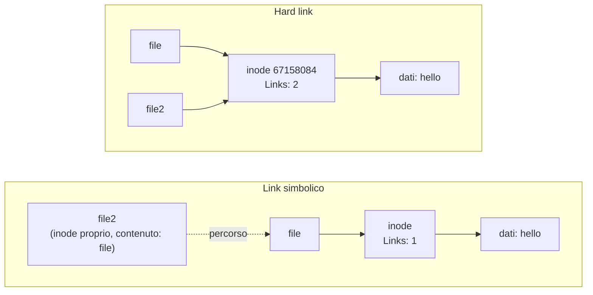
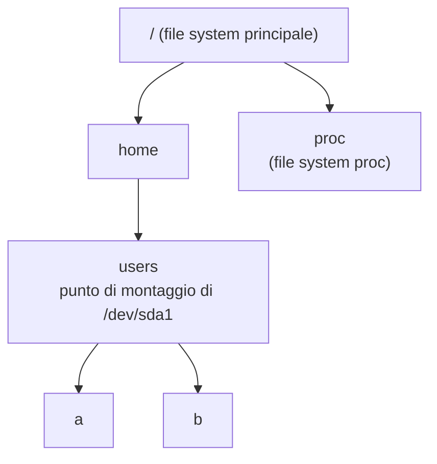

# Lezione 16 — File e directory, link, montaggio dei file system e introduzione ai dischi rigidi

La lezione completa la panoramica sull'interfaccia del **file system** iniziata nella [[Lezione 15 - File e directory, chiamate di sistema sui file ed esercitazione|lezione precedente]], quando le prime chiamate di sistema sui file erano state presentate in fretta per poter svolgere gli esercizi. Il professore riparte da un breve riepilogo (file, inode, directory, `open`, `read`, `write`, `close`, descrittori di file) e prosegue con il resto del capitolo 39: l'**offset** e la chiamata `lseek`, la condivisione delle voci della tabella dei file aperti tra processo padre e figlio, la scrittura forzata con `fsync`, la sostituzione atomica di un file con `rename`, la rimozione con `unlink`, le directory, gli **hard link** e i **link simbolici**, i **permessi** e infine la creazione e il **montaggio** dei file system. Nell'ultima mezz'ora comincia il capitolo 37 sui **dischi rigidi** (*hard disk drive*): l'interfaccia a settori, la geometria del disco, il ritardo di rotazione, il tempo di seek e la formula del tempo di I/O, che spiega perché le letture sequenziali sono molto più veloci di quelle casuali. Il capitolo 37 prosegue nella [[Lezione 17 - Dischi e implementazione del file system|lezione successiva]].

Per questa lezione non ci sono appunti manuali. Dopo la pausa la registrazione riprende a discorso già avviato, all'inizio della parte sui link simbolici: la parte mancante è breve e coincide con la slide 31, che la nota segue. Gli esempi da terminale e i programmi C della nota sono stati eseguiti su Linux (le uscite riportate sono quelle ottenute, salvo dove si dice che vengono dalle slide).

## Riepilogo: file, inode e directory

### Due livelli di memorizzazione

Quando si parla di memorizzazione delle informazioni bisogna distinguere due livelli. Il primo è il **supporto fisico**, il disco rigido o l'unità a stato solido, che verrà trattato nella seconda parte della lezione: anche questo, in qualche modo, interagisce con il sistema operativo. Il secondo è il livello **logico**, cioè il modo in cui le informazioni vengono organizzate per essere usate. Il **file system** è la parte del sistema operativo che organizza i dati in **file** e **cartelle** (o **directory**): si colloca quindi sul livello logico, ed è un'architettura comoda per accedere alle informazioni.

Il professore fa notare che anche qui, in un certo senso, si sta **virtualizzando**: comunque siano fatte le cose fisicamente, all'utente e ai programmi viene data una rappresentazione virtuale che è sempre la stessa, quella fatta di file e cartelle. È il terzo grande tema del corso, la **persistenza**, introdotto nella [[Lezione 01 - Introduzione ai SO e processi#Persistenza|Lezione 1]].

### File e inode

> [!important] File e inode
> Un **file** è un array lineare di byte. Ogni file ha, oltre al nome usato dall'utente, un **nome di basso livello**: un numero detto **numero di inode** (*inode number*), che identifica il file in modo univoco all'interno del file system. L'utente normalmente non lo vede. Il file system ha la responsabilità di memorizzare i dati in modo persistente sul disco.

Il professore insiste su una distinzione già fatta: una cosa è il **file**, un'altra è una **specifica istanza di apertura** del file. Quando un processo apre un file ottiene una propria istanza di apertura, per esempio in sola lettura; un altro processo può aprire lo stesso file in un altro modo, per esempio in sola scrittura. Entrambe le istanze fanno riferimento allo **stesso inode**, cioè al file così come è fisicamente memorizzato.

### Directory e albero delle directory

> [!important] Directory
> Anche una **directory** (cartella) ha un nome di basso livello, cioè un numero di inode, ed è memorizzata come un file. La sua particolarità è il contenuto: non contiene dati dell'utente, ma una lista di **coppie (nome leggibile, numero di inode)**. Ogni coppia, detta *entry*, si riferisce a un file oppure a un'altra directory.

Per esempio, una directory che contiene la entry `("foo", "10")` dice che il nome `foo`, in quella cartella, corrisponde al file con inode 10. Il nome è quello che si usa quando si scrive "apple", "file", "word"; l'inode è il riferimento interno.

Directory che contengono altre directory formano un **albero** (*directory tree* o *directory hierarchy*), che chiunque abbia usato un calcolatore conosce bene. Nei sistemi Unix, usati nel corso a scopo didattico perché accessibili e interessanti per come sono stati pensati, la radice dell'albero si chiama **root** ed è indicata con la sola barra `/`. Il comando `cd /` (*change directory*) porta proprio all'inizio dell'albero. Un **percorso assoluto** (*absolute pathname*) parte dalla radice e attraversa le cartelle separandole con `/`: nell'esempio delle slide `/foo/bar.txt` e `/bar/foo/bar.txt` sono due file diversi con lo stesso nome finale, in cartelle diverse.

## Le chiamate di sistema di base sui file

### Le quattro chiamate principali

Per interagire con i file ci sono quattro chiamate di sistema principali: `open` per aprire un file, `read` e `write` per leggere e scrivere, `close` per chiuderlo quando non serve più. Ce ne sono altre, anche molto importanti, che si vedranno tra poco.

Chi programma potrebbe obiettare che per scrivere su un file usa altre funzioni, per esempio `fprintf` in C. È vero, ma `fprintf` è una funzione della **libreria** del linguaggio, che a sua volta usa le chiamate di sistema. Qui si parla proprio delle **chiamate di sistema**, le funzioni di base che il sistema operativo mette a disposizione e su cui le librerie sono costruite.

### open e i descrittori di file

Un file si crea e si apre con `open`, passando il flag `O_CREAT`:

```c
int fd = open("foo", O_CREAT | O_WRONLY | O_TRUNC, S_IRUSR | S_IWUSR);
```

Il primo argomento è il nome del file, in realtà il **percorso**: qui c'è solo `foo` perché si immagina di essere nella stessa cartella del file. Il secondo argomento sono le opzioni che dicono come aprirlo. Come spesso accade, sono **flag** combinati con l'**OR bit a bit** (*bitwise OR*): a ogni flag corrisponde una sequenza di bit con un solo bit a 1 in una posizione diversa (per esempio `00100`), e mettendoli in OR si ottiene un numero in cui sono accesi tutti i bit delle opzioni scelte.

- `O_CREAT`: crea il file se non esiste;
- `O_WRONLY`: apre il file in sola scrittura;
- `O_TRUNC`: se il file esiste, lo **tronca**, cioè ne porta la dimensione a zero cancellando il contenuto.

Il terzo argomento, i permessi del file da creare, serve solo quando c'è `O_CREAT` (nella slide non compare; vedi l'avviso sulle slide più avanti).

> [!important] Descrittore di file
> `open` restituisce un **descrittore di file** (*file descriptor*), un intero che fa da "maniglia": è il riferimento che il processo userà nelle chiamate successive per agire su quel file. I descrittori sono gestiti dal sistema operativo **per processo**: i numeri restituiti a un processo sono del tutto indipendenti da quelli di un altro processo creato separatamente.

Nei sistemi Unix ciò si realizza con una semplice struttura, per esempio un array, nella struttura che descrive il processo. In xv6, il piccolo sistema operativo didattico già incontrato nella [[Lezione 01 - Introduzione ai SO e processi#Process list e PCB|Lezione 1]], è un campo della `struct proc`:

```c
struct proc {
    ...
    struct file *ofile[NOFILE];   // file aperti
    ...
};
```

Il descrittore è l'indice in questo array; l'elemento corrispondente punta alla struttura che descrive il file aperto. Il professore anticipa un'eccezione all'indipendenza dei descrittori tra processi: quando un processo crea un **figlio**, i due si ritrovano con gli stessi descrittori. Se ne parlerà tra poco.

### Osservare le chiamate con strace

Il comando `echo` riproduce sullo standard output la stringa che riceve; il simbolo `>` **redirige** lo standard output su un file, come visto nella [[Lezione 02 - Process API e Limited Direct Execution#Redirezione dell'input e dell'output|Lezione 2]]. Il primo comando qui sotto crea quindi un file `foo` che contiene soltanto `hello`. Il comando `cat` prende il contenuto di un file e lo stampa sullo schermo. Sono comandi della **shell** di Unix, l'equivalente del prompt dei comandi di Windows.

```bash
prompt> echo hello > foo
prompt> cat foo
hello
```

Come fa `cat` ad accedere al file? Lo si può scoprire con **`strace`**, un comando che funziona con qualunque programma, della shell o scritto da sé, e mostra la **traccia delle chiamate di sistema** che il programma esegue (il professore scherza sul nome `strace cat foo`, che sembra quello di un'arte marziale). Questa è la parte interessante della traccia riportata nelle slide:

```text
prompt> strace cat foo
...
open("foo", O_RDONLY|O_LARGEFILE)       = 3
read(3, "hello\n", 4096)                = 6
write(1, "hello\n", 6)                  = 6
hello
read(3, "", 4096)                       = 0
close(3)                                = 0
...
```

La lettura riga per riga mostra il comportamento delle chiamate.

1. `open` apre il file in sola lettura e restituisce **3**. Perché proprio 3? Perché i descrittori 0, 1 e 2 sono già assegnati all'avvio del processo: **0** è lo standard input, **1** lo standard output, **2** lo standard error. Il primo file aperto riceve il primo numero libero, cioè 3.
2. `read(3, ..., 4096)` legge dal file appena aperto. Il valore di ritorno è il **numero di byte letti**, 6; 4096 è il **numero massimo** di byte che `cat` chiede di leggere, non quelli effettivamente presenti.
3. `write(1, "hello\n", 6)` scrive i 6 byte sul descrittore **1**, cioè sullo standard output: compare la scritta `hello`. Per scrivere sullo schermo, su un file, o per leggere dalla tastiera o da un file si usano **sempre le stesse chiamate di sistema**; cambia solo il descrittore.
4. `cat` prova a leggere ancora dal descrittore 3, ma questa volta la `read` restituisce **0**: il file è finito.
5. `close(3)` chiude il file e restituisce 0, che per convenzione significa "tutto bene" (−1 indicherebbe un errore).

Il professore sottolinea che questa **non è il codice** di `cat`, che non è stato mostrato, ma la traccia delle chiamate che esegue; il codice si può intuire: un ciclo che legge un blocco, lo scrive, e si ferma quando la lettura restituisce 0.

> [!warning] Precisazione — il sesto byte di hello
> A lezione si dice che i 6 byte sono le cinque lettere di "hello" più il **carattere di fine stringa**. In realtà il sesto byte è il **ritorno a capo** `\n`, che `echo` aggiunge in fondo alla riga: è visibile nella traccia (`"hello\n"`) e il contenuto del file, esaminato byte per byte con `od -c foo`, è `h e l l o \n`. Un file non contiene il terminatore `\0` delle stringhe C.

> [!tip] Approfondimento — La stessa traccia su un sistema Linux recente
> #approfondimento
> Eseguendo `strace cat foo` su un sistema Linux attuale la sostanza è la stessa, ma alcuni dettagli cambiano. Al posto di `open` compare **`openat`**, una variante che interpreta un percorso relativo rispetto a un descrittore di directory (qui `AT_FDCWD`, la directory corrente) e che la libreria C usa ormai al posto di `open` [@linuxman2open]. La dimensione massima letta non è più 4096 byte ma dipende dalla versione di `cat` (nella prova svolta era 131072):
>
> ```text
> openat(AT_FDCWD, "foo", O_RDONLY)       = 3
> read(3, "hello\n", 131072)              = 6
> write(1, "hello\n", 6)                  = 6
> read(3, "", 131072)                     = 0
> close(3)                                = 0
> ```
>
> Prima di queste righe la traccia contiene molte altre chiamate (l'apertura delle librerie condivise, la lettura dell'eseguibile), che si possono escludere con l'opzione `-e trace=openat,read,write,close`.

### read e write

Le firme delle due chiamate sono simmetriche:

```c
ssize_t bread    = read(fd, buffer, size);    // restituisce i byte letti
ssize_t bwritten = write(fd, buffer, size);   // restituisce i byte scritti
```

Per la `read`, `fd` è il descrittore del file (3 nell'esempio), `buffer` è un'area di memoria **già allocata**, adatta a contenere i byte letti, e `size` è la **quantità massima** di byte da leggere, che deve corrispondere alla dimensione del buffer. Non si sa a priori quanti byte ci siano da leggere, quindi si indica un massimo; la `read` ne leggerà un numero minore o uguale, che è proprio il valore di ritorno. Nella `read` il contenuto iniziale del buffer non interessa: sarà la chiamata a riempirlo.

La `write` ha gli stessi argomenti: il descrittore del file su cui scrivere (che può essere anche lo standard output), un buffer che questa volta deve **già contenere** i byte da scrivere, e la sua lunghezza. Restituisce il numero di byte scritti.

> [!warning] Errore nella slide — la dimensione nella read
> La slide 10 riporta `int bread = read(fd, buffer, strlen(buffer))`. Per la `read` il terzo argomento deve essere la **capacità del buffer** (per esempio `sizeof(buffer)` se è un array), come dice anche il professore: `strlen` conta i caratteri di una stringa già presente, ma prima della lettura il buffer non contiene niente di significativo. `strlen(buffer)` è corretto solo nella `write`, quando il buffer contiene la stringa da scrivere. Inoltre i valori di ritorno sono di tipo `ssize_t`, non `int`.

### close e la bufferizzazione

`close` si chiama alla fine e chiude il file: il descrittore torna libero e la struttura che descriveva l'istanza di apertura viene eliminata. Che cosa succede se non lo si chiude? Potenzialmente possono esserci problemi. Il professore introduce qui un concetto che tornerà subito con `fsync`: una `write` informa il sistema operativo che deve scrivere certi byte su disco, ma **non** significa che vengano scritti sul disco nel momento esatto della chiamata. Come quasi ovunque c'è un meccanismo di **bufferizzazione**: le scritture vengono messe da parte, accodate, e il sistema operativo le esegue più tardi.

> [!warning] Precisazione — close non garantisce la scrittura su disco
> A lezione si dice che la `close`, tra le altre cose, garantisce che tutto venga scritto e terminato. Non è così: il manuale di Linux avverte che una `close` andata a buon fine **non garantisce** che i dati siano stati salvati sul disco, perché il kernel usa la propria cache per rinviare le scritture, e di solito i file system non svuotano i buffer alla chiusura di un file. Per essere sicuri che i dati siano fisicamente sul disco bisogna usare `fsync` [@linuxman2close]. Lo stesso vale per una `write` andata a buon fine [@linuxman2write].

## L'offset e la lettura non sequenziale

### La struttura di un file aperto

Un file è una sequenza di byte. Quando lo si legge, qualcuno deve ricordare **fin dove si è arrivati**, perché la lettura successiva non ricominci ogni volta dall'inizio. Per ogni file aperto c'è quindi una struttura che contiene un **offset corrente**. Le slide mostrano una versione semplificata, a scopo puramente didattico (la struttura reale del kernel Linux è più complessa), che ricalca quella di xv6:

```c
struct file {
    int ref;            // numero di riferimenti a questa struttura
    char readable;      // aperto in lettura?
    char writable;      // aperto in scrittura?
    struct inode *ip;   // inode del file
    uint off;           // offset corrente
};
```

Ogni volta che si apre un file con `open` viene compilata una struttura di questo tipo. `ref` conta quanti riferimenti puntano alla struttura (tornerà utile tra poco); `ip` punta all'**inode**, che è specifico del file system; `readable` e `writable` dicono se il file è stato aperto in lettura, in scrittura o in entrambi i modi; `off` è l'**offset**, la posizione da cui partirà la prossima lettura o scrittura.

> [!important] Offset corrente
> Ogni file aperto ha un **offset corrente**, che determina da dove inizierà la prossima lettura o scrittura. L'offset si aggiorna in due modi:
> 1. **implicitamente**: una `read` o una `write` di $N$ byte aggiunge $N$ all'offset;
> 2. **esplicitamente**, con la chiamata di sistema `lseek`.

### La chiamata lseek

```c
off_t lseek(int fildes, off_t offset, int whence);
```

Il primo argomento è il descrittore del file, il secondo un offset, il terzo, `whence` ("da dove"), stabilisce **come interpretare** l'offset. Il professore osserva che questo modo di ragionare, un parametro che dice come interpretare un altro parametro, ritorna anche in altre chiamate di sistema.

- `SEEK_SET`: l'offset è **assoluto**, contato dall'inizio del file. Con `SEEK_SET` e 15, l'offset va al byte 15.
- `SEEK_CUR`: l'offset è **relativo** alla posizione corrente. Con `SEEK_CUR` e 15, se si era arrivati al byte 18 si salta al byte $18 + 15 = 33$.
- `SEEK_END`: l'offset è contato dalla **fine** del file: la nuova posizione è la dimensione del file più l'offset. Questo permette, apparentemente, di andare a scrivere oltre la fine.

`lseek` restituisce il nuovo offset. Una chiamata come `lseek(fd, 0, SEEK_CUR)` sposta l'offset di zero byte, cioè non lo modifica: è il modo più semplice per **farsi restituire la posizione corrente**.

> [!tip] Approfondimento — I file con buchi
> #approfondimento
> Il manuale di `lseek` conferma che l'offset può essere portato oltre la fine del file, e che questo da solo non cambia la dimensione del file. Se poi si scrive in quella posizione, la parte intermedia diventa un **buco** (*hole*): leggendola si ottengono byte nulli (`\0`) finché qualcuno non ci scrive davvero [@linuxman2lseek]. Il programma seguente scrive `A`, si sposta 10 byte oltre la fine con `SEEK_END` e scrive `B`:
>
> ```c
> int fd = open("buco", O_WRONLY | O_CREAT | O_TRUNC, 0644);
> write(fd, "A", 1);
> lseek(fd, 10, SEEK_END);     // 10 byte oltre la fine
> write(fd, "B", 1);
> close(fd);
> ```
>
> Il file risultante, verificato eseguendo il programma, è lungo 12 byte e `od -c buco` mostra `A`, dieci `\0` e `B`.

### Come si muove l'offset

Il professore avverte che quella che segue è **una domanda tipica dell'esame**, semplice ma da avere ben chiara. La slide 13 contiene due tabelle che mostrano, passo per passo, il valore di ritorno di ogni chiamata e l'offset corrente.

> [!example] Letture successive sullo stesso file
> Si apre un file di 300 byte e si leggono 100 byte alla volta.
>
> | Chiamata di sistema | Valore di ritorno | Offset corrente |
> | ------------------------------- | ----------------- | --------------- |
> | `fd = open("file", O_RDONLY);` | 3 | 0 |
> | `read(fd, buffer, 100);` | 100 | 100 |
> | `read(fd, buffer, 100);` | 100 | 200 |
> | `read(fd, buffer, 100);` | 100 | 300 |
> | `read(fd, buffer, 100);` | 0 | 300 |
> | `close(fd);` | 0 | – |

All'apertura il processo non ha altri file aperti, quindi riceve il descrittore 3, e l'offset è all'inizio, 0. Ogni `read` da 100 byte, se i byte ci sono, restituisce 100 e porta avanti l'offset di 100. Alla quarta lettura il file è finito: lo si capisce dal valore di ritorno **0**, e l'offset non si sposta. Attenzione: il valore di ritorno potrebbe anche essere, per esempio, 5. Se si chiedono 100 byte e ne restano solo 5, la `read` legge quelli che può e restituisce 5: non si blocca in attesa degli altri. Dopo la `close` l'offset non esiste più, perché non esiste più la struttura del file aperto.

> [!example] Due aperture dello stesso file
> Lo stesso file viene aperto due volte. OFT sta per *Open File Table*, la tabella dei file aperti; OFT[10] e OFT[11] sono le due voci create dalle due `open`.
>
> | Chiamata di sistema | Valore di ritorno | Offset di OFT[10] | Offset di OFT[11] |
> | ------------------------------------- | ----------------- | ----------------- | ----------------- |
> | `fd1 = open("file", O_RDONLY);` | 3 | 0 | – |
> | `fd2 = open("file", O_RDONLY);` | 4 | 0 | 0 |
> | `read(fd1, buffer1, 100);` | 100 | 100 | 0 |
> | `read(fd2, buffer2, 100);` | 100 | 100 | 100 |
> | `close(fd1);` | 0 | – | 100 |
> | `close(fd2);` | 0 | – | – |

Il secondo caso può rappresentare due processi diversi oppure, come qui, due aperture dello stesso file nello **stesso** processo. La seconda `open` restituisce 4 perché il 3 è già occupato. Ogni apertura è un'**istanza separata**, con la propria struttura e il proprio offset. La lettura dal primo descrittore porta il primo offset a 100 e lascia il secondo a 0; la lettura dal secondo descrittore porta il secondo a 100 e lascia il primo dov'era. Anche i buffer `buffer1` e `buffer2` sono aree di memoria distinte. Chiudendo il primo descrittore la sua struttura scompare, e con lei il suo offset; chiudendo il secondo scompare anche l'altra. Entrambe le `close` restituiscono 0, cioè "tutto bene".

Le due tabelle sono state verificate con due piccoli programmi che stampano, dopo ogni chiamata, l'offset ottenuto con `lseek(fd, 0, SEEK_CUR)`, su un file di 300 byte; l'uscita del secondo è questa:

```text
fd1 = 3, fd2 = 4
read(fd1) = 100, off1 = 100, off2 = 0
read(fd2) = 100, off1 = 100, off2 = 100
close(fd1) = 0
close(fd2) = 0
```

### Voci condivise della tabella dei file aperti

Non è sempre vero che ogni descrittore ha la propria struttura e il proprio offset. Ci sono casi in cui una voce della tabella dei file aperti viene **condivisa**, in particolare tra un processo genitore e il figlio creato con `fork`. Il programma della slide 14 lo mostra:

```c
int main(int argc, char *argv[]) {
    int fd = open("file.txt", O_RDONLY);
    assert(fd >= 0);
    int rc = fork();
    if (rc == 0) {                       // figlio
        rc = lseek(fd, 10, SEEK_SET);    // sposta l'offset al byte 10
        printf("child: offset %d\n", rc);
    } else if (rc > 0) {                 // genitore
        (void) wait(NULL);               // attende la fine del figlio
        printf("parent: offset %d\n", (int) lseek(fd, 0, SEEK_CUR));
    }
    return 0;
}
```

Il genitore apre il file in lettura e poi chiama `fork`. Come si ricorderà dalla [[Lezione 02 - Process API e Limited Direct Execution#Parte I — L'API dei processi in Unix|Lezione 2]], nel figlio il valore di ritorno `rc` della `fork` è 0, mentre nel genitore è il PID del figlio. Il **figlio** sposta l'offset alla posizione 10 con `SEEK_SET`, stampa il valore restituito e termina. Il **genitore** aspetta con `wait(NULL)` che il figlio abbia finito, poi chiama `lseek(fd, 0, SEEK_CUR)`, che non sposta l'offset ma lo restituisce, e lo stampa. Il risultato, verificato compilando ed eseguendo il programma, è:

```text
child: offset 10
parent: offset 10
```

Il genitore vede l'offset spostato dal figlio. Quando si crea il figlio viene copiata l'intera memoria del genitore, e si ottengono due processi separati, con una copia identica anche del codice; ma i descrittori del figlio fanno riferimento alla **stessa voce** della tabella dei file aperti del genitore. C'è quindi **un solo offset**: se uno dei due lo manda avanti, l'altro lo vede spostato. Il campo `ref` della voce condivisa vale 2.



Il professore aggiunge che il meccanismo è fatto apposta per permettere a genitore e figlio di **condividere informazioni**, e che è uno dei modi in cui si può far comunicare un processo con il proprio figlio attraverso un file.

> [!warning] Precisazione — che cosa viene condiviso dopo la fork
> A lezione si dice che dopo la `fork` "i descrittori dei file vengono condivisi". Più esattamente, il figlio riceve una **copia** della tabella dei descrittori del genitore, e ogni descrittore copiato fa riferimento alla **stessa voce** della tabella dei file aperti (nel manuale, la stessa *open file description*): è questa voce, con l'offset e i flag di apertura, a essere condivisa [@linuxman2fork]. La differenza conta: se il figlio chiude il proprio descrittore 3, quello del genitore resta aperto, e la voce condivisa scende da `refcnt` 2 a 1.

## Scrivere subito con fsync

Le chiamate di sistema del file system non si esauriscono in `open`, `close`, `read`, `write` e `lseek`. Altre sono importanti perché legate al modo in cui il file system viene gestito. La prima è **`fsync`**.

Quando si chiama una `write`, i dati non vengono memorizzati subito in modo permanente sul disco. La `write` risponde "tutto a posto, fatto", ma in realtà il file system ha messo i dati da qualche parte in memoria (li **bufferizza**) e li scriverà sul dispositivo più tardi, anche con un ritardo significativo: le slide indicano per esempio 5 o 30 secondi. Lo si fa per ragioni di **prestazioni**: le scritture sembrano completarsi in fretta, e il sistema può raggrupparle. Il prezzo è che i dati possono andare **persi** se la macchina si blocca prima della scrittura vera: il programma ha ricevuto conferma, ma se nel frattempo, dice il professore, arriva un cinghiale e strappa a morsi il disco dal sistema, quei dati non sono mai stati salvati.

Per molte applicazioni questa garanzia "prima o poi" basta, per altre no. L'esempio tipico è un **database** (DBMS): se aggiorna i propri dati vuole essere sicuro che restino coerenti e non vadano persi, e ogni tanto deve **forzare** le scritture sul disco. È possibile accorgersi dopo di un problema con dei controlli, ma l'obiettivo è che il problema non si presenti.

> [!important] fsync
> `int fsync(int fd)` forza il file system a scrivere sul disco tutti i dati **sporchi** (*dirty*, cioè non ancora scritti) del file a cui si riferisce il descrittore `fd`. La chiamata **ritorna solo quando** tutte queste scritture sono state completate.

L'esempio delle slide apre il file, scrive e chiama `fsync` con lo stesso descrittore usato per la scrittura. Le `assert` verificano che la condizione tra parentesi sia vera e terminano il programma altrimenti: sono controlli degli errori, e per capire il codice si possono ignorare.

```c
int fd = open("foo", O_CREAT | O_WRONLY | O_TRUNC, S_IRUSR | S_IWUSR);
assert(fd > -1);
int rc = write(fd, buffer, size);
assert(rc == size);
rc = fsync(fd);        // ritorna quando i dati sono sul disco
assert(rc == 0);
```

> [!warning] Errore nella slide — le firme di fsync e open
> La slide 17 riporta `off_t fsync(int fd)`: il tipo restituito è `int` (0 in caso di successo, −1 in caso di errore) [@linuxman2fsync]. Nella slide 18, inoltre, la `open` con `O_CREAT` non ha il terzo argomento con i permessi: il manuale avverte che con `O_CREAT` va sempre fornito, altrimenti come permessi del nuovo file vengono usati byte arbitrari presi dallo stack [@linuxman2open]. Nella nota è stato aggiunto.

### Le stampe di debug e la bufferizzazione

Il professore collega `fsync` a un'esperienza comune. Chi fa un **debugging artigianale**, con stampe su schermo o su file del tipo "sono arrivato al punto A", tende a pensare che, se il programma va in crash e il messaggio non compare, allora il punto A non è stato raggiunto. Non è affatto vero: anche la stampa è bufferizzata, e la funzione che stampa risponde "fatto" anche se la scritta comparirà più tardi. Per lo schermo il professore ha sempre usato **`fflush(stdout)`**, che garantisce che la stampa avvenga nel punto in cui c'è il comando; e si domanda, senza averlo mai provato, se `fsync(1)` faccia la stessa cosa sullo standard output, dato che il descrittore 1 è lo standard output.

> [!warning] Precisazione — fflush e fsync agiscono su buffer diversi
> I buffer in gioco sono due, a livelli diversi. Il primo è il buffer della **libreria standard del C**, nella memoria del processo: `printf` accumula lì i caratteri e chiama la `write` solo quando il buffer è pieno o, se l'uscita è un terminale, a ogni ritorno a capo [@linuxman3setbuf]. È questo buffer che fa sparire i messaggi di debug in caso di crash, e **`fflush(stdout)`** lo svuota chiamando la `write`. Il secondo è la cache del **kernel**, in cui finiscono i dati dopo la `write`: è quello che **`fsync`** svuota sul disco. Quindi `fsync(1)` non sostituisce `fflush(stdout)`, perché non tocca il buffer della libreria. In più, `fsync` ha senso solo per i file che si possono sincronizzare: se lo standard output è una pipe fallisce con l'errore `EINVAL` [@linuxman2fsync]. È stato verificato: con `./prova | cat` il programma riceve `EINVAL`, con `./prova > out.txt` la chiamata riesce. Lo stesso problema del buffer della libreria era emerso con la `fork` nella [[Lezione 06 - Base and bound, Memory API ed esercitazione Linux#Gli esercizi proposti|Lezione 6]].

## Rinominare un file in modo atomico

La chiamata di sistema **`rename`** cambia il **nome** di un file, non l'inode: il nome è quello che si usa con le chiamate di sistema per aprire il file, leggerlo, scriverci.

```c
int rename(const char *old, const char *new);
```

Prende il vecchio nome e il nuovo nome come stringhe. È usata dal comando di shell **`mv`** (*move*), che serve sia a spostare un file da una cartella a un'altra sia a cambiargli nome. Il professore nota che il nome del comando di shell è una scelta di chi ha scritto la shell; la chiamata di sistema si chiama `rename`.

```bash
prompt> mv foo bar      # mv usa la chiamata di sistema rename()
```

> [!important] rename è atomica
> `rename` è implementata come un'operazione **atomica**: non è interrompibile a metà. Prima il file ha il vecchio nome, dopo ha il nuovo, e non esiste uno stato intermedio incoerente: se la chiamata viene interrotta, viene interrotta prima di cominciare.

Per questo `rename` si usa per **aggiornare un file in modo atomico**, cioè sostituire il contenuto di un file vecchio con uno nuovo. Il problema è questo: esiste un file `foo.txt`, e magari un processo lo sta leggendo. Un altro processo vuole scriverne una nuova versione. Se scrivesse direttamente dentro `foo.txt`, potrebbe cambiare il contenuto mentre l'altro legge, e il lettore vedrebbe un po' della vecchia versione e un po' della nuova. La soluzione è non modificare il file esistente, ma crearne uno nuovo:

```c
int fd = open("foo.txt.tmp", O_WRONLY | O_CREAT | O_TRUNC, S_IRUSR | S_IWUSR);
write(fd, buffer, size);   // scrive la nuova versione del file
fsync(fd);                 // la forza sul disco
close(fd);
rename("foo.txt.tmp", "foo.txt");   // sostituisce atomicamente la vecchia
```

1. Si crea un file temporaneo, `foo.txt.tmp` (*tmp* sta per temporaneo), e ci si scrive la nuova versione.
2. Si chiama `fsync`: il file è sul disco e non resta nulla in sospeso.
3. Si chiude il file. In questo momento sul disco esistono sia `foo.txt` sia `foo.txt.tmp`, completo.
4. Si chiama `rename`, che dà al nuovo file il nome `foo.txt` al posto del vecchio, integralmente e in modo atomico.

Chi apre `foo.txt` trova sempre o la versione vecchia o quella nuova, mai una via di mezzo. Il programma è stato compilato ed eseguito (con i controlli degli errori sulle singole chiamate).

> [!warning] Precisazione — rename non aspetta i lettori
> A lezione si dice che, se qualcuno sta usando il file, la `rename` "aspetterà che sia possibile cambiarlo". In realtà `rename` non aspetta nessuno: sostituisce subito la entry nella directory, e il manuale garantisce che non c'è alcun istante in cui un altro processo che accede a `foo.txt` lo trovi mancante [@linuxman2rename]. Un processo che aveva già **aperto** la vecchia versione continua a leggerla, perché il suo descrittore punta al vecchio inode, che resta in vita finché il file è aperto (vedi più avanti `unlink`). È stato verificato: un lettore apre `foo.txt` contenente "versione vecchia", un altro processo esegue la sequenza qui sopra, e il lettore legge ancora "versione vecchia", mentre `foo.txt` ha ora un inode diverso e contiene "versione nuova". La conclusione del professore resta valida: non si arriva mai a una situazione in cui qualcuno legge una versione mescolata.

> [!tip] Approfondimento — mv e rename su Linux
> #approfondimento
> Con `strace mv foo.txt bar.txt` su un sistema Linux recente si vede che `mv` chiama `renameat2(AT_FDCWD, "foo.txt", AT_FDCWD, "bar.txt", RENAME_NOREPLACE)`. `renameat2` è una variante di `rename` con un argomento di flag: `RENAME_NOREPLACE` fa fallire l'operazione se il nome di destinazione esiste già, e `RENAME_EXCHANGE` scambia atomicamente due nomi esistenti [@linuxman2rename].

## Informazioni sui file con stat

Ogni file, oltre al contenuto, ha molte **informazioni aggiuntive**, i **metadati**: per esempio l'ultimo istante in cui qualcuno vi ha acceduto, l'ultimo in cui è stato modificato, l'ultimo in cui ne è cambiato lo stato. Diverse chiamate di sistema permettono di leggerle; la principale è **`stat`** (e `fstat`, che lavora su un descrittore invece che su un nome). Il professore la presenta rapidamente ("non è particolarmente interessante vederle tutte") e torna a citarla a proposito dei link: `stat` dice, tra l'altro, se un file è un file regolare o un link simbolico. Il file system conserva questi metadati nell'**inode**. Il contenuto della `struct stat` è riportato nella sezione finale sulle slide non trattate.

## Rimuovere i file con unlink

Per cancellare un file si usa la chiamata di sistema **`unlink`**, ed è la chiamata usata dal comando di shell **`rm`** (*remove*):

```text
prompt> strace rm foo
...
unlink("foo")                           = 0
...
```

Perché si chiama `unlink` e non `remove` o `delete`? Il nome viene dal modo in cui è costruito il file system; il professore chiede di tenere la domanda "a bollire" in testa, perché la risposta arriva con i link. Inizialmente la presenta come la chiamata che cancella il file, l'inode e il nome simbolico; con i link si vedrà che, più esattamente, `unlink` toglie un **nome**, e il file sparisce solo quando non ne ha più nessuno.

## Le directory

### Creare una directory

**`mkdir`** crea una cartella. Il nome è lo stesso per la chiamata di sistema e per il comando di shell:

```text
prompt> strace mkdir foo
...
mkdir("foo", 0777)                      = 0
...
```

Il secondo argomento sono i permessi richiesti per la nuova cartella. Da shell è raro creare un file vuoto (lo si può fare, ma di solito un file lo crea un programma che deve scriverci); è normale invece creare una cartella vuota, perché è un contenitore da riempire.

> [!important] Una directory vuota non è vuota
> Una directory appena creata contiene due entry: **`.`**, che si riferisce alla directory stessa, e **`..`**, che si riferisce alla directory **genitrice**, quella che la contiene.

```text
prompt> ls -a
./ ../
prompt> ls -al
total 8
drwxr-x--- 2 remzi remzi    6 Apr 30 16:17 ./
drwxr-x--- 26 remzi remzi 4096 Apr 30 16:17 ../
```

### Leggere e cancellare una directory

Come esistono le chiamate per aprire e leggere un file, esistono quelle per aprire una directory e leggerne il contenuto: **`opendir`**, **`readdir`** e **`closedir`**. Si usano meno spesso nei propri programmi, ma permettono di fare con le cartelle ciò che si fa con i file. Il professore cita anche una `writedir`, che però non esiste: una directory non si scrive direttamente, ma si modifica creando, rinominando o cancellando file al suo interno. Il codice delle slide, una versione minima di `ls`, scorre le entry della directory corrente e ne stampa inode e nome:

```c
int main(int argc, char *argv[]) {
    DIR *dp = opendir(".");               // apre la directory corrente
    assert(dp != NULL);
    struct dirent *d;
    while ((d = readdir(dp)) != NULL) {   // legge una entry alla volta
        // stampa il numero di inode e il nome di ogni entry
        printf("%d %s\n", (int) d->d_ino, d->d_name);
    }
    closedir(dp);                         // chiude la directory
    return 0;
}
```

Ogni chiamata a `readdir` restituisce un puntatore a una `struct dirent`, che contiene il nome (`d_name`), il numero di inode (`d_ino`) e altri campi (l'offset della entry successiva, la lunghezza del record, il tipo del file); quando le entry sono finite restituisce `NULL`. Il programma, eseguito in una cartella con due file `a` e `b`, stampa quattro righe: `a`, `b`, `.` e `..`, ciascuna con il proprio inode, in un ordine che dipende dal file system.

**`rmdir`** cancella una directory, che però deve essere **vuota**, cioè contenere solo `.` e `..`; su una directory non vuota fallisce. Il professore conclude che non è necessario ricordare tutte queste chiamate: basta sapere che esiste un insieme di chiamate di sistema con funzionalità diverse.

## Gli hard link

### La chiamata link

Tra le chiamate di sistema ce n'è una, **`link`**, che spiega perché per cancellare un file si usa `unlink`. `link` permette di dare un **nome aggiuntivo allo stesso inode**. In una directory ci sono l'inode, che è il file fisico ("lì c'è veramente la ciccia"), e il nome con cui lo si usa; `link` aggiunge un nuovo nome per lo stesso file fisico. Il comando di shell che la usa si chiama **`ln`**.

```bash
prompt> echo hello > file
prompt> cat file
hello
prompt> ln file file2     # crea un hard link: file2 è un altro nome di file
prompt> cat file2
hello
```

> [!important] Hard link
> `link(vecchio, nuovo)` crea nella directory una nuova entry con il nome `nuovo` che fa riferimento allo **stesso numero di inode** di `vecchio`. Il file **non viene copiato**: si ottengono due nomi che si riferiscono allo stesso file sul disco. Un collegamento di questo tipo si chiama **hard link**.

Con il comando `ls` (*list*), che elenca il contenuto di una cartella, e l'opzione `-i` (dall'aula arriva subito la risposta: *inode*) si vede il numero di inode, che normalmente non viene mostrato:

```text
prompt> ls -i file file2
67158084 file
67158084 file2
```

Lo stesso inode ha due nomi. E i due nomi sono **alla pari**: non conta di più quello creato per primo. Il professore lo sottolinea perché con i link simbolici sarà diverso; con l'hard link il nome è "pinzato" all'inode in modo indissolubile.

### Il reference count

Ora si capisce il nome `unlink`: rimuovere un file significa fare l'**opposto di `link`**, cioè togliere un nome. Se un inode ha più nomi e se ne cancella uno, gli altri sopravvivono:

```bash
prompt> rm file
removed 'file'
prompt> cat file2     # il file è ancora accessibile
hello
```

`rm` non cancella il file fisico: cancella il nome. Se si sono dati 30 nomi allo stesso inode e se ne rimuovono 29, l'ultimo collegamento tra nome e inode resta, e il file è ancora sul disco. Il file fisico viene cancellato solo quando si toglie l'**ultimo** nome. Nel caso normale un file ha un solo nome, e `unlink` lo fa sparire.

> [!important] Reference count
> L'inode mantiene un **contatore dei riferimenti** (*reference count*, o *link count*), che conta quanti nomi sono collegati a quell'inode. `link` lo incrementa, `unlink` lo decrementa. Quando arriva a **zero**, il file system libera l'inode e i blocchi di dati: solo allora il file viene davvero cancellato.

La slide 30 mostra l'esempio completo ("abbastanza noioso", dice il professore, ma utile da riguardare), ripetuto e confermato su Linux: `stat` mostra il contatore nel campo `Links`.

> [!example] Evoluzione del reference count
> | Comando | Nomi esistenti | Links (inode 67158084) |
> | ------------------------ | --------------------- | ---------------------- |
> | `echo hello > file` | file | 1 |
> | `ln file file2` | file, file2 | 2 |
> | `ln file2 file3` | file, file2, file3 | 3 |
> | `rm file` | file2, file3 | 2 |
> | `rm file2` | file3 | 1 |
> | `rm file3` | nessuno | 0: inode e dati liberati |
>
> Il numero di inode è quello delle slide; nella prova su Linux era diverso, ma i contatori coincidono.

> [!tip] Approfondimento — Un file cancellato ma ancora aperto
> #approfondimento
> Oltre ai nomi, anche le aperture tengono in vita un file. Il manuale di `unlink` precisa che, se il nome rimosso era l'ultimo ma qualche processo ha ancora il file aperto, il file continua a esistere finché non viene chiuso l'ultimo descrittore che lo riferisce; solo allora lo spazio viene liberato [@linuxman2unlink]. È ciò che permette al lettore dell'esempio su `rename` di finire di leggere la versione vecchia, ed è anche il motivo per cui a volte, cancellando un file di log enorme mentre un programma lo tiene aperto, lo spazio sul disco non si libera.

## I link simbolici

### Che cosa contiene un link simbolico

C'è un secondo modo per creare collegamenti: i **link simbolici** (*symbolic link* o *soft link*). Si creano con `ln` e l'opzione `-s`:

```bash
prompt> echo hello > file
prompt> ln -s file file2     # -s crea un link simbolico
prompt> cat file2
hello
```

Un link simbolico **non** collega un nuovo nome all'inode, come se fossero due file separati con lo stesso contenuto: crea un collegamento puramente simbolico **da un nome a un altro nome**. `file2` non contiene un riferimento all'inode di `file`: contiene soltanto, come dato, il **nome** del file a cui si riferisce, come per dire "questo fa riferimento a quel nome". L'effetto iniziale è lo stesso: leggendo `file2` si trova il contenuto di `file`.

> [!important] Link simbolico
> Un **link simbolico** è un file di un **terzo tipo**, oltre ai file regolari e alle directory. Ha un proprio inode, e il suo contenuto è il **percorso** del file a cui punta. Il sistema, quando si accede al link, segue quel percorso.

Lo si vede con `stat`, che per `file` dice *regular file* e per `file2` *symbolic link*, e con `ls -al`:

```text
prompt> ls -al
drwxr-x---  2 remzi remzi   29 May  3 19:10 ./
drwxr-x--- 27 remzi remzi 4096 May  3 15:14 ../
-rw-r-----  1 remzi remzi    6 May  3 19:10 file
lrwxrwxrwx  1 remzi remzi    4 May  3 19:10 file2 -> file
```

Il file regolare è lungo 6 byte (le cinque lettere e il ritorno a capo). Il link è lungo **4 byte**, perché contiene soltanto la stringa `file`, il nome del file a cui è collegato. Se `file` crescesse fino a diversi megabyte, il link resterebbe di 4 byte. Se il percorso è più lungo, per esempio perché il file ha un nome più lungo o sta in un'altra cartella, il link è più grande, ma la sua dimensione dipende solo dal percorso, non dal contenuto del file:

```text
prompt> echo hello > alongerfilename
prompt> ln -s alongerfilename file3
prompt> ls -al alongerfilename file3
-rw-r----- 1 remzi remzi  6 May  3 19:17 alongerfilename
lrwxrwxrwx 1 remzi remzi 15 May  3 19:17 file3 -> alongerfilename
```

`alongerfilename` ha 15 caratteri, e il link è lungo 15 byte. Entrambi gli esempi delle slide sono stati riprodotti su Linux con le stesse dimensioni.

> [!warning] Precisazione — il link simbolico contiene un percorso
> A lezione, a un certo punto, si dice che la dimensione del link non cresce col contenuto del file "perché contiene soltanto un numero". Il link non contiene un numero (questo semmai è il caso dell'hard link, che è una entry di directory con un numero di inode), ma il **percorso** del file collegato, come il professore stesso aveva detto poco prima: per questo la sua dimensione è il numero di caratteri del percorso.

### Il riferimento pendente

A cosa serve un link simbolico? Molto spesso a **evitare nomi lunghi**. Un file può trovarsi in profondità nell'albero delle cartelle, con un percorso completo lunghissimo (radice, cartella delle librerie, sottocartella, sottocartella, nome). Con un link simbolico gli si dà un nome breve, utilizzabile dalla cartella in cui ci si trova, per esempio dentro un programma, senza scrivere ogni volta il percorso completo.

C'è però una differenza sostanziale rispetto all'hard link. Creando un link simbolico **non** si incrementa il reference count dell'inode: il file resta uno solo, con un solo nome vero. Se si cancella il file originale, il file non c'è più e non occupa più spazio sul disco, e il link simbolico resta un riferimento che **non porta a niente**, un **riferimento pendente** (*dangling reference*):

```bash
prompt> echo hello > file
prompt> ln -s file file2
prompt> cat file2
hello
prompt> rm file           # cancella il file originale
prompt> cat file2
cat: file2: No such file or directory
```

### Link simbolici tra partizioni diverse

Il vantaggio dei link simbolici è che possono attraversare i confini tra file system. Gli **inode sono numerati separatamente per ogni partizione** del disco: un disco fisico si può dividere in più parti, dette partizioni, e su ognuna si crea un file system distinto; il caso estremo di separazione sono due dischi diversi. Un numero di inode ha senso solo all'interno del proprio file system, quindi **non si può creare un hard link tra una partizione e l'altra**: il numero di inode indicherebbe file diversi nelle due partizioni. Un link simbolico, invece, fa riferimento a un **nome**; e, come si vedrà tra poco, partizioni e dischi diversi vengono innestati in un unico albero di cartelle. Con un link simbolico si può quindi far riferimento a un file ovunque nel sistema, anche su un altro disco o in un'altra partizione.



> [!important] Hard link e link simbolico a confronto
> | | Hard link | Link simbolico |
> | --- | --- | --- |
> | Come si crea | `ln file file2` (chiamata `link`) | `ln -s file file2` (chiamata `symlink`) |
> | Che cos'è | una nuova entry di directory con lo stesso numero di inode | un file di tipo diverso, con un proprio inode |
> | Che cosa contiene | nulla di proprio: condivide inode e dati | il percorso del file collegato |
> | Reference count | lo incrementa | non lo modifica |
> | Se si cancella l'originale | il file sopravvive tramite l'altro nome | il link diventa pendente |
> | Tra file system diversi | non possibile | possibile |
> | Verso una directory | non permesso | possibile |

L'ultima riga viene dalla slide 31 e non è stata commentata a lezione: è spiegata nella sezione finale.

## Permessi e liste di controllo degli accessi

### Il file system come virtualizzazione condivisa

Il file system è un altro modo di **virtualizzare**. La CPU viene virtualizzata facendo credere a ogni processo di averla tutta per sé, mentre un algoritmo di scheduling la assegna un po' a ciascuno, e se lo fa in modo equo tutti i processi vanno avanti. La memoria viene virtualizzata dando a ogni processo l'impressione di avere l'intero spazio di indirizzamento, grazie anche allo swap delle pagine su disco (vedi la [[Lezione 09 - Swapping, politiche di sostituzione e introduzione ai thread#Lo swap space|Lezione 9]]). Allo stesso modo il file system trasforma i **blocchi** del disco (insiemi di byte che vengono scritti e letti in modo atomico, come si vedrà nella seconda parte) in file e directory organizzati.

C'è però una differenza: CPU e memoria virtuali sono **private** del processo, mentre i file sono spesso **condivisi** tra utenti e processi. Per questo il file system ha bisogno di meccanismi più complessi, che stabiliscano chi può accedere a che cosa. Con più utenti sulla stessa macchina, non tutti i file di un utente devono essere visibili agli altri.

### I bit di permesso di Unix

Il meccanismo classico è quello dei **bit di permesso** di Unix, che si mostrano di solito per ragioni didattiche; Windows e macOS hanno i propri, ma l'idea è simile. I permessi si vedono con `ls -l` (le opzioni `-i`, `-l`, `-a` di `ls` mostrano più o meno informazioni sul contenuto di una cartella: `-l` il formato lungo con permessi, proprietario, dimensione e data, `-a` anche i file nascosti, quelli il cui nome comincia con il punto):

```text
prompt> ls -l foo.txt
-rw-r--r-- 1 remzi wheel 0 Aug 24 16:29 foo.txt
```

All'inizio della riga ci sono **dieci caratteri**. Come visto nella [[Lezione 06 - Base and bound, Memory API ed esercitazione Linux#I permessi dei file|Lezione 6]], dal secondo al decimo formano tre gruppi di tre, e in ogni gruppo le lettere `r`, `w`, `x` indicano i permessi di lettura (*read*), scrittura (*write*) ed esecuzione (*execute*), con un trattino al posto di quelli mancanti. Unix divide il mondo in tre categorie:

- caratteri 2–4: il **proprietario** (*owner*) del file, di solito chi l'ha creato, qui `remzi`;
- caratteri 5–7: il **gruppo** a cui il file è associato, qui `wheel`;
- caratteri 8–10: **tutti gli altri** (*other*), chiunque non sia il proprietario e non faccia parte del gruppo.

Nell'esempio il proprietario può leggere e scrivere ma non eseguire; il gruppo e gli altri possono solo leggere. Il proprietario non ha il permesso di esecuzione perché `foo.txt` non è un eseguibile: non ha senso eseguire un file di testo. Per le cartelle il permesso `x` ha un significato diverso (vedi la precisazione nella Lezione 6). Il comando `chmod`, con cui il proprietario cambia i permessi (slide 36), e la notazione in base 8 come `0644` sono stati spiegati durante l'esercitazione della [[Lezione 15 - File e directory, chiamate di sistema sui file ed esercitazione|lezione precedente]]. Il professore ricorda anche che spesso si trovano file con proprietario e gruppo `root`: **root** è il nome sia della radice dell'albero delle directory sia del **superutente** (*super user*), che può fare qualunque cosa.

> [!warning] Precisazione sul nome
> Nella trascrizione il proprietario e il gruppo dell'esempio sono resi come "Renzi" e "Will". Sono `remzi` (dal nome di Remzi Arpaci-Dusseau, uno degli autori del libro di riferimento, da cui vengono gli esempi) e `wheel`, un gruppo tradizionale dei sistemi Unix, usato per gli utenti con privilegi amministrativi.

> [!warning] Precisazione — si possono eseguire gli script
> A lezione si dice che il permesso di esecuzione ha senso solo per i file **compilati**, perché uno script non si esegue direttamente ma si passa all'interprete (per esempio `python script.py`). In Unix anche uno script si può eseguire direttamente, con `./script`, se ha il permesso `x` e se la prima riga ha la forma `#!interprete`, per esempio `#!/usr/bin/env python3`: in quel caso il kernel avvia l'interprete indicato passandogli lo script [@linuxman2execve]. È una delle ragioni per cui il permesso di esecuzione si dà anche a file di testo.

### Il primo carattere: il tipo di file

Che cosa indica il **primo** carattere? Non un permesso, ma il **tipo di file**: `-` per un file regolare, `d` per una directory (il professore non ricordava se le cartelle avessero la `d`: ce l'hanno, come si vede negli esempi di `ls -al` più sopra), `l` per un link simbolico. E qui il professore segnala una cosa "veramente interessante". Nella loro ossessione di astrarre e virtualizzare, gli sviluppatori di Unix hanno deciso che una grande famiglia di **dispositivi fisici**, come la tastiera, lo schermo o la stampante, venga trattata **esattamente come file**. Nessuno direbbe che la tastiera è un file ("è come dire che la pera è un elefante"), eppure in Unix esistono dei **file speciali**, che non sono veri file ma si usano come file: si possono aprire, leggere, scrivere, sincronizzare. Scrivendo in uno di questi file si scrive sul terminale; leggendo da un altro si legge la tastiera.

Per questi file il primo carattere è una **`c`**, da *character device*, **dispositivo a caratteri**: un dispositivo gestito come una sequenza di byte, proprio come un file. Su un sistema Linux, per esempio:

```text
prompt> ls -l /dev/null /dev/tty
crw-rw-rw- 1 root root 1, 3 Nov 19 23:16 /dev/null
crw-rw-rw- 1 root root 5, 0 Nov 19 23:16 /dev/tty
```

`/dev/tty` è il terminale del processo, `/dev/null` un dispositivo che scarta tutto ciò che vi si scrive. Al posto della dimensione compaiono due numeri che identificano il dispositivo per il kernel. Esiste anche il tipo `b`, *block device*, per i dispositivi a blocchi come i dischi.

### Le liste di controllo degli accessi

I bit di permesso non sono l'unico meccanismo: sono la base che tutti conoscono. Alcuni file system offrono un controllo più avanzato con le **liste di controllo degli accessi** (*access control list*, ACL), associate a ogni file o directory. Le slide citano AFS, un file system distribuito, che usa una ACL per ogni directory. Una ACL permette di stabilire con precisione quali **singoli utenti** possono o non possono leggere un insieme di file: è più espressiva del modello proprietario, gruppo, tutti gli altri.

## Creare e montare un file system

### mkfs

Si sono visti file, cartelle, hard link e link simbolici. Restano due domande: come si **crea** un file system, e come si mettono insieme tanti file system per ottenerne **uno solo**?

Per la prima c'è lo strumento **`mkfs`** (*make file system*), che scrive su una **partizione** di un disco un file system vuoto, con la sua directory radice. Il disco non deve essere necessariamente un disco rigido classico: può essere, per esempio, un'unità a stato solido appena collegata. Una volta partizionato, il sistema operativo dà a ogni partizione un nome, per esempio `/dev/sda1`. `mkfs` riceve due informazioni:

- il **dispositivo**, cioè la partizione, per esempio `/dev/sda1`;
- il **tipo** di file system, per esempio `ext3`.

`ext3` è il nome di un tipo di file system; ce ne sono altri, come `ext2`, `ext4` o NTFS. Tipi diversi sono **organizzati diversamente al loro interno**, gestiscono i file in modo diverso, ma vengono tutti visti come insiemi di file e cartelle.

### mount

Ciascun file system creato su una partizione ha la propria radice. Una delle caratteristiche più belle della gestione dei file system in Unix, dice il professore, è che i file system si possono **montare** dentro altri file system: si fanno degli **innesti**, come in un albero, e si ottiene un **unico albero** in cui non ci si accorge più di dove sia fisicamente ciascun file system. Lo si fa con il comando (e la chiamata di sistema) **`mount`**, che prende una directory esistente, il **punto di montaggio** (*mount point*), e incolla in quel punto dell'albero il nuovo file system.

```bash
prompt> mount -t ext3 /dev/sda1 /home/users
prompt> ls /home/users
a b
```

L'opzione `-t` indica il **tipo** del file system da montare, `ext3`, che è quello scelto quando lo si è creato con `mkfs`: dice come è organizzato a basso livello. Il file system da montare è quello contenuto nella partizione `/dev/sda1`. Il punto di montaggio è la cartella `/home/users` del file system principale, che prima era vuota. Dopo il comando, il percorso `/home/users` si riferisce alla **radice del file system appena montato**, e `ls /home/users` ne mostra il contenuto (`a` e `b`).



Dopo il montaggio non importa più in quale partizione si trovino davvero i file. Il professore fa il confronto con Windows, in cui si è continuamente consapevoli dell'esistenza di `C:`, `D:`, `E:`, delle unità di rete, tutte distinte; in Unix invece tutto è montato in un'unica gerarchia, in modo trasparente.

Lanciando `mount` senza argomenti si vedono tutti i file system montati. L'esempio delle slide:

```text
/dev/sda1 on / type ext3 (rw)
proc on /proc type proc (rw)
sysfs on /sys type sysfs (rw)
/dev/sda5 on /tmp type ext3 (rw)
/dev/sda7 on /var/vice/cache type ext3 (rw)
tmpfs on /dev/shm type tmpfs (rw)
AFS on /afs type afs (rw)
```

Accanto ai file system "veri", in cui si mettono i propri file, ci sono porzioni di file system di sistema. Per esempio **`proc`** è montato in `/proc`: è un file system i cui file servono soltanto a dare **informazioni sul sistema operativo** e sui processi in esecuzione. È un uso del file system che non ci si aspetterebbe, ma viene gestito allo stesso modo, con le stesse chiamate.

> [!tip] Approfondimento — Lo pseudo-file system proc
> #approfondimento
> Il manuale di Linux descrive `proc` come uno **pseudo-file system** che fornisce un'interfaccia verso le strutture dati del kernel; di solito viene montato automaticamente in `/proc`, ma si può montare anche a mano con `mount -t proc proc /proc` [@linuxman5proc]. Per esempio, ogni processo ha una cartella `/proc/<PID>`, e `/proc/<PID>/fd` contiene una entry per ogni descrittore aperto dal processo: `ls -l /proc/self/fd` mostra i descrittori aperti dal comando stesso (0, 1, 2 e quello con cui `ls` ha aperto la cartella): è un modo concreto di vedere la tabella dei descrittori di cui si è parlato all'inizio.

## I dischi rigidi

### Perché il sistema operativo deve conoscere il disco

Dopo il file system, il professore passa ai **dischi**, cioè al supporto su cui il file system viene implementato. Sembra un argomento poco da sistema operativo: la gestione di un disco rigido è fatta dal suo **controllore** (*controller*), e il produttore fornisce tutto ciò che serve per metterci i dati. Il sistema operativo non controlla come girano i dischi. Ci sono però alcuni **punti di contatto** che rendono necessario vedere, almeno superficialmente, come sono fatti e come vengono gestiti.

Si parla qui di **dischi rigidi classici** (*hard disk drive*), quelli con dischi magnetici e testine montate su bracci che si spostano, che si rompono se prendono uno scossone; non delle unità a stato solido (SSD), che memorizzano le informazioni in altro modo. Per decenni sono stati la forma principale di memorizzazione persistente.

### L'interfaccia: un array di settori

> [!important] Spazio di indirizzamento di un disco
> Un disco è composto da un gran numero di **settori**, blocchi da **512 byte**. Così come la memoria ha indirizzi (per esempio a 32 bit), il disco si vede come un grande **array di settori**: un disco con $n$ settori ha indirizzi da $0$ a $n - 1$.

Il settore è l'**unità minima** di lettura e scrittura, e l'**unica garanzia** che il disco offre è che la scrittura di un singolo settore da 512 byte sia **atomica**: un settore o viene scritto per intero o non viene scritto. Non si può scrivere mezzo settore, né un byte solo: se si modifica un byte di un file, viene letto l'intero blocco che lo contiene, cambiato quel byte e riscritto l'intero blocco.

Sono possibili anche **operazioni su più settori**: molti file system leggono o scrivono 4 KB alla volta. Il disco gestisce la richiesta tutta insieme, ma l'unità atomica resta il settore: se l'alimentazione viene a mancare nel momento sbagliato, può darsi che solo una parte di una scrittura grande sia stata completata.

Il terzo aspetto dell'interfaccia riguarda le prestazioni: accedere a blocchi **contigui** è il modo di accesso più veloce. Una lettura o scrittura **sequenziale** (blocchi 0, 1, 2, 3, 4, 5 uno dopo l'altro, supponendo che siano memorizzati in posizioni vicine) è molto più rapida di un accesso **casuale**, che salta da una parte all'altra, e la differenza è decisamente significativa. Deriva da come il disco è fatto fisicamente.

### La geometria del disco

Un disco contiene uno o più **piatti** (*platter*), dischi rigidi circolari di alluminio ricoperti da un sottile strato magnetico; i dati si memorizzano in modo persistente inducendo variazioni magnetiche. Ogni piatto ha due lati, ciascuno detto **superficie** (*surface*). I piatti sono fissati a un **perno** (*spindle*), collegato a un motore che li fa ruotare.

I dati sono disposti su **tracce** (*track*): cerchi concentrici di settori. Una superficie ne contiene molte migliaia. La figura delle slide è volutamente irrealistica: un disco con **una sola traccia** di 12 settori, numerati da 0 a 11. Realistica è invece la numerazione **progressiva** dei settori lungo la traccia: non sono messi a caso, ed è proprio questo che permette di sapere che conviene leggerli in sequenza.

La lettura e la scrittura sono svolte dalla **testina** (*disk head*), una per ogni superficie, che legge o scrive un blocco alla volta. Le testine sono montate su un **braccio** (*disk arm*), che si sposta sulla superficie. I movimenti sono quindi due: il **disco ruota**, portando i settori di una traccia sotto la testina, e il **braccio si sposta** da una traccia all'altra.

> [!important] Cilindro
> In un disco reale ci sono più piatti e un braccio con più testine, una per ogni lato di ogni piatto. L'insieme delle tracce corrispondenti, alla stessa distanza dal centro, su tutte le superfici si chiama **cilindro** (*cylinder*).

La slide 7 mostra un disco con tre piatti, il perno, il gruppo dei bracci (*arm assembly*), una traccia $t$, un settore $s$ e un cilindro $c$: vale la pena guardarla.

> [!tip] Schema consigliato
> In questo punto sarebbe utile uno schema disegnato a mano (per esempio con Excalidraw) in due parti. A sinistra, il disco a una traccia visto dall'alto: un cerchio con i settori da 0 a 11 numerati in senso antiorario, una freccia curva che indica il verso di rotazione, e la testina ferma sul settore 6. Due frecce colorate indicano il tragitto per leggere il settore 0 (mezzo giro) e il settore 5 (quasi un giro intero). A destra, la vista di lato: tre piatti impilati sul perno, il braccio con una testina per superficie, e un cilindro tratteggiato che attraversa le tracce alla stessa distanza dal centro.

### La velocità di rotazione

La velocità di rotazione si misura in **RPM** (*rotations per minute*, giri al minuto). Valori tipici indicati nelle slide sono da 7200 a 15 000 RPM; il professore avverte di non averli ricontrollati e che oggi potrebbero essere diversi. Il tempo di un giro completo si ricava dividendo un minuto per il numero di giri:

$$
R = \frac{60\ \text{s}}{\text{RPM}}, \qquad \text{per esempio}\quad \frac{60\ \text{s}}{10\,000} = 6\ \text{ms}.
$$

| RPM | Durata di un giro $R$ | Ritardo medio $R/2$ |
| ------ | --------------------- | ------------------- |
| 7 200 | 8,33 ms | 4,17 ms |
| 10 000 | 6 ms | 3 ms |
| 15 000 | 4 ms | 2 ms |

Sei millisecondi non sono pochi. Il professore fa un confronto con la robotica: il controllore di un braccio robotico che deve seguire un profilo di movimento gli manda comandi di velocità più di 1000 volte al secondo, cioè ogni millisecondo o meno. Rispetto agli altri tempi tipici di un calcolatore, 6 ms sono un tempo enorme.

### Il ritardo di rotazione

Nel disco a una traccia, con il disco che ruota in senso antiorario e la testina sul settore 6, si supponga di voler leggere il settore 0. Il sistema operativo non sa dove si trova fisicamente il settore: lo sa il controllore del disco. Il sistema operativo chiede semplicemente "voglio leggere il settore 0", e il disco deve **aspettare che il settore arrivi sotto la testina**. Diventano così rilevanti tempi che in altre parti del calcolatore non si sarebbero mai considerati.

> [!important] Ritardo di rotazione
> Il **ritardo di rotazione** (*rotational delay*) è il tempo necessario perché il settore desiderato ruoti fino a trovarsi sotto la testina. Se $R$ è il tempo di un giro completo:
> - dal settore 6 al settore 0 servono **mezzo giro**, cioè $R/2$ (3 ms se $R = 6$ ms);
> - dal settore 6 al settore 5 serve **quasi un giro intero**, quasi $R$: è il caso peggiore.
>
> Se non si sa quale settore verrà richiesto, a volte si aspetta di più, a volte di meno; **in media** il ritardo di rotazione è $R/2$.

### Il tempo di seek

In un disco reale le tracce sono molte, e c'è un secondo problema: portare il braccio sulla **traccia giusta**. Se la testina è sulla traccia più interna, per esempio sul settore 30, e si vuole leggere il settore 9, che sta sulla traccia più esterna, bisogna prima spostare il braccio.

> [!important] Seek
> Il **seek** è lo spostamento del braccio sulla traccia che contiene il settore richiesto; il **tempo di seek** (*seek time*) è il tempo necessario per farlo. È una delle operazioni più costose del disco. Una volta sulla traccia giusta, si deve comunque attendere il ritardo di rotazione perché il settore arrivi sotto la testina.

Le fasi in cui si divide il seek (accelerazione, moto a velocità costante, decelerazione, assestamento) vengono presentate nella lezione successiva.

### Il tempo di I/O e la velocità di I/O

L'ultima fase di un'operazione di I/O è il **trasferimento** (*transfer*): i dati vengono effettivamente letti dalla superficie o scritti su di essa. Il tempo complessivo di un'operazione di I/O, cioè di una lettura o di una scrittura, è la somma dei tre contributi:

$$
T_{I/O} = T_{\text{seek}} + T_{\text{rotation}} + T_{\text{transfer}},
$$

dove $T_{\text{seek}}$ e $T_{\text{rotation}}$ sono tempi **medi**, perché non si sa in anticipo dove sarà la testina. Da qui si ricava la **velocità di I/O** (*rate of I/O*), cioè quanti dati si trasferiscono per unità di tempo:

$$
R_{I/O} = \frac{\text{Size}_{\text{transfer}}}{T_{I/O}}.
$$

La formula mostra perché convengono le **letture grandi e sequenziali** rispetto a tante piccole letture sparse. Se i settori sono disposti bene sul disco, in sequenza lungo la traccia e poi sulla traccia successiva, e si devono trasferire molti byte contigui, seek e rotazione si pagano quasi solo una volta, all'inizio: resta una prima parte quasi fissa, mentre il tempo di trasferimento diventa molto grande. In quel caso $T_{I/O} \approx T_{\text{transfer}}$ e la velocità si avvicina a quella massima di trasferimento del disco. Se invece si salta da una parte all'altra per leggere pochi byte ogni volta, il tempo di trasferimento è piccolo, seek e rotazione pesano moltissimo, e la velocità di I/O diventa **molto bassa**.

Per questo le prestazioni dei dischi si misurano sempre con **benchmark distinti**: uno per le letture sequenziali, uno per gli accessi casuali. Il professore fa l'esempio di un videogioco che deve caricare dal disco tutte le texture di una nuova mappa: probabilmente sono dati sequenziali. Un programma che salta qua e là sul disco ha prestazioni molto diverse.

> [!example] Quanto conta la dimensione della richiesta
> Il grafico mostra la velocità di I/O al variare della dimensione di una singola richiesta, calcolata con la formula per un disco con seek medio di 4 ms, rotazione a 15 000 RPM (ritardo medio 2 ms) e velocità massima di trasferimento di 125 MB/s, cioè i parametri di uno dei due dischi della slide 15 (con 1 MB = $10^6$ byte). Per ogni richiesta si pagano $T_{\text{seek}} + T_{\text{rotation}} = 6$ ms più il trasferimento.
>
> | Dimensione | $T_{\text{transfer}}$ | $T_{I/O}$ | $R_{I/O}$ |
> | ---------- | --------------------- | --------- | --------- |
> | 4 KB | 0,032 ms | 6,03 ms | 0,66 MB/s |
> | 64 KB | 0,51 ms | 6,51 ms | 9,8 MB/s |
> | 256 KB | 2,05 ms | 8,05 ms | 31,8 MB/s |
> | 1 MB | 8 ms | 14 ms | 71,4 MB/s |
> | 4 MB | 32 ms | 38 ms | 105,3 MB/s |
> | 16 MB | 128 ms | 134 ms | 119,4 MB/s |
> | 100 MB | 800 ms | 806 ms | 124,1 MB/s |

```chart
type: line
labels: ["4 KB", "64 KB", "256 KB", "1 MB", "4 MB", "16 MB", "100 MB"]
series:
  - title: Velocità di I/O (MB/s)
    data: [0.66, 9.83, 31.81, 71.43, 105.26, 119.40, 124.07]
  - title: Velocità massima di trasferimento (MB/s)
    data: [125, 125, 125, 125, 125, 125, 125]
tension: 0
fill: false
width: 80%
labelColors: false
beginAtZero: true
```

Valori ricalcolati con la formula; l'asse orizzontale non è in scala. Con richieste da 4 KB in posizioni casuali il disco trasferisce meno di 1 MB/s, quasi 200 volte meno del suo massimo; con richieste sequenziali da 100 MB lo raggiunge quasi. Il confronto completo della slide 16 tra carico casuale e sequenziale per i due dischi viene svolto nella lezione successiva.

## Contenuti delle slide non trattati a lezione

> [!warning] Sezione basata sulle slide
> Le parti che seguono compaiono nelle slide del capitolo 39 ma a lezione sono state saltate o solo nominate. Seguono le slide e il libro di riferimento [@arpacidusseau2023ostep, cap. 39], con le verifiche indicate.

### La struttura stat

La slide 20 riporta la struttura che `stat` e `fstat` riempiono con i metadati del file:

```c
struct stat {
    dev_t     st_dev;     // ID del dispositivo che contiene il file
    ino_t     st_ino;     // numero di inode
    mode_t    st_mode;    // tipo di file e permessi
    nlink_t   st_nlink;   // numero di hard link
    uid_t     st_uid;     // ID utente del proprietario
    gid_t     st_gid;     // ID del gruppo del proprietario
    dev_t     st_rdev;    // ID del dispositivo (se è un file speciale)
    off_t     st_size;    // dimensione totale, in byte
    blksize_t st_blksize; // dimensione dei blocchi per l'I/O
    blkcnt_t  st_blocks;  // numero di blocchi allocati
    time_t    st_atime;   // istante dell'ultimo accesso
    time_t    st_mtime;   // istante dell'ultima modifica
    time_t    st_ctime;   // istante dell'ultimo cambio di stato
};
```

Vi si ritrovano tutte le informazioni citate in questa lezione: il numero di inode, il **numero di hard link** `st_nlink`, che è il reference count visto con `link` e `unlink` [@linuxman7inode], i permessi e il tipo in `st_mode`, i tre istanti di accesso, modifica e cambio di stato. Il comando `stat` da terminale li mostra in forma leggibile (esempio della slide 21):

```text
prompt> echo hello > file
prompt> stat file
  File: 'file'
  Size: 6           Blocks: 8          IO Block: 4096   regular file
Device: 811h/2065d  Inode: 67158084    Links: 1
Access: (0640/-rw-r-----)  Uid: (30686/ root)   Gid: (30686/ remzi)
Access: 2011-05-03 15:50:20.157594748 -0500
Modify: 2011-05-03 15:50:20.157594748 -0500
Change: 2011-05-03 15:50:20.157594748 -0500
```

Il file è lungo 6 byte ma occupa 8 blocchi da 512 byte, cioè 4 KB: lo spazio su disco si alloca a blocchi interi. Nella riga `Uid` la slide associa all'identificativo 30686 il nome `root`, che è probabilmente un refuso: il superutente ha sempre identificativo 0, e lo stesso numero 30686 compare come gruppo `remzi`, quindi l'utente è con ogni probabilità `remzi`.

### Perché un hard link non può puntare a una directory

La slide 31 dà due motivi per cui i link simbolici sono più flessibili degli hard link. Il primo, che gli hard link non attraversano i file system perché i numeri di inode sono unici solo al loro interno, è stato spiegato a lezione. Il secondo è che **non si può creare un hard link a una directory**. Il libro ne dà la ragione: si rischierebbe di creare un **ciclo** nell'albero delle directory [@arpacidusseau2023ostep, cap. 39]. Il manuale di `link` elenca infatti l'errore `EPERM` quando il primo argomento è una directory, e `EXDEV` quando i due nomi non stanno sullo stesso file system montato [@linuxman2link]. Su Linux `ln d dlink`, con `d` directory, risponde `hard link not allowed for directory`. Un link simbolico invece può riferirsi a una directory, attraversare i file system e persino riferirsi a un percorso che non esiste, nel qual caso è un *dangling link* [@linuxman7symlink].

Le directory hanno comunque più di un hard link, creati e gestiti solo dal file system: la entry nella directory genitrice e la entry `.` al proprio interno, più una entry `..` per ogni sottodirectory. Per questo nell'esempio di `ls -al` della slide 23 la cartella `..` ha 26 link.

### fsync e la directory

La slide 18 aggiunge, sotto l'esempio di `fsync`, che in alcuni casi bisogna chiamare `fsync` anche sulla **directory** che contiene il file `foo`. Il motivo è che `fsync` sul file garantisce che arrivino sul disco i dati e i metadati del file, ma non necessariamente la entry della directory che collega il nome all'inode. Se il file è stato appena creato, dopo un crash i dati potrebbero esserci ma il nome no: per garantirlo serve un'ulteriore `fsync` su un descrittore aperto sulla directory [@linuxman2fsync].

### Gli altri file system montati

Nell'elenco di `mount` della slide 40 compaiono, oltre a `ext3` e `proc`, anche **`sysfs`** montato in `/sys`, **`tmpfs`**, un file system per i soli file temporanei, e **AFS**, il file system distribuito già citato per le ACL. L'elenco mostra che sotto un'unica gerarchia convivono file system di natura molto diversa.

## Indicazioni pratiche

- Le tabelle su come si muove l'offset (letture successive, due aperture dello stesso file) sono, dice il professore, **una cosa che capita di mettere all'esame**: bisogna saper ricostruire, chiamata per chiamata, il valore di ritorno e l'offset corrente.
- Delle molte chiamate di sistema sulle directory e sui metadati (`mkdir`, `opendir`, `readdir`, `rmdir`, `stat`) non è necessario ricordare tutto: basta sapere che esistono e a che cosa servono. Vanno invece capiti bene `link` e `unlink`, il reference count e la differenza tra hard link e link simbolici.
- Il capitolo 37 sui dischi rigidi prosegue nella [[Lezione 17 - Dischi e implementazione del file system|lezione successiva]]: fasi del seek, *track skew*, cache del disco, esempi numerici del tempo di I/O e scheduling del disco.
