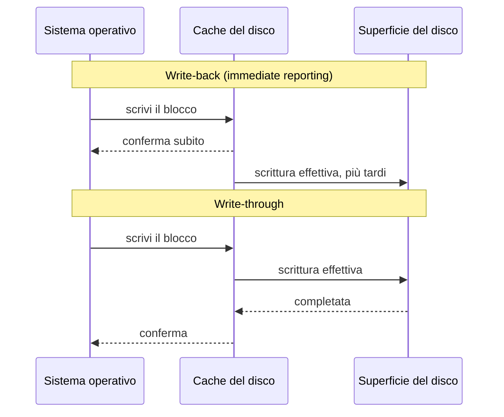
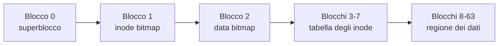
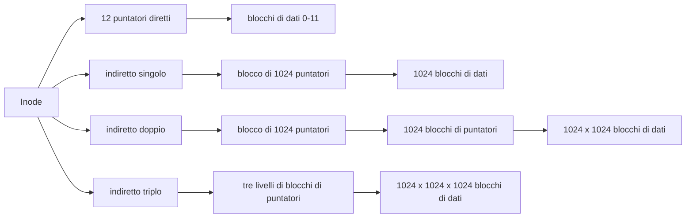
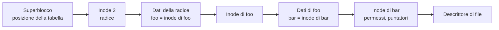

# Lezione 17 — Prestazioni e scheduling dei dischi, implementazione del file system

La lezione ha due parti. La prima completa il discorso sugli **hard disk** iniziato nella lezione precedente: riprende la geometria del disco, scompone il tempo di un'operazione di input/output in seek, rotazione e trasferimento, mostra perché il modo in cui i settori sono disposti (il *track skew*) e la cache interna del disco contano, e fa i conti su due dischi reali per far vedere che le prestazioni di un disco non sono un numero fisso ma dipendono dal tipo di carico. Da qui nasce il problema dello **scheduling del disco**, con gli algoritmi SSTF, NBF, SCAN, F-SCAN, C-SCAN e SPTF. La seconda parte, dopo la pausa, entra finalmente nel **file system**: come si organizzano su disco i dati e i metadati di un file system semplice (blocchi, inode, bitmap, superblocco), come si trova un inode a partire dal suo numero, come un inode riesce a descrivere file grandi con un numero fisso di puntatori, come sono fatte le directory, e infine che cosa succede, blocco per blocco, durante una `open`, una `read` e una `write`. Il professore presenta questo file system come il modello didattico da cui partono quelli reali: le lezioni successive saranno dedicate a renderlo più veloce e più robusto. Le ultime slide di entrambi i capitoli non sono state spiegate e sono riportate in fondo.

## Ripasso: la geometria del disco

Si parla qui dell'hard disk magnetico tradizionale, quello con i piatti che ruotano e le testine che si muovono su un braccio. Il disco contiene diversi **piatti** (*platter*), ciascuno con due **superfici**; ogni superficie è divisa in **tracce** (*track*), cerchi concentrici, e ogni traccia è divisa in **settori** (*sector*). Il professore insiste che questi dettagli non interessano per sé, ma perché determinano i tempi necessari per trasferire i dati, e i tempi hanno conseguenze su come il sistema operativo e il file system organizzano le cose.

I settori sono il modo in cui il disco viene **indirizzato**: come la memoria ha i suoi indirizzi, così il disco si presenta come una sequenza di settori numerati 0, 1, 2, 3, … Si parla anche di **LBA** (*Logical Block Address*), l'indirizzo logico con cui si chiede al disco un certo settore. I piatti girano attorno a un asse, lo *spindle*, a una velocità misurata in **RPM** (*Rotations Per Minute*, rotazioni al minuto); valori tipici sono 7 200 o 15 000 RPM. A 10 000 RPM una rotazione completa dura

$$
\frac{60\ \text{s}}{10\,000} = 6\ \text{ms},
$$

e questo è l'ordine di grandezza da tenere a mente.

La lettura e la scrittura sono compiute dalla **testina** (*disk head*), una per superficie, montata su un **braccio** (*disk arm*). I movimenti sono due: lungo la stessa traccia non è la testina a muoversi, ma il disco che ruota e porta i settori sotto di essa; per cambiare traccia, invece, si sposta il braccio. L'insieme delle tracce che si trovano alla stessa distanza dal centro su tutti i piatti si chiama **cilindro** (*cylinder*): sono le tracce che le diverse testine, montate sullo stesso braccio, possono leggere contemporaneamente.

> [!tip] Schema consigliato
> In questo punto sarebbe utile uno schema disegnato a mano (per esempio con Excalidraw) che mostri, in vista dall'alto, un piatto con tre tracce concentriche numerate come nelle slide (esterna 0–11, intermedia 12–23, interna 24–35), la freccia del verso di rotazione e il braccio con la testina; accanto, una vista laterale con tre piatti sovrapposti, le sei testine sullo stesso braccio e, evidenziate con lo stesso colore, le tracce che formano un cilindro.

## Il tempo di un'operazione di I/O

### Il ritardo di rotazione

Il primo tempo che si perde è il **ritardo di rotazione** (*rotational delay*): il tempo che il settore desiderato impiega ad arrivare sotto la testina. Non ha senso chiedersi quanto sia in assoluto, perché dipende da dove si trova il settore da leggere rispetto a quello appena letto. Se si è appena letto il settore 6 e si vuole il 7, il disco deve ruotare pochissimo; se si vuole il 5, si è particolarmente sfortunati, perché serve quasi un giro completo.

> [!important] Ritardo di rotazione medio
> Se $R$ è il tempo di una rotazione completa, il **ritardo di rotazione medio** è $R/2$. Non sapendo dove si trova il prossimo settore, a volte è più vicino e a volte più lontano: in media serve mezzo giro. Per esempio, partendo dal settore 6, per leggere lo 0 (dalla parte opposta della traccia di 12 settori) serve proprio $R/2$.

### Il seek e le sue fasi

Il secondo tempo, tradizionalmente il più rilevante, è il **tempo di seek** (*seek time*): il tempo che il braccio impiega a spostarsi dalla traccia corrente a quella che contiene il settore desiderato. Nell'esempio delle slide la testina è sulla traccia più interna, vicino al settore 30, e si vuole leggere l'11, che sta sulla traccia più esterna: servono un seek per raggiungere la traccia esterna e poi una rotazione per portare l'11 sotto la testina. Il professore osserva che nei dischi più recenti il seek non è più necessariamente molto più lungo della rotazione, ma è stato a lungo una delle operazioni più costose del disco.

Il seek si compone di quattro fasi.


Nell'**accelerazione** il braccio comincia a muoversi; nel **coasting** (letteralmente "andare per inerzia") si sposta da una traccia all'altra alla sua velocità massima; nella **decelerazione** rallenta, altrimenti supererebbe la traccia di destinazione; nel **settling** ("assestamento") la testina viene posizionata con un controllo più fine esattamente sopra la traccia giusta. È quest'ultima fase a pesare di più: il tempo di settling è spesso significativo, da 0,5 a 2 ms, ed è ciò che rende il seek dispendioso.

### Il trasferimento e il tempo complessivo

L'ultima fase è il **trasferimento** (*transfer*): i dati vengono effettivamente letti dalla superficie o scritti su di essa.

> [!important] Tempo di I/O
> Il tempo complessivo di un'operazione di input/output su disco è la somma dei tre contributi:
> $$
> T_{I/O} = T_{\text{seek}} + T_{\text{rotation}} + T_{\text{transfer}}.
> $$

### Il sistema operativo non conosce la geometria

Il professore sottolinea un punto che avrà conseguenze più avanti: **tutto questo il sistema operativo non lo sa**. Il sistema operativo ragiona in termini di blocchi da leggere o scrivere in settori logici, ma non conosce l'organizzazione fisica interna del disco. Non è il sistema operativo a dire "muovi il braccio lì": dice soltanto "voglio leggere il settore 18", e poi è il disco, con il suo controllore, a decidere come farlo. Per questo, in un corso di sistemi operativi, i dettagli meccanici si potrebbero quasi ignorare; ma il fatto che il sistema operativo non li conosca condiziona ciò che può fare, come si vedrà con lo scheduling.

## Il track skew

Guardando la numerazione dei settori nella figura con tre tracce, si nota una cosa curiosa. Sulla traccia esterna ci sono i settori da 0 a 11; ci si aspetterebbe che il 12, primo settore della traccia successiva, stia subito "accanto" all'11, e invece è spostato più avanti. Lo stesso accade passando dalla seconda alla terza traccia: dopo il 23, il 24 non è lì, ma più avanti. Questo sfasamento si chiama **track skew**, che il professore propone di tradurre come "disallineamento" delle tracce.

Per capirne il motivo il professore fa un'osservazione di metodo che vale ben oltre i dischi.

> [!important] Non si può ottimizzare sempre
> Quando si ottimizzano le prestazioni di qualcosa, raramente si può ottimizzare per tutti i casi. Bisogna chiedersi quali sono le **situazioni più frequenti o più rilevanti** e ottimizzare per quelle. Per un disco, due casi estremi e opposti sono la **lettura sequenziale di file grandi** e la **lettura di tanti file piccoli**.

Per i file grandi si vuole poter leggere in sequenza: è per questo che i settori sono numerati 0, 1, 2, 3, … lungo la traccia, e i file vengono scritti in modo sequenziale, così da non doversi riposizionare a ogni lettura. All'estremo opposto, tanti file piccoli significano letture brevi e tanti salti da un punto all'altro, quindi tanti tempi di rotazione e di seek.

Il track skew nasce per il primo caso. Si immagini un file grande memorizzato nei settori 0, 1, …, 11, 12, …, 23, 24, … Arrivati alla fine della traccia esterna, dopo l'11 bisogna spostare il braccio sulla traccia successiva. Se il 12 fosse esattamente accanto all'11, durante il seek il disco continuerebbe a girare e, quando la testina è finalmente in posizione, il 12 sarebbe già passato: servirebbe un giro completo, "tremendo", dice il professore. Spostando il 12 più avanti, invece, durante il tempo di seek il disco ruota quel tanto che basta perché la testina arrivi sulla nuova traccia poco prima che il 12 le passi sotto.

> [!important] Track skew
> Il **track skew** è lo sfasamento della numerazione dei settori tra una traccia e la successiva. Serve a fare in modo che le **letture sequenziali** proseguano senza perdere un giro completo anche quando attraversano il confine tra due tracce: il primo settore della traccia successiva viene posto abbastanza avanti da arrivare sotto la testina appena terminato il seek. Nella figura delle slide lo skew è di 2 settori.

Al di là della geometria, che "lascia il tempo che trova", ciò che va ricordato è il ragionamento: individuare il caso rilevante (la lettura sequenziale di file grandi) e organizzare i dati in funzione di quello.

## La cache del disco

Le operazioni di lettura e scrittura richiedono tempo, e per questo all'interno del controllore del disco c'è di solito un meccanismo di **caching**: una piccola memoria, la **cache** o *track buffer*, tipicamente dell'ordine di 8 o 16 MB, che conserva i dati appena letti o scritti. Se si vuole rileggere un dato appena letto, o leggere un dato appena scritto, lo si trova nella cache e non serve né un seek né una rotazione. Non è quindi vero che ogni richiesta comporti un accesso fisico alla superficie. La cache ha però una dimensione modesta: quando si leggono o si scrivono file grandi il suo effetto diventa trascurabile.

Il problema interessante riguarda le scritture. Quando il sistema operativo chiede al disco di scrivere e i dati finiscono nella cache, **quando** il disco deve rispondere "tutto bene, la scrittura è riuscita"? Le possibilità sono due.



> [!important] Write-back e write-through
> - Con il **write-back**, detto anche *immediate reporting*, il disco conferma la scrittura appena i dati sono nella sua cache. È più veloce, ma pericoloso: la conferma non garantisce che i dati siano davvero sulla superficie, e se in quel momento il disco si guastasse o mancasse la corrente i dati andrebbero persi.
> - Con il **write-through** il disco conferma solo dopo che i dati sono stati effettivamente scritti sulla superficie. È sicuro, ma per le scritture la cache non porta più alcun vantaggio, perché il sistema operativo deve comunque aspettare la scrittura fisica.

Il professore nota che con il write-through, se si dovesse aspettare ogni volta la scrittura sul disco, "non servirebbe niente avere la cache", almeno per le scritture. Il punto da ricordare è che scrivere sulla superficie è molto più oneroso che scrivere nella cache, e quindi il momento in cui si dà la conferma al sistema operativo è una scelta tra velocità e sicurezza. Il tema tornerà quando si parlerà di come il file system resta coerente dopo un guasto.

## I conti su due dischi reali

Il professore scrive i calcoli alla lavagna "non per fare i calcoli, ma per far vedere come vengono fuori" i numeri della tabella delle slide, perché è proprio il confronto tra due casi a essere istruttivo. Oltre al tempo di I/O si definisce la **rate di I/O**, la velocità effettiva in byte al secondo che il disco riesce a fornire.

> [!important] Rate di I/O
> $$
> R_{I/O} = \frac{\text{Size}_{\text{transfer}}}{T_{I/O}},
> $$
> cioè la quantità di dati trasferiti divisa per il tempo impiegato a trasferirli.

La prima osservazione è che questo numero **non si può calcolare una volta per tutte**, perché dipende dal tipo di accesso. Scrivere file grandi vuol dire scrivere settori in sequenza e perdere poco tempo in seek e rotazione; scrivere tanti piccoli insiemi di byte in punti diversi del disco costa invece un seek e una rotazione per ciascuno. Per questo le prestazioni dei dischi si valutano con più **benchmark** (programmi di prova standardizzati), almeno due.

### I due dischi e i due carichi

Le slide confrontano due dischi reali: un **Cheetah 15K.5** con interfaccia SCSI e un **Barracuda** con interfaccia SATA. La dimensione della cache qui non interessa; contano la velocità di rotazione, il seek medio e la velocità massima di trasferimento.

| Caratteristica | Cheetah 15K.5 | Barracuda |
| -------------- | ------------- | --------- |
| Capacità | 300 GB | 1 TB |
| RPM | 15 000 | 7 200 |
| Seek medio | 4 ms | 9 ms |
| Trasferimento massimo | 125 MB/s | 105 MB/s |
| Piatti | 4 | 4 |
| Cache | 16 MB | 16/32 MB |
| Interfaccia | SCSI | SATA |

I due carichi di lavoro (*workload*) sono:

- **carico casuale** (*random workload*): letture di 4 KB in posizioni casuali del disco, quindi potenzialmente un seek e una rotazione per ogni lettura;
- **carico sequenziale** (*sequential workload*): lettura di 100 MB consecutivi. Se il disco è costruito bene e i blocchi sono memorizzati bene, tenendo conto del track skew, ci sarà essenzialmente un solo seek all'inizio; i successivi spostamenti tra tracce adiacenti sono minimi.

### Il carico casuale

Il **tempo di seek** è quello medio dichiarato: 4 ms e 9 ms. Il **tempo di rotazione** medio è metà del tempo di un giro, $R/2$:

$$
\begin{aligned}
\text{Cheetah:}\quad & T_{\text{rotation}} = \frac{1}{2}\cdot\frac{60\ \text{s}}{15\,000} = \frac{4\ \text{ms}}{2} = 2\ \text{ms},\\
\text{Barracuda:}\quad & T_{\text{rotation}} = \frac{1}{2}\cdot\frac{60\ \text{s}}{7\,200} \approx \frac{8{,}33\ \text{ms}}{2} \approx 4{,}2\ \text{ms}.
\end{aligned}
$$

Il **tempo di trasferimento** è la dimensione del trasferimento divisa per la velocità di trasferimento indicata nelle specifiche:

$$
\begin{aligned}
\text{Cheetah:}\quad & T_{\text{transfer}} = \frac{4\ \text{KB}}{125\ \text{MB/s}} \approx 30\ \mu\text{s},\\
\text{Barracuda:}\quad & T_{\text{transfer}} = \frac{4\ \text{KB}}{105\ \text{MB/s}} \approx 38\ \mu\text{s}.
\end{aligned}
$$

Sommando:

$$
\begin{aligned}
\text{Cheetah:}\quad & T_{I/O} = 4\ \text{ms} + 2\ \text{ms} + 0{,}03\ \text{ms} \approx 6\ \text{ms},\\
\text{Barracuda:}\quad & T_{I/O} = 9\ \text{ms} + 4{,}2\ \text{ms} + 0{,}04\ \text{ms} \approx 13{,}2\ \text{ms}.
\end{aligned}
$$

Il trasferimento si potrebbe anche non sommare: 30 microsecondi non cambiano il risultato. È questo il dato interessante: **il tempo di I/O è praticamente il tempo per spostarsi**; leggere non conta quasi niente. La rate di I/O è allora

$$
\begin{aligned}
\text{Cheetah:}\quad & R_{I/O} = \frac{4\ \text{KB}}{6\ \text{ms}} \approx 0{,}66\ \text{MB/s},\\
\text{Barracuda:}\quad & R_{I/O} = \frac{4\ \text{KB}}{13{,}2\ \text{ms}} \approx 0{,}31\ \text{MB/s}.
\end{aligned}
$$

Il Barracuda va a circa metà velocità perché il suo tempo di I/O è circa doppio, e il tempo di I/O è circa doppio perché è circa doppio il seek (con un contributo anche della rotazione più lenta). Con piccoli blocchi, la velocità effettiva dipende praticamente solo da quanto costa posizionarsi: "se devo saltare di qua e di là, la rate di trasferimento è semplicemente questa".

> [!warning] Precisazione — La rate di I/O dipende dalla dimensione della richiesta
> A lezione si è detto che questa quantità "non dipende da quanto è grande" la richiesta: con 1, 2 o 4 KB "è sempre la stessa cosa". Ciò che resta quasi uguale è il **tempo di I/O**, dominato da seek e rotazione; proprio per questo la **rate** di I/O cresce quasi in proporzione alla dimensione della richiesta. Con richieste casuali di 2 KB il Cheetah impiegherebbe ancora circa 6 ms, e fornirebbe quindi circa 0,33 MB/s, la metà che con 4 KB. Il grafico più sotto mostra l'andamento completo.

### Il carico sequenziale

Con una grande lettura sequenziale di 100 MB i rapporti si capovolgono. Il seek e la rotazione si pagano una volta sola, all'inizio, mentre il trasferimento diventa enorme:

$$
\begin{aligned}
\text{Cheetah:}\quad & T_{\text{transfer}} = \frac{100\ \text{MB}}{125\ \text{MB/s}} = 800\ \text{ms}, & T_{I/O} &= 4 + 2 + 800 = 806\ \text{ms},\\
\text{Barracuda:}\quad & T_{\text{transfer}} = \frac{100\ \text{MB}}{105\ \text{MB/s}} \approx 950\ \text{ms}, & T_{I/O} &\approx 9 + 4{,}2 + 950 = 963{,}2\ \text{ms}.
\end{aligned}
$$

Ora seek e rotazione non contano quasi niente, conta solo il trasferimento, e la rate di I/O, cioè 100 MB divisi per il tempo di I/O, coincide praticamente con la **velocità nominale** del disco: circa 125 MB/s e 105 MB/s.

> [!example] Riepilogo dei risultati (tabella delle slide)
> | Carico | Grandezza | Cheetah 15K.5 | Barracuda |
> | ------ | --------- | ------------- | --------- |
> | entrambi | $T_{\text{seek}}$ | 4 ms | 9 ms |
> | entrambi | $T_{\text{rotation}}$ | 2 ms | 4,2 ms |
> | casuale | $T_{\text{transfer}}$ | 30 µs | 38 µs |
> | casuale | $T_{I/O}$ | 6 ms | 13,2 ms |
> | casuale | $R_{I/O}$ | 0,66 MB/s | 0,31 MB/s |
> | sequenziale | $T_{\text{transfer}}$ | 800 ms | 950 ms |
> | sequenziale | $T_{I/O}$ | 806 ms | 963,2 ms |
> | sequenziale | $R_{I/O}$ | 125 MB/s | 105 MB/s |
>
> I valori sono stati ricalcolati. Le piccole differenze dipendono dagli arrotondamenti e dall'uso di KB da 1 000 o da 1 024 byte: per esempio 4 KB / 125 MB/s vale tra 31 e 33 µs, il $R_{I/O}$ casuale del Cheetah tra 0,65 e 0,68 MB/s; per il Barracuda, senza arrotondare 950 ms e 4,2 ms, si ottiene $T_{I/O} \approx 965{,}5$ ms. Nel caso sequenziale la rate esatta è leggermente inferiore alla nominale (circa 124 e 104 MB/s), perché seek e rotazione iniziali, pur trascurabili, ci sono.

> [!important] Il divario tra accesso casuale e sequenziale
> Tra un carico casuale e un carico sequenziale c'è un **divario enorme** di prestazioni: per il Cheetah, da 0,66 a 125 MB/s, quasi 200 volte. Non ha senso parlare delle prestazioni di un disco in assoluto: dipendono da che cosa si fa. Con accessi piccoli e sparsi conta quasi solo il posizionamento (seek e rotazione); con accessi grandi e contigui conta quasi solo il trasferimento.

> [!warning] Precisazione — Il caso peggiore è quello casuale
> Tirando le somme, a lezione si è detto che "la situazione 1, ovviamente, sequenziale, è la peggiore, perché il salto è in continuazione". È un lapsus: dalla spiegazione stessa è chiaro che il caso peggiore è quello **casuale**, in cui si salta in continuazione e conta soltanto il seek, mentre quello sequenziale è il caso ottimale, in cui la rate effettiva coincide con quella nominale.

Il grafico seguente mostra come la rate di I/O di una sequenza di richieste in posizioni casuali cresca con la dimensione di ciascuna richiesta, passando dal regime dominato dal posizionamento a quello dominato dal trasferimento.

```chart
type: line
labels: ["4 KB", "64 KB", "256 KB", "1 MB", "4 MB", "16 MB", "100 MB"]
series:
  - title: Cheetah 15K.5 (MB/s)
    data: [0.66, 9.83, 31.81, 71.43, 105.26, 119.40, 124.07]
  - title: Barracuda (MB/s)
    data: [0.30, 4.65, 16.41, 44.07, 78.03, 96.65, 103.57]
tension: 0
fill: false
width: 80%
labelColors: false
beginAtZero: true
```

I valori non vengono dalle slide: sono calcolati per questa nota con la formula $R_{I/O} = S / (T_{\text{seek}} + T_{\text{rotation}} + S/\text{velocità massima})$, con i dati delle due tabelle e unità decimali (1 KB = 1 000 byte). Le due estremità del grafico corrispondono ai due carichi delle slide; le curve si avvicinano alla velocità nominale solo quando ogni richiesta è di diversi megabyte.

### Una domanda sul DMA

Uno studente chiede se il trasferimento passa per la CPU oppure va direttamente in RAM tramite **DMA** (*Direct Memory Access*). Il professore risponde che, ragionevolmente, il trasferimento avviene direttamente tra memoria e dispositivo, "altrimenti a che cosa servirebbe il DMA", pur dicendo di non conoscere nel dettaglio come lo facciano le diverse architetture.

> [!warning] Precisazione — Il trasferimento avviene con il DMA
> La risposta, data con qualche incertezza, è corretta. Come si è visto con i dispositivi di I/O (slide del capitolo 36), il DMA è proprio il meccanismo che copia i dati tra memoria e dispositivo sapendo dove si trovano in memoria e quanti sono, senza che la CPU copi ogni parola: la CPU programma il trasferimento, nel frattempo esegue altro, e il DMA solleva un interrupt quando la copia è terminata [@arpacidusseau2023ostep, cap. 36]. Il tempo di trasferimento calcolato qui è dunque tempo del disco, non tempo di CPU.

## Lo scheduling del disco

Sapendo che i tempi cambiano moltissimo a seconda di che cosa si trasferisce e di dove si trova, ha senso parlare di **scheduling del disco**, come si fa per i processi. Si immagini che il sistema operativo debba fare diverse letture e scritture: un file molto lungo e alcuni file molto corti, che si trovano su tracce diverse. Alcuni spostamenti costano più di altri, e intuitivamente non sembra una buona idea servire le richieste nell'ordine in cui arrivano saltando da un capo all'altro del disco. Lo **scheduler del disco** decide quale richiesta di I/O servire per prima, tenendo conto dei tempi di seek e di rotazione.

Il professore precisa che nessuno degli algoritmi che seguono è "la soluzione": sono modi diversi di affrontare un problema, ciascuno con i suoi difetti.

### Shortest Seek Time First

Partendo dall'ipotesi che il seek sia il tempo più rilevante, l'algoritmo **SSTF** (*Shortest Seek Time First*) ordina la coda delle richieste di I/O in base alla traccia, e serve per prima la richiesta sulla traccia più vicina a quella corrente. Nell'esempio delle slide la testina è sulla traccia interna (settore 30) e ci sono richieste per il settore 21, sulla traccia intermedia, e per il 2, sulla traccia esterna. Invece di servire per primo il 2, con uno spostamento grande seguito da uno piccolo, SSTF serve prima il 21 e poi il 2.

### Nearest Block First

SSTF ha però un primo problema: **il sistema operativo non conosce la geometria del disco**. Non sa su che traccia stia un settore, quindi non può applicare SSTF; può soltanto passare al disco un insieme di richieste, e sarà il controllore del disco a decidere.

Il sistema operativo può comunque ragionare in termini di **blocchi**, e applicare una versione approssimata dello stesso principio: **NBF** (*Nearest Block First*), che ordina le richieste per numero di blocco e serve prima quella col numero più vicino. Numeri di blocco vicini non significano necessariamente posizioni vicine sul disco, ma sono un buon indicatore della località: un disco costruito bene fa sì che blocchi con numeri vicini siano fisicamente vicini. Così il sistema operativo ordina le richieste per blocchi, e poi il disco, che conosce le tracce, prenderà a sua volta le sue decisioni interne.

### Il problema della starvation

Il secondo problema riguarda tanto SSTF, applicato dal disco sulle tracce, quanto NBF, applicato dal sistema operativo sui blocchi. Un algoritmo che sembrava una bella idea "non è poi molto furbo", perché soffre di **starvation** (letteralmente "morire di fame"): una richiesta può non essere servita mai. A differenza dei processi, che vengono creati ogni tanto, le richieste di lettura e scrittura arrivano **in continuazione**. Se continuano ad arrivare richieste per blocchi vicini, o per settori sulla traccia corrente, quando si andrà sulle tracce lontane? Mai.

Il professore usa un esempio: durante un esame risponde alle domande degli studenti, e decide di rispondere sempre allo studente più vicino per stancarsi di meno. Conviene, ma se quelli vicini continuano apposta a chiamarlo, "perché sono malvagi", lo studente in fondo all'aula non riceverà mai risposta. È lo stesso difetto già incontrato nello scheduling della CPU con [[Lezione 03 - Introduzione allo scheduling#Shortest Job First (SJF)|SJF]] e con il [[Lezione 05 - MLFQ, scheduling multiprocessore e spazio di indirizzamento#I problemi del MLFQ di base|MLFQ di base]]: privilegiare sempre il caso più conveniente può lasciare indietro qualcuno per sempre.

### Gli algoritmi dell'ascensore

Ci sono altri algoritmi, applicabili sia dal disco sulle tracce sia dal sistema operativo sui blocchi, che evitano la starvation. Si chiamano complessivamente **algoritmi dell'ascensore** (*elevator algorithms*) perché si comportano come un ascensore che deve servire tutti i piani: non rimbalza continuamente tra due piani vicini, ma una volta che ha cominciato a scendere continua a scendere, e così dà la precedenza a tutti i piani e a tutte le persone, a turno.

> [!important] SCAN, F-SCAN e C-SCAN
> - **SCAN** muove il braccio attraverso il disco servendo le richieste nell'ordine delle tracce. Un passaggio completo si chiama **sweep**: il braccio serve tutte le richieste su una traccia e poi passa alla successiva. Se arriva una richiesta per una traccia già servita in questo sweep, non torna indietro: la richiesta viene messa in coda e servita allo sweep successivo.
> - **F-SCAN** (*freeze*) "congela" la coda all'inizio di ogni sweep: fa una fotografia delle richieste presenti, serve solo quelle e prende le richieste arrivate nel frattempo soltanto allo sweep successivo. Evita così la starvation delle richieste lontane.
> - **C-SCAN** (*Circular SCAN*) percorre il disco sempre nello stesso verso, per esempio dall'esterno verso l'interno, e poi riparte dalla traccia esterna, invece di servire richieste in entrambi i versi.

La differenza tra SCAN e F-SCAN si capisce così. Con SCAN il braccio parte, per esempio, dalla traccia più esterna, serve tutto, si avvicina all'interno, serve tutto, si avvicina ancora. Non può tornare indietro, ma se nel frattempo arrivano nuove richieste sulle tracce più interne, ancora da raggiungere, le deve servire. Se ne arrivano sempre di nuove, prima di arrivare in fondo può metterci molto tempo, e le richieste in fondo aspettano. F-SCAN impedisce questo: le richieste arrivate durante lo sweep, anche se sono sulla strada, vengono rimandate al giro successivo.

> [!warning] Errore nella slide — La descrizione di C-SCAN
> La slide 19 descrive C-SCAN come "sweep from outer-to-inner, and then inner-to-outer", cioè un movimento avanti e indietro, e anche a lezione la distinzione tra i versi è rimasta poco chiara nella registrazione. Avanti e indietro è il comportamento di SCAN. Secondo OSTEP, C-SCAN invece **non** spazza il disco nei due versi: va solo dall'esterno verso l'interno e poi **si riporta alla traccia esterna** per ricominciare. Lo scopo è l'equità: lo SCAN puro, andando avanti e indietro, passa più spesso sulle tracce centrali e le favorisce rispetto a quelle interne ed esterne [@arpacidusseau2023ostep, cap. 37].

### Shortest Positioning Time First

Tutti questi algoritmi danno per scontato che il seek sia il tempo dominante e cercano di ridurre gli spostamenti del braccio. Nei dischi più recenti, però, il seek è stato ridotto, e già nelle tabelle precedenti non era così lontano dal tempo di rotazione: i due contributi sono diventati paragonabili. Per questo esiste l'algoritmo **SPTF** (*Shortest Positioning Time First*), che considera seek e rotazione **insieme**, cioè il tempo di posizionamento complessivo, e serve prima la richiesta che si raggiunge nel tempo più breve. Anche questo può farlo soltanto il disco, non il sistema operativo, perché solo il disco sa dove si trovano tracce e settori e dov'è la testina in quel momento.

> [!example] Un esempio numerico (costruito per questa nota)
> L'esempio non viene dalle slide; serve a vedere gli algoritmi all'opera. Il disco ha tracce numerate da 0 (esterna) a 99 (interna), la testina è sulla traccia 50 e si sta muovendo verso le tracce più alte; in coda ci sono, nell'ordine di arrivo, richieste per le tracce 82, 17, 43, 90, 5, 61. Si conta lo spostamento totale del braccio in tracce; per SCAN si assume che il braccio inverta il verso dopo l'ultima richiesta, senza arrivare al bordo del disco.
>
> | Algoritmo | Ordine di servizio | Spostamento totale |
> | --------- | ------------------ | ------------------ |
> | Ordine di arrivo | 82, 17, 43, 90, 5, 61 | 311 tracce |
> | SSTF | 43, 61, 82, 90, 17, 5 | 139 tracce |
> | SCAN | 61, 82, 90, poi 43, 17, 5 | 125 tracce |
> | C-SCAN | 61, 82, 90, ritorno, 5, 17, 43 | 163 tracce, di cui 85 per il ritorno da 90 a 5 |
>
> SSTF, partendo da 50, va prima a 43 (7 tracce), poi sale fino a 90 e infine torna a 17 e a 5: i 73 passi da 90 a 17 sono il prezzo di aver inseguito la richiesta più vicina. Se durante il servizio continuassero ad arrivare richieste tra le tracce 40 e 60, SSTF resterebbe in quella zona e le richieste per 17 e 5 aspetterebbero indefinitamente: è la starvation. SCAN e C-SCAN, invece, garantiscono che entro uno sweep (con F-SCAN, entro quello successivo all'arrivo) ogni richiesta venga raggiunta. C-SCAN percorre più strada perché paga il ritorno, ma tratta in modo uniforme tutte le tracce. I conti sono stati verificati con una piccola simulazione.

> [!tip] Approfondimento — Gli scheduler di I/O in Linux
> #approfondimento
> In Linux ogni dispositivo a blocchi ha un proprio scheduler di I/O, che si può leggere e cambiare a sistema acceso attraverso il file `/sys/block/<dispositivo>/queue/scheduler`. La documentazione del kernel elenca quattro scelte: `mq-deadline`, `kyber`, `bfq` e `none`; leggendo il file, lo scheduler attivo compare tra parentesi quadre [@linuxdocswitchingsched]. Nella macchina usata per preparare questa nota, per esempio, `cat /sys/block/vda/queue/scheduler` restituisce `none [mq-deadline] kyber bfq`. La scelta `none` ha senso proprio per i dispositivi che riordinano da sé le richieste o per i quali la posizione non conta, come dischi virtuali e SSD: è la stessa logica per cui le slide osservano che certi algoritmi li può applicare soltanto il disco.

## Implementazione del file system

Dopo la pausa si passa al file system. Il professore premette due cose. La prima: dalle discussioni fatte finora qualcuno potrebbe non avere chiaro come i dati vengano memorizzati in modo permanente sul disco, ed è giusto, perché non se ne è parlato. Quando si dice come sono scritti i dati, si intende come sono **organizzati dal punto di vista logico**; la tecnologia fisica di memorizzazione, e anche il controllo degli errori di scrittura sul supporto, sono ignorati, perché si lavora a un livello di astrazione superiore. Dei tempi si è parlato solo perché hanno un impatto su come le cose vengono organizzate ai livelli superiori.

La seconda: il primo file system che si studia, il *very simple file system* del libro, è importante dal punto di vista didattico perché stabilisce dei principi che sono corretti e vengono ripresi nei file system reali, i quali partono da questo e vi aggiungono altri aspetti.

### Strutture dati e metodi di accesso

Per implementare un file system bisogna rispondere a due domande.

> [!important] I due aspetti di un file system
> - **Strutture dati**: quali strutture su disco servono per organizzare i dati e i **metadati** (le informazioni che descrivono i dati) dei file, e per saperli ritrovare?
> - **Metodi di accesso**: come vengono mappate su queste strutture le chiamate di sistema dei processi, come `open()`, `read()` e `write()`? Quali strutture vengono lette o scritte durante l'esecuzione di ciascuna chiamata?

### Blocchi e settori

Il disco viene diviso in **blocchi**. Qui il professore chiarisce un punto delicato. Finora si è sempre assunto che blocco e settore coincidano: il **settore** è l'unità con cui si indirizza il disco ("dammi il settore numero 50"), e in origine blocchi e settori avevano la stessa dimensione, 512 byte. In seguito sono comparse altre configurazioni. A un estremo, settori e blocchi sono entrambi di 4 KB e continuano a corrispondere. C'è poi la situazione intermedia, quella del file system che si studia: il file system organizza i dati in **blocchi di 4 KB**, ma il disco è indirizzato a **settori di 512 byte**, e quindi un blocco corrisponde a 8 settori consecutivi.

> [!warning] Precisazione — Un blocco, una richiesta multi-settore
> A lezione si è detto che, per leggere un blocco di 4 KB su un disco a settori da 512 byte, il sistema operativo "dovrà mandare 8 richieste di lettura di settori". Il blocco corrisponde effettivamente a 8 settori, ma non serve inviare 8 comandi separati: come ricordano le slide sull'interfaccia del disco, le operazioni multi-settore sono possibili e molti file system leggono e scrivono 4 KB alla volta con un'unica richiesta. Resta vero che l'unica garanzia di atomicità riguarda la scrittura di un singolo settore da 512 byte [@arpacidusseau2023ostep, cap. 37].

Il professore invita a immaginare la situazione che si preferisce (blocco e settore da 512 byte, entrambi da 4 KB, o blocco da 4 KB e settore da 512 byte): il discorso non cambia molto, e la differenza conta in un solo punto, che si vedrà calcolando dove si trova un inode.

Nell'esempio delle slide il file system ha **64 blocchi** da 4 KB, numerati da 0 a 63: un numero irrealistico, scelto per poter disegnare tutto.

### La regione dei dati

La maggior parte dei blocchi è dedicata ai dati, "e meno male": non si può usare il disco solo per i metadati. Questa parte si chiama **regione dei dati** (*data region*); nell'esempio sono i blocchi da 8 a 63, 56 blocchi in tutto. Un file di 8 KB occupa due di questi blocchi.

Serve però qualcosa che dica **quali** blocchi compongono quel file. I blocchi di un file non sono necessariamente contigui: un file potrebbe avere un blocco in un punto del disco e un altro altrove. In ogni caso, serve una struttura che dica "quel file ha quei blocchi in quelle posizioni", e che ne tenga anche la dimensione, il proprietario e così via.

### La tabella degli inode

Questa struttura è l'**inode**, già incontrato parlando di file e directory: nell'inode c'è proprio l'informazione su quali blocchi di dati corrispondono a un file. Gli inode stanno in una parte più piccola del disco, tipicamente agli indirizzi più bassi, che si chiama **tabella degli inode** (*inode table*): un array di inode memorizzato su disco.

> [!important] Tabella degli inode
> Nell'esempio ogni inode occupa **256 byte**, perché deve contenere parecchie informazioni, tra cui gli indirizzi dei blocchi del file. Un blocco di 4 KB contiene quindi $4096 / 256 = 16$ inode, e la tabella, che occupa **5 blocchi** (dal 3 al 7), contiene $5 \times 16 = 80$ inode. Poiché ogni file ha il suo inode, **80 è il numero massimo di file** che questo file system può contenere.

Di regola un blocco è assegnato a un solo file (i blocchi non vengono condivisi tra file), mentre un file può avere più blocchi.

A questo punto, osserva il professore, il problema non è ancora risolto: gli inode dicono dove sono i blocchi, ma chi vuole leggere un file come fa a sapere quale inode gli corrisponde? Per ora si è fatto solo un passo in più.

### Le bitmap

Prima di rispondere servono altre due strutture, le **strutture di allocazione**, che dicono quali inode e quali blocchi di dati sono usati e quali sono liberi. Si usano due **bitmap**, cioè sequenze di bit in cui ogni bit vale 0 se l'elemento corrispondente è libero e 1 se è in uso:

- la **data bitmap** per la regione dei dati;
- la **inode bitmap** per la tabella degli inode.

Quando un blocco non serve più, non lo si "raschia via con la spazzola" per svuotarlo: semplicemente il suo bit nella data bitmap torna a 0. Quando lo si prende si mette il bit a 1, quando lo si libera lo si rimette a 0. Lo stesso vale per gli inode: se si cancella un file, il bit del suo inode nella inode bitmap torna a 0. Una bitmap è molto compatta: un blocco di 4 KB contiene 32 768 bit, molti più dei 56 blocchi di dati e degli 80 inode dell'esempio, ma per semplicità si dedica un blocco intero a ciascuna bitmap (il blocco 1 alla inode bitmap, il blocco 2 alla data bitmap).

> [!warning] Precisazione — Quanti inode in un blocco
> Spiegando la inode bitmap, a lezione si è detto che "in ognuno di quei blocchi di inode ho 256 inode". Il numero 256 è la **dimensione in byte** di ciascun inode; ogni blocco di 4 KB della tabella contiene **16 inode**, come detto poco prima.

Lo stesso problema, tenere traccia di che cosa è libero e che cosa è occupato, si era già posto per la memoria, dove però si usava una free list: si veda la [[Lezione 07 - Segmentazione e gestione dello spazio libero#Gestione dello spazio libero|gestione dello spazio libero]].

### Il superblocco

Infine c'è il **superblocco** (*superblock*), all'inizio del disco, nel blocco 0. Contiene diverse informazioni sul file system: per esempio quanti inode e quanti blocchi di dati ci sono, e **dove comincia la tabella degli inode** (qui, nel blocco 3).

Il superblocco è il **riferimento fisso** che mancava. Ogni accesso parte dal superblocco, che è in una posizione nota; da lì si sa dove comincia la tabella degli inode; e, come si vedrà, all'inizio della tabella c'è l'inode della directory radice, da cui si può seguire l'albero delle cartelle fino al file cercato. Le slide aggiungono che, quando si **monta** un file system (lo si collega all'albero delle directory del sistema), il sistema operativo legge per prima cosa il superblocco per inizializzare le varie informazioni.

> [!important] Organizzazione complessiva del file system dell'esempio
> | Blocchi | Contenuto | Sigla nelle slide |
> | ------- | --------- | ----------------- |
> | 0 | Superblocco | S |
> | 1 | Inode bitmap | i |
> | 2 | Data bitmap | d |
> | 3–7 | Tabella degli inode (80 inode da 256 byte) | I |
> | 8–63 | Regione dei dati (56 blocchi) | D |



## L'inode

### Dal numero di inode alla posizione su disco

Ogni inode è identificato da un **numero di inode** (*inode number*, o *i-number*): è il numero già visto associato ai file, e coincide con la posizione dell'inode nella tabella. Dal numero si calcola quindi direttamente dove si trova l'inode sul disco.

Nella figura ingrandita delle slide, i primi 12 KB sono superblocco, inode bitmap e data bitmap (4 KB ciascuno); seguono i blocchi della tabella, *iblock* 0, 1, 2, 3, 4, ciascuno con 16 inode: 0–15 nel primo, 16–31 nel secondo, 32–47 nel terzo, e così via. L'inode numero 32 sta evidentemente all'inizio dell'iblock 2. "Al di là della formula", dice il professore, se si conosce il numero si sa dove si trova; volendo fare il conto:

$$
\begin{aligned}
\text{offset nella tabella} &= 32 \times 256\ \text{byte} = 8192\ \text{byte} = 8\ \text{KB},\\
\text{indirizzo} &= \text{inizio della tabella} + \text{offset} = 12\ \text{KB} + 8\ \text{KB} = 20\ \text{KB}.
\end{aligned}
$$

Qui interviene la distinzione tra blocchi e settori. Tutte queste strutture, inode compresi, stanno sul disco, e il disco **non è indirizzabile per byte ma per settori**: per leggere l'inode bisogna sapere quale settore chiedere. Le slide danno due passaggi:

$$
\begin{aligned}
\text{blk} &= \frac{\text{inumber} \times \text{sizeof(inode)}}{\text{blocksize}} = \frac{32 \times 256}{4096} = 2,\\
\text{iaddr} &= \frac{\text{blk} \times \text{blocksize} + \text{inodeStartAddr}}{\text{sectorsize}} = \frac{2 \times 4096 + 12\,288}{512} = 40.
\end{aligned}
$$

La prima formula (con divisione intera) dice in quale blocco della tabella si trova l'inode; la seconda dà il numero del settore da cui comincia quel blocco: si chiede al disco il settore 40, che è proprio il byte $40 \times 512 = 20\,480$, cioè 20 KB.

> [!example] Inode che non stanno all'inizio di un blocco
> La formula dà il settore in cui **comincia** il blocco dell'inode. Le slide avvertono che, se l'inode non è il primo del blocco, va aggiunto un ulteriore offset. Per l'inode 40: $\text{blk} = \lfloor 40 \times 256 / 4096 \rfloor = 2$, quindi il blocco comincia ancora al settore 40; ma l'inode si trova $40 \times 256 \bmod 4096 = 2048$ byte dentro il blocco, cioè $2048 / 512 = 4$ settori più avanti. Il settore che lo contiene è il **44**, e infatti $12\ \text{KB} + 40 \times 256 = 22\,528 = 44 \times 512$. Nella pratica si legge l'intero blocco di 4 KB e si estrae l'inode dalla posizione giusta.

Il professore conclude che ci si può fermare tranquillamente alla prima delle due slide: ciò che conta è che dal numero di inode si calcola in che blocco si trova.

### Che cosa contiene un inode

Nell'inode ci sono tutte le informazioni che servono sul file, cioè i **metadati**: sono, in buona parte, quelle che si vedono quando si esegue `ls -l`. Il tipo di file, la dimensione, il numero di blocchi allocati, le informazioni di protezione (chi è il proprietario, chi può leggere, scrivere, eseguire), i tempi (quando è stato fatto l'ultimo accesso, quando il file è stato creato, modificato, cancellato) e, naturalmente, gli indirizzi dei blocchi che lo compongono. La struttura completa di un inode reale, quello del file system **ext2** di Linux, è nella tabella seguente; si capisce perché servano 256 byte.

| Byte | Campo | A che cosa serve |
| ---- | ----- | ---------------- |
| 2 | `mode` | si può leggere, scrivere, eseguire il file? (e di che tipo è) |
| 2 | `uid` | chi è il proprietario? |
| 4 | `size` | quanti byte contiene il file? |
| 4 | `time` | quando è avvenuto l'ultimo accesso? |
| 4 | `ctime` | quando è stato creato? |
| 4 | `mtime` | quando è stato modificato l'ultima volta? |
| 4 | `dtime` | quando è stato cancellato questo inode? |
| 4 | `gid` | a quale gruppo appartiene il file? |
| 2 | `links_count` | quanti hard link ci sono verso il file? |
| 2 | `blocks` | quanti blocchi sono allocati al file? |
| 4 | `flags` | come deve usare questo inode ext2? |
| 4 | `osd1` | campo dipendente dal sistema operativo |
| 60 | `block` | un insieme di puntatori ai blocchi su disco (15 in tutto) |
| 4 | `generation` | versione del file (usata da NFS) |
| 4 | `file_acl` | un modello di permessi più ricco dei bit di `mode` |
| 4 | `dir_acl` | detti *access control list* |
| 4 | `faddr` | campo non supportato |
| 12 | `i_osd2` | altro campo dipendente dal sistema operativo |

Il professore richiama alcuni campi: `uid`, il proprietario del file che si vede sotto Linux; i campi dei tempi; `blocks`, quanti blocchi sono stati allocati al file; e `block`, gli indirizzi dei blocchi. Le **access control list** (ACL) sono elenchi di permessi per singoli utenti o gruppi, più flessibili dei soli bit proprietario/gruppo/altri; **NFS** (*Network File System*) è un file system di rete, che usa il campo `generation` per distinguere versioni successive di un inode riutilizzato.

### Il tipo di file

Tra le informazioni dell'inode c'è il **tipo di file**, codificato nel campo `mode`. È lo stesso carattere che compare all'inizio di ogni riga di `ls -l`, prima dei permessi.

| Tipo | Carattere |
| ---- | --------- |
| File regolare | `-` |
| Directory | `d` |
| Link simbolico | `l` |
| Dispositivo a caratteri | `c` |
| Dispositivo a blocchi | `b` |
| FIFO (*named pipe*) | `p` |
| Socket | `s` |

Il file regolare è il caso "normale". La `d` indica una directory; la `l` un **link simbolico**, visto nella lezione precedente, che non è veramente un file ma un riferimento a un altro percorso. La `c` indica un **dispositivo a caratteri** (*character device*): un file "finto" che serve solo come collegamento a un dispositivo fisico. Come si è detto, in Unix i dispositivi sono trattati come file di tipo particolare, i **file speciali**: la tastiera, per esempio, produce una sequenza di caratteri, e leggere i tasti premuti equivale a leggere da un file. Analogamente `b` indica un dispositivo a blocchi, come un disco. Una **FIFO** o *named pipe* (`p`) è un altro file non vero, gestito dal sistema operativo per far comunicare i processi tra loro: ciò che un processo vi scrive viene letto da un altro, nell'ordine di scrittura. Lo stesso vale per i **socket** (`s`), usati anch'essi per la comunicazione tra processi. L'inode descrive quindi non solo i file standard, ma anche questi oggetti che hanno uno scopo particolare nel file system.

### L'indice multilivello

Guardando la tabella dell'inode, il professore pone una domanda per mettere alla prova "l'intuizione sopraffina" della classe. Ogni file ha **un solo** inode, e ogni inode ha solo **15 puntatori** ai blocchi dei dati (i 60 byte del campo `block`, 4 byte per puntatore). I blocchi possono essere sparsi, quindi non si può scrivere "dal blocco tale al blocco tale". Vuol dire che un file può essere grande al massimo $15 \times 4\ \text{KB} = 60\ \text{KB}$? Ovviamente no: dov'è il trucco?

Dall'aula arriva la risposta giusta: usare alcuni dei puntatori per puntare ad altri blocchi che contengono puntatori.

> [!important] Indice multilivello e puntatori indiretti
> Per descrivere file grandi si usa un **indice multilivello** (*multi-level index*). L'inode contiene un numero fisso di **puntatori diretti**, 12, che indicano direttamente blocchi di dati, e alcuni **puntatori indiretti**:
> - un **puntatore indiretto singolo** punta a un blocco che non contiene dati né inode, ma solo altri puntatori a blocchi di dati;
> - un **puntatore indiretto doppio** punta a un blocco di puntatori, ciascuno dei quali punta a un blocco di puntatori a blocchi di dati;
> - un **puntatore indiretto triplo** aggiunge un altro livello.
>
> I blocchi di puntatori vengono allocati solo quando il file cresce abbastanza da averne bisogno. In ext2 i 15 puntatori sono 12 diretti, 1 indiretto singolo, 1 doppio e 1 triplo.

Il conto, che nelle slide compare "come una cosa magica", si fa così. Con blocchi da 4 KB e indirizzi di disco da 4 byte, un blocco di puntatori ne contiene $4096 / 4 = 1024$. Allora:

$$
\begin{aligned}
\text{solo puntatori diretti:}\quad & 12 \times 4\ \text{KB} = 48\ \text{KB},\\
\text{con l'indiretto singolo:}\quad & (12 + 1024) \times 4\ \text{KB} = 4144\ \text{KB} \approx 4\ \text{MB},\\
\text{con l'indiretto doppio:}\quad & (12 + 1024 + 1024^2) \times 4\ \text{KB} \approx 4\ \text{GB},\\
\text{con l'indiretto triplo:}\quad & (12 + 1024 + 1024^2 + 1024^3) \times 4\ \text{KB} \approx 4\ \text{TB}.
\end{aligned}
$$

Con il solo puntatore indiretto singolo il file può arrivare a circa 4 MB, "ancora piccolo"; il doppio indiretto aggiunge $1024 \times 1024$, cioè circa un milione di blocchi da 4 KB, e porta oltre i 4 GB. L'inode resta uno solo, ma in questo modo si possono avere file di dimensioni molto diverse.

> [!warning] Precisazione — 4 GB con il doppio indiretto, non con il triplo
> A lezione si è detto che "col triplo indirect pointer" si arriva "fino a 4 gigabyte". Secondo le slide, i circa 4 GB si raggiungono già con 12 puntatori diretti, un indiretto singolo e un **indiretto doppio**: $(12 + 1024 + 1024^2) \times 4\ \text{KB} = 4\,198\,448\ \text{KB}$, poco più di 4 GB. L'indiretto triplo aggiunge altri $1024^3$ blocchi e porta il limite teorico dell'indice a circa **4 TB**. Nei file system reali il limite effettivo dipende anche da altri vincoli, come la dimensione del campo che memorizza la lunghezza del file (vedi l'approfondimento più sotto).

L'idea è la stessa delle [[Lezione 08 - Paginazione, TLB e tabelle delle pagine multilivello#Page table multilivello|page table multilivello]]: un albero di blocchi di puntatori, allocati solo dove servono, al posto di un unico grande array. Le slide ricordano che molti file system usano un indice multilivello (ext2, ext3, WAFL di NetApp, il file system Unix originale), mentre **ext4** usa al posto dei semplici puntatori gli **extent**.



> [!example] Verifica su un file system ext2 reale
> Per questa nota è stato creato un piccolo file system ext2 in un file (con `mke2fs`, blocchi da 4 KB e inode da 256 byte) e vi è stato copiato un file di 13 blocchi, cioè 53 248 byte, uno in più di quanti ne descrivono i puntatori diretti. Lo strumento `debugfs` mostra così i blocchi del file:
> ```text
> BLOCKS:
> (0-11):139-150, (IND):151, (12):152
> TOTAL: 14
> ```
> I blocchi 0–11 del file sono descritti dai puntatori diretti; per il tredicesimo è stato allocato un **blocco indiretto** (il 151), che contiene il puntatore al blocco 152. Il file occupa quindi 14 blocchi su disco: 13 di dati e 1 di puntatori.

> [!tip] Approfondimento — Gli extent di ext4
> #approfondimento
> La documentazione del kernel Linux spiega perché ext4 ha abbandonato l'indice multilivello di ext2/ext3: con quello schema bisogna compilare molti dati di mappatura anche per un file grande e contiguo, per esempio un blocco indiretto intero per mappare 1 000 blocchi consecutivi. Con gli **extent**, la stessa allocazione si descrive con una sola struttura che dice in sostanza "a partire da questo blocco, 1 000 blocchi consecutivi". Gli extent sono organizzati ad albero, e i 60 byte del campo `i_block` dell'inode ospitano la radice dell'albero; la documentazione nota anche che un file mappato con il vecchio schema non può trovarsi oltre il blocco $2^{32}$ [@linuxdocext4ifork].

> [!tip] Approfondimento — Il campo della dimensione e i file oltre 4 GB
> #approfondimento
> Nella tabella dell'inode ext2 il campo `size` occupa 4 byte, quindi può esprimere al massimo $2^{32}$ byte, cioè 4 GiB: un limite indipendente da quanti blocchi l'indice potrebbe descrivere. La documentazione di ext4 spiega che il campo che in ext2/ext3 si chiamava `i_dir_acl`, quasi sempre lasciato a zero, è stato riutilizzato come `i_size_high`, la metà alta della dimensione del file, portando la dimensione a 64 bit [@linuxdocext4inodes].

## Le directory

Per vedere come si arriva a un file bisogna prima ricordare che cosa contiene una directory. Anche una directory ha un inode, nel cui campo tipo è indicato "directory" invece di "file regolare". Nei suoi **blocchi di dati** ci sono le coppie (**nome**, **numero di inode**) dei file contenuti.

> [!important] Organizzazione di una directory
> Una directory è un file di tipo speciale: ha un inode nella tabella degli inode e blocchi di dati nella regione dei dati, puntati dall'inode (ed eventualmente da blocchi indiretti). Questi blocchi contengono un elenco di coppie (nome della voce, numero di inode). Ogni directory contiene anche due voci speciali: `.` (*dot*), la directory stessa, e `..` (*dot-dot*), la directory genitore. Le strutture su disco, quindi, non cambiano: le directory usano gli stessi inode e gli stessi blocchi dei file.

Le slide mostrano il contenuto su disco di una directory `dir` con tre file, `foo`, `bar` e `foobar`:

| inum | reclen | strlen | name |
| ---- | ------ | ------ | ---- |
| 5 | 4 | 2 | `.` |
| 2 | 4 | 3 | `..` |
| 12 | 4 | 4 | `foo` |
| 13 | 4 | 4 | `bar` |
| 24 | 8 | 7 | `foobar` |

Le colonne `reclen` (lunghezza del record) e `strlen` (lunghezza del nome, compreso il carattere di terminazione) servono a gestire nomi di lunghezza variabile, e il professore chiede di ignorarle. Ciò che conta: `.` ha inode 5, cioè `dir` stessa; `..` ha inode 2, la directory genitore, e così da qualunque directory si sa come salire a quella soprastante; seguono i file veri e propri, che potrebbero anche essere a loro volta directory: `foo` ha inode 12, `bar` 13, `foobar` 24. Dunque i file regolari hanno dati nei loro blocchi, le directory hanno nei blocchi questo elenco.

## I percorsi di accesso

Il professore la indica come la cosa più importante di tutto il file system: come si usano queste strutture per accedere a un file.

### Aprire un file

Si immagini la chiamata `open("/foo/bar", O_RDONLY)`: la radice `/` contiene una directory `foo`, che contiene un file `bar`, e lo si vuole aprire in sola lettura. Il file system deve **attraversare il percorso** (*pathname traversal*) per trovare l'inode di `bar`.

Bisogna partire da qualcosa di prestabilito, altrimenti non si saprebbe da dove cominciare: si conosce la radice del file system. Il professore si corregge: aveva forse detto che la radice era l'inode 0, ma **il numero di inode della radice è 2**, nella maggior parte dei file system Unix.

> [!important] Attraversamento del percorso nella open
> Per `open("/foo/bar", O_RDONLY)`:
> 1. si legge l'**inode della radice** (numero 2), sapendo dove si trova grazie al superblocco e al calcolo visto prima;
> 2. dall'inode si ricavano i puntatori ai blocchi di dati della radice, e si leggono i **dati della radice**: tra le voci si trova `foo` con il suo numero di inode;
> 3. si legge l'**inode di `foo`** nella tabella degli inode, e da lì i puntatori ai suoi dati;
> 4. si leggono i **dati di `foo`**: tra le voci si trova `bar` con il suo numero di inode;
> 5. si legge l'**inode di `bar`**, si verificano i **permessi** (si può aprire il file in lettura?), si alloca un **descrittore di file** per il processo e lo si restituisce.



Il procedimento è gerarchico: si legge l'inode di una directory, si trova ciò che contiene, si legge l'inode dell'elemento successivo, e così via fino al file. La lettura dell'inode di `bar` alla fine non è superflua: serve per controllare i permessi, che stanno nell'inode. Va notato che qui "leggere" non è la chiamata di sistema `read`, ma la lettura di un blocco dal disco.

> [!warning] Precisazione — Il numero della radice non sta nel superblocco
> A lezione, seguendo la slide 19, si dice che si va a leggere il superblocco e si scopre che il numero di inode della radice è 2. Secondo OSTEP, invece, il numero della radice deve essere **noto a priori** (*well known*): il file system lo conosce già quando comincia l'attraversamento, e nella maggior parte dei file system Unix è 2 [@arpacidusseau2023ostep, cap. 40]. In ext4, per esempio, è un **inode riservato**, e il superblocco non contiene un campo con il numero della radice [@linuxdocext4specialinodes]. Il superblocco serve comunque per sapere **dove** si trova la tabella degli inode, e quindi dove leggere l'inode 2.

> [!tip] Approfondimento — Perché proprio 2: gli inode riservati di ext4
> #approfondimento
> La documentazione del kernel elenca gli inode riservati di ext4: l'inode 0 **non esiste**, l'1 contiene l'elenco dei blocchi difettosi, il **2 è la directory radice**, e i successivi fino al 10 hanno altri usi speciali (quote, journal e simili); l'11 è tradizionalmente il primo inode non riservato, di solito la directory `lost+found` [@linuxdocext4specialinodes]. Poiché non c'è un inode 0, in ext4 la posizione si calcola da `inode_number - 1` [@linuxdocext4inodes]: è una piccola differenza rispetto al file system didattico, in cui l'inode 32 sta esattamente a $32 \times 256$ byte dall'inizio della tabella. Sul file system ext2 di prova costruito per questa nota, `debugfs` conferma che la radice è l'inode 2, che `lost+found` è l'inode 11 e che l'inode 2 si trova a 256 byte (`0x100`) dall'inizio della tabella, cioè nella seconda posizione.

### Leggere un file

Ottenuto il descrittore, il processo chiama `read()`. Ora non serve rifare tutto il percorso: il descrittore dice esattamente qual è l'inode di `bar`. Il file system:

- legge l'**inode di `bar`**, dove trova i permessi, i tempi e i puntatori ai dati, e consulta l'inode per sapere dove si trova il primo blocco;
- legge il **blocco di dati**;
- **scrive l'inode** di `bar`, per aggiornare il tempo dell'ultimo accesso;
- aggiorna, in memoria, la tabella dei file aperti con il nuovo offset nel file.

Se i dati di `bar` occupano più blocchi, la `read` si ripete usando di volta in volta i puntatori successivi dell'inode, finché la lettura è finita. Le slide riportano la sequenza completa per un file di tre blocchi.

> [!example] Sequenza degli accessi per open e read di /foo/bar (tempo che scorre verso il basso)
> | Passo | Chiamata | Operazione su disco | Struttura |
> | ----- | -------- | ------------------- | --------- |
> | 1 | `open(bar)` | read | inode della radice |
> | 2 | | read | dati della radice |
> | 3 | | read | inode di `foo` |
> | 4 | | read | dati di `foo` |
> | 5 | | read | inode di `bar` |
> | 6 | `read()` | read | inode di `bar` |
> | 7 | | read | `bar` data[0] |
> | 8 | | write | inode di `bar` |
> | 9 | `read()` | read | inode di `bar` |
> | 10 | | read | `bar` data[1] |
> | 11 | | write | inode di `bar` |
> | 12 | `read()` | read | inode di `bar` |
> | 13 | | read | `bar` data[2] |
> | 14 | | write | inode di `bar` |
>
> La `open` costa 5 letture, una per ogni livello del percorso più l'inode finale; ogni `read` costa 3 I/O. Il numero di letture della `open` cresce con la profondità del percorso.

Il professore fa notare che **la data bitmap e la inode bitmap non sono mai coinvolte**: si sta solo leggendo, non si alloca né si libera niente, e quindi non c'è niente da segnare nelle bitmap.

### Creare un file e scriverci

La scrittura è più complessa. Se si sovrascrive un blocco già esistente non cambia nulla nelle strutture di allocazione: il blocco era usato prima e continua a esserlo dopo. Ma se si fa un **append**, cioè si aggiunge qualcosa in fondo al file, serve un **nuovo blocco**, e quindi bisogna modificare anche la data bitmap. Se poi il file va **creato**, il lavoro è ancora maggiore, perché bisogna modificare anche i dati della directory che lo contiene: le voci della directory descrivono i file contenuti, e qui se ne aggiunge una. Le slide considerano proprio il caso di un file `/foo/bar` che viene prima creato e poi scritto.

**La creazione.** Come per la `open`, si legge l'inode della radice, poi i dati della radice, dove si trova l'inode di `foo`; si legge l'inode di `foo`, e da lì i dati di `foo`, dove si scopre che `bar` non c'è (lo si sta creando). A questo punto:

1. si legge la **inode bitmap** per trovare un inode libero, e la si **scrive**: il bit corrispondente all'inode scelto passa da 0 a 1, perché `bar` deve avere un inode che prima non c'era;
2. si **scrive nei dati di `foo`** la nuova voce, con il nome `bar` e il suo numero di inode;
3. si **legge e si scrive l'inode di `bar`**, per inizializzarlo; la lettura serve perché l'inode è grande 256 byte e sta in un blocco insieme ad altri: per riscriverlo bisogna prima leggere l'intero blocco;
4. si **scrive l'inode di `foo`**, perché la directory è stata modificata e bisogna aggiornarne almeno il tempo di ultima modifica.

**La scrittura.** Il file è stato aperto in scrittura al momento della creazione, quindi si ha già il descrittore e non serve rifare il percorso. Per ogni nuovo blocco:

1. si legge l'**inode di `bar`**, e si vede che il blocco non esiste ancora;
2. si legge la **data bitmap** per trovare un blocco libero e la si **scrive** per segnarlo come usato;
3. si **scrive il blocco di dati** con il nuovo contenuto;
4. si **scrive l'inode di `bar`**, aggiungendo il puntatore al nuovo blocco e aggiornando la dimensione e i tempi.

Se il file ha più blocchi, la stessa sequenza si ripete per ognuno: trovare un blocco libero nella data bitmap, aggiornare l'inode con un nuovo puntatore, scrivere il blocco.

> [!example] Sequenza degli accessi per create e write di /foo/bar (tempo che scorre verso il basso)
> | Passo | Chiamata | Operazione su disco | Struttura |
> | ----- | -------- | ------------------- | --------- |
> | 1 | `create(/foo/bar)` | read | inode della radice |
> | 2 | | read | dati della radice |
> | 3 | | read | inode di `foo` |
> | 4 | | read | dati di `foo` |
> | 5 | | read | inode bitmap |
> | 6 | | write | inode bitmap |
> | 7 | | write | dati di `foo` |
> | 8 | | read | inode di `bar` |
> | 9 | | write | inode di `bar` |
> | 10 | | write | inode di `foo` |
> | 11 | `write()` | read | inode di `bar` |
> | 12 | | read | data bitmap |
> | 13 | | write | data bitmap |
> | 14 | | write | `bar` data[0] |
> | 15 | | write | inode di `bar` |
> | 16–20 | `write()` | come 11–15 | `bar` data[1] |
> | 21–25 | `write()` | come 11–15 | `bar` data[2] |
>
> La creazione costa 10 I/O; ogni `write` che alloca un blocco ne costa **5**: lettura e scrittura della data bitmap, lettura e scrittura dell'inode, scrittura del blocco di dati. Creare un file e scriverci tre blocchi richiede in tutto 25 accessi al disco.

> [!important] Il costo dei metodi di accesso
> Leggere un file richiede, prima ancora dei dati, la lettura di un inode e di almeno un blocco di dati per ogni directory del percorso; scrivere un blocco nuovo richiede cinque I/O; creare un file ne richiede ancora di più, perché tocca anche la inode bitmap e la directory che lo contiene. Le bitmap entrano in gioco solo quando si alloca o si libera qualcosa.

### Logicamente corretto, ma lento e fragile

Il professore chiude con due osservazioni. La prima riguarda i tempi. Si immagini un disco vero, molto più grande di quello delle slide, con blocchi su blocchi di dati, mentre gli inode stanno sempre lì, all'inizio. La procedura che legge un inode, va a leggere il blocco corrispondente, torna agli inode e così via è logicamente sensata e funziona, ma ricordando quanto costano seek e rotazione, saltare continuamente da un capo all'altro del disco "non è mica tanto bello". È esattamente il carico casuale dei conti fatti nella prima parte.

La seconda riguarda i guasti. Che cosa succede se qualcuno spegne tutto mentre si sta scrivendo? Si potrebbe trovare una situazione disastrosa: aver segnato un blocco come usato nella data bitmap senza che l'inode sia stato aggiornato, o viceversa. Rispondendo a una domanda dall'aula sui controlli in caso di scritture errate, il professore distingue i meccanismi fisici di controllo degli errori del disco, che non verranno studiati, da quelli del file system, che invece si vedranno in dettaglio: meccanismi che permettono di restare in una situazione coerente anche se un'interruzione di corrente impedisce di terminare una scrittura.

> [!important] Il modello di base
> Questo è il principio di funzionamento di un file system basato sugli inode: superblocco, bitmap, tabella degli inode, regione dei dati, indice multilivello e attraversamento gerarchico delle directory. Tutto ciò che verrà dopo saranno modi per migliorarlo: renderlo più veloce e più sicuro di fronte ai disastri.

## Contenuti delle slide non trattati a lezione

> [!warning] Sezione basata sulle slide
> Le slide seguenti non sono state spiegate in aula: la slide 20 del capitolo 37 è stata solo accennata (per introdurre SPTF), la 21 non è stata mostrata; del capitolo 40 non sono state commentate la slide 15 sulle misure dei file system, le slide 17 e 18 sulla cancellazione nelle directory e sullo spazio libero, la parte della slide 20 sulla chiusura del file e le slide 24–25 su caching e buffering. Il testo segue le slide e il libro [@arpacidusseau2023ostep, capp. 37 e 40], senza commenti del professore.

### Rotazione contro seek

La slide 20 del capitolo 37 mostra perché SSTF può non bastare. La testina è sulla traccia interna, vicino al settore 30, e ci sono due richieste: il settore 16, sulla traccia intermedia, e il settore 8, sulla traccia esterna. SSTF sceglierebbe il 16, la traccia più vicina; ma il 16 è appena passato, e per raggiungerlo bisogna aspettare quasi un giro intero. La scelta migliore dipende dai tempi relativi: se il seek è molto più lento della rotazione, conviene il 16 (un seek corto seguito da molta rotazione); se il seek è più veloce della rotazione, conviene andare prima all'8, con un seek più lungo verso la traccia esterna, dove il settore arriva sotto la testina prima. Nei dischi moderni seek e rotazione sono più o meno equivalenti, ed è questo che rende utile SPTF.

### L'I/O merging

Lo scheduler può anche **unire richieste** (*I/O merging*): se arrivano richieste per i blocchi 33, poi 8, poi 34, lo scheduler fonde le richieste per 33 e 34 in un'unica richiesta di due blocchi. Si riduce così il numero di richieste inviate al disco e il costo fisso associato a ciascuna.

### Che cosa dicono le misure sui file

La slide 15 del capitolo 40 riassume alcune misure sui file system reali, che giustificano la struttura asimmetrica dell'inode, con pochi puntatori diretti e i livelli indiretti per i file grandi:

| Osservazione | Dato |
| ------------ | ---- |
| La maggior parte dei file è piccola | la dimensione più comune è circa 2 KB |
| La dimensione media cresce | circa 200 KB in media |
| La maggior parte dei byte sta in file grandi | pochi file grandi usano la maggior parte dello spazio |
| I file system contengono molti file | circa 100 000 in media |
| I file system sono pieni circa a metà | anche se i dischi crescono, restano pieni al 50% circa |
| Le directory sono in genere piccole | molte hanno poche voci, quasi tutte 20 o meno |

Poiché la maggior parte dei file è piccola, i 12 puntatori diretti bastano quasi sempre, e gli accessi a un file piccolo non richiedono di leggere blocchi indiretti.

### La cancellazione nelle directory

La slide 17 ricorda che cancellare un file può lasciare uno **spazio vuoto in mezzo alla directory**, segnato per esempio con un numero di inode riservato come 0. È uno dei motivi per cui ogni voce ha la sua lunghezza del record (`reclen`): una nuova voce può riutilizzare lo spazio di una voce vecchia più grande, e avere così spazio in più al suo interno.

### La gestione dello spazio libero

La slide 18 riprende le bitmap dal punto di vista dell'allocazione. Quando si crea un file, il file system cerca un inode libero nella inode bitmap e la aggiorna; qualcosa di simile avviene per i blocchi di dati con la data bitmap. Molti file system usano una politica di **preallocazione** (*pre-allocation*): quando un file ha bisogno di blocchi, si cerca di assegnargliene un gruppo di contigui, così che una parte del file sia memorizzata in modo contiguo e la lettura sequenziale sia veloce, la stessa preoccupazione che motiva il track skew.

### La chiusura del file

Secondo la slide 20, quando il file viene chiuso il descrittore deve essere deallocato; per il file system semplice non c'è altro da fare, e la chiusura **non genera alcun I/O su disco**.

### Caching e buffering

Le slide 24 e 25 affrontano il problema emerso alla fine della lezione: leggere e scrivere file costa molti I/O. Con un percorso lungo, come `/1/2/3/…/100/file.txt`, la `open` deve leggere, per ogni directory, il suo inode e almeno un blocco di dati: centinaia di letture solo per aprire il file.

Per ridurre il traffico, i file system usano in modo aggressivo la **memoria di sistema** (DRAM) come cache dei blocchi del disco. I primi file system usavano una cache di dimensione fissa per i blocchi più usati; ma una suddivisione statica della memoria può essere uno spreco, se la cache resta in parte inutilizzata mentre altre parti del sistema avrebbero bisogno di memoria. I sistemi moderni usano invece una **suddivisione dinamica**, con una cache unificata con la *page cache*, la cache delle pagine della memoria virtuale. Con una cache grande, molte letture non toccano proprio il disco.

Per le scritture la situazione è diversa: devono comunque arrivare sul disco per essere persistenti, e la cache non riduce le scritture. Il file system usa però il **write buffering**, cioè tiene le scritture per un po' in memoria. Questo ha tre vantaggi: permette di **raggruppare** più aggiornamenti in un numero minore di I/O (per esempio, più modifiche alla stessa bitmap); permette di **schedulare** meglio gli I/O successivi, perché se ne conoscono di più; e a volte permette di **evitare** del tutto delle scritture, quando un file viene cancellato poco dopo essere stato creato. Il prezzo è lo stesso del write-back del disco: se il sistema si blocca prima che i dati arrivino sul disco, gli aggiornamenti vanno persi. Per questo alcune applicazioni forzano la scrittura sul disco chiamando `fsync()`, o usano l'**I/O diretto**, che scavalca la cache.

## Indicazioni pratiche

- **Date d'esame.** Il professore aveva pubblicato il primo appello di Sistemi Operativi per il giorno 22 (il mese non è detto nella registrazione). Gli è stato chiesto di scambiarlo con l'esame di Robotica, perché gli studenti del terzo anno di Robotica quel giorno hanno un altro esame; con lo scambio Sistemi Operativi passerebbe al 21, con un giorno in meno di preparazione. In aula nessuno ha sollevato problemi; il professore manderà un messaggio per raccogliere eventuali motivazioni serie contro lo scambio, e c'è ancora tempo per farlo.
- **Prossime lezioni.** Il file system visto oggi è il modello di base; le prossime lezioni lo miglioreranno per renderlo più veloce e più sicuro di fronte ai guasti, in particolare alle interruzioni durante una scrittura.
- **Che cosa va saputo.** Il professore indica l'attraversamento del percorso nella `open` come la cosa più importante di tutto il file system; per i conti sul disco insiste che interessa capire come vengono fuori i numeri (la scomposizione del tempo di I/O e il calcolo della rate nei due carichi), più che ricordarli.
