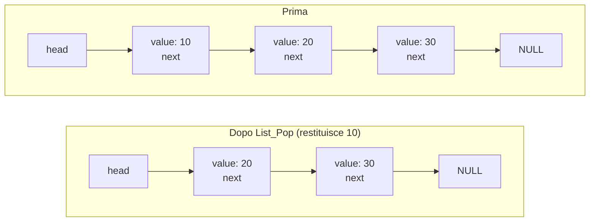

---

## corso: Sistemi Operativi lezione: 5 data: 2026-10-05 argomenti: [MLFQ, priority boost, allotment, Solaris, scheduling multiprocessore, cache, coerenza delle cache, mutex, cache affinity, SQMS, MQMS, migrazione, work stealing, spazio di indirizzamento, indirizzi virtuali, address translation, base and bound] slide: ["08 - Scheduling: The Multi-Level Feedback Queue", "10 - Multiprocessor Scheduling (Advanced)", "13 - The Abstraction: Address Space", "15 - Address Translation (prima parte)"] tags: [sistemi-operativi]
---
# Lezione 5 — Completamento del MLFQ, scheduling multiprocessore e spazio di indirizzamento

La lezione chiude il discorso sullo scheduling e apre quello sulla memoria. La prima parte riprende il **Multi-Level Feedback Queue** lasciato in sospeso in [[Lezione 03 - Introduzione allo scheduling|Lezione 3]]. Ne mostra i problemi e aggiunge le regole che lo rendono uno scheduler realistico. La seconda parte affronta lo **scheduling su più processori**, dove la presenza delle cache e della memoria condivisa cambia le scelte dello scheduler. Dopo la pausa si passa alla **memoria**: si introduce l'astrazione dello **spazio di indirizzamento** e si comincia a vedere come il sistema operativo, con l'aiuto dell'hardware, traduce gli indirizzi virtuali in indirizzi fisici.

## Il MLFQ: ripasso e regole di base

Il professore riparte dal **Round Robin** classico. Ogni processo riceve un quanto di tempo, allo scadere del quale viene interrotto anche se non ha finito e rimesso nella coda dei pronti, mentre un altro processo va in esecuzione. Il MLFQ migliora questa idea tenendo conto che i processi non hanno tutti le stesse caratteristiche. Ci sono due estremi.

Da un lato c'è il processo che **fa molti calcoli** ed è **poco interattivo**: non prende mai dati in input e non produce output, né su file né su schermo. Ha sempre bisogno della CPU. Dall'altro c'è il processo **interattivo**, che ogni tanto si ferma ad aspettare che l'utente faccia qualcosa, per esempio muova il mouse o prema un tasto del joypad. Mentre aspetta non ha bisogno della CPU: va nello stato _blocked_ e nel frattempo può essere schedulato qualcun altro.

Il MLFQ usa quindi **più code dei pronti**, una ad alta priorità e le altre a priorità via via decrescente. Valgono le due regole di base già viste: tra i processi della coda a priorità più alta si fa Round Robin (regola 2), e una coda viene considerata solo se quelle a priorità maggiore sono vuote (regola 1). Le slide illustrano la struttura con otto code: A e B si trovano nella coda Q8, la più alta, C nella coda intermedia Q4 e D nella coda più bassa Q1.

Finché A e B chiedono il processore, C e D non vengono mai schedulati. Il trucco è fare in modo che **nelle code alte stiano proprio i processi interattivi**: anche se sono lassù, si bloccano spesso e lasciano spazio alle code sottostanti. Per ottenerlo servono le regole che spostano i job da una coda all'altra:

- **Regola 3**: un job che entra nel sistema viene messo nella coda a priorità più alta. Gli si dà fiducia: lo si considera interattivo finché non si scopre il contrario.
- **Regola 4a**: se un job usa per intero il suo quanto, scende di priorità, perché evidentemente non è interattivo.
- **Regola 4b**: se un job lascia la CPU prima della fine del quanto, resta allo stesso livello.

L'idea, spiega il professore, è di **approssimare lo Shortest Job First**. Non si sta facendo davvero SJF, ma l'effetto è simile: i job corti e interattivi restano in alto, gli altri scendono. Il professore sottolinea anche che FIFO, SJF e Round Robin puro sono principi di base che servono a capire i concetti, ma così come sono non gestiscono il nostro calcolatore. Il MLFQ, con le sue varianti, è invece uno scheduler realistico, del tipo usato nei sistemi operativi moderni.

### Scheduling e algoritmo di scheduling

Prima degli esempi il professore precisa due termini che ricorrono spesso.

> [!important] Scheduling e algoritmo di scheduling L'**algoritmo di scheduling** è l'insieme delle **regole** con cui si decide chi esegue. Lo **scheduling** è il **risultato**: l'assegnazione concreta del processore ai task nel tempo. Si rappresenta di solito con una linea temporale per ciascun task (o, come nelle slide del MLFQ, per ciascuna coda), vuota quando il task non ha il processore e riempita quando lo ha. È la stessa rappresentazione usata dal simulatore del corso.

> [!important] Job, task e processo Il **processo** è una specifica implementazione di un'attività: quella che si crea con la `fork()`. **Job** e **task** sono termini più generici, che indicano attività svolte dal sistema non necessariamente implementate come processi. Nelle slide sullo scheduling vengono usati come sinonimi.

### Tre esempi

Gli esempi delle slide usano tre code (Q2 la più alta, Q0 la più bassa) e un quanto di 10 ms.

**Esempio 1: un solo job lungo.** Un job che calcola a lungo e non fa I/O entra in Q2 (regola 3) e usa tutto il quanto, quindi scende in Q1 (regola 4a). Anche lì usa tutto il quanto e scende in Q0, dove resterà per sempre.

```mermaid
gantt
    title Esempio 1: un job lungo scende di coda (tempo in ms)
    dateFormat x
    axisFormat %Q
    section Q2
    A : e1a, 0, 10
    section Q1
    A : e1b, 10, 20
    section Q0
    A : e1c, 20, 200
```



Al professore questo comportamento non piace. Un job potrebbe fare molti calcoli all'inizio e poi diventare interattivo, ma con queste regole, una volta classificato come non interattivo, è perduto per sempre: è sceso e non potrà più risalire.

**Esempio 2: arriva un job breve.** Il job lungo A è già sceso in Q0 quando, a $t = 100$ ms, arriva un job B che dura 20 ms. B entra in Q2, esegue per un quanto, scende in Q1, esegue per un altro quanto e termina. Poi A riprende.

```mermaid
gantt
    title Esempio 2: un job breve arriva a t = 100 ms (tempo in ms)
    dateFormat x
    axisFormat %Q
    section Q2
    A : e2a, 0, 10
    B : e2b, 100, 110
    section Q1
    A : e2c, 10, 20
    B : e2d, 110, 120
    section Q0
    A : e2e, 20, 100
    A (ripresa) : e2f, 120, 200
```



Le slide descrivono B come "interattivo", ma il professore osserva che dal grafico non lo si vede: B scende di coda, quindi ha consumato tutto il suo quanto. Semplicemente dura poco e finisce prima di arrivare in fondo. Se fosse durato di più, sarebbe sceso fino a Q0 e avrebbe diviso la CPU con A in Round Robin, a meno di essere davvero interattivo e bloccarsi spesso. È lo stesso caso dell'esempio costruito in [[Lezione 03 - Introduzione allo scheduling#Come cambia la priorità|Lezione 3]].

**Esempio 3: un job davvero interattivo.** A è il solito job lungo; B usa la CPU per 1 ms e poi fa I/O, ripetutamente. B lascia sempre la CPU prima della fine del quanto e quindi, per la regola 4b, **resta sempre nella coda più alta**. A esegue negli spazi lasciati liberi.

Il professore trova il risultato del tutto ragionevole. Il task che vuole fare molti calcoli consuma il processore negli spazi vuoti. Quello che usa poco il processore sta in alto, e non solo perché consuma meno: deve anche essere **reattivo**. Se si preme un tasto, si vuole che il task che lo gestisce possa elaborare subito l'input.

## I problemi del MLFQ di base

Questa versione del MLFQ ha tre problemi.

1. **Starvation** (morte per fame). Dire che i job interattivi sono spesso bloccati va bene, ma dipende da quanti sono. Se sono troppi, a turno occupano sempre il processore, e il job che sta nelle code basse potrebbe non riceverlo mai.
2. **Si può ingannare lo scheduler** (_gaming the scheduler_). Un programmatore malizioso può scrivere un task che usa il 99% del quanto e poi, anche senza alcun bisogno, esegue un'operazione di I/O. Lo scheduler lo crede interattivo, lo tiene in alto e quel task sottrae risorse ai processi scritti onestamente.
3. **Il comportamento di un job può cambiare.** Un job **CPU-bound** (cioè limitato dalla CPU, che passa il tempo a calcolare) può diventare a un certo punto **I/O-bound** (limitato dall'I/O, che passa il tempo ad aspettare dati). Con le regole viste, chi è stato classificato CPU-bound lo resta per sempre. Nelle parole del professore: "le persone cambiano, e anche i task possono cambiare", ma qui il task non ha possibilità di redenzione.

### Regola 5: il priority boost

Per i problemi 1 e 3 si aggiunge una regola che, periodicamente, dà a tutti una nuova possibilità.

> [!important] Regola 5 (priority boost) Dopo un certo periodo di tempo $S$, **tutti i job** del sistema vengono spostati nella **coda a priorità più alta**.

Dopo il boost, un job che continua a essere CPU-bound usa di nuovo tutto il suo quanto e riscende. Un job che ha cambiato comportamento, invece, può restare in alto. La regola risolve anche la starvation: dopo ogni boost il job lungo si ritrova in cima, dove esegue in Round Robin insieme ai job interattivi, e riceve quindi una quota di CPU. Le slide lo mostrano con un job lungo A e due job interattivi B e C: senza boost A, sceso in Q0, non esegue più finché B e C sono attivi; con il boost risale periodicamente e ottiene la CPU.

La durata del periodo $S$ è importante. Con un periodo lungo, un job CPU-bound deve aspettare di più per avere una seconda possibilità. Con un periodo breve, la ottiene prima. In ogni caso tutti, prima o poi, tornano in alto.

> [!tip] Approfondimento — Le "costanti voodoo" #approfondimento 
> OSTEP osserva che il periodo $S$ è un esempio di quelle che John Ousterhout chiamava **costanti voodoo**: parametri che sembrano richiedere una qualche magia nera per essere impostati bene. Con un valore troppo alto i job lunghi possono soffrire la fame; con uno troppo basso i job interattivi potrebbero non ricevere una quota adeguata di CPU. Il libro consiglia di evitare costanti di questo tipo quando è possibile, e nota che spesso si finisce per lasciare i valori predefiniti sperando che funzionino [@arpacidusseau2023ostep, cap. 8].

### Regola 4: contabilizzare meglio il tempo

Resta il problema del task "furbastro". Il professore chiede alla classe come risolverlo; la soluzione, dice, è abbastanza semplice.

Si riscrivono le regole 4a e 4b, che si chiamavano così proprio perché sarebbero state fuse in un'unica regola 4. Non conta più se un job usa tutto il quanto in una singola esecuzione. Conta se ha esaurito la **quantità di tempo che ha a disposizione a un certo livello**. Questa quantità si chiama **allotment** ("dotazione"). Il tempo usato si **somma** attraverso esecuzioni separate: un job che termina ogni volta prima della fine del quanto prima o poi supera, sommando i vari spezzoni, il tempo assegnato a quella coda, e allora scende.

> [!important] Regola 4 (sostituisce 4a e 4b) 
> Quando un job ha **esaurito il suo allotment** a un certo livello, **indipendentemente da quante volte abbia ceduto la CPU**, la sua priorità viene ridotta: scende di una coda.

> [!example] Il task che inganna lo scheduler, con e senza regola 4 
> Si supponga un allotment di 10 ms per coda e un task che esegue per 9 ms e poi fa una breve operazione di I/O, ripetendo il ciclo.
> 
> |Esecuzione|Tempo usato|Tempo cumulato al livello|Con le regole 4a/4b|Con la regola 4|
> |---|--:|--:|---|---|
> |1ª|9 ms|9 ms|cede prima del quanto: resta|sotto i 10 ms: resta|
> |2ª|9 ms|18 ms|cede prima del quanto: resta|allotment esaurito: **scende**|
> 
> Con le vecchie regole il task resta in cima per sempre. Con la nuova regola scende alla seconda esecuzione, e da lì continua a scendere perché consuma regolarmente il suo tempo. Il boost della regola 5 continua a valere: ogni tanto il task torna in alto, ma se si comporta allo stesso modo riscende.

### Quanti diversi per coda

Per rendere lo scheduler più efficace, spesso le code hanno **quanti di durata diversa**. Nelle code ad alta priorità ci sono i job interattivi, ai quali dovrebbe bastare poco tempo: si usano quanti brevi, per esempio 10 ms o meno. Nelle code basse ci sono job che fanno molti calcoli: si usano quanti più lunghi, per esempio 100 ms, così da ridurre i context switch. L'esempio delle slide usa 10 ms per la coda più alta, 20 ms per quella intermedia e 40 ms per la più bassa. Due job CPU-bound partono in alto con fettine strette; man mano che scendono di coda, le fette diventano più larghe.

### Il MLFQ di Solaris

Le slide riportano, come dato reale, lo scheduler di **Solaris**, una versione di Unix per _workstation_ (stazioni di lavoro di fascia più alta di un personal computer), così come Linux è una versione di Unix. Per la classe di scheduling a tempo condiviso (_Time-Sharing_, TS), Solaris usa:

- **60 code**;
- quanti che aumentano lentamente da una coda all'altra, da **20 ms** nella coda più alta fino a **poche centinaia di millisecondi** in quelle più basse;
- un **boost** di tutte le priorità circa **ogni secondo**.

Il professore non sa come si sia arrivati a 60, ma evidentemente è un numero ragionevole, frutto dell'esperienza.

> [!important] Il MLFQ completo
> 
> - **Regola 1**: se la priorità di A è maggiore della priorità di B, esegue A (B no).
> - **Regola 2**: se la priorità di A è uguale alla priorità di B, A e B eseguono in Round Robin.
> - **Regola 3**: quando un job entra nel sistema, viene messo nella coda a priorità più alta.
> - **Regola 4**: quando un job ha esaurito il suo allotment a un certo livello, indipendentemente da quante volte abbia ceduto la CPU, scende di una coda.
> - **Regola 5**: dopo un certo periodo $S$, tutti i job vengono spostati nella coda a priorità più alta.

> [!tip] Approfondimento — Tabelle, formule e consigli dell'utente #approfondimento 
> Secondo OSTEP, la classe TS di Solaris è facile da configurare: è governata da tabelle che stabiliscono come cambia la priorità di un processo, quanto dura ogni quanto e ogni quanto avviene il boost, e un amministratore può modificarle per cambiare il comportamento dello scheduler. Non tutti i MLFQ usano tabelle: lo scheduler di FreeBSD 4.3, per esempio, calcola il livello di priorità con una **formula** basata sul tempo di CPU usato dal processo, che "decade" col tempo e produce così l'equivalente di un boost. Alcuni sistemi accettano infine **consigli** dall'utente: il comando `nice` permette di alzare o abbassare un po' la priorità di un job [@arpacidusseau2023ostep, cap. 8].

## Lo scheduling su più processori

L'ultimo argomento di scheduling riguarda i sistemi con più CPU.

### Processori multicore

Un processore **multicore** contiene più _core_, cioè più unità di elaborazione, sullo stesso chip. In un sistema del genere due task possono essere eseguiti **veramente in parallelo**, non solo in apparenza. Ogni core avrà comunque bisogno di un algoritmo di scheduling, perché di solito i task sono più dei core.

Aggiungere CPU **non rende più veloce una singola applicazione**: per sfruttare più core, l'applicazione andrebbe riscritta perché esegua in parallelo, usando i **thread**, che saranno trattati più avanti. Più CPU permettono però di eseguire più processi in parallelo, e l'effetto complessivo è un aumento della velocità, perché i processi esistenti non devono più dividersi un unico processore.

### Cache e località

Per capire i problemi dello scheduling multiprocessore servono alcuni concetti legati alla memoria, che verranno ripresi più avanti. La **memoria principale** contiene tutto: il sistema operativo, il codice dei processi, i dati statici (come le variabili globali), l'heap con la memoria allocata dinamicamente (`malloc` in C, `new` in C++) e lo stack. Ogni CPU ha però anche una propria **cache**.

> [!important] Cache 
> La **cache** è una memoria **piccola e veloce** che conserva copie dei dati più usati della memoria principale. Se un dato richiesto è in cache si ha un **cache hit** ("colpito") e si evita l'accesso, più lento, alla memoria principale. Se non c'è si ha un **cache miss** ("mancato"): il dato va preso in memoria principale e poi copiato in cache per gli accessi successivi.

La cache non è veloce solo perché è costruita con una tecnologia diversa: funziona perché sfrutta il **principio di località**. La **località temporale** dice che un dato appena usato ha buone probabilità di essere riusato a breve. L'esempio del professore è il contatore `i` di un ciclo `for`: viene letto e aggiornato a ogni iterazione, e sta sempre nello stesso posto. La **località spaziale** dice che, dopo l'accesso a un indirizzo, è probabile un accesso agli indirizzi vicini.

> [!warning] Precisazione sulla località spaziale A lezione la località spaziale viene descritta in modo un po' sfumato, come la probabilità di accedere in istanti successivi "agli stessi dati" dichiarati nel programma. Più precisamente, la località spaziale riguarda gli **indirizzi vicini**: se un programma accede all'indirizzo $x$, è probabile che acceda presto a $x+1$, $x+2$ e così via. È il caso di un array scorso elemento per elemento, o delle istruzioni di un programma, eseguite una dopo l'altra. Per questo una cache, quando carica un dato, carica insieme anche quelli adiacenti.

Un cache miss costa **più** che non avere affatto la cache: prima si cerca il dato in cache senza trovarlo, poi lo si prende dalla memoria principale, poi lo si copia in cache. Il principio è statistico: grazie alla località, le volte in cui va bene sono molte più di quelle in cui va male, e nel complesso ci si guadagna. È uno dei principi su cui si basano le architetture dei calcolatori. Con più CPU, però, può avere effetti deleteri.

### Il problema della coerenza delle cache

Le slide mostrano due CPU, ciascuna con la propria cache, che condividono la memoria principale tramite un **bus**. È rilevante che si parli di **thread** e non di processi: due processi non condividono la memoria, due thread sì.

1. La CPU 0 ha bisogno del dato $D$ che sta in memoria. Non lo trova nella propria cache, quindi lo legge dalla memoria principale e se ne copia una copia in cache.
2. Un task in esecuzione sulla CPU 0 modifica il dato: la modifica avviene nella cache della CPU 0, dove $D$ diventa $D'$. Per sfruttare la cache, l'aggiornamento della memoria principale non avviene subito; in memoria resta $D$.
3. Viene schedulato sulla CPU 1 un task che ha bisogno dello stesso dato. La CPU 1 lo legge dalla memoria principale e ottiene il valore **vecchio** $D$ invece di quello corretto $D'$.

Le cache hanno aggiunto un livello che può creare **incoerenza**. Il problema si chiama **coerenza delle cache** (_cache coherence_). Una soluzione classica è il **bus snooping** ("spiare il bus"): ogni cache osserva gli aggiornamenti della memoria che passano sul bus. Quando una CPU vede un aggiornamento di un dato che ha nella propria cache, se ne accorge e **invalida** la propria copia oppure la **aggiorna**.

Sono questioni di architettura dei calcolatori, che al corso interessano poco. Il punto è che serve una soluzione tecnologica raffinata, e che queste operazioni aggiuntive richiedono tempo. Questo ha un impatto anche sullo scheduling: conviene eseguire un processo sempre sulla stessa CPU, così da ritrovare nella cache i dati giusti.

### Non dimenticare la sincronizzazione

C'è un secondo aspetto: ogni volta che c'è **memoria condivisa** servono meccanismi che la proteggano. Verranno trattati in dettaglio con la concorrenza e i semafori, ma il professore anticipa un esempio. La funzione seguente toglie il primo elemento da una **lista concatenata**:

```c
typedef struct __Node_t {
    int value;                 // valore contenuto nel nodo
    struct __Node_t *next;     // puntatore al nodo successivo
} Node_t;

int List_Pop() {
    Node_t *tmp = head;        // ricorda la vecchia testa...
    int value = head->value;   // ...e il suo valore
    head = head->next;         // la testa avanza al nodo successivo
    free(tmp);                 // libera la vecchia testa
    return value;              // restituisce il valore
}
```

Una lista concatenata ha un puntatore `head` alla testa. Ogni nodo contiene un valore (`value`) e un puntatore `next` al nodo successivo; l'ultimo nodo punta a `NULL`. `List_Pop` crea un puntatore temporaneo `tmp` alla testa, legge il valore della testa, sposta `head` sul nodo successivo e infine libera il vecchio nodo, a cui punta ancora `tmp`.



È un'operazione comunissima, ma diventa pericolosa se la lista sta in memoria condivisa tra due thread che eseguono su due CPU diverse. Nessuno impedisce che i due operino contemporaneamente sulla lista, e che uno cancelli un nodo mentre l'altro lo sta leggendo: un disastro. Servono funzionalità di **sincronizzazione**.

```c
pthread_mutex_t m;

int List_Pop() {
    lock(&m);                  // inizio della sezione protetta
    Node_t *tmp = head;
    int value = head->value;
    head = head->next;
    free(tmp);
    unlock(&m);                // fine della sezione protetta
    return value;
}
```

> [!important] Mutex 
> Un **mutex** (da _mutual exclusion_, mutua esclusione) è un semaforo di mutua esclusione. Il primo thread che chiama `lock` prosegue, e il mutex viene segnato come occupato. Il thread successivo che chiama `lock` resta **bloccato**, come per un'attesa di I/O, finché il primo non ha finito di aggiornare la lista e ha chiamato `unlock`.

Nella slide il tipo è scritto `pthread_mtuex_t`, con un refuso; il nome corretto è `pthread_mutex_t`. Anche `lock` e `unlock` sono abbreviazioni: con la libreria pthread le funzioni si chiamano `pthread_mutex_lock` e `pthread_mutex_unlock`.

I problemi sono quindi due: evitare le incoerenze dovute alle cache e garantire l'accesso in mutua esclusione alle strutture dati condivise. Ciò che interessa qui, però, è il loro impatto sullo scheduling.

### Cache affinity

> [!important] Cache affinity 
> Un processo che esegue su una CPU accumula molto stato nella cache di quella CPU. La volta successiva eseguirà più velocemente se una parte di quello stato è ancora lì. La **cache affinity** ("affinità di cache") è il principio per cui conviene **mantenere un processo sulla stessa CPU** il più possibile. Uno scheduler multiprocessore dovrebbe tenerne conto nelle sue decisioni.

Così il processo ritrova i suoi dati in cache e non bisogna preoccuparsi di aggiornamenti e sincronizzazioni con le altre CPU.

### Una sola coda: SQMS

Il primo approccio è lo **Single Queue Multiprocessor Scheduling** (SQMS): tutti i job da schedulare stanno in **un'unica coda**. Ogni CPU, quando è libera o quando è finito il quanto del task precedente, prende dalla coda condivisa il job successivo. È tutto uguale al caso con una CPU, solo che le CPU pescano dalla stessa coda. I problemi sono due.

Il primo è che serve un **meccanismo di locking**. La coda è una struttura condivisa tra più CPU, come la lista vista sopra, e quindi è una struttura critica. Il locking si può fare, ma introduce ritardi: mentre una CPU esamina la coda per scegliere il prossimo processo, le altre devono aspettare. Al crescere del numero di CPU il problema peggiora, e l'approccio **scala male**.

Il secondo, ancora più rilevante, riguarda la **cache affinity**. Le slide considerano una coda con cinque job, A, B, C, D ed E, schedulati in Round Robin su quattro CPU.

|CPU|Quanto 1|Quanto 2|Quanto 3|Quanto 4|Quanto 5|…|
|---|---|---|---|---|---|---|
|CPU 0|A|E|D|C|B|…|
|CPU 1|B|A|E|D|C|…|
|CPU 2|C|B|A|E|D|…|
|CPU 3|D|C|B|A|E|…|

La CPU 0 prende A, la CPU 1 prende B, e così via. Quando la CPU 0 ha finito, prende il job rimasto, E. Ogni job finisce per girare su una CPU diversa a ogni quanto: è il caso estremo, contrario alla cache affinity. La località viene vanificata, e la cache deve essere riempita di nuovi dati ogni volta che arriva un processo.

Una variante mantiene la coda unica ma decide che alcuni task restino sempre sulla stessa CPU, mentre altri possono **migrare**. La **migrazione** è lo spostamento di un task da una CPU all'altra; il professore chiede di ricordare questa parola.

|CPU|Quanto 1|Quanto 2|Quanto 3|Quanto 4|Quanto 5|…|
|---|---|---|---|---|---|---|
|CPU 0|A|E|A|A|A|…|
|CPU 1|B|B|E|B|B|…|
|CPU 2|C|C|C|E|C|…|
|CPU 3|D|D|D|D|E|…|

A, B, C e D sono assegnati sempre alla stessa CPU; solo E migra. Quando E occupa la CPU 0, A deve aspettare il turno successivo; poi E passa alla CPU 1 e salta un turno B, e così via. A, B, C e D conservano la cache affinity: il danno non è eliminato, ma è ridotto al minimo. Lo schema però aggiunge complessità, e resta da decidere **con che criterio** stabilire chi migra e chi no. Nell'esempio i task sono cinque, ma in un sistema reale sono innumerevoli.

### Più code: MQMS

Un'idea più interessante, e spesso applicata, è il **Multi-Queue Multiprocessor Scheduling** (MQMS): **ogni CPU ha la propria coda dei pronti**. Quando un job entra nel sistema viene messo in esattamente una coda, per esempio quella con meno lavoro, e resta lì. Ogni coda segue una propria disciplina di scheduling. Il professore sottolinea che queste code non hanno nulla a che vedere con le code di priorità del MLFQ: per semplicità si immagina un'unica coda in Round Robin, "clonata" per ogni CPU. La cache affinity è preservata per definizione, perché un job non può passare su un'altra CPU, e non c'è più una struttura condivisa da proteggere.

Con la coda Q0 che contiene A e C e la coda Q1 che contiene B e D, il Round Robin produce questo scheduling:

|CPU|Quanti successivi|
|---|---|
|CPU 0|A A C C A A C C A A C C …|
|CPU 1|B B D D B B D D B B D D …|

La CPU 0 alterna sempre A e C, la CPU 1 alterna B e D: ogni cache contiene sempre dati utili. MQMS è più scalabile e rispetta la cache affinity.

> [!example] Domanda in aula: qual è il problema del MQMS? 
> Il professore chiede alla classe di individuare il problema senza guardare le slide successive. Un primo studente osserva che un processo potrebbe aver bisogno di una risorsa modificata da un processo su un'altra CPU. Il professore risponde che i processi accedono comunque alla stessa memoria e che i meccanismi per evitare i "casini" esistono. Il punto non è che il sistema smetta di funzionare: evitare i problemi **costa tempo**, e tenere i processi associati alla loro CPU serve a essere più efficienti.
> 
> Un secondo studente nota che l'assegnazione iniziale potrebbe essere sbagliata: se A e C sono interattivi e B e D fanno molti calcoli, una CPU resta quasi inattiva e l'altra è sovraccarica. Il professore riconosce che l'osservazione è giusta e simile a quella che aveva in mente.

Il problema a cui pensava il professore è lo **sbilanciamento del carico** (_load imbalance_): i job non finiscono tutti insieme. Se in Q0 il job C termina, la CPU 0 esegue solo A, che riceve il doppio della CPU rispetto a B e D:

|CPU|Quanti successivi|
|---|---|
|CPU 0|A A A A A A A A A A A A …|
|CPU 1|B B D D B B D D B B D D …|

È un'allocazione non equa. Il professore la spiega con tre studenti e due panini: due devono dividersi un panino, mentre il terzo se ne mangia uno intero da solo. Se poi termina anche A, la CPU 0 resta **inattiva** finché qualcuno non lancia un nuovo processo, mentre B e D si dividono la CPU 1.

### Migrazione e work stealing

La soluzione è la **migrazione**. Il sistema operativo deve poter rivedere periodicamente le proprie scelte. Nel caso più semplice, con la CPU 0 vuota, sposta B oppure D nella coda Q0.

Il caso di A da solo su una CPU e di B e D sull'altra è più complicato: spostare un job una volta sola non risolve, perché si sposterebbe solo lo sbilanciamento. Serve una **migrazione continua**. Per un po' B viene eseguito sulla CPU 0, alternato con A, mentre D resta da solo sulla CPU 1; poi è A a passare sulla CPU 1. Così, nel lungo periodo, tutti ricevono la stessa quota.

|CPU|Quanti successivi|Note|
|---|---|---|
|CPU 0|A A A A B A B A B B B B …|B migra sulla CPU 0|
|CPU 1|B D B D D D D D A D A D …|poi A migra sulla CPU 1|

Un meccanismo usato per decidere le migrazioni è il **work stealing** ("furto di lavoro"). Una coda **sorgente** che ha pochi job, ogni tanto, dà un'occhiata a un'altra coda, la coda **bersaglio**. Se la trova più piena di sé, le "ruba" uno o più job. Il professore non entra nei dettagli tecnici: gli interessa mostrare che, con più processori, questi problemi emergono e che chi progetta i sistemi operativi cerca di risolverli. Il work stealing ha però un costo: guardare spesso le altre code introduce un overhead elevato e crea problemi di scalabilità.

> [!tip] Approfondimento — Quanto spesso guardare le altre code #approfondimento 
> OSTEP descrive il compromesso del work stealing. Se una coda controlla troppo spesso le altre, il sistema soffre di un overhead elevato e scala male, cioè proprio il difetto per cui si era abbandonata la coda unica. Se controlla troppo di rado, rischia sbilanciamenti gravi. Trovare la soglia giusta, conclude il libro, resta "un'arte oscura", come spesso accade nella progettazione delle politiche di sistema. Per lo stesso motivo il libro spiega che la coda unica scala male: il lock che la protegge diventa sempre più conteso al crescere del numero di CPU, e il sistema passa sempre più tempo a gestire il lock [@arpacidusseau2023ostep, cap. 10].

### Gli scheduler multiprocessore di Linux

L'ultima slide del capitolo, non commentata a lezione, elenca tre scheduler multiprocessore usati in Linux.

- **O(1)**: scheduler basato su priorità, con **più code**. Cambia nel tempo la priorità di un processo ed esegue quelli a priorità più alta, con particolare attenzione all'interattività: un approccio simile al MLFQ.
- **CFS** (_Completely Fair Scheduler_): approccio deterministico a **quote proporzionali** (_proportional-share_), con **più code**.
- **BFS** (_BF Scheduler_): approccio a quote proporzionali con **un'unica coda**; le slide lo indicano come basato su EEVDF (_Earliest Eligible Virtual Deadline First_).

OSTEP osserva che O(1) e CFS usano più code mentre BFS ne usa una sola, a dimostrazione che entrambi gli approcci possono funzionare [@arpacidusseau2023ostep, cap. 10]. Sull'evoluzione dello scheduler principale di Linux si veda l'approfondimento in [[Zen/Anno 2/Sistemi Operativi/generated/Lezione 3 - CLAUDE|Lezione 3]].

> [!tip] Approfondimento — Scegliere la CPU di un processo in Linux #approfondimento 
> Linux permette anche di indicare esplicitamente su quali CPU può eseguire un thread. La chiamata di sistema `sched_setaffinity()` imposta la **maschera di affinità** (_CPU affinity mask_) di un thread, cioè l'insieme delle CPU su cui può essere eseguito. La pagina di manuale nota che, su un sistema multiprocessore, impostare questa maschera può portare benefici di prestazioni. Dalla shell si ottiene lo stesso effetto con il comando `taskset` [@linuxman2schedaffinity].

## Lo spazio di indirizzamento

Dopo la pausa si passa finalmente alla **memoria**, che finora era comparsa solo di passaggio. Il concetto centrale è lo **spazio di indirizzamento** (_address space_), su cui si basano i sistemi operativi moderni.

### Virtualizzare la memoria

Quando si parla di memoria si intende la **RAM**. Il professore lo precisa perché molti utenti, non ingegneri, chiamano "memoria" anche il disco. La memoria fisica è limitata: è quella che si compra, e costa. Il sistema operativo **virtualizza** la memoria fisica: crea l'illusione che ce ne sia di più, tanta quanto lo spazio di indirizzamento, cioè moltissima. E non solo: invece di dividere la memoria in fette, una per processo, crea l'illusione che **ogni processo abbia a disposizione l'intero spazio di indirizzamento**, che è persino più grande della memoria fisica.

Lo spazio di indirizzamento è l'insieme degli indirizzi diversi che si possono usare. Per esempio, con un byte si rappresentano 256 valori diversi, quindi si possono indirizzare 256 indirizzi.

I benefici della virtualizzazione sono tre:

- **semplicità di programmazione**. Se la memoria fisica fosse divisa in fette, un programma dovrebbe essere modificato a seconda della porzione che gli tocca. Una variabile `pippo` messa a un certo indirizzo dovrebbe cambiare indirizzo se il programma venisse spostato in un'altra zona perché quella originale è occupata. Invece ogni processo pensa di avere l'intero spazio di indirizzamento e non si preoccupa di dove sia fisicamente;
- **efficienza** nell'uso della memoria, in termini di tempo e di spazio;
- **isolamento** dei processi tra loro e rispetto al sistema operativo. Nessun processo può scrivere nella memoria di un altro: ovunque legga o scriva, si muove dentro il proprio spazio di indirizzamento, del tutto privato, ed è il SO a garantire che gli spazi siano separati.

> [!tip] Approfondimento — I tre obiettivi della memoria virtuale #approfondimento OSTEP formula gli obiettivi di un sistema di memoria virtuale in tre parole. **Trasparenza**: la virtualizzazione deve essere invisibile al programma, che si comporta come se avesse una propria memoria fisica privata. **Efficienza**: deve rallentare poco i programmi e occupare poca memoria per le proprie strutture dati, il che richiede supporto hardware. **Protezione**: deve proteggere i processi gli uni dagli altri e il sistema operativo dai processi [@arpacidusseau2023ostep, cap. 13].

### I sistemi di una volta

Per arrivare all'astrazione conviene vedere gli approcci precedenti, non basati sulla virtualizzazione. Nei primi sistemi in memoria c'era **un solo processo**. Il sistema operativo stesso è un programma: il codice delle chiamate di sistema e le strutture dati del SO devono stare da qualche parte. Tipicamente occupava gli indirizzi bassi, da 0 a 64 KB, e da lì in poi c'era il programma in esecuzione. Gli indirizzi erano **fisici**: il programma sapeva che la variabile `pluto` stava a quell'indirizzo, e quello era un indirizzo di memoria fisica.

Con più processi, questo schema obbliga a togliere e rimettere in memoria l'intero processo a ogni cambio. Con il Round Robin, a ogni quanto si dovrebbe copiare tutta la memoria di un processo e poi toglierla: un'enorme perdita di tempo. Con la **multiprogrammazione** e il time sharing si caricano invece **più processi in memoria**, ciascuno in una propria fetta, e si passa dall'uno all'altro.

|Indirizzi fisici|Contenuto|
|---|---|
|0 – 64 KB|sistema operativo|
|64 – 128 KB|libero|
|128 – 192 KB|processo C|
|192 – 256 KB|processo B|
|256 – 320 KB|libero|
|320 – 384 KB|processo A|
|384 – 512 KB|libero|

L'utilizzo della macchina migliora, ma restano problemi seri. Ogni processo ha una quantità **massima e fissa** di memoria, più piccola di quella totale. Lo spazio basta solo per un numero finito di processi, a meno di toglierli e rimetterli, il che costa tempo. C'è un problema di **protezione**: nel codice di B potrebbe esserci un'istruzione che scrive 0 all'indirizzo 320K, che appartiene ad A, e nessuno lo impedisce. Si possono inventare meccanismi che limitano ogni processo a un intervallo di indirizzi, ma le cose si complicano. Infine, se un processo viene spostato in un'altra fetta, il suo codice va **modificato**, perché ogni riferimento alla memoria deve puntare alla nuova posizione.

### L'astrazione dello spazio di indirizzamento

> [!important] Spazio di indirizzamento Lo **spazio di indirizzamento** è un'astrazione della memoria fisica creata dal sistema operativo: l'insieme degli indirizzi che un processo può usare per le proprie attività. Contiene tutto ciò che riguarda il processo in esecuzione: codice, dati statici, heap e stack. Parte **sempre da 0** e arriva sempre allo stesso indirizzo massimo, **indipendentemente da dove il processo si trovi in memoria fisica**.

Nell'esempio delle slide lo spazio di indirizzamento è di 16 KB, con indirizzi da 0 a 16 KB − 1:

|Indirizzi virtuali|Contenuto|
|---|---|
|0 – 1 KB|**codice** del programma (e dati statici, non rappresentati)|
|1 – 2 KB|**heap**, memoria allocata dinamicamente (`malloc`, `new`); cresce verso il basso|
|2 – 15 KB|spazio libero|
|15 – 16 KB|**stack**, variabili locali, parametri e indirizzi di ritorno; cresce verso l'alto|

Heap e stack crescono da direzioni opposte verso lo spazio libero centrale. Tutte le istruzioni del programma fanno riferimento a questi indirizzi **virtuali**, non agli indirizzi fisici. Da qualche parte nel codice ci sarà scritto "prendi la variabile all'indirizzo 15K", e il processo andrà sempre a prendere quella. Ovviamente serve un meccanismo che trasformi l'indirizzo virtuale nell'indirizzo fisico, perché l'informazione sta davvero in memoria fisica: di questo si occupa il sistema operativo, con l'aiuto dell'hardware.

### Un esperimento: stampare gli indirizzi

Il professore propone un programma C che rende visibile lo spazio di indirizzamento:

```c
#include <stdio.h>
#include <stdlib.h>

int main(int argc, char *argv[]) {
    printf("location of code : %p\n", (void *) main);       // indirizzo del codice
    printf("location of heap : %p\n", (void *) malloc(1));  // indirizzo dell'heap
    int x = 3;
    printf("location of stack : %p\n", (void *) &x);        // indirizzo dello stack
    return x;
}
```

La prima `printf` stampa l'indirizzo della funzione `main`, cioè un indirizzo del **codice**. La seconda stampa l'indirizzo restituito dalla prima `malloc`, che è l'inizio dell'**heap**. La terza crea una variabile locale `x` e ne stampa l'indirizzo, che sta nello **stack**. Non è l'unica cosa nello stack: ci saranno probabilmente anche `argc` e `argv`. Su una macchina Linux a 64 bit l'output riportato nelle slide è:

```text
location of code : 0x40057d
location of heap : 0xcf2010
location of stack : 0x7fff9ca45fcc
```

Le slide lo collocano nello spazio di indirizzamento: il codice (_text_) a partire da `0x400000`, poi i dati da `0x401000`, l'heap da `0xcf2000`, e lo stack verso la fine, vicino a `0x7fff9ca49000`. Rispetto al disegno schematico qui finalmente il codice è separato dai dati statici.

Dire che una macchina o un sistema operativo è **a 64 bit** significa che ogni indirizzo è lungo 64 bit. Gli indirizzi sono scritti in **esadecimale**, dove ogni cifra corrisponde a 4 bit: un indirizzo completo avrebbe quindi 16 cifre. Ne compaiono meno perché gli zeri iniziali non vengono stampati, e per lo stesso motivo il codice inizia a `0x400000`. Il professore invita a calcolare quanti indirizzi diversi si possono rappresentare con 64 bit: $2^{64} \approx 1{,}8 \cdot 10^{19}$.

Il professore sottolinea che tutti questi indirizzi sono relativi allo spazio di indirizzamento, quindi non dipendono da dove il SO metta il processo in memoria fisica. Ogni processo ha a disposizione l'intero spazio di indirizzamento e usa sempre gli stessi indirizzi, indipendentemente da dove e quando viene eseguito.

> [!warning] Precisazione — l'output cambia a ogni esecuzione A lezione si dice che, eseguendo il programma più volte, si ottiene sempre lo stesso output. Sui sistemi Linux attuali di solito non è così, per via della **randomizzazione dello spazio di indirizzamento** (ASLR), già incontrata in [[Lezione 01 - Introduzione ai SO e processi#Virtualizzare la memoria|Lezione 1]]. Con l'impostazione `randomize_va_space` a 1 il kernel rende casuali, tra l'altro, la posizione dello stack e, per gli eseguibili compilati come PIE, l'inizio del codice; con il valore 2 rende casuale anche l'heap. Il valore predefinito dipende dall'architettura e dalla configurazione del kernel [@linuxdocsysctlkernel]. Gli indirizzi restano comunque **virtuali**, e il principio del professore resta valido: non dipendono dalla posizione in memoria fisica. Cambiano perché il sistema sceglie di proposito una disposizione diversa a ogni esecuzione, per motivi di sicurezza. Disattivando l'ASLR si ottiene sempre lo stesso output.

> [!tip] Approfondimento — 64 bit, ma non tutti usati #approfondimento Su x86-64 gli indirizzi sono lunghi 64 bit, ma i processori attuali non usano tutti i $2^{64}$ indirizzi virtuali possibili. La documentazione del kernel Linux indica che sono supportati indirizzi virtuali a **48 bit**, con tabelle delle pagine a quattro livelli, e a **57 bit**, con cinque livelli. Nel primo caso lo spazio per i processi utente è di circa **128 TB**, nel secondo di circa **64 PB** [@linuxdocx86mm]. Lo stack dell'esempio, vicino a `0x7fff…`, si trova infatti verso la fine dello spazio utente a 48 bit, che termina a `0x7fffffffffff`. OSTEP aggiunge un'avvertenza da non dimenticare: qualunque indirizzo si stampi in un programma è virtuale, e solo il sistema operativo e l'hardware conoscono quello reale [@arpacidusseau2023ostep, cap. 13].

## La traduzione degli indirizzi: prime idee

Per capire come venga creata l'illusione bisogna affrontare il problema della **address translation**, la traduzione degli indirizzi. Come per lo scheduler, si comincia da meccanismi semplici, magari adottati nei primi sistemi ma non usati così nei sistemi operativi attuali, perché il meccanismo reale è complesso. In sequenza si vedranno l'uso di **registri**, un **buffer** per rendere più rapida la traduzione, la memoria **segmentata** e la memoria **paginata**, che sono i meccanismi davvero utilizzati.

Le slide inquadrano il problema in parallelo con la CPU. Per virtualizzare la memoria si adotta una strategia simile alla _limited direct execution_: efficienza e controllo si ottengono grazie al **supporto dell'hardware**, cioè registri, TLB (_Translation Look-aside Buffer_) e tabelle delle pagine. È l'hardware che trasforma ogni indirizzo virtuale in indirizzo fisico, dove l'informazione è davvero memorizzata. Il sistema operativo interviene nei momenti chiave per configurare l'hardware e gestisce la memoria.

### Un esempio: `x = x + 3`

Si consideri questa funzione C:

```c
void func() {
    int x;
    ...
    x = x + 3;   // la riga che interessa
}
```

Dal punto di vista del processore, la riga richiede tre passi: **caricare** dalla memoria il valore di `x`, **incrementarlo** di 3 e **riscriverlo** in memoria. Può esserci una cache di mezzo, ma non interessa: si ragiona in termini di indirizzi di memoria. In assembly x86 il codice ha questo aspetto:

```asm
128 : movl 0x0(%ebx), %eax   ; carica in eax il valore all'indirizzo 0 + ebx
132 : addl $0x03, %eax       ; somma 3 al registro eax
135 : movl %eax, 0x0(%ebx)   ; riscrive eax in memoria all'indirizzo 0 + ebx
```

I numeri a sinistra sono gli indirizzi delle istruzioni: anche le istruzioni del programma stanno in memoria e hanno un indirizzo. Nella prima `movl` il primo operando, `0x0(%ebx)`, indica l'indirizzo da cui leggere: 0 più il contenuto del registro `ebx`, che contiene l'indirizzo di `x`. Il secondo operando, `%eax`, è il registro del processore in cui copiare il valore. `addl` aggiunge 3 a `eax`. La seconda `movl` fa il percorso inverso: copia `eax` all'indirizzo 0 più `ebx`. Il contenuto di `ebx` è un **indirizzo**; il contenuto di `eax` è il **valore** che interessa.

Supponendo che `x` stia all'indirizzo 15 KB, nello stack, il processore:

1. preleva l'istruzione all'indirizzo 128;
2. la esegue, caricando il valore dall'indirizzo 15 KB (nell'esempio delle slide vale 3000);
3. preleva l'istruzione all'indirizzo 132 e la esegue, senza accessi alla memoria;
4. preleva l'istruzione all'indirizzo 135;
5. la esegue, scrivendo il valore all'indirizzo 15 KB.

Tutti questi indirizzi appartengono allo spazio di indirizzamento: non c'è alcun riferimento alla memoria fisica.

### La rilocazione e i registri base e bound

Il sistema operativo, però, vuole mettere il processo da qualche parte in memoria fisica, e non all'indirizzo 0. Nell'esempio delle slide lo spazio di indirizzamento di 16 KB finisce tra 32 e 48 KB di memoria fisica. L'indirizzo virtuale 15 KB non corrisponde più all'indirizzo fisico 15 KB, ma a un indirizzo tra 40 e 48 KB. Come si fa la trasformazione?

Il meccanismo di base usa due registri associati a ogni processo, **base** e **bound**. Fanno parte del **contesto** del processo, l'insieme di registri che il processo si porta dietro e che vengono salvati e ripristinati a ogni scheduling e deschedulazione, come il program counter. Il registro **base** contiene il punto della memoria fisica in cui è stato messo il processo; il registro **bound** contiene il limite oltre il quale il processo non può andare.

Nell'esempio il registro base vale 32 KB. Ogni volta che il processo fa riferimento a un indirizzo, l'hardware vi somma automaticamente il valore del registro base: una scrittura all'indirizzo virtuale 15 KB diventa una scrittura all'indirizzo fisico 15 KB + 32 KB = 47 KB. Il bound serve a impedire che il processo scriva oltre il proprio spazio di indirizzamento. Il professore si ferma qui; il meccanismo viene ripreso e completato in [[Lezione 06 - Base and bound, Memory API ed esercitazione Linux|Lezione 6]].

## Indicazioni pratiche

Durante la pausa il professore ricorda di installare Linux, in dual boot o in una macchina virtuale, entro il giorno successivo, o al più tardi entro la domenica, in vista dell'esercitazione: annuncerà se si farà il mercoledì o il lunedì seguente. Va bene qualunque distribuzione (uno studente dice di voler installare Fedora), perché quello che si farà vale in generale per i sistemi Unix. In caso di dubbi conviene chiedere prima a un collega, eventualmente al professore.

A fine lezione il professore annuncia che farà sapere se la lezione successiva sarà dedicata agli esercizi o se si andrà avanti con il programma.