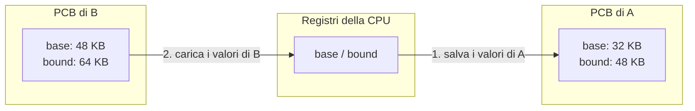

---

## corso: Sistemi Operativi lezione: 6 data: 2026-10-07 argomenti: [base and bound, rilocazione dinamica, MMU, free list, context switch, Memory API, malloc, free, sizeof, calloc, realloc, brk, mmap, errori di memoria, esercitazione Linux, gcc, permessi dei file, processi orfani] slide: ["15 - Address Translation (seconda parte)", "14 - Memory API"] tags: [sistemi-operativi]
---
# Lezione 6 — Base and bound, Memory API ed esercitazione su Linux

La lezione ha due parti. Nella prima il professore completa rapidamente alcuni concetti di base sulla memoria. Riprende il meccanismo dei registri **base** e **bound** e i compiti che spettano al sistema operativo, poi mostra con esempi in C che cosa succede davvero nello spazio di indirizzamento di un processo quando si allocano e si liberano aree di memoria (la **Memory API**). Nella seconda parte la classe lavora su Linux: compila ed esegue i programmi sui processi visti in [[Lezione 02 - Process API e Limited Direct Execution|Lezione 2]], impara alcuni comandi della shell e li modifica.

## La memoria di un processo: indirizzi e byte

Il professore riprende la rappresentazione standard della memoria di un processo: il codice in cima, insieme ai dati statici, poi l'**heap**, che cresce quando si alloca memoria, e lo **stack**, che sale dal fondo e contiene tipicamente le variabili locali. Accanto al disegno ci sono gli indirizzi, 0, 1, 2, 3 e così via fino all'ultimo: nell'esempio lo spazio di indirizzamento del processo è di 16 KB.

> [!important] Ogni indirizzo indirizza un byte Nella memoria **ogni indirizzo corrisponde a un byte**. Un dato più grande occupa più indirizzi **contigui**: un intero di 4 byte, per esempio, occupa quattro indirizzi consecutivi. Il professore chiede esplicitamente di ricordarlo.

## La rilocazione dinamica con base e bound

L'esempio è quello della lezione precedente. Il codice carica il valore che si trova all'indirizzo virtuale 15 KB (l'indirizzo non compare nell'istruzione, ma è contenuto nel registro `ebx`), lo copia nel registro `eax`, ci somma 3 e lo riscrive in memoria. Lo spazio di indirizzamento parte da zero per il processo, ma in memoria fisica viene messo altrove: non tutti i processi possono cominciare da zero. Nell'esempio i 16 KB del processo occupano la memoria fisica da 32 a 48 KB. Gli spazi vuoti sono inutilizzati, ma potrebbero contenere altri processi, ognuno dei quali vede il proprio spazio partire da zero.

Il modo più semplice per fare questa corrispondenza usa due registri:

- il registro **base** indica l'indirizzo fisico da cui comincia il processo;
- il registro **bound** indica il limite massimo dedicato al processo. Serve a garantire che il processo non vada oltre, invadendo la memoria di qualcun altro.

Base e bound fanno parte del **contesto** del processo, come il program counter. A ogni context switch vanno salvati quelli del processo che esce e caricati quelli del processo che entra, perché processi diversi stanno in zone diverse della memoria fisica. Quando un processo viene caricato, il sistema operativo decide dove metterlo in memoria fisica e imposta il registro base a quel valore. Da quel momento ogni accesso alla memoria viene tradotto così:

> [!important] Rilocazione dinamica (base and bound) $$\text{indirizzo fisico} = \text{indirizzo virtuale} + \text{base}$$ con il controllo che l'indirizzo virtuale non sia negativo e sia minore del bound: $$0 \le \text{indirizzo virtuale} < \text{bound}$$ La traduzione avviene **durante l'esecuzione**, a ogni accesso: per questo si parla di **rilocazione dinamica**.

Nell'esempio, il processore preleva l'istruzione all'indirizzo virtuale 128. In memoria fisica l'istruzione si trova a $128 + 32\ \text{KB} = 128 + 32,768 = 32,896$. Eseguendola, deve leggere il valore all'indirizzo virtuale 15 KB, che in memoria fisica si trova a $15\ \text{KB} + 32\ \text{KB} = 47\ \text{KB}$. Il processo è sempre lo stesso ovunque venga messo, fa sempre le stesse cose e usa sempre gli stessi riferimenti: le trasformazioni avvengono al di fuori di lui.

> [!warning] Precisazione — chi traduce gli indirizzi A lezione si dice che le trasformazioni "le fa il sistema operativo". Più precisamente, come indicano le slide, la traduzione a ogni accesso è svolta dall'**hardware**: la parte del processore che se ne occupa si chiama **MMU** (_Memory Management Unit_). Il sistema operativo interviene nei momenti chiave: sceglie dove mettere il processo, imposta i registri base e bound e li salva e ripristina a ogni context switch. Se la traduzione passasse ogni volta dal sistema operativo, ogni accesso alla memoria sarebbe lentissimo.

### Due modi di esprimere il bound

Il professore segnala una sottigliezza che potrebbe confondere. Il registro base è per forza un indirizzo **fisico**. Il bound, invece, nelle slide è indicato come la **dimensione** dello spazio di indirizzamento: 16 KB, un valore riferito alla memoria virtuale. Esiste anche l'approccio alternativo, ugualmente legittimo, in cui il bound è l'**indirizzo fisico della fine** dello spazio di indirizzamento: 48 KB nell'esempio. Nel primo caso si confronta l'indirizzo virtuale con il bound prima di sommare la base; nel secondo si confronta l'indirizzo fisico ottenuto con il bound.

|Bound espresso come|Valore nell'esempio|Controllo eseguito|
|---|---|---|
|dimensione dello spazio di indirizzamento|16 KB|indirizzo virtuale < 16 KB|
|indirizzo fisico della fine dello spazio|48 KB|indirizzo virtuale + base < 48 KB|

> [!tip] Approfondimento — Rilocazione statica e requisiti hardware #approfondimento OSTEP contrappone la rilocazione dinamica alla **rilocazione statica**. In quel caso un programma, il _loader_, riscrive gli indirizzi dell'eseguibile prima di avviarlo, per adattarli alla posizione scelta in memoria. È il problema citato dal professore in [[Lezione 05 - MLFQ, scheduling multiprocessore e spazio di indirizzamento#I sistemi di una volta|Lezione 5]]: il codice va modificato a seconda di dove viene messo. La rilocazione statica non offre protezione, perché un processo può comunque generare indirizzi sbagliati, e rende difficile spostare un processo in seguito. Il libro elenca anche ciò che l'hardware deve offrire per la rilocazione dinamica: una modalità privilegiata, una coppia di registri base e bound per ogni CPU, la capacità di tradurre e controllare ogni indirizzo, istruzioni privilegiate per aggiornare base e bound e per registrare i gestori delle eccezioni, e la capacità di sollevare un'eccezione quando un processo accede fuori dai limiti [@arpacidusseau2023ostep, cap. 15].

### Che cosa deve fare il sistema operativo

Le slide individuano tre momenti in cui il sistema operativo deve intervenire.

1. **Quando un processo comincia a eseguire**, il SO deve trovare in memoria fisica lo spazio per il suo spazio di indirizzamento, uno spazio libero non occupato da altri processi.
2. **Quando un processo termina**, il SO deve liberare la sua memoria, perché possa essere usata da altri processi.
3. **A ogni context switch**, il SO deve salvare base e bound del processo che esce, nella sua struttura di processo o PCB, e caricare quelli del processo che entra.

Per sapere dove c'è spazio, il sistema operativo tiene una lista degli intervalli di memoria fisica non usati, la **free list**. Nell'esempio la free list contiene due elementi: uno spazio libero a partire da 16 KB e uno a partire da 48 KB. Il disegno delle slide riporta solo l'indirizzo, ma un elemento della free list contiene anche la **dimensione** dello spazio libero contiguo. Quando il processo A termina, il suo spazio da 32 a 48 KB torna libero e la free list viene aggiornata. In realtà, osserva il professore, non serve avere una lista di spazi vuoti adiacenti: esistono algoritmi per fonderli in un unico spazio più grande. La gestione dello spazio libero è trattata in dettaglio in [[Lezione 07 - Segmentazione e gestione dello spazio libero#Gestione dello spazio libero|Lezione 7]].

Le slide mostrano anche il context switch. A sinistra ci sono due processi A e B, entrambi in memoria fisica, ciascuno con il proprio spazio virtuale mappato in una zona diversa. Mentre esegue A, i registri base e bound del processore contengono quelli di A (32 KB e 48 KB, con il bound espresso come indirizzo fisico). Dopo il context switch contengono quelli di B (48 KB e 64 KB). I valori di A sono stati salvati nel suo PCB.



Questo approccio non è quello dei sistemi attuali. Si basa comunque su una divisione della memoria fisica: con 64 KB di memoria e 16 KB per processo, il numero di processi è limitato. I meccanismi più avanzati verranno visti più avanti, ma il professore ritiene che questo faccia passare bene l'idea di spazio di indirizzamento virtuale.

## La Memory API

Il professore vuole mostrare che cosa succede concretamente nella memoria quando un programma alloca e libera aree di memoria. Finora si è detto che l'heap si usa con la `malloc`, che lì ci sono i dati statici e là le variabili locali; con gli schemi delle slide si può avere un'idea chiara di dove finiscono le cose.

### `malloc` e `free`

```c
#include <stdlib.h>

void *malloc(size_t size);
void free(void *ptr);
```

`malloc` **alloca una regione di memoria nell'heap**. Riceve la dimensione del blocco in byte, di tipo `size_t`, che è una ridefinizione di un tipo intero senza segno. Se ha successo restituisce un puntatore al blocco allocato, di tipo `void *`, cioè un puntatore generico; se fallisce restituisce un puntatore nullo. `free` fa l'operazione opposta: riceve un puntatore restituito da `malloc` e rende di nuovo disponibile quell'area di memoria. Non restituisce nulla.

Dietro funzioni come queste c'è sicuramente una **chiamata di sistema**: non si può agire sulla memoria se non tramite il kernel, che garantisce che le cose avvengano in modo sicuro. La chiamata di sistema però non si chiama `malloc`; il suo nome si vedrà più avanti.

### `sizeof`

Per indicare a `malloc` la dimensione si usano `sizeof` e macro simili, invece di scrivere direttamente un numero. Il risultato di `sizeof` applicato a una variabile dipende da come la variabile è stata dichiarata:

```c
int *x = malloc(10 * sizeof(int));   // spazio per 10 interi nell'heap
printf("%d\n", sizeof(x));           // stampa 4: la dimensione del puntatore

int y[10];                           // array allocato staticamente
printf("%d\n", sizeof(y));           // stampa 40: 10 interi da 4 byte
```

Nel primo caso `x` è un **puntatore**: `sizeof(x)` restituisce la dimensione del puntatore stesso, cioè dell'indirizzo, non dell'area puntata. Nel secondo caso `y` è un array di dimensione nota al compilatore, e `sizeof` restituisce la dimensione dell'intera area: $4 \times 10 = 40$ byte. Il puntatore è proprio l'indirizzo da cui inizia la memoria allocata.

> [!warning] Precisazione — la dimensione di un puntatore Il valore 4 delle slide vale per un sistema a **32 bit**, in cui gli indirizzi occupano 4 byte. Su un sistema Linux a 64 bit, come quelli che si usano oggi, un puntatore occupa **8 byte** e il primo `printf` stampa 8. Il secondo stampa sempre 40. Inoltre, per stampare un valore di tipo `size_t`, il formato corretto è `%zu`, non `%d`.

### Che cosa succede nello spazio di indirizzamento

Le slide seguono passo per passo l'allocazione di quattro interi.

```c
int *pi;                               // 1. variabile locale: finisce nello stack
pi = (int *) malloc(sizeof(int) * 4);  // 2. 16 byte allocati nell'heap
free(pi);                              // 3. la memoria torna libera
```

1. Dichiarare `int *pi` significa creare una **variabile locale** di tipo puntatore: lo spazio per contenerla viene riservato nello **stack**, in fondo allo spazio di indirizzamento. È questo che si intende quando si dice che le variabili locali stanno nello stack.
2. La `malloc` alloca la memoria nell'**heap**. L'espressione `(int *)` davanti è un **cast**: `malloc` restituisce un `void *`, e lo si converte in un puntatore a intero perché l'area va interpretata come interi. Il puntatore resta un indirizzo. Sono quattro interi da 4 byte: il primo sta all'indirizzo 2 KB, che nell'esempio è il primo indirizzo dell'heap, il secondo a 2 KB + 4, il terzo a 2 KB + 8 e il quarto a 2 KB + 12. Ogni intero occupa quattro indirizzi, perché ogni indirizzo corrisponde a un byte: il primo intero va da 2 KB a 2 KB + 3. In `pi`, nello stack, viene scritto l'indirizzo 2 KB.
3. Con `free(pi)` la memoria viene **marcata come libera**. Il valore dentro `pi` resta 2 KB, perché nessuno lo cancella, ma non vale più nulla: il puntatore è diventato **non valido**. Anche il contenuto dell'area non viene cancellato: sarà sovrascrivibile, ma non corrisponde più a niente di sensato.

|Indirizzo virtuale|Dopo la `malloc`|Dopo la `free`|
|---|---|---|
|2 KB|primo intero (allocato)|libero|
|2 KB + 4|secondo intero|libero|
|2 KB + 8|terzo intero|libero|
|2 KB + 12|quarto intero|libero|
|stack: `pi`|contiene 2 KB|contiene ancora 2 KB, ma non è più valido|

### Gli errori più comuni

Le slide presentano una serie di errori tipici. Servono, dice il professore, a chiarire dove vengono messe le cose.

**Dimenticare di allocare.**

```c
char *src = "hello";   // costante stringa
char *dst;             // non allocato
strcpy(dst, src);      // segmentation fault
```

Quando il compilatore trova la stringa `"hello"` la mette nell'area dei **dati statici**, sopra l'heap. `src` è una variabile locale, quindi sta nello stack, e punta a quella stringa. Anche `dst` è una variabile locale nello stack, ma non punta a nessuna area allocata. `strcpy` (_string copy_) copia una stringa, compreso il carattere di fine stringa `'\0'`, nell'area puntata da `dst`; poiché quell'area non è stata allocata, il programma va in errore.

**La versione corretta.**

```c
char *src = "hello";
char *dst = (char *) malloc(strlen(src) + 1);   // spazio per i caratteri e per '\0'
strcpy(dst, src);                               // funziona
```

Ora `dst` contiene l'indirizzo di un'area allocata nell'heap, e `strcpy` vi copia il contenuto dell'area puntata da `src`. Si allocano `strlen(src) + 1` byte perché `strlen` restituisce la lunghezza della stringa **senza** il carattere di fine stringa: "hello" ha 5 caratteri, ma ne servono 6.

**Allocare troppo poco.**

```c
char *src = "hello";
char *dst = (char *) malloc(strlen(src));   // troppo piccolo: 5 byte invece di 6
strcpy(dst, src);                           // sembra funzionare
```

Il professore lo definisce un codice sbagliato ma che funziona. I byte da copiare sono 6 e lo spazio è per 5, quindi il carattere di fine stringa resta fuori. Quando qualcuno proverà a stampare la stringa potrebbero esserci problemi, perché non si accorge che la stringa è finita.

> [!warning] Precisazione — dove finisce il sesto byte A lezione si dice che il sesto byte "non viene copiato da nessuna parte". In realtà `strcpy` non conosce la dimensione dell'area di destinazione e copia sempre l'intera stringa: il sesto byte, `'\0'`, viene scritto **un byte oltre la fine** del blocco allocato. È un _buffer overflow_: si sovrascrive memoria che non appartiene al blocco, per esempio un altro dato allocato o le informazioni interne della libreria di allocazione. Il programma può sembrare funzionare per caso e poi comportarsi in modo imprevedibile [@arpacidusseau2023ostep, cap. 14].

**Dimenticare di inizializzare.**

```c
int *x = (int *) malloc(sizeof(int));   // allocato
printf("*x = %d\n", *x);                // lettura di memoria non inizializzata
```

Viene allocato spazio per un intero e in `x`, nello stack, c'è il suo indirizzo. Allocare però significa solo **riservare** la memoria, non scriverci. Il primo argomento di `printf` è il formato, qui un numero intero. Scrivere `*x` significa stampare il valore contenuto all'indirizzo puntato; scrivere `x` senza asterisco stamperebbe l'indirizzo. Il codice funziona, ma stampa la "spazzatura" (il professore usa il termine dialettale _rumenta_) che c'era già in quell'area prima dell'allocazione.

**Memory leak.** Un programma che continua ad allocare memoria (`a`, poi `b`, `c`, `d`…) senza mai liberarla la consuma un po' alla volta. È una **perdita di memoria** (_memory leak_): alla fine non c'è più spazio da allocare e il programma non può più proseguire.

**Dangling pointer** (non commentato a lezione). Si libera la memoria prima di aver finito di usarla. Nell'esempio delle slide `a` e `b` puntano a due aree, a 2 KB e 3 KB; dopo `free(b)` il puntatore `b` contiene ancora 3 KB, ma quell'area è stata liberata. È un **puntatore pendente**: usarlo significa accedere a memoria non più valida, che nel frattempo potrebbe essere stata riassegnata.

**Double free** (non commentato a lezione). Si libera due volte la stessa memoria:

```c
int *x = (int *) malloc(sizeof(int));
free(x);   // libera la memoria
free(x);   // la libera di nuovo: comportamento non definito
```

Il risultato è **non definito**: il programma può andare in crash o corrompere le strutture interne dell'allocatore [@linuxman3malloc].

### `calloc` e `realloc`

Oltre a `malloc` esistono altre funzioni di allocazione.

```c
void *calloc(size_t num, size_t size);
void *realloc(void *ptr, size_t size);
```

`calloc` è più "cauta" di `malloc`: alloca spazio per `num` blocchi di `size` byte ciascuno e **imposta a zero** tutta l'area prima di restituirla. Si evita così la spazzatura vista sopra.

`realloc` prende un'area già allocata (con `malloc`, `calloc` o `realloc`) e prova a **cambiarne la dimensione**. In caso di successo restituisce un puntatore al blocco; se fallisce restituisce un puntatore nullo.

> [!warning] Precisazione — `realloc` può spostare il blocco A lezione si dice che con `realloc` il puntatore resta lo stesso e che, se non c'è spazio contiguo per ingrandire l'area, l'operazione non va a buon fine. Le slide sono più precise: il puntatore restituito **può essere lo stesso oppure uno nuovo**. Se non c'è spazio per ingrandire il blocco dov'è, `realloc` ne alloca uno nuovo altrove, vi copia il contenuto (fino alla minore tra la vecchia e la nuova dimensione) e libera il vecchio. Per questo bisogna sempre usare il puntatore restituito. Se invece `realloc` fallisce, restituisce `NULL` e il blocco originale resta intatto: non viene né liberato né spostato [@linuxman3malloc].

### Le chiamate di sistema: `brk`, `sbrk` e `mmap`

Tutte queste funzioni fanno cose simili, e si appoggiano alla stessa chiamata di sistema, **`brk`**. È un punto interessante: `malloc`, `calloc` e `realloc` **non sono chiamate di sistema**, ma funzioni di libreria associate a chiamate di sistema.

```c
#include <unistd.h>

int brk(void *addr);
void *sbrk(intptr_t increment);
```

Il nome viene dal **program break**, cioè la fine dell'heap nello spazio di indirizzamento. `brk` sposta quel punto, ampliando (o riducendo) l'heap; `sbrk` è una chiamata simile, che lo sposta di un incremento. Il professore confessa di aver scoperto solo di recente da dove venisse il nome. Nessun programmatore dovrebbe chiamare direttamente `brk` o `sbrk`: si usano `malloc`, `calloc`, `realloc` e `free`. Le slide citano anche **`mmap`**, che con gli argomenti giusti crea una regione di memoria **anonima**, cioè non associata a un file.

> [!tip] Approfondimento — `brk` non è l'unica strada #approfondimento La pagina di manuale di `brk` definisce il program break come la prima locazione dopo la fine del segmento dei dati non inizializzati, e osserva che spostarlo in avanti equivale ad allocare memoria al processo. Raccomanda di non usare `brk` e `sbrk` direttamente, perché `malloc` è il modo portabile e comodo di allocare memoria [@linuxman2brk]. La glibc, la libreria C standard di Linux, non usa però solo `brk`. Per i blocchi più grandi di una soglia, `MMAP_THRESHOLD`, che per default vale 128 kB, `malloc` crea una mappatura anonima privata con `mmap` invece di ingrandire l'heap [@linuxman3malloc]. L'affermazione che tutte queste funzioni "corrispondono a `brk`" va quindi letta come una semplificazione.

> [!tip] Approfondimento — Due livelli di gestione della memoria e strumenti di controllo #approfondimento OSTEP osserva che nel sistema ci sono **due livelli** di gestione della memoria. Il sistema operativo assegna la memoria ai processi e la riprende tutta quando un processo termina. All'interno di ogni processo, la libreria gestisce l'heap con `malloc` e `free`. Per questo un piccolo programma che termina subito non "perde" memoria in senso permanente anche se dimentica qualche `free`. Per un programma che resta in esecuzione a lungo, come un server o il sistema operativo stesso, un memory leak è invece un problema serio. Per trovare questi errori il libro consiglia strumenti come **purify** e **valgrind** [@arpacidusseau2023ostep, cap. 14].

## Esercitazione su Linux

Nella seconda parte della lezione la classe lavora al computer. Chi non ha un PC si affianca a un collega. Alcuni studenti con la macchina virtuale hanno problemi a connettersi alla rete, perché la rete della macchina virtuale va configurata: il professore se ne occupa a parte, mentre gli altri proseguono. Si usano i quattro programmi già visti in [[Lezione 02 - Process API e Limited Direct Execution|Lezione 2]], che riguardano ancora i processi e non la memoria:

|Programma|Che cosa fa|
|---|---|
|`p1.c`|il padre fa una `fork()` e crea un figlio|
|`p2.c`|come `p1.c`, ma il padre aspetta il figlio con `wait()`|
|`p3.c`|come `p2.c`, ma il figlio esegue anche una `exec()`|
|`p4.c`|come `p3.c`, con la redirezione dello standard output su file|

### Preparare la cartella

Dal sito del corso si scarica l'archivio zip degli _homework_ relativo al capitolo dei processi. Il professore ricorda che dovrebbe essere quello del capitolo 5 e non del 4. Lo si copia in una cartella e lo si estrae (tasto destro, _Extract here_). Il professore rinomina la cartella ottenuta, per esempio in `esercizi`: quando si compila da terminale conviene sempre evitare nomi con spazi. I file si possono aprire con un editor di testo per vedere come sono fatti.

Il modo più rapido per aprire un **terminale**, cioè una shell testuale, nella cartella giusta è fare clic con il tasto destro nella finestra della cartella e scegliere _Open in Terminal_. Il professore insiste sul fatto che, una volta imparato, lavorare da tastiera è molto più comodo e dà più controllo; chi non lo sa ancora fare dovrebbe approfittare di questo momento per impararlo.

### Compilare con `gcc`

Il comando `ls` mostra il contenuto della cartella corrente. Per compilare un programma C si usa `gcc`, il compilatore standard:

```text
$ gcc p1.c
$ ls
a.out  p1.c  p2.c  p3.c  p4.c
```

`gcc` non stampa nulla, ed è un buon segno: se ci fossero errori li segnalerebbe. L'eseguibile c'è, ma si chiama `a.out`, il nome che il compilatore usa per default. Il terminale lo mostra in verde, a indicare che si può eseguire. Per dare all'eseguibile un nome scelto si usa l'opzione `-o` (_output_):

```text
$ gcc p1.c -o p1
```

Questo compila `p1.c` e chiama l'eseguibile `p1` invece di `a.out`. Il professore precisa che `gcc` è un compilatore C: un programma che usasse costrutti del C++ andrebbe compilato con `g++`.

### I permessi dei file

Il comando `ls -la` mostra informazioni complete sui file della cartella, non solo i nomi. Il professore ci si sofferma perché ci si tornerà parlando di file system, e perché si presuppone che chi segue un corso di sistemi operativi abbia una conoscenza di base di Unix.

```text
$ ls -la
drwxr-xr-x  2 utente utente  4096 ott  7 15:30 .
drwxr-xr-x 18 utente utente  4096 ott  7 15:28 ..
-rwxrwxr-x  1 utente utente 16000 ott  7 15:31 a.out
-rwxrwxr-x  1 utente utente 16000 ott  7 15:32 p1
-rw-rw-r--  1 utente utente   550 ott  7 15:29 p1.c
...
```

L'esempio è indicativo: nomi, dimensioni e date dipendono dal sistema. In Unix ogni file ha dei **permessi**: se qualcuno ha file che non vuole far leggere a un altro utente, il sistema deve poterlo impedire. La prima colonna li descrive. Il primo carattere indica il tipo: `d` sta per _directory_, cioè cartella, mentre `-` indica un file normale. Seguono nove caratteri, divisi in tre gruppi di tre:

- `r` (_read_): permesso di **lettura**;
- `w` (_write_): permesso di **scrittura**, che comprende anche la possibilità di modificare e cancellare il file;
- `x` (_execute_): permesso di **esecuzione**.

I tre gruppi corrispondono a tre categorie di utenti:

1. il **proprietario** del file (_owner_), cioè chi l'ha creato;
2. il **gruppo** del proprietario: si immagina che gli utenti siano divisi in gruppi, e il secondo gruppo di permessi dice che cosa possono fare i membri del suo gruppo, del suo team;
3. **tutti gli altri**, chiunque non sia proprietario e non faccia parte del gruppo.

Così `-rw-rw-r--` per `p1.c` significa che il proprietario e il suo gruppo possono leggere e scrivere il file, mentre il resto del mondo può solo leggerlo: è giusto che nessun altro possa cancellarlo. Nessuno lo può eseguire, perché è un sorgente C. `-rwxrwxr-x` per `p1` significa che proprietario e gruppo possono leggerlo, scriverlo ed eseguirlo, e gli altri possono leggerlo ed eseguirlo ma non modificarlo. Le due colonne dopo il numero indicano il proprietario e il gruppo del proprietario, che nell'esempio hanno lo stesso nome. Nell'elenco compaiono anche `.`, che indica la cartella corrente, e `..`, la cartella superiore.

> [!important] Permessi in Unix
> 
> |Gruppo di caratteri|Riguarda|Lettere possibili|
> |---|---|---|
> |1° (dopo il tipo)|proprietario|`r`, `w`, `x` o `-`|
> |2°|gruppo|`r`, `w`, `x` o `-`|
> |3°|tutti gli altri|`r`, `w`, `x` o `-`|
> 
> Il trattino indica che quel permesso manca.

> [!warning] Precisazione — la `x` sulle cartelle A lezione si dice che anche le cartelle sono "eseguibili" e che eseguire una cartella significa elencarne il contenuto. Per le cartelle il significato dei permessi è leggermente diverso. **`r`** permette di **elencare** il contenuto della cartella. **`w`** permette di creare e cancellare file al suo interno. **`x`** permette di **accedere** ai file della cartella, cioè di attraversarla, per esempio per entrarci con `cd` o per aprire un file di cui si conosce il nome [@gnucoreutilsmode].

### Eseguire il programma

Per eseguire il programma si scrive:

```text
$ ./p1
```

Il `./` indica che l'eseguibile si trova nella cartella corrente: va sempre specificato il percorso. Si potrebbe anche fare doppio clic sul file, ma l'utente esperto sa che la shell è il modo più rapido, oltre che quello che dà più controllo.

L'output è banale: "hello world", poi "hello, I am parent of…", poi "hello, I am child…". C'è però un dettaglio curioso: sembra che il programma finisca, il prompt ricompare, e solo dopo appare la scritta del figlio. Il motivo si capisce dal codice di questa versione di `p1.c`. Il figlio, quando `rc` vale 0, dorme per due secondi e solo dopo stampa il proprio messaggio. Il padre stampa il suo e termina **senza aspettare il figlio**: "un padre un po' snaturato". La shell vede terminare il processo che ha lanciato e mostra di nuovo il prompt, ma il figlio è ancora nel sistema e continua a eseguire, finché dopo due secondi stampa e termina.

> [!tip] Approfondimento — I processi orfani #approfondimento Un processo il cui padre è terminato si dice **orfano**. Su Linux non resta senza padre: quando un processo termina, i suoi figli vengono "ereditati" dal processo `init` oppure, se esiste, dal più vicino processo _subreaper_ configurato con `prctl` [@linuxman2exit]. Sarà il nuovo padre a raccoglierne lo stato quando terminano, evitando che restino zombie (si veda [[Lezione 01 - Introduzione ai SO e processi#Process list e PCB|Lezione 1]]). La shell aspetta solo il processo che ha lanciato direttamente, per questo il prompt ricompare prima che il figlio abbia finito.

### Gli esercizi proposti

Mentre risolve i problemi tecnici di chi ne ha, il professore assegna due modifiche a `p1.c`:

1. far sì che il **figlio crei a sua volta un figlio**, così che il processo iniziale diventi "nonno";
2. far sì che **ogni padre aspetti la terminazione del proprio figlio**, eliminando l'effetto fastidioso del messaggio che arriva dopo il prompt. Per farlo bisogna guardare le slide o `p2.c`, dove si vede come si usa `wait()`.

Chi si trova in difficoltà con questa modifica, aggiunta più che altro per tenere occupati i più veloci, può passare direttamente a compilare, eseguire e capire `p2.c` e poi `p3.c`. L'obiettivo della giornata, dice il professore, è arrivare a compilare, eseguire e capire i programmi fino a `p3.c`.

> [!example] Una possibile soluzione (non svolta a lezione) Il programma seguente realizza entrambe le modifiche. È stato compilato con `gcc -Wall` ed eseguito su Linux.
> 
> ```c
> #include <stdio.h>
> #include <stdlib.h>
> #include <unistd.h>
> #include <sys/wait.h>
> 
> int main(int argc, char *argv[]) {
>     printf("nonno (pid:%d)\n", (int) getpid());
>     fflush(stdout);                     // svuota il buffer prima della fork
>     int rc = fork();
>     if (rc < 0) {                       // fork fallita
>         fprintf(stderr, "fork failed\n");
>         exit(1);
>     } else if (rc == 0) {               // figlio: crea a sua volta un figlio
>         int rc2 = fork();
>         if (rc2 < 0) {
>             fprintf(stderr, "fork failed\n");
>             exit(1);
>         } else if (rc2 == 0) {          // nipote
>             sleep(2);
>             printf("nipote (pid:%d), figlio di %d\n", (int) getpid(), (int) getppid());
>         } else {                        // figlio: aspetta il nipote
>             wait(NULL);
>             printf("figlio (pid:%d), padre di %d\n", (int) getpid(), rc2);
>         }
>     } else {                            // nonno: aspetta il figlio
>         wait(NULL);
>         printf("nonno (pid:%d), padre di %d\n", (int) getpid(), rc);
>     }
>     return 0;
> }
> ```
> 
> Un'esecuzione tipica (i PID cambiano ogni volta):
> 
> ```text
> $ gcc -Wall nonno.c -o nonno
> $ ./nonno
> nonno (pid:352)
> nipote (pid:355), figlio di 354
> figlio (pid:354), padre di 355
> nonno (pid:352), padre di 354
> ```
> 
> Grazie alle due `wait()` l'ordine è sempre lo stesso: il nipote stampa per primo, il figlio solo dopo che il nipote è terminato, il nonno per ultimo. Il prompt ricompare solo alla fine. `getppid()` restituisce il PID del padre del processo chiamante.

> [!tip] Approfondimento — Perché serve `fflush(stdout)` #approfondimento Senza la riga `fflush(stdout)`, eseguendo il programma con l'output rediretto su un file o in una pipe (per esempio `./nonno | cat`), il messaggio "nonno" compare **tre volte**. Il motivo è la bufferizzazione della libreria standard del C. Quando lo standard output è un terminale è _line buffered_: i caratteri vengono scritti a ogni ritorno a capo. Quando è un file o una pipe è _block buffered_: i caratteri si accumulano in un buffer e vengono scritti a blocchi [@linuxman3setbuf]. Il buffer sta nella memoria del processo, quindi la `fork()` lo copia nel figlio, e poi di nuovo nel nipote. Ogni processo, terminando, scrive la propria copia del messaggio non ancora inviato. `fflush(stdout)` svuota il buffer prima della `fork()` ed elimina il problema.

### Comandi usati

|Comando|Effetto|
|---|---|
|`ls`|elenca il contenuto della cartella corrente|
|`ls -la`|elenco completo, con permessi, proprietario, gruppo, dimensione e data, compresi i file nascosti|
|`gcc file.c`|compila `file.c`; l'eseguibile si chiama `a.out`|
|`gcc file.c -o nome`|compila `file.c` e chiama l'eseguibile `nome`|
|`./nome`|esegue il programma `nome` che si trova nella cartella corrente|