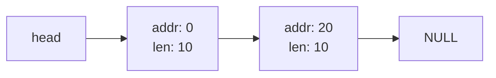
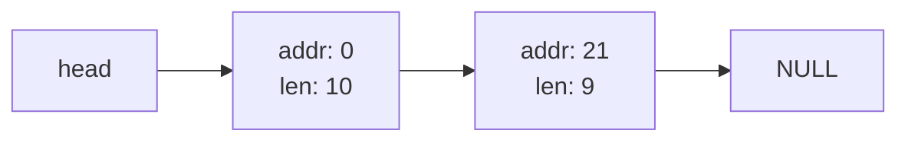
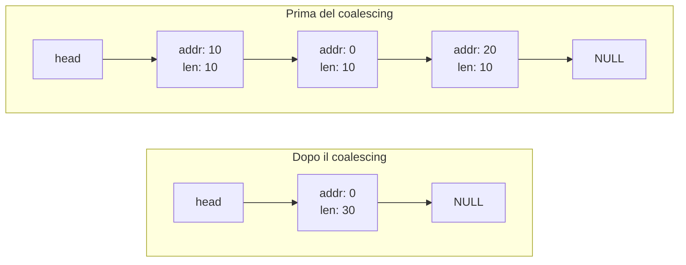
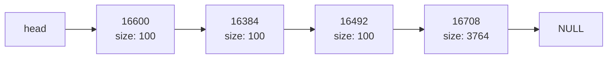
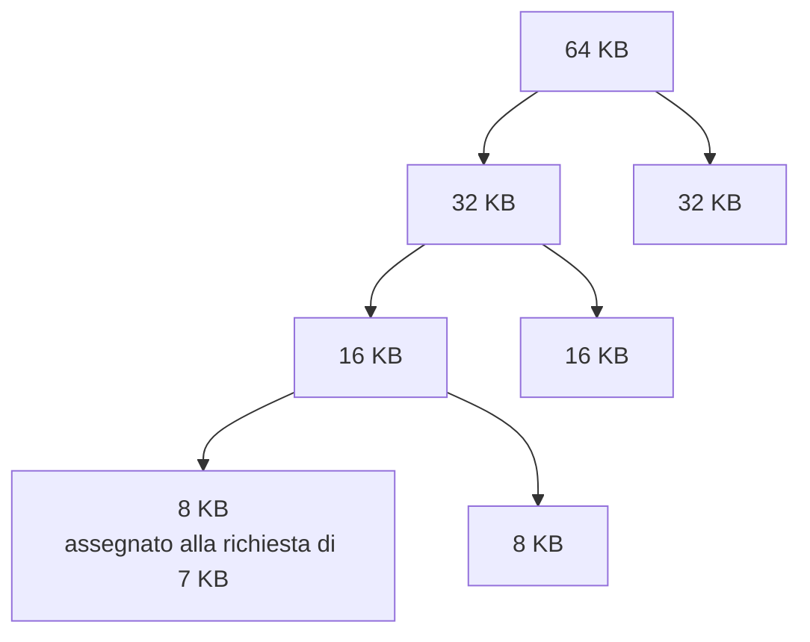

---

## corso: Sistemi Operativi lezione: 7 data: 2026-10-14 argomenti: [segmentazione, offset, segmentation fault, crescita negativa dello stack, condivisione dei segmenti, bit di protezione, frammentazione esterna, compattazione, free list, splitting, coalescing, header, best fit, worst fit, first fit, next fit, segregated list, slab allocator, buddy allocator, frammentazione interna, paginazione] slide: ["16 - Segmentation", "17 - Free-Space Management", "18 - Paging: Introduction (prime slide)"] tags: [sistemi-operativi]
---
# Lezione 7 — Segmentazione e gestione dello spazio libero

La lezione prosegue il discorso sulla memoria virtuale. Il meccanismo con un'unica coppia di registri base e bound, visto in [[Lezione 06 - Base and bound, Memory API ed esercitazione Linux|Lezione 6]], spreca memoria. La **segmentazione** lo migliora trattando separatamente le parti logiche di un processo, ma introduce il problema di come gestire lo **spazio libero** in memoria. La seconda parte della lezione è dedicata proprio a questo: le strutture dati e le politiche con cui un allocatore tiene traccia dei pezzi liberi e sceglie dove soddisfare una richiesta. Negli ultimi minuti il professore introduce l'idea della **paginazione**, che verrà sviluppata nella lezione successiva.

La registrazione presenta qualche lacuna nella prima parte. Dove il discorso si interrompe, la nota segue le slide, che sono la fonte di riferimento.

## Ripasso: base e bound

Uno dei problemi principali della memoria virtuale è trasformare gli indirizzi virtuali in indirizzi fisici. Finora lo si è fatto con i due registri **base**, il primo indirizzo della memoria fisica in cui risiede il processo, e **bound**, il limite oltre il quale il processo non può andare. Il professore ricorda però che questo modello è molto semplicistico, e che esistono altre tecniche per fare una cosa simile. La prima è la **segmentazione**.

## La segmentazione

### Il limite di base e bound

Con un'unica coppia base e bound, l'intero spazio di indirizzamento del processo viene copiato in un pezzo contiguo di memoria fisica. Lo spazio libero tra heap e stack, pur essendo inutilizzato, è **riservato** al processo e occupa memoria fisica. Le slide aggiungono un secondo problema: con questo approccio è difficile eseguire un processo il cui spazio di indirizzamento non entra per intero nella memoria fisica.

|Indirizzi virtuali|Contenuto|
|---|---|
|0 – 2 KB|codice|
|2 – 4 KB|libero|
|4 – 6 KB|heap|
|6 – 14 KB|**libero, ma occupa comunque memoria fisica**|
|14 – 16 KB|stack|

### Che cos'è un segmento

> [!important] Segmento e segmentazione Un **segmento** è una porzione **contigua** dello spazio di indirizzamento, di una certa lunghezza, che raggruppa indirizzi usati per uno stesso scopo logico: il codice, l'heap, lo stack. La **segmentazione** tratta ogni segmento separatamente: ogni segmento ha la **propria coppia base e bound** e può essere collocato in una zona diversa della memoria fisica.

Il nome è familiare: chi ha programmato in C su Linux avrà ricevuto almeno una volta il messaggio _segmentation fault_, quando un programma fa qualcosa di sbagliato, tipicamente viola i limiti della memoria. Il nome viene proprio da qui.

Con la segmentazione, la memoria fisica non contiene più un unico pezzo in cui è mappato l'intero processo, ma tre pezzi separati, uno per segmento. Lo spazio libero tra heap e stack non occupa più memoria fisica. Le slide mostrano questa disposizione:

|Segmento|Base|Dimensione|
|---|---|---|
|Codice|32K|2K|
|Heap|34K|2K|
|Stack|28K|2K|

|Indirizzi fisici|Contenuto|
|---|---|
|0 – 16 KB|sistema operativo|
|16 – 26 KB|non usato|
|26 – 28 KB|stack (cresce verso il basso a partire da 28 KB)|
|28 – 32 KB|non usato|
|32 – 34 KB|codice|
|34 – 36 KB|heap|
|36 – 64 KB|non usato|

### La traduzione degli indirizzi

Con base e bound semplici la traduzione era $\text{indirizzo virtuale} + \text{base}$, perché l'intero processo era visto come un unico segmento che partiva da 0. Con più segmenti non basta più.

> [!important] Traduzione con la segmentazione $$\text{indirizzo fisico} = \text{offset} + \text{base del segmento}$$ L'**offset** è la posizione dell'indirizzo rispetto all'**inizio del segmento** a cui appartiene. Con un unico segmento che parte da 0, offset e indirizzo virtuale coincidono; con più segmenti, in generale, no.

**Esempio nel codice.** L'istruzione all'indirizzo virtuale 100 sta nel segmento del codice, che inizia all'indirizzo virtuale 0: l'offset è quindi 100. Si somma la base del codice, 32 KB: $$100 + 32\ \text{KB} = 100 + 32,768 = 32,868.$$

**Esempio nell'heap.** L'indirizzo virtuale 4200 sta nell'heap. Sommare 4200 alla base dell'heap, 34 KB, darebbe un risultato sbagliato. Bisogna sommare l'offset. L'heap inizia all'indirizzo virtuale 4 KB, cioè 4096, quindi $$\text{offset} = 4200 - 4096 = 104, \qquad 104 + 34\ \text{KB} = 104 + 34,816 = 34,920.$$

Il professore sottolinea che le etichette come "4 KB" nel disegno vanno pensate come numeri: lungo lo spazio di indirizzamento ci sono gli indirizzi 0, 1, 2, …, 1024, 1025, …, 4096, 4097, …, 4200, ognuno dei quali è un numero.

### Il segmentation fault

Se un processo usa un indirizzo **illegale**, oltre la fine di un segmento, si verifica proprio il **segmentation fault**. Nell'esempio l'heap occupa gli indirizzi virtuali da 4 KB a 6 KB. Un accesso all'indirizzo 7 KB cade oltre la fine dell'heap: l'hardware si accorge che l'indirizzo è fuori dai limiti del segmento e il sistema operativo segnala l'errore.

> [!tip] Approfondimento — Un nome sopravvissuto alla tecnica #approfondimento OSTEP osserva che il termine _segmentation fault_ (o _segmentation violation_) nasce dagli accessi a indirizzi illegali sulle macchine segmentate. Il termine è rimasto anche sulle macchine che la segmentazione non la supportano affatto: oggi un "segfault" su Linux indica in generale un accesso a memoria non valido, anche se il meccanismo sottostante è la paginazione [@arpacidusseau2023ostep, cap. 16].

### Come si capisce a quale segmento appartiene un indirizzo

Per tradurre un indirizzo bisogna sapere a quale segmento appartiene e qual è il suo offset. Un modo semplice, detto **approccio esplicito**, è dividere nettamente l'indirizzo virtuale in due parti: i **primi bit**, i più significativi, identificano il segmento, e i restanti danno l'offset all'interno del segmento.

Nell'esempio lo spazio di indirizzamento è di 16 KB, quindi gli indirizzi hanno 14 bit (numerati da 13 a 0), perché $2^{14} = 16,384$. I due bit più significativi, 13 e 12, offrono quattro combinazioni:

|Bit 13–12|Segmento|
|---|---|
|`00`|codice|
|`01`|heap|
|`10`|stack|
|`11`|non usato|

I 12 bit restanti sono l'offset. È un meccanismo molto semplice, che si presta a essere realizzato direttamente in hardware. Per l'indirizzo 4200:

$$4200 = \underbrace{01}_{\text{segmento}}\ \underbrace{0000,0110,1000}_{\text{offset}}$$

I primi due bit valgono `01`, quindi l'indirizzo sta nell'heap. I restanti 12 bit valgono $0110,1000_2 = 104$: è proprio l'offset calcolato prima.

Le slide riportano lo pseudocodice che l'hardware esegue a ogni accesso:

```pseudo
// prende i 2 bit più alti dell'indirizzo virtuale di 14 bit
Segment = (VirtualAddress & SEG_MASK) >> SEG_SHIFT
// ricava l'offset
Offset = VirtualAddress & OFFSET_MASK
if (Offset >= Bounds[Segment])
    RaiseException(PROTECTION_FAULT)
else
    PhysAddr = Base[Segment] + Offset
    Register = AccessMemory(PhysAddr)
```

con `SEG_MASK = 0x3000` (in binario `11 0000 0000 0000`), `SEG_SHIFT = 12` e `OFFSET_MASK = 0xFFF` (in binario `00 1111 1111 1111`).

Il professore spiega i due operatori, che non tutti ricordano. Una singola `&` in C non è l'AND logico (che si scrive `&&`), ma l'**AND bit a bit**: confronta i due numeri bit per bit e mette 1 solo dove entrambi valgono 1. È il "trabocchetto" su cui il professore ha scherzato in aula. `>>` è lo **shift a destra**: sposta tutti i bit verso destra del numero di posizioni indicato.

1. `VirtualAddress & SEG_MASK` conserva solo i due bit più significativi e azzera tutti gli altri. Lo shift di 12 posizioni a destra porta quei due bit in fondo, ottenendo il numero del segmento (0, 1 o 2).
2. `VirtualAddress & OFFSET_MASK` conserva i 12 bit meno significativi, dal bit 0 all'11, e azzera i due più alti. Il risultato è l'offset; qui lo shift non serve.
3. Se l'offset è maggiore o uguale al bound di quel segmento, il processo sta provando a leggere oltre i limiti del segmento: si solleva un'eccezione di protezione. Nell'esempio i segmenti sono di 2 KB, quindi un offset di 2 KB o più è illegale.
4. Altrimenti l'indirizzo fisico è la base del segmento più l'offset, e si accede alla memoria.

> [!example] Lo pseudocodice applicato all'indirizzo 4200:
$$
\begin{aligned}
4200 \mathbin{\&} \texttt{0x3000} &= \texttt{0x1000}, \qquad \texttt{0x1000} \gg 12 = 1 \quad \Rightarrow \text{heap} \\
4200 \mathbin{\&} \texttt{0xFFF} &= 104 \quad \Rightarrow \text{offset} \\
104 &< 2\ \text{KB} \quad \Rightarrow \text{accesso legale} \\
\text{indirizzo fisico} &= 34\ \text{KB} + 104 = 34,920
\end{aligned}
$$

Le slide pongono una domanda: quali sono i problemi di questo approccio? La registrazione non riporta la risposta. Due problemi si ricavano dall'esempio stesso. Usando due bit per tre segmenti, una delle quattro combinazioni resta **inutilizzata**, e con essa un quarto dello spazio di indirizzamento. Inoltre ogni segmento ha una **dimensione massima** fissata dal numero di bit dell'offset: con 12 bit, 4 KB [@arpacidusseau2023ostep, cap. 16].

### Lo stack cresce al contrario

Il professore segnala un problema non enorme, ma da tenere presente perché ogni dettaglio aggiunge complessità. Lo **stack cresce verso indirizzi più bassi**: per i suoi indirizzi non si può semplicemente sommare l'offset alla base, ma bisogna tenere conto della direzione di crescita. Per questo, insieme a base e dimensione di ogni segmento, l'hardware memorizza un bit che indica **se il segmento cresce in direzione positiva**.

|Segmento|Base|Dimensione|Cresce in positivo?|
|---|---|---|---|
|Codice|32K|2K|1|
|Heap|34K|2K|1|
|Stack|28K|2K|0|

Il valore 1 per il codice non significa che il codice "cresca": indica semplicemente che, andando avanti nel segmento, gli indirizzi aumentano. Lo 0 dello stack indica la direzione opposta. Queste informazioni stanno in una tabella in hardware, come i registri base e bound, di cui il sistema operativo conserva sicuramente una copia.

> [!example] Traduzione di un indirizzo dello stack (dall'esempio di OSTEP) Si vuole accedere all'indirizzo virtuale 15 KB, che sta nello stack. In binario, su 14 bit, è `11 1100 0000 0000`: i 12 bit di offset valgono `1100 0000 0000`, cioè 3 KB. Poiché lo stack cresce verso il basso, l'offset va trasformato in un **offset negativo**, sottraendo la dimensione massima di un segmento, che con 12 bit di offset è 4 KB: $$\text{offset negativo} = 3\ \text{KB} - 4\ \text{KB} = -1\ \text{KB}.$$ Si somma l'offset negativo alla base dello stack: $$28\ \text{KB} + (-1\ \text{KB}) = 27\ \text{KB}.$$ Il controllo dei limiti verifica che il valore assoluto dell'offset negativo, 1 KB, non superi la dimensione attuale dello stack, 2 KB. In OSTEP lo stack è selezionato dai bit `11`, mentre la tabella delle slide assegna allo stack `10`: è solo una diversa convenzione [@arpacidusseau2023ostep, cap. 16].

### Condivisione e protezione

Grazie ai segmenti si possono **condividere** parti di memoria tra processi diversi. Il caso tipico è il **codice**. Quando si carica un processo vengono caricati il suo codice e i suoi dati statici e viene inizializzato lo stack. Lo stack però conterrà valori che dipendono da quella specifica esecuzione: se il programma riceve dati da tastiera, due esecuzioni dello stesso programma avranno stack diversi, ma il codice è lo stesso. Due processi che eseguono lo stesso programma possono quindi condividere il segmento del codice. Le slide notano che la condivisione del codice è usata ancora oggi.

Se un segmento è condiviso, però, nessuno dei due processi deve poterlo modificare: un processo si ritroverebbe con il codice cambiato da un altro. Servono quindi **bit di protezione**, che indicano per ogni segmento i permessi di lettura, scrittura ed esecuzione.

|Segmento|Base|Dimensione|Cresce in positivo?|Protezione|
|---|---|---|---|---|
|Codice|32K|2K|1|lettura–esecuzione|
|Heap|34K|2K|1|lettura–scrittura|
|Stack|28K|2K|0|lettura–scrittura|

Il codice si può leggere ed eseguire ma non scrivere. Heap e stack si possono leggere e scrivere, ma non vengono condivisi.

### Segmentazione a grana grossa e a grana fine

Quella vista finora è una segmentazione **a grana grossa** (_coarse-grained_), con pochi segmenti: codice, heap, stack. Si può anche immaginare una segmentazione **a grana fine** (_fine-grained_), in cui questi pezzi vengono a loro volta suddivisi in segmenti più piccoli. Alcuni dei primi sistemi lo facevano, e per gestire molti segmenti serve una **tabella dei segmenti** in hardware.

Perché segmenti più piccoli dovrebbero convenire? Il professore lo chiede alla classe e propone, con il suo umorismo, l'immagine di un cadavere da far sparire: è più facile portarlo in giro intero o tagliato a pezzi? Man mano che la memoria fisica viene usata, liberata e riusata, gli spazi liberi diventano numerosi ma piccoli. Più è grande il pezzo da sistemare, più è difficile trovare uno spazio libero **contiguo** abbastanza grande. Pezzi più piccoli si infilano più facilmente nei buchi. È l'idea che porterà alla **memoria paginata**: suddividere la memoria in pezzi tutti uguali e piccoli, da sistemare dove si vuole. Il prezzo dei segmenti piccoli è che più pezzi significano **tabelle molto più grandi**, perché per ogni pezzo bisogna tenere traccia di base, bound e caratteristiche.

> [!tip] Approfondimento — Sistemi con migliaia di segmenti #approfondimento OSTEP cita come esempi di segmentazione a grana fine **Multics**, uno dei primi sistemi a supportare molti segmenti più piccoli, e la **Burroughs B5000**, una macchina che supportava migliaia di segmenti e affidava al compilatore il compito di suddividere codice e dati [@arpacidusseau2023ostep, cap. 16].

### La frammentazione esterna e la compattazione

Che si usino segmenti a grana grossa o fine, si presenta il problema della **frammentazione**.

> [!important] Frammentazione esterna La **frammentazione esterna** è la presenza in memoria fisica di tanti **piccoli buchi** di spazio libero, che rendono difficile allocare nuovi segmenti. Nell'esempio delle slide ci sono 24 KB liberi, ma non contigui: il sistema operativo non riesce a soddisfare una richiesta di 20 KB.

Una soluzione è la **compattazione**: riorganizzare i segmenti in memoria fisica, spostandoli in modo da ricostruire spazi liberi contigui più ampi. È però un'operazione costosa. Bisogna fermare i processi in esecuzione, copiare i loro dati altrove e aggiornare i valori dei registri dei segmenti.

|Indirizzi fisici|Prima della compattazione|Dopo la compattazione|
|---|---|---|
|0 – 16 KB|sistema operativo|sistema operativo|
|16 – 24 KB|non usato|allocato|
|24 – 32 KB|allocato|allocato|
|32 – 40 KB|non usato|allocato|
|40 – 48 KB|allocato|non usato|
|48 – 56 KB|non usato|non usato|
|56 – 64 KB|allocato|non usato|

Prima della compattazione ci sono tre zone allocate separate da tre buchi, che insieme fanno i 24 KB liberi dell'esempio; nessun buco, da solo, basta per una richiesta di 20 KB. Nella figura della slide le dimensioni dei singoli buchi sono disegnate in modo approssimativo, e la tabella le semplifica in tre buchi da 8 KB. Dopo la compattazione le zone allocate sono contigue e resta un unico spazio libero di 24 KB, da 40 a 64 KB.

## Gestione dello spazio libero

Accettato che lo spazio libero va gestito, si vede come il problema viene affrontato. È un tema interessante anche perché compare tra gli esercizi del simulatore. Come esistono diverse politiche di scheduling dei processi, esistono diverse politiche per trovare uno spazio libero che soddisfi una richiesta. Il discorso vale in generale: per la memoria fisica divisa in segmenti e per l'heap di un processo gestito da `malloc` e `free`.

### La free list, lo splitting e il coalescing

L'esempio delle slide è volutamente irrealistico: un heap di soli **30 byte**. I byte da 0 a 9 sono liberi, quelli da 10 a 19 occupati, quelli da 20 a 29 liberi. Il professore nota che la slide scrive "da 20 a 30", mentre secondo questa logica il 30 sarebbe già fuori.

La struttura che ricorda dove sono gli spazi liberi si chiama **free list**. Dal punto di vista logico è una lista che contiene **solo gli spazi liberi**, non quelli occupati. Ha una testa (`head`); ogni nodo indica l'indirizzo di inizio di uno spazio libero e la sua lunghezza, e contiene un puntatore al nodo successivo. Come venga realizzata davvero si vede più avanti.



**Splitting.** Si supponga una richiesta di **1 byte**. La richiesta è più piccola degli spazi liberi, quindi si prende uno spazio libero e lo si **divide in due** (_splitting_): una parte soddisfa la richiesta, l'altra resta libera. Quale spazio scegliere, il primo o il secondo, è una questione di politica, vista più avanti; nell'esempio si sceglie il secondo. Si prende il byte 20, e il nodo della free list diventa "indirizzo 21, lunghezza 9".



**Coalescing.** Se arriva una richiesta più grande di ogni spazio libero, per esempio di 20 byte, non si può fare nulla. A meno che, nel frattempo, non sia successo qualcosa che permetta di **fondere** due o più spazi liberi adiacenti in uno solo: è il **coalescing** (fusione). Nell'esempio delle slide la zona da 10 a 19 è stata liberata. Il nuovo nodo viene messo **in testa** alla lista, non nella posizione corrispondente all'indirizzo, perché la free list è una lista e i nuovi elementi si aggiungono in cima. La lista vede tre pezzi da 10 byte, anche se in realtà ci sono 30 byte liberi contigui. Senza coalescing una richiesta di 20 byte fallirebbe. Periodicamente bisogna accorgersi che i tre spazi sono contigui e trasformarli in un unico nodo di 30 byte.



Liberando, occupando e liberando di continuo, senza fondere gli spazi, ci si ritrova con tanti pezzi piccoli, inutilizzabili per richieste di aree grandi e contigue.

### Come si ricorda la dimensione di un blocco allocato

Il professore pone una domanda che dice di essersi fatto anche lui. `malloc` richiede di specificare quanta memoria allocare, mentre `free` riceve solo il puntatore. Dove sta l'informazione su quanta memoria liberare?

La risposta è che una `malloc(20)` occupa in realtà **più di 20 byte**. Restituisce un puntatore ai 20 byte utilizzabili, ma appena prima di essi la libreria di allocazione memorizza un **header** (intestazione): metainformazioni sul blocco, non il contenuto vero e proprio.

```c
typedef struct __header_t {
    int size;    // dimensione della regione allocata
    int magic;   // numero "magico" per il controllo di integrità
} header_t;
```

L'header contiene almeno la **dimensione** della regione allocata. Può contenere anche puntatori aggiuntivi per velocizzare la deallocazione e un **numero magico** (nelle slide 1234567), un valore fisso che serve a controllare l'integrità: se al momento della `free` non c'è, il blocco è stato corrotto.

Lo spazio occupato da un blocco è quindi la dimensione dell'header più quella dell'area richiesta. Quando l'utente chiede $N$ byte, la libreria cerca uno spazio libero di $N$ byte più la dimensione dell'header. Quando l'utente chiama `free(ptr)`, la libreria ritrova l'header con una semplice operazione sui puntatori:

```c
void free(void *ptr) {
    header_t *hptr = (void *) ptr - sizeof(header_t);   // torna indietro di un header
    ...
}
```

Dal puntatore ricevuto si torna indietro della dimensione dell'header e si trova l'informazione sulla dimensione del blocco.

> [!warning] Precisazione — chi gestisce l'header A lezione si dice che l'header viene memorizzato "internamente nel sistema operativo". Come indicano le slide ("the header used by malloc library"), header e free list dell'heap sono gestiti dalla **libreria di allocazione**, cioè dal codice di `malloc` e `free` che gira nello spazio utente del processo. Il sistema operativo interviene solo quando l'heap va ingrandito, tramite chiamate di sistema come `brk`, `sbrk` o `mmap` (si veda [[Lezione 06 - Base and bound, Memory API ed esercitazione Linux#La Memory API|Lezione 6]]).

### La free list dentro lo spazio libero

Dopo la pausa il professore mostra la cosa più interessante: la free list **non è una struttura a sé**, ma sta **nello spazio libero stesso**. La libreria non può usare `malloc` per costruire la propria lista, quindi scrive i nodi direttamente nei pezzi di memoria liberi. Ogni nodo contiene la dimensione dello spazio libero e il puntatore al nodo successivo:

```c
typedef struct __node_t {
    int size;                 // dimensione dello spazio libero
    struct __node_t *next;    // indirizzo del nodo successivo
} node_t;
```

All'inizio l'heap è tutto libero. Nell'esempio delle slide la libreria ottiene un pezzo di 4096 byte con la chiamata di sistema `mmap` e ci scrive il primo, e unico, nodo:

```c
// mmap() restituisce un puntatore a un pezzo di spazio libero
node_t *head = mmap(NULL, 4096, PROT_READ|PROT_WRITE, MAP_ANON|MAP_PRIVATE, -1, 0);
head->size = 4096 - sizeof(node_t);
head->next = NULL;
```

Lo spazio libero utilizzabile non è 4096 byte: il nodo stesso occupa 8 byte, 4 per `size` e 4 per `next`. Resta quindi $4096 - 8 = 4088$. Il pezzo si trova all'indirizzo virtuale 16 KB, cioè 16384, e `next` vale 0 (`NULL`), perché non ci sono altri nodi.

**Allocazione.** Quando arriva una richiesta, la libreria trova un pezzo libero abbastanza grande, lo divide in due (una parte per la richiesta, il resto libero) e riduce la dimensione del nodo nella free list. Con `ptr = malloc(100)` servono 100 byte più un header di 8 byte (4 per `size`, 4 per `magic`), cioè 108 byte. Il nodo libero si riduce a $$4088 - 108 = 3980\ \text{byte}.$$ Finché lo spazio libero resta contiguo, la free list ha un solo nodo, che si sposta in avanti e si rimpicciolisce. Dopo tre allocazioni da 100 byte il nodo libero misura $$4088 - 3 \times 108 = 3764\ \text{byte}.$$

|Indirizzo virtuale|Contenuto|
|---|---|
|16384|header (size 100, magic 1234567) + 100 byte allocati|
|16492|header (size 100, magic 1234567) + 100 byte allocati (`sptr` punta qui + 8)|
|16600|header (size 100, magic 1234567) + 100 byte allocati|
|16708|nodo libero: size 3764, next 0|

Gli indirizzi si ricavano sommando ogni volta 108: $16384 + 108 = 16492$, $16492 + 108 = 16600$, $16600 + 108 = 16708$.

**Deallocazione.** Con `free(sptr)` il blocco centrale torna libero. Dove prima c'era l'header con il numero magico, ora c'è un nodo della free list: size 100 e `next` uguale a 16708, l'indirizzo del grande pezzo libero. Il nuovo nodo diventa la **testa** della lista. Ora i nodi sono due. Il professore precisa che i nodi della free list non sono necessariamente ordinati per indirizzo: l'ordine dipende da come i pezzi sono stati presi e liberati, ed è per questo che si usa una lista.

Infine vengono liberati anche il primo e il terzo blocco.



> [!example] Domanda in aula: in che ordine sono stati liberati? Il professore chiede quale sia stato liberato prima tra il primo e il terzo blocco. La risposta corretta è il primo. La testa della lista punta sempre all'**ultimo** blocco liberato, che è il terzo (16600). Il terzo punta al primo (16384), che quindi è stato liberato prima di lui. Il primo punta al secondo (16492), liberato per primo di tutti con `free(sptr)`. Il secondo punta infine al grande pezzo libero (16708).

Seguendo i puntatori `next` si percorre la lista. Il punto importante è che la free list è memorizzata nello stesso posto dove c'è la memoria libera: permette di trovare in fretta tutte le informazioni necessarie, per esempio per scorrere i pezzi liberi. In questa situazione si ha **frammentazione esterna**. Ci sono quattro pezzi liberi, tre dei quali adiacenti tra loro e al quarto, ma la lista li vede separati: serve un'operazione di coalescing per riunirli.

### Far crescere l'heap

L'heap non riceve tutta la memoria del mondo: gli viene dedicata una certa quantità di spazio, che è quella gestita come spazio libero. La maggior parte degli allocatori parte con un heap piccolo e, quando lo spazio finisce, chiede altra memoria al sistema operativo, nei sistemi Unix con `sbrk` o `brk`. La chiamata sposta il _break_, cioè la fine dell'heap.

La slide mostra un heap contiguo nello spazio di indirizzamento che in memoria fisica corrisponde a due pezzi separati, con il commento "Questo non è possibile… o sì?". Il professore risponde che è possibile: la segmentazione non è necessariamente a grana grossa, e con una segmentazione più fine lo stesso heap può essere diviso in più pezzi. Con la paginazione, come si vedrà, sarà la norma.

### Le politiche di scelta

Resta la domanda che, dice il professore, molti si portavano dietro: **quale** spazio libero scegliere per soddisfare una richiesta? Il coalescing funziona solo tra spazi contigui, quindi in generale ci sono più candidati. Nell'esempio di prima, con uno spazio libero di 100 byte e uno di 3764, una richiesta di 50 byte può andare nell'uno o nell'altro.

> [!example] Domanda in aula: dove mettereste la richiesta? Uno studente sceglie lo spazio più piccolo: "prendo la scatola più piccola in cui ci sta". Il professore osserva che la scelta non è ovvia. Usando lo spazio più grande resta comunque una bella scatola da 100 byte. Usando quello piccolo resta una scatola da 50, più difficile da riutilizzare. Proprio perché non c'è una risposta ovvia, esistono diverse politiche.

|Politica|Come sceglie|
|---|---|
|**Best fit**|individua tutti gli spazi liberi grandi almeno quanto la richiesta e sceglie il **più piccolo**|
|**Worst fit**|sceglie lo spazio libero **più grande**, ne usa la parte richiesta e lascia il resto nella free list|
|**First fit**|scorre la lista dall'inizio e sceglie il **primo** spazio abbastanza grande|
|**Next fit**|come il first fit, ma riprende la ricerca **da dove si era fermata** l'ultima volta invece che dall'inizio|

Il **best fit** è la scelta dello studente: spreca meno, ma lascia pezzi piccoli che chissà se si potranno usare, e quindi tende a frammentare. Il **worst fit** fa l'opposto: se arrivano tante richieste da 50 byte, continua a riempire lo spazio più grande finché non diventa grande quanto gli altri, poi pesca un po' qui e un po' là. In questo modo abbassa in modo uniforme la dimensione degli spazi liberi. Quale sia meglio dipende dall'uso che si prevede. Il **first fit** è comodo perché ha sempre il puntatore all'inizio della lista e si ferma al primo candidato, ma tende a riempire di più i primi elementi della lista. Il **next fit** garantisce un'occupazione più uniforme dell'intera lista, perché riparte ogni volta dal punto raggiunto.

> [!example] Best fit e worst fit a confronto La free list contiene tre spazi liberi di 10, 30 e 20 byte, e arriva una richiesta di 15 byte.
> 
> |Politica|Spazio scelto|Free list risultante|
> |---|---|---|
> |Best fit|20 (il più piccolo tra 30 e 20)|10 → 30 → 5|
> |Worst fit|30 (il più grande)|10 → 15 → 20|
> 
> Lo spazio da 10 non è un candidato, perché è troppo piccolo. Con il best fit resta un pezzetto da 5 byte; con il worst fit gli spazi restano di dimensioni più simili.

> [!tip] Approfondimento — Il costo della ricerca #approfondimento OSTEP osserva che best fit e worst fit, nelle implementazioni ingenue, richiedono una **ricerca esaustiva** di tutta la lista a ogni allocazione, e quindi costano parecchio. Per il worst fit aggiunge che la maggior parte degli studi mostra risultati scadenti: produce un eccesso di frammentazione pur avendo costi elevati. Il first fit è più veloce perché si ferma al primo candidato. Il libro segnala anche che gli allocatori reali sono molto più sofisticati di questi schemi: per esempio **jemalloc** è oggi molto diffuso, usato tra l'altro in FreeBSD, NetBSD e Firefox [@arpacidusseau2023ostep, cap. 17].

### Liste segregate e slab allocator

Il rischio è sempre la frammentazione. Una possibilità per limitarla è usare **liste segregate**: non più un'unica free list, ma liste dedicate a spazi liberi di dimensioni diverse, per esempio una per gli spazi piccoli e una per quelli grandi. Una richiesta grande si cerca nella lista degli spazi grandi, una richiesta piccola in quella degli spazi piccoli. Così le richieste piccole non consumano gli spazi grandi, che restano disponibili per le richieste di grandi dimensioni. Nasce però una nuova complicazione: quanta memoria dedicare a ciascuna lista?

Un meccanismo che affronta il problema è lo **slab allocator**. Vengono **preallocate** delle _cache_ di oggetti, cioè zone di memoria già riservate per tipi di strutture usate molto spesso e di dimensione fissa: semafori e lock, oppure gli _inode_ del file system. Invece di cercare ogni volta un piccolo spazio libero quando serve un semaforo, lo si prende da quelli già pronti. Quando una cache si sta esaurendo, chiede altra memoria a un allocatore più generale. Il professore precisa che si tratta di complicazioni che non cambiano il senso generale: risolto il problema in modo generale, si cercano soluzioni ad hoc per i casi più frequenti. Ciò che conta davvero sono i principi visti fin qui.

> [!tip] Approfondimento — L'origine dello slab allocator #approfondimento Lo slab allocator fu progettato da **Jeff Bonwick** per il kernel di Solaris e descritto nell'articolo _The Slab Allocator: An Object-Caching Kernel Memory Allocator_, presentato alla conferenza USENIX del 1994. Secondo OSTEP, oltre a evitare la frammentazione, lo slab allocator conserva gli oggetti liberati nel loro stato già inizializzato. Quando un oggetto viene richiesto di nuovo non bisogna ripetere l'inizializzazione, che per molte strutture del kernel è costosa [@arpacidusseau2023ostep, cap. 17].

### Il buddy allocator

Un'idea completamente diversa è il **binary buddy allocator** ("allocatore a compagni"). Si supponga di avere 64 KB di memoria libera e una richiesta di 7 KB. L'allocatore divide la memoria in due blocchi da 32 KB, poi uno di questi in due da 16 KB, poi uno di questi in due da 8 KB. Si ferma qui, perché un'ulteriore divisione darebbe blocchi da 4 KB, troppo piccoli, e assegna il primo blocco da 8 KB.



Il vantaggio principale è che è molto facile trovare il **buddy** (il "compagno") di ogni blocco, guardando solo gli indirizzi. Il professore lo spiega immaginando di dividere la memoria in blocchetti da 1 KB, numerati con 6 bit: questi 6 bit sono la parte iniziale degli indirizzi. Il primo blocco da 32 KB va da `000000` a `011111`, il secondo da `100000` a `111111`. Il primo blocchetto del secondo pezzo ha lo stesso numero del primo blocchetto del primo pezzo, tranne il bit più significativo; lo stesso vale per gli ultimi (`011111` e `111111`) e per ogni coppia di blocchetti corrispondenti. **Due buddy differiscono per un solo bit**. Lo stesso vale ai livelli inferiori: i due blocchi da 16 KB del primo pezzo vanno da `000000` a `001111` e da `010000` a `011111`.

Questo rende il **coalescing semplicissimo**. Quando si libera un blocco, si controlla se il suo buddy è libero: in caso affermativo i due si fondono in un blocco del livello superiore, e si ripete il controllo. Liberando il blocco da 8 KB si ottiene subito, se anche il buddy è libero, un blocco da 16 KB, poi uno da 32 KB, e così via. Il modo in cui la memoria viene allocata riduce quindi la frammentazione esterna.

Il buddy allocator introduce però un altro problema: la **frammentazione interna**. Per 7 KB bisogna comunque allocare un blocco da 8 KB, perché si possono assegnare solo blocchi di dimensione pari a una potenza di due. Il kilobyte in più resta allocato ma inutilizzato.

> [!important] Frammentazione interna ed esterna
> 
> - **Frammentazione esterna**: lo spazio libero è spezzato in tanti pezzi piccoli, **fuori** dai blocchi allocati. Nel complesso c'è abbastanza memoria, ma non contigua. Si verifica quando si allocano e si liberano blocchi di dimensioni diverse.
> - **Frammentazione interna**: lo spazio sprecato sta **dentro** un blocco allocato, perché il blocco è più grande della richiesta. Un esempio è la richiesta di 7 KB servita con un blocco da 8 KB.
> 
> Il buddy allocator riduce la frammentazione esterna e aumenta quella interna.

## Introduzione alla paginazione

Negli ultimi minuti il professore anticipa il meccanismo che, nei sistemi recenti, accompagna quasi sempre la segmentazione o la sostituisce: la **memoria paginata**. L'idea è semplice. Lo spazio di indirizzamento virtuale non viene più diviso in base a unità concettuali (codice, heap, stack), ma in pezzi di **dimensione fissa**, uguali tra loro, chiamati **pagine**. Anche la memoria fisica è divisa in pezzi della stessa dimensione, chiamati **page frame** (cornici di pagina).

> [!important] Paginazione La **paginazione** divide lo spazio di indirizzamento in unità di dimensione fissa, le **pagine**, e la memoria fisica in unità della stessa dimensione, i **page frame**. Ogni processo ha una **tabella delle pagine** (_page table_) che indica in quale frame si trova ciascuna delle sue pagine, e che serve a tradurre gli indirizzi virtuali in indirizzi fisici.

Il professore la descrive come avere delle "targhette" in memoria virtuale, da sistemare liberamente in memoria fisica. Le slide indicano due vantaggi:

- **flessibilità**: l'astrazione dello spazio di indirizzamento si realizza bene senza bisogno di ipotesi su come crescono e vengono usati heap e stack;
- **semplicità** nella gestione dello spazio libero: pagine e frame hanno la stessa dimensione, quindi è facile allocarli e tenere una free list. Non serve più ricordare base e bound di ogni pezzo: basta un meccanismo più semplice per associare le pagine ai frame.

> [!example] Un esempio semplice Le slide considerano uno spazio di indirizzamento di 64 byte, diviso in 4 pagine da 16 byte, e una memoria fisica di 128 byte, divisa in 8 frame da 16 byte. Il frame 0 è riservato al sistema operativo, e le pagine del processo sono sparse negli altri frame, senza alcun bisogno di contiguità:
> 
> |Pagina dello spazio di indirizzamento|Frame della memoria fisica|
> |---|---|
> |pagina 0|frame 3|
> |pagina 1|frame 7|
> |pagina 2|frame 5|
> |pagina 3|frame 2|
> 
> I frame 1, 4 e 6 restano liberi e possono ospitare pagine di altri processi.

Le pagine possono anche essere copiate **su disco** e riportate in memoria quando servono. Quando un sistema "lavora con il disco" perché sta caricando dati in memoria, sta proprio spostando pagine. Questo, come il resto delle slide sulla paginazione (struttura dell'indirizzo virtuale, tabella delle pagine e sue voci, costo degli accessi), sarà affrontato nella lezione successiva.
