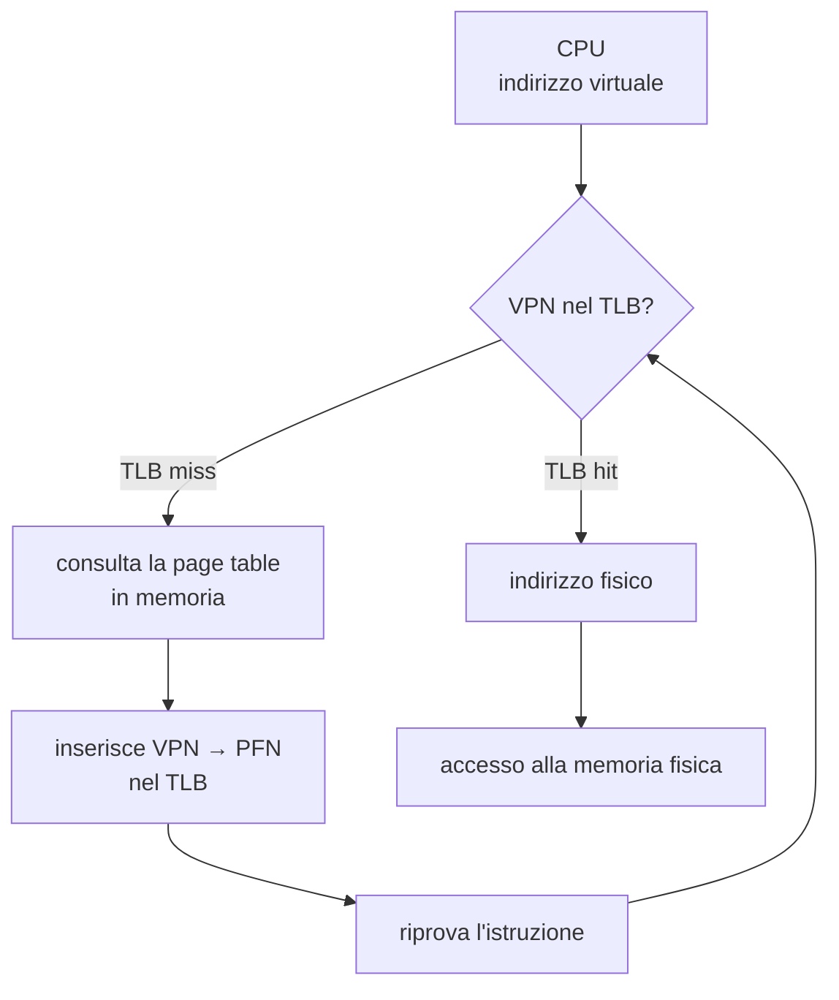
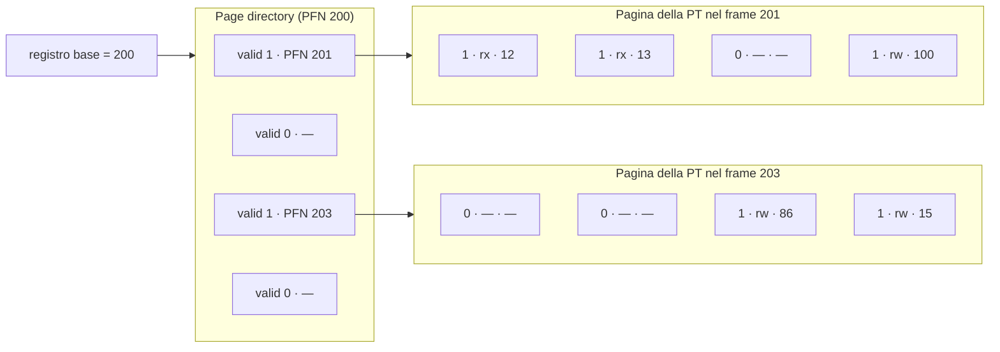

# Lezione 8 — Paginazione, TLB e tabelle delle pagine multilivello

La lezione completa il discorso sulla **memoria paginata**, introdotta alla fine della [[Lezione 07 - Segmentazione e gestione dello spazio libero#Introduzione alla paginazione|Lezione 7]], e affronta i due problemi che la paginazione porta con sé. Il primo è la **lentezza**: ogni accesso alla memoria richiede di consultare la tabella delle pagine, cioè un accesso in più. La soluzione è una piccola cache hardware delle traduzioni, il **TLB**. Il secondo è lo **spazio**: le tabelle delle pagine sono grandi, ce n'è una per processo, e sono in gran parte vuote. La soluzione più diffusa è organizzarle **su più livelli**.

Le slide del capitolo sul TLB non sono tra il materiale disponibile. Per quella parte la nota segue la registrazione e la integra con il capitolo corrispondente del libro di testo [@arpacidusseau2023ostep, cap. 19], da cui le slide del corso sono tratte.

## Ripasso: dalla base and bound alla paginazione

Il professore riprende il percorso fatto finora sulla memoria virtuale. Il meccanismo di partenza è quello con i registri **base and bound**, che colloca l'intero spazio di indirizzamento di un processo in un'unica zona contigua della memoria fisica. La **memoria segmentata** lo migliora usando una coppia base and bound per ogni segmento: codice, dati statici, heap e stack. Infine la **memoria paginata** divide lo spazio di indirizzamento in unità di dimensione prefissata, le **pagine**. Il professore le paragona a tanti blocchi di Lego, tutti della stessa dimensione, che costruiscono la memoria virtuale e vengono poi collocati ciascuno in un punto qualsiasi della memoria fisica.

Anche la memoria fisica va divisa in pezzi della stessa dimensione, chiamati **page frame**: *frame* significa cornice, e i frame sono i contenitori delle pagine. Serve infine una struttura, la **page table** (tabella delle pagine), che associ ogni pagina della memoria virtuale al frame in cui si trova. Questa volta serve **una entry (una riga) per ogni pagina**, perché le pagine sono indipendenti l'una dall'altra e possono trovarsi ovunque in memoria fisica.

L'esempio di partenza è quello già visto: uno spazio di indirizzamento di 64 byte con pagine da 16 byte (pagine 0, 1, 2, 3) e una memoria fisica di 128 byte con 8 frame. Le dimensioni sono volutamente irrealistiche: una pagina da 16 byte conterrebbe solo quattro interi. Servono soltanto a rendere visibile il meccanismo.

## La traduzione degli indirizzi

### VPN e offset

Un indirizzo è composto da un certo numero di bit. Quando si parla di architettura a 16 bit, per esempio, si intende che gli indirizzi in memoria sono composti da 16 bit. Nell'esempio lo spazio di indirizzamento è di 64 byte, e per indirizzare 64 byte servono $\log_2 64 = 6$ bit.

L'indirizzo virtuale viene interpretato in due parti:

> [!important] VPN e offset
> - I bit **più significativi** formano il **VPN** (*Virtual Page Number*, numero di pagina virtuale), che identifica la pagina.
> - I bit **meno significativi** formano l'**offset**, che identifica il byte all'interno della pagina.
>
> Con pagine di $2^k$ byte l'offset occupa $k$ bit. Se l'indirizzo ha $n$ bit, il VPN ne occupa $n - k$ e le pagine sono $2^{n-k}$.

Nell'esempio le pagine sono da 16 byte, quindi l'offset ha 4 bit: con 4 bit si compongono $2^4 = 16$ indirizzi diversi, proprio i 16 byte della pagina. Restano 2 bit per il VPN, che danno $2^2 = 4$ combinazioni: le quattro pagine.

La **traduzione** è il passaggio dall'indirizzo in memoria virtuale all'indirizzo in memoria fisica, necessario per accedere davvero al dato. Concettualmente funziona così:

- l'**offset resta tale e quale**, perché indica il byte all'interno della pagina e la pagina, spostata in un frame, conserva la propria struttura interna;
- il **VPN** viene tradotto, attraverso la page table, nel **PFN** (*Physical Frame Number*, numero del frame fisico) corrispondente.

Il professore sottolinea che la traduzione non è un algoritmo di calcolo: è una consultazione. Per ogni pagina virtuale si va a leggere nella page table in quale frame si trova.

> [!example] L'indirizzo virtuale 21
> Nello spazio da 64 byte, l'indirizzo virtuale 21 in binario è $010101$. I due bit più alti, $01$, danno VPN = 1; i quattro bit bassi, $0101$, danno offset = 5. La pagina 1 si trova nel frame 7, cioè $111$ in binario. L'indirizzo fisico si ottiene affiancando PFN e offset:
>
> $$
> \underbrace{01}_{\text{VPN}=1}\,\underbrace{0101}_{\text{offset}=5}
> \;\longrightarrow\;
> \underbrace{111}_{\text{PFN}=7}\,\underbrace{0101}_{\text{offset}=5} = 1110101_2 = 117
> $$
>
> L'indirizzo fisico ha 7 bit perché la memoria fisica è di 128 byte [@arpacidusseau2023ostep, cap. 18].

### Una page table per processo

Lo spazio virtuale dell'esempio ha 4 pagine, mentre la memoria fisica ha 8 frame, quindi la traduzione non è uno a uno. Ogni processo traduce i propri indirizzi virtuali in modo diverso, a seconda di dove si trovano le sue pagine. Ne segue una conseguenza importante: la page table **non è unica**, ma **ogni processo ha la propria page table**. Altrimenti non si potrebbero occupare gli altri frame con le pagine di altri processi.

### Quanto è grande una page table

Le page table rischiano di diventare grandi molto presto. Si supponga uno spazio di indirizzamento a **32 bit**, cioè indirizzi composti da 32 bit, e pagine da **4 KB**, una dimensione realistica:

$$
\begin{aligned}
4\ \text{KB} &= 2^{12}\ \text{byte} &&\Rightarrow\ 12\ \text{bit di offset}\\
32 - 12 &= 20\ \text{bit di VPN} &&\Rightarrow\ 2^{20}\ \text{pagine}\\
2^{20}\ \text{entry} \times 4\ \text{byte} &= 4\ \text{MB} &&\text{per ogni page table}
\end{aligned}
$$

Ogni entry deve contenere almeno l'indirizzo del frame in memoria fisica, e si assumono 4 byte per entry. Quattro megabyte possono sembrare pochi, ma ogni processo ha la propria page table, e i processi possono essere molti. Le page table occupano quindi uno spazio significativo. Il problema verrà affrontato nella seconda parte della lezione; per ora si accetta che le page table non siano strutture minimali.

### Dove si trovano le page table

In una prima soluzione di progettazione, le page table stanno nella **memoria fisica riservata al kernel**. Il professore ricorda un fatto che tendiamo a dimenticare parlando sempre della memoria dei processi: anche il sistema operativo ha il suo spazio di memoria. Questo spazio non viene mai tolto, perché il kernel deve essere sempre pronto a eseguire, per esempio, il codice delle chiamate di sistema. C'è quindi una fetta della memoria fisica riservata al kernel, e in prima istanza le page table si possono immaginare lì. Nell'esempio delle slide la page table occupa il frame 0 della memoria fisica da 128 byte.

### Che cosa contiene una page table entry

Nella forma più semplice la page table è un **array lineare** (*linear page table*). Il numero di pagina non compare nella tabella: è implicito nell'ordine delle entry. La pagina virtuale 0 corrisponde alla prima entry, la pagina 1 alla seconda, e così via. Per trovare la traduzione basta usare il **VPN come indice dell'array**.

Ogni entry, la **PTE** (*Page Table Entry*), non contiene soltanto il PFN. Contiene anche alcuni bit di controllo. Il professore precisa che non è necessario ricordarli tutti, ma è importante capire intuitivamente a che cosa servono.

> [!important] I bit di una page table entry
> - **Valid bit**: indica se la traduzione è valida, cioè se la pagina fa davvero parte dello spazio di indirizzamento del processo. Le pagine nello spazio libero tra heap e stack sono marcate non valide, e un accesso a esse genera un'eccezione.
> - **Protection bit**: indicano se la pagina può essere letta, scritta o eseguita.
> - **Present bit**: indica se la pagina si trova in memoria fisica oppure è stata spostata su disco (*swapped out*).
> - **Dirty bit**: indica se la pagina è stata modificata da quando è stata portata in memoria.
> - **Reference bit** (o *accessed bit*): indica se la pagina è stata acceduta.

I **bit di protezione** sono significativi, per esempio, quando due processi condividono la stessa pagina. Il caso più semplice è quello di uno stesso programma eseguito due volte contemporaneamente: i due processi hanno lo stesso codice, e le pagine di codice non vengono duplicate ma usate da entrambi. Queste pagine devono però essere protette in scrittura, perché il codice non deve poter essere modificato.

Il **present bit** introduce una possibilità mai citata finora, anche se tutti la conoscono per esperienza. Su un computer vecchio e sovraccarico si sente il disco che lavora di continuo: il sistema sta salvando pagine su disco o le sta riprendendo, il cosiddetto **swapping**. Con i dischi SSD dei computer recenti è difficile sentirlo, ma il meccanismo è lo stesso. Le pagine di un processo non devono essere tutte in memoria fisica: possono essere trasferite sul disco e riprese quando servono. Il present bit dice proprio se la pagina è in memoria fisica o se bisogna andarla a prendere perché è stata tolta. Il meccanismo è l'argomento della [[Lezione 09 - Swapping, politiche di sostituzione e introduzione ai thread|Lezione 9]].

Il **dirty bit** serve sempre allo swapping. Se una pagina viene caricata dal disco e non viene modificata, quando la si toglie dalla memoria non serve risalvarla: vale la copia che è già sul disco. Se invece è stata modificata nel frattempo, bisogna tenerne conto e riscriverla.

> [!tip] Approfondimento — Il valid bit e gli spazi di indirizzamento sparsi
> #approfondimento
> OSTEP osserva che il valid bit è cruciale per supportare uno spazio di indirizzamento **sparso**. Marcando come non valide tutte le pagine inutilizzate tra heap e stack, il sistema operativo evita di allocare frame fisici per esse, e risparmia una grande quantità di memoria [@arpacidusseau2023ostep, cap. 18].

Le slide mostrano come esempio reale la PTE dell'architettura **x86**, a 32 bit:

| Campo | Significato |
| ----- | ----------- |
| P | *present*: la pagina è in memoria fisica |
| R/W | *read/write*: indica se sono consentite scritture sulla pagina |
| U/S | *user/supervisor*: indica se la pagina è accessibile ai processi in modalità utente |
| A | *accessed*: la pagina è stata acceduta (è il reference bit) |
| D | *dirty*: la pagina è stata modificata |
| PFN | numero del frame fisico |

> [!tip] Approfondimento — Gli altri bit della PTE x86
> #approfondimento
> La PTE x86 delle slide contiene anche i bit PWT, PCD, PAT e G. Secondo OSTEP questi bit determinano come funziona la **cache hardware** per quelle pagine [@arpacidusseau2023ostep, cap. 18]. Si noti anche che x86 non ha un valid bit separato: il bit P svolge entrambi i ruoli, e spetta al sistema operativo distinguere, con proprie strutture, una pagina mai allocata da una pagina spostata su disco.

### L'algoritmo di accesso alla memoria

Per fare un accesso in memoria a partire da un indirizzo virtuale, innanzitutto bisogna sapere **dove inizia la page table** del processo. Ogni processo ha la sua, e tutte stanno nella memoria del kernel: serve quindi sapere dove si trova quella giusta. L'indirizzo iniziale è contenuto in un registro, il **PTBR** (*Page Table Base Register*).

> [!important] Page Table Base Register
> Il **PTBR** contiene l'indirizzo fisico di inizio della page table del processo in esecuzione. Fa parte del **contesto** del processo: viene salvato e ripristinato a ogni context switch, come gli altri registri.

Il professore nota la somiglianza con il registro base del meccanismo base and bound. Il concetto è lo stesso: bisogna sapere dove inizia tutto. Nel caso della paginazione è l'inizio della page table, nell'altro era l'inizio dello spazio contiguo in memoria.

L'accesso segue questo schema (lo stesso visto per la segmentazione, con le maschere di bit):

```pseudo
// Estrae il VPN dall'indirizzo virtuale
VPN = (VirtualAddress & VPN_MASK) >> SHIFT

// Calcola l'indirizzo della page table entry
PTEAddr = PTBR + (VPN * sizeof(PTE))

// Legge la PTE dalla memoria
PTE = AccessMemory(PTEAddr)

// Controlla che il processo possa accedere alla pagina
if (PTE.Valid == False)
    RaiseException(SEGMENTATION_FAULT)
else if (CanAccess(PTE.ProtectBits) == False)
    RaiseException(PROTECTION_FAULT)
else
    // Accesso consentito: forma l'indirizzo fisico e accede
    offset   = VirtualAddress & OFFSET_MASK
    PhysAddr = (PTE.PFN << PFN_SHIFT) | offset
    Register = AccessMemory(PhysAddr)
```

I passi sono i seguenti.

1. **Estrarre il VPN.** Si fa un AND bit a bit tra l'indirizzo virtuale e la `VPN_MASK`. L'AND singolo (`&`) lavora bit per bit: il risultato è 1 solo dove entrambi gli operandi valgono 1. La maschera è una sequenza di 1 in corrispondenza dei bit del VPN e di 0 altrove, quindi conserva il VPN e azzera tutto il resto. Il risultato però è ancora "in posizione": nell'esempio dell'indirizzo 21 si ottiene $010000$, mentre si vuole il numero $01$. Per questo si fa uno **shift a destra** di 4 posizioni, la lunghezza dell'offset.
2. **Calcolare l'indirizzo della PTE.** È la base della page table più il VPN moltiplicato per la dimensione di una entry. Con entry da 4 byte, per la pagina 3 si va a $\text{PTBR} + 3 \cdot 4$.
3. **Leggere la PTE** e controllarla. Se non è valida viene sollevata un'eccezione che fa intervenire il sistema operativo. Se è valida ma i bit di protezione non consentono l'accesso (per esempio una scrittura su una pagina di sola lettura), viene sollevata un'altra eccezione. La differenza tra le due eccezioni non interessa particolarmente.
4. **Formare l'indirizzo fisico.** Nel caso buono si estrae l'offset con un AND tra l'indirizzo virtuale e la `OFFSET_MASK`. Il PFN trovato nella PTE, per esempio $111$, viene **shiftato a sinistra** della lunghezza dell'offset, diventando $1110000$, e messo in **OR bit a bit** con l'offset, che resta tale e quale. Il risultato è l'indirizzo fisico, a cui si accede.

> [!warning] Precisazione: chi esegue l'algoritmo
> Durante la lezione il professore introduce l'algoritmo chiedendosi "che cosa fa il sistema operativo". In realtà questo procedimento è eseguito dall'**hardware**, cioè dalla MMU, a ogni accesso in memoria; il sistema operativo interviene solo quando viene sollevata un'eccezione. Il professore lo chiarisce esplicitamente nella lezione successiva, quando ripresenta l'algoritmo completo: va interpretato come ciò che fa l'hardware, non come un pezzo di software. Le slide lo dicono in un modo che può confondere ("paging requires the OS to perform one extra memory reference"): l'accesso in più è un accesso alla page table, che sta nella memoria gestita dal SO, ma a eseguirlo è l'hardware [@arpacidusseau2023ostep, cap. 18].

## Una traccia degli accessi in memoria

Il professore mostra un esempio che diventa fondamentale per ciò che segue: che cosa significa, in termini di pagine, un semplice programma che scrive in un array.

```c
int array[1000];
...
for (i = 0; i < 1000; i++)
    array[i] = 0;
```

Compilato, il ciclo diventa il seguente codice assembly x86:

```asm
0x1024 movl $0x0,(%edi,%eax,4)
0x1028 incl %eax
0x102c cmpl $0x03e8,%eax
0x1030 jne  0x1024
```

La prima istruzione scrive 0 nell'elemento dell'array il cui indirizzo è dato dalla base dell'array (in `%edi`) più l'indice (in `%eax`) moltiplicato per 4, la dimensione di un intero. La seconda incrementa l'indice. La terza lo confronta con 1000 (`0x03e8` in esadecimale). La quarta torna all'inizio del ciclo se l'indice non ha raggiunto 1000.

Le ipotesi dell'esempio sono le seguenti.

- Lo spazio di indirizzamento virtuale è di **64 KB**, con pagine da **1 KB**: ci sono quindi 64 pagine virtuali.
- Il codice si trova all'indirizzo virtuale **1024**, che è venuto fuori così dalla compilazione. La pagina 0 va da 0 a 1023, la pagina 1 da 1024 a 2047: il codice sta nella **pagina 1**, che si assume mappata nel **frame 4**.
- L'array occupa 4000 byte (1000 interi da 4 byte) e si assume che stia tra gli indirizzi virtuali **40000 e 44000**. Le pagine virtuali coinvolte vanno dalla **39** alla **42**: quattro pagine. Si assume il mapping VPN 39 → PFN 7, VPN 40 → PFN 8, VPN 41 → PFN 9, VPN 42 → PFN 10.

| Contenuto | Pagina virtuale | Frame fisico | Indirizzi virtuali |
| --------- | --------------- | ------------ | ------------------ |
| codice del ciclo | VPN 1 | PFN 4 | 1024 – 2047 |
| array (prima parte) | VPN 39 | PFN 7 | 39936 – 40959 |
| array | VPN 40 | PFN 8 | 40960 – 41983 |
| array | VPN 41 | PFN 9 | 41984 – 43007 |
| array (ultima parte) | VPN 42 | PFN 10 | 43008 – 44031 |

Il primo elemento dell'array, all'indirizzo virtuale 40000, si trova nella pagina 39 con offset $40000 - 39 \cdot 1024 = 64$; il suo indirizzo fisico è quindi $7 \cdot 1024 + 64 = 7232$, il valore che compare nella figura delle slide.

La figura delle slide mostra, per le prime iterazioni del ciclo, quali indirizzi vengono toccati nel tempo: gli accessi al codice, quelli all'array e quelli alla page table. Ogni accesso alla memoria richiede infatti un accesso preliminare alla page table per la traduzione. In aula il professore conta gli accessi e nota che una delle istruzioni ne fa due: la `movl` accede sia al codice, per essere letta, sia all'array, per scrivervi.

> [!tip] Approfondimento — Dieci accessi per iterazione
> #approfondimento
> OSTEP fa il conto completo, assumendo una page table lineare collocata all'indirizzo fisico 1 KB (1024). Ogni iterazione del ciclo produce **10 accessi alla memoria**: 4 letture di istruzioni, 1 scrittura esplicita nell'array e 5 accessi alla page table, uno per tradurre ciascuno dei quattro fetch e uno per tradurre la scrittura [@arpacidusseau2023ostep, cap. 18]. Il libro stima che gli accessi in più dovuti alla page table possano rallentare un processo di un fattore due o più.

La cosa interessante è che tutto il ciclo usa **solo due pagine** alla volta: quella del codice e quella dell'array in cui ci si trova. Gli accessi al codice sono continui, quelli all'array cadono sulla pagina 39 per un lungo tratto, poi passano alla 40, alla 41, alla 42. Una volta in memoria, la pagina 1 viene usata in continuazione.

> [!warning] Precisazione sul numero di elementi per pagina
> A lezione si dice che i primi 250 elementi dell'array stanno tutti nella pagina 39. Una pagina da 1 KB contiene effettivamente 250 interi, ma l'array non inizia a un confine di pagina: la pagina 39 va da 39936 a 40959, quindi contiene gli elementi dall'indirizzo 40000 al 40956, cioè i primi **240**. Il ragionamento non cambia.

Questo succede per come sono fatti i programmi. È difficile che un codice salti a un indirizzo, poi a uno completamente diverso, poi a un altro ancora. Vale un **principio di località**: accessi vicini nel tempo riguardano pagine vicine. Il professore chiede di ricordarlo, perché è l'elemento su cui si fonda il meccanismo presentato subito dopo.

## Il Translation Lookaside Buffer

### Perché la paginazione è lenta

La traduzione da indirizzo virtuale a indirizzo fisico è onerosa. Ogni volta bisogna accedere alla page table, prendere la entry giusta e fare i calcoli visti. Sono poche operazioni, ma **ogni accesso alla memoria** passa attraverso questo algoritmo, cioè la traduzione avviene a ogni istruzione. Il meccanismo della page table, da solo, è quindi troppo costoso, e viene affiancato da un meccanismo hardware chiamato **TLB**.

### Che cos'è il TLB

> [!important] Translation Lookaside Buffer
> Il **TLB** (*Translation Lookaside Buffer*) è un buffer, cioè una piccola area di memoria, che fa parte della **MMU** e contiene le **traduzioni da memoria virtuale a memoria fisica usate più di recente e più frequentemente**. Concettualmente è una **cache delle traduzioni**. Quando la traduzione cercata è nel TLB si ha un **TLB hit**; quando non c'è si ha un **TLB miss**, e bisogna consultare la page table.

Lo schema complessivo diventa il seguente. La CPU produce un indirizzo virtuale (o logico). La prima cosa che si fa **non** è cercare nella page table, ma guardare nel TLB se la traduzione è già memorizzata. La MMU gestisce quindi due strutture: la page table, dove ci sono tutte le traduzioni da virtuale a fisico, e il TLB, che contiene solo le traduzioni più "popolari".



> [!warning] Precisazione sul nome
> A lezione il TLB viene descritto come un buffer "in grado di guardare in avanti e sapere già come andrà a finire la traduzione", e il nome viene pronunciato a volte come *look-ahead buffer*. Il nome corretto è *lookaside buffer*, e il TLB non fa previsioni: conserva le traduzioni **già fatte**, sfruttando il fatto che probabilmente serviranno di nuovo. Secondo OSTEP il nome è storico: i progettisti del sistema Atlas chiamavano *lookaside buffer* una cache, e il termine *translation lookaside buffer* è rimasto anche quando l'altro è caduto in disuso [@arpacidusseau2023ostep, cap. 19].

Il meccanismo funziona **in senso statistico**. Nel caso fortunato si trova la traduzione nel TLB e si risparmia tempo. Nel caso sfortunato le cose vanno peggio che senza TLB: si accede al TLB senza trovare nulla, si deve comunque andare nella page table, e in più bisogna **aggiornare il TLB**, così che d'ora in poi la traduzione ci sia. Se hit e miss fossero equiprobabili, il TLB forse non converrebbe. Conviene perché gli hit sono molto più probabili dei miss, grazie al **principio di località** visto poco fa.

### L'algoritmo con il TLB

Le slide formalizzano l'algoritmo. Il professore avverte che non aggiunge molta informazione, ma vale la pena vederlo.

```pseudo
VPN = (VirtualAddress & VPN_MASK) >> SHIFT
(Success, TlbEntry) = TLB_Lookup(VPN)
if (Success == True)                       // TLB hit
    if (CanAccess(TlbEntry.ProtectBits) == True)
        Offset   = VirtualAddress & OFFSET_MASK
        PhysAddr = (TlbEntry.PFN << SHIFT) | Offset
        Register = AccessMemory(PhysAddr)
    else
        RaiseException(PROTECTION_FAULT)
else                                       // TLB miss
    PTEAddr = PTBR + (VPN * sizeof(PTE))
    PTE = AccessMemory(PTEAddr)
    if (PTE.Valid == False)
        RaiseException(SEGMENTATION_FAULT)
    else if (CanAccess(PTE.ProtectBits) == False)
        RaiseException(PROTECTION_FAULT)
    else
        TLB_Insert(VPN, PTE.PFN, PTE.ProtectBits)
        RetryInstruction()
```

Il VPN si estrae come al solito, con la maschera e lo shift a destra. Questa volta però lo si passa subito a `TLB_Lookup`, che cerca una corrispondenza VPN → PFN. In caso di **hit** si fanno i controlli soliti (si può accedere alla pagina?), si estrae l'offset e si forma l'indirizzo fisico con il PFN preso **dal TLB**, shiftato a sinistra e messo in OR con l'offset. Se l'accesso non è consentito si solleva un'eccezione. In aula il professore si corregge su questo punto: l'eccezione del ramo di hit non dipende dal non aver trovato la traduzione, ma dai bit di protezione.

In caso di **miss** si fa quello che si è già visto: si calcola l'indirizzo della PTE, la si legge, la si controlla. Si aggiunge un passo: la coppia VPN, PFN viene **inserita nel TLB**, e poi l'istruzione viene **ripetuta** (*retry*).

Il ragionamento è il seguente. Non ho trovato nel TLB la traduzione, e succede: anzi, prima o poi deve succedere. Vado allora a cercarla nella page table del processo. Per il principio di località, se adesso ho fatto un accesso a quell'indirizzo è probabile che a breve accederò di nuovo alla stessa pagina: per questo memorizzo la traduzione nel TLB. Il professore lancia subito una domanda: qual è il grosso problema teorico che si pone? Non riguarda che cosa inserire, che è ovvio, ma **che cosa togliere**. Il TLB ha dimensioni limitate, e per decidere che cosa eliminare si possono fare scelte diverse. Questo vale per qualunque cache, cioè per qualunque memoria che tiene pochi dati e deve accogliere quelli più aggiornati.

Il retry fa un'assunzione. Quando la gestione del miss è affidata al sistema operativo è davvero un retry: il SO aggiorna il TLB e poi l'istruzione viene rieseguita, e questa volta il lookup ha successo. In questo modo si verifica che tutto sia stato fatto e che da lì in poi il dato ci sia davvero. Ma non tutte le architetture funzionano così.

### Perché funziona: la località

> [!example] Accesso a un array con il TLB
> Si considera un array di 10 interi da 4 byte, in uno spazio di indirizzamento con pagine da **16 byte**: ogni pagina contiene 4 interi. Il professore precisa che le dimensioni sono puramente illustrative, scelte perché è semplice farle vedere. Il codice somma tutti gli elementi in una variabile `sum`:
>
> ```c
> int sum = 0;
> for (i = 0; i < 10; i++)
>     sum += a[i];
> ```
>
> L'array non parte dall'inizio di una pagina, perché il primo spazio era già occupato. Nell'esempio del libro inizia all'indirizzo virtuale 100: `a[0]`–`a[2]` stanno nella pagina 6, `a[3]`–`a[6]` nella pagina 7, `a[7]`–`a[9]` nella pagina 8. Supponendo che all'inizio il TLB non contenga nessuna di queste pagine:
>
> | Elemento | a[0] | a[1] | a[2] | a[3] | a[4] | a[5] | a[6] | a[7] | a[8] | a[9] |
> | -------- | ---- | ---- | ---- | ---- | ---- | ---- | ---- | ---- | ---- | ---- |
> | Pagina   | 6    | 6    | 6    | 7    | 7    | 7    | 7    | 8    | 8    | 8    |
> | TLB      | miss | hit  | hit  | miss | hit  | hit  | hit  | miss | hit  | hit  |
>
> Il primo accesso a ogni pagina è un miss, perché la pagina non era nel TLB e ce la si mette; gli accessi successivi alla stessa pagina sono hit. Si hanno **3 miss e 7 hit**, cioè un **hit rate** del 70% [@arpacidusseau2023ostep, cap. 19]:
>
> $$
> \text{hit rate} = \frac{\text{hit}}{\text{hit} + \text{miss}} = \frac{7}{10} = 70\%
> $$

Gli hit sono molti più dei miss, e questo con pagine irrealisticamente piccole. Nell'esempio precedente, con pagine da 1 KB, ogni pagina contiene circa 250 elementi dell'array: si ha un miss all'inizio e circa 249 hit. È questo il motivo per cui il meccanismo funziona in generale.

Si parla di due tipi di località. Il professore avverte che a volte si confondono e la distinzione non è netta, ma tendenzialmente:

> [!important] Località temporale e spaziale
> - **Località temporale**: un'istruzione o un dato a cui si è acceduto di recente sarà molto probabilmente acceduto di nuovo nel prossimo futuro.
> - **Località spaziale**: se un programma accede alla memoria all'indirizzo $x$, probabilmente accederà presto a indirizzi vicini a $x$.

Nell'esempio, accedere agli elementi dell'array uno dopo l'altro è **località spaziale**: non si accede alla stessa memoria, ma a memoria vicina. Accedere continuamente alla variabile `sum` e alle istruzioni del ciclo `for` (tradotte in assembly) è **località temporale**: si torna allo stesso dato o alla stessa istruzione in istanti vicini. Il codice di un ciclo è sempre lo stesso pezzo di codice, eseguito in istanti successivi.

> [!tip] Approfondimento — La copertura del TLB
> #approfondimento
> OSTEP chiama **copertura del TLB** (*TLB coverage*) la quantità di memoria raggiungibile senza miss, cioè il numero di entry del TLB moltiplicato per la dimensione della pagina. Se un programma, in un breve intervallo, accede a più pagine di quante il TLB ne possa contenere, i miss crescono bruscamente. Il libro riporta la "legge di Culler" (*RAM isn't always RAM*): accedere a caso a una grande area di memoria può essere molto più lento del previsto proprio per questo motivo. Un rimedio è usare pagine più grandi, che aumentano la copertura; i database, che accedono a caso a strutture molto grandi, le usano spesso [@arpacidusseau2023ostep, cap. 19].

### Chi gestisce il TLB miss

Il professore ripete che si tratta di un dettaglio, ma utile per capire che l'approccio può essere diverso a seconda dell'architettura.

- Nelle architetture **CISC** (*Complex Instruction Set Computer*) la gestione del miss è spesso fatta **interamente in hardware**. Una parte dell'hardware percorre la page table, estrae la traduzione e aggiorna il TLB, senza intervento del sistema operativo.
- Nelle architetture **RISC** (*Reduced Instruction Set Computer*) il comportamento è più vicino all'algoritmo visto, con il retry esplicito. Un miss solleva un'**eccezione**, gestita dal **sistema operativo**: il SO cerca nella page table, aggiorna il TLB, e poi l'istruzione viene ripetuta.

> [!tip] Approfondimento — TLB gestito in hardware e in software
> #approfondimento
> OSTEP cita come esempio di TLB gestito in hardware l'Intel **x86**: l'hardware conosce il formato della page table, che è multilivello e fissato, e la trova tramite il registro **CR3**. Come esempi di TLB gestito in software cita il **MIPS R10k** e lo **SPARC v9**. Nel caso software il ritorno dalla trap ha una particolarità: dopo una chiamata di sistema l'esecuzione riprende dall'istruzione **successiva** alla trap, mentre dopo un TLB miss deve riprendere **dalla stessa istruzione** che l'ha causato, perché venga ripetuta. L'hardware deve quindi salvare un PC diverso a seconda del tipo di trap. Bisogna anche evitare una catena infinita di miss: il gestore del miss deve trovarsi in memoria fisica non tradotta, oppure deve avere traduzioni riservate permanentemente nel TLB (le entry *wired*). Il vantaggio dell'approccio software è la flessibilità: il SO può usare la struttura dati che preferisce per la page table [@arpacidusseau2023ostep, cap. 19].

### Com'è fatta una entry del TLB

Il TLB è una **memoria completamente associativa** (*fully associative*). Contiene una serie di entry, ciascuna con un VPN e il PFN corrispondente. Le entry non sono ordinate per VPN crescente, perché non ci sono tutte: sono disposte a seconda di quando sono state trovate, inserite e tolte. Se il primo accesso è alla pagina 30 ci sarà il 30, poi magari l'84, poi il 15. "Associativa" significa che la ricerca non avviene per posizione ma per contenuto: si cerca la entry il cui VPN coincide con quello richiesto, e l'hardware confronta tutte le entry in parallelo.

A fianco di ogni coppia VPN, PFN ci sono **altri bit**, gli stessi della PTE: tutto quello che c'era nella page table serve anche qui, per lo stesso motivo. Si può accedere alla pagina solo in lettura? Contiene codice eseguibile? L'informazione deve stare da qualche parte, nei bit di protezione.

| VPN | PFN | altri bit |
| --- | --- | --------- |
| 30 | … | valid, protezione, dirty, … |
| 84 | … | … |
| 15 | … | … |

Nel caso della page table il VPN non compare, perché è l'indice dell'array e tutte le entry sono presenti. Nel TLB deve comparire esplicitamente, proprio perché la memoria è associativa.

### Il problema del context switch e l'ASID

Il professore pone un'altra domanda alla classe. Il processo A accede alla pagina virtuale 10. Nel TLB non c'è ancora nulla, quindi è un miss: la traduzione viene trovata nella page table di A e scritta nel TLB, con il valid bit e la protezione come visto. Poi avviene un **context switch** e va in esecuzione il processo B, che accede anche lui alla pagina virtuale 10. Ma la pagina 10 di B è una pagina del **suo** spazio di indirizzamento, e non corrisponde alla stessa memoria fisica. Nel TLB ci si troverebbe con due entry per il VPN 10, con PFN diversi.

| VPN | PFN | valid | protezione |
| --- | --- | ----- | ---------- |
| 10 | 100 | 1 | rwx |
| — | — | 0 | — |
| 10 | 170 | 1 | rwx |
| — | — | 0 | — |

Quando si cerca una corrispondenza non si sa distinguere quale entry appartiene a quale processo: non c'è scritto. Perché il problema non si poneva con le page table? Perché ogni processo aveva **la propria** page table, separata dalle altre per definizione, ed era proprio lo spirito della memoria virtuale: ogni spazio di indirizzamento ha il suo mapping verso la memoria fisica. Si potrebbe pensare di avere un TLB per processo, ma si perderebbe lo spirito del TLB, che è memorizzare un piccolo numero delle traduzioni più comuni.

La soluzione è aggiungere un campo che dica a quale spazio di indirizzamento appartiene la traduzione.

> [!important] Address Space Identifier
> L'**ASID** (*Address Space Identifier*) è un campo della entry del TLB che identifica lo spazio di indirizzamento, cioè in pratica il processo, a cui appartiene la traduzione. Con l'ASID due entry con lo stesso VPN si distinguono: entrambe corrispondono al VPN cercato, ma si sceglie quella con l'ASID del processo in esecuzione.

| VPN | PFN | valid | protezione | ASID |
| --- | --- | ----- | ---------- | ---- |
| 10 | 100 | 1 | rwx | 1 |
| — | — | 0 | — | — |
| 10 | 170 | 1 | rwx | 2 |
| — | — | 0 | — | — |

> [!tip] Approfondimento — L'alternativa all'ASID: svuotare il TLB
> #approfondimento
> OSTEP presenta anche una soluzione più semplice: **svuotare** il TLB (*flush*) a ogni context switch, mettendo a 0 tutti i valid bit. Con un TLB gestito in hardware lo svuotamento può avvenire automaticamente quando cambia il registro base della page table. Il costo è che ogni processo, ripartendo, subisce una serie di miss finché non ha ripopolato il TLB; con context switch frequenti il costo è alto. L'ASID evita questo costo permettendo al TLB di contenere contemporaneamente le traduzioni di più processi. L'ASID è più corto di un PID: il libro fa l'esempio di 8 bit per l'ASID contro 32 bit per un PID [@arpacidusseau2023ostep, cap. 19].

Un altro caso interessante è la **condivisione** di pagine. Era possibile anche con la page table, ma nel TLB diventa subito evidente: si possono avere due entry con VPN diversi e **lo stesso PFN**. Il caso più semplice è di nuovo quello di due processi che eseguono lo stesso programma e condividono quindi il codice. Non è un problema specifico, ma mostra che la situazione viene rappresentata bene nel TLB.

| VPN | PFN | valid | protezione | ASID |
| --- | --- | ----- | ---------- | ---- |
| 10 | 101 | 1 | r-x | 1 |
| — | — | 0 | — | — |
| 50 | 101 | 1 | r-x | 2 |
| — | — | 0 | — | — |

### La politica di sostituzione: LRU

Torna il problema emerso prima: non si può aggiungere nel TLB ogni traduzione trovata, perché il TLB ha una dimensione limitata e prima o poi bisogna togliere qualcosa. Le slide presentano un solo algoritmo, e il professore chiede di ricordarselo perché in contesti molto simili, più avanti, se ne vedranno diversi.

> [!important] Least Recently Used
> La politica **LRU** (*Least Recently Used*) toglie la entry **usata meno recentemente**, cioè quella il cui ultimo utilizzo è più lontano nel passato. Si basa sulla località temporale: ciò che non è stato usato da tempo probabilmente non servirà a breve.

L'esempio delle slide usa un TLB con spazio per sole **tre** entry e una sequenza di riferimenti a pagine. Il professore lo ripercorre, ma trova la figura sbagliata in più punti e la definisce da rivedere, perché chi la guardasse per capire il meccanismo se ne farebbe un'idea distorta.

> [!warning] Ricostruzione dell'esempio LRU
> La figura delle slide sul TLB non è tra il materiale disponibile, e a lezione il professore ha rilevato che contiene errori. Si riporta quindi la traccia corretta dei primi otto riferimenti letti in aula (7, 0, 1, 2, 0, 3, 0, 4), con un TLB di tre entry inizialmente vuoto. Il ragionamento coincide con quello fatto a voce: al 2 esce il 7, al 3 esce l'1, al 4 esce il 2 e non il 3.

| Riferimento | Esito | Esce | Contenuto (dal meno al più recente) |
| ----------- | ----- | ---- | ----------------------------------- |
| 7 | miss | — | 7 |
| 0 | miss | — | 7, 0 |
| 1 | miss | — | 7, 0, 1 |
| 2 | miss | 7 | 0, 1, 2 |
| 0 | hit | — | 1, 2, 0 |
| 3 | miss | 1 | 2, 0, 3 |
| 0 | hit | — | 2, 3, 0 |
| 4 | miss | 2 | 3, 0, 4 |

I primi tre riferimenti sono miss perché il TLB è vuoto. Al riferimento 2 il TLB è pieno: esce la pagina usata meno recentemente, il 7. Il successivo 0 è un hit, e lo 0 diventa il più recente. Al 3 esce l'1, che ora è il meno recente. Al 4 esce il 2 e non il 3, perché il 3 è stato usato dopo il 2.

> [!tip] Approfondimento — LRU e random nel TLB
> #approfondimento
> OSTEP indica come politiche comuni per il TLB sia LRU sia una politica **random**, che toglie una entry a caso. Random è semplice e ha il vantaggio di evitare alcuni casi limite. Il libro fa l'esempio di un programma che scorre ciclicamente $n + 1$ pagine con un TLB di $n$ entry: LRU sbaglia **ogni** accesso, perché toglie sempre proprio la pagina che servirà subito dopo, mentre random si comporta molto meglio [@arpacidusseau2023ostep, cap. 19]. Lo stesso fenomeno ricompare nella [[Lezione 09 - Swapping, politiche di sostituzione e introduzione ai thread|Lezione 9]], a proposito della sostituzione delle pagine.

### Una entry reale del TLB

Per chi volesse vedere in dettaglio, bit per bit, com'è fatta una entry di un TLB realistico, le slide ne mostrano una. Ci sono lo spazio per il VPN, perché la memoria resta associativa, e il PFN corrispondente; poi l'ASID per distinguere gli spazi di indirizzamento, e i bit aggiuntivi già visti nella PTE, come il dirty bit e il valid bit.

> [!tip] Approfondimento — La entry del TLB del MIPS R4000
> #approfondimento
> L'esempio di OSTEP è il **MIPS R4000**, un sistema a 32 bit con pagine da 4 KB, il cui TLB è gestito in software. Ogni entry ha 64 bit e contiene:
>
> | Campo | Bit | Significato |
> | ----- | --- | ----------- |
> | VPN | 19 | bastano 19 bit invece di 20 perché gli indirizzi utente occupano solo metà dello spazio |
> | PFN | 24 | fino a $2^{24}$ frame da 4 KB, cioè 64 GB di memoria fisica |
> | G | 1 | *global*: pagina condivisa da tutti i processi, l'ASID viene ignorato |
> | ASID | 8 | identificatore dello spazio di indirizzamento |
> | C | 3 | *coherence*: come la pagina viene gestita dalla cache hardware |
> | D | 1 | *dirty* |
> | V | 1 | *valid* |
>
> Il TLB ha di solito 32 o 64 entry. Il SO può riservarne alcune, tramite il registro *wired*, per traduzioni che non devono mai mancare, come quelle del codice del gestore dei miss [@arpacidusseau2023ostep, cap. 19].

## Tabelle delle pagine più piccole

### Il problema: page table troppo grandi

Il professore anticipa che il modo in cui si affronta questo problema ricomparirà, in un contesto apparentemente molto diverso, quando si parlerà di file system.

Di solito c'è **una page table per ogni processo** nel sistema. Se le page table sono grandi e sono tante, occupano molto spazio. Il conto è quello già fatto: spazio di indirizzamento a 32 bit, pagine da 4 KB, entry da 4 byte.

$$
\text{dimensione della page table} = \frac{2^{32}}{2^{12}} \cdot 4\ \text{byte} = 2^{20} \cdot 4\ \text{byte} = 4\ \text{MB}
$$

Ogni pagina da 4 KB richiede 12 bit per indirizzare ogni suo byte, quindi restano $32 - 12 = 20$ bit per identificare le pagine. La page table ha $2^{20}$ entry da 4 byte: 4 MB per ogni page table, e consumano troppa memoria.

#### Pagine più grandi

Un'idea immediata è **aumentare la dimensione delle pagine**. Con pagine da **16 KB** l'offset richiede 14 bit, e ne restano $32 - 14 = 18$ per identificare le pagine:

$$
\frac{2^{32}}{2^{14}} \cdot 4\ \text{byte} = 2^{18} \cdot 4\ \text{byte} = 1\ \text{MB}
$$

Si passa da 4 MB a 1 MB per page table. Ma pagine troppo grandi portano alla **frammentazione interna**, già incontrata con il buddy allocator nella [[Lezione 07 - Segmentazione e gestione dello spazio libero#Il buddy allocator|Lezione 7]]: buona parte di una pagina può restare inutilizzata. Con pagine di dimensione fissa, se serve un indirizzo bisogna caricare in memoria fisica l'intera pagina che lo contiene. Si immagini che quella pagina contenga lo stack del processo, e che in quel momento il processo ne usi soltanto 2 KB: si carica in memoria una pagina da 16 KB di cui 14 KB non servono. Più le pagine sono grandi, più si rischia di caricare in memoria fisica qualcosa di molto grosso e in gran parte inutilizzato.

C'è quindi un compromesso. Al limite si potrebbe fare un'unica grande pagina, ma il meccanismo della memoria paginata non servirebbe più a niente. Con pagine più piccole si lavora a grana più fine e si prende solo ciò che serve, ma le page table diventano enormi. Il grafico mostra la dimensione della page table lineare, con indirizzi a 32 bit ed entry da 4 byte, al variare della dimensione della pagina.

```chart
type: bar
labels: [4 KB, 8 KB, 16 KB, 32 KB, 64 KB]
series:
  - title: Dimensione della page table lineare (KB)
    data: [4096, 2048, 1024, 512, 256]
width: 80%
labelColors: false
beginAtZero: true
```

#### Una page table piena di entry non valide

Il secondo aspetto del problema si vede bene in un esempio con uno spazio di indirizzamento di **16 KB** e pagine da **1 KB**. Il codice sta nella pagina virtuale 0, l'heap nella 4, lo stack nelle pagine 13 e 14. Tutte le altre pagine sono inutilizzate: non corrispondono a nulla in memoria fisica.

| VPN | PFN | valid | prot | present | dirty |
| --- | --- | ----- | ---- | ------- | ----- |
| 0 (codice) | 10 | 1 | r-x | 1 | 0 |
| 1 | — | 0 | — | — | — |
| 2 | — | 0 | — | — | — |
| 3 | — | 0 | — | — | — |
| 4 (heap) | 15 | 1 | rw- | 1 | 1 |
| … | … | … | … | … | … |
| 12 | — | 0 | — | — | — |
| 13 (stack) | 3 | 1 | rw- | 1 | 1 |
| 14 (stack) | 23 | 1 | rw- | 1 | 1 |

Questa è una page table, non il TLB: lo si vede dal fatto che il VPN non è un campo della tabella, ma l'indice della riga. Dato che la page table descrive **tutto** lo spazio di indirizzamento, dalla pagina 0 all'ultima, contiene molte entry vuote. Quindi non solo si hanno pagine grandi in parte vuote: anche la page table stessa è **in gran parte vuota**, piena di entry non valide.

> [!warning] Dettaglio della figura
> La figura delle slide numera le pagine virtuali da 0 a 14. Con uno spazio di 16 KB e pagine da 1 KB le pagine sono in realtà 16 (VPN 0–15). Il dettaglio non cambia il ragionamento.

Ci sono diverse possibilità per affrontare questi problemi.

### Approccio ibrido: paginazione e segmentazione

La prima idea è considerare i **segmenti** del processo come parti diverse e avere **una page table per ogni segmento**. Invece di una sola page table, il processo ne ha tre: una per il codice, una per l'heap, una per lo stack.

Si riprendono i registri della [[Lezione 07 - Segmentazione e gestione dello spazio libero#La segmentazione|memoria segmentata]], con un significato diverso. Nella segmentazione il registro base di ogni segmento diceva dove iniziava il segmento in memoria fisica. Nell'approccio ibrido dice **dove inizia la page table di quel segmento**. Quando il processo è in esecuzione, il registro base di ciascun segmento contiene l'indirizzo fisico (le page table stanno sempre nella memoria fisica riservata al kernel) di una page table lineare per quel segmento. Il registro **bound** indica invece **la fine della page table**, cioè quante pagine valide ha il segmento.

L'indirizzo virtuale a 32 bit, con pagine da 4 KB, viene interpretato così:

| Bit | 31–30 | 29–12 | 11–0 |
| --- | ----- | ----- | ---- |
| Campo | Seg | VPN | Offset |

I due bit più alti indicano il segmento, con la stessa interpretazione già vista per la memoria segmentata:

| Seg | Contenuto |
| --- | --------- |
| 00 | segmento inutilizzato |
| 01 | codice |
| 10 | heap |
| 11 | stack |

Seguono i bit del VPN all'interno del segmento e infine l'offset all'interno della pagina. In caso di TLB miss, l'hardware usa i bit del segmento per scegliere la coppia base e bound, e combina la base con il VPN per trovare la PTE:

```pseudo
SN  = (VirtualAddress & SEG_MASK) >> SN_SHIFT
VPN = (VirtualAddress & VPN_MASK) >> VPN_SHIFT
AddressOfPTE = Base[SN] + (VPN * sizeof(PTE))
```

Si estrae il numero di segmento con la maschera del segmento e uno shift, poi il VPN all'interno del segmento con la sua maschera e il suo shift, e infine si calcola l'indirizzo della PTE come base del segmento più VPN per la dimensione di una entry. Come annotato nelle slide, si usa anche il registro bound, per verificare che la PTE cercata stia davvero dentro la page table di quel segmento.

Riassumendo, invece di prendere tutto lo spazio di indirizzamento, dividerlo in pagine e mapparle tutte, si tiene conto solo della memoria che il processo usa davvero: quel pezzo di codice, quel pezzo di heap, quel pezzo di stack. Al posto di una page table da 4 MB se ne hanno tre più piccole, potenzialmente piccolissime: dipende da quanto sono grandi codice, heap e stack.

L'approccio però non risolve tutti i casi. Funziona bene se l'heap cresce poco a poco e resta compatto. Se invece l'heap è **grande ma usato in modo sparso**, per esempio perché è stato ampliato molte volte e poi la memoria è stata in parte liberata, bisogna comunque mappare tutti gli indirizzi, e la page table dell'heap torna a essere piena di entry non valide. Le slide segnalano un secondo problema: si ripresenta la **frammentazione esterna**, perché le page table dei segmenti hanno dimensioni arbitrarie e trovare spazio libero per esse in memoria diventa più complicato.

> [!tip] Approfondimento — Le origini dell'approccio ibrido
> #approfondimento
> Secondo OSTEP l'idea di combinare segmentazione e paginazione risale a **Jack Dennis** ed è stata usata nel sistema **Multics**. Il libro motiva anche l'urgenza del problema: con un centinaio di processi attivi, page table lineari da 4 MB ciascuna occuperebbero centinaia di megabyte solo per le tabelle [@arpacidusseau2023ostep, cap. 20].

### Page table multilivello

C'è un'altra idea, molto popolare. Il professore precisa che è a questa, e non all'approccio ibrido, che si riferiva quando ha detto che la stessa soluzione viene usata nei file system. L'idea è non avere più una page table **lineare**, cioè una specie di array in cui la entry $i$ contiene i dati della pagina $i$, ma qualcosa che **assomiglia a un albero**.

> [!important] Page table multilivello
> In una **page table multilivello** la page table lineare viene **tagliata in pezzi della dimensione di una pagina**. Se tutte le entry contenute in un pezzo non sono valide, quel pezzo **non viene allocato** affatto. Per tenere traccia di quali pezzi esistono e di dove si trovano si usa una nuova struttura, la **page directory**.
>
> La page directory contiene una entry per ogni pagina della page table. Ogni entry, la **PDE** (*Page Directory Entry*), ha un **valid bit** e un **PFN**, che indica in quale frame fisico si trova quel pezzo di page table.

Nel meccanismo precedente la page table era nella memoria del sistema operativo, intera e impossibile da togliere, perché bisognava sapere per ogni entry a che cosa portava. Con la page table divisa in pezzi da una pagina, se tutte le entry di un pezzo non sono valide perché corrispondono a pagine non utilizzate, la pagina che le conterrebbe non viene proprio caricata in memoria: non c'è. Se la maggior parte delle pagine dello spazio di indirizzamento non è usata, la maggior parte delle entry è non valida, e intere porzioni della page table non occupano memoria.

L'esempio delle slide confronta le due strutture. A sinistra c'è una page table lineare di 12 entry, che occupa tre pagine di memoria (i frame 201, 202 e 203), quattro entry per pagina. La pagina nel frame 202 contiene solo entry non valide. A destra la stessa tabella è organizzata su due livelli.



Il registro base, che ora punta alla page directory, vale 200: la page directory si trova nel frame 200. La prima entry della directory dice che la prima pagina della page table è valida e si trova nel frame 201: contiene le traduzioni delle pagine virtuali 0–3, cioè i PFN 12, 13 e 100 (la pagina 2 non è valida). La seconda entry dice che la seconda pagina della page table **non c'è**: nella versione lineare occupava il frame 202 e conteneva solo entry non valide, quindi non viene allocata (la figura la indica come *not allocated*). La entry della directory deve comunque esistere, perché qualcuno deve dire che quella porzione non è valida; ma la porzione stessa non occupa memoria. La terza entry punta al frame 203, con le traduzioni che portano ai frame 86 e 15. La quarta entry non è valida.

I pezzi a destra sono esattamente gli stessi pezzi di quella a sinistra; in più c'è la page directory, che permette di risparmiare spazio. Se la page table fosse tutta occupata, servirebbero tante pagine quante nel caso lineare, più quella della directory. Ma in un processo il cui spazio di indirizzamento è in larga parte inutilizzato, molte pagine della page table non servono affatto: non sono scritte da nessuna parte, e la directory dice che non ci sono.

#### Vantaggi e svantaggi

Le slide riassumono i pro e i contro.

- **Vantaggi.** Lo spazio occupato dalla page table è **proporzionale alla quantità di spazio di indirizzamento effettivamente usata**. Inoltre ogni pezzo della page table sta in una pagina: quando deve allocare o far crescere una page table, il SO può prendere la prossima pagina libera, ovunque si trovi, senza cercare una zona contigua di memoria fisica.
- **Svantaggi.** La page table multilivello è un piccolo esempio di **compromesso tempo-spazio** (*time-space trade-off*): si risparmia spazio, ma in caso di TLB miss servono due accessi in memoria invece di uno, uno alla page directory e uno alla PTE. Inoltre la struttura è più **complessa**.

Le slide aggiungono che la page directory introduce un **livello di indirezione**: grazie a essa, le pagine della page table possono essere collocate dove si vuole in memoria fisica.

#### Più di due livelli

Il meccanismo è gerarchico, ad albero: un nodo, la directory, con dei nodi figli, le pagine della page table. C'è chi propone, in certi casi, un livello ancora superiore. Il motivo è che la page directory stessa potrebbe avere un numero di entry che occupa **più di una pagina**. In tal caso si può aggiungere un livello che dica quali pagine della page directory esistono e quali no, perché anche quelle potrebbero essere vuote; e così via.

Il professore si ferma a questo punto: ciò che conta è il concetto che, invece di una page table lineare, se ne può avere una **a più livelli**. Le slide successive, che mostrano il meccanismo con maggior dettaglio, non sono state trattate in aula e sono riassunte qui sotto.

## Contenuti delle slide non trattati a lezione

> [!warning] Sezione basata sulle slide
> I contenuti di questa sezione compaiono nelle slide del capitolo 20 ma non sono stati spiegati a lezione. Il professore ha dichiarato concluso l'argomento dopo il concetto di page table multilivello. Sono riportati qui per completezza; la spiegazione segue le slide e il libro di testo [@arpacidusseau2023ostep, cap. 20].

### Un esempio dettagliato a due livelli

Si consideri uno spazio di indirizzamento di **16 KB** con pagine da **64 byte**.

| Parametro | Valore |
| --------- | ------ |
| Spazio di indirizzamento | 16 KB, quindi indirizzi da 14 bit |
| Dimensione della pagina | 64 byte, quindi offset da 6 bit |
| VPN | $14 - 6 = 8$ bit |
| Entry della page table lineare | $2^8 = 256$ |

Lo spazio contiene codice nelle pagine 0 e 1, heap nelle pagine 4 e 5, stack nelle pagine 254 e 255; il resto è libero. Con entry da 4 byte la page table lineare occupa $256 \cdot 4 = 1024$ byte, cioè 16 pagine da 64 byte, ciascuna con $64 / 4 = 16$ PTE. Ne segue che:

- la page directory ha bisogno di **una entry per ogni pagina della page table**, quindi di $256 \cdot 4 / 64 = 16$ entry, indicizzate dai **4 bit più alti del VPN** (*page directory index*);
- i **4 bit successivi** del VPN (*page table index*) scelgono una delle $64 / 4 = 16$ PTE all'interno della pagina di page table indicata dalla directory.

| Bit | 13–10 | 9–6 | 5–0 |
| --- | ----- | --- | --- |
| Campo | indice nella page directory | indice nella pagina della page table | offset |

Se la PDE trovata non è valida, l'accesso è illegale e si solleva un'eccezione. Se è valida, si legge la PTE dalla pagina della page table a cui punta.

> [!example] Traduzione dell'indirizzo 0x3F80
> L'indirizzo virtuale `0x3F80` in binario è $11\,1111\,1000\,0000$: VPN = $1111\,1110_2 = 254$, offset = 0. I 4 bit alti, $1111$, scelgono l'ultima entry della page directory, che punta alla pagina della page table contenente le traduzioni dello stack. I 4 bit successivi, $1110$, scelgono la entry di indice 14 di quella pagina, che nell'esempio del libro indica il PFN 55. L'indirizzo fisico è il PFN seguito dall'offset:
>
> $$
> \text{PhysAddr} = (55 \ll 6) \mid 0 = 3520 = \texttt{0x0DC0}
> $$
>
> In tutto la page table occupa **3 pagine** (la directory e le due pagine di page table effettivamente usate) invece delle 16 della versione lineare [@arpacidusseau2023ostep, cap. 20].

### Più di due livelli: un esempio

Le slide mostrano quando serve un terzo livello. Si consideri uno spazio di indirizzamento a **30 bit** con pagine da **512 byte**: l'offset ha 9 bit e il VPN 21. Con PTE da 4 byte, una pagina contiene $512 / 4 = 128$ PTE, quindi l'indice nella pagina della page table richiede $\log_2 128 = 7$ bit. Per la page directory restano $21 - 7 = 14$ bit: una directory con $2^{14}$ entry, che non occupa più una pagina ma $2^{14} \cdot 4 / 512 = 128$ pagine. Lo scopo della struttura multilivello, che ogni pezzo stia in una pagina, è perso.

Il rimedio è costruire un ulteriore livello dell'albero, dividendo la page directory stessa in pagine. I 14 bit si dividono in due indici da 7 bit: **PD Index 0** sceglie la pagina della directory, **PD Index 1** la entry al suo interno.

| Bit | 29–23 | 22–16 | 15–9 | 8–0 |
| --- | ----- | ----- | ---- | --- |
| Campo | PD Index 0 | PD Index 1 | indice nella page table | offset |

### Il flusso di controllo completo

Le slide riportano l'algoritmo di traduzione con TLB e page table a due livelli. Il ramo di TLB hit è identico a quello già visto; cambia il ramo di miss, in cui si percorrono due livelli.

```pseudo
VPN = (VirtualAddress & VPN_MASK) >> SHIFT
(Success, TlbEntry) = TLB_Lookup(VPN)
if (Success == True)                          // TLB hit
    if (CanAccess(TlbEntry.ProtectBits) == True)
        Offset   = VirtualAddress & OFFSET_MASK
        PhysAddr = (TlbEntry.PFN << SHIFT) | Offset
        Register = AccessMemory(PhysAddr)
    else
        RaiseException(PROTECTION_FAULT)
else                                          // TLB miss: lookup su due livelli
    // primo livello: la page directory
    PDIndex = (VPN & PD_MASK) >> PD_SHIFT
    PDEAddr = PDBR + (PDIndex * sizeof(PDE))
    PDE = AccessMemory(PDEAddr)
    if (PDE.Valid == False)
        RaiseException(SEGMENTATION_FAULT)
    else
        // secondo livello: la pagina della page table
        PTIndex = (VPN & PT_MASK) >> PT_SHIFT
        PTEAddr = (PDE.PFN << SHIFT) + (PTIndex * sizeof(PTE))
        PTE = AccessMemory(PTEAddr)
        if (PTE.Valid == False)
            RaiseException(SEGMENTATION_FAULT)
        else if (CanAccess(PTE.ProtectBits) == False)
            RaiseException(PROTECTION_FAULT)
        else
            TLB_Insert(VPN, PTE.PFN, PTE.ProtectBits)
            RetryInstruction()
```

Al primo livello si estrae dal VPN l'indice nella page directory, si calcola l'indirizzo della PDE a partire dal registro base della directory (PDBR) e la si legge. Se la PDE non è valida, l'accesso è illegale. Se è valida, al secondo livello si estrae l'indice nella pagina della page table; l'indirizzo della PTE è l'indirizzo di inizio di quella pagina, ottenuto dal PFN della PDE shiftato a sinistra, più l'indice per la dimensione di una PTE. Il resto è identico al caso lineare. Si vede concretamente il costo del compromesso tempo-spazio: nel ramo di miss ci sono due accessi alla memoria (`AccessMemory(PDEAddr)` e `AccessMemory(PTEAddr)`) invece di uno.

### Le inverted page table

Un approccio radicalmente diverso è la **inverted page table** (tabella delle pagine invertita). Invece di tante page table, una per processo, se ne tiene **una sola**, con **una entry per ogni pagina fisica** del sistema. La entry dice quale processo sta usando quel frame e quale pagina virtuale di quel processo vi è mappata.

> [!important] Inverted page table
> Una **inverted page table** è un'unica tabella con una entry per ogni frame fisico. Ogni entry indica il processo e la pagina virtuale mappati in quel frame. Per tradurre un indirizzo bisogna **cercare** nella tabella la entry che contiene la coppia (processo, VPN) richiesta.

La dimensione della tabella dipende dalla memoria fisica, non dal numero di processi né dalla dimensione degli spazi di indirizzamento. Il prezzo è la ricerca: una scansione lineare sarebbe troppo costosa, e per questo si costruisce spesso una **tabella hash** sopra la struttura. OSTEP cita come esempio l'architettura **PowerPC** [@arpacidusseau2023ostep, cap. 20].

> [!tip] Approfondimento — Quanti livelli usa x86-64
> #approfondimento
> Le architetture x86 usano page table multilivello. Sull'x86-64 la documentazione del kernel Linux spiega che la paginazione originaria a **4 livelli** limitava lo spazio di indirizzamento virtuale a 256 TiB e quello fisico a 64 TiB. La paginazione a **5 livelli** porta i limiti a 128 PiB di spazio virtuale e 4 PiB di spazio fisico; su Linux un processo ottiene indirizzi oltre i 47 bit solo se li chiede esplicitamente, passando a `mmap()` un indirizzo suggerito (*hint*) più alto [@linuxdocx86fivelevel]. È un buon esempio della regola vista sopra: più grande è lo spazio di indirizzamento, più livelli servono perché ogni pezzo dell'albero stia in una pagina.

> [!tip] Schema consigliato
> In questo punto sarebbe utile uno schema disegnato a mano (per esempio con Excalidraw) che segua la traduzione di un indirizzo in una page table a due livelli. Lo schema dovrebbe mostrare l'indirizzo virtuale diviso in tre campi colorati (indice nella directory, indice nella page table, offset), il PDBR che punta alla page directory, una freccia dalla entry scelta della directory alla pagina della page table, una freccia dalla entry scelta di quella pagina al frame fisico, e l'offset che si somma all'inizio del frame.

## Indicazioni pratiche

- Il professore ha assegnato **nuovi esercizi da svolgere con il simulatore** del corso. Alcuni studenti hanno segnalato problemi minori, che non sono ancora stati corretti; se tutti riescono comunque a usarlo per caricare gli esercizi, per ora va bene così, e le segnalazioni verranno esaminate nel tempo.
- Il professore chiede di non usare il telefono durante la lezione: non c'è alcun obbligo di presenza, e chi preferisce può uscire.
