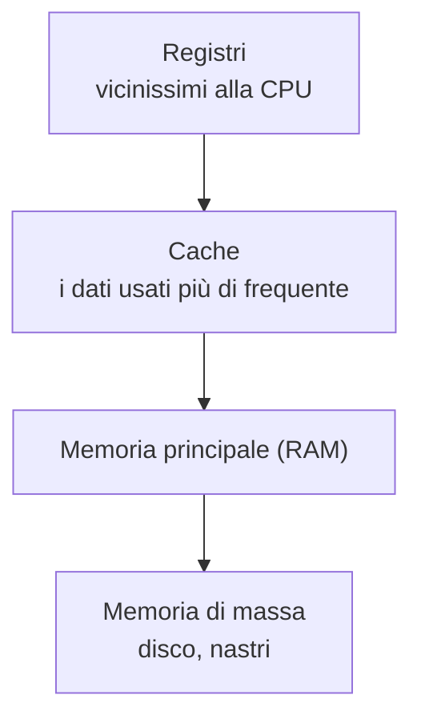
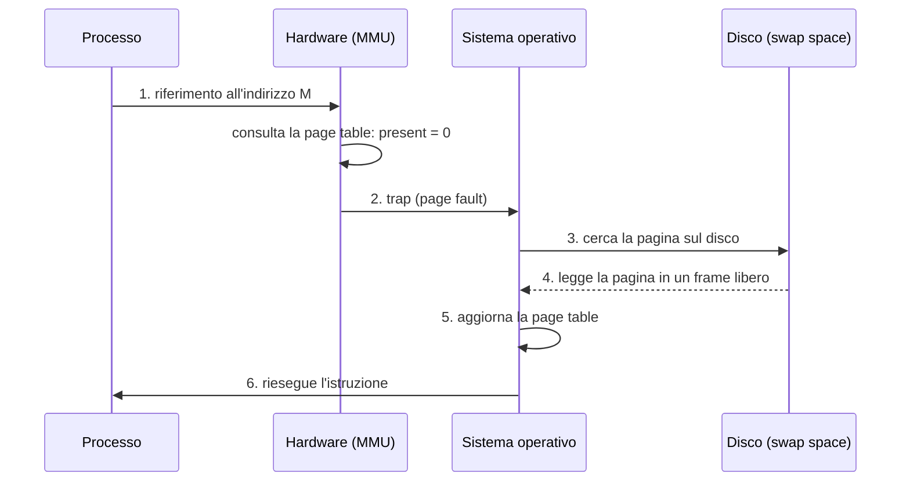
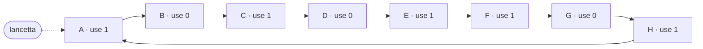

# Lezione 9 — Swapping, politiche di sostituzione e introduzione ai thread

La lezione chiude il discorso sulla memoria con la parte che il professore definisce la più interessante: i meccanismi di **swapping**, il motivo per cui la memoria virtuale è davvero una bella idea. L'obiettivo è andare **oltre la memoria fisica**, usando il disco come ulteriore livello in cui parcheggiare le pagine che non servono in quel momento. Ne nascono due problemi: il **meccanismo** con cui una pagina viene riportata in memoria quando serve, e la **politica** con cui si sceglie quale pagina togliere quando la memoria è piena. Nell'ultima parte inizia il secondo grande tema del corso, la **concorrenza**, con l'introduzione dei **thread** e un primo esempio di programma multithread.

## Ripasso: la memoria virtuale e il vincolo della memoria fisica

Finora si è considerata la memoria virtuale in questo senso: ogni processo ha il **suo** spazio di indirizzamento, cioè lo stesso intervallo di indirizzi (l'indirizzo 0 esiste sia per il processo P1 sia per il processo P2), che viene poi mappato in zone diverse della memoria fisica. La mappatura si può fare con **base and bound**; con la **memoria segmentata**, che usa una coppia base and bound per ogni segmento (codice, heap per la memoria allocata dinamicamente, stack); oppure con la **memoria paginata**, basata su unità di dimensione fissa (1 KB, 4 KB, negli esempi anche pochi byte) che possono essere collocate in punti qualsiasi della memoria fisica.

In tutti i casi il vincolo era la **memoria fisica**, cioè la RAM: la memoria volatile, quella che scompare quando si spegne il computer. L'idea ora è superare questo vincolo e dare a ogni processo più memoria, usando un supporto di **memorizzazione di massa** (*mass storage*).

## Oltre la memoria fisica: i meccanismi

### La gerarchia delle memorie

Il professore propone di vedere la situazione come una **gerarchia delle memorie**. Si chiama gerarchia perché si passa da livelli più alti, piccoli e veloci, a livelli più bassi, grandi e lenti.



- I **registri** sono vicinissimi alla CPU: è lì che si trasferisce un dato, si fa la somma, si mette il risultato.
- La **cache** è una parte di memoria che tiene i dati usati più di frequente. Non è stata trattata nel corso perché riguarda l'architettura fisica.
- La **memoria principale** è quella vista in dettaglio finora.
- La **memoria di massa** comprende i dischi e i nastri; in questo contesto è il disco a svolgere il ruolo. I dischi si possono fare molto più grandi della memoria disponibile, ma l'accesso è meno rapido, perché richiede meccanismi diversi.

Un processo cerca prima nei livelli più alti, e solo quando necessario scende a quelli più bassi. Lo swapping aggiunge appunto quest'ultimo livello alla gestione della memoria.

### L'illusione di un grande spazio di indirizzamento

Lo swapping non si limita ad aggiungere memoria: crea l'**illusione** che ogni processo abbia a disposizione **l'intero spazio di indirizzamento**. Con uno spazio di indirizzamento a 32 bit ogni indirizzo è composto da 32 bit, e gli indirizzi possibili sono $2^{32}$. Ogni processo vede tutti i $2^{32}$ indirizzi, anche se la RAM corrispondente non c'è.

Ci si potrebbe chiedere perché non mettere semplicemente più RAM. A parte il costo, la domanda è mal posta: i processi possono essere moltissimi, e più se ne aggiungono più memoria servirebbe. Il meccanismo non può funzionare senza un supporto esterno. Le slide sottolineano due aspetti: un programma non deve più preoccuparsi di portare in memoria codice e dati prima di usarli, e lo **swap space** permette al sistema operativo di offrire l'illusione di una grande memoria virtuale a **più processi** in esecuzione contemporaneamente.

### Lo swap space

> [!important] Swap space
> Lo **swap space** è una porzione del disco **riservata** dal sistema operativo per spostarvi le pagine di memoria che non vengono usate in quel momento, e riprenderle quando servono. Non contiene i file dell'utente (documenti, programmi), ma solo pagine. Il SO deve ricordare dove si trova ogni pagina nello swap space, **in unità della dimensione di una pagina**.

Il meccanismo funziona bene proprio perché la memoria è divisa in pagine. L'esempio delle slide mostra una memoria fisica di 4 frame e uno swap space di 8 blocchi.

| Memoria fisica | PFN 0 | PFN 1 | PFN 2 | PFN 3 |
| -------------- | ----- | ----- | ----- | ----- |
| Contenuto | Proc 0 [VPN 0] | Proc 1 [VPN 2] | Proc 1 [VPN 3] | Proc 2 [VPN 0] |

| Swap space | Blocco 0 | Blocco 1 | Blocco 2 | Blocco 3 | Blocco 4 | Blocco 5 | Blocco 6 | Blocco 7 |
| ---------- | -------- | -------- | -------- | -------- | -------- | -------- | -------- | -------- |
| Contenuto | Proc 0 [VPN 1] | Proc 0 [VPN 2] | libero | Proc 1 [VPN 0] | Proc 1 [VPN 1] | Proc 3 [VPN 0] | Proc 2 [VPN 1] | Proc 3 [VPN 1] |

Il processo 0 ha tre pagine (VPN 0, 1, 2), il processo 1 ne ha quattro (VPN 0–3), il processo 2 ne ha due (VPN 0 e 1). Ogni pagina può trovarsi **in memoria fisica**, quando il programma la sta usando, oppure **nello swap space**, quando non la usa. Il processo 3 ha tutte le sue pagine su disco: in questo momento non è in esecuzione. Il blocco 2 è libero, perché in questo momento non serve; potrebbe servire se partisse un altro processo.

L'idea è semplice e intelligente, ma ha bisogno di meccanismi per essere gestita. Si supponga che le pagine del processo 0 contengano il suo codice, e che a un certo punto l'esecuzione arrivi a istruzioni che non sono in memoria. Serve un meccanismo che dica: bisogna prendere quella pagina dallo swap space e portarla in memoria fisica. Ma in memoria fisica potrebbe non esserci spazio, e allora bisogna togliere qualcosa. Servono **politiche** per gestire queste scelte.

### Il present bit e il page fault

La prima cosa necessaria è sapere, quando si accede a una PTE, se la pagina si trova in memoria fisica o nello swap space. A questo serve il **present bit**, già visto tra i campi della PTE nella [[Lezione 08 - Paginazione, TLB e tabelle delle pagine multilivello#Che cosa contiene una page table entry|lezione precedente]].

| Present bit | Significato |
| ----------- | ----------- |
| 1 | la pagina è presente in memoria fisica |
| 0 | la pagina non è in memoria, ma su disco: bisogna andarla a recuperare |

> [!important] Page fault e page replacement policy
> - Si ha un **page fault** quando si accede a una pagina che **non è in memoria fisica**: la PTE è valida, ma il present bit vale 0. Il page fault deve essere gestito dal sistema operativo, che porta la pagina in memoria.
> - Se la memoria è piena, il SO deve togliere una pagina per fare spazio a quella nuova. Il procedimento con cui sceglie quale pagina togliere si chiama **page replacement policy** (politica di sostituzione delle pagine). Le politiche possibili sono diverse.

Il nome *page fault*, letteralmente "errore di pagina", può trarre in inganno: non si tratta di un errore del programma, ma di un evento normale che il SO gestisce in modo trasparente.

### Il flusso di controllo di un page fault

Le slide descrivono l'intero procedimento in sei passi. Un processo prova ad accedere a un indirizzo, per esempio con un'istruzione `load` all'indirizzo $M$.



Il processo fa riferimento all'indirizzo. L'hardware guarda nella page table dove si trova la pagina corrispondente; se la trova in memoria fisica non succede nulla di speciale. Se invece non la trova, scatta una **trap**: si ricorda che la trap è il salto a una funzionalità del sistema operativo, la stessa istruzione usata per eseguire le [[Lezione 02 - Process API e Limited Direct Execution#Le system call|chiamate di sistema]]. Il SO va a vedere sul disco, prende la pagina e la mette in un frame adeguato della memoria fisica (forse dovendo togliere qualcosa, ma lo schema non lo rappresenta). Poi aggiorna la page table e **riesegue l'istruzione**, che questa volta trova la pagina in memoria.

Nella PTE di una pagina che si trova su disco, il campo che di solito contiene il PFN viene usato per memorizzare l'**indirizzo della pagina sul disco**: è lì che il SO guarda per sapere dove leggere.

#### La parte eseguita dall'hardware

Il professore ricorda che l'algoritmo seguente non va interpretato come un pezzo di software: è ciò che fa l'**hardware** quando si prova ad accedere a un indirizzo. Riunisce tutto quello visto finora, la PTE, la page table, il TLB, e chiude il discorso: non ce n'è uno più complicato.

```pseudo
 1: VPN = (VirtualAddress & VPN_MASK) >> SHIFT
 2: (Success, TlbEntry) = TLB_Lookup(VPN)
 3: if (Success == True)                         // TLB hit
 4:     if (CanAccess(TlbEntry.ProtectBits) == True)
 5:         Offset   = VirtualAddress & OFFSET_MASK
 6:         PhysAddr = (TlbEntry.PFN << SHIFT) | Offset
 7:         Register = AccessMemory(PhysAddr)
 8:     else RaiseException(PROTECTION_FAULT)
 9: else                                         // TLB miss
10:     PTEAddr = PTBR + (VPN * sizeof(PTE))
11:     PTE = AccessMemory(PTEAddr)
12:     if (PTE.Valid == False)
13:         RaiseException(SEGMENTATION_FAULT)
14:     else
15:         if (CanAccess(PTE.ProtectBits) == False)
16:             RaiseException(PROTECTION_FAULT)
17:         else if (PTE.Present == True)
18:             // assumendo un TLB gestito in hardware
19:             TLB_Insert(VPN, PTE.PFN, PTE.ProtectBits)
20:             RetryInstruction()
21:         else if (PTE.Present == False)
22:             RaiseException(PAGE_FAULT)
```

Le righe 1–8 sono già note. Si estrae il VPN mascherando l'indirizzo e spostandolo a destra; si cerca nel TLB; in caso di successo si controlla se si può accedere alla pagina, si calcola l'offset, si forma l'indirizzo fisico con il PFN shiftato e l'offset, e si accede. Se l'accesso non è consentito si solleva un'eccezione.

Anche il ramo di miss è in gran parte noto. Non trovando la traduzione nel TLB si guarda nella page table completa: l'indirizzo della entry è la base della page table (il PTBR) più l'entry corrispondente. Si legge la PTE e si controlla se è valida, perché la pagina potrebbe non esistere, non far parte del processo; se non è valida si solleva un'eccezione. Se è valida si controlla la protezione.

La novità è alle righe 17–22. Prima, se la entry era valida e la protezione lo consentiva, si poteva accedere e basta, perché tutte le pagine erano necessariamente in memoria fisica. Ora una pagina può essere **presente o non presente**. Se è presente si inserisce nel TLB la nuova corrispondenza tra pagina virtuale e frame fisico e si riprova l'istruzione, come già visto. Se non è presente si solleva un'eccezione di tipo **page fault**.

#### La parte eseguita dal sistema operativo

Il gestore del page fault, eseguito dal sistema operativo, fa quanto segue.

```pseudo
1: PFN = FindFreePhysicalPage()
2: if (PFN == -1)              // nessun frame libero
3:     PFN = EvictPage()       // esegue l'algoritmo di sostituzione
4: DiskRead(PTE.DiskAddr, PFN) // si sospende in attesa dell'I/O
5: PTE.present = True          // aggiorna la page table: present bit
6: PTE.PFN = PFN               // e traduzione (PFN)
7: RetryInstruction()          // riesegue l'istruzione
```

Bisogna decidere dove mettere la nuova pagina, quindi si cerca un **frame libero** in memoria fisica. Se non c'è, un **algoritmo di sostituzione** decide quale delle pagine in memoria cacciare via (riga 3). Poi si legge dal disco la pagina, all'indirizzo su disco scritto nella PTE, e la si copia nel frame appena liberato. Durante la lettura il processo si sospende in attesa dell'I/O. Si aggiornano il present bit e il PFN della PTE, che ora indica proprio il frame dove la pagina è stata messa, e infine si riprova l'istruzione, che questa volta ha successo.

Il professore fa notare che in questo schema il **TLB non viene aggiornato**. Si potrebbe farlo, ragionando che la pagina appena caricata sta per essere usata; tradizionalmente non lo si fa, perché al retry ci si accorge che la traduzione non è nel TLB e la si inserisce seguendo l'algoritmo già visto. Il retry, quindi, prima produce un TLB miss, che stavolta trova la pagina presente, e poi un TLB hit.

> [!tip] Approfondimento — Mentre il disco lavora
> #approfondimento
> La lettura dal disco è lentissima rispetto alla CPU. OSTEP osserva che, mentre il page fault è in servizio, il processo che l'ha causato è nello stato **bloccato**, e il sistema operativo è libero di mandare in esecuzione altri processi pronti. È lo stesso schema di sovrapposizione tra I/O e calcolo visto per le altre operazioni di I/O, ed è un uso efficiente dell'hardware [@arpacidusseau2023ostep, cap. 21].

### Quando avviene davvero la sostituzione: lo swap daemon

Lo schema visto funziona concettualmente, ma è poco realistico. Implicherebbe che il SO riempia la memoria fisica fino all'ultimo frame, e che solo quando non c'è più spazio tolga una pagina per metterne un'altra. A quel punto la memoria è di nuovo piena, e la volta dopo bisogna di nuovo togliere e rimettere: da lì in poi è un continuo "togli e metti" a ogni passo.

Nella realtà la sostituzione è affidata a un componente separato, lo **swap daemon** (o *page daemon*). Un **demone** è un task che esegue in modo indipendente e si occupa esclusivamente di un compito. Lo swap daemon non fa parte della sequenza vista prima: è un processo a sé che si preoccupa di mantenere abbastanza memoria fisica libera, in modo che sia disponibile quando viene richiesta. Le slide lo chiamano *thread*, termine che verrà chiarito alla fine della lezione; per ora lo si può immaginare come un task indipendente.

> [!important] Low watermark e high watermark
> Lo swap daemon si basa su due soglie:
> - **LW** (*Low Watermark*, segno basso): quando le pagine libere sono **meno di LW**, il demone si attiva e inizia a liberare memoria;
> - **HW** (*High Watermark*, segno alto): il demone toglie pagine **finché le pagine libere non sono HW**, poi torna a dormire.
>
> Il valore delle soglie dipende dal sistema operativo; ciò che conta è il concetto.

Il demone interviene **in via precauzionale**, indipendentemente dal fatto che in quel momento serva spazio, e per scegliere le pagine da togliere usa comunque la replacement policy. Il punto chiave è che non ne toglie una sola: se si fermasse non appena tornato sopra LW, al prossimo caricamento si ritroverebbe di nuovo sotto, e si sarebbe al punto di partenza. Il professore lo descrive come un meccanismo a **isteresi**: scesi sotto LW, non ci si preoccupa di tornare a LW ma di tornare a HW. In questo modo, al passo successivo non c'è bisogno di intervenire di nuovo, perché le pagine libere sono più numerose.

```chart
type: line
labels: [t0, t1, t2, t3, t4, t5, t6, t7, t8, t9, t10]
series:
  - title: Pagine libere (andamento qualitativo)
    data: [40, 33, 26, 19, 12, 40, 33, 26, 19, 12, 40]
  - title: LW
    data: [12, 12, 12, 12, 12, 12, 12, 12, 12, 12, 12]
  - title: HW
    data: [40, 40, 40, 40, 40, 40, 40, 40, 40, 40, 40]
tension: 0
width: 80%
labelColors: false
fill: false
beginAtZero: true
```

Il grafico è puramente qualitativo: le pagine libere diminuiscono man mano che i processi caricano pagine, e ogni volta che raggiungono la soglia LW il demone le riporta in un colpo solo fino a HW.

> [!tip] Approfondimento — Lo swap daemon di Linux
> #approfondimento
> In Linux il ruolo dello swap daemon è svolto da un thread del kernel chiamato **kswapd**. La documentazione del kernel descrive il parametro `vm.watermark_scale_factor`, che controlla l'aggressività di kswapd: definisce quanta memoria deve restare libera prima che kswapd venga risvegliato e quanta deve essere libera prima che torni a dormire, cioè la distanza tra le soglie. Il valore predefinito 10 corrisponde a una distanza tra le soglie dello 0,1% della memoria disponibile. Lo stesso documento descrive `vm.swappiness`, un valore tra 0 e 200 (predefinito 60) che esprime il costo relativo dello swapping rispetto al rileggere dati dal file system [@linuxdocsysctlvm].

## Le politiche di sostituzione

### Quale pagina togliere

A questo punto diventa interessante parlare delle **politiche**. Il professore chiede alla classe quale pagina toglierebbe. Uno studente propone **LRU**, la pagina usata meno di recente: è sicuramente ragionevole, e ci si arriverà, ma il professore vuole mostrare *come* ci si arriva, e anticipa che LRU in quanto tale non è facile da implementare. Un altro studente propone **LFU**, la pagina usata meno frequentemente: è un'altra possibilità. Entrambe però richiedono di tenere traccia degli accessi a ogni pagina e di aggiornare queste informazioni per tutte le pagine a ogni accesso. Si può fare, ma sono stati proposti algoritmi che le approssimano senza questo costo.

Un terzo studente chiede di una politica *not recently used* (NRU). Il professore osserva che "recentemente" è un concetto ambiguo, che richiede di fissare una soglia: per qualcuno essere andato al cinema otto giorni fa è "recentemente", per altri no. Torna sul tema più avanti, a proposito dell'algoritmo dell'orologio.

### L'obiettivo: minimizzare i miss

Prima di confrontare le politiche bisogna dire qual è l'obiettivo. La memoria fisica, rispetto al disco, si comporta come una **cache**: non nel senso della cache hardware, ma con lo stesso principio. Tiene le pagine più usate, e bisogna decidere che cosa togliere. L'obiettivo è **minimizzare il numero di cache miss**, cioè di accessi a pagine che non sono in memoria.

Il numero di hit e di miss permette di calcolare la quantità che interessa davvero: il tempo medio di accesso alla memoria.

> [!important] Average Memory Access Time
> L'**AMAT** (*Average Memory Access Time*, tempo medio di accesso alla memoria) è
>
> $$
> \text{AMAT} = T_M + P_{\text{Miss}} \cdot T_D
> $$
>
> dove $T_M$ è il costo di un accesso alla memoria, $T_D$ il costo di un accesso al disco e $P_{\text{Miss}}$ la probabilità di non trovare il dato in memoria (un miss).

Il termine $T_M$ c'è sempre: anche in caso di miss si porta la pagina dal disco in memoria e poi si ripete l'istruzione, che accede comunque alla memoria. Il secondo termine è il prodotto tra la probabilità di un miss e il tempo di accesso al disco. Il tempo di accesso al disco non si può cambiare, almeno non con la politica; la probabilità di miss sì, e dipende dalla politica. Il numero totale di accessi è dato da ciò che il programma deve fare; l'obiettivo è quindi, data una sequenza di accessi a pagine, **ridurre il numero di miss**.

Il numero di miss dipende dalla sequenza. Se si accede dieci volte di fila alla stessa pagina, si ha al massimo un miss; se si accede a dieci pagine diverse una dopo l'altra, magari tutti miss. Per questo si ragiona in media.

> [!tip] Approfondimento — Quanto pesa un miss
> #approfondimento
> OSTEP fa un esempio numerico con $T_M \approx 100$ ns e $T_D \approx 10$ ms. Con un hit rate del 90% ($P_{\text{Miss}} = 0{,}1$):
>
> $$
> \text{AMAT} \approx 100\ \text{ns} + 0{,}1 \cdot 10\ \text{ms} \approx 1{,}0001\ \text{ms}
> $$
>
> cioè circa un millisecondo. Con un hit rate del 99,9% ($P_{\text{Miss}} = 0{,}001$) si scende a circa 10,1 µs, cento volte meno. Il costo del disco è così grande che anche una piccolissima frequenza di miss domina il tempo medio: per questo la scelta della politica conta tanto [@arpacidusseau2023ostep, cap. 22].

### La politica ottima

Si parte, come è ragionevole, definendo l'algoritmo **ottimo**. Serve perché è inutile sforzarsi di ottenere zero miss se zero non è possibile. L'obiettivo realistico è un algoritmo implementabile che si avvicini il più possibile all'ottimo.

> [!important] Politica ottima (Belady)
> La **politica ottima**, proposta da **Belady**, toglie **la pagina a cui si accederà più lontano nel futuro**. Produce il numero minimo possibile di miss. Il professore non lo dimostra: lo si prende come un dato di fatto.

L'algoritmo chiaramente **non è implementabile**: mentre un programma esegue, non si può sapere a quali pagine accederà, anche perché dipende da ciò che succede nel frattempo con gli altri processi. Però, dato un singolo problema specifico, lo si può calcolare a posteriori e usare come **termine di paragone**.

> [!example] La politica ottima su una traccia
> Il professore avverte che questo tipo di schema è importante, perché all'esame a volte viene chiesto di **simulare** che cosa succede. In cima c'è la sequenza dei riferimenti alle pagine (la stessa riportata in verticale nella prima colonna); a destra lo stato della cache, che si assume capace di contenere **3 pagine**. La dimensione è irrealistica: se si vuole mettere una quarta pagina bisogna toglierne una.
>
> Sequenza: 0, 1, 2, 0, 1, 3, 0, 3, 1, 2, 1.
>
> | Accesso | Esito | Esce | Stato della cache |
> | ------- | ----- | ---- | ----------------- |
> | 0 | miss | — | 0 |
> | 1 | miss | — | 0, 1 |
> | 2 | miss | — | 0, 1, 2 |
> | 0 | hit | — | 0, 1, 2 |
> | 1 | hit | — | 0, 1, 2 |
> | 3 | miss | 2 | 0, 1, 3 |
> | 0 | hit | — | 0, 1, 3 |
> | 3 | hit | — | 0, 1, 3 |
> | 1 | hit | — | 0, 1, 3 |
> | 2 | miss | 3 | 0, 1, 2 |
> | 1 | hit | — | 0, 1, 2 |
>
> All'inizio la cache è vuota, e finché non si riempie sono tutti miss, a meno di riaccedere a una pagina appena caricata. Il primo 0 è un miss obbligato, ma non c'è nulla da togliere; lo stesso per 1 e 2. Poi 0 e 1 sono hit. Al 3 la cache è piena e bisogna togliere qualcosa: la politica ottima guarda il futuro. Lo 0 servirà subito dopo, l'1 tre accessi più in là; il 2 è quello a cui si accederà più tardi, quindi esce il 2. Seguono tre hit (0, 3, 1). Al 2 si ha un miss: la sequenza finisce lì, quindi non si sa bene che cosa togliere. Sicuramente non l'1, che servirà a breve; si può togliere indifferentemente lo 0 o il 3, e nella slide viene tolto il 3.
>
> Il risultato è di **6 hit e 5 miss**. L'**hit rate** è
>
> $$
> \text{hit rate} = \frac{\text{hit}}{\text{hit} + \text{miss}} = \frac{6}{11} \approx 54{,}5\%
> $$
>
> La slide riporta 54,6%, per un arrotondamento diverso.

> [!tip] Approfondimento — I tre tipi di miss
> #approfondimento
> OSTEP riporta la classificazione dei miss nota come "le tre C". Un **compulsory miss** (o *cold-start miss*) avviene al primo accesso a un elemento, quando la cache è ancora vuota: nessuna politica può evitarlo, ed è il caso dei primi tre miss dell'esempio. Un **capacity miss** avviene perché la cache ha finito lo spazio e ha dovuto togliere un elemento per farne entrare un altro. Un **conflict miss** nasce nelle cache hardware dai limiti su dove un elemento può essere collocato; non si presenta nella gestione delle pagine, perché lì la "cache" è sempre completamente associativa: una pagina può andare in qualunque frame [@arpacidusseau2023ostep, cap. 22]. Il libro indica anche il riferimento originale di Belady, un articolo del 1966 sull'*IBM Systems Journal*, in cui la politica era chiamata MIN.

### FIFO

L'ottimo non è realizzabile, quindi si cominciano a pensare altri algoritmi. Il primo è una politica **FIFO** (*First In, First Out*): le pagine vengono messe in una coda quando entrano in memoria, e quando bisogna sostituirne una si toglie quella entrata per prima.

Forse non è un'idea grandiosa, ma ha un pregio: è **semplicissima da implementare**. Non bisogna tenere traccia di niente, basta una coda. Il difetto è che **non tiene conto dell'importanza delle pagine**. Se la sequenza è 1, 2, 3, 4, 3, 2, 1 e a quel punto bisogna inserire il 9, FIFO fa uscire l'1, perché è il primo entrato, anche se è stato appena usato. Una politica che tenesse conto di quanto è recente l'accesso lo terrebbe.

> [!example] FIFO sulla stessa traccia
> | Accesso | Esito | Esce | Stato della cache (dal più vecchio) |
> | ------- | ----- | ---- | ----------------------------------- |
> | 0 | miss | — | 0 |
> | 1 | miss | — | 0, 1 |
> | 2 | miss | — | 0, 1, 2 |
> | 0 | hit | — | 0, 1, 2 |
> | 1 | hit | — | 0, 1, 2 |
> | 3 | miss | 0 | 1, 2, 3 |
> | 0 | miss | 1 | 2, 3, 0 |
> | 3 | hit | — | 2, 3, 0 |
> | 1 | miss | 2 | 3, 0, 1 |
> | 2 | miss | 3 | 0, 1, 2 |
> | 1 | hit | — | 0, 1, 2 |
>
> Al 3 la politica ottima toglieva il 2; FIFO toglie lo 0, il primo della coda, anche se lo 0 era stato usato più volte. Il risultato è di **4 hit e 7 miss**, con un hit rate di $4/11 \approx 36{,}4\%$, più basso di prima, proprio perché FIFO non considera l'importanza delle pagine.

> [!warning] Errore nella slide
> Nella tabella FIFO delle slide, alla riga dell'accesso 1 (miss, stato risultante 3, 0, 1) la colonna della pagina tolta è vuota. Una studentessa lo nota in aula e il professore conferma che manca un **2**. È intuitivo che manchi qualcosa: all'inizio i miss sono dovuti alla cache vuota, ma quando la cache è piena ogni miss deve togliere una pagina. Nella tabella sopra la colonna è completata.

A questo punto verrebbe da dire che FIFO non ha senso. Il professore invita a **sospendere il giudizio**: da un singolo caso non si può concludere nulla. Potrebbero esistere classi di casi in cui FIFO e l'ottimo si comportano allo stesso modo. Per esempio, se gli accessi sono completamente casuali si possono dire cose che non fanno sembrare FIFO così brutto. Per valutare la qualità di un algoritmo non basta una sequenza, e dimostrazioni generali sono difficili da ottenere. Si considera sempre un **workload** (carico di lavoro) con certe caratteristiche e si osserva che cosa succede.

### L'anomalia di Belady

Con FIFO si vede subito un fatto controintuitivo. Sembrerebbe ovvio che **aumentando la dimensione della cache** le cose migliorino. Non è così.

> [!important] Anomalia di Belady
> Si parla di **anomalia di Belady** quando, con una certa politica e una certa sequenza di accessi, **aumentare il numero di frame disponibili aumenta il numero di page fault** invece di diminuirlo. FIFO può presentare l'anomalia.

L'esempio delle slide usa la sequenza 1, 2, 3, 4, 1, 2, 5, 1, 2, 3, 4, 5.

> [!example] FIFO con 3 frame
> | Accesso | Esito | Esce | Stato della cache |
> | ------- | ----- | ---- | ----------------- |
> | 1 | miss | — | 1 |
> | 2 | miss | — | 1, 2 |
> | 3 | miss | — | 1, 2, 3 |
> | 4 | miss | 1 | 2, 3, 4 |
> | 1 | miss | 2 | 3, 4, 1 |
> | 2 | miss | 3 | 4, 1, 2 |
> | 5 | miss | 4 | 1, 2, 5 |
> | 1 | hit | — | 1, 2, 5 |
> | 2 | hit | — | 1, 2, 5 |
> | 3 | miss | 1 | 2, 5, 3 |
> | 4 | miss | 2 | 5, 3, 4 |
> | 5 | hit | — | 5, 3, 4 |
>
> I primi tre miss servono a riempire la cache. Poi arriva il 4, che non c'è, ed esce l'1; subito dopo serve proprio l'1, che si deve rimettere togliendo il 2, e subito dopo serve il 2. Curiosamente si toglie sempre proprio la pagina che servirà subito dopo. In totale **9 miss**.

> [!example] FIFO con 4 frame
> | Accesso | Esito | Esce | Stato della cache |
> | ------- | ----- | ---- | ----------------- |
> | 1 | miss | — | 1 |
> | 2 | miss | — | 1, 2 |
> | 3 | miss | — | 1, 2, 3 |
> | 4 | miss | — | 1, 2, 3, 4 |
> | 1 | hit | — | 1, 2, 3, 4 |
> | 2 | hit | — | 1, 2, 3, 4 |
> | 5 | miss | 1 | 2, 3, 4, 5 |
> | 1 | miss | 2 | 3, 4, 5, 1 |
> | 2 | miss | 3 | 4, 5, 1, 2 |
> | 3 | miss | 4 | 5, 1, 2, 3 |
> | 4 | miss | 5 | 1, 2, 3, 4 |
> | 5 | miss | 1 | 2, 3, 4, 5 |
>
> Con il frame in più non si è più costretti a togliere l'1 e poi il 2, e infatti quei due accessi diventano hit. Ma più avanti, con questa sequenza, le cose peggiorano: in totale **10 miss**.

Il grafico riporta il numero di page fault di FIFO su questa sequenza al variare del numero di frame, da 1 a 7 (valori ricalcolati sulla sequenza). Il passaggio da 3 a 4 frame è l'anomalia.

```chart
type: bar
labels: [1, 2, 3, 4, 5, 6, 7]
series:
  - title: Page fault con FIFO
    data: [12, 12, 9, 10, 5, 5, 5]
width: 80%
labelColors: false
beginAtZero: true
```

Non basta quindi risolvere il problema aumentando la cache: l'analisi deve essere più approfondita.

> [!tip] Approfondimento — La proprietà di stack
> #approfondimento
> OSTEP spiega perché LRU non soffre dell'anomalia. LRU gode della **proprietà di stack** (*stack property*): con una cache di dimensione $N + 1$, il contenuto include sempre quello di una cache di dimensione $N$. Aumentare la cache può quindi solo migliorare o lasciare invariato l'hit rate. FIFO e random non hanno questa proprietà, e possono presentare l'anomalia. L'anomalia è descritta in un articolo di Belady, Nelson e Shedler del 1969 [@arpacidusseau2023ostep, cap. 22]. Sulla sequenza dell'esempio, LRU produce 10 miss con 3 frame e 8 con 4.

### Random

Un'altra idea è **togliere una pagina a caso**. Potrebbe non essere il massimo, o forse sì: dipende dal workload. Di certo è la politica **più semplice possibile**: non bisogna tenere traccia di nulla, nemmeno di una coda. Si prende una pagina e la si toglie, senza cercare di fare nulla di intelligente.

> [!example] Random sulla traccia di partenza
> | Accesso | Esito | Esce | Stato della cache |
> | ------- | ----- | ---- | ----------------- |
> | 0 | miss | — | 0 |
> | 1 | miss | — | 0, 1 |
> | 2 | miss | — | 0, 1, 2 |
> | 0 | hit | — | 0, 1, 2 |
> | 1 | hit | — | 0, 1, 2 |
> | 3 | miss | 0 | 1, 2, 3 |
> | 0 | miss | 1 | 2, 3, 0 |
> | 3 | hit | — | 2, 3, 0 |
> | 1 | miss | 3 | 2, 0, 1 |
> | 2 | hit | — | 2, 0, 1 |
> | 1 | hit | — | 2, 0, 1 |
>
> Al 3 esce lo 0 e al successivo 0 esce l'1: sembra FIFO, ma la scelta è casuale. Lo si vede all'accesso 1, dove esce il 3, che non è il primo della coda. In questa esecuzione si hanno **6 miss**, contro i 7 di FIFO: con questa sequenza random funziona meglio di FIFO, anche se non bene quanto l'ottimo. Il professore scherza sul fatto che serva un dado a tre facce, che non esiste: come sanno i giocatori di giochi di ruolo, il minimo è quattro.

Random dipende per definizione da quanto è fortunata la scelta. Per farsene un'idea, l'esperimento è stato ripetuto molte volte sulla stessa sequenza, con scelte casuali diverse. L'istogramma delle slide (10 000 prove) mostra la frequenza di ciascun numero di hit.

```chart
type: bar
labels: [1 hit, 2 hit, 3 hit, 4 hit, 5 hit, 6 hit]
series:
  - title: Frequenza (%), valori letti dal grafico delle slide
    data: [0, 2, 10, 20, 40, 45]
width: 80%
labelColors: false
beginAtZero: true
```

Il caso più frequente è quello con **6 hit**, lo stesso numero dell'ottimo. Random non può essere sempre come l'ottimo, perché a volte ottiene solo 5 o 4 hit; ma nella maggior parte dei casi ne ottiene 6 o 5. Random non è affatto male, e costa zero. Secondo OSTEP, poco più del 40% delle volte random ottiene 6 hit, eguagliando l'ottimo [@arpacidusseau2023ostep, cap. 22].

### Usare la storia: LRU e LFU

Per essere più raffinati conviene tenere conto della **storia** degli accessi. Le slide distinguono due tipi di informazione storica.

| Informazione | Significato | Algoritmo |
| ------------ | ----------- | --------- |
| recenza (*recency*) | più una pagina è stata acceduta di recente, più è probabile che venga acceduta di nuovo | **LRU** |
| frequenza (*frequency*) | se una pagina è stata acceduta molte volte, ha chiaramente valore e non va sostituita | **LFU** |

> [!important] LRU e LFU
> - **LRU** (*Least Recently Used*) toglie la pagina **usata meno di recente**, cioè quella il cui ultimo accesso è più lontano nel passato.
> - **LFU** (*Least Frequently Used*) toglie la pagina **usata meno frequentemente**. Una pagina può essere stata usata meno di recente ma più spesso, e LFU la conserva.

> [!warning] Precisazione sui nomi
> A lezione l'acronimo LRU viene a volte sciolto come "List Recently Used" e LFU come "list recently used". I nomi corretti sono *Least Recently Used* e *Least Frequently Used*: *least* significa "il meno".

> [!example] LRU sulla traccia di partenza
> | Accesso | Esito | Esce | Stato della cache (dal meno al più recente) |
> | ------- | ----- | ---- | ------------------------------------------- |
> | 0 | miss | — | 0 |
> | 1 | miss | — | 0, 1 |
> | 2 | miss | — | 0, 1, 2 |
> | 0 | hit | — | 1, 2, 0 |
> | 1 | hit | — | 2, 0, 1 |
> | 3 | miss | 2 | 0, 1, 3 |
> | 0 | hit | — | 1, 3, 0 |
> | 3 | hit | — | 1, 0, 3 |
> | 1 | hit | — | 0, 3, 1 |
> | 2 | miss | 0 | 3, 1, 2 |
> | 1 | hit | — | 3, 2, 1 |
>
> Quando si deve accedere al 3 bisogna vedere quale tra 0, 1 e 2 è stato usato più lontano nel passato: l'ordine degli ultimi accessi è 2, 0, 1, quindi esce il 2. Su questa sequenza LRU ottiene **6 hit**, esattamente come l'ottimo.

Già qui si vede che lo sforzo è maggiore rispetto a FIFO. A colpo d'occhio è rapido, ma non è indolore: bisogna ricordare che cosa è successo nel passato. In alternativa si può tenere la lista sempre ordinata: si toglie sempre il primo elemento, ma ogni volta che si accede a una pagina la si sposta in fondo, così che non sia più in posizione di essere tolta.

### Valutare le politiche con i workload

Per valutare gli algoritmi non ci si basa su una sequenza, ma su **workload**. Un workload è un insieme di task da eseguire, caratterizzato in qualche modo: altrimenti tutti i workload sarebbero uguali. Negli esperimenti delle slide ogni punto dei grafici è calcolato rieseguendo gli accessi 100 volte e facendo la media, che è un'idea sensata: chi si occupa di statistica sa anche quantificare il margine di errore di queste medie. Gli esperimenti riguardano **100 pagine** distinte e cache di dimensione crescente, fino a 100. Quando la cache contiene tutte le pagine, l'hit rate arriva al 100% con qualunque politica, perché non c'è più nulla da togliere.

#### Il workload senza località

Nel primo workload ogni accesso è a una pagina **casuale**. Attenzione: qui è casuale il workload, non l'algoritmo. Si sta togliendo qualunque principio di località, cioè l'idea che dopo l'accesso a una pagina si acceda presto alla stessa pagina o a una vicina. Si immagina, in modo apparentemente irrealistico, che la prossima pagina richiesta possa essere una qualunque: si tira un dado.

Il risultato è interessante. L'ottimo resta l'ottimo, ma **LRU, FIFO e random si comportano allo stesso modo**: le curve sono perfettamente sovrapposte, per qualunque dimensione della cache. Senza località, tutti i ragionamenti fatti finora perdono valore. Ci si può allora chiedere se valga lo sforzo aggiuntivo di implementare LRU: se non ci fosse la località, no, non varrebbe niente.

#### Il workload 80-20

Quello appena visto è un caso limite, perché la località in gran parte c'è. Il secondo workload la ripristina. Le sequenze sono sempre casuali, ma con un vincolo: l'**80% degli accessi riguarda il 20% delle pagine** (le pagine "calde"), e il restante 20% degli accessi riguarda l'80% delle pagine. L'80% delle volte si insiste sempre sulla stessa roba, e solo il 20% delle volte si va altrove. Le proporzioni sono puramente didattiche.

In questo caso l'ottimo resta il migliore, e **LRU si comporta meglio** di FIFO e random, perché tende a conservare le pagine calde. FIFO e random continuano invece a comportarsi in modo quasi identico. Il professore lo trova abbastanza logico: l'unica differenza tra i due è che FIFO toglie la prima pagina della coda e random una pagina qualsiasi, ma il risultato dipende soprattutto da come sono fatti gli accessi più che da come sono ordinate le pagine nella cache.

#### Il workload sequenziale ciclico

Il terzo caso non è ovvio. Gli accessi non sono casuali ma **sequenziali**: si accede alla pagina 0, poi alla 1, alla 2, fino alla 49, e poi si ricomincia da capo, ripetendo il ciclo molte volte (in tutto 10 000 accessi a 50 pagine distinte). La cache varia da pochi frame a un numero molto grande.

Il professore stesso, a prima vista, ha un dubbio sul grafico, che poi si chiarisce ricordando che la sequenza viene ripetuta in ciclo.

- Se la cache è **minore di 50**, LRU e FIFO funzionano **malissimo**: hit rate pari a zero. Con una cache di 20 pagine si caricano le pagine fino alla 19, poi alla 20 bisogna toglierne una, alla 21 un'altra, e così via: si sostituiscono sempre tutte. Quando il ciclo ricomincia, la pagina 0 è stata tolta da tempo, ed è proprio quella che serve. Si toglie sempre la pagina che servirà più presto.
- **Random** si comporta **meglio**. Scegliendo a caso, a volte una pagina, per esempio la 19, resta in memoria perché non viene mai estratta, e quando il ciclo la richiede di nuovo è già lì.
- Quando la cache è **maggiore o uguale a 50**, tutti gli algoritmi sono perfetti: c'è spazio per tutto, e una volta riempita la cache non serve togliere nulla.

Il professore osserva che il risultato andrebbe discusso, ma suggerisce questo: se si accede in sequenza a una grande quantità di memoria, la località all'interno di ciascuna pagina c'è, ma a un certo punto si passa da una pagina all'altra continuamente. Se la cache è piccola, LRU fa peggio di random, che ogni tanto conserva per caso una pagina che servirà dopo. Quello che succede, insomma, non è ovvio, e in casi come questi la politica più semplice può essere la migliore.

> [!tip] Schema consigliato
> In questo punto sarebbe utile uno schema disegnato a mano (per esempio con Excalidraw) che affianchi tre piccoli grafici qualitativi, uno per workload (senza località, 80-20, sequenziale ciclico), con l'hit rate in funzione della dimensione della cache. In ciascuno andrebbero tracciate le curve di OPT, LRU, FIFO e random, evidenziando: la sovrapposizione delle tre politiche nel primo, il vantaggio di LRU nel secondo, LRU e FIFO piatte a zero e random sopra di loro fino a 50 frame nel terzo.

### Implementare LRU

Stabilito come si comportano le politiche, resta l'aspetto implementativo, che per LRU è problematico. Bisogna tenere traccia di quando si fa riferimento a ogni pagina, e ci sono due strade:

1. **tenere la lista ordinata**: ogni volta che si accede a una pagina la si sposta in testa (o in coda, a seconda di dove si prende la pagina da togliere). Se si toglie dalla coda, la pagina acceduta va in testa; se si toglie dalla testa, va in coda. Questo richiede di riordinare le pagine a ogni accesso;
2. **aggiungere a ogni pagina un campo temporale** (*time field*) che registri quando è stata acceduta, o almeno un numero che dia un ordinamento. Per trovare la pagina da togliere bisogna poi cercare il valore più vecchio.

Le slide precisano che in entrambi i casi il sistema deve fare un lavoro di contabilità **a ogni accesso alla memoria**, cosa troppo costosa. LRU, che secondo il professore è probabilmente l'algoritmo più usato, viene quindi **approssimato**, con un piccolo aiuto dell'hardware.

### Approssimare LRU: l'algoritmo dell'orologio

L'idea è non tenere traccia di quale pagina sia la più recente, perché abbiamo visto che è complicato, ma usare un singolo bit.

> [!important] Use bit
> Lo **use bit** (o *reference bit*) è un bit associato a ogni pagina che l'**hardware** imposta a 1 **ogni volta che la pagina viene acceduta**. L'hardware non lo rimette mai a 0: azzerarlo è compito del **sistema operativo**.

Il sistema operativo azzera gli use bit, ma se una pagina viene acceduta il suo bit torna a 1. Una pagina acceduta di recente avrà quindi un'alta probabilità di avere il bit a 1. Non si tiene conto dell'ordine degli accessi: si distingue soltanto tra pagine **recenti** e **non recenti**.

> [!important] Algoritmo dell'orologio
> Nel **clock algorithm** si immagina che tutte le pagine siano disposte in una **lista circolare**, con una **lancetta** che punta a una pagina. Quando bisogna sostituire una pagina, si esamina quella indicata dalla lancetta:
> - se lo use bit vale **1**, la pagina è stata usata di recente e per questa volta è salva: il bit viene messo a **0** e la lancetta avanza alla pagina successiva;
> - se lo use bit vale **0**, la pagina viene **tolta**.
>
> L'algoritmo continua a girare finché non trova una pagina con use bit a 0. La volta successiva riparte da dove si era fermato.

Le pagine non sono davvero disposte in cerchio: è un modo intuitivo di vedere una lista che non è più lineare ma circolare, scandita periodicamente da una lancetta, da cui il nome.



> [!example] Un giro dell'orologio
> Con la situazione della figura e la lancetta su A: A ha use bit 1, quindi il bit diventa 0 e la lancetta passa a B. B ha use bit 0, quindi B viene tolta e la nuova pagina prende il suo posto. Al prossimo page fault si riparte da C: ha il bit a 1, diventa 0, si passa a D, che ha bit 0 e viene tolta. Se nel frattempo A viene acceduta, il suo bit torna a 1, indipendentemente dall'algoritmo, e al passaggio successivo della lancetta A sarà di nuovo salva.

Il pregio dell'algoritmo è che **non richiede di riordinare le pagine** né di registrare tempi: basta un bit e una scansione circolare. Sul workload 80-20, che è quello ragionevole perché rispetta la località, il clock si comporta **quasi come LRU**: non esattamente, ma lo approssima abbastanza bene, ed è molto più semplice da implementare. Fa comunque meglio delle politiche che non considerano affatto la storia, come FIFO e random. Si potrebbe provare anche un workload 90-10 e vedere come cambia.

Riguardo alla politica NRU citata da uno studente, il professore, che non la conosceva con quel nome, ritiene molto probabile che il concetto sia proprio questo: si distinguono le pagine usate di recente da quelle non usate di recente, senza tenere conto dell'ordine.

> [!tip] Approfondimento — Le origini del clock algorithm
> #approfondimento
> Secondo OSTEP lo use bit fu introdotto dal sistema **Atlas**, uno dei primi sistemi con memoria virtuale, e l'algoritmo dell'orologio è dovuto a **Corbató** (1969) [@arpacidusseau2023ostep, cap. 22].

### Le pagine sporche

Si può tenere conto non solo di quanto recentemente è stata usata una pagina, ma anche di **quanto costa toglierla**. Togliere le pagine non ha sempre lo stesso costo. Una pagina di codice, che per definizione non viene modificata, si può togliere a costo nullo: si butta via e basta, perché la copia sul disco è ancora valida; bisogna solo caricare la nuova pagina. Una pagina **modificata**, per esempio perché contiene dati, costa molto di più: oltre a caricare la nuova pagina, bisogna **salvare sul disco** quella vecchia, che nel frattempo è cambiata.

Per questo l'hardware include il **dirty bit** (o *modified bit*), che indica che la pagina è "sporca": non solo è stata acceduta, ma è stata acceduta **in scrittura**. Una pagina sporca deve essere riscritta su disco prima di essere tolta; una pagina pulita si toglie gratis. Si può tenerne conto in modi diversi, da discutere: per esempio cercando per prima una pagina che abbia a 0 sia lo use bit sia il dirty bit.

> [!tip] Approfondimento — Clock con dirty bit
> #approfondimento
> OSTEP descrive una variante del clock in cui la lancetta cerca prima le pagine **non usate e pulite**, da togliere subito; se non ne trova, passa alle pagine non usate ma sporche, e così via. Il libro nota che molti sistemi di memoria virtuale **preferiscono togliere pagine pulite** piuttosto che sporche, proprio per evitare la scrittura su disco [@arpacidusseau2023ostep, cap. 22].

### Altre politiche: quando portare le pagine in memoria

Togliere le pagine è un problema, e si è visto che se ne occupa il demone: interviene quando lo spazio libero scende sotto LW e toglie pagine finché non ne ha liberate HW. **Quando prendere** le pagine dal disco è un altro problema. In quest'ottica le due cose non sono più sincrone: il demone libera spazio in modo indipendente, e quando serve una pagina lo spazio c'è già. Il professore dà solo un accenno, per dire che il problema esiste; non ci sono algoritmi da discutere.

> [!important] Politiche di selezione delle pagine
> - **Demand paging** (paginazione su richiesta): il SO porta in memoria una pagina solo quando viene acceduta.
> - **Prefetching**: il SO **indovina** che una pagina sta per essere usata e la porta in memoria in anticipo. Se serve la pagina 1, per il principio di località può avere senso portare in memoria anche la 2. Se si tratta del codice di un programma ha molto senso.
> - **Clustering** (o *grouping*) delle scritture: invece di scrivere subito ogni pagina su disco, si raccolgono le scritture in sospeso e le si eseguono **tutte insieme**, con un'unica scrittura grande.

Entrambe le ottimizzazioni sono motivate dal costo dell'accesso al disco, molto alto anche perché, nei dischi tradizionali, comporta spostamenti meccanici. Una singola scrittura grande è più efficiente di tante piccole. OSTEP precisa che il prefetching va fatto solo quando ci sono ragionevoli probabilità che l'ipotesi sia giusta [@arpacidusseau2023ostep, cap. 22].

Con questo si chiude il discorso sulla memoria.

### Contenuti delle slide non trattati a lezione: il thrashing

> [!warning] Sezione basata sulle slide
> L'ultima slide del capitolo, dedicata al thrashing, non è stata spiegata a lezione. La si riporta per completezza, seguendo le slide e il libro di testo.

Che cosa deve fare il SO quando la memoria è **sovraccarica**, cioè quando le richieste di memoria dei processi in esecuzione superano la memoria fisica disponibile? In questa situazione il sistema passa il tempo a spostare pagine avanti e indietro dal disco, e i processi non avanzano.

> [!important] Thrashing
> Si parla di **thrashing** quando il sistema è costantemente impegnato a paginare, perché la memoria richiesta dall'insieme dei processi in esecuzione supera la memoria fisica. Aumentando il **grado di multiprogrammazione** (il numero di processi in memoria), l'utilizzo della CPU cresce fino a un certo punto e poi crolla.

Il grafico delle slide mostra proprio questo: l'utilizzo della CPU in funzione del grado di multiprogrammazione sale, raggiunge un massimo e poi precipita nella zona del thrashing. Una soluzione è decidere di **non eseguire un sottoinsieme dei processi**, in modo che i **working set** dei processi rimasti, cioè le pagine che stanno usando attivamente, stiano in memoria. OSTEP chiama questo approccio **controllo di ammissione** (*admission control*) e lo riassume così: a volte è meglio fare bene meno lavoro che fare male tutto insieme [@arpacidusseau2023ostep, cap. 22].

> [!tip] Approfondimento — L'out-of-memory killer
> #approfondimento
> OSTEP cita un approccio più drastico, adottato da alcune versioni di Linux: quando la memoria è sovraccarica, un demone, l'**out-of-memory killer**, sceglie un processo che usa molta memoria e lo **termina**. Il libro avverte che il metodo può avere effetti spiacevoli: se viene ucciso, per esempio, il server grafico X, tutte le applicazioni che hanno bisogno dello schermo diventano inutilizzabili [@arpacidusseau2023ostep, cap. 22].

## Introduzione alla concorrenza

### Dai processi ai thread

Si passa a un tema diverso, la **concorrenza**. I processi competono per avere la memoria, e l'umanità (sottolinea il professore, non lui) ha inventato i meccanismi visti finora per permettere questa competizione. Ma i processi competono anche per la **CPU**, per essere eseguiti. La concorrenza era già stata toccata parlando degli [[Lezione 01 - Introduzione ai SO e processi#Gli stati di un processo|stati di un processo]], e si porta dietro problemi importanti, che riguardano tutti la **sincronizzazione** tra i task.

Che cosa succede, per esempio, se due processi vogliono usare la stessa risorsa? Al professore piace usare come esempio di risorsa la memoria. Però, per definizione, i processi hanno spazi di indirizzamento separati: un processo non può scrivere nella memoria di un altro, e il processo B non sa neanche che cosa sia la memoria del processo A. Per parlare del problema della sincronizzazione bisogna allora introdurre un concetto simile al processo, ma diverso: il **thread**.

> [!important] Thread
> Un **thread** è un **flusso di esecuzione** all'interno di un processo. Un programma **multithread** ha più punti di esecuzione, quindi **più program counter**, uno per thread, ma tutti i thread dello stesso processo **condividono lo stesso spazio di indirizzamento**.

I thread sono usatissimi nella programmazione. Si può immaginare che un pezzo di codice venga eseguito da un thread e un altro pezzo, nello stesso processo, da un altro thread, in maniera concorrente: uno è bloccato in attesa, l'altro esegue. Ogni thread ha bisogno del proprio program counter, perché bisogna sapere in che punto si trova ciascuno.

La differenza magica rispetto ai processi è la **condivisione dello spazio di indirizzamento**: i thread sono diversi flussi di esecuzione nello stesso processo, e lo spazio di indirizzamento è uno solo. È bellissimo, perché un thread può scrivere una variabile e un altro thread può leggerla.

A che cosa servono? Di solito si tratta di più task che collaborano a un'attività. Un **server web** è tipicamente multithread: un thread riceve le richieste di connessione e, quando ne arriva una, la passa a un altro thread che la elabora, mentre il primo torna a ricevere richieste. "Passare la richiesta" implica un'interazione e una comunicazione forte, che si può realizzare proprio attraverso lo spazio condiviso. Le slide indicano due motivazioni generali:

- **parallelismo**: su una macchina con più CPU, i thread di un programma possono eseguire contemporaneamente su processori diversi, dividendosi il lavoro;
- **evitare che un programma si blocchi per un I/O lento**: mentre un thread attende una risposta dal disco o dalla rete, un altro thread dello stesso programma può continuare a lavorare. È la stessa sovrapposizione tra I/O e calcolo che lo scheduling realizza tra processi diversi, ottenuta però all'interno di un singolo programma.

### Il context switch tra thread

Ogni thread non ha solo il proprio program counter, ma anche un proprio **insieme di registri**: per esempio il registro che indica lo stack, lo stato e altri. Quindi registri e **context switch** esistono anche tra thread. Gli stati di un thread sono gli stessi dei processi: quando un thread va in esecuzione e un altro torna nella coda dei pronti o si blocca, c'è un context switch. Ci deve essere per forza: il thread che entra copia i propri valori nei registri del processore, come minimo il program counter, ma anche il resto.

> [!important] Thread Control Block
> Lo stato di ciascun thread viene salvato in un **TCB** (*Thread Control Block*), l'analogo per i thread del [[Lezione 01 - Introduzione ai SO e processi#Process list e PCB|PCB]] dei processi.

Quando si passa da un thread T1 a un thread T2:

1. lo stato dei registri di T1 viene **salvato**;
2. lo stato dei registri di T2 viene **ripristinato**;
3. lo **spazio di indirizzamento resta lo stesso**.

Il terzo punto è la differenza rispetto al [[Lezione 02 - Process API e Limited Direct Execution#Il context switch|context switch tra processi]]: non bisogna cambiare la page table, perché i due thread usano la stessa.

### Uno stack per ogni thread

Lo spazio di indirizzamento è condiviso, ma lo **stack** deve essere **diverso** per ogni thread. Il motivo è abbastanza ovvio, se si ricorda che cosa contiene lo stack: le **variabili locali** e i **parametri passati alle funzioni**. È fatto a pila proprio per come funziona l'esecuzione delle funzioni: si chiama una funzione e i suoi parametri vanno in cima alla pila; dentro quella funzione se ne chiama un'altra, e i suoi parametri vanno sopra; uscendo dalla seconda si tolgono i suoi parametri, uscendo dalla prima i propri. Due thread fanno cose diverse e hanno le proprie variabili locali: servono due stack.

| Spazio di indirizzamento con un thread | Spazio di indirizzamento con due thread |
| -------------------------------------- | --------------------------------------- |
| 0–1 KB: codice del programma | 0–1 KB: codice del programma |
| 1–2 KB: heap | 1–2 KB: heap |
| libero | libero |
| | **stack (2)** |
| | libero |
| 15–16 KB: stack (1) | 15–16 KB: stack (1) |

Il **codice** è condiviso, perché il codice è uno solo: contiene il codice di entrambi i thread, ma il processo è uno. L'**heap** è uno solo: si alloca memoria da un thread e vi si accede dall'altro. Gli **stack** invece sono diversi. È l'unica differenza sostanziale nella divisione della memoria.

> [!tip] Approfondimento — Dove finiscono gli stack dei thread
> #approfondimento
> OSTEP osserva che gli stack aggiuntivi rompono la disposizione ordinata vista finora, con heap e stack che crescono uno verso l'altro: ora ci sono più stack sparsi nello spazio di indirizzamento. Di solito non è un problema, perché gli stack raramente devono essere molto grandi; fanno eccezione i programmi che usano pesantemente la ricorsione [@arpacidusseau2023ostep, cap. 26]. Su Linux la pagina di manuale di `pthread_create` precisa che la dimensione predefinita dello stack di un nuovo thread è data dal limite di risorsa `RLIMIT_STACK`, se questo non è illimitato; altrimenti si usa un valore fisso, 2 MB sulla maggior parte delle architetture [@linuxman3pthreadcreate].

### Il primo programma multithread

Il professore chiude la lezione mostrando com'è fatto il codice. L'esempio crea due thread che stampano ciascuno una lettera.

```c
#include <stdio.h>
#include <assert.h>
#include <pthread.h>
#include "common.h"
#include "common_threads.h"

void *mythread(void *arg) {
    printf("%s\n", (char *) arg);
    return NULL;
}

int main(int argc, char *argv[]) {
    pthread_t p1, p2;
    int rc;
    printf("main: begin\n");
    Pthread_create(&p1, NULL, mythread, "A");
    Pthread_create(&p2, NULL, mythread, "B");
    // join waits for the threads to finish
    Pthread_join(p1, NULL);
    Pthread_join(p2, NULL);
    printf("main: end\n");
    return 0;
}
```

**La funzione del thread.** Ogni thread esegue una funzione con una struttura particolare. Il nome `mythread` è inventato, ma la **firma** è un vincolo: la funzione deve restituire un puntatore a `void` (`void *`) e deve avere **un solo parametro**, anch'esso di tipo `void *`. Il contenuto della funzione dipende da ciò che il thread deve fare. Thread diversi possono eseguire funzioni diverse, ma nulla impedisce di creare più thread che eseguono la stessa funzione. In questo caso il thread non fa niente: stampa soltanto il suo parametro, convertendolo in stringa (`char *`).

**La creazione.** Il `main` può fare qualunque cosa; qui usa poche funzioni specifiche, che è importante saper usare. `pthread_create` **crea un thread**: da quel momento esiste un thread che esegue in modo **concorrente** con il programma principale, il quale prosegue, perché non ha mica finito. I parametri sono:

1. un puntatore a una variabile di tipo `pthread_t` (`&p1`), in cui viene scritto l'**identificatore** del thread creato. Serve dopo per fare riferimento a quel thread e non a un altro;
2. gli **attributi** del thread, per ora `NULL`;
3. la **funzione** da eseguire, `mythread`;
4. l'**argomento** passato alla funzione: la stringa `"A"` finisce proprio nel parametro `arg` di `mythread`.

Vengono creati due thread, con identificatori diversi (`p1` e `p2`), così che li si possa distinguere. La funzione eseguita è la stessa, per semplicità, ma il parametro cambia: il secondo thread riceve la stringa `"B"`, e quindi stampa qualcosa di diverso.

Nelle slide le funzioni sono scritte con l'iniziale maiuscola (`Pthread_create`, `Pthread_join`): sono **wrapper** del libro di testo, inclusi tramite `common_threads.h`. `Pthread_create` chiama semplicemente `pthread_create` e controlla che il codice di ritorno sia 0; in caso contrario stampa un messaggio e termina il programma [@arpacidusseau2023ostep, cap. 26].

> [!example] Domanda in aula: quanti thread ci sono?
> Il professore chiede: subito dopo la seconda chiamata a `pthread_create`, quanti thread ci sono? Sperava che qualcuno rispondesse due, e invece chi lo pensava è rimasto zitto sospettando un tranello. La risposta giusta è **tre**. Ogni processo ha sempre **almeno un thread di esecuzione**: anche quando non si crea alcun thread, si sta eseguendo un processo con un solo thread. All'inizio del `main` c'è solo il **thread principale**; con la prima `pthread_create` i thread diventano due, con la seconda tre. Due li ha creati il programma, uno c'era già.

**L'attesa.** Il thread principale, dopo aver creato i due thread, si ferma ad aspettare `p1` con `pthread_join`. È la prima primitiva di **sincronizzazione** che si incontra. Non è quella che serve a proteggere un'area di memoria, ma la più semplice: fa sì che il thread principale **attenda finché il thread indicato non termina**. Quando `p1` termina, il thread principale passa ad aspettare `p2`, e quando anche `p2` termina, il thread principale procede verso la propria terminazione e stampa `main: end`.

### Nessuna garanzia sull'ordine di esecuzione

L'aspetto su cui il professore si ferma è che **non c'è alcuna garanzia** su come i thread verranno eseguiti, a parte ciò che deriva dalle sincronizzazioni esplicite. Le slide mostrano tre esecuzioni possibili dello stesso programma.

| Passo | Esecuzione 1 | Esecuzione 2 | Esecuzione 3 |
| ----- | ------------ | ------------ | ------------ |
| 1 | main: stampa "main: begin" | main: stampa "main: begin" | main: stampa "main: begin" |
| 2 | main: crea T1 | main: crea T1 | main: crea T1 |
| 3 | main: crea T2 | **T1: stampa "A" e termina** | main: crea T2 |
| 4 | main: attende T1 | main: crea T2 | **T2: stampa "B" e termina** |
| 5 | T1: stampa "A" e termina | **T2: stampa "B" e termina** | main: attende T1 |
| 6 | main: attende T2 | main: attende T1 (ritorna subito) | T1: stampa "A" e termina |
| 7 | T2: stampa "B" e termina | main: attende T2 (ritorna subito) | main: attende T2 (ritorna subito) |
| 8 | main: stampa "main: end" | main: stampa "main: end" | main: stampa "main: end" |

1. Nel primo caso il main crea entrambi i thread e si mette ad aspettare T1; T1 esegue, stampa "A" e ritorna; il main riparte, aspetta T2, che esegue e termina.
2. Nel secondo caso T1 parte **appena creato**, prima ancora che venga creato T2. Poi viene creato T2, che parte anche lui. Quando il main aspetta T1, T1 è già terminato e la `join` ritorna subito; lo stesso per T2.
3. Nel terzo caso il main crea T1 e T2, ma parte **prima T2**, che stampa "B" prima che T1 stampi "A".

Tutto questo è possibile. Non si può fare affidamento su nulla che sembri intuitivo, tranne ciò che si impone esplicitamente. L'unica cosa certa è che il main **non può andare oltre la `join`** di T1 se T1 non è terminato, né oltre la `join` di T2 se T2 non è terminato. Tutto il resto non lo sa nessuno. Questo evidenzia quanto la **sincronizzazione esplicita** sia fondamentale per gestire i thread.

> [!tip] Approfondimento — Che cosa dice il manuale
> #approfondimento
> La pagina di manuale di `pthread_create` su Linux conferma il punto: a meno di usare politiche di scheduling in tempo reale, dopo la creazione **è indeterminato quale thread eseguirà per primo**, il chiamante o il nuovo thread. Il manuale ricorda anche che un thread termina quando ritorna dalla sua funzione, quando chiama `pthread_exit` o quando viene cancellato; ma se un thread qualsiasi chiama `exit`, o se il thread principale ritorna da `main`, **terminano tutti i thread del processo** [@linuxman3pthreadcreate]. È un motivo in più per cui il `main` dell'esempio attende i due thread con `pthread_join` prima di ritornare: senza la `join`, il programma potrebbe terminare prima che "A" e "B" vengano stampate.

Le slide restanti del capitolo sulla concorrenza (race condition, sezione critica, lock) e quelle sull'API dei thread verranno trattate nella lezione successiva, che il professore annuncia dedicata alla programmazione: sia le operazioni di base sui thread sia i **semafori**, il secondo meccanismo di sincronizzazione dei thread, che serve a proteggere la memoria condivisa.

## Indicazioni pratiche

- Per la **prossima lezione** bisogna portare il **PC** con la possibilità di fare esercizi di programmazione: si useranno i thread in modo pratico, come già fatto per i processi. Il professore spera di ricordarsi di scriverlo anche sul sito, e chiede a chi è presente di passare comunque la voce agli altri.
- Il professore segnala, scherzando ma esplicitamente, che lo **schema di simulazione delle politiche di sostituzione** (sequenza di riferimenti, hit o miss, pagina tolta, stato della cache) è anche materia d'**esame**: a volte viene chiesto di simulare che cosa succede con una certa politica.
