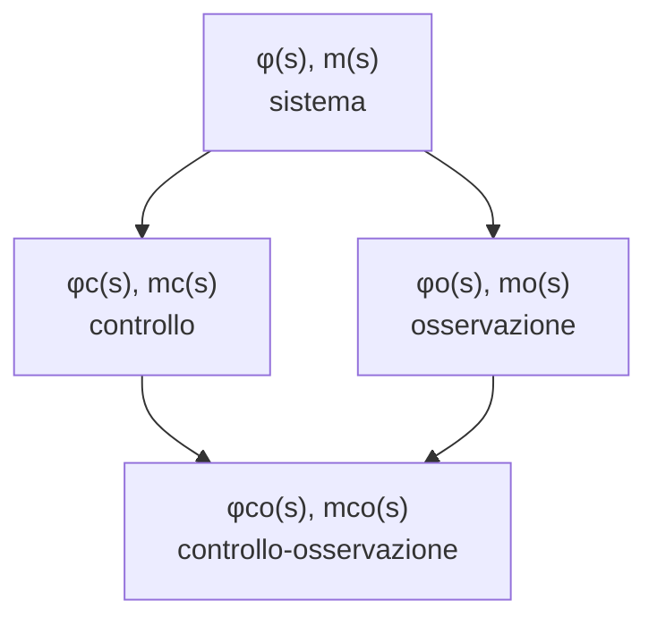

# Lezione 11 — Polinomio caratteristico e polinomio minimo

Questa nota ricostruisce l'undicesima lezione. Le fonti sono la trascrizione della registrazione (parte 1) e la dispensa in inglese del docente (cap. 4, §4.1, formula 4.17 e seguenti). Per questa lezione non sono stati forniti appunti personali.

La registrazione è frammentaria. La parte iniziale e alcuni tratti in cui gli studenti lavoravano da soli contengono solo rumore. In altri punti la trascrizione ripete la stessa frase decine di volte, un difetto della trascrizione automatica. Le matrici degli esempi sono state ricostruite dai passaggi udibili e verificate con il calcolo simbolico. Dove la ricostruzione non è univoca, è segnalato.

La lezione sviluppa un'osservazione della [[Lezione 10 - Equazioni di stato|lezione 10]]: l'inversa $(sI-A)^{-1}$ è una matrice di rapporti di polinomi. Ne nascono due polinomi associati a una matrice, il **polinomio caratteristico** e il **polinomio minimo**. Il docente li estende poi a quattro matrici di funzioni razionali che descrivono il sistema da punti di vista diversi. Sono gli strumenti con cui, nelle lezioni successive, si studieranno le proprietà strutturali: stabilità, controllabilità e osservabilità.

## 1. Riepilogo: trasformare matrici e invertire $sI-A$

Una matrice di funzioni del tempo si trasforma (e si antitrasforma) **elemento per elemento**. Per ottenere $e^{At}$ non serve la serie: basta calcolare $(sI-A)^{-1}$ e antitrasformarne gli elementi.

L'inversa si calcola in generale, senza condizioni particolari su $A$, con la matrice aggiunta:

$$(sI-A)^{-1} = \frac{\operatorname{adj}(sI-A)}{\det(sI-A)} .$$

> [!important] Polinomio caratteristico
> $$\varphi(s) = \det(sI - A)$$
> è il **polinomio caratteristico** della matrice $A$. Se $A$ è $n\times n$, ha grado esattamente $n$, e le sue radici sono gli autovalori di $A$, cioè i poli del sistema.

Come già osservato, $sI-A$ contiene numeri e, sulla diagonale, la variabile $s$. Ogni determinante di una sua sottomatrice è una somma di prodotti, quindi un polinomio: al denominatore non c'è mai niente. Per una matrice $50\times50$ il polinomio caratteristico ha grado $50$. I complementi algebrici sono determinanti di sottomatrici $49\times49$, quindi polinomi di grado al più $49$. Ogni elemento di $(sI-A)^{-1}$ è dunque un rapporto di polinomi **strettamente proprio**: il tipo di oggetto che si sa antitrasformare.

## 2. Il polinomio minimo

### 2.1 Un fattore comune nell'aggiunta

Può capitare che tutti i polinomi dell'aggiunta abbiano un **fattore comune**. Nel caso peggiore il loro massimo comun divisore è $1$, che divide qualunque cosa. Se invece c'è un polinomio non banale $Z(s)$ che divide tutti gli elementi di $\operatorname{adj}(sI-A)$, lo si può raccogliere fuori dalla matrice, perché uno scalare che moltiplica una matrice moltiplica ciascun elemento:

$$(sI-A)^{-1} = \frac{Z(s)\,\overline{\operatorname{adj}}(sI-A)}{\varphi(s)} .$$

Qui $\overline{\operatorname{adj}}$ («aggiunta barrata», per mancanza di un nome migliore) è l'aggiunta dopo aver tolto $Z(s)$ da tutti gli elementi. Il fattore $Z(s)$ divide anche $\varphi(s)$, e semplificandolo:

> [!important] Polinomio minimo
> $$m(s) = \frac{\varphi(s)}{Z(s)}, \qquad (sI-A)^{-1} = \frac{\overline{\operatorname{adj}}(sI-A)}{m(s)},$$
> dove $Z(s)$ è il massimo comun divisore (monico) degli elementi di $\operatorname{adj}(sI-A)$. $m(s)$ è il **polinomio minimo** di $A$. Ha grado al più $n$, e coincide con $\varphi(s)$ quando $Z(s) = 1$.

Il polinomio minimo è quindi il **minimo comune multiplo dei denominatori degli elementi di $(sI-A)^{-1}$**, dopo averli ridotti ai minimi termini (§4).

### 2.2 Il teorema di Cayley-Hamilton

Il polinomio caratteristico ha una proprietà notevole, che il docente chiede di conoscere: è il **teorema di Cayley-Hamilton**.

> [!important] Teorema di Cayley-Hamilton
> Ogni matrice quadrata annulla il proprio polinomio caratteristico. Se $\varphi(s) = s^n + a_{n-1}s^{n-1} + \dots + a_0$, allora
> $$\varphi(A) = A^n + a_{n-1}A^{n-1} + \dots + a_1 A + a_0 I = 0_{n\times n} .$$

Non c'è alcuna ipotesi: data una matrice quadrata, si calcola il suo polinomio caratteristico e lo si valuta in $A$. Valutare un polinomio in una matrice significa sostituire $s$ con $A$. Il termine noto $a_0$ va inteso come $a_0 I$: per sommare matrici quadrate, anche «il numero» deve diventare una matrice quadrata. Il risultato è la matrice nulla, della stessa dimensione di $A$.

Il polinomio minimo ha la stessa proprietà, ed è da qui che prende il nome:

> [!important] Caratterizzazione del polinomio minimo
> $m(s)$ è il polinomio **monico di grado più basso** tale che $m(A) = 0$.

Del polinomio caratteristico si sa sempre il grado, che è $n$. Del polinomio minimo no: dipende da com'è fatta la matrice.

### 2.3 Esempi

> [!example] $A = \begin{bmatrix} -1 & 0\\ 0 & -2\end{bmatrix}$
> $sI-A = \begin{bmatrix} s+1 & 0\\ 0 & s+2\end{bmatrix}$. Il determinante di una matrice diagonale, o triangolare, è il prodotto degli elementi diagonali:
> $$\varphi(s) = (s+1)(s+2) = s^2 + 3s + 2 .$$
> **Verifica di Cayley-Hamilton.** $A^2 = \begin{bmatrix} 1 & 0\\ 0 & 4\end{bmatrix}$, quindi
> $$A^2 + 3A + 2I = \begin{bmatrix} 1 - 3 + 2 & 0\\ 0 & 4 - 6 + 2\end{bmatrix} = \begin{bmatrix} 0 & 0\\ 0 & 0\end{bmatrix}.$$
> **Esiste un polinomio di primo grado che annulla $A$?** $A + wI = \begin{bmatrix} w-1 & 0\\ 0 & w-2\end{bmatrix}$ dovrebbe essere nulla, cioè $w = 1$ e $w = 2$ insieme: impossibile. Quindi $m(s) = \varphi(s)$.
>
> **Con l'aggiunta.** $\operatorname{adj}(sI-A) = \begin{bmatrix} s+2 & 0\\ 0 & s+1\end{bmatrix}$. L'unico fattore che divide sia $s+2$ sia $s+1$ è $1$, quindi $Z(s) = 1$ e $m(s) = \varphi(s)$: lo stesso risultato.

> [!example] $A = \begin{bmatrix} -1 & 1\\ 0 & -1\end{bmatrix}$ e $A = \begin{bmatrix} -1 & 0\\ 0 & -1\end{bmatrix}$
> **Prima matrice.** È triangolare: $\varphi(s) = (s+1)^2 = s^2 + 2s + 1$. Con $A^2 = \begin{bmatrix} 1 & -2\\ 0 & 1\end{bmatrix}$:
> $$A^2 + 2A + I = \begin{bmatrix} 1 - 2 + 1 & -2 + 2 + 0\\ 0 & 1 - 2 + 1\end{bmatrix} = 0 .$$
> Un polinomio di primo grado non basta, perché $A + wI$ ha sempre un $1$ fuori dalla diagonale. L'aggiunta è $\begin{bmatrix} s+1 & 1\\ 0 & s+1\end{bmatrix}$, con massimo comun divisore $1$: $m(s) = \varphi(s) = (s+1)^2$.
>
> **Seconda matrice.** Il docente propone di mettere uno zero al posto dell'$1$ e di rifare tutto. Il determinante è lo stesso, $\varphi(s) = (s+1)^2$: lo zero fuori dalla diagonale non cambia il prodotto degli elementi diagonali. L'aggiunta però è $\begin{bmatrix} s+1 & 0\\ 0 & s+1\end{bmatrix}$, e ora tutti gli elementi non nulli hanno in comune $Z(s) = s+1$. Quindi
> $$m(s) = \frac{(s+1)^2}{s+1} = s+1 .$$
> Infatti qui $A = -I$ e $A + I = 0$: basta un polinomio di primo grado.
>
> Le due matrici hanno lo stesso polinomio caratteristico ma polinomi minimi diversi. Nella prima l'autovalore $-1$ compare con molteplicità $2$ nel polinomio minimo, nella seconda con molteplicità $1$. In termini di $e^{At}$: per la prima compare $t\,e^{-t}$, per la seconda solo $e^{-t}$.

## 3. Quattro matrici, otto polinomi

### 3.1 Le matrici

Il docente osserva che con questo «in realtà si comincia, non si finisce». Il concetto di polinomio caratteristico e polinomio minimo si estende a **matrici di funzioni razionali** qualsiasi, anche **rettangolari**. Al sistema
$$\dot x = Ax + Bu, \qquad y = Cx + Du$$
si associano quattro matrici, ciascuna con il suo significato fisico, e a ciascuna una coppia di polinomi.

| Matrice | Che cosa descrive | Polinomi |
| :--- | :--- | :--- |
| $(sI-A)^{-1}$ | il solo sistema: $A$ non sa nulla dei controlli né delle misure | $\varphi(s)$, $m(s)$: caratteristico e minimo **del sistema** |
| $(sI-A)^{-1}B$ | sistema e controllo: come gli ingressi entrano nello stato | $\varphi_c(s)$, $m_c(s)$: caratteristico e minimo **di controllo** |
| $C(sI-A)^{-1}$ | sistema e misura: che cosa si vede dello stato attraverso le uscite | $\varphi_o(s)$, $m_o(s)$: caratteristico e minimo **di osservazione** |
| $M(s) = C(sI-A)^{-1}B + D$ | relazione ingresso-uscita «ai morsetti», con condizioni iniziali nulle | $\varphi_{co}(s)$, $m_{co}(s)$: caratteristico e minimo **di controllo-osservazione** |

### 3.2 Le relazioni tra i polinomi

Per descrivere i legami il docente usa due simboli di contenimento.

- **Contenuto** ($\subseteq$): un polinomio è un **fattore** dell'altro.
- **Contenuto «col pallino»** ($\overset{\circ}{\subseteq}$): oltre a essere un fattore, ha **le stesse radici**. Ogni valore di $s$ che annulla l'uno annulla anche l'altro, e viceversa. Le radici sono gli stessi punti del piano di Gauss; cambia solo la molteplicità, che nel polinomio contenuto non può essere più alta.

> [!example] Che cosa permette il «pallino»
> Se $\varphi(s) = (s+1)^5(s+2)(s+3)^2$ e $m(s)\overset{\circ}{\subseteq}\varphi(s)$, allora $m(s)$ ha **sicuramente** le radici $-1$, $-2$, $-3$, con molteplicità:
> - per $-1$, tra $1$ e $5$;
> - per $-2$, esattamente $1$;
> - per $-3$, tra $1$ e $2$.
>
> Quali molteplicità abbia davvero non lo dice la relazione: bisogna calcolare $m$.

> [!important] Contenimenti tra i polinomi
> **Orizzontali** (col pallino): ogni polinomio minimo ha le stesse radici del corrispondente caratteristico.
> $$m \overset{\circ}{\subseteq} \varphi, \qquad m_c \overset{\circ}{\subseteq} \varphi_c, \qquad m_o \overset{\circ}{\subseteq} \varphi_o, \qquad m_{co} \overset{\circ}{\subseteq} \varphi_{co} .$$
> **Verticali** (senza pallino, semplici fattori):
> $$\varphi_{co} \subseteq \varphi_c \subseteq \varphi, \qquad \varphi_{co} \subseteq \varphi_o \subseteq \varphi,$$
> e allo stesso modo per i polinomi minimi: $m_{co} \subseteq m_c \subseteq m$, $m_{co} \subseteq m_o \subseteq m$.

Ogni freccia indica che il polinomio in basso è un fattore di quello in alto. Scendendo si possono **perdere** radici: è il punto di partenza dello studio della controllabilità e dell'osservabilità.

## 4. Come si calcolano: le due procedure

Il docente avverte che la descrizione va ripetuta più volte, «finché non viene fuori una frase sensata». Ecco le due regole, valide per **qualunque** matrice di funzioni razionali, quadrata o rettangolare.

> [!important] Procedure di calcolo
> Si riducono prima tutti gli elementi ai minimi termini, semplificando numeratore e denominatore di ciascuno.
> 1. **Polinomio minimo**: il **minimo comune multiplo dei denominatori degli elementi non nulli**.
> 2. **Polinomio caratteristico**: si costruiscono **tutte** le sottomatrici quadrate possibili, di ogni dimensione (non solo le principali), se ne calcolano i determinanti e si prende il **minimo comune multiplo dei denominatori dei determinanti non nulli**.

Le sottomatrici $1\times1$ sono gli elementi stessi, quindi i denominatori usati per il polinomio minimo compaiono anche nel calcolo del caratteristico: è uno dei motivi per cui $m$ è contenuto in $\varphi$.

> [!tip] Matrici riga o colonna
> Se una delle due dimensioni della matrice è $1$ (una riga, una colonna o un singolo elemento), le uniche sottomatrici quadrate sono $1\times1$, cioè gli elementi. Le due procedure coincidono e **polinomio caratteristico e polinomio minimo sono uguali**. Succede, ad esempio, per $(sI-A)^{-1}B$ con un solo ingresso, o per $C(sI-A)^{-1}$ con una sola uscita.

Applicata a $(sI-A)^{-1}$, la seconda procedura restituisce proprio $\det(sI-A)$, coerentemente con la definizione del §1.

## 5. Esempi

> [!example] Esempio 1: $A = \begin{bmatrix} -1 & 1\\ 0 & -2\end{bmatrix}$, $B = \begin{bmatrix} 0\\ 1\end{bmatrix}$, $C = I$
> Le matrici sono ricostruite dai passaggi udibili: $B$ seleziona la seconda colonna, $C$ è l'identità, gli elementi non nulli e il determinante citati.
> $$(sI-A)^{-1} = \begin{bmatrix} \dfrac{1}{s+1} & \dfrac{1}{(s+1)(s+2)}\\[8pt] 0 & \dfrac{1}{s+2}\end{bmatrix}.$$
> - **Sistema.** Minimo comune multiplo dei denominatori non nulli: $m(s) = (s+1)(s+2)$. Il polinomio minimo è un fattore del caratteristico, che per un sistema di ordine $2$ ha grado $2$: non può che essere $\varphi(s) = (s+1)(s+2)$. Lo conferma il calcolo con le sottomatrici: l'unica $2\times2$ ha determinante $\frac{1}{(s+1)(s+2)}$.
> - **Controllo.** $(sI-A)^{-1}B$ è la seconda colonna: un $B$ con $0$ e $1$ fa «$0$ volte la prima colonna più $1$ volta la seconda». È una colonna, quindi $\varphi_c = m_c = (s+1)(s+2)$.
> - **Osservazione.** $C = I$, quindi $C(sI-A)^{-1} = (sI-A)^{-1}$ e $\varphi_o = \varphi$, $m_o = m$.
> - **Controllo-osservazione.** $M(s) = (sI-A)^{-1}B$, una colonna: $\varphi_{co} = m_{co} = (s+1)(s+2)$.
>
> In questo caso tutti i contenimenti sono uguaglianze: tutti gli otto polinomi coincidono.

> [!example] Esempio 2: $A = \begin{bmatrix} 0 & 0 & 0\\ 0 & 0 & 0\\ 0 & 0 & -1\end{bmatrix}$, $C = \begin{bmatrix} 1 & 0 & 0\\ 0 & 0 & 1\end{bmatrix}$
> Ricostruito dai passaggi udibili: matrice diagonale, $C$ che seleziona prima e terza riga, i polinomi risultanti. Il vettore $B$ non si ricava con certezza; qui si usa $B = [1\ \ 1\ \ 1]^\top$, coerente con i risultati detti a lezione.
>
> Una matrice diagonale ha per inversa la matrice diagonale degli inversi:
> $$(sI-A)^{-1} = \begin{bmatrix} \frac{1}{s} & 0 & 0\\ 0 & \frac{1}{s} & 0\\ 0 & 0 & \frac{1}{s+1}\end{bmatrix}.$$
> - **Sistema.** $m(s) = \operatorname{mcm}(s, s, s+1) = s(s+1)$, di grado $2$ e non $3$. Calcolando anche i determinanti delle sottomatrici, ad esempio la $2\times2$ in alto a sinistra con determinante $\frac{1}{s^2}$, si trova $\varphi(s) = s^2(s+1)$, che è proprio $\det(sI-A)$. Il polo $0$ è **doppio** in $\varphi$ ma **semplice** in $m$: le radici sono le stesse, le molteplicità no.
> - **Controllo.** $(sI-A)^{-1}B = \big[\frac{1}{s}\ \ \frac{1}{s}\ \ \frac{1}{s+1}\big]^\top$ è una colonna: $\varphi_c = m_c = s(s+1)$. Qui $\varphi_c$ è contenuto in $\varphi$ con il pallino; in generale sarebbe un semplice fattore.
> - **Osservazione.** $C(sI-A)^{-1}$ è formata dalla prima e dalla terza riga:
> $$C(sI-A)^{-1} = \begin{bmatrix} \frac{1}{s} & 0 & 0\\ 0 & 0 & \frac{1}{s+1}\end{bmatrix}.$$
> $m_o = s(s+1)$. Per $\varphi_o$ servono le sei sottomatrici $1\times1$ e le tre $2\times2$. Quelle con prima e seconda colonna, o con seconda e terza, hanno una colonna di zeri e determinante nullo. Quella con prima e terza colonna ha determinante $\frac{1}{s(s+1)}$. Quindi $\varphi_o = s(s+1)$.
> - **Controllo-osservazione.** $M(s) = \big[\frac{1}{s}\ \ \frac{1}{s+1}\big]^\top$, una colonna: $\varphi_{co} = m_{co} = s(s+1)$.

> [!tip] Collegamento con il seguito del corso
> Un esercizio completo sui polinomi di controllo, con due ingressi considerati prima insieme e poi uno alla volta, è svolto nella [[Lezione 12 - Esercizi sulle equazioni di stato e polinomi di controllo|lezione 12]].

## Domande di autoverifica

Domande nello stile dei «perché» d'esame, con una traccia di risposta.

1. *Perché gli elementi di $(sI-A)^{-1}$ sono rapporti di polinomi strettamente propri?* I complementi algebrici sono determinanti di sottomatrici $(n-1)\times(n-1)$, quindi polinomi di grado al più $n-1$; il denominatore $\det(sI-A)$ ha grado $n$.
2. *Che cosa dice il teorema di Cayley-Hamilton?* Che ogni matrice quadrata annulla il proprio polinomio caratteristico: $\varphi(A) = 0$.
3. *Perché $A = -I$ ha polinomio minimo $s+1$ anche se $\varphi(s) = (s+1)^2$?* Tutti gli elementi dell'aggiunta hanno il fattore comune $s+1$. Equivalentemente, $A + I = 0$: un polinomio di primo grado basta ad annullarla.
4. *Che cosa significa che $m(s)$ è contenuto «col pallino» in $\varphi(s)$?* Che è un fattore di $\varphi(s)$ con esattamente le stesse radici, ciascuna con molteplicità non superiore.
5. *Perché per una matrice colonna polinomio caratteristico e minimo coincidono?* Le uniche sottomatrici quadrate sono gli elementi, quindi le due procedure considerano gli stessi denominatori.
6. *Che differenza c'è tra $(sI-A)^{-1}$ e $(sI-A)^{-1}B$ dal punto di vista fisico?* La prima descrive il solo sistema; la seconda tiene conto anche di come gli ingressi agiscono sullo stato.
